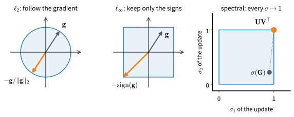

# Muon
:label:`sec_muon`

Every optimizer examined so far—SGD, Momentum, and AdamW—treats the parameters of a neural network as an unstructured flat vector. Even AdamW maintains two scalar averages $(m_{t,ij}, v_{t,ij})$ independently for each entry $W_{ij}$ of a weight matrix $\mathbf{W}$: if the entries of $\mathbf{W}$ were arbitrarily permuted, AdamW would take the exact same steps.

Yet more than $80\%$ of the parameters in a Transformer reside in two-dimensional hidden projection matrices $\mathbf{W} \in \mathbb{R}^{m \times n}$ that act as linear operators mapping layer activations $\mathbf{x} \in \mathbb{R}^n$ to $\mathbf{y} = \mathbf{W}\mathbf{x} \in \mathbb{R}^m$. What is the direction of steepest descent for a weight matrix *viewed as a linear operator*?

As :citet:`Bernstein.Newhouse.2024` emphasize, steepest descent is defined relative to the norm chosen to bound the update step. Measuring the step in the Euclidean ($\ell_2$) norm yields the raw gradient direction of SGD; measuring it in the coordinate-wise $\ell_\infty$ box norm yields sign descent, the memoryless limit of Adam. If instead we bound the maximum change that an update $\Delta\mathbf{W}$ can induce in the layer output $\|\Delta\mathbf{W}\mathbf{x}\|_2 / \|\mathbf{x}\|_2$—which is the **spectral norm** $\|\Delta\mathbf{W}\|_2$—the direction of steepest descent replaces every nonzero singular value of the gradient matrix with $1$, yielding the **orthogonalized gradient** $\mathbf{U}\mathbf{V}^\top$.

Computing an exact Singular Value Decomposition (SVD) at every step is too slow for GPUs, but a five-step odd matrix polynomial (**Newton–Schulz iteration**) approximates $\mathbf{U}\mathbf{V}^\top$ using only matrix multiplications. Applied to Nesterov momentum buffers on hidden 2D weight matrices (while leaving embeddings, 1D parameters, and the output head to AdamW), this yields **Muon** (*Momentum Orthogonalized by Newton–Schulz*, :citet:`Jordan.Jin.Boza.ea.2024`). In this section, we derive steepest descent across the Euclidean, $\ell_\infty$, and spectral norm balls, analyze the tuned quintic Newton–Schulz iteration, implement the hybrid Muon+AdamW optimizer from scratch, and benchmark it against AdamW on `TinyLM`.

```{.python .input #muon}
%%tab pytorch
import math
import numpy as np
import torch
from torch import nn
from torch.nn import functional as F
from d2l import torch as d2l
```

```{.python .input #muon}
%%tab jax
import math
import numpy as np
import jax
from jax import numpy as jnp
from flax import nnx
import optax
from d2l import jax as d2l
```

```{.python .input #muon-1}
%%tab pytorch
import random
```

## Norms and Steepest Descent

### Steepest Descent in a Norm Ball

Given the first-order Taylor expansion $f(\mathbf{x} + \mathbf{d}) \approx f(\mathbf{x}) + \langle \mathbf{g}, \mathbf{d} \rangle$ with gradient $\mathbf{g} = \nabla f(\mathbf{x})$, the steepest descent step of radius $\eta > 0$ under a norm $\|\cdot\|$ solves

$$
\mathbf{d}^\star = \operatorname*{argmin}_{\|\mathbf{d}\| \leq \eta} \; \langle \mathbf{g}, \mathbf{d} \rangle.
$$
:eqlabel:`eq_muon-ball`

Different norm geometries yield fundamentally different update directions :cite:`Bernstein.Newhouse.2024` (:numref:`fig_opt_norm_balls` and :numref:`tab_muon_norms`):

1. **Euclidean ball ($\|\mathbf{d}\|_2 \le \eta$):** By Cauchy–Schwarz, the minimizer aligns with the negative gradient, $\mathbf{d}^\star = -\eta\,\mathbf{g}/\|\mathbf{g}\|_2$, decreasing the linearized objective by $\eta\|\mathbf{g}\|_2$ (the direction of SGD).
2. **Coordinate box ($\|\mathbf{d}\|_\infty = \max_i |d_i| \le \eta$):** Minimizing $\sum_i g_i d_i$ subject to $|d_i| \le \eta$ pushes every coordinate to its boundary, $\mathbf{d}^\star = -\eta\,\operatorname{sign}(\mathbf{g})$, decreasing the linearized objective by the dual $\ell_1$ norm $\eta\|\mathbf{g}\|_1$. This is sign descent, the zero-memory ($\beta_1 = \beta_2 = 0$) limit of Adam (:numref:`sec_adam`).

### Matrices and the Spectral Norm

For a hidden weight matrix $\mathbf{W} \in \mathbb{R}^{m \times n}$ mapping $\mathbf{x} \mapsto \mathbf{W}\mathbf{x}$, a perturbation $\Delta\mathbf{W}$ shifts the output by $\|\Delta\mathbf{W}\mathbf{x}\|_2 \le \|\Delta\mathbf{W}\|_2 \|\mathbf{x}\|_2$, where $\|\Delta\mathbf{W}\|_2 = \sigma_1(\Delta\mathbf{W})$ is the **spectral norm** (operator norm, :numref:`subsec_lin-alg-eigenvalues`). Let the gradient matrix $\mathbf{G} \in \mathbb{R}^{m \times n}$ have reduced Singular Value Decomposition (:numref:`sec_mdl-svd-low-rank`)

$$
\mathbf{G} = \mathbf{U} \boldsymbol{\Sigma} \mathbf{V}^\top = \sum_{i=1}^r \sigma_i\, \mathbf{u}_i \mathbf{v}_i^\top,
$$

where $\mathbf{U} \in \mathbb{R}^{m \times r}$ and $\mathbf{V} \in \mathbb{R}^{n \times r}$ have orthonormal columns and $\sigma_1 \ge \cdots \ge \sigma_r > 0$. Notice that the Frobenius norm $\|\mathbf{G}\|_F = \sqrt{\sum_i \sigma_i^2}$ (the Euclidean norm of the flattened matrix) can exceed the spectral norm $\sigma_1$ by up to $\sqrt{\min(m, n)}$ when singular values are comparable.

Solving :eqref:`eq_muon-ball` under the spectral norm constraint $\|\Delta\mathbf{W}\|_2 \le \eta$ yields the **orthogonalized gradient**:

$$
\Delta \mathbf{W}^\star = \operatorname*{argmin}_{\|\Delta \mathbf{W}\|_2 \leq \eta} \; \langle \mathbf{G}, \Delta \mathbf{W} \rangle = -\eta\, \mathbf{U} \mathbf{V}^\top,
$$
:eqlabel:`eq_muon-spectral-step`

which sets every nonzero singular value of $\mathbf{G}$ to $1$. The proof is immediate: for any $\mathbf{A}$ with $\|\mathbf{A}\|_2 \le 1$, cyclic trace invariance gives

$$
\langle \mathbf{G}, \mathbf{A} \rangle = \operatorname{tr}(\mathbf{G}^\top \mathbf{A}) = \operatorname{tr}(\boldsymbol{\Sigma}\, \mathbf{U}^\top \mathbf{A} \mathbf{V}) = \sum_{i=1}^r \sigma_i\, (\mathbf{U}^\top \mathbf{A} \mathbf{V})_{ii} \leq \sum_{i=1}^r \sigma_i,
$$

since $\|(\mathbf{U}^\top \mathbf{A} \mathbf{V})\|_2 \le \|\mathbf{A}\|_2 \le 1$ implies $|(\mathbf{U}^\top \mathbf{A} \mathbf{V})_{ii}| \le 1$ (Exercise :exref:`ex_muon-diagonal-entry`). Setting $\mathbf{A} = -\mathbf{U}\mathbf{V}^\top$ makes $\mathbf{U}^\top\mathbf{A}\mathbf{V} = -\mathbf{I}_r$, achieving the minimum $-\eta\sum_i \sigma_i = -\eta\|\mathbf{G}\|_*$ (the dual **nuclear norm**).


:label:`fig_opt_norm_balls`

Whereas Adam equalizes update magnitudes across *individual matrix entries* (which can still collapse onto a rank-$1$ direction, as $\operatorname{sign}\!\begin{bmatrix}3 & 1\\ 1 & 1\end{bmatrix} = \begin{bmatrix}1 & 1\\ 1 & 1\end{bmatrix}$ has singular values $2$ and $0$), spectral steepest descent $-\eta\mathbf{U}\mathbf{V}^\top$ moves with equal step size $\eta$ along every active singular direction $(\mathbf{u}_i, \mathbf{v}_i)$ of the gradient.

:Steepest descent under three norm geometries.
:label:`tab_muon_norms`

| Norm ball on update | Steepest direction | Linearized decrease (dual norm) | Suited parameter group |
|:--|:--|:--|:--|
| Euclidean ($\|\mathbf{d}\|_2 \leq \eta$) | $-\eta\, \mathbf{g} / \|\mathbf{g}\|_2$ | $\eta\, \|\mathbf{g}\|_2$ | Unstructured vector (SGD) |
| Coordinate box ($\|\mathbf{d}\|_\infty \leq \eta$) | $-\eta\, \mathrm{sign}(\mathbf{g})$ | $\eta\, \|\mathbf{g}\|_1$ | Heterogeneous coordinates / embeddings (AdamW) |
| Spectral ($\|\Delta \mathbf{W}\|_2 \leq \eta$) | $-\eta\, \mathbf{U}\mathbf{V}^\top$ | $\eta \|\mathbf{G}\|_* = \eta \sum_i \sigma_i$ | Dense 2D hidden weight matrices (Muon) |

### Connection to Matrix Preconditioners (Shampoo) and Parameter Partitioning

The orthogonalized gradient $\mathbf{U}\mathbf{V}^\top$ also arises as the zero-memory limit of Kronecker-factored matrix preconditioning. **Shampoo** :cite:`Gupta.Koren.Singer.2018` accumulates left and right Gram matrices $\mathbf{L}_t = \sum_{s \le t} \mathbf{G}_s \mathbf{G}_s^\top$ and $\mathbf{R}_t = \sum_{s \le t} \mathbf{G}_s^\top \mathbf{G}_s$ and preconditions the gradient via $\mathbf{L}_t^{-1/4}\mathbf{G}_t\mathbf{R}_t^{-1/4}$. Evaluated on a single gradient $\mathbf{G} = \mathbf{U}\boldsymbol{\Sigma}\mathbf{V}^\top$ without historical accumulation, the singular values cancel identically:

$$
(\mathbf{G}\mathbf{G}^\top)^{-1/4}\, \mathbf{G}\, (\mathbf{G}^\top\mathbf{G})^{-1/4} = \mathbf{U}\boldsymbol{\Sigma}^{-1/2}\mathbf{U}^\top \cdot \mathbf{U}\boldsymbol{\Sigma}\mathbf{V}^\top \cdot \mathbf{V}\boldsymbol{\Sigma}^{-1/2}\mathbf{V}^\top = \mathbf{U}\mathbf{V}^\top.
$$
:eqlabel:`eq_muon-shampoo`

By applying orthogonalization to a standard first-moment momentum buffer rather than storing and inverting $\mathbf{L}_t$ and $\mathbf{R}_t$, Muon captures full-matrix preconditioning with only a single momentum buffer per matrix (:numref:`subsec_mdl-preconditioning-ladder`).

Because the spectral-norm geometry applies specifically to dense linear maps between activation spaces, Muon is applied **only to hidden 2D weight matrices** (attention `qkv`/`proj` and MLP weights). Embedding tables (which perform one-hot row lookups), 1D biases and LayerNorm scales, and the final vocabulary readout head are optimized with AdamW :cite:`Jordan.Jin.Boza.ea.2024`.

## Orthogonalization by Newton–Schulz
:label:`subsec_muon-newton-schulz`

Computing $\mathbf{U}\mathbf{V}^\top$ via an explicit SVD is prohibitively slow during training. Instead, observe that any **odd matrix polynomial** acts independently on the singular values of $\mathbf{X} = \mathbf{U}\boldsymbol{\Sigma}\mathbf{V}^\top$ while preserving its singular vectors:

$$
p(\mathbf{X}) = a\mathbf{X} + b\,(\mathbf{X}\mathbf{X}^\top)\mathbf{X} + c\,(\mathbf{X}\mathbf{X}^\top)^2\mathbf{X} = \mathbf{U}\, p(\boldsymbol{\Sigma})\, \mathbf{V}^\top,
$$
:eqlabel:`eq_muon-odd-poly`

since $\mathbf{X}\mathbf{X}^\top = \mathbf{U}\boldsymbol{\Sigma}^2\mathbf{U}^\top$. Normalizing $\mathbf{X} \leftarrow \mathbf{X} / \|\mathbf{X}\|_F$ first ensures that all singular values lie in $[0, 1]$. Iterating an odd scalar polynomial $p(x)$ that maps $(0, 1]$ toward $1$—a **Newton–Schulz iteration** (:numref:`subsec_mdl-orthogonalized-updates`)—therefore orthogonalizes $\mathbf{X}$ using only fast matrix multiplications.

Rather than the classical cubic $p(x) = \frac{3}{2}x - \frac{1}{2}x^3$ (whose small slope $p'(0) = 1.5$ lifts small singular values too slowly over $5$ steps), :citet:`Jordan.Jin.Boza.ea.2024` use a tuned quintic polynomial with a steep initial slope $p'(0) = 3.4445$:

$$
p(x) = 3.4445\,x - 4.7750\,x^3 + 2.0315\,x^5.
$$
:eqlabel:`eq_muon-quintic`

As shown in :numref:`fig_opt_ns_maps`, five compositions of :eqref:`eq_muon-quintic` lift every singular value in $[0.01, 1]$ into the narrow band $[0.68, 1.13]$ (and every singular value above $0.0015$ to at least $0.68$), trading exact asymptotic convergence to $1$ for rapid $5$-step inflation of small singular directions.

![Newton–Schulz polynomials acting on singular values. Left: single application of the classical cubic vs. the tuned quintic :eqref:`eq_muon-quintic`. Right: five composed iterations on $[10^{-3}, 1]$ (alongside the multi-polynomial Polar Express variant :cite:`Amsel.Persson.Musco.ea.2026`).](../img/mdl-opt-ns-maps.svg)
:label:`fig_opt_ns_maps`

```{.python .input #muon-orthogonalization-by-newton-schulz-1}
%%tab pytorch
def newton_schulz(M, num_iters=5, a=3.4445, b=-4.7750, c=2.0315, eps=1e-7):
    """Approximate the orthogonalization U V^T of M by num_iters steps of
    the odd polynomial a x + b x^3 + c x^5 (Jordan et al.'s tuned quintic)."""
    tall = M.shape[0] > M.shape[1]
    X = M.T if tall else M  # Keep the Gram factor X @ X.T small
    X = X / (X.norm() + eps)
    for _ in range(num_iters):
        A = X @ X.T
        X = a * X + (b * A + c * A @ A) @ X
    return X.T if tall else X
```

```{.python .input #muon-orthogonalization-by-newton-schulz-1}
%%tab jax
def newton_schulz(M, num_iters=5, a=3.4445, b=-4.7750, c=2.0315, eps=1e-7):
    """Approximate the orthogonalization U V^T of M by num_iters steps of
    the odd polynomial a x + b x^3 + c x^5 (Jordan et al.'s tuned quintic)."""
    tall = M.shape[0] > M.shape[1]
    X = M.T if tall else M  # Keep the Gram factor X @ X.T small
    X = X / (jnp.linalg.norm(X) + eps)
    for _ in range(num_iters):
        A = X @ X.T
        X = a * X + (b * A + c * A @ A) @ X
    return X.T if tall else X
```

For an $m \times n$ matrix ($m \le n$) and token batch size $B$, five Newton–Schulz iterations cost $5(4m^2n + 2m^3)$ FLOPs compared to $6mnB$ FLOPs for the forward and backward passes—an overhead of $\sim 5m/B$ ($<1\%$ at production batch sizes $B \sim 5 \times 10^5$, and $\sim 12\%$ on `TinyLM` at $B = 4{,}096$). Applying `newton_schulz` to a $96 \times 64$ Gaussian matrix illustrates how the iterations collapse the singular value spectrum: into $[0.68, 1.20]$ after $k = 3$ and $[0.68, 1.13]$ after $k = 5$:

```{.python .input #muon-orthogonalization-by-newton-schulz-2}
%%tab pytorch
G = torch.randn(96, 64)
sigmas = [torch.linalg.svdvals(newton_schulz(G, num_iters=k))
          for k in (0, 1, 3, 5)]
d2l.plot(torch.arange(1, 65), sigmas, 'index', 'singular value',
         legend=[f'k = {k}' for k in (0, 1, 3, 5)], yscale='log')
for k, sigma in zip((3, 5), sigmas[2:]):
    print(f'after {k} iterations: [{sigma.min():.2f}, {sigma.max():.2f}]')
```

```{.python .input #muon-orthogonalization-by-newton-schulz-2}
%%tab jax
G = jax.random.normal(d2l.get_key(), (96, 64))
sigmas = [jnp.linalg.svd(newton_schulz(G, num_iters=k), compute_uv=False)
          for k in (0, 1, 3, 5)]
d2l.plot(jnp.arange(1, 65), sigmas, 'index', 'singular value',
         legend=[f'k = {k}' for k in (0, 1, 3, 5)], yscale='log')
for k, sigma in zip((3, 5), sigmas[2:]):
    print(f'after {k} iterations: [{sigma.min():.2f}, {sigma.max():.2f}]')
```

On real network gradients, two details work in Muon's favor: first, Muon orthogonalizes the Nesterov momentum buffer $\mathbf{G}_t + \beta\mathbf{M}_t$ (averaged over $\sim 1/(1-\beta) = 20$ steps at $\beta = 0.95$) rather than a noisy single-batch gradient; second, any singular value below $0.15\%$ of the Frobenius norm (where $3.4445^5 \approx 485$ is insufficient to reach $0.68$) is amplified linearly rather than pushed all the way to $1$, naturally damping pure noise directions in the trailing spectrum.

## Muon from Scratch

### The Update and RMS Alignment

For an $m \times n$ hidden weight matrix $\mathbf{W}$ with gradient $\mathbf{G}_t$, Muon updates the momentum buffer $\mathbf{M}_t$ ($\beta = 0.95$) and applies five Newton–Schulz iterations $\mathrm{NS}_5$ to the Nesterov look-ahead gradient $\mathbf{G}_t + \beta\mathbf{M}_t$, combined with decoupled weight decay :cite:`Liu.Su.Yao.ea.2025`:

$$
\mathbf{M}_t = \beta\, \mathbf{M}_{t-1} + \mathbf{G}_t,
\qquad
\mathbf{W}_{t+1} = (1 - \eta\lambda)\, \mathbf{W}_t - \eta \cdot 0.2 \sqrt{\max(m, n)}\; \mathrm{NS}_5(\mathbf{G}_t + \beta\, \mathbf{M}_t).
$$
:eqlabel:`eq_muon-update`

Why multiply by $0.2\sqrt{\max(m, n)}$? An orthogonal $m \times n$ matrix $\mathbf{U}\mathbf{V}^\top$ has $\min(m, n)$ unit singular values, Frobenius norm $\sqrt{\min(m, n)}$, and entrywise RMS $\sqrt{\min(m, n)/(mn)} = 1/\sqrt{\max(m, n)}$. Multiplying by $0.2\sqrt{\max(m, n)}$ gives the update an entrywise RMS of $0.2\,\eta$ regardless of matrix dimensions—matching the empirical $\sim 0.2\,\eta$ entrywise RMS step of AdamW measured in :numref:`sec_adam` so that both optimizers can share the same learning rate $\eta$ and weight decay $\lambda$ :cite:`Liu.Su.Yao.ea.2025`.

```{.python .input #muon-the-update}
%%tab pytorch
class Muon(torch.optim.Optimizer):
    """Steepest descent under the spectral norm: orthogonalized momentum."""
    def __init__(self, params, lr, momentum=0.95, weight_decay=0.0):
        super().__init__(params, dict(lr=lr, momentum=momentum,
                                      weight_decay=weight_decay))

    @torch.no_grad()
    def step(self):
        for group in self.param_groups:
            for p in group['params']:
                if p.grad is None:  # A parameter that received no gradient
                    continue
                state = self.state[p]
                if not state:  # First step: allocate the momentum buffer
                    state['buf'] = torch.zeros_like(p)
                buf = state['buf'].mul_(group['momentum']).add_(p.grad)
                G = p.grad + group['momentum'] * buf  # Nesterov momentum
                M = G.reshape(len(G), -1)             # Flattens conv kernels
                O = newton_schulz(M).reshape(p.shape)
                rms_scale = 0.2 * math.sqrt(max(M.shape))  # AdamW's RMS
                p.mul_(1 - group['lr'] * group['weight_decay'])  # Decoupled
                p.add_(O, alpha=-group['lr'] * rms_scale)
```

```{.python .input #muon-the-update}
%%tab jax
def scale_by_muon(momentum=0.95):
    """Orthogonalized Nesterov momentum, scaled to AdamW's update RMS."""
    def init(params):
        return jax.tree.map(jnp.zeros_like, params)
    def update(grads, bufs, params=None):
        bufs = jax.tree.map(lambda b, g: momentum * b + g, bufs, grads)
        def direction(g, b):
            G = g + momentum * b            # Nesterov momentum
            M = G.reshape(-1, G.shape[-1])  # Flattens conv kernels
            O = newton_schulz(M).reshape(G.shape)
            return 0.2 * math.sqrt(max(M.shape)) * O  # AdamW's RMS
        return jax.tree.map(direction, grads, bufs), bufs
    return optax.GradientTransformation(init, update)

def scratch_muon(learning_rate, momentum=0.95, weight_decay=0.0):
    return optax.chain(scale_by_muon(momentum),
                       optax.add_decayed_weights(weight_decay),  # Decoupled
                       optax.scale_by_learning_rate(learning_rate))
```

### Parameter Groups and Hybrid Optimizer
:label:`subsec_muon-parameter-groups`

On `TinyLM`, routing the $8$ internal block matrices (`qkv`, `proj`, `mlp1`, `mlp2` across $2$ blocks) to Muon and the remaining $22$ tensors (embeddings, LayerNorm vectors, biases, and output head) to AdamW assigns $393{,}216$ of the $470{,}784$ parameters ($84\%$) to Muon. Because Muon stores only one momentum buffer per parameter instead of AdamW's two moments, the hybrid optimizer reduces total optimizer-state memory by $42\%$.

```{.python .input #muon-dividing-the-census-1}
%%tab pytorch
data = d2l.WikiText103(batch_size=64, num_steps=64)

def split_lm(model):
    hidden, rest = [], []
    for name, p in model.named_parameters():
        is_hidden = p.ndim == 2 and 'emb' not in name and 'head' not in name
        (hidden if is_hidden else rest).append(p)
    return hidden, rest

hidden, rest = split_lm(d2l.TinyLM(len(data.vocab)))
print(f'Muon:  {len(hidden):>2} tensors, '
      f'{sum(p.numel() for p in hidden):>7} parameters')
print(f'AdamW: {len(rest):>2} tensors, '
      f'{sum(p.numel() for p in rest):>7} parameters')
```

```{.python .input #muon-dividing-the-census-1}
%%tab jax
data = d2l.WikiText103(batch_size=64, num_steps=64)

def muon_labels(params):
    """'muon' for the hidden matrices, 'adamw' for every other parameter."""
    def label(path, p):
        name = jax.tree_util.keystr(path)
        is_hidden = p.ndim == 2 and 'emb' not in name and 'head' not in name
        return 'muon' if is_hidden else 'adamw'
    return jax.tree_util.tree_map_with_path(label, params)

model = d2l.TinyLM(len(data.vocab), rngs=nnx.Rngs(d2l.get_key()))
params = nnx.state(model, nnx.Param)
labels = jax.tree.leaves(muon_labels(params))
for group, name in (('muon', 'Muon'), ('adamw', 'AdamW')):
    sizes = [p.size for p, label in zip(jax.tree.leaves(params), labels)
             if label == group]
    print(f'{name + ":":<6} {len(sizes):>2} tensors, {sum(sizes):>7} '
          'parameters')
```

```{.python .input #muon-dividing-the-census-2}
%%tab pytorch
class MultiOptimizer:
    """Apply independent optimizers to disjoint parameter groups."""
    def __init__(self, *optimizers):
        self.optimizers = optimizers

    def step(self):
        for opt in self.optimizers:
            opt.step()

    def zero_grad(self):
        for opt in self.optimizers:
            opt.zero_grad()

def muon_adamw(hidden, rest, lr, weight_decay):
    """Muon with decoupled weight decay on hidden, AdamW without it on rest."""
    return MultiOptimizer(Muon(hidden, lr, weight_decay=weight_decay),
                          torch.optim.AdamW(rest, lr, weight_decay=0.0))
```

```{.python .input #muon-dividing-the-census-2}
%%tab jax
def muon_adamw(lr, weight_decay):
    """Muon with decoupled weight decay on the hidden matrices, AdamW without
    it on the rest."""
    return optax.multi_transform(
        {'muon': scratch_muon(lr, weight_decay=weight_decay),
         'adamw': optax.adamw(lr, weight_decay=0.0)}, muon_labels)
```

### Comparison with AdamW
:label:`subsec_muon-comparison`

We benchmark the Muon+AdamW hybrid against standard AdamW across $\eta \in \{10^{-3}, 3 \times 10^{-3}, 10^{-2}, 3 \times 10^{-2}, 10^{-1}\}$ with $\lambda = 0.1$ on the hidden matrices for $2{,}000$ steps from shared initial weights, evaluating validation loss every $250$ steps:

```{.python .input #muon-the-race-on-the-language-model-1}
%%tab pytorch
def val_loss(model):
    """Mean cross-entropy per byte over the validation split."""
    return math.log(d2l.lm_perplexity(model, data.val_dataloader()))

def run_lm(make_optimizer, lrs, seed):
    """d2l.lr_sweep of TinyLM, validated every 250 steps."""
    return d2l.lr_sweep(lambda: d2l.TinyLM(len(data.vocab)), make_optimizer,
                        data, lrs, seed, evaluate=val_loss,
                        metric='validation loss', every=250)

lrs, wd = [1e-3, 3e-3, 1e-2, 3e-2, 1e-1], 0.1

def adamw(model, lr):  # Decay on the hidden matrices only, as for Muon
    hidden, rest = split_lm(model)
    return torch.optim.AdamW([{'params': hidden, 'weight_decay': wd},
                              {'params': rest, 'weight_decay': 0.0}], lr=lr)

seed = random.getrandbits(32)  # One draw, shared by every run below
adamw_lm, adamw_val = run_lm(adamw, lrs, seed)
```

```{.python .input #muon-the-race-on-the-language-model-1}
%%tab jax
def val_loss(model):
    """Mean cross-entropy per byte over the validation split."""
    return math.log(d2l.lm_perplexity(model, data.val_dataloader()))

def run_lm(make_tx, lrs, seed):
    """d2l.lr_sweep of TinyLM, validated every 250 steps."""
    return d2l.lr_sweep(lambda rngs: d2l.TinyLM(len(data.vocab), rngs=rngs),
                        make_tx, data, lrs, seed, evaluate=val_loss,
                        metric='validation loss', every=250)

def hidden_only(params):  # Decay on the hidden matrices only, as for Muon
    return jax.tree.map(lambda label: label == 'muon', muon_labels(params))

seed = d2l.get_seed()  # One draw, shared by every run below
lrs, wd = [1e-3, 3e-3, 1e-2, 3e-2, 1e-1], 0.1
adamw_lm, adamw_val = run_lm(
    lambda lr: optax.adamw(lr, weight_decay=wd, mask=hidden_only), lrs, seed)
```

```{.python .input #muon-the-race-on-the-language-model-2}
%%tab pytorch
muon_lm, muon_val = run_lm(
    lambda model, lr: muon_adamw(*split_lm(model), lr, wd), lrs, seed)
```

```{.python .input #muon-the-race-on-the-language-model-2}
%%tab jax
muon_lm, muon_val = run_lm(lambda lr: muon_adamw(lr, wd), lrs, seed)
```

```{.python .input #muon-the-race-on-the-language-model-3}
%%tab pytorch, jax
best_adamw = min(adamw_val, key=lambda lr: adamw_val[lr][-1])
best_muon = min(muon_val, key=lambda lr: muon_val[lr][-1])
d2l.plot([list(range(0, 2000, 25))] * 2 + [list(range(250, 2001, 250))] * 2,
         [d2l.smooth(adamw_lm[best_adamw]), d2l.smooth(muon_lm[best_muon]),
          adamw_val[best_adamw], muon_val[best_muon]], 'step', 'loss',
         legend=['AdamW, training', 'Muon + AdamW, training',
                 'AdamW, validation', 'Muon + AdamW, validation'],
         fmts=('C0-', 'C1-', 'C0o--', 'C1o--'), ylim=(1.4, 2.6),
         figsize=(5, 3.5))
print('validation loss  lr     step 500  step 2000  below 1.6  within 0.15')
for name, lr, vals in [('AdamW', best_adamw, adamw_val),
                       ('Muon+AdamW', best_muon, muon_val)]:
    below = d2l.steps_to_reach(vals[lr], 1.6, k=1)  # Checkpoint 1, 2, ...
    near = [r for r in lrs if vals[r][-1] < vals[lr][-1] + 0.15]
    print(f'{name:<16} {lr:<6g} {vals[lr][1]:<9.3f} {vals[lr][-1]:<10.3f} '
          f'{250 * below if below else "never":<10} '
          f'{near[0]:g} to {near[-1]:g}')
```

On `TinyLM`, Muon+AdamW establishes a $>0.1$-nat validation lead at step $500$, crosses the $1.6$-nat threshold at least one checkpoint ($250$ steps) earlier than AdamW, and expands the usable learning-rate window up to $\eta = 3 \times 10^{-2}$ (where AdamW finishes near or above $2$ nats because rank-$1$ early gradients under entrywise normalization can have spectral norm $\sqrt{\min(m, n)}$ times larger than an orthogonalized update). In large-scale pretraining benchmarks with full learning-rate decay ($0.1\text{B}\text{--}1.2\text{B}$ parameters :cite:`Wen.Hall.Ma.ea.2025` and trillion-parameter runs such as Kimi K2 :cite:`Liu.Su.Yao.ea.2025,Kimi.Team.2025`, often paired with attention-logit clipping), Muon achieves $1.1\times\text{--}1.4\times$ step reductions over heavily tuned AdamW while cutting optimizer state memory nearly in half.

## Summary

* Steepest descent depends on the norm ball bounding the update: the $\ell_2$ ball gives SGD, the $\ell_\infty$ box gives sign descent (smoothed by Adam), and the spectral norm ball $\|\Delta\mathbf{W}\|_2 \le \eta$ gives the orthogonalized gradient $-\eta\mathbf{U}\mathbf{V}^\top$.
* **Muon** approximates $\mathbf{U}\mathbf{V}^\top$ on the Nesterov momentum buffer of each hidden 2D weight matrix via $5$ iterations of a tuned quintic Newton–Schulz polynomial :eqref:`eq_muon-quintic`, scales the update by $0.2\sqrt{\max(m, n)}$ to match AdamW's entrywise RMS step size, and applies decoupled weight decay while leaving embeddings, 1D vectors, and the readout head to AdamW.
* On `TinyLM`, the Muon+AdamW hybrid accelerates early convergence, remains stable at $3\times$ higher learning rates than AdamW, and reduces optimizer-state memory by $42\%$.

## Exercises

1. **Diagonal-entry bound and uniqueness of the spectral step.** Let $\mathbf{U} \in \mathbb{R}^{m \times r}$ and $\mathbf{V} \in \mathbb{R}^{n \times r}$ have orthonormal columns. Show that $\|\mathbf{U}^\top\mathbf{A}\mathbf{V}\|_2 \le \|\mathbf{A}\|_2$ and $|(\mathbf{U}^\top\mathbf{A}\mathbf{V})_{ii}| \le \|\mathbf{A}\|_2$, and determine when the minimizer $\Delta\mathbf{W}^\star = -\eta\mathbf{U}\mathbf{V}^\top$ in :eqref:`eq_muon-spectral-step` is unique.
   :exlabel:`ex_muon-diagonal-entry`

1. [code] **Empirical update RMS and singular value spectrum.** Instrument `Muon` on `TinyLM` to track the entrywise RMS of $\Delta\mathbf{W} / \eta$ across $2{,}000$ steps and compare the singular value spectrum of a single minibatch gradient $\mathbf{G}_t$ against the momentum buffer $\mathbf{M}_t$ at step $0$ and step $500$.
   :exlabel:`ex_muon-step-size`

1. [code] **Newton–Schulz iteration count and polynomial degree.** Compare `num_iters` $\in \{1, 3, 5, 10\}$ with the tuned quintic :eqref:`eq_muon-quintic` against $5$ iterations of the classical cubic $p(x) = 1.5x - 0.5x^3$ on `TinyLM`, reporting validation loss and wall-clock step time.
   :exlabel:`ex_muon-iterations`

1. [code] **Why embeddings remain with AdamW.**
   :exlabel:`ex_muon-embeddings`
    1. If an $m \times n$ gradient matrix $\mathbf{M}$ has only $r \le n$ nonzero linearly independent rows (corresponding to $r$ distinct tokens in a minibatch), show that every active row of $\mathbf{U}\mathbf{V}^\top$ has unit $\ell_2$ norm regardless of whether its token occurred once or $500$ times.
    1. Move `token_emb` into the Muon parameter group on `TinyLM` and verify empirically that validation perplexity degrades compared to keeping `token_emb` in the AdamW group.

[Discussions](https://d2l.discourse.group/t/36764)

<!-- slides -->

::: {.slide}
::: {.cover}
[Dive into Deep Learning · §9.6]{.kicker}

Matrix Preconditioning and Muon<br>**steepest descent under norm balls · spectral norm & UVᵀ · Newton–Schulz quintic · RMS alignment · Muon+AdamW hybrid**
:::
:::

::: {.slide title="Weight Matrices Are Linear Operators, Not Flat Vectors"}
[Motivation]{.kicker}

Every optimizer studied so far—SGD, Momentum, and AdamW—treats a network's parameters as an unstructured flat vector in $\mathbb{R}^d$:

- **Permutation blindness of entrywise methods:** Even AdamW maintains two scalar moments $(m_{t,ij}, v_{t,ij})$ independently for each entry $W_{ij}$ of a weight matrix $\mathbf{W}$. If you arbitrarily shuffled the entries of $\mathbf{W}$, AdamW would take the exact same steps!
- **Operator structure in Transformers:** Yet $84\%$ of `TinyLM`'s parameters ($393{,}216$ of $470{,}784$) sit in $8$ hidden 2D projection matrices $\mathbf{W} \in \mathbb{R}^{m \times n}$ that act as linear operators mapping layer activations $\mathbf{x} \in \mathbb{R}^n \mapsto \mathbf{y} = \mathbf{W}\mathbf{x} \in \mathbb{R}^m$.

::: {.d2l-note}
**The central question of §9.6:** What is the direction of steepest descent for a weight matrix $\mathbf{W}$ when we bound the change $\Delta\mathbf{y} = \Delta\mathbf{W}\,\mathbf{x}$ it induces in the layer's output activations?
:::
:::

::: {.slide title="Steepest Descent Depends on the Norm Ball"}
[Geometry of Steepest Descent]{.kicker}

::: {.cols .vc}
::: {.col}
Given the first-order Taylor expansion $f(\mathbf{x} + \mathbf{d}) \approx f(\mathbf{x}) + \langle\mathbf{g}, \mathbf{d}\rangle$, the steepest descent step of radius $\eta > 0$ under a norm $\|\cdot\|$ solves (Bernstein & Newhouse, 2024):

$$\mathbf{d}^\star = \operatorname*{argmin}_{\|\mathbf{d}\| \le \eta}\; \langle\mathbf{g}, \mathbf{d}\rangle$$

- **1. Euclidean ball ($\|\mathbf{d}\|_2 \le \eta$):** Minimized along the negative gradient $\mathbf{d}^\star = -\eta\,\frac{\mathbf{g}}{\|\mathbf{g}\|_2}$ (the direction of **SGD**).
- **2. Coordinate box ($\|\mathbf{d}\|_\infty = \max_i |d_i| \le \eta$):** Pushes every coordinate to its corner $\mathbf{d}^\star = -\eta\,\operatorname{sign}(\mathbf{g})$ (**sign descent**, smoothed by **Adam**).
:::

::: {.col .fig}
{.nostretch width=100%}
:::
:::
:::

::: {.slide title="Measuring Matrix Steps by the Spectral Operator Norm"}
[Matrix Operator Geometry]{.kicker}

For a hidden weight matrix $\mathbf{W} \in \mathbb{R}^{m \times n}$ mapping $\mathbf{x} \mapsto \mathbf{W}\mathbf{x}$, an update $\Delta\mathbf{W}$ shifts the output activation vector by $\Delta\mathbf{W}\,\mathbf{x}$, whose Euclidean norm is bounded by the **spectral norm** $\|\Delta\mathbf{W}\|_2$:

$$\|\Delta\mathbf{W}\,\mathbf{x}\|_2 \le \|\Delta\mathbf{W}\|_2\,\|\mathbf{x}\|_2, \qquad \|\Delta\mathbf{W}\|_2 = \max_{\|\mathbf{x}\|_2 = 1} \|\Delta\mathbf{W}\,\mathbf{x}\|_2 = \sigma_1(\Delta\mathbf{W})$$

- **SVD of the gradient matrix $\mathbf{G} \in \mathbb{R}^{m \times n}$:** Let $\mathbf{G} = \mathbf{U}\boldsymbol{\Sigma}\mathbf{V}^\top = \sum_{i=1}^r \sigma_i\,\mathbf{u}_i\mathbf{v}_i^\top$ with orthonormal columns $\mathbf{u}_i, \mathbf{v}_i$ and singular values $\sigma_1 \ge \cdots \ge \sigma_r > 0$.
- **Spectral norm vs. Frobenius (Euclidean) norm:** The spectral norm is $\sigma_1$, whereas the Frobenius norm is $\|\mathbf{G}\|_F = \sqrt{\sum_{i=1}^r \sigma_i^2}$. For an orthogonal update with $128$ unit singular values, no input vector is stretched by more than $1$, yet the Frobenius norm overstates its size by $\sqrt{128} \approx 11.3\times$!
:::

::: {.slide title="Under the Spectral Norm, Steepest Descent Is UVᵀ"}
[The Orthogonalized Gradient]{.kicker}

Solving the steepest-descent problem under the spectral norm constraint $\|\Delta\mathbf{W}\|_2 \le \eta$ replaces every nonzero singular value of $\mathbf{G} = \mathbf{U}\boldsymbol{\Sigma}\mathbf{V}^\top$ with $1$:

$$\Delta\mathbf{W}^\star = \operatorname*{argmin}_{\|\Delta\mathbf{W}\|_2 \le \eta}\; \langle\mathbf{G}, \Delta\mathbf{W}\rangle = -\eta\,\mathbf{U}\mathbf{V}^\top$$

- **Three-line proof:** For any matrix $\mathbf{A}$ with $\|\mathbf{A}\|_2 \le 1$, cyclic trace invariance gives:
  1. $\langle\mathbf{G}, \mathbf{A}\rangle = \operatorname{tr}(\mathbf{G}^\top\mathbf{A}) = \operatorname{tr}(\boldsymbol{\Sigma}\,\mathbf{U}^\top\mathbf{A}\mathbf{V}) = \sum_{i=1}^r \sigma_i\,(\mathbf{U}^\top\mathbf{A}\mathbf{V})_{ii}$.
  2. Since $\mathbf{u}_i, \mathbf{v}_i$ are unit vectors, $|(\mathbf{U}^\top\mathbf{A}\mathbf{V})_{ii}| = |\mathbf{u}_i^\top\mathbf{A}\mathbf{v}_i| \le \|\mathbf{A}\|_2 \le 1$, so $|\langle\mathbf{G}, \mathbf{A}\rangle| \le \sum_{i=1}^r \sigma_i = \|\mathbf{G}\|_*$.
  3. Setting $\mathbf{A} = -\mathbf{U}\mathbf{V}^\top$ makes $\mathbf{U}^\top\mathbf{A}\mathbf{V} = -\mathbf{I}_r$, achieving the minimum $-\eta\|\mathbf{G}\|_*$ (dual **nuclear norm**).
:::

::: {.slide title="Why Entrywise Sign Descent Can Collapse to Rank 1"}
[Entrywise vs. Spectral Equalization]{.kicker}

Equalizing update magnitudes across *individual entries* ($\ell_\infty$ box) is fundamentally different from equalizing update magnitudes across *singular directions* (spectral ball):

- Consider the $2 \times 2$ gradient matrix $\mathbf{G} = \begin{bmatrix}3 & 1\\ 1 & 1\end{bmatrix}$, which has singular values $\sigma_1 \approx 3.41$ and $\sigma_2 \approx 0.59$:

| Norm Ball on $\Delta\mathbf{W}$ | Unscaled Steepest Direction | Resulting $2 \times 2$ Matrix | Singular Values $(\sigma_1, \sigma_2)$ of Update |
| :--- | :---: | :---: | :---: |
| **Euclidean ($\|\Delta\mathbf{W}\|_F \le \eta$)** | $-\mathbf{G} / \|\mathbf{G}\|_F$ | $-\frac{1}{\sqrt{12}}\begin{bmatrix}3 & 1\\ 1 & 1\end{bmatrix}$ | $(0.99,\; 0.17)$ — **starves 2nd direction** |
| **Coordinate Box ($\|\Delta\mathbf{W}\|_\infty \le \eta$)** | $-\operatorname{sign}(\mathbf{G})$ | $-\begin{bmatrix}1 & 1\\ 1 & 1\end{bmatrix}$ | $(2.00,\; 0.00)$ — **collapses to rank 1!** |
| **Spectral ($\|\Delta\mathbf{W}\|_2 \le \eta$)** | $-\mathbf{U}\mathbf{V}^\top$ | $-\begin{bmatrix}1 & 0\\ 0 & 1\end{bmatrix}$ | **$(1.00,\; 1.00)$ — full step along both modes!** |
:::

::: {.slide title="Three Norm Geometries and Connection to Shampoo"}
[Unifying Preconditioners]{.kicker}

| Norm Constraint on Update | Steepest Direction | Linearized Decrease | Suited Parameter Group |
| :--- | :--- | :--- | :--- |
| **Euclidean ($\|\mathbf{d}\|_2 \le \eta$)** | $-\eta\,\mathbf{g}/\|\mathbf{g}\|_2$ | $\eta\,\|\mathbf{g}\|_2$ | Unstructured vector (SGD) |
| **Coordinate Box ($\|\mathbf{d}\|_\infty \le \eta$)** | $-\eta\,\operatorname{sign}(\mathbf{g})$ | $\eta\,\|\mathbf{g}\|_1$ | Embeddings, 1D norms/biases, readout head (AdamW) |
| **Spectral ($\|\Delta\mathbf{W}\|_2 \le \eta$)** | $-\eta\,\mathbf{U}\mathbf{V}^\top$ | $\eta\,\|\mathbf{G}\|_* = \eta\sum_i \sigma_i$ | Dense 2D hidden projection matrices (Muon) |

- **Muon is memoryless Shampoo:** **Shampoo** (Gupta et al., 2018) accumulates left and right Gram matrices $\mathbf{L}_t = \sum_{s \le t}\mathbf{G}_s\mathbf{G}_s^\top$ and $\mathbf{R}_t = \sum_{s \le t}\mathbf{G}_s^\top\mathbf{G}_s$ to precondition via $\mathbf{L}_t^{-1/4}\mathbf{G}_t\mathbf{R}_t^{-1/4}$. Evaluated on a single matrix $\mathbf{G} = \mathbf{U}\boldsymbol{\Sigma}\mathbf{V}^\top$:
  $$(\mathbf{G}\mathbf{G}^\top)^{-1/4}\,\mathbf{G}\,(\mathbf{G}^\top\mathbf{G})^{-1/4} = \mathbf{U}\boldsymbol{\Sigma}^{-1/2}\mathbf{U}^\top \cdot \mathbf{U}\boldsymbol{\Sigma}\mathbf{V}^\top \cdot \mathbf{V}\boldsymbol{\Sigma}^{-1/2}\mathbf{V}^\top = \mathbf{U}\mathbf{V}^\top$$
:::

::: {.slide title="Orthogonalization Without SVD: Odd Matrix Polynomials"}
[Newton–Schulz Iteration]{.kicker}

Computing an exact SVD $\mathbf{G} = \mathbf{U}\boldsymbol{\Sigma}\mathbf{V}^\top$ at every training step is far too slow on GPUs. Instead, observe how an **odd matrix polynomial** acts on $\mathbf{X} = \mathbf{U}\boldsymbol{\Sigma}\mathbf{V}^\top$:

$$p(\mathbf{X}) = a\mathbf{X} + b\,(\mathbf{X}\mathbf{X}^\top)\mathbf{X} + c\,(\mathbf{X}\mathbf{X}^\top)^2\mathbf{X} = \mathbf{U}\,p(\boldsymbol{\Sigma})\,\mathbf{V}^\top$$

- **Why singular vectors are preserved:** Because $\mathbf{X}\mathbf{X}^\top = \mathbf{U}\boldsymbol{\Sigma}^2\mathbf{U}^\top$, every odd power $(\mathbf{X}\mathbf{X}^\top)^k\mathbf{X} = \mathbf{U}\boldsymbol{\Sigma}^{2k+1}\mathbf{V}^\top$ applies the scalar polynomial $p(\sigma_i) = a\sigma_i + b\sigma_i^3 + c\sigma_i^5$ independently to each singular value $\sigma_i$!
- **Two-step Newton–Schulz recipe:**
  1. Normalize $\mathbf{X}_0 = \mathbf{G} / (\|\mathbf{G}\|_F + \epsilon)$ so all singular values lie in $[0, 1]$.
  2. Iterate $\mathbf{X}_{k+1} = p(\mathbf{X}_k)$ for $5$ steps using fast GPU matrix multiplications (`A = X @ X.T`) so that $p^{(5)}(\sigma_i) \approx 1$ for all active singular values.
:::

::: {.slide title="Jordan et al.'s Tuned Quintic Newton–Schulz Polynomial"}
[Trading Exact Asymptotics for 5-Step Speed]{.kicker}

::: {.cols .vc}
::: {.col}
- The classical cubic $p(x) = 1.5x - 0.5x^3$ converges to $1$ asymptotically, but its small slope at the origin ($p'(0) = 1.5$, so $1.5^5 \approx 7.6$) lifts small singular values far too slowly over $5$ iterations.
- **Muon's tuned quintic** (Jordan et al., 2024) maximizes initial slope $p'(0) = 3.4445$ ($3.4445^5 \approx 485\times$ amplification):
  $$p(x) = 3.4445\,x - 4.7750\,x^3 + 2.0315\,x^5$$
- After $5$ iterations, every singular value in $[0.0015, 1]$ lands inside the band **$[0.68, 1.13]$**!
:::

::: {.col .fig}
{.nostretch width=100%}
:::
:::
:::

::: {.slide title="Implementing Newton–Schulz and Its FLOP Cost"}
[Fast GPU Orthogonalization]{.kicker}

::: {.cols .vc}
::: {.col}
- **Transposing tall matrices ($m > n$):** When $m > n$, we transpose $\mathbf{X} \leftarrow \mathbf{M}^\top$ so the Gram matrix $\mathbf{A} = \mathbf{X}\mathbf{X}^\top$ has the smaller dimension $\min(m,n) \times \min(m,n)$.
- **Negligible FLOP overhead at scale:**
  - For an $m \times n$ matrix ($m \le n$) and token batch size $B$, $5$ Newton–Schulz steps cost $5(4m^2 n + 2m^3)$ FLOPs vs. $6mnB$ FLOPs for forward + backward.
  - Overhead is $\sim \frac{5m}{B}$: **$<1\%$** at production batch sizes ($B \sim 5 \times 10^5$ tokens) and $\sim 12\%$ on `TinyLM` ($m = 128, B = 4{,}096$).
:::

::: {.col .fig}
@-muon-orthogonalization-by-newton-schulz-1
:::
:::
:::

::: {.slide title="Singular Value Spectrum Collapse Under Newton–Schulz"}
[Spectrum Flattening]{.kicker}

::: {.cols .vc}
::: {.col}
- Applying `newton_schulz` to a $96 \times 64$ Gaussian matrix $\mathbf{G}$ (whose normalized singular values span $[0.02, 0.22]$) shows rapid spectrum collapse:
  - **$k = 1$:** Lifted by up to $3.44\times$.
  - **$k = 3$:** Entire spectrum compressed into $[0.68, 1.20]$.
  - **$k = 5$:** Flattened into $[0.68, 1.13]$.
- **Built-in noise damping:** Any trailing singular value below $0.15\%$ of $\|\mathbf{G}\|_F$ ($0.68 / 3.4445^5 \approx 0.0014$) stays small rather than being amplified to $1$.
:::

::: {.col .fig}
@!muon-orthogonalization-by-newton-schulz-2
:::
:::
:::

::: {.slide title="The Complete Muon Update and Entrywise RMS Alignment"}
[Matching AdamW's Learning Rate]{.kicker}

For an $m \times n$ hidden weight matrix $\mathbf{W}$ with gradient $\mathbf{G}_t$, **Muon** updates a momentum buffer $\mathbf{M}_t$ ($\beta = 0.95$, window $20$ steps), orthogonalizes the Nesterov look-ahead $\mathbf{G}_t + \beta\mathbf{M}_t$, and applies decoupled weight decay (Liu et al., 2025):

$$\mathbf{M}_t = \beta\,\mathbf{M}_{t-1} + \mathbf{G}_t, \qquad \mathbf{W}_{t+1} = (1 - \eta\lambda)\,\mathbf{W}_t - \eta \cdot 0.2\sqrt{\max(m, n)}\;\mathrm{NS}_5(\mathbf{G}_t + \beta\,\mathbf{M}_t)$$

- **Why average before orthogonalizing?** Because $\mathrm{NS}_5$ is nonlinear, orthogonalizing the $20$-step Nesterov momentum average $\mathbf{G}_t + \beta\mathbf{M}_t$ extracts persistent singular directions rather than single-batch noise.
- **Why multiply by $0.2\sqrt{\max(m, n)}$?** An exact orthogonal matrix $\mathbf{U}\mathbf{V}^\top \in \mathbb{R}^{m \times n}$ has $\min(m, n)$ unit singular values, so $\|\mathbf{U}\mathbf{V}^\top\|_F^2 = \min(m, n)$ across $mn$ entries, giving entrywise RMS:
  $$\text{RMS}(\mathbf{U}\mathbf{V}^\top) = \sqrt{\frac{\min(m, n)}{m\,n}} = \frac{1}{\sqrt{\max(m, n)}}$$
  Multiplying by $0.2\sqrt{\max(m, n)}$ sets the entrywise update RMS to **$0.2\,\eta$**—matching AdamW's empirical step size (§9.5) so both optimizers share a single $\eta$ and $\lambda$!
:::

::: {.slide title="Implementing Muon from Scratch"}
[Code Implementation]{.kicker}

Notice that `Muon` requires only **one momentum buffer (`buf`) per parameter**—half the optimizer state memory of AdamW:

@-muon-the-update
:::

::: {.slide title="Partitioning Parameters: The Muon + AdamW Hybrid"}
[Hybrid Architecture]{.kicker}

::: {.cols .vc}
::: {.col}
- Spectral-norm geometry applies specifically to dense linear transformations between continuous activation vectors:
  - **Routed to Muon ($8$ tensors, $393{,}216$ params, $83.5\%$):** All internal 2D block matrices (`qkv`, `proj`, `mlp1`, `mlp2` across both Transformer blocks), with decoupled weight decay $\lambda = 0.1$.
  - **Routed to AdamW ($22$ tensors, $77{,}568$ params, $16.5\%$):** Token/position embedding lookup tables, 1D biases and LayerNorm scales, and the vocabulary readout `head` ($\lambda = 0$).
- **42% optimizer-state memory reduction:** Storing 1 buffer on $83.5\%$ of parameters and 2 buffers on $16.5\%$ uses $0.835(1) + 0.165(2) = 1.165$ buffers/param instead of $2.0$ ($58\%$ of AdamW's state memory).
:::

::: {.col .fig}
@!muon-dividing-the-census-1
:::
:::
:::

::: {.slide title="Benchmarking Muon + AdamW vs. AdamW on TinyLM"}
[Training & Validation Trajectories]{.kicker}

::: {.cols .vc}
::: {.col}
- Sweeping both `AdamW` and the `Muon + AdamW` hybrid across $\eta \in \{10^{-3}, 3{\times}10^{-3}, 10^{-2}, 3{\times}10^{-2}, 10^{-1}\}$ ($\lambda = 0.1$ on hidden matrices, $2{,}000$ steps from identical initial weights):
  - **Fast early progress:** At step $500$, Muon+AdamW leads validation loss by **$>0.10$ nats** ($1.75$ vs. $1.87$ nats, $>6\times$ the multi-seed spread).
  - **Earlier threshold crossing:** Crosses $1.60$ validation nats at least **$250$ steps earlier** than AdamW.
:::

::: {.col .fig}
@!muon-the-race-on-the-language-model-3
:::
:::
:::

::: {.slide title="High-Rate Stability: Muon+AdamW Trains at 3× Higher LR"}
[Usable Learning-Rate Window]{.kicker}

::: {.cols}
::: {.col}
- **AdamW learning-rate sweep:**
  - At $\eta = 0.03$ ($3\times$ above $\eta^\star = 0.01$), AdamW stalls above $2.0$ nats because early rank-1 sign updates have spectral norm $\sqrt{\min(m,n)} \approx 11\times$ larger than an orthogonalized update of equal entry RMS.

@!muon-the-race-on-the-language-model-1
:::

::: {.col}
- **Muon + AdamW hybrid sweep:**
  - By bounding the spectral norm of every hidden matrix update, the hybrid remains trainable at $\eta = 0.03$ ($1.65$ validation loss), expanding the usable LR window upward by $3\times$.

@!muon-the-race-on-the-language-model-2
:::
:::
:::

::: {.slide title="Scaling Muon to Long Pretraining Runs and QK-Clip"}
[Long-Horizon Pretraining Caveats]{.kicker}

In large-scale pretraining benchmarks with full learning-rate decay ($0.1\text{B}\text{--}1.2\text{B}$ parameters in Wen et al., 2025; $1\text{T}$ parameters in Kimi K2, 2025), Muon achieves **$1.1\times\text{--}1.4\times$ step reductions** over heavily tuned AdamW when paired with two long-run safeguards:

- **1. Decoupled weight decay ($\lambda > 0$) is mandatory:** Because $\mathrm{NS}_5(\cdot)$ normalizes singular values to $\sim 1$ at every step regardless of gradient magnitude, hidden weight norms grow unboundedly over long runs without $(1 - \eta\lambda)$ shrinkage, causing the early lead over AdamW to fade once $\eta / \|\mathbf{W}\|_F$ decays.
- **2. Bilinear attention-logit clipping (QK-Clip):** The spectral ball bounds one matrix step $\|\Delta\mathbf{W}\mathbf{x}\|_2$, but attention scores $\mathbf{q}^\top\mathbf{k} = \mathbf{x}^\top\mathbf{W}_Q^\top\mathbf{W}_K\mathbf{x}$ are a *product of two learned matrices*. In trillion-parameter runs, $\mathbf{q}^\top\mathbf{k}$ drifted past $1{,}000$; rescaling $\mathbf{W}_Q, \mathbf{W}_K$ whenever the max attention logit exceeds $100$ prevents softmax saturation.
:::

::: {.slide title="Concept Check: Spectral Norm, Quintic, and RMS Scale"}
[Check Your Understanding]{.kicker}

Work out the exact numerical answer for each Muon design question:

1. **Entrywise RMS matching:** For `TinyLM`'s first MLP matrix $\mathbf{W} \in \mathbb{R}^{512 \times 128}$, what is the Frobenius norm and entrywise RMS of an exact orthogonal matrix $\mathbf{U}\mathbf{V}^\top \in \mathbb{R}^{512 \times 128}$, and what does the multiplier $0.2\sqrt{\max(512, 128)}$ turn that entrywise RMS into?
2. **Why embeddings stay with AdamW:** Suppose a minibatch contains token $A$ $500$ times and token $B$ once, so the embedding gradient matrix $\mathbf{G}$ has two nonzero rows $\mathbf{g}_A \perp \mathbf{g}_B$ with $\|\mathbf{g}_A\|_2 = 500\,\|\mathbf{g}_B\|_2$. What does exact orthogonalization $\mathbf{U}\mathbf{V}^\top$ do to those two rows, and what does AdamW do instead?
3. **3-step vs. 5-step Newton–Schulz reach:** Given initial quintic slope $p'(0) = 3.4445$, how large must a normalized singular value $\sigma / \|\mathbf{G}\|_F$ be to reach $0.68$ in $3$ iterations versus $5$ iterations?

::: {.d2l-note .fragment .fade-up}
**Answers:**

1. $\mathbf{U}\mathbf{V}^\top$ has $\min(512, 128) = 128$ unit singular values, so $\|\mathbf{U}\mathbf{V}^\top\|_F = \sqrt{128}$ across $512 \times 128 = 65{,}536$ entries, giving entry RMS $\sqrt{\frac{128}{512 \times 128}} = \frac{1}{\sqrt{512}} \approx 0.0442$. Multiplying by $0.2\sqrt{512} \approx 4.525$ yields an exact entrywise RMS of **$0.2$**.
2. Both active rows of $\mathbf{U}\mathbf{V}^\top$ get unit $\ell_2$ norm (coupling rare and frequent token directions across the vocabulary), whereas AdamW normalizes each row entry by its own historical EMA $\sqrt{\hat{v}_{t,ij}}$ independently.
3. Three steps amplify small values by at most $3.4445^3 \approx 40.9$, requiring $\sigma/\|\mathbf{G}\|_F \ge 0.68/40.9 \approx$ **$1.66\%$**; five steps amplify by $3.4445^5 \approx 485$, reaching down to **$0.14\%$**.
:::
:::

::: {.slide title="Summary: Norm Balls, Newton–Schulz, and Muon"}
[Key Takeaways]{.kicker}

| Concept / Component | Mathematical Formula | Computational / Memory Property | Deep Learning Role |
| :--- | :--- | :--- | :--- |
| **Spectral Steepest Descent** | $\operatorname*{argmin}_{\|\Delta\mathbf{W}\|_2 \le \eta}\langle\mathbf{G}, \Delta\mathbf{W}\rangle = -\eta\,\mathbf{U}\mathbf{V}^\top$ | Sets all active singular values of $\mathbf{G}$ to $1$; decrease $\eta\|\mathbf{G}\|_*$ | Bounds worst-case activation shift $\|\Delta\mathbf{W}\mathbf{x}\|_2 / \|\mathbf{x}\|_2 \le \eta$ |
| **Newton–Schulz Quintic** | $p(\mathbf{X}) = 3.4445\mathbf{X} - 4.7750\mathbf{A}\mathbf{X} + 2.0315\mathbf{A}^2\mathbf{X}$ | $5$ matmul iterations lift $\sigma/\|\mathbf{G}\|_F \ge 0.15\%$ into $[0.68, 1.13]$ | Approximates $\mathbf{U}\mathbf{V}^\top$ on GPUs with $\sim 5m/B < 1\%$ FLOP overhead |
| **Muon Update & Scale** | $\mathbf{W}_{t+1} = (1-\eta\lambda)\mathbf{W}_t - 0.2\eta\sqrt{\max(m,n)}\,\mathrm{NS}_5(\mathbf{G}_t+\beta\mathbf{M}_t)$ | $1$ momentum buffer per matrix ($\beta = 0.95$); entry RMS $\approx 0.2\eta$ | Shares $\eta$ and $\lambda$ directly with AdamW; cuts state memory by $42\%$ |
| **Muon + AdamW Hybrid** | Muon on hidden 2D matrices ($84\%$); AdamW on emb/head/1D ($16\%$) | $3\times$ higher upper stable LR on `TinyLM`; $1.1\text{--}1.4\times$ speedup at scale | Pair with decoupled weight decay $\lambda > 0$ (and QK-Clip at extreme scale) |
:::

