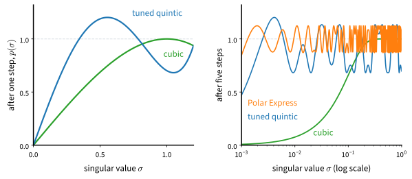

# Muon
:label:`sec_muon`

Every optimizer of this chapter has treated the parameters of a network as
one long list of numbers. Adam went furthest. It keeps two averages for
every entry of a weight matrix and chooses the step of that entry from them
alone. Shuffle the entries of the matrix, and Adam would not notice.

The network would. A weight matrix is a map that takes the activations of
one layer to those of the next, $\mathbf{y} = \mathbf{W}\mathbf{x}$, and
what a step does to the network is what it does to this map. In `TinyLM`,
the small transformer of :numref:`sec_test_models`, more than four fifths
of the parameters sit in such matrices. So we take up the question on
which :numref:`sec_adamw` ended: what is the best step for a matrix, taken
as a matrix?

The question turns out to be incomplete, and completing it is the idea of
this section. The best step is the one that lowers the loss most among all
steps of a given size, and nobody has said yet how the size of a step is
to be measured. Measure it by Euclidean length, and the best step follows
the gradient, as SGD does. Measure it by the most that the step can change
the output of the layer, and the best step changes the map equally along
every direction in which the gradient asks for a change, however faintly.
A handful of matrix multiplications approximate that step. The result is
Muon :cite:`Jordan.Jin.Boza.ea.2024`, which in under a year went from a
record in a training-speed competition to the pretraining of a
trillion-parameter model.

We first derive these two steps, and a third that turns out to be Adam's.
We then build the approximation that Muon uses and try it on gradients of
`TinyLM`, where it does less than the derivation asks for. Last, we write
the optimizer, compare it with AdamW, and report what is known about it in
runs far longer than ours.

```{.python .input #muon}
%%tab pytorch
import math
import numpy as np
import torch
from torch import nn
from torch.nn import functional as F
from d2l import torch as d2l
```

```{.python .input #muon}
%%tab jax
import math
import numpy as np
import jax
from jax import numpy as jnp
from flax import nnx
import optax
from d2l import jax as d2l
```

```{.python .input #muon-1}
%%tab pytorch
import random
```

## Norms and Steepest Descent

### Steepest Descent in a Ball

What does it mean for a direction to be "steepest"? Linearize the loss
around the current iterate, $f(\mathbf{x} + \mathbf{d}) \approx
f(\mathbf{x}) + \langle \mathbf{g}, \mathbf{d} \rangle$ with the gradient
$\mathbf{g}$, and ask for the step that decreases the linearization most
among all steps of size at most $\eta$:

$$
\mathbf{d}^\star = \operatorname*{argmin}_{\|\mathbf{d}\| \leq \eta} \; \langle \mathbf{g}, \mathbf{d} \rangle.
$$
:eqlabel:`eq_muon-ball`

The problem is not posed until we say which norm defines the ball
$\|\mathbf{d}\| \leq \eta$, and different norms give different answers
:cite:`Bernstein.Newhouse.2024`. Under the Euclidean norm the ball is round,
and the minimizer points straight along the negative gradient,
$-\eta\,\mathbf{g}/\|\mathbf{g}\|_2$. It lowers the linearization by
$\eta\,\|\mathbf{g}\|_2$. This is the direction of SGD. To follow the
gradient, then, is to assume that the space of parameters is Euclidean. We
have made this assumption since the first model of the book without saying
so.

The length of the step is another matter. SGD moves by
$\eta\,\|\mathbf{g}\|_2$ and not by $\eta$, since it solves the penalized
problem $\min_{\mathbf{d}} \langle \mathbf{g}, \mathbf{d} \rangle +
\|\mathbf{d}\|_2^2 / (2\eta)$. In this section the ball decides the
direction of a step. Its length is a separate choice, to which we return
at the end.

Now take the $\ell_\infty$ norm, $\|\mathbf{d}\|_\infty = \max_i |d_i|$. The
ball becomes a box: a step has size at most $\eta$ as long as no single
coordinate moves by more than $\eta$. To make $\langle \mathbf{g},
\mathbf{d} \rangle$ as negative as possible we push every coordinate to its
wall, so the minimizer is $-\eta\, \mathrm{sign}(\mathbf{g})$, and the
linearization falls by $\eta \sum_i |g_i| = \eta\,\|\mathbf{g}\|_1$. This is
the sign descent of :numref:`sec_adam`, to which Adam reduces when both of
its averages are switched off. Read geometrically, Adam is a smoothed
steepest descent in a box. The step to the corner of the box moves every
coordinate by the same amount whatever the size of its gradient, which
suits parameters whose gradients differ widely in size, as we found those
of `TinyLM` to do.

### Matrices and the Spectral Norm

Both norms treat a parameter as a vector without structure. For a weight
matrix, which acts on activations as $\mathbf{y} = \mathbf{W}\mathbf{x}$, a
more natural measure of a step $\Delta\mathbf{W}$ is the largest change that
it can cause in the output of the layer. The output changes by
$\Delta\mathbf{W}\mathbf{x}$, and

$$
\|\Delta \mathbf{W} \mathbf{x}\|_2 \leq \|\Delta \mathbf{W}\|_2\, \|\mathbf{x}\|_2,
$$

where $\|\Delta \mathbf{W}\|_2$ is the *spectral norm*, the largest factor
by which a matrix stretches any vector
(:numref:`subsec_lin-alg-eigenvalues`). Some input attains the bound.

To find the steepest step in this norm we need the directions in which a
matrix stretches. Every $m \times n$ matrix can be written as

$$
\mathbf{G} = \mathbf{U} \boldsymbol{\Sigma} \mathbf{V}^\top = \sum_i \sigma_i\, \mathbf{u}_i \mathbf{v}_i^\top,
$$

its *singular value decomposition* (SVD, :numref:`sec_mdl-svd-low-rank`).
The columns $\mathbf{v}_i$ of $\mathbf{V}$ are orthonormal directions in the
input space, the columns $\mathbf{u}_i$ of $\mathbf{U}$ are orthonormal
directions in the output space, and the matrix maps $\mathbf{v}_i$ to
$\sigma_i \mathbf{u}_i$. The *singular values* $\sigma_1 \geq \sigma_2 \geq
\cdots \geq 0$ are the stretch factors, $\min(m, n)$ in number. For a
symmetric positive definite matrix the SVD is the eigendecomposition of
:numref:`subsec_lin-alg-eigenvalues`. If $\mathbf{G}$ is the gradient of
the loss with respect to a weight matrix, each pair $(\mathbf{u}_i,
\mathbf{v}_i)$ is a direction in which the gradient asks the map to change,
and $\sigma_i$ says how strongly.

The singular values give us two ways to measure a matrix. The spectral
norm is $\sigma_1$, the largest stretch. The Frobenius norm, which
is the Euclidean norm of the flattened matrix, is $\sqrt{\sum_i
\sigma_i^2}$: it adds up the stretch in all directions. The two can lie far
apart. Take a $128 \times 128$ matrix whose singular values all equal one.
It changes the length of no vector, and its Frobenius norm is $\sqrt{128}
\approx 11$. The Euclidean ball would count a step of this kind as eleven
times larger than it is for any activation that passes through the layer.

So let the ball be spectral. For a matrix with gradient $\mathbf{G}$, the
solution of :eqref:`eq_muon-ball` is

$$
\Delta \mathbf{W}^\star = \operatorname*{argmin}_{\|\Delta \mathbf{W}\|_2 \leq \eta} \; \langle \mathbf{G}, \Delta \mathbf{W} \rangle = -\eta\, \mathbf{U} \mathbf{V}^\top,
$$
:eqlabel:`eq_muon-spectral-step`

the gradient with every nonzero singular value replaced by one. We call
$\mathbf{U}\mathbf{V}^\top$ the *orthogonalized gradient*. This is the
result on which the section rests, and its proof takes three lines.

The inner product of two matrices is that of their flattened entries,
$\langle \mathbf{G}, \mathbf{A} \rangle = \sum_{i,j} G_{ij} A_{ij} =
\mathrm{tr}(\mathbf{G}^\top \mathbf{A})$. Insert the SVD of $\mathbf{G}$
and move $\mathbf{V}$ to the other end of the product, which does not
change a trace. For any $\mathbf{A}$ with $\|\mathbf{A}\|_2 \leq 1$ this
gives

$$
\langle \mathbf{G}, \mathbf{A} \rangle = \mathrm{tr}(\boldsymbol{\Sigma}\, \mathbf{U}^\top \mathbf{A} \mathbf{V}) = \sum_i \sigma_i\, (\mathbf{U}^\top \mathbf{A} \mathbf{V})_{ii} \leq \sum_i \sigma_i.
$$

The last step holds because $\mathbf{U}^\top \mathbf{A} \mathbf{V}$
stretches no vector by more than $\mathbf{A}$ does, so its spectral norm is
at most one, and no entry of such a matrix exceeds one in absolute value
(Exercise :exref:`ex_muon-diagonal-entry`). The choice $\mathbf{A} =
\mathbf{U}\mathbf{V}^\top$ attains the bound, since then $\mathbf{U}^\top
\mathbf{A} \mathbf{V} = (\mathbf{U}^\top \mathbf{U})(\mathbf{V}^\top
\mathbf{V})$ is the identity, and its negative attains the minimum. The
linearization falls by $\eta \sum_i \sigma_i$.

The sum of the singular values is called the *nuclear norm* of
$\mathbf{G}$, and it completes a pattern. In each of the three balls the
best decrease is $\eta$ times a norm of the gradient: $\|\mathbf{g}\|_2$ in
the round ball, $\|\mathbf{g}\|_1$ in the box, the nuclear norm in the
spectral ball. Each is the *dual* of the norm that defines its ball.
:numref:`fig_opt_norm_balls` draws the three steps for one gradient.


:label:`fig_opt_norm_balls`

Let us consider a case small enough to compute, the gradient

$$
\mathbf{G} = \begin{bmatrix} 3 & 1 \\ 1 & 1 \end{bmatrix}.
$$

It is symmetric with eigenvalues $2 \pm \sqrt{2}$, so its singular values
are about $3.41$ and $0.59$: the gradient asks for almost six times as much
change along its first direction as along its second. The Euclidean step
$-\eta\, \mathbf{G} / \|\mathbf{G}\|_F$ keeps that ratio. The spectral step
is $-\eta\, \mathbf{U}\mathbf{U}^\top = -\eta\, \mathbf{I}$, which moves
both directions by the same amount. And the sign step is $-\eta$ times the
matrix of four ones, whose singular values are $2$ and $0$: four equal
entries add up to a step in a single direction of the map. Equal steps per
entry are not equal steps per direction. Adam delivers the first, and the
orthogonalized gradient the second, in the basis that the gradient itself
supplies.

Is that wise? The directions with the smallest singular values are the ones
that a minibatch gradient identifies most weakly, and some of them are
noise, yet :eqref:`eq_muon-spectral-step` moves along them at the full rate.
One answer lies in the ball. The spectral norm bounds the change of the
layer's output for *every* input, so a full step along a weak direction
disturbs the layer no more than a full step along the strongest one. The
algorithm will supply two more. Muon orthogonalizes an average of gradients
over many steps, in which much of the noise has cancelled, and its
orthogonalization is approximate in a way that leaves the smallest singular
values small. We return to the objection twice, each time with a
measurement.

### Hidden Matrices and Other Parameters

The argument for the spectral norm was that a weight matrix maps
activations to activations. It also says where the norm does not belong. We
call a weight matrix *hidden* if its input and its output are both
activations inside the network. In `TinyLM` these are the four matrices of
each block. An embedding table is not of this kind. Its input is one-hot,
so each row is looked up on its own, and the most that a step can change
the output is the largest change that it makes to any single row. Biases
and the scales of layer normalizations are vectors, not maps.

The output head is the awkward case. It is a dense matrix applied to the
last hidden state, and our argument would hand it to Muon. The convention,
which goes back to Muon's authors, leaves it with AdamW because that
trained better in their experiments. The norm argument does not predict
this, and we know of no explanation. We follow the convention: embeddings,
head, and vectors stay with AdamW. :numref:`tab_muon_norms` summarizes the
three geometries.

:Steepest descent under three norms. Each ball yields a closed-form step, lowers the linearized loss by $\eta$ times the dual norm of the gradient, and suits a different group of parameters.
:label:`tab_muon_norms`

| ball on the step | steepest step | decrease of the linearization | suited to |
|:--|:--|:--|:--|
| Euclidean, $\|\mathbf{d}\|_2 \leq \eta$ | $-\eta\, \mathbf{g} / \|\mathbf{g}\|_2$ | $\eta\, \|\mathbf{g}\|_2$ | no structure assumed (SGD direction) |
| box, $\|\mathbf{d}\|_\infty \leq \eta$ | $-\eta\, \mathrm{sign}(\mathbf{g})$ | $\eta\, \|\mathbf{g}\|_1$ | coordinates of very different scale (Adam family) |
| spectral, $\|\Delta \mathbf{W}\|_2 \leq \eta$ | $-\eta\, \mathbf{U}\mathbf{V}^\top$ | $\eta \sum_i \sigma_i$ | hidden matrices (Muon) |

### Matrix Preconditioners

The orthogonalized gradient can be reached by a second road, and an older
one. Adam's division is a diagonal preconditioner in the sense of
:numref:`sec_gd`. Shampoo :cite:`Gupta.Koren.Singer.2018` preconditions a
matrix as a matrix. For each $m \times n$ weight matrix it accumulates two
small matrices, $\mathbf{L}_t = \sum_{s \leq t} \mathbf{G}_s
\mathbf{G}_s^\top$ and $\mathbf{R}_t = \sum_{s \leq t} \mathbf{G}_s^\top
\mathbf{G}_s$, as AdaGrad accumulates squared gradients, and it steps along
$\mathbf{L}_t^{-1/4}\, \mathbf{G}_t\, \mathbf{R}_t^{-1/4}$. Each sum is a
square of the gradient, so the two fourth roots together divide by one
power of it, as Adam's square root does. Now switch off the accumulation,
so that only the current gradient $\mathbf{G} =
\mathbf{U}\boldsymbol{\Sigma}\mathbf{V}^\top$ remains:

$$
(\mathbf{G}\mathbf{G}^\top)^{-1/4}\, \mathbf{G}\, (\mathbf{G}^\top\mathbf{G})^{-1/4} = \mathbf{U}\boldsymbol{\Sigma}^{-1/2}\mathbf{U}^\top \cdot \mathbf{U}\boldsymbol{\Sigma}\mathbf{V}^\top \cdot \mathbf{V}\boldsymbol{\Sigma}^{-1/2}\mathbf{V}^\top = \mathbf{U}\mathbf{V}^\top.
$$
:eqlabel:`eq_muon-shampoo`

The singular values cancel, and the orthogonalized gradient is left
:cite:`Bernstein.Newhouse.2024`. Adam without its averages was the
steepest step in the box, and Shampoo without its sums is the steepest
step in the spectral ball. Muon is Shampoo without its memory. It drops the
two matrices and their inverse roots, the costly part of Shampoo, and
remembers the past in a cheaper way, by averaging the gradients themselves
and not their products. :numref:`subsec_mdl-preconditioning-ladder` derives
the family, from diagonal to spectral preconditioners.

## Orthogonalization by Newton--Schulz
:label:`subsec_muon-newton-schulz`

### Odd Matrix Polynomials

Equation :eqref:`eq_muon-spectral-step` asks for
$\mathbf{U}\mathbf{V}^\top$. An SVD of every hidden matrix at every step
would deliver it, but an SVD is expensive and parallelizes poorly on a GPU.
Luckily we do not need one. An *odd* polynomial of a matrix acts on its
singular values and leaves its singular vectors alone:

$$
p(\mathbf{X}) = a\mathbf{X} + b\,(\mathbf{X}\mathbf{X}^\top)\mathbf{X} + c\,(\mathbf{X}\mathbf{X}^\top)^2\mathbf{X} = \mathbf{U}\, p(\boldsymbol{\Sigma})\, \mathbf{V}^\top.
$$
:eqlabel:`eq_muon-odd-poly`

Each factor $\mathbf{X}\mathbf{X}^\top$ equals
$\mathbf{U}\boldsymbol{\Sigma}^2\mathbf{U}^\top$, and the orthogonal factors
cancel in the product. A polynomial of the matrix is thus the same
polynomial applied to each singular value, with $\mathbf{U}$ and
$\mathbf{V}$ untouched. We can therefore push every nonzero singular value
toward $1$ without ever computing one, with matrix multiplications alone, by
iterating a scalar polynomial that maps small numbers to larger ones and
numbers near $1$ to numbers near $1$. An iteration of this kind is called a
*Newton--Schulz* iteration, after its classical member, which we meet in a
moment. Dividing $\mathbf{X}$ by its Frobenius norm first puts every
singular value in $[0, 1]$, since the Frobenius norm is at least as large
as the largest singular value. An odd polynomial maps zero to zero, so the
iteration does not invent directions that the gradient does not have.

### The Tuned Quintic

Which polynomial should we iterate? A training step can afford only a few
iterations, so the polynomial must move small singular values toward $1$
quickly. The classical choice is the cubic $p(x) = \tfrac{3}{2}x -
\tfrac{1}{2}x^3$. It converges to $1$, but slowly from below. Near zero its
slope is $1.5$, so a small singular value grows by only half its size per
step, and one that starts at $0.01$ needs ten steps to pass $0.5$
(:numref:`subsec_mdl-orthogonalized-updates` analyzes this iteration).
:citet:`Jordan.Jin.Boza.ea.2024` instead tuned a quintic for speed,

$$
p(x) = 3.4445\,x - 4.7750\,x^3 + 2.0315\,x^5,
$$
:eqlabel:`eq_muon-quintic`

whose slope at the origin is $3.4445$. The same singular value of $0.01$
passes $0.5$ in four steps. In return the iteration no longer converges.
The polynomial rises to $1.20$ near $x = 0.55$ and falls to a minimum of
$0.68$ just above $x = 1$, passing $p(1) = 0.70$ on the way. No singular
value can settle at $1$: the iterates overshoot and then bounce around in a
band from $0.68$ to $1.2$. To give up convergence for speed is the bold
decision in Muon's design. It rests on the view that an optimizer needs all
directions to move at roughly the same rate, and has no use for
orthogonality to machine precision. :numref:`fig_opt_ns_maps` draws both
maps, one step at a time and composed five times.

![Newton--Schulz as a map on each singular value. Left: one step of the classical cubic and of the tuned quintic :eqref:`eq_muon-quintic`. Right: five steps of each, composed, for singular values from $10^{-3}$ to $1$ on a log scale. The quintic maps every input above $0.0015$ to at least $0.68$ and every input above $0.01$ into the band from $0.68$ to $1.13$; the cubic brings only inputs above about $0.2$ close to $1$. The third curve uses a different quintic at each step (Polar Express, :cite:`Amsel.Persson.Musco.ea.2026`) and maps the whole range into a band from $0.85$ to $1.12$.](../img/mdl-opt-ns-maps.svg)
:label:`fig_opt_ns_maps`

The right panel also shows what five steps cannot do. Near zero a step
multiplies a singular value by at most $3.4445$, and five steps by at most
$3.4445^5 \approx 485$. A singular value below about $0.15\%$ of the
Frobenius norm is therefore raised several hundredfold and still ends below
$0.68$. We will meet this limit again: how well the iteration does on a
given matrix depends on how much of its spectrum lies above it.

The third curve of the figure belongs to a refinement that we do not
need, a different quintic at each step, which narrows the band. Whether an
optimizer gains anything from a narrower band is the question of Exercise
:exref:`ex_muon-iterations`.

The function below runs the iteration, with the tuned quintic as its
default. A tall matrix is transposed first, so that the Gram factor
$\mathbf{X}\mathbf{X}^\top$ is the smaller of the two possible squares.

```{.python .input #muon-orthogonalization-by-newton-schulz-1}
%%tab pytorch
def newton_schulz(M, num_iters=5, a=3.4445, b=-4.7750, c=2.0315, eps=1e-7):
    """Approximate the orthogonalization U V^T of M by num_iters steps of
    the odd polynomial a x + b x^3 + c x^5 (Jordan et al.'s tuned quintic)."""
    tall = M.shape[0] > M.shape[1]
    X = M.T if tall else M  # Keep the Gram factor X @ X.T small
    X = X / (X.norm() + eps)
    for _ in range(num_iters):
        A = X @ X.T
        X = a * X + (b * A + c * A @ A) @ X
    return X.T if tall else X
```

```{.python .input #muon-orthogonalization-by-newton-schulz-1}
%%tab jax
def newton_schulz(M, num_iters=5, a=3.4445, b=-4.7750, c=2.0315, eps=1e-7):
    """Approximate the orthogonalization U V^T of M by num_iters steps of
    the odd polynomial a x + b x^3 + c x^5 (Jordan et al.'s tuned quintic)."""
    tall = M.shape[0] > M.shape[1]
    X = M.T if tall else M  # Keep the Gram factor X @ X.T small
    X = X / (jnp.linalg.norm(X) + eps)
    for _ in range(num_iters):
        A = X @ X.T
        X = a * X + (b * A + c * A @ A) @ X
    return X.T if tall else X
```

Can a training step afford this? Five iterations take fifteen matrix
multiplications, to be set against the cost of the gradient itself. For an
$m \times n$ matrix with $m \leq n$, one iteration costs $4m^2n + 2m^3$
floating-point operations, which for a square matrix is $6m^3$, or $30m^3$
for all five. The forward and backward passes through the same matrix cost
about $6m^2B$ operations for a minibatch of $B$ tokens, so the ratio is
$5m/B$ :cite:`Jordan.Jin.Boza.ea.2024`. In the example of Muon's authors,
a transformer of width $m = 768$ trained on batches of 524,288 tokens, it
is 0.7%.

`TinyLM` sits at the other end, with $m = 128$, $n$ between 128 and 512,
and only $B = 64 \times 64 = 4{,}096$ tokens in a batch. The same count,
with $6mnB$ for the two passes, gives about 12%. At the batch sizes of
large runs the orthogonalization is negligible. On our small model it is a
visible share of the work.

### The Spectrum of a Gradient

Does the iteration deliver $\mathbf{U}\mathbf{V}^\top$? We first try it
where it ought to succeed, on a random $96 \times 64$ matrix with Gaussian
entries. Its singular values, the curve for $k = 0$ in the plot below, lie
between about $2\%$ and a little over $20\%$ of its Frobenius norm, far
above the limit of $0.15\%$. Three steps multiply even the smallest of them
by up to $3.4445^3 \approx 41$, enough to reach the band, so we expect a
flat spectrum after three iterations and little change from two more. The
cell plots the spectrum after 0, 1, 3, and 5 iterations and prints its
range after three and after five. (The SVD in this cell only measures the
result. The iteration never computes one.)

```{.python .input #muon-orthogonalization-by-newton-schulz-2}
%%tab pytorch
G = torch.randn(96, 64)
sigmas = [torch.linalg.svdvals(newton_schulz(G, num_iters=k))
          for k in (0, 1, 3, 5)]
d2l.plot(torch.arange(1, 65), sigmas, 'index', 'singular value',
         legend=[f'k = {k}' for k in (0, 1, 3, 5)], yscale='log')
for k, sigma in zip((3, 5), sigmas[2:]):
    print(f'after {k} iterations: [{sigma.min():.2f}, {sigma.max():.2f}]')
```

```{.python .input #muon-orthogonalization-by-newton-schulz-2}
%%tab jax
G = jax.random.normal(d2l.get_key(), (96, 64))
sigmas = [jnp.linalg.svd(newton_schulz(G, num_iters=k), compute_uv=False)
          for k in (0, 1, 3, 5)]
d2l.plot(jnp.arange(1, 65), sigmas, 'index', 'singular value',
         legend=[f'k = {k}' for k in (0, 1, 3, 5)], yscale='log')
for k, sigma in zip((3, 5), sigmas[2:]):
    print(f'after {k} iterations: [{sigma.min():.2f}, {sigma.max():.2f}]')
```

After three iterations every singular value lies between $0.68$ and $1.20$,
and after five between $0.68$ and $1.13$. For this matrix the iteration
delivers $\mathbf{U}\mathbf{V}^\top$ as nearly as an optimizer needs it, and
three steps would have done.

A Gaussian matrix is too kind a test, however. Muon orthogonalizes
gradients, and nothing so far says that the singular values of a gradient
are spread as evenly as those of noise. So let us take a gradient: a newly
initialized `TinyLM`, one minibatch of 64 windows of 64 bytes, and the four
hidden matrices of the first block, `qkv` and `proj` of the attention layer
and `mlp1` and `mlp2` of the MLP. For each matrix the function `ns_spectrum`
prints one line. It starts with the shape, written as outputs by inputs,
the rank, which counts the singular values that single precision can tell
from zero, and the share $\sigma_1 / \|\mathbf{G}\|_F$ of the Frobenius
norm that the largest singular value carries. The rest of the line
describes what five steps make of these singular values: their range, the
fraction of them that has reached $0.68$, and the Frobenius norm of the
result relative to that of $\mathbf{U}\mathbf{V}^\top$. Were the gradient
like the Gaussian matrix, the share would be far below one, the fraction
100%, and the relative norm close to one.

```{.python .input #muon-per-neuron-normalization-1}
%%tab pytorch
def ns_spectrum(name, G):
    """Print the spectrum of G and of five Newton-Schulz steps applied to G."""
    r = int(torch.linalg.matrix_rank(G))  # Number of nonzero singular values
    sigma = torch.linalg.svdvals(G)
    ns = torch.linalg.svdvals(newton_schulz(G))[:r]  # Images of those r
    print(f'{name:<4} {G.shape[0]:>3} x {G.shape[1]:<3}  rank {r:>3}  '
          f'sigma_1/|G|_F {sigma[0] / G.norm():.2f}  '
          f'NS_5 {ns.min():.2f}-{ns.max():.2f}, '
          f'{(ns >= 0.68).float().mean():4.0%} >= 0.68, '
          f'|NS_5|/|UV^T| {ns.norm() / math.sqrt(r):.2f}')

def block_weights(model):  # The hidden matrices of the first block
    blk = model.blks[0]  # PyTorch weights are (out, in)
    return {'qkv': blk['qkv'].weight, 'proj': blk['proj'].weight,
            'mlp1': blk['mlp'][0].weight, 'mlp2': blk['mlp'][2].weight}

data = d2l.WikiText103(batch_size=64, num_steps=64)
model = d2l.TinyLM(len(data.vocab))
X, Y = next(iter(data.train_dataloader()))
logits = model(X)
F.cross_entropy(logits.reshape(-1, logits.shape[-1]), Y.reshape(-1)).backward()
for name, W in block_weights(model).items():
    ns_spectrum(name, W.grad)
```

```{.python .input #muon-per-neuron-normalization-1}
%%tab jax
@jax.default_matmul_precision('highest')  # float32, not TF32
def ns_spectrum(name, G):
    """Print the spectrum of G and of five Newton-Schulz steps applied to G."""
    r = int(jnp.linalg.matrix_rank(G))  # Number of nonzero singular values
    sigma = jnp.linalg.svd(G, compute_uv=False)
    ns = jnp.linalg.svd(newton_schulz(G), compute_uv=False)[:r]
    print(f'{name:<4} {G.shape[0]:>3} x {G.shape[1]:<3}  rank {r:>3}  '
          f'sigma_1/|G|_F {sigma[0] / jnp.linalg.norm(G):.2f}  '
          f'NS_5 {ns.min():.2f}-{ns.max():.2f}, '
          f'{(ns >= 0.68).mean():4.0%} >= 0.68, '
          f'|NS_5|/|UV^T| {jnp.linalg.norm(ns) / math.sqrt(r):.2f}')

def block_weights(tree):  # The hidden matrices of the first block
    blk = tree['blks'][0]  # Flax kernels are (in, out): transpose
    return {name: blk[name]['kernel'][...].T
            for name in ('qkv', 'proj', 'mlp1', 'mlp2')}

def loss_fn(model, X, Y):
    logits = model(X)
    return optax.softmax_cross_entropy_with_integer_labels(
        logits.reshape(-1, logits.shape[-1]), Y.reshape(-1)).mean()

data = d2l.WikiText103(batch_size=64, num_steps=64)
model = d2l.TinyLM(len(data.vocab), rngs=nnx.Rngs(d2l.get_key()))
X, Y = (jnp.asarray(a) for a in next(iter(data.train_dataloader())))
with jax.default_matmul_precision('highest'):
    grads = nnx.grad(loss_fn)(model, X, Y)
for name, G in block_weights(grads).items():
    ns_spectrum(name, G)
```

Read the share of the largest singular value first. For `qkv` and `proj` it
is about $0.99$, where the Gaussian matrix had a little over a fifth: by
its norm, the gradient of a new network is a matrix of rank one. This is
the most surprising number of the section, and we can only report it. We
have no derivation of it.

Its consequences are easier to follow. All other singular values together
carry at most a few percent of the squared norm, and after the division by
the Frobenius norm many of them start below the $0.15\%$ that five steps
can lift. For these two matrices the smallest singular values of the result
are a few hundredths or less. Only about half of the singular values of
`qkv` and under a third of those of `proj` reach $0.68$, and the result has
between a little over half and three quarters of the norm of
$\mathbf{U}\mathbf{V}^\top$. The gradients of the MLP are less extreme.
About nine tenths of the singular values of `mlp1` arrive, and `mlp2` lies
in between with about six tenths.

On the gradient of a new network, then, five steps of the quintic do not
compute $\mathbf{U}\mathbf{V}^\top$. What they compute is more modest: the
one dominant direction is cut down to the size of the others, a few dozen
directions are raised to about one, and a long tail is raised several
hundredfold and still falls short. This bears on the objection that a full
step along the weakest directions follows noise. The tail holds the
directions that the minibatch identified most weakly, and along them the
iteration is nearly linear: it moves in proportion to the singular values,
as gradient descent would. A new network is an extreme case, though, and
Muon does not orthogonalize single gradients. We repeat the measurement in
:numref:`subsec_muon-parameter-groups`, on what the optimizer sees in the
middle of a run.

## Muon from Scratch

### The Update

Muon applies the orthogonalization to a momentum average of the gradients.
Its name abbreviates the recipe, momentum orthogonalized by Newton--Schulz.
From AdamW it borrows two things, the size of its step and its weight decay.
For an $m \times n$ matrix $\mathbf{W}$ with gradient $\mathbf{G}_t$ the
update is

$$
\mathbf{M}_t = \beta\, \mathbf{M}_{t-1} + \mathbf{G}_t,
\qquad
\mathbf{W}_{t+1} = (1 - \eta\lambda)\, \mathbf{W}_t - \eta \cdot 0.2 \sqrt{\max(m, n)}\; \mathrm{NS}_5(\mathbf{G}_t + \beta\, \mathbf{M}_t),
$$
:eqlabel:`eq_muon-update`

where $\mathrm{NS}_5$ denotes five steps of the tuned quintic.

Start with the buffer. $\mathbf{M}_t$ is the velocity of
:numref:`sec_momentum`, a leaky sum of past gradients, with $\beta = 0.95$
as Muon's authors chose. The matrix that enters the iteration,
$\mathbf{G}_t + \beta \mathbf{M}_t$, is Nesterov momentum in the form in
which libraries compute it, where the newest gradient counts once more. The
order of the two operations matters, and it is the second answer to the
objection about weak directions. Averaging comes first, so the directions
that the iteration raises to full size are directions of an average over
about $1/(1 - \beta) = 20$ steps, not of one minibatch.

Next, the size of the step. How large are the entries of an orthogonalized
$m \times n$ matrix? It has $\min(m, n)$ singular values equal to $1$,
hence Frobenius norm $\sqrt{\min(m, n)}$, and its $mn$ entries have a
root mean square (RMS) of $1 / \sqrt{\max(m, n)}$. Left alone, a large
matrix would take smaller steps per entry than a small one. The factor
$0.2\sqrt{\max(m, n)}$ removes the dependence on the shape and gives the
update of every matrix an entrywise RMS of $0.2\,\eta$. For a $512 \times
128$ matrix, for example, the orthogonalized entries have RMS $1/\sqrt{512}
\approx 0.044$, and the factor $0.2 \sqrt{512} \approx 4.5$ brings them to
$0.2$. The constant $0.2$ is taken from AdamW, whose steps on the matrices
of `TinyLM` we measured at about a fifth of $\eta$ per entry
(:numref:`sec_adam`). With this convention, introduced by
:citet:`Liu.Su.Yao.ea.2025`, a learning rate that suits AdamW is a good
first guess for Muon, and the two can share one $\eta$.

The value $0.2\,\eta$ is a nominal one. It assumes that every singular
value arrives at one, and on the gradients of the new network the result of
five steps had only a little over half to nine tenths of the norm of
$\mathbf{U}\mathbf{V}^\top$. Note also that the factor imitates AdamW. It
does not come from the norm. Had we measured the input and the output of
the layer by the RMS of their entries and not by their length, our argument
would have given $\sqrt{d_\textrm{out} / d_\textrm{in}}$ for a matrix with
$d_\textrm{in}$ inputs and $d_\textrm{out}$ outputs
:cite:`Bernstein.2025`. The two factors part ways when a layer grows wider
(:numref:`sec_scaling`).

That leaves the factor $1 - \eta\lambda$, the decoupled weight decay of
:numref:`sec_adamw`. Muon needs it for the reason that AdamW does, only
more plainly. The orthogonalized step has the same size at every step,
however small the gradient has become, so nothing but decay limits the
growth of the weights.

The implementation follows :eqref:`eq_muon-update` line by line.

```{.python .input #muon-the-update}
%%tab pytorch
class Muon(torch.optim.Optimizer):
    """Steepest descent under the spectral norm: orthogonalized momentum."""
    def __init__(self, params, lr, momentum=0.95, weight_decay=0.0):
        super().__init__(params, dict(lr=lr, momentum=momentum,
                                      weight_decay=weight_decay))

    @torch.no_grad()
    def step(self):
        for group in self.param_groups:
            for p in group['params']:
                if p.grad is None:  # A parameter that received no gradient
                    continue
                state = self.state[p]
                if not state:  # First step: allocate the momentum buffer
                    state['buf'] = torch.zeros_like(p)
                buf = state['buf'].mul_(group['momentum']).add_(p.grad)
                G = p.grad + group['momentum'] * buf  # Nesterov momentum
                M = G.reshape(len(G), -1)             # Flattens conv kernels
                O = newton_schulz(M).reshape(p.shape)
                rms_scale = 0.2 * math.sqrt(max(M.shape))  # AdamW's RMS
                p.mul_(1 - group['lr'] * group['weight_decay'])  # Decoupled
                p.add_(O, alpha=-group['lr'] * rms_scale)
```

```{.python .input #muon-the-update}
%%tab jax
def scale_by_muon(momentum=0.95):
    """Orthogonalized Nesterov momentum, scaled to AdamW's update RMS."""
    def init(params):
        return jax.tree.map(jnp.zeros_like, params)
    def update(grads, bufs, params=None):
        bufs = jax.tree.map(lambda b, g: momentum * b + g, bufs, grads)
        def direction(g, b):
            G = g + momentum * b            # Nesterov momentum
            M = G.reshape(-1, G.shape[-1])  # Flattens conv kernels
            O = newton_schulz(M).reshape(G.shape)
            return 0.2 * math.sqrt(max(M.shape)) * O  # AdamW's RMS
        return jax.tree.map(direction, grads, bufs), bufs
    return optax.GradientTransformation(init, update)

def scratch_muon(learning_rate, momentum=0.95, weight_decay=0.0):
    return optax.chain(scale_by_muon(momentum),
                       optax.add_decayed_weights(weight_decay),  # Decoupled
                       optax.scale_by_learning_rate(learning_rate))
```

:begin_tab:`pytorch`
`Muon` subclasses `torch.optim.Optimizer`, so it plugs into any training
loop that calls `zero_grad` and `step`. The library has a `torch.optim.Muon`
of its own, with other defaults: it accepts two-dimensional parameters
only, runs Newton--Schulz in `bfloat16`, decays the weights by 0.1 unless
told otherwise, and uses the scale of :eqref:`eq_muon-update` only with
`adjust_lr_fn='match_rms_adamw'`.
:end_tab:

:begin_tab:`jax`
`scale_by_muon` returns the orthogonalized and rescaled direction, and
`scratch_muon` chains it with `optax.add_decayed_weights` and
`optax.scale_by_learning_rate`, as `optax.adamw` is built from
`optax.scale_by_adam` (:numref:`sec_adamw`). The library's
`optax.contrib.muon` has other defaults: it takes the scale of
:eqref:`eq_muon-update` as `consistent_rms=0.2`, keeps its momentum as a
bias-corrected moving average, and sends the parameters that it does not
orthogonalize to an AdamW of its own.
:end_tab:

### Parameter Groups
:label:`subsec_muon-parameter-groups`

Muon is an optimizer for hidden matrices only, so a training run that uses
it is a *hybrid*. This is the less elegant half of the method: an optimizer
derived from one norm has to leave a sixth of the parameters of `TinyLM` to
an optimizer derived from another. We split the parameters into two groups,
as :numref:`sec_adamw` did for weight decay, and give each group its own
optimizer: Muon for the hidden matrices, AdamW for the embeddings, the
head, and the vectors. The four hidden matrices of a block of `TinyLM` have
$128 \cdot (384 + 128 + 512 + 512) = 196{,}608$ entries
(:numref:`subsec_tinylm`), and there are two blocks. Muon should therefore
receive 393,216 of the 470,784 parameters.

```{.python .input #muon-dividing-the-census-1}
%%tab pytorch
def split_lm(model):
    hidden, rest = [], []
    for name, p in model.named_parameters():
        is_hidden = p.ndim == 2 and 'emb' not in name and 'head' not in name
        (hidden if is_hidden else rest).append(p)
    return hidden, rest

hidden, rest = split_lm(d2l.TinyLM(len(data.vocab)))
print(f'Muon:  {len(hidden):>2} tensors, '
      f'{sum(p.numel() for p in hidden):>7} parameters')
print(f'AdamW: {len(rest):>2} tensors, '
      f'{sum(p.numel() for p in rest):>7} parameters')
```

```{.python .input #muon-dividing-the-census-1}
%%tab jax
def muon_labels(params):
    """'muon' for the hidden matrices, 'adamw' for every other parameter."""
    def label(path, p):
        name = jax.tree_util.keystr(path)
        is_hidden = p.ndim == 2 and 'emb' not in name and 'head' not in name
        return 'muon' if is_hidden else 'adamw'
    return jax.tree_util.tree_map_with_path(label, params)

model = d2l.TinyLM(len(data.vocab), rngs=nnx.Rngs(d2l.get_key()))
params = nnx.state(model, nnx.Param)
labels = jax.tree.leaves(muon_labels(params))
for group, name in (('muon', 'Muon'), ('adamw', 'AdamW')):
    sizes = [p.size for p, label in zip(jax.tree.leaves(params), labels)
             if label == group]
    print(f'{name + ":":<6} {len(sizes):>2} tensors, {sum(sizes):>7} '
          'parameters')
```

Eight matrices hold 84% of the parameters. The split also shrinks the
optimizer state. AdamW keeps two numbers for every parameter
(:numref:`subsec_adamw-memory`) and Muon one, its momentum buffer, so the
state of the hybrid is $(393{,}216 + 2 \cdot 77{,}568) / (2 \cdot
470{,}784) = 58\%$ of what AdamW needs for the whole model. The function
`muon_adamw` builds the hybrid. Both halves receive the same learning rate,
and the weight decay goes to the hidden matrices alone.

```{.python .input #muon-dividing-the-census-2}
%%tab pytorch
class MultiOptimizer:
    """Apply independent optimizers to disjoint parameter groups."""
    def __init__(self, *optimizers):
        self.optimizers = optimizers

    def step(self):
        for opt in self.optimizers:
            opt.step()

    def zero_grad(self):
        for opt in self.optimizers:
            opt.zero_grad()

def muon_adamw(hidden, rest, lr, weight_decay):
    """Muon with decoupled weight decay on hidden, AdamW without it on rest."""
    return MultiOptimizer(Muon(hidden, lr, weight_decay=weight_decay),
                          torch.optim.AdamW(rest, lr, weight_decay=0.0))
```

```{.python .input #muon-dividing-the-census-2}
%%tab jax
def muon_adamw(lr, weight_decay):
    """Muon with decoupled weight decay on the hidden matrices, AdamW without
    it on the rest."""
    return optax.multi_transform(
        {'muon': scratch_muon(lr, weight_decay=weight_decay),
         'adamw': optax.adamw(lr, weight_decay=0.0)}, muon_labels)
```

:begin_tab:`pytorch`
`MultiOptimizer` steps two independent optimizers, one per group. A single
`torch.optim.Optimizer` with two parameter groups cannot do this, because
all of its groups share one update rule.
:end_tab:

:begin_tab:`jax`
`optax.multi_transform` gives each leaf of the parameter tree a label, here
from `muon_labels`, and routes it to the transformation with that label.
:end_tab:

With the hybrid we can repeat the measurement of
:numref:`subsec_muon-newton-schulz` in the middle of a run. We train
`TinyLM` for 500 steps at $\eta = 0.003$ and $\lambda = 0.1$ and apply
`ns_spectrum` to the momentum buffers $\mathbf{M}_t$ of the same four
matrices, which differ from what Muon orthogonalizes only by the extra
weight of the newest gradient. Two things have changed since the first
measurement: the network has trained, and each matrix is an average over
about twenty minibatches. If either has spread the gradient over more
directions, the share of the largest singular value should have fallen
well below its value in the new network, and more of the spectrum should
clear the limit of $0.15\%$.

```{.python .input #muon-parameter-groups-1}
%%tab pytorch
model = d2l.TinyLM(len(data.vocab))
optimizer = muon_adamw(*split_lm(model), lr=3e-3, weight_decay=0.1)
d2l.train_steps(model, data, optimizer, 500)
muon = optimizer.optimizers[0]
for name, W in block_weights(model).items():
    ns_spectrum(name, muon.state[W]['buf'].cpu())  # The momentum buffer
```

```{.python .input #muon-parameter-groups-1}
%%tab jax
model = d2l.TinyLM(len(data.vocab), rngs=nnx.Rngs(d2l.get_key()))
optimizer = nnx.Optimizer(model, muon_adamw(lr=3e-3, weight_decay=0.1),
                          wrt=nnx.Param)
d2l.train_steps(model, data, optimizer, 500)
state = optimizer.opt_state.inner_states['muon'].inner_state
for name, M in block_weights(state[0]).items():  # The momentum buffers
    ns_spectrum(name, M)
```

It has. The largest singular value now carries about a third of the
Frobenius norm instead of nearly all of it. After five steps of the
quintic, 99% or more of the singular values have reached $0.68$ for three
of the four matrices and about 90% for `proj`. The result has about $0.9$
of the norm of $\mathbf{U}\mathbf{V}^\top$ in every case. A gradient
dominated by a single direction is what the first step sees. Five
hundred steps later the buffer is spread over many directions, the
iteration comes close to the steepest step of
:eqref:`eq_muon-spectral-step`, and the nominal step of $0.2\,\eta$ per
entry is in fact about $0.18\,\eta$. The cell cannot say which of the two
changes spread the gradient. Exercise :exref:`ex_muon-step-size` separates
them.

The measurement also changes the answer to our objection. In the middle of
a run Muon does what the objection feared: it moves at nearly the full rate
along nearly every direction of the buffer, the weakest included. The
approximation protected the tail in the first steps only. Two answers
remain, the ball and the average over twenty steps. Whether they are enough
is an empirical question, and the comparison that follows is the test.

### Comparison with AdamW
:label:`subsec_muon-comparison`

We now compare the hybrid with AdamW on `TinyLM`. The comparison follows the
protocol of :numref:`sec_test_models`: 2,000 steps at a constant learning
rate, the same initial weights for every run, and a grid of rates for each
arm, here five rates from $10^{-3}$ to $10^{-1}$. Both arms use decoupled
weight decay with $\lambda = 0.1$ on the hidden matrices and none
elsewhere, so that they differ in nothing but the step of those matrices.

An optimizer can be ahead during a run and level at its end, and a single
number at step 2,000 would hide that. We therefore record the loss on the
validation split every 250 steps: `val_loss` computes it, and `run_lm`
does the recording. The best rate of each arm is the one with the lowest
value at the last checkpoint. First the baseline, AdamW on every parameter.

```{.python .input #muon-the-race-on-the-language-model-1}
%%tab pytorch
def val_loss(model):
    """Mean cross-entropy per byte over the validation split."""
    return math.log(d2l.lm_perplexity(model, data.val_dataloader()))

def run_lm(make_optimizer, lrs, seed):
    """d2l.lr_sweep of TinyLM, validated every 250 steps."""
    return d2l.lr_sweep(lambda: d2l.TinyLM(len(data.vocab)), make_optimizer,
                        data, lrs, seed, evaluate=val_loss,
                        metric='validation loss', every=250)

lrs, wd = [1e-3, 3e-3, 1e-2, 3e-2, 1e-1], 0.1

def adamw(model, lr):  # Decay on the hidden matrices only, as for Muon
    hidden, rest = split_lm(model)
    return torch.optim.AdamW([{'params': hidden, 'weight_decay': wd},
                              {'params': rest, 'weight_decay': 0.0}], lr=lr)

seed = random.getrandbits(32)  # One draw, shared by every run below
adamw_lm, adamw_val = run_lm(adamw, lrs, seed)
```

```{.python .input #muon-the-race-on-the-language-model-1}
%%tab jax
def val_loss(model):
    """Mean cross-entropy per byte over the validation split."""
    return math.log(d2l.lm_perplexity(model, data.val_dataloader()))

def run_lm(make_tx, lrs, seed):
    """d2l.lr_sweep of TinyLM, validated every 250 steps."""
    return d2l.lr_sweep(lambda rngs: d2l.TinyLM(len(data.vocab), rngs=rngs),
                        make_tx, data, lrs, seed, evaluate=val_loss,
                        metric='validation loss', every=250)

def hidden_only(params):  # Decay on the hidden matrices only, as for Muon
    return jax.tree.map(lambda label: label == 'muon', muon_labels(params))

seed = d2l.get_seed()  # One draw, shared by every run below
lrs, wd = [1e-3, 3e-3, 1e-2, 3e-2, 1e-1], 0.1
adamw_lm, adamw_val = run_lm(
    lambda lr: optax.adamw(lr, weight_decay=wd, mask=hidden_only), lrs, seed)
```

The hybrid runs over the same grid from the same initial weights.

```{.python .input #muon-the-race-on-the-language-model-2}
%%tab pytorch
muon_lm, muon_val = run_lm(
    lambda model, lr: muon_adamw(*split_lm(model), lr, wd), lrs, seed)
```

```{.python .input #muon-the-race-on-the-language-model-2}
%%tab jax
muon_lm, muon_val = run_lm(lambda lr: muon_adamw(lr, wd), lrs, seed)
```

The last cell plots the best run of each arm, with its training loss
smoothed and its validation loss at the checkpoints. For each arm it prints
the best rate, the validation loss at steps 500 and 2,000, the first
checkpoint with a validation loss below $1.6$, and the usable range, the
rates that end within $0.15$ nats of the best one.

```{.python .input #muon-the-race-on-the-language-model-3}
%%tab pytorch, jax
best_adamw = min(adamw_val, key=lambda lr: adamw_val[lr][-1])
best_muon = min(muon_val, key=lambda lr: muon_val[lr][-1])
d2l.plot([list(range(0, 2000, 25))] * 2 + [list(range(250, 2001, 250))] * 2,
         [d2l.smooth(adamw_lm[best_adamw]), d2l.smooth(muon_lm[best_muon]),
          adamw_val[best_adamw], muon_val[best_muon]], 'step', 'loss',
         legend=['AdamW, training', 'Muon + AdamW, training',
                 'AdamW, validation', 'Muon + AdamW, validation'],
         fmts=('C0-', 'C1-', 'C0o--', 'C1o--'), ylim=(1.4, 2.6),
         figsize=(5, 3.5))
print('validation loss  lr     step 500  step 2000  below 1.6  within 0.15')
for name, lr, vals in [('AdamW', best_adamw, adamw_val),
                       ('Muon+AdamW', best_muon, muon_val)]:
    below = d2l.steps_to_reach(vals[lr], 1.6, k=1)  # Checkpoint 1, 2, ...
    near = [r for r in lrs if vals[r][-1] < vals[lr][-1] + 0.15]
    print(f'{name:<16} {lr:<6g} {vals[lr][1]:<9.3f} {vals[lr][-1]:<10.3f} '
          f'{250 * below if below else "never":<10} '
          f'{near[0]:g} to {near[-1]:g}')
```

Both arms have their best rate inside the grid, and early in the run the
hybrid is clearly ahead. At step 500 its validation loss is about $1.76$
nats per byte against about $1.88$ for AdamW, a lead of more than a tenth
of a nat, where two runs of one setting end about a hundredth apart
(:numref:`sec_test_models`). The hybrid also gets below $1.6$ first, by at
least one checkpoint of 250 steps. Then the lead shrinks. At step 2,000
what is left of it is a few hundredths of a nat at most, short of the
$0.05$ nats that we require of a result. By our own rule this is a tie, and
we report it as one.

The hybrid is also the more forgiving of the two. The usable range of
AdamW runs from $10^{-3}$ to $10^{-2}$, as that of Adam did in
:numref:`sec_adam`, and at $3 \times 10^{-2}$ AdamW stalls as Adam did
there: it ends more than a nat above its best run. The hybrid at $3 \times
10^{-2}$ ends near $1.68$, a little over a tenth of a nat above its best
run. At $10^{-1}$ neither arm trains. And at every rate of the grid the
hybrid ends level with AdamW or below it. Whatever a full step along the
weakest directions does, on this model it does no harm that we can measure.

Why should the hybrid survive a rate at which AdamW stalls? The derivation
suggests a reason, which we have not tested. Among all matrices with a
given RMS entry, the orthogonalized one has the smallest spectral norm and
a matrix of rank one the largest, greater by the factor $\sqrt{\min(m,
n)}$, the 11 that we met for a matrix of `TinyLM`. Adam fixes the size of
each entry of a step and nothing about how the entries combine, and the
gradients of a new network, as we saw, are close to rank one. Muon fixes
the most that the step can do to any input of the layer, which is the
protection that the spectral ball was chosen for.

One caution before we leave these runs. Both arms ran at a constant
learning rate, and at a constant rate no run comes to rest: where it ends
depends on the size of its last steps as well as on the method
(:numref:`sec_sgd`). The tie at step 2,000 therefore says little about a
run in which the rate falls toward the end.

## Muon in Long Runs

A model of 0.47 million parameters demonstrates the mechanism but cannot
rank optimizers. For that we have to turn to runs that we cannot repeat
here. :citet:`Wen.Hall.Ma.ea.2025` tuned ten optimizers separately at each
of four model sizes, from 0.1 to 1.2 billion parameters. The fastest of
them all precondition with matrices, Muon among them, but their speedup
over a well-tuned AdamW, counted in steps to a given loss, falls from about
$1.4\times$ at 0.1 billion parameters to about $1.1\times$ at 1.2 billion.
Claims about optimizers need matched tuning and a stated model size, and a
real gain for Muon is measured in tens of percent, not in multiples.

Long runs also changed the optimizer. The Muon of 2024 had no weight decay.
:citet:`Liu.Su.Yao.ea.2025` found that without it the weight matrices keep
growing and Muon loses its early lead over AdamW late in training, and they
added the decay of :eqref:`eq_muon-update`. Our runs could not show this.
At $\eta\lambda = 3 \times 10^{-4}$ the timescale of the decay is
$1/(\eta\lambda) = 3{,}333$ steps (:numref:`sec_adamw`), and our runs stop
at 2,000.

A second change shows where the argument of this section ends. The
spectral ball bounds what one step of one matrix does to the output of its
layer. It says nothing about a product of two matrices, and nothing about
what many steps add up to. An attention layer contains such a product: it
scores one position against another by the dot product of two vectors,
each computed by weights of its own, and passes the scores to a softmax
(:numref:`chap_attention`). Kimi K2, a model of a trillion parameters, was
pretrained with Muon :cite:`Kimi.Team.2025`. In trial runs for it the
largest scores grew past 1,000, far outside the range in which a softmax
works well, and more often under Muon than under AdamW. The remedy is as
direct as the fault: after each step, both sets of weights are scaled down
wherever a score has exceeded a threshold of 100.

Tens of percent are still worth having when a run takes weeks. For a
transformer trained from scratch, Muon on the hidden matrices merits a
trial against an AdamW with a grid of its own: it starts from the same
learning rate and adds little to the cost of a step.

Gradient, sign, and orthogonalized gradient are three answers to the
question of direction, and none of them says anything about length. In
every run of this section, as in the sections before it, $\eta$ kept one
value from the first step to the last. A normalized step does not shrink
with the gradient, and no step is more thoroughly normalized than that of
Muon: it has the same size at the first step of a run and at the last. If
the steps are to get shorter as a run nears its end, $\eta$ itself has to
change.

## Summary

The steepest step depends on the norm that measures the size of a step: the
Euclidean ball gives the direction of SGD, and the box gives the sign
descent that Adam smooths. For a hidden weight matrix the spectral norm
bounds what a step can do to the output of the layer, and the steepest step
is the orthogonalized gradient $\mathbf{U}\mathbf{V}^\top$, which moves
equally far along every singular direction. Muon approximates it by five
steps of a quintic matrix polynomial applied to Nesterov momentum, scales
the result to the step of AdamW, adds decoupled weight decay, and leaves
embeddings, head, and vectors to AdamW. Five steps bring only singular
values above about $0.15\%$ of the Frobenius norm into the band around one,
which leaves out much of the spectrum of a new `TinyLM`'s gradient and
little of its momentum buffers after 500 steps. On `TinyLM` the hybrid led
tuned AdamW by more than a tenth of a nat at step 500 and still trained at
three times the largest rate that AdamW tolerates, and the two ended in a
tie. With matched tuning at 0.1 to 1.2 billion parameters, matrix
preconditioners such as Muon need fewer steps than AdamW by a factor of
about $1.4$ at the small end and $1.1$ at the large.

## Exercises

1. **Diagonal-entry bound.** The proof of :eqref:`eq_muon-spectral-step`
   bounds the diagonal entries of
   $\mathbf{U}^\top \mathbf{A} \mathbf{V}$ by one.
   :exlabel:`ex_muon-diagonal-entry`
    1. Let $\mathbf{U}$ and $\mathbf{V}$ have orthonormal columns. Show
       that $\|\mathbf{U}^\top \mathbf{A} \mathbf{V}\|_2 \leq
       \|\mathbf{A}\|_2$, and that no entry of a matrix exceeds its
       spectral norm in absolute value.
    1. Identify when $(\mathbf{U}^\top \mathbf{A} \mathbf{V})_{ii} = 1$
       holds for all $i$ simultaneously, and hence when the minimizer in
       :eqref:`eq_muon-spectral-step` is unique.

1. [code] **The size of Muon's step.** The update :eqref:`eq_muon-update`
   rescales the orthogonalized matrix by $0.2\sqrt{\max(m, n)}$, so that
   its entries have root-mean-square size $0.2\,\eta$ when every singular
   value is one.
   :exlabel:`ex_muon-step-size`
    1. The cell of :numref:`subsec_muon-parameter-groups` measured the
       momentum buffer once, after 500 steps. Instrument the hybrid to
       record, for each hidden matrix and every step of a 2,000-step run,
       the entrywise RMS of its update divided by $\eta$. Use the matrix
       that Muon orthogonalizes, $\mathbf{G}_t + \beta \mathbf{M}_t$.
       Between which values must the RMS lie once every singular value is
       in the band from $0.68$ to $1.13$? After how many steps does it
       leave the values of a new network, and how close to $0.2$ does it
       come? Compare with the steps of Adam in the table
       of :numref:`sec_adam`.
    1. That cell compared a single gradient of a new network with a
       momentum buffer after 500 steps, so two things had changed at once.
       Apply `ns_spectrum` to the minibatch gradient at step 500 as well.
       Which of the two, training or averaging, accounts for the fall of
       $\sigma_1 / \|\mathbf{G}\|_F$ and for the larger share of singular
       values that reach $0.68$?

1. [code] **Accuracy of the orthogonalization.** How close to
   $\mathbf{U}\mathbf{V}^\top$ does the update of Muon have to be?
   :exlabel:`ex_muon-iterations`
    1. Let $p$ be an odd polynomial with $|1 - p(x)| \leq \delta$ for all
       $x$ in an interval $[\ell, u]$. Show that $p(\mathbf{X})$ is within
       $\delta$ of $\mathbf{U}\mathbf{V}^\top$ in the spectral norm for
       every matrix $\mathbf{X}$ whose nonzero singular values lie in
       $[\ell, u]$. Read off $\delta$ for five steps of the tuned quintic
       on $[0.01, 1]$ and for the third curve on $[0.001, 1]$ from the
       caption of :numref:`fig_opt_ns_maps`.
    1. Rerun the tuned hybrid of :numref:`subsec_muon-comparison` with
       `num_iters=1`, `3`, and `10` in `newton_schulz`, and measure the
       validation loss and the wall-clock time per step. Where does the
       validation loss stop improving, and how does the time per step
       grow with the number of iterations? Compare the growth with the
       operation count of :numref:`subsec_muon-newton-schulz`, which adds
       about $m/B$ of the cost of the forward and backward passes per
       iteration for a square matrix.
    1. Now use five iterations of the classical cubic, `a=1.5`, `b=-0.5`,
       `c=0`, which brings a singular value of $0.05$ only to about
       $0.37$, where the quintic brings it into its band
       (:numref:`fig_opt_ns_maps`). Does the validation loss change by
       more than two runs of one setting differ
       (:numref:`sec_test_models`)? What do your results say about how
       small $\delta$ has to be for an optimizer?

1. [code] **Embeddings in the Muon group.** The split in
   :numref:`subsec_muon-parameter-groups` keeps the token embedding table
   `token_emb`, a $256 \times 128$ matrix with one row per byte value,
   with AdamW. Row $i$ of its gradient collects contributions only from
   the positions where byte $i$ occurs, so the rows of bytes that are
   absent from a minibatch are zero.
   :exlabel:`ex_muon-embeddings`
    1. Let $\mathbf{M} = \mathbf{U}\boldsymbol{\Sigma}\mathbf{V}^\top$ be
       an $m \times n$ matrix of rank $r$, where $\mathbf{U}$ and
       $\mathbf{V}$ hold the singular vectors of the $r$ nonzero singular
       values. Show that the norm of row $i$ of
       $\mathbf{U}\mathbf{V}^\top$ is the length of the projection of the
       $i$-th coordinate vector onto the column space of $\mathbf{M}$, so
       that the squared row norms lie between $0$ and $1$ and add up to
       $r$.
    1. Suppose that only $r \leq n$ rows of $\mathbf{M}$ are nonzero and
       that they are linearly independent. Show that each of them
       receives a row of norm one in $\mathbf{U}\mathbf{V}^\top$. What
       does this say about the step of a byte that occurs once in a
       minibatch, next to that of a byte that occurs 500 times? Would you
       want it?
    1. Move `token_emb` into the Muon group and rerun the hybrid's sweep
       of :numref:`subsec_muon-comparison`. Compare the best validation
       loss with that in `muon_val`. Does `TinyLM` confirm the convention
       that keeps the embeddings with AdamW?

1. [code] **Equalizing neurons.** ● Muon equalizes singular directions,
   not neurons. Write the update of a hidden matrix with one row per
   output unit; the norm of a row is then the size of the step of that
   unit, or *neuron*. Following NorMuon :cite:`Li.Liu.Liang.ea.2026`, keep
   one number per neuron of the orthogonalized update $\mathbf{O}_t$, the
   running average $v_{t,i} = \beta_2\, v_{t-1,i} + (1 - \beta_2)\, \frac{1}{n}
   \sum_j O_{t,ij}^2$ with $\beta_2 = 0.95$, divide row $i$ by
   $\sqrt{v_{t,i}}$, and rescale the result to the Frobenius norm of
   $\mathbf{O}_t$.
    1. For the four momentum buffers of the cell
       in :numref:`subsec_muon-parameter-groups`, compute the largest and
       the smallest row norm of the output of `newton_schulz`. Which
       matrices are the most uneven, and how does the first part of
       Exercise :exref:`ex_muon-embeddings` explain it?
    1. Add the normalization to Muon and compare it with Muon on `TinyLM`
       by the protocol of :numref:`subsec_muon-comparison`, three times
       from different initial weights. Is the difference larger than the
       difference between two runs of one setting?

1. [code] **Lion.** Lion :cite:`Chen.Liang.Huang.ea.2023` is steepest
   descent in the box with one momentum buffer and no second average.
   With buffer $\mathbf{m}_t$, it updates
   $$\mathbf{x}_{t+1} = \mathbf{x}_t - \eta\,\mathrm{sign}(\beta_1 \mathbf{m}_{t-1} + (1 - \beta_1)\, \mathbf{g}_t),
   \qquad \mathbf{m}_t = \beta_2 \mathbf{m}_{t-1} + (1 - \beta_2)\, \mathbf{g}_t,$$
   with $(\beta_1, \beta_2) = (0.9, 0.99)$.
    1. Implement it and compare it with AdamW and the hybrid on `TinyLM`
       by the protocol of :numref:`subsec_muon-comparison`. Shift the grid
       of Lion down by a factor of three to ten relative to that of AdamW,
       since every coordinate of its update has magnitude $\eta$, where
       Adam's had about a fifth of that. Does Lion share the hybrid's lead
       at step 500 and its wider usable range, or does it behave like
       AdamW in both? What would each outcome say about the source of the
       hybrid's lead: the spectral ball, or a step whose size does not
       depend on the gradient?
    1. Lion takes the sign of an interpolation weighted by $\beta_1$, not
       of its buffer $\mathbf{m}_t$. Show that the two coincide when
       $\beta_1 = \beta_2$. For $(\beta_1, \beta_2) = (0.9, 0.99)$, find the
       weight that each of them places on $\mathbf{g}_t$ and on
       $\mathbf{g}_{t-k}$ for $k \geq 1$, and explain how the choice
       $\beta_1 < \beta_2$ changes how quickly the update direction follows
       a change in the gradient.

1. **Damped orthogonalization.** The derivation of
   :eqref:`eq_muon-shampoo` keeps only the current gradient $\mathbf{G}$.
   Let $\mathbf{G}$ be $m \times n$ with $m > n$ and rank $n$. Then
   $\mathbf{G}\mathbf{G}^\top$ is singular, and its inverse fourth root
   exists only as a pseudo-inverse. Shampoo :cite:`Gupta.Koren.Singer.2018`
   starts both accumulators at $\epsilon \mathbf{I}$ with $\epsilon > 0$,
   so without memory its update direction becomes
   $$(\mathbf{G}\mathbf{G}^\top + \epsilon \mathbf{I})^{-1/4}\, \mathbf{G}\, (\mathbf{G}^\top\mathbf{G} + \epsilon \mathbf{I})^{-1/4}.$$
    1. Show that this matrix has the singular vectors of $\mathbf{G}$, and
       find the function that it applies to each singular value $\sigma$.
    1. Unlike $\mathbf{U}\mathbf{V}^\top$, this update changes when
       $\mathbf{G}$ is multiplied by a positive constant. Find the singular
       values that it maps to within 1% of $1$, and compare the role of
       $\epsilon$ with that of the $\epsilon$ in Adam's denominator
       $\sqrt{\hat{\mathbf{v}}_t} + \epsilon$.

[Discussions](https://d2l.discourse.group/t/36764)

<!-- slides -->

::: {.slide}
::: {.cover}
[Dive into Deep Learning · §9.8]{.kicker}

Muon<br>
**steepest descent under the spectral norm · Newton–Schulz · the hybrid with AdamW · long runs**
:::
:::

::: {.slide title="Adam Cannot See That a Weight Matrix Is a Map"}
[The problem]{.kicker}

`TinyLM`, a two-block transformer that predicts the next byte of Wikipedia
text: 393,216 of its 470,784 parameters (84%) sit in eight matrices that
map activations, $\mathbf{y} = \mathbf{W}\mathbf{x}$.

- Adam chooses the step of each entry from that entry's own gradients.
  Shuffle the entries of a matrix and it takes the same steps.
- The network sees only what a step $\Delta\mathbf{W}$ does to
  $\mathbf{y}$.

::: {.d2l-note}
What is the best step for a matrix, taken as a matrix?
:::
:::

::: {.slide title="By the End of This Deck You Can"}
[Goals]{.kicker}

- derive the steepest step under the Euclidean, $\ell_\infty$, and spectral
  norms;
- orthogonalize a matrix with five polynomial steps, and say which
  singular values arrive;
- write Muon's update with its scale and its weight decay;
- split a model's parameters between Muon and AdamW;
- read a comparison of two optimizers for what it shows.

**Idea:** the steepest step depends on how a step is measured.

**Running example:** `TinyLM`, 2,000 steps, Muon + AdamW against AdamW.
:::

::: {.slide title="Muon Is the Chapter's Third Answer to the Question of Direction"}
[Where this fits]{.kicker}

| movement | sections |
|---|---|
| two difficulties, on a valley we can solve | Landscapes · Gradient Descent · Stochastic and Minibatch GD |
| which direction to step in, on two small networks | Two Test Models · Momentum · Adam · AdamW · **Muon** |
| how the step changes over a run, with batch size and width | Schedules · Batch Size · Scaling Up · Practice |

- **Uses:** Nesterov momentum, Adam as a sign method, decoupled weight
  decay, the spectral norm.
- **Skips:** variants of Muon, training on many devices, convergence
  theory.
:::

::: {.slide title="The Steepest Direction Depends on the Norm"}
[Norms and steepest descent]{.kicker}

Linearize, $f(\mathbf{x} + \mathbf{d}) \approx f(\mathbf{x}) + \langle
\mathbf{g}, \mathbf{d}\rangle$ ($\mathbf{g}$: gradient), and ask for the
best step of size at most $\eta$:

$$\mathbf{d}^\star = \operatorname*{argmin}_{\|\mathbf{d}\| \leq \eta} \langle \mathbf{g}, \mathbf{d} \rangle.$$

{width=60%}

::: {.d2l-note}
Round ball: the **direction of SGD**. Box, $\max_i |d_i| \leq \eta$:
**sign descent**, which Adam smooths. Right: the ball for a matrix, next.
:::
:::

::: {.slide title="A Matrix Step Is Measured by What It Does to the Layer's Output"}
[Norms and steepest descent]{.kicker}

A layer computes $\mathbf{y} = \mathbf{W}\mathbf{x}$. A step
$\Delta\mathbf{W}$ changes its output by $\Delta\mathbf{W}\mathbf{x}$:

$$\|\Delta\mathbf{W}\mathbf{x}\|_2 \leq \|\Delta\mathbf{W}\|_2\,\|\mathbf{x}\|_2$$

- $\|\Delta\mathbf{W}\|_2$: the **spectral norm**, the largest stretch of
  any vector.
- SVD: $\mathbf{G} = \sum_i \sigma_i\,\mathbf{u}_i\mathbf{v}_i^\top$ with
  orthonormal $\mathbf{u}_i$, orthonormal $\mathbf{v}_i$, and singular
  values $\sigma_1 \geq \sigma_2 \geq \cdots \geq 0$.
- Spectral norm $\sigma_1$; Frobenius norm $\sqrt{\sum_i \sigma_i^2}$.

::: {.d2l-note}
128 singular values of one: no input is stretched, yet the Frobenius norm
is $\sqrt{128} \approx 11$. The Euclidean ball overstates such a step
elevenfold.
:::
:::

::: {.slide title="Under the Spectral Norm the Steepest Step Is UVᵀ"}
[Norms and steepest descent]{.kicker}

Gradient $\mathbf{G} = \mathbf{U}\boldsymbol{\Sigma}\mathbf{V}^\top$,
inner product $\langle \mathbf{G}, \mathbf{A}\rangle = \sum_{i,j}
G_{ij}A_{ij} = \mathrm{tr}(\mathbf{G}^\top\mathbf{A})$:

$$\operatorname*{argmin}_{\|\Delta\mathbf{W}\|_2 \leq \eta} \langle \mathbf{G}, \Delta\mathbf{W}\rangle = -\eta\, \mathbf{U}\mathbf{V}^\top$$

For any $\mathbf{A}$ with $\|\mathbf{A}\|_2 \leq 1$:

1. $\langle \mathbf{G}, \mathbf{A}\rangle =
   \mathrm{tr}(\boldsymbol{\Sigma}\,\mathbf{U}^\top\mathbf{A}\mathbf{V}) =
   \sum_i \sigma_i\,(\mathbf{U}^\top\mathbf{A}\mathbf{V})_{ii}$.
2. $\|\mathbf{U}^\top\mathbf{A}\mathbf{V}\|_2 \leq 1$, so no entry
   exceeds 1: $\langle \mathbf{G}, \mathbf{A}\rangle \leq \sum_i \sigma_i$.
3. $\mathbf{A} = \mathbf{U}\mathbf{V}^\top$ gives
   $\mathbf{U}^\top\mathbf{A}\mathbf{V} = \mathbf{I}$: attained.

::: {.d2l-note}
The **orthogonalized gradient**: singular vectors kept, every singular
value set to one.
:::
:::

::: {.slide title="Check: Three Balls, Three Steps for One Gradient"}
[Check]{.kicker}

$$\mathbf{G} = \begin{bmatrix} 3 & 1 \\ 1 & 1 \end{bmatrix}, \qquad \sigma_1 \approx 3.41, \quad \sigma_2 \approx 0.59$$

Up to the factor $-\eta$, what are the steepest steps in the round ball,
the box, and the spectral ball, and what are the singular values of each?

::: {.fragment .fade-up}
::: {.d2l-note}
**Answer.** Round: $\mathbf{G}/\|\mathbf{G}\|_F$, singular values $0.99$
and $0.17$. Box: the matrix of four ones, $2$ and $0$. Spectral: the
identity, $1$ and $1$. Equal steps per entry are not equal steps per
direction.
:::
:::
:::

::: {.slide title="Weak Directions Get a Full Step, and the Ball Bounds What It Does"}
[Norms and steepest descent]{.kicker}

**Objection.** Small singular values belong to the directions that a
minibatch identifies most weakly. Some are noise. $\mathbf{U}\mathbf{V}^\top$
moves along them at the full rate.

1. **The ball.** $\|\Delta\mathbf{W}\mathbf{x}\|_2 \leq \eta\,\|\mathbf{x}\|_2$
   for every input $\mathbf{x}$: a weak direction disturbs the layer no
   more than the strongest.
2. **Averaging.** Muon orthogonalizes momentum, an average over about 20
   steps.
3. **Approximation.** Five polynomial steps leave the smallest singular
   values small.

::: {.d2l-note}
Answers 2 and 3 belong to the algorithm. We measure them on `TinyLM`.
:::
:::

::: {.slide title="Embeddings, Head, and Vectors Stay with AdamW"}
[Norms and steepest descent]{.kicker}

| ball on the step | steepest step | loss decrease (linearized) | parameters |
|:--|:--|:--|:--|
| Euclidean | $-\eta\, \mathbf{g} / \|\mathbf{g}\|_2$ | $\eta\,\|\mathbf{g}\|_2$ | no structure assumed |
| box ($\ell_\infty$) | $-\eta\, \mathrm{sign}(\mathbf{g})$ | $\eta\,\|\mathbf{g}\|_1$ | coordinates of different scale |
| spectral | $-\eta\, \mathbf{U}\mathbf{V}^\top$ | $\eta\sum_i \sigma_i$ | hidden matrices |

- Hidden matrix: input and output are both activations.
- Embedding table: one-hot input, each row is looked up alone.
- Output head: a dense matrix, kept with AdamW by convention. It trained
  better that way; the norm argument does not say why.
:::

::: {.slide title="Muon Is Shampoo without Memory"}
[Norms and steepest descent]{.kicker}

Shampoo preconditions an $m \times n$ matrix with two accumulated
matrices, $\mathbf{L}_t = \sum_s \mathbf{G}_s\mathbf{G}_s^\top$ and
$\mathbf{R}_t = \sum_s \mathbf{G}_s^\top\mathbf{G}_s$. Its step is
$\mathbf{L}_t^{-1/4}\mathbf{G}_t\mathbf{R}_t^{-1/4}$. Keep only the
current gradient $\mathbf{G} =
\mathbf{U}\boldsymbol{\Sigma}\mathbf{V}^\top$:

$$(\mathbf{G}\mathbf{G}^\top)^{-1/4}\mathbf{G}(\mathbf{G}^\top\mathbf{G})^{-1/4} = \mathbf{U}\boldsymbol{\Sigma}^{-1/2}\mathbf{U}^\top\,\mathbf{U}\boldsymbol{\Sigma}\mathbf{V}^\top\,\mathbf{V}\boldsymbol{\Sigma}^{-1/2}\mathbf{V}^\top = \mathbf{U}\mathbf{V}^\top.$$

::: {.d2l-note}
Adam without its averages: the steepest step in the box. Shampoo without
its sums: the steepest step in the spectral ball.
:::

[Gupta et al., 2018; Bernstein and Newhouse, 2024]{.small}
:::

::: {.slide title="Odd Matrix Polynomials Act on Singular Values Alone"}
[Newton–Schulz]{.kicker}

Wanted: $\mathbf{U}\mathbf{V}^\top$ without an SVD. For numbers $a$, $b$,
$c$ and $\mathbf{X} = \mathbf{U}\boldsymbol{\Sigma}\mathbf{V}^\top$,

$$p(\mathbf{X}) = a\mathbf{X} + b\,(\mathbf{X}\mathbf{X}^\top)\mathbf{X} + c\,(\mathbf{X}\mathbf{X}^\top)^2\mathbf{X} = \mathbf{U}\,p(\boldsymbol{\Sigma})\,\mathbf{V}^\top$$

because $\mathbf{X}\mathbf{X}^\top =
\mathbf{U}\boldsymbol{\Sigma}^2\mathbf{U}^\top$. The Newton–Schulz
iteration:

1. $\mathbf{X} \leftarrow \mathbf{G} / \|\mathbf{G}\|_F$, so every
   singular value is in $[0, 1]$.
2. Five times: $\mathbf{A} \leftarrow \mathbf{X}\mathbf{X}^\top$,
   $\mathbf{X} \leftarrow a\mathbf{X} + (b\mathbf{A} +
   c\mathbf{A}^2)\mathbf{X}$.

::: {.d2l-note}
Choose $p$ to push small numbers up and to keep numbers near 1 near 1.
Zero stays zero.
:::
:::

::: {.slide title="The Tuned Quintic Gives Up Convergence for Speed"}
[Newton–Schulz]{.kicker}

::: {.cols .vc}
::: {.col .narrow}
- Cubic $\tfrac{3}{2}x - \tfrac{1}{2}x^3$: slope 1.5 at zero, converges
  to 1.
- Quintic $3.4445x - 4.7750x^3 + 2.0315x^5$: slope 3.44, ends in a band
  from 0.68 to 1.2.
- Polar Express (orange): a different quintic at each step narrows the
  band.
:::

::: {.col}
{width=100%}
:::
:::

[Quintic: Jordan et al., 2024. Per-step quintics: Amsel et al., 2026]{.small}
:::

::: {.slide title="Check: How Small a Singular Value Can Five Steps Lift?"}
[Check]{.kicker}

A singular value is $\sigma$ times the Frobenius norm. Near zero the
quintic multiplies it by 3.4445 per step. How large must $\sigma$ be to
reach the band, at 0.68, in five steps? And in three?

::: {.fragment .fade-up}
::: {.d2l-note}
**Answer.** Five steps multiply by at most $3.4445^5 \approx 485$, so
$\sigma \geq 0.68/485 \approx 0.15\%$. Three steps multiply by 41:
$\sigma \geq 1.7\%$. Smaller singular values are raised and still fall
short.
:::
:::
:::

::: {.slide title="On a Gaussian Matrix Three Steps Already Reach the Band"}
[Newton–Schulz]{.kicker}

A random $96 \times 64$ Gaussian matrix: singular values from about 2%
to a little over 20% of the Frobenius norm, enough for three steps.
Spectrum after $k$ steps of the quintic:

@!muon-orthogonalization-by-newton-schulz-2
:::

::: {.slide title="On the Gradient of a New TinyLM Many Singular Values Fall Short"}
[Newton–Schulz]{.kicker}

One minibatch, the four hidden matrices of block 1, five quintic steps.

| matrix | $\sigma_1 / \|\mathbf{G}\|_F$ | singular values that reach 0.68 | norm relative to $\mathbf{U}\mathbf{V}^\top$ |
|:--|:--|:--|:--|
| `qkv`, $384 \times 128$ | 0.99 | about half | about 0.7 |
| `proj`, $128 \times 128$ | 0.99 | under a third | under 0.6 |
| `mlp1`, $512 \times 128$ | about 0.7 | about 90% | 0.9 |
| `mlp2`, $128 \times 512$ | over 0.9 | about 60% | about 0.8 |

- $\sigma_1 / \|\mathbf{G}\|_F = 0.99$: by its norm, a gradient of rank
  one.

::: {.d2l-note}
Five steps flatten the top of the spectrum and leave the tail small.
:::
:::

::: {.slide title="Muon Orthogonalizes Nesterov Momentum, Scaled to AdamW's Step"}
[Muon from scratch]{.kicker}

$$\mathbf{M}_t = \beta \mathbf{M}_{t-1} + \mathbf{G}_t, \qquad \mathbf{W}_{t+1} = (1 - \eta\lambda)\,\mathbf{W}_t - \eta\cdot 0.2\sqrt{\max(m,n)}\;\mathrm{NS}_5(\mathbf{G}_t + \beta \mathbf{M}_t)$$

- $\mathbf{W}$: $m \times n$ matrix; $\mathbf{G}_t$: its gradient; $\eta$:
  learning rate; $\mathrm{NS}_5$: five quintic steps.
- $\mathbf{M}_t$: momentum, $\beta = 0.95$. Averaging comes first:
  full-size directions belong to about 20 steps, not one minibatch.
- $0.2\sqrt{\max(m,n)}$: entry RMS $0.2\,\eta$, as for AdamW.
- $\lambda$: decoupled weight decay.

[Scale and decay: Liu et al., 2025]{.small}
:::

::: {.slide title="Check: The RMS-Matching Factor"}
[Check]{.kicker}

`TinyLM`'s first MLP matrix is $512 \times 128$. What is the RMS of an
entry of its exact $\mathbf{U}\mathbf{V}^\top$, and what does Muon's factor
turn it into?

::: {.fragment .fade-up}
::: {.d2l-note}
**Answer.** 128 singular values of one:
$\|\mathbf{U}\mathbf{V}^\top\|_F^2 = 128$ over $65{,}536$ entries, so the
RMS is $1/\sqrt{512} \approx 0.044$. Times $0.2\sqrt{512} \approx 4.5$:
$0.2$.
:::
:::
:::

::: {.slide title="Hidden Matrices Go to Muon, Everything Else to AdamW"}
[Muon from scratch]{.kicker}

Predicted: $2 \cdot 128 \cdot (384 + 128 + 512 + 512) = 393{,}216$
parameters in eight hidden matrices.

@!muon-dividing-the-census-1

- Muon: 84% of the parameters. AdamW: embeddings, head, vectors.
- Muon keeps one buffer, AdamW two: the optimizer state is 58% of
  AdamW's.
- Both halves share one learning rate; decay goes to the hidden matrices.
:::

::: {.slide title="In Mid-Run Five Steps Come Close to UVᵀ"}
[Muon from scratch]{.kicker}

Momentum buffers after 500 steps of the hybrid ($\eta = 0.003$,
$\lambda = 0.1$), against the gradient of the new network:

| matrix | $\sigma_1 / \|\mathbf{G}\|_F$, new network $\to$ step 500 | reach 0.68, new network $\to$ step 500 |
|:--|:--|:--|
| `qkv` | 0.99 $\to$ about a third | about half $\to$ 99% |
| `proj` | 0.99 $\to$ about 0.4 | under a third $\to$ about 90% |
| `mlp1` | about 0.7 $\to$ under 0.3 | about 90% $\to$ 99% |
| `mlp2` | over 0.9 $\to$ about 0.3 | about 60% $\to$ 100% |

- Norm about 0.9 of $\mathbf{U}\mathbf{V}^\top$: a step of about
  $0.18\,\eta$ per entry.

::: {.d2l-note}
Now every direction gets nearly a full step. Of the three answers to the
objection, the ball and the average remain.
:::
:::

::: {.slide title="On TinyLM the Hybrid Leads Early and Ties at Step 2,000"}
[Muon from scratch]{.kicker}

::: {.cols .vc}
::: {.col .narrow}
Same initial weights, constant rate, grid $10^{-3}$ to $10^{-1}$,
$\lambda = 0.1$ on hidden matrices, validation loss in nats per byte.

- Step 500: about 1.76 against 1.88. Two runs of one setting differ by
  about 0.01.
- Below 1.6: at least 250 steps earlier.
- Step 2,000: under 0.05 apart, a tie.
:::

::: {.col}
@!muon-the-race-on-the-language-model-3
:::
:::
:::

::: {.slide title="At Three Times AdamW's Largest Usable Rate the Hybrid Still Trains"}
[Muon from scratch]{.kicker}

::: {.cols}
::: {.col}
AdamW:

@!muon-the-race-on-the-language-model-1
:::

::: {.col}
Muon + AdamW:

@!muon-the-race-on-the-language-model-2
:::
:::

::: {.d2l-note}
At 0.03 AdamW ends over a nat above its best run, the hybrid about a
tenth. A possible reason, untested: at equal RMS a rank-one step has
$\sqrt{128} \approx 11$ times the spectral norm of an orthogonalized one.
:::
:::

::: {.slide title="With Matched Tuning the Gain Is Tens of Percent"}
[Muon in long runs]{.kicker}

Ten optimizers, each tuned separately, at four model sizes. The fastest
precondition a matrix as a matrix, Muon among them:

| parameters | speedup of the fastest over AdamW |
|:--|:--|
| 0.1 billion | about $1.4\times$ |
| 1.2 billion | about $1.1\times$ |

- Speedup: ratio of the steps needed for the same loss.
- `TinyLM`, 0.47 million parameters: over 0.1 nats ahead at step 500, a
  tie at step 2,000.

::: {.d2l-note}
A small model shows the mechanism. It cannot rank optimizers.
:::

[Wen et al., 2025]{.small}
:::

::: {.slide title="The Spectral Ball Bounds One Step of One Matrix, Not a Long Run"}
[Muon in long runs]{.kicker}

- **Many steps.** Muon's step never shrinks. Without weight decay the
  matrices keep growing and the early lead over AdamW fades.
- **Two matrices.** Attention scores are dot products of two vectors,
  each from weights of its own, fed to a softmax. Under Muon they grew
  past 1,000 in trial runs for a trillion-parameter model.
- **Remedy.** After each step, scale both sets of weights down wherever
  the largest score exceeds 100.

::: {.d2l-note}
Our 2,000 steps are too short to show the first: at $\eta\lambda = 3
\times 10^{-4}$ the decay acts over $1/(\eta\lambda) = 3{,}333$ steps.
:::

[Liu et al., 2025; Kimi Team, 2025]{.small}
:::

::: {.slide title="Check: Can a Training Step Afford Fifteen Matrix Products?"}
[Check]{.kicker}

An $m \times m$ hidden matrix, a batch of $B$ tokens. The forward and
backward passes through the matrix cost about $6m^2B$ operations, one
product of two $m \times m$ matrices $2m^3$. Five Newton–Schulz steps take
three products each. What share do they add at $m = 768$,
$B = 524{,}288$?

::: {.fragment .fade-up}
::: {.d2l-note}
**Answer.** $15 \cdot 2m^3 / (6m^2B) = 5m/B \approx 0.7\%$. On `TinyLM`,
with $m = 128$, rectangular matrices and $B = 4{,}096$, the same count
gives about 12%: visible on a small model, negligible at scale.
:::
:::

[Cost count: Jordan et al., 2024]{.small}
:::

::: {.slide title="Recap: The Norm Chooses the Step, and for a Hidden Matrix It Is UVᵀ"}
[Wrap-up]{.kicker}

- The ball sets the steepest step: gradient, sign, or
  $\mathbf{U}\mathbf{V}^\top$ for a hidden matrix.
- Five quintic steps lift singular values above 0.15% of
  $\|\mathbf{G}\|_F$ to 0.68 or more: under a third to nine tenths of
  them on a new `TinyLM`, nine tenths or more after 500 steps.
- $0.2\sqrt{\max(m, n)}$ matches AdamW's step, so both share one rate.
- `TinyLM`: over 0.1 nats ahead at step 500, a tie at 2,000, one more
  usable rate at the top.
- Matched tuning at scale: $1.4\times$ shrinking to $1.1\times$.

**Next:** how the learning rate should change during a run.
:::
