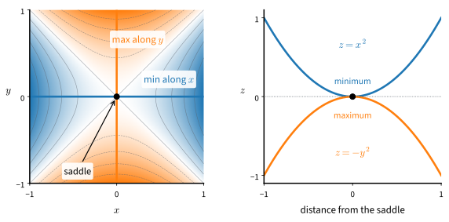
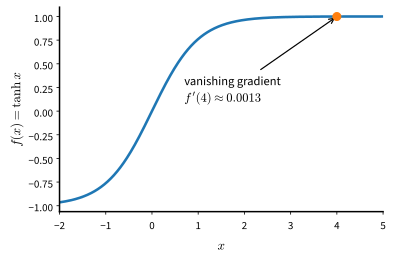

# Landscapes
:label:`sec_optimization-intro`

The training recipes of the earlier chapters differed in their additions,
momentum in one, warmup or weight decay in another. Underneath, all of
them repeated one step: compute the gradient of the loss on a minibatch,
and move the parameters a short distance against it. Even so, the loss
fell quickly for some models and slowly for others. The step was the same
each time. What differed was the function it was applied to.

A model with a million parameters defines a loss over a million-dimensional
space, and it helps to think of this function as a landscape on which the
optimizer walks downhill, able to measure only the slope under its feet.
Whether a step makes progress depends on the shape of the surface nearby.
Where the surface is flat, the slope says almost nothing. Where it forms a
narrow valley, steep across and gentle along, we meet the difficulty that
the chapter introduction put first: a step short enough to be safe across
the valley barely moves along it.

Which shape is to blame when training is slow? The hazard with the longest
reputation is a third one, the local minimum: a dip in the hillside in
which the walk ends too early. If it were the main hazard, a good
optimizer would be one that climbs out of dips. This section takes the
other side: uneven curvature is what slows training, and the points where
the slope vanishes do less harm than their reputation suggests.

We first fix the function that an optimizer is given. Then we take the
simplest surface with uneven curvature, a valley in two variables, and
work out by hand which learning rates are safe on it, which one is best,
and how many steps the best one needs. With these answers we return to the
points where the slope vanishes, and we end by asking how much of a
network's loss a valley can describe. The optimizer throughout is the
plain gradient step. We analyze it completely because the valley stays
with us for the rest of the chapter: every later method answers something
that goes wrong on it.

```{.python .input #optimization-intro-goal-of-optimization-1}
%%tab pytorch
import math
import numpy as np
import torch
from torch import nn
from torch.nn import functional as F
from d2l import torch as d2l
```

```{.python .input #optimization-intro-goal-of-optimization-1}
%%tab jax
import math
import numpy as np
import jax
from jax import numpy as jnp
from flax import nnx
import optax
from d2l import jax as d2l
```

## The Goal of Optimization

What is an optimizer asked to minimize? In this chapter it is the
*empirical risk*, the average loss over the training set, viewed as a
function of all parameters at once. Optimization texts call the function
to be minimized the *objective* and collect its arguments into a single
vector $\mathbf{x}$. We follow them: $\mathbf{x}$ holds everything that
earlier chapters wrote as $(\mathbf{w}, b)$. Linear regression had a
formula for the minimizer of its objective
(:numref:`sec_linear_regression`). A deep network has none, so every
method in this chapter is iterative: it starts somewhere and improves the
parameters step by step.

Learning wants something else, a low *risk*, the expected loss on examples
the model has not seen (:numref:`subsec_empirical-risk-and-risk`). The two
differ because the training set is a finite sample. No optimizer can
remove that difference, and regularization and model selection are the
tools for it (:numref:`sec_generalization_basics`). In this chapter we
therefore ask a narrower question: how fast, and how reliably, does a
method lower the objective it is given? The optimizer is not quite a
bystander in generalization, though, and we shall see at the end of the
section where it comes in.

## A Narrow Valley

General loss surfaces are hard to study. Let us therefore start from the
simplest surface that has uneven curvature, a quadratic in two variables:

$$f(\mathbf{x}) = 0.1 x_1^2 + 2 x_2^2.$$
:eqlabel:`eq_opt-intro-valley`

Its minimum is at the origin. By the *curvature* of $f$ in a direction we
mean its second derivative along that direction. This function curves
gently along $x_1$, with curvature $\lambda_1 = 0.2$, and steeply along
$x_2$, with curvature $\lambda_2 = 4$, so its contours are ellipses about
four and a half times as long as they are wide: a valley. We minimize it
by gradient descent, the update we have used in one form or another since
:numref:`sec_linear_regression`: step against the gradient with a learning
rate $\eta$, that is, $\mathbf{x} \leftarrow \mathbf{x} - \eta \nabla
f(\mathbf{x})$. The gradient of the valley is $(0.2 x_1, 4 x_2)$, so each
step multiplies the two coordinates by fixed factors,

$$x_1 \leftarrow (1 - 0.2\eta)\, x_1, \qquad x_2 \leftarrow (1 - 4\eta)\, x_2.$$

The coordinates do not interact, and each makes its own demand on $\eta$.
The steep coordinate sets a ceiling: $x_2$ shrinks only if
$|1 - 4\eta| < 1$, that is, if $\eta < 0.5$. The flat coordinate sets the
pace: below that ceiling, $1 - 0.2\eta$ stays above $0.9$, so each step
removes less than a tenth of the distance along $x_1$.

Let us take $\eta = 0.45$, just under the ceiling, and start at
$(-5, -2)$. The steep factor is $1 - 4 \cdot 0.45 = -0.8$, so $x_2$ should
overshoot the valley floor on every step, flipping its sign and losing a
fifth of its size. The flat factor is $0.91$, so $x_1$ should shed only
nine percent of its remaining distance per step. At that rate every factor
of ten along $x_1$ takes about 24 steps, and 30 steps should leave $x_1$
near $-5 \cdot 0.91^{30} \approx -0.3$. We run the 30 steps and plot both
coordinates against the step count. The array `h` in the code holds the
two curvatures.

```{.python .input #optimization-intro-an-ill-conditioned-valley}
%%tab pytorch, jax
h = np.array([0.2, 4.0])  # Curvatures h1, h2 along x1 and x2

def gd_valley(eta, steps, x0=(-5.0, -2.0)):
    """Gradient descent on the valley; returns all iterates."""
    xs = [np.array(x0)]
    for _ in range(steps):
        xs.append(xs[-1] - eta * h * xs[-1])  # The gradient is h * x
    return np.stack(xs)

xs = gd_valley(0.45, steps=30)
d2l.plot(np.arange(31), [xs[:, 0], xs[:, 1]], 'step', 'coordinate',
         legend=['$x_1$', '$x_2$'])
```

The plot shows both predictions. The steep coordinate swings from side to
side and is too small to see after twenty steps, while the flat one is
still at $-0.3$ when the run ends. Seen from above, the walk is a zigzag.
The first step moves the iterate by $3.6$ across the valley and by only
$0.45$ along it, and the steps that follow keep crossing from one wall to
the other while they creep along the floor.

Could another learning rate do better? We count the steps until both
coordinates are within 1% of the minimum, measured relative to where they
started.

```{.python .input #optimization-intro-an-ill-conditioned-valley-1}
%%tab pytorch, jax
print('  eta   factor x1   factor x2   steps to 1%')
for eta in [0.1, 0.2, 0.3, 0.4, 0.45, 2 / 4.2, 0.49, 0.5]:
    xs = gd_valley(eta, steps=1000)
    done = np.all(np.abs(xs) <= 0.01 * np.abs(xs[0]), axis=1)
    steps = int(np.argmax(done)) if done.any() else 'never'
    print(f'{eta:5.3f}   {1 - 0.2 * eta:9.3f}   {1 - 4 * eta:9.3f}   '
          f'{steps:>11}')
```

Small learning rates are slow because the flat factor stays near one.
Raising $\eta$ helps until the steep factor, which grows more negative,
overtakes the flat one in size. The best rate balances the two:
$1 - 0.2\eta = -(1 - 4\eta)$ gives $\eta = 2/4.2 \approx 0.476$, where both
factors have size $0.905$. There the count bottoms out at 47 steps, and no
other choice of $\eta$ does better. Just above it the steep coordinate
becomes the slow one, and at $\eta = 0.5$ it stops shrinking altogether.

The table is lopsided around its best row: 49 steps at $\eta = 0.45$, 113
at $\eta = 0.49$. Close to the ceiling, a learning rate slightly too large
costs far more than one slightly too small.

## The Condition Number

Is the count of 47 an accident of this valley? Nothing in the argument
used that the valley is aligned with the coordinate axes, or that it has
two variables. Let us consider a general quadratic,

$$f(\mathbf{x}) = \frac{1}{2} \mathbf{x}^\top \mathbf{H} \mathbf{x},$$

where the symmetric matrix $\mathbf{H}$ is the *Hessian* of $f$, the
matrix of its second derivatives. For the valley,
$\mathbf{H} = \textrm{diag}(0.2, 4)$. A linear term would only move the
minimum away from the origin, so we leave it out.

The gradient of this function is $\mathbf{H}\mathbf{x}$, so a step of
gradient descent maps $\mathbf{x}$ to
$(\mathbf{I} - \eta\mathbf{H})\mathbf{x}$. That looks worse than before,
because $\mathbf{H}$ mixes the coordinates. It turns out that a better
choice of coordinates removes the mixing. Since $\mathbf{H}$ is symmetric,
it has orthogonal eigenvectors $\mathbf{v}_i$ with eigenvalues
$\lambda_i$, and we can write $\mathbf{x} = \sum_i c_i \mathbf{v}_i$.
Each eigenvector satisfies
$\mathbf{H}\mathbf{v}_i = \lambda_i \mathbf{v}_i$, so the step acts on
every term of the sum by itself:

$$(\mathbf{I} - \eta\mathbf{H}) \sum_i c_i \mathbf{v}_i = \sum_i (1 - \eta\lambda_i)\, c_i \mathbf{v}_i.$$

Each coefficient $c_i$ is multiplied by its own factor
$1 - \eta\lambda_i$, as $x_1$ and $x_2$ were. Measured along its
eigenvectors, every quadratic falls apart into independent coordinates,
one per eigenvector, each with its own curvature $\lambda_i$. This change
of coordinates is the one step of the section that takes an idea. What
follows is the arithmetic of the valley, done once more.

If all eigenvalues are positive, $\mathbf{H}$ is called *positive
definite*, the origin is the only minimum, and the quadratic is a valley
like ours, possibly turned in space. Both demands on the learning rate
return. Every factor must be smaller than one in size, and the largest
eigenvalue $\lambda_{\max}$ is the first to break that rule, so the
ceiling is $\eta < 2/\lambda_{\max}$, the $0.5$ of the valley. Below the
ceiling, $\eta\lambda_{\min}$ is less than
$2\lambda_{\min}/\lambda_{\max}$, so the coordinate of the smallest
eigenvalue $\lambda_{\min}$ keeps more than the fraction
$1 - 2\lambda_{\min}/\lambda_{\max}$ of its size per step. That is the
pace, and the curvatures enter it only through their ratio.

This ratio is the *condition number*,

$$\kappa = \frac{\lambda_{\max}}{\lambda_{\min}},$$

which is $4/0.2 = 20$ for the valley. A problem with a large $\kappa$ is
called *ill-conditioned*. Why should a ratio matter, and not the
curvatures themselves? Multiply the loss by ten. Every curvature is then
ten times larger and the ceiling ten times lower, but a learning rate ten
times smaller produces the same iterates, step for step. The learning
rate absorbs the scale of the loss. The condition number is what remains.

How many steps does the best learning rate need? It balances the two
extreme factors, as in the sweep. The factor of $\lambda_{\min}$ falls as
$\eta$ rises, and that of $\lambda_{\max}$, once it is negative, grows in
size, so the larger of the two is smallest where they are equal in size.
That happens at $\eta = 2/(\lambda_{\min} + \lambda_{\max})$, where both
have size $(\kappa - 1)/(\kappa + 1)$ and the factor of every eigenvalue
in between is no larger.

For large $\kappa$ this common factor is about $1 - 2/\kappa$. Let us
call the distance to the minimum the *error*. After $t$ steps the error
has shrunk by about $(1 - 2/\kappa)^t \approx e^{-2t/\kappa}$, since
$\log(1 - u) \approx -u$ for small $u$. Setting this equal to $\epsilon$
and solving for $t$ gives the number of steps that reduce the error to a
fraction $\epsilon$ of its starting value,

$$t \approx \frac{\kappa}{2} \log \frac{1}{\epsilon},$$

with $\log$ the natural logarithm. If you remember one formula from this
section, let it be this one. For the valley the common factor is
$19/21 = 0.905$ and the estimate is $10 \log 100 \approx 46$ steps,
against the 47 we counted. (The proof that no learning rate beats the
balanced one is in :numref:`subsec_mdl-quadratic-model`.) The number of
steps grows in proportion to $\kappa$, and no learning rate can change
that. To do better we have to change the method, which is what most of
this chapter does.

## Critical Points and Plateaus

A reader may object that the valley is too kind. It has a single minimum,
while the loss of a network has many, of different depth. Should we not
worry first about getting stuck in a poor one? The worry is about the
places where a gradient method loses its signal: *critical points*, where
the gradient is zero, and *plateaus*, where it is merely tiny. A *local
minimum*, where $f$ is no larger than at any nearby point, is a critical
point, and the gradient cannot tell it from the *global minimum*, where
$f$ is smallest over the whole domain. The evidence, however, is that
most critical points of a network's loss are not minima at all.

### Saddle Points
:label:`subsec_opt-intro-saddles`

The function $f(x, y) = x^2 - y^2$ has a critical point at the origin that
is neither a minimum nor a maximum (:numref:`fig_mdl-opt-saddle`). Along
the $x$-axis the origin is a minimum, along the $y$-axis it is a maximum,
and the surface has the shape of the saddle that gives such a point its
name, a *saddle point*.


:label:`fig_mdl-opt-saddle`

In high dimensions saddle points are the rule, and the Hessian shows why.
Its eigenvalues are the curvatures along its eigenvectors, as they were
for a quadratic. At a critical point of a function of $k$ variables, the
signs of the $k$ eigenvalues decide the shape:

* all $k$ eigenvalues positive: a local minimum;
* all $k$ negative: a local maximum;
* some positive and some negative: a saddle point;
* no negative and some zero eigenvalues, or no positive and some zero: the
  test is inconclusive, and higher-order terms decide. In one variable,
  $x^4$ and $x^3$ both have second derivative zero at the origin, and only
  the first has a minimum there.

A minimum needs every one of the $k$ signs to come out positive. If the
signs were independent fair coin flips, a critical point of a function with
$k = 1000$ parameters would be a minimum with probability
$2^{-1000} \approx 10^{-301}$, and nearly every critical point would be a
saddle. The coin-flip model is crude, of course. The eigenvalues of a
Hessian are not independent, as
Exercise :exref:`ex_optimization-intro-eigenvalues-symmetric-random-matrices`
shows, and the loss of a network is not a random function.

What supports the conclusion is measurement.
:citet:`Dauphin.Pascanu.Gulcehre.ea.2014` located critical points of small
networks and examined the Hessian at each. Critical points at high loss
are saddles with many descending directions, the fraction of negative
eigenvalues falls as the loss falls, and critical points at low loss have
few descending directions or none. Nobody has proved that large networks
behave the same way. It is the working assumption of the field, and of
this chapter.

Does a saddle trap gradient descent? Only if the iterate arrives on it
exactly. On $x^2 - y^2$ the valley's rule applies with one curvature of
each sign: a step multiplies $x$ by $1 - 2\eta$ and $y$ by $1 + 2\eta$. The
second factor exceeds one, so any nonzero $y$ grows geometrically. Only a
start on the line $y = 0$, the ridge of the saddle, runs into the origin.

This holds in general. Call a critical point a *strict saddle* if its
Hessian has at least one negative eigenvalue, so that some direction
curves downward. From a random start, gradient descent with a small enough
learning rate avoids any given strict saddle. The starting points that
lead into it form a set of measure zero, which a random start hits with
probability zero :cite:`Lee.Simchowitz.Jordan.ea.2016`.

How long does the escape take? From a start at distance $\delta$ from the
ridge, $|y|$ reaches one after $\log(1/\delta)/\log(1 + 2\eta)$ steps. At
$\eta = 0.1$ that is 38 steps for $\delta = 10^{-3}$ and 76 for
$\delta = 10^{-6}$: starting a thousand times closer only doubles the
wait. What does make a saddle slow is a small downward curvature. With
$-0.02$ in place of $-2$, the factor per step is $1.002$ and the 38 steps
become about 3,500. A slow saddle is slow for the same reason as the flat
direction of the valley. The noise of minibatch gradients is welcome
here, for once: it pushes the iterate off the ridge even when the start
lies on it, as
Exercise :exref:`ex_optimization-intro-saddle-escape-time` measures.

If critical points at high loss are saddles, and gradient methods leave
saddles, then the places where a run can come to rest have low loss. The
classical worry, a run stuck in a poor local minimum, has little support
left. The methods of this chapter are built for curvature and for noise.

### Plateaus

A gradient can also be too small to guide an update at a point that is not
critical at all. Suppose we minimize $f(x) = \tanh(x)$, starting from
$x = 4$ (:numref:`fig_mdl-opt-tanh-flat`). The derivative is
$f'(x) = 1 - \tanh^2(x)$, so $f'(4) \approx 0.0013$, and with $\eta = 1$
the first step moves the iterate by just that much. It takes about 370
steps to get from $x = 4$ to $x = 2$, and then fewer than twenty to reach
$x = -2$. Nearly the whole run is spent where nothing seems to happen.


:label:`fig_mdl-opt-tanh-flat`

This is the vanishing-gradient problem of
:numref:`sec_numerical_stability` in one variable. In a deep network the
gradient of an early layer is a product of one derivative per later layer,
and a product of many factors below one shrinks fast. The cure was found
in the design of the model. ReLU activations, careful initialization,
normalization layers and residual connections all keep that product from
collapsing (:numref:`subsec_activation-functions`,
:numref:`sec_batch_norm`, :numref:`sec_resnet`). Uneven curvature is
another matter: it is present at every step of every run, and dealing with
it is the optimizer's job.

## The Valley as a Model of a Network

The ceiling, the best learning rate and the step count were all worked
out on a quadratic bowl. How much of this holds for the loss of a
network, which is no bowl?

The valley is a *convex* function: the straight line between any two
points of its graph lies on or above the graph
(:numref:`sec_mdl-convexity` develops the notion). A convex function has
no saddle points and no local minima other than its global ones, so any
weakness an optimizer shows on a convex problem belongs to the optimizer.
A method that fails on a quadratic is unlikely to succeed on a
transformer, which is why the methods of this chapter meet the valley
before they meet a network.

The loss of a network is not convex, and a symmetry shows it. Permuting
the hidden units of a layer leaves the function a network computes
unchanged, so every minimum comes with a large family of copies of
itself, one per permutation. If the loss were convex, it could not rise
above the straight line between two of these copies, which is level at
the minimum value. Every point between them would be a minimizer, and so
would the average of all the copies. That average is a network whose
units in the layer are all identical. It is no more expressive than a
network with one unit, and unless one unit fits the data as well as the
whole layer does, its loss is higher
(Exercise :exref:`ex_optimization-intro-permutation-symmetric-minima`).

What a quadratic can describe is a neighborhood. Near any point, a smooth
loss is close to a quadratic whose matrix $\mathbf{H}$ is the Hessian of
the loss at that point, and gradient descent acts on each eigenvector of
that Hessian separately, as before. So we should ask what the Hessian of
a network looks like. It is not positive definite, not even at the end of
training. Measured on image classifiers, it has more than 99.99% of its
eigenvalues close to zero, some of them negative, and a largest
eigenvalue far above them, with a few isolated outliers in networks
without normalization layers :cite:`Ghorbani.Krishnan.Xiao.2019`. The
ratio $\lambda_{\max}/\lambda_{\min}$ is then infinite or negative and
says nothing.

What carries over is the comparison that the valley taught us to make.
The largest eigenvalue, called the *sharpness* of the loss, limits the
learning rate as $\lambda_2$ did on the valley. Below that limit, a
direction of positive curvature $\lambda$ covers only a fraction
$\eta\lambda$ of its remaining distance per step. The valley had one flat
direction, with a twentieth of the curvature of the steep one. A network
has a few steep directions, and nearly all the others are flat by
comparison. It is the narrow valley again, in an extreme form.

The valley also leaves things out. It has one minimizer, whereas the
empirical risk of a network has many, and they do not all generalize
equally well. Here the optimizer does have a say in generalization. The
ceiling applies at a minimizer as it does anywhere else, so gradient
descent cannot settle where the sharpness exceeds $2/\eta$, and the
learning rate thereby selects among minimizers.
Exercise :exref:`ex_optimization-intro-learning-rate-sharpness` lets you
watch the selection on a network with two weights.

The gradient of the valley is also exact. A minibatch gradient is an
estimate whose error does not vanish at the minimum, so a constant
learning rate leaves the parameters fluctuating around it
(:numref:`subsec_linear-regression-minibatch-sgd`). :numref:`sec_sgd`
adds this noise to the valley and computes how far from the minimum the
iterates stay.

Last, the valley gave us a ceiling for the learning rate and a best
value, but on a quadratic whose curvatures we chose ourselves. Nobody
tells us the curvatures of a network's loss. What limits the step on a
general function, and what would the ideal step be if the curvature could
be measured?

## Summary

An optimizer minimizes the empirical risk; the gap to the risk on new
data is not its to close, although the learning rate does select among
minimizers. What slows gradient descent is uneven curvature: the learning
rate must stay below $2/\lambda_{\max}$ for the steepest direction, and a
direction of curvature $\lambda$ then covers only a fraction
$\eta\lambda$ of its distance per step. On a quadratic the best learning
rate needs about $(\kappa/2) \log(1/\epsilon)$ steps, where
$\kappa = \lambda_{\max}/\lambda_{\min}$ is the condition number: 47 steps
to 1% on the valley, with $\kappa = 20$. Critical points do less harm: at
high loss they are saddle points, which gradient descent leaves, and the
plateaus of saturating activations are removed in the design of the
model. The loss of a network is not convex, but near any point it
resembles the valley in an extreme form, with a few sharp directions and
a nearly flat rest.

## Exercises

1. **Critical points and plateaus.** Gradient descent slows or stops at
   each of the following points: the origin of $f(x) = x^3$, the origin of
   $f(x, y) = x^2 - y^2$, and $x = 4$ for $f(x) = \tanh x$.
    1. Compute the gradient and the Hessian at each point. Classify each
       point by the eigenvalue test of :numref:`subsec_opt-intro-saddles`
       as a local minimum, local maximum, saddle, inconclusive case, or
       non-critical point.
    1. Gradient descent with learning rate $\eta$ on $f(x) = x^3$ starts
       at $x_0 = \epsilon$ or at $x_0 = -\epsilon$ for a small
       $\epsilon > 0$. For each sign, determine whether the iterates
       approach $0$ or move away, and find the rate at which $x_t$ decays
       on the side that approaches. Explain why the result on strict
       saddles stated in :numref:`subsec_opt-intro-saddles` does not apply
       to this point.
    1. Using $1 - \tanh^2 x \approx 4e^{-2x}$ for large $x$, show that
       gradient descent at $\eta = 1$ on $f(x) = \tanh x$ needs about
       $(e^{2x_0} - e^4)/8$ steps to move from $x_0 > 2$ to $x = 2$.
       Compare the estimate for $x_0 = 4$ with the count given in the
       text, and evaluate it for $x_0 = 8$.

    *Adapted from Simon Prince,
    [Understanding Deep Learning](https://udlbook.github.io/udlbook/),
    Problem 6.6.*

1. [code] **Saddle escape time.** Balancing a ball on the saddle of
   :numref:`fig_mdl-opt-saddle` is stable along $x$ and unstable along
   $y$, and gradient descent behaves the same way. Consider the saddle
   $f(x, y) = x^2 - \mu y^2$ with $\mu > 0$, whose downward curvature is
   $2\mu$, and start gradient descent with learning rate $\eta$ at
   $(1, \delta)$.
    1. Show that the number of steps until $|y| \geq 1$ is about
       $\log(1/\delta)/(2\eta\mu)$ when $\eta\mu$ is small. Check the
       estimate numerically for $\mu \in \{1, 0.01\}$ at
       $\delta = 10^{-2}$ and $\eta = 0.1$, and state what happens for
       $\delta = 0$. How many steps does the same learning rate need to
       shrink a coordinate of positive curvature $2\mu$ by the factor
       $\delta$?
    1. Set $\mu = 1$, add zero-mean Gaussian noise of standard deviation
       $\sigma$ to every gradient evaluation, and measure the escape time
       from $\delta = 0$ for $\sigma \in \{10^{-3}, 10^{-1}\}$. Reconcile
       the result with the statement in
       :numref:`subsec_opt-intro-saddles` that gradient descent from a
       random start avoids a strict saddle without noise.
   :exlabel:`ex_optimization-intro-saddle-escape-time`

1. [code] **An ill-conditioned valley.** Gradient descent on the valley
   :eqref:`eq_opt-intro-valley` multiplies $x_1$ by $1 - 0.2\eta$ and
   $x_2$ by $1 - 4\eta$ on every step, so it is stable for $\eta < 0.5$.
   The *step count* is the number of steps until both $|x_1|$ and $|x_2|$
   are below $1\%$ of their starting values.
    1. For $f(\mathbf{x}) = \frac{\lambda_{\min}}{2} x_1^2 +
       \frac{\lambda_{\max}}{2} x_2^2$, set $\eta = 1.8/\lambda_{\max}$,
       the same fraction of the stability limit $2/\lambda_{\max}$ as
       $\eta = 0.45$ is of $0.5$. Predict the step count from the two
       factors for $\kappa = \lambda_{\max}/\lambda_{\min} \in
       \{10, 100, 1000\}$, check it numerically, and compare it with the
       count $(\kappa/2)\log 100$ at the best learning rate.
    1. The section found the best rate by balancing the two factors. Prove
       that this is optimal: show that the learning rate minimizing the
       larger of $|1 - \eta\lambda_{\min}|$ and $|1 - \eta\lambda_{\max}|$
       is $\eta^\star = 2/(\lambda_{\min} + \lambda_{\max})$, that the
       factor it achieves is $(\kappa - 1)/(\kappa + 1)$, and that a
       direction with an eigenvalue between $\lambda_{\min}$ and
       $\lambda_{\max}$ shrinks at least as fast. Use the result to
       explain why tuning the learning rate cannot remove the dependence
       of the step count on $\kappa$.

1. [code] **Learning rate and sharpness.** A two-layer scalar linear
   network maps the input $1$ to the prediction $ab$ and is fit to the
   target $1$ with the loss $\ell(a, b) = \frac{1}{2}(ab - 1)^2$. Every
   point of the curve $ab = 1$ is a minimizer.
    1. Show that the Hessian at a minimizer $(a, b)$ has largest
       eigenvalue $\lambda_{\max} = a^2 + b^2$. Which minimizers are
       flattest?
    1. Run 200 steps of gradient descent from $(a, b) = (4, 0.1)$ at
       $\eta \in \{0.05, 0.1, 0.15, 0.2\}$. For each run, report the
       $\lambda_{\max}$ of the minimizer it reaches next to $2/\eta$.
    1. Explain the pattern with the stability condition
       $\eta < 2/\lambda_{\max}$.
   :exlabel:`ex_optimization-intro-learning-rate-sharpness`

1. **Permutation-symmetric minima.** ● Consider a multilayer perceptron with
   one hidden layer of $d \geq 2$ units and a single output, and let
   $\boldsymbol{\theta}^\star$ be a local minimum of its loss at which no
   two hidden units have identical incoming weights.
    1. Show that permuting the hidden units yields $d!$ distinct parameter
       vectors that all compute the same function and are therefore all
       local minima with the same loss.
    1. Suppose the loss were a convex function of the parameters. Show
       that the average of the $d!$ copies would then also be a global
       minimizer and that it computes the same function as a network with
       one hidden unit. Conclude that the loss is not convex whenever
       every network with one hidden unit has a higher loss than
       $\boldsymbol{\theta}^\star$.
    1. For the activation $\tanh$, identify a second symmetry of each
       hidden unit, state the resulting count of equivalent minima, and
       give a condition on $\boldsymbol{\theta}^\star$ under which all of
       them are distinct.
   :exlabel:`ex_optimization-intro-permutation-symmetric-minima`

1. **Eigenvalues of symmetric random matrices.** ● Let $\mathbf{M}$ be a
   random symmetric $k \times k$ matrix whose entries $M_{ij} = M_{ji}$,
   $i \leq j$, are drawn independently from distributions $p_{ij}$ with
   $p_{ij}(x) = p_{ij}(-x)$ :cite:`Wigner.1958`.
    1. Prove that an eigenvalue $\lambda$ drawn uniformly at random from
       the $k$ eigenvalues of $\mathbf{M}$ satisfies
       $P(\lambda > 0) = P(\lambda < 0)$.
    1. Explain why this symmetry alone does not determine the fraction of
       negative eigenvalues in a single realization of $\mathbf{M}$. The
       semicircle law of :citet:`Wigner.1958` does: when the off-diagonal
       entries are identically distributed with variance $\sigma^2$, the
       histogram of the eigenvalues of $\mathbf{M}/\sqrt{k}$ approaches
       the density $\sqrt{4\sigma^2 - \lambda^2}/(2\pi\sigma^2)$ on
       $[-2\sigma, 2\sigma]$ as $k$ grows. What fraction of the
       eigenvalues of one large $\mathbf{M}$ is negative?
    1. The coin-flip heuristic of :numref:`subsec_opt-intro-saddles`
       treats the $k$ signs as independent, so all of them are positive
       with probability $2^{-k}$. For $k = 2$, draw the diagonal entries
       from $\mathcal{N}(0, 1)$ and the off-diagonal entry from
       $\mathcal{N}(0, 1/2)$. Compute the probability that both
       eigenvalues are positive, compare it with $2^{-2}$, and state what
       the gap says about the independence assumption.
   :exlabel:`ex_optimization-intro-eigenvalues-symmetric-random-matrices`

:begin_tab:`pytorch`
[Discussions](https://d2l.discourse.group/t/487)
:end_tab:

:begin_tab:`jax`
[Discussions](https://d2l.discourse.group/t/489)
:end_tab:

<!-- slides -->

::: {.slide}
::: {.cover}
[Dive into Deep Learning · §9.1]{.kicker}

Landscapes<br>
**the goal of optimization · a narrow valley · the condition number · saddle points and plateaus · the valley as a model of a network**
:::
:::

::: {.slide title="One Learning Rate Must Serve Curvatures 0.2 and 4"}
[The problem]{.kicker}

The valley $f(\mathbf{x}) = 0.1 x_1^2 + 2 x_2^2$ has **curvature** (second
derivative) $0.2$ along $x_1$ and $4$ along $x_2$. Gradient descent with
learning rate $\eta$ steps against the gradient $(0.2 x_1, 4 x_2)$:

$$\mathbf{x} \leftarrow \mathbf{x} - \eta \nabla f(\mathbf{x}): \qquad x_1 \leftarrow (1 - 0.2\eta)\, x_1, \quad x_2 \leftarrow (1 - 4\eta)\, x_2$$

- $\eta \geq 0.5$: the steep coordinate $x_2$ never shrinks.
- $\eta < 0.5$: the flat coordinate $x_1$ keeps more than 90% per step.

::: {.d2l-note}
The best $\eta$ still needs **47 steps** to get within 1% of the minimum.
:::
:::

::: {.slide title="By the End of This Deck You Can"}
[Goals]{.kicker}

- say what an optimizer can and cannot fix about generalization;
- predict each coordinate's factor $1 - \eta\lambda$ from its curvature
  $\lambda$, and the largest stable learning rate;
- compute the best learning rate and the step count from the condition
  number;
- classify a critical point from the signs of its Hessian eigenvalues;
- explain why saddle points and plateaus rarely limit training.

**Running example:** the valley, curvatures 0.2 and 4, start $(-5, -2)$.
**The idea:** uneven curvature, not critical points, sets the speed of
training.
:::

::: {.slide title="Landscapes Opens the Chapter on a Valley We Can Solve by Hand"}
[Where this fits]{.kicker}

::: {.cols .vc}
::: {.col}
| part | decks |
|---|---|
| **1 · Two problems:** uneven curvature, noisy gradients | **Landscapes** · Gradient Descent · Stochastic and Minibatch Gradient Descent |
| **2 · Direction:** which way to step | Two Test Models · Momentum · Adam · AdamW · Muon |
| **3 · The run:** step size over time, noise level, model width | Schedules · Batch Size · Scaling Up · Practice |
:::

::: {.col .narrow}
- **Uses:** gradients, eigenvalues of a symmetric matrix.
- **Skips:** gradient noise (the SGD deck) and proofs.
:::
:::
:::

::: {.slide title="The Optimizer Minimizes the Empirical Risk, Not the Risk"}
[The goal]{.kicker}

- **Objective:** the empirical risk, the average loss on the training
  set, as a function of all parameters $\mathbf{x}$.
- **Learning wants:** a low risk, the expected loss on new data.
- A network has no formula for its minimizer, so every method iterates.

::: {.d2l-note}
The gap between the two comes from sampling the data. No optimizer closes
it, so we ask how fast a method lowers the objective it is given.
:::
:::

::: {.slide title="The Steep Coordinate Flips Sign, the Flat One Creeps"}
[The valley]{.kicker}

@!optimization-intro-an-ill-conditioned-valley

$\eta = 0.45$, 30 steps from $(-5, -2)$. Predicted: $x_2$ times $-0.8$ per
step, $x_1$ times $0.91$, so $x_1$ ends near
$-5 \cdot 0.91^{30} \approx -0.3$. The first step moves $3.6$ across the
valley and $0.45$ along it: a zigzag.
:::

::: {.slide title="No Learning Rate Beats 47 Steps"}
[The valley]{.kicker}

Steps until both coordinates are within 1% of the minimum, from $(-5, -2)$:

| $\eta$ | 0.1 | 0.45 | 0.476 | 0.49 | 0.5 |
|---|---:|---:|---:|---:|---:|
| factor $x_1$ | 0.98 | 0.91 | 0.905 | 0.902 | 0.9 |
| factor $x_2$ | 0.6 | −0.8 | −0.905 | −0.96 | −1 |
| steps | 228 | 49 | 47 | 113 | never |

::: {.d2l-note}
Raising $\eta$ shrinks the flat factor, while the steep one turns
negative and grows in size. The slower coordinate is fastest where the two
balance:
$1 - 0.2\eta = -(1 - 4\eta)$, so $\eta = 2/4.2 \approx 0.476$.
:::
:::

::: {.slide title="Check: Which Coordinate Is Slow at η = 0.49?"}
[Check]{.kicker}

On the valley, gradient descent at $\eta = 0.49$ needs 113 steps, more
than twice as many as at $\eta = 0.45$. Which coordinate is to blame?

::: {.fragment .fade-up}
$x_2$: its factor is $1 - 4 \cdot 0.49 = -0.96$, larger in size than the
flat factor $0.902$. Close to the ceiling, a rate slightly too large costs
far more than one slightly too small.
:::
:::

::: {.slide title="Along Its Eigenvectors, Every Quadratic Has One Factor per Curvature"}
[The condition number]{.kicker}

$f(\mathbf{x}) = \frac{1}{2}\mathbf{x}^\top\mathbf{H}\mathbf{x}$ with
Hessian $\mathbf{H}$, the matrix of second derivatives (valley:
$\textrm{diag}(0.2, 4)$). One step of gradient descent:

$$\mathbf{x} \leftarrow (\mathbf{I} - \eta\mathbf{H})\,\mathbf{x}$$

Write $\mathbf{x} = \sum_i c_i \mathbf{v}_i$ with eigenvectors
$\mathbf{H}\mathbf{v}_i = \lambda_i\mathbf{v}_i$. Then

$$c_i \leftarrow (1 - \eta\lambda_i)\, c_i$$

::: {.d2l-note}
All $\lambda_i > 0$: a valley. The largest eigenvalue sets the ceiling,
$\eta < 2/\lambda_{\max}$. The smallest, $\lambda_{\min}$, sets the pace.
:::
:::

::: {.slide title="Steps Grow in Proportion to the Condition Number"}
[The condition number]{.kicker}

$$\kappa = \frac{\lambda_{\max}}{\lambda_{\min}}, \qquad \textrm{valley: } \frac{4}{0.2} = 20$$

- Best rate $\eta = 2/(\lambda_{\min} + \lambda_{\max})$: both extreme
  factors have size $(\kappa - 1)/(\kappa + 1) \approx 1 - 2/\kappa$, here
  $19/21 = 0.905$.
- After $t$ steps the error (distance to the minimum) has shrunk by
  $(1 - 2/\kappa)^t \approx e^{-2t/\kappa}$.

::: {.d2l-note}
Error down to a fraction $\epsilon$: about
$\frac{\kappa}{2}\log\frac{1}{\epsilon}$ steps (natural logarithm).
Valley: $10 \log 100 \approx 46$, counted 47.
:::
:::

::: {.slide title="Check: Multiply the Loss by 10. What Changes?"}
[Check]{.kicker}

The valley becomes $f(\mathbf{x}) = x_1^2 + 20 x_2^2$. What are the
ceiling, the best learning rate, the condition number, and the steps to
1%?

::: {.fragment .fade-up}
- Curvatures 2 and 40: ceiling $2/40 = 0.05$, best
  $\eta = 2/42 \approx 0.048$, ten times smaller.
- $\kappa = 40/2 = 20$ and 47 steps, both unchanged.

The learning rate absorbs the scale of the loss. The condition number is
what remains.
:::
:::

::: {.slide title="A Saddle Curves Up in One Direction and Down in Another"}
[Critical points]{.kicker}

{width=74%}

A **critical point** has zero gradient. At the origin of $z = x^2 - y^2$
it is a minimum along $x$ and a maximum along $y$: a **saddle point**.
:::

::: {.slide title="Hessian Eigenvalue Signs Classify a Critical Point"}
[Critical points]{.kicker}

| eigenvalues of the Hessian | critical point |
|---|---|
| all positive | local minimum |
| all negative | local maximum |
| some positive, some negative | saddle |
| zeros, all others one sign | inconclusive |

::: {.d2l-note}
Coin-flip signs, $k = 1000$ parameters: a minimum with probability
$2^{-1000} \approx 10^{-301}$. Crude, but measured on small networks:
critical points at high loss are saddles.
:::

[Dauphin et al., 2014]{.small}
:::

::: {.slide title="Check: Minimum, Saddle, or Inconclusive?"}
[Check]{.kicker}

The gradient is zero, and the Hessian is

1. $\textrm{diag}(2, 3)$
2. $\textrm{diag}(2, -1)$
3. $\textrm{diag}(0, 3)$

::: {.fragment .fade-up}
1. Local minimum: both curvatures positive.
2. Saddle: up along the first axis, down along the second.
3. Inconclusive: the flat direction is decided by higher-order terms
   ($x_1^4$ gives a minimum, $x_1^3$ does not).
:::
:::

::: {.slide title="Gradient Descent Leaves a Saddle Unless It Starts on the Ridge"}
[Critical points]{.kicker}

On $x^2 - y^2$, one step with learning rate $\eta$:

$$x \leftarrow (1 - 2\eta)\, x, \qquad y \leftarrow (1 + 2\eta)\, y$$

- Only a start on the ridge $y = 0$ ends on the saddle: probability zero
  for a random start.
- From $|y| = \delta$, reaching $|y| = 1$ takes
  $\log(1/\delta)/\log(1 + 2\eta)$ steps. At $\eta = 0.1$: 38 steps from
  $\delta = 10^{-3}$, 76 from $10^{-6}$.

::: {.d2l-note}
High-loss critical points are saddles, and descent leaves saddles: a run
comes to rest only at low loss.
:::

[Lee et al., 2016]{.small}
:::

::: {.slide title="A Plateau Stalls Descent Without a Critical Point"}
[Plateaus]{.kicker}

::: {.cols .vc}
::: {.col}
{width=100%}
:::

::: {.col}
$f(x) = \tanh x$ from $x = 4$, with $\eta = 1$:

- slope $f'(4) \approx 0.0013$;
- about 370 steps from $x = 4$ to $x = 2$;
- 16 more from $x = 2$ to $x = -2$.
:::
:::

::: {.d2l-note}
Deep networks: the gradient of an early layer is a product of one
derivative per later layer. ReLU, initialization, normalization and
residual connections keep it alive. The fix is in the model.
:::
:::

::: {.slide title="A Network's Loss Is Not Convex: Every Minimum Has d! Copies"}
[Beyond the valley]{.kicker}

- **Convex:** the line between two points of the graph lies on or above
  it, so every point between two minimizers is a minimizer.
- Permuting the $d$ hidden units of a layer gives $d!$ copies of a
  minimum. Their average has $d$ identical units and, unless one unit
  suffices, a higher loss.

::: {.d2l-note}
Not convex, yet convex problems remain the test: a method that fails on a
quadratic is unlikely to succeed on a transformer.
:::
:::

::: {.slide title="Locally, a Network Is a Far Narrower Valley"}
[Beyond the valley]{.kicker}

Near any point a smooth loss is close to a quadratic with the Hessian
$\mathbf{H}$ of that point.

| | the valley | image classifiers |
|---|---|---|
| eigenvalues of $\mathbf{H}$ | 0.2 and 4 | over 99.99% near zero, some negative; the largest far above |
| $\lambda_{\max}/\lambda_{\min}$ | 20 | infinite or negative |

::: {.d2l-note}
What carries over: the largest eigenvalue, the **sharpness**, limits
$\eta$, and a direction of curvature $\lambda > 0$ covers only a fraction
$\eta\lambda$ of its distance per step.
:::

[Ghorbani et al., 2019]{.small}
:::

::: {.slide title="A Network Adds Many Minimizers, Noise and Unknown Curvatures"}
[Beyond the valley]{.kicker}

| the valley | a network | consequence |
|---|---|---|
| one minimizer | many, not equally good on new data | descent cannot settle where the sharpness exceeds $2/\eta$: the learning rate selects |
| exact gradient | minibatch estimate | a constant $\eta$ leaves the parameters fluctuating around the minimum |
| curvatures we chose | curvatures nobody tells us | the ceiling has to be found another way |
:::

::: {.slide title="Check: A Valley with Condition Number 1000"}
[Check]{.kicker}

Curvatures $0.004$ and $4$. With the best fixed learning rate, about how
many steps reduce the error by a factor of 100? And at $\eta = 0.45$?

::: {.fragment .fade-up}
- Best $\eta \approx 2/4.004$: about $(1000/2) \cdot \log 100 \approx 2300$
  steps.
- $\eta = 0.45$: the flat factor is $1 - 0.0018$, so
  $\log 100 / 0.0018 \approx 2560$ steps; the steep factor $-0.8$ is no
  bottleneck.
:::
:::

::: {.slide title="Recap"}
[Wrap-up]{.kicker}

- The optimizer minimizes the empirical risk. It cannot close the gap to
  the risk, but the learning rate selects among minimizers.
- The valley, curvatures 0.2 and 4: ceiling $\eta < 0.5$, best
  $\eta \approx 0.476$, never fewer than 47 steps to 1%.
- $\kappa = \lambda_{\max}/\lambda_{\min} = 20$: about
  $(\kappa/2)\log(1/\epsilon)$ steps at the best rate.
- Saddles are left behind, and plateaus are fixed in the model.
- A network is locally a far narrower valley: a few sharp directions, the
  rest nearly flat.

**Next:** what limits the step on a general function, and the ideal step
when the curvature is known.
:::
