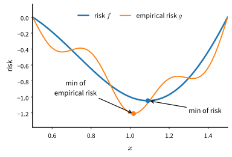
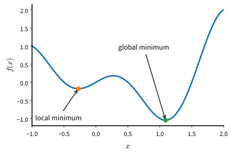
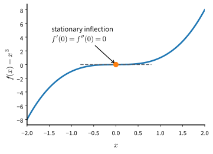
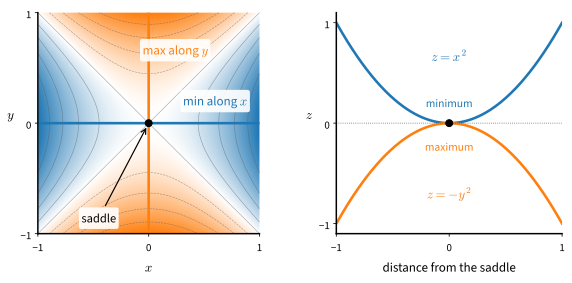
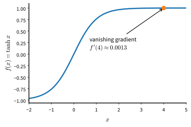

# Landscapes
:label:`sec_optimization-intro`

Training a network is a walk downhill. A model with a million parameters
defines a loss over a million-dimensional space, and every optimizer in this
chapter does the same thing on that surface: it measures the slope where it
stands and takes a step. Whether the step makes progress depends on the
shape of the surface nearby. Where the surface is flat, the slope carries
almost no information and the step goes nowhere. Where it curves steeply in
one direction and gently in another, a step small enough to be safe in the
steep direction barely moves along the gentle one. And because the slope is
computed from a minibatch rather than from the whole dataset, every step is
also slightly wrong.

This section examines these shapes before we build any optimizer. We first
ask what minimizing the training loss achieves and what it cannot achieve.
We then look at the points where the slope vanishes: local minima, saddle
points, and plateaus. The larger part of the section is about two effects
that slow routine training far more often than critical points do: uneven
curvature and noisy gradients. We measure the first on a two-dimensional valley that the rest
of the chapter reuses, and we watch a small network adjust its own
curvature to the step size. Convex analysis, the source of most of our
vocabulary, closes the section.

## The Goal of Optimization

In optimization, the function to be minimized is called the *objective
function*. By convention we minimize; maximizing a quantity is the same as
minimizing its negative. Optimization texts also collect all parameters
into a single vector $\mathbf{x}$, and we follow them in this chapter:
$\mathbf{x}$ holds everything that earlier chapters wrote as
$(\mathbf{w}, b)$.

Optimization and learning share a loss function but not a goal. The optimizer
minimizes the *empirical risk*, the average loss over the training set.
Learning wants a low *risk*, the expected loss over the whole population of
examples the model will ever see (:numref:`subsec_empirical-risk-and-risk`).
The optimizer only ever sees the former, and as
:numref:`sec_generalization_basics` showed, driving the training error
toward zero can even raise the error on new data.

```{.python .input #optimization-intro-goal-of-optimization-1}
%%tab pytorch
import math
import numpy as np
import torch
from torch import nn
from torch.nn import functional as F
from d2l import torch as d2l
```

```{.python .input #optimization-intro-goal-of-optimization-1}
%%tab jax
import math
import numpy as np
import jax
from jax import numpy as jnp
from flax import nnx
import optax
from d2l import jax as d2l
```

```{.python .input #optimization-intro-the-goal-of-optimization-1}
%%tab jax
import functools
import random
```

A one-dimensional example shows the difference. Let $f$ be a smooth risk
and let $g$ be an empirical risk that fluctuates around it, as a
finite-sample average fluctuates around its expectation. The minimum of $g$
need not sit at the minimum of $f$, and in
:numref:`fig_mdl-opt-risk-gap` it does not.


:label:`fig_mdl-opt-risk-gap`

No optimizer can close this gap, because it comes from sampling the data,
not from the algorithm. Regularization and model selection address it. For
the rest of the chapter we therefore set generalization aside and take the
objective at face value. Even so, the problem is hard. A deep network's
objective has no closed-form minimizer like the one we found for linear
regression in :numref:`sec_linear_regression`, so every algorithm in this
chapter is iterative, and the surface it iterates over is far from a
convex bowl.

## Critical Points and Plateaus

An iterative method needs a signal to follow, and the gradient is that
signal. The signal gives out at *critical points*, where the gradient is
zero, and nearly gives out on *plateaus*, where it is tiny. These are the
classical hazards of nonconvex optimization, and we look at each in turn.

### Local Minima

If the value of $f$ at $x$ is smaller than at any nearby point, then $x$ is
a *local minimum*. If it is smallest over the entire domain, $x$ is the
*global minimum*. The function

$$f(x) = x \cos(\pi x), \quad -1 \leq x \leq 2,$$

has one of each (:numref:`fig_mdl-opt-local-minima`).


:label:`fig_mdl-opt-local-minima`

An iterate that lands near either minimum sees its gradient shrink toward
zero, so from the gradient alone a local minimum cannot be told apart from the
global one. Deep learning objectives have many local minima. Noise in the
gradient can move the parameters out of a shallow basin. This is one
reason, as we will see below, why minibatch noise is not purely a nuisance.

### Saddle Points
:label:`subsec_opt-intro-saddles`

A *saddle point* is a critical point that is neither a minimum nor a
maximum. In one dimension the closest example is $f(x) = x^3$
(:numref:`fig_mdl-opt-inflection`): its first and second derivatives both
vanish at $x = 0$, so gradient descent can stall there, although the
function keeps decreasing to the left. Strictly speaking, this point is a
*stationary inflection*. A true saddle, which curves up in one direction and
down in another, needs at least two dimensions; we use "saddle" for both.


:label:`fig_mdl-opt-inflection`

The function $f(x, y) = x^2 - y^2$ has a true saddle at the origin
(:numref:`fig_mdl-opt-saddle`). Along the $x$-axis the origin is a minimum,
along the $y$-axis it is a maximum, and the surface has the shape of the
saddle that gives the point its name.


:label:`fig_mdl-opt-saddle`

In high dimensions saddles become the rule. To see why, recall the
second-order test for a critical point of a function of $k$ variables. Its
Hessian, the $k \times k$ matrix of second derivatives, has $k$ real
eigenvalues, one curvature per principal direction, and their signs decide
the shape:

* all $k$ eigenvalues positive (the Hessian is *positive definite*): a
  strict local minimum;
* all $k$ negative: a strict local maximum;
* some positive and some negative (the Hessian is *indefinite*): a saddle
  point, called *strict* because at least one direction curves downward;
* no negative and some zero eigenvalues, or no positive and some zero: the
  test is inconclusive, and higher-order terms decide.

A strict local minimum needs all $k$ curvatures to be positive. If the signs were
independent fair coin flips, a critical point of a function with
$k = 1000$ parameters would be a minimum with probability
$2^{-1000} \approx 10^{-301}$, and nearly every critical point would be a
saddle. The coin-flip model is only a heuristic. The eigenvalues of a
Hessian are not independent, as
Exercise :exref:`ex_optimization-intro-eigenvalues-symmetric-random-matrices`
shows. At the critical points of real networks, the fraction of negative
eigenvalues falls as the loss falls: high-loss critical points are mostly
saddles, while low-loss ones are close to minima
:cite:`Dauphin.Pascanu.Gulcehre.ea.2014`. The measurements agree with the
heuristic where it matters: in high dimensions the critical points a method
meets on its way down are overwhelmingly saddles, not poor local minima.

### Plateaus

A gradient can also be too small to guide an update at a point that is not
critical at all. Suppose we minimize $f(x) = \tanh(x)$, starting from
$x = 4$. The derivative is $f'(x) = 1 - \tanh^2(x)$, so $f'(4) \approx
0.0013$. The surface is nearly flat at the starting point
(:numref:`fig_mdl-opt-tanh-flat`), and gradient descent barely moves for a
long time before it reaches the slope.


:label:`fig_mdl-opt-tanh-flat`

This is the vanishing-gradient problem of
:numref:`sec_numerical_stability` in one variable. In a deep network the
gradient of an early layer is a product of one derivative per later layer,
and a product of many factors below one shrinks fast. Saturating
activations made deep networks hard to train until ReLU activations and
careful initialization removed most such plateaus. Those fixes belong to
model design (:numref:`subsec_activation-functions`), not to the optimizer.

The classical hazards are real, but two facts soften them. Deep learning
does not need *the* global minimum: a good local minimum serves as well,
and at low loss most critical points are good. And what limits the speed
of routine training is usually something else, which we turn to next.

## Curvature and Noise

Two effects make training slow or unstable far more often than critical
points do. The curvature of the objective differs from direction to
direction, and the gradient we compute is only an estimate. Most methods in
this chapter address one of these effects or both.

### An Ill-Conditioned Valley

The smallest example of uneven curvature is a quadratic valley in two
variables,

$$f(\mathbf{x}) = 0.1 x_1^2 + 2 x_2^2.$$
:eqlabel:`eq_opt-intro-valley`

It curves gently along $x_1$, with second derivative $h_1 = 0.2$, and
steeply along $x_2$, with second derivative $h_2 = 4$, so its contours are
long, narrow ellipses. The gradient is $(0.2 x_1, 4 x_2)$. Gradient descent, the
simplest optimizer, steps against the gradient with a learning rate $\eta$:
$\mathbf{x} \leftarrow \mathbf{x} - \eta \nabla f(\mathbf{x})$. On this
valley each step multiplies the two coordinates by fixed factors,

$$x_1 \leftarrow (1 - 0.2\eta)\, x_1, \qquad x_2 \leftarrow (1 - 4\eta)\, x_2.$$

The steep coordinate sets a ceiling: $x_2$ shrinks only if
$|1 - 4\eta| < 1$, that is, if $\eta < 0.5$. The flat coordinate sets the
pace: below that ceiling, $1 - 0.2\eta$ stays above $0.9$, so each step
removes less than a tenth of the distance along $x_1$. This valley is the
running example of the chapter: gradient descent, stochastic gradient
descent, momentum, and Adam are all tested on it.

We run 30 steps from $(-5, -2)$ at $\eta = 0.45$, just under the ceiling,
and plot both coordinates against the step count.

```{.python .input #optimization-intro-an-ill-conditioned-valley}
%%tab pytorch, jax
h = np.array([0.2, 4.0])  # Curvatures h1, h2 along x1 and x2

def gd_valley(eta, steps, x0=(-5.0, -2.0)):
    """Gradient descent on the valley; returns all iterates."""
    xs = [np.array(x0)]
    for _ in range(steps):
        xs.append(xs[-1] - eta * h * xs[-1])  # The gradient is h * x
    return np.stack(xs)

xs = gd_valley(0.45, steps=30)
d2l.plot(np.arange(31), [xs[:, 0], xs[:, 1]], 'step', 'coordinate',
         legend=['$x_1$', '$x_2$'])
```

The steep coordinate overshoots the valley floor on every step. Its factor
is $1 - 4 \cdot 0.45 = -0.8$, so $x_2$ flips sign and loses a fifth of its
size each time. The flat coordinate never overshoots, but its factor is
$0.91$, so it sheds only nine percent of its remaining distance per step.
At that rate every factor of ten along $x_1$ takes about 24 steps, and after
30 steps $x_1$ is still $-0.3$. In the plane, the iterate zigzags across
the narrow valley while it creeps along its floor.

Could another learning rate do better? We count the steps until both
coordinates are within 1% of the minimum, measured relative to where they
started.

```{.python .input #optimization-intro-an-ill-conditioned-valley-1}
%%tab pytorch, jax
print('  eta   factor x1   factor x2   steps to 1%')
for eta in [0.1, 0.2, 0.3, 0.4, 0.45, 2 / 4.2, 0.49, 0.5]:
    xs = gd_valley(eta, steps=1000)
    done = np.all(np.abs(xs) <= 0.01 * np.abs(xs[0]), axis=1)
    steps = int(np.argmax(done)) if done.any() else 'never'
    print(f'{eta:5.3f}   {1 - 0.2 * eta:9.3f}   {1 - 4 * eta:9.3f}   '
          f'{steps:>11}')
```

Small learning rates are slow because the flat factor stays near one.
Raising $\eta$ helps until the steep factor, which grows more negative,
overtakes the flat one in size. The best rate balances the two:
$1 - 0.2\eta = -(1 - 4\eta)$ gives $\eta = 2/4.2 \approx 0.476$, where both
factors have size $0.905$, and the count bottoms out at 47 steps. Just
above it the steep coordinate becomes the slow one, and at $\eta = 0.5$ it
stops shrinking altogether. No choice of $\eta$ reaches 1% in fewer than
47 steps.

The quantity behind this floor is the ratio of the largest to the smallest
curvature, the *condition number*

$$\kappa = \frac{\lambda_{\max}}{\lambda_{\min}},$$

where $\lambda_{\max}$ and $\lambda_{\min}$ are the largest and smallest
eigenvalues of the Hessian. The valley's Hessian is diagonal, so its
eigenvalues are the two curvatures, $\lambda_{\min} = h_1 = 0.2$ and
$\lambda_{\max} = h_2 = 4$, and $\kappa = 20$. At the best rate,
$\eta = 2/(\lambda_{\min} + \lambda_{\max})$, both factors have size
$(\kappa - 1)/(\kappa + 1) \approx 1 - 2/\kappa$, which is
$19/21 = 0.905$ for the valley. Reducing the error by a factor $\epsilon$
then takes about $(\kappa/2) \log(1/\epsilon)$ steps, and for the valley
this is $10 \log 100 \approx 46$, the count we measured.
:numref:`subsec_mdl-quadratic-model` derives the formula. The cost of
gradient descent grows linearly with $\kappa$, and the $\kappa$ of a deep
network is far larger than 20. The Hessian of a trained network has a few
large eigenvalues and a bulk of eigenvalues near zero
:cite:`Ghorbani.Krishnan.Xiao.2019`, so its largest curvature exceeds the
typical one by factors of hundreds or more.

### The Edge of Stability

The valley treats curvature as a fixed property of the surface, and the
classical advice follows from it: measure the largest curvature
$\lambda_{\max}$, called the *sharpness*, and choose $\eta < 2/\lambda_{\max}$.
On real networks the dependence can run the other way.
:citet:`Cohen.Kaur.Li.ea.2021` trained networks with full-batch gradient
descent and found that the sharpness rises during training, a behavior
they named *progressive sharpening*, until it reaches about $2/\eta$, and
then stays there. The loss keeps falling, although not on every step, in a
regime that the quadratic analysis calls unstable. They called this regime
the *edge of stability*.

We can watch it happen on a network small enough to compute its full
Hessian. The network has one input, eight $\tanh$ hidden units, and one
output, 25 parameters in all, and it fits 16 points of $\sin(3x)$ on
$[-2, 2]$ with the squared loss. We train it from one random start with
full-batch gradient descent at $\eta = 0.4$ and at $\eta = 0.25$, whose
ceilings $2/\eta$ are 5 and 8, and compute the sharpness every 500 steps.

```{.python .input #optimization-intro-the-edge-of-stability-1}
%%tab pytorch
X = torch.linspace(-2, 2, 16)
Y = torch.sin(3 * X)

def mlp_loss(p):  # 8 hidden units: weights, biases, output weights, bias
    W1, b1, W2, b2 = p[:8], p[8:16], p[16:24], p[24]
    return 0.5 * ((torch.tanh(X[:, None] * W1 + b1) @ W2 + b2 - Y) ** 2).mean()

def sharpness(p):  # Largest eigenvalue of the Hessian
    return torch.linalg.eigvalsh(torch.func.hessian(mlp_loss)(p))[-1]

def gd_sharpness(eta, p, steps=20000, every=500):
    """Full-batch gradient descent; returns the sharpness every `every`
    steps and the final loss."""
    grad, sharp = torch.func.grad(mlp_loss), []
    for k in range(steps + 1):
        if k % every == 0:
            sharp.append(sharpness(p).item())
        p = p - eta * grad(p)
    return sharp, mlp_loss(p).item()

p0 = 0.5 * torch.randn(25)  # One random start for both runs
```

```{.python .input #optimization-intro-the-edge-of-stability-1}
%%tab jax
X = jnp.linspace(-2, 2, 16)
Y = jnp.sin(3 * X)

def mlp_loss(p):  # 8 hidden units: weights, biases, output weights, bias
    W1, b1, W2, b2 = p[:8], p[8:16], p[16:24], p[24]
    return 0.5 * ((jnp.tanh(X[:, None] * W1 + b1) @ W2 + b2 - Y) ** 2).mean()

def sharpness(p):  # Largest eigenvalue of the Hessian
    return jnp.linalg.eigvalsh(jax.hessian(mlp_loss)(p))[-1]

@functools.partial(jax.jit, static_argnames=('steps', 'every'))
def gd_sharpness(eta, p, steps=20000, every=500):
    """Full-batch gradient descent; returns the sharpness every `every`
    steps and the final loss."""
    def block(p, _):  # Measure, then take `every` steps
        p_next = jax.lax.fori_loop(
            0, every, lambda _, p: p - eta * jax.grad(mlp_loss)(p), p)
        return p_next, sharpness(p)
    p, sharp = jax.lax.scan(block, p, length=steps // every)
    return jnp.append(sharp, sharpness(p)), mlp_loss(p)

p0 = 0.5 * jax.random.normal(d2l.get_key(), (25,))  # One start for both runs
```

```{.python .input #optimization-intro-the-edge-of-stability-2}
%%tab pytorch, jax
runs = {eta: gd_sharpness(eta, p0) for eta in (0.4, 0.25)}
for eta, (sharp, loss) in runs.items():
    print(f'eta {eta}: sharpness {float(sharp[0]):.2f} -> '
          f'{float(sharp[-1]):.2f} (2/eta = {2 / eta:.0f}), loss '
          f'{float(mlp_loss(p0)):.3f}'
          f' -> {float(loss):.1e}')
steps = np.arange(0, 20001, 500)
ceilings = [np.full(len(steps), 2 / eta) for eta in (0.4, 0.25)]
d2l.plot(steps, [runs[0.4][0], runs[0.25][0], *ceilings],
         'step', 'sharpness', ylim=(0, 9), fmts=('C0-', 'C1-', 'C0:', 'C1:'),
         legend=[r'$\eta = 0.4$', r'$\eta = 0.25$', '$2/0.4$', '$2/0.25$'])
```

Both runs start from the same weights, with a sharpness well below 8 and
usually below 5. Neither stays there. In almost every run the sharpness
climbs until it reaches the ceiling of its own learning rate and then stays
close to $2/\eta$: near 5 for $\eta = 0.4$ and near 8 for $\eta = 0.25$.
Meanwhile the loss keeps falling by orders of magnitude, though not on
every step. The two runs differ only in $\eta$, yet they end in regions of
different curvature, each as sharp as its own learning rate allows.

Gradient descent stays at the edge because it corrects itself. When the
sharpness exceeds $2/\eta$, the iterate starts to oscillate along the
sharpest direction, as $x_2$ did on the valley, and this oscillation moves
the iterate toward flatter parts of the surface until the sharpness drops
back below the ceiling :cite:`Damian.Nichani.Lee.2023`. The quadratic
model predicts the oscillation but not what follows. The third-order term
of the Taylor expansion, which the quadratic model drops, turns the
oscillation into a drift toward lower sharpness. The quadratic analysis
misses this change of the surface under the iterate. Most results quoted in this
chapter assume monotone descent on a fixed surface, and the edge of
stability lies outside that assumption.

The start of training is delicate for a related reason. In large networks
the sharpness is often high at initialization and falls early in training,
the reverse of our small network. A learning rate
that suits the later surface can then diverge on the first steps, and
warmup keeps $\eta$ small until the sharpness has fallen
:cite:`Kalra.Barkeshli.2024` (:numref:`sec_scheduler`).

### Noisy Gradients
:label:`subsec_opt-intro-noise`

The second effect is that the gradient we use is an estimate. The
objective is an average of $n$ per-example losses, so its exact gradient
costs a pass over all $n$ examples, far too much for a single step on a
large dataset. Practical methods compute the gradient on a *minibatch* of
$b$ examples instead. This estimate is correct on average, and because it
averages $b$ independent terms, its variance is $1/b$ times the variance of
a single example's gradient.

Noise changes what a constant learning rate can achieve. Near the minimum
the true gradient is small, but the noise in its estimate is not, so the
iterates never settle. They keep moving inside a region around the minimum,
a *noise ball*, whose size grows with $\eta$. Convergence therefore needs a
learning rate that decays over time, and the batch size $b$ becomes a
second dial for the noise, with its own computational cost.

Noise is not only a nuisance. It can push the iterate off a saddle point or
out of a shallow basin. Gradient descent with a small enough learning rate
escapes strict saddles from a random start even without noise, because the
starting points that lead into a strict saddle form a set of measure zero
:cite:`Lee.Simchowitz.Jordan.ea.2016`. Escape can still take many steps,
and noise shortens it. Noise rarely lifts the iterate out of a deep
basin.

## The Role of Convexity

Every surface in this section except the valley has been nonconvex. Yet
the words we used to describe them (condition number, convergence rate,
noise ball) come from *convex* analysis, where they are the subjects of
theorems.
A convex function has no saddle points and no local minima other than its
global ones, so any weakness an optimizer shows on a convex problem belongs
to the optimizer. A method that fails on a quadratic is unlikely to succeed
on a transformer, which is why the first methods of this chapter meet the
valley before they meet a network.

Convex analysis also applies locally. Near a minimum, a smooth loss is
approximately a quadratic bowl, so the valley describes the last phase of
training reasonably well even when the surface as a whole is far from
convex. Some practical methods come directly from this local
approximation: averaging the iterates near the bottom of the bowl, as in stochastic weight
averaging :cite:`Izmailov.Podoprikhin.Garipov.ea.2018`, is a convex-analysis
idea that works on deep networks (:numref:`sec_practice`).

The local approximation does not extend to the whole surface. Permuting the
hidden units of a layer leaves the function a network computes unchanged,
so every minimum comes with a large family of copies of itself, one per
permutation. If the loss were convex, the average of these copies would be
a minimizer too. That average is a network whose units in the layer are
all identical. It is no more expressive than a network with one unit and
usually fits worse, as
Exercise :exref:`ex_optimization-intro-permutation-symmetric-minima` makes
precise. For deep learning, convexity is a local approximation
and a source of tools, never a global fact. The appendix develops convex
sets and functions, Jensen's inequality, and duality
(:numref:`sec_mdl-convexity`), and proves the convergence rates this chapter
quotes (:numref:`chap_mdl-optimization`).

## Three Decisions

What we have seen suggests that any optimizer can be described by three
decisions. The first is the *descent direction*. The negative gradient is
the steepest direction when the size of a step is measured by its Euclidean
length, and on the valley it points mostly across the valley rather than
along it. The second is the *step size over time*: how far to move along
the chosen direction, limited by the largest curvature, and how that
distance should change as training proceeds. The third is the *treatment of
noise*: the batch size and any averaging of gradients over steps decide how
noisy each update is.

Each method in this chapter is a particular set of these decisions.
Gradient descent (:numref:`sec_gd`) makes the plainest choice for each and
shows how dividing by the curvature would remove the condition number of
the valley altogether. Stochastic gradient descent (:numref:`sec_sgd`)
brings in the noise that the valley lacks. Momentum
(:numref:`sec_momentum`) averages gradients over steps, which builds up
speed along the flat floor of the valley and also damps the noise. Adam
(:numref:`sec_adam`) rescales the step coordinate by coordinate, and Muon
(:numref:`sec_muon`) measures the length of a step differently and so
changes the direction itself. Schedules and the batch size settle the
remaining two decisions in the later sections.

## Summary

Optimization minimizes the empirical risk, while learning wants a low risk
on new data, and no optimizer can close the gap between the two. On the
training objective, gradients vanish at local minima, at saddle points,
which dominate in high dimensions, and on plateaus such as saturated
activations. Routine training is limited more often by two other effects.
Uneven curvature forces one learning rate to serve both steep and flat
directions, so gradient descent needs a number of steps proportional to the
condition number $\kappa$: on the valley, with $\kappa = 20$, no learning
rate reaches 1% in fewer than 47 steps. Noise in minibatch gradients keeps a
constant learning rate from converging. Real networks also adapt their
curvature to the step size and train at the edge of stability. The rest of
the chapter builds optimizers that choose direction, step size, and noise
level better than plain gradient descent.

## Exercises

1. **Critical points and plateaus.** Gradient descent slows or stops at
   each of the following points: the critical points of
   $f(x) = x\cos(\pi x)$ in the interior of $[-1, 2]$, the origin of
   $f(x) = x^3$, the origin of $f(x, y) = x^2 - y^2$, and $x = 4$ for
   $f(x) = \tanh x$.
    1. Compute the gradient and the Hessian at each point, locating the
       critical points of $x\cos(\pi x)$ numerically. Classify each point
       by the eigenvalue test of :numref:`subsec_opt-intro-saddles` as a
       local minimum, local maximum, saddle, inconclusive case, or
       non-critical point.
    1. Gradient descent with learning rate $\eta$ on $f(x) = x^3$ starts
       at $x_0 = \epsilon$ or at $x_0 = -\epsilon$ for a small
       $\epsilon > 0$. For each sign, determine whether the iterates
       approach $0$ or move away, and find the rate at which $x_t$ decays
       on the side that approaches. Explain why the escape of strict
       saddles stated in :numref:`subsec_opt-intro-noise` does not apply
       to this point.
    1. Using $1 - \tanh^2 x \approx 4e^{-2x}$ for large $x$, estimate how
       many steps gradient descent at $\eta = 1$ needs to move from $x = 4$
       to $x = 2$ on $f(x) = \tanh x$.

    *Adapted from Simon Prince,
    [Understanding Deep Learning](https://udlbook.github.io/udlbook/),
    Problem 6.6.*

1. [code] **Saddle escape time.** Balancing a ball on the saddle
   $f(x_1, x_2) = x_1^2 - x_2^2$ of :numref:`fig_mdl-opt-saddle` is stable
   along $x_1$ and unstable along $x_2$. Gradient descent with learning
   rate $\eta$ started at $(1, \delta)$ behaves the same way.
    1. Write the iterates in closed form and derive the number of steps
       until $|x_2| \geq 1$ as a function of $\delta$ and $\eta$. Evaluate
       it for $\delta \in \{10^{-2}, 10^{-6}\}$ at $\eta = 0.1$, check both
       counts numerically, and state what happens for $\delta = 0$.
    1. Add zero-mean Gaussian noise of standard deviation $\sigma$ to every
       gradient evaluation and measure the escape time from $\delta = 0$
       for $\sigma \in \{10^{-3}, 10^{-1}\}$. Reconcile the result with
       the statement in :numref:`subsec_opt-intro-noise` that gradient
       descent from a random start escapes strict saddles without noise.

1. [code] **An ill-conditioned valley.** Gradient descent on the valley
   :eqref:`eq_opt-intro-valley` multiplies $x_1$ by $1 - 0.2\eta$ and
   $x_2$ by $1 - 4\eta$ on every step, so it is stable for $\eta < 0.5$.
   The *step count* is the number of steps until both $|x_1|$ and $|x_2|$
   are below $1\%$ of their starting values.
    1. For $f(\mathbf{x}) = \frac{\lambda_{\min}}{2} x_1^2 +
       \frac{\lambda_{\max}}{2} x_2^2$, set $\eta = 1.8/\lambda_{\max}$,
       the same fraction of the stability limit $2/\lambda_{\max}$ as
       $\eta = 0.45$ is of $0.5$. Predict the step count from the two
       factors for $\kappa = \lambda_{\max}/\lambda_{\min} \in
       \{10, 100, 1000\}$, check it numerically, and compare with the
       linear growth in $\kappa$ that :numref:`subsec_mdl-quadratic-model`
       derives.
    1. Derive the best rate that the section quotes: show that the learning
       rate minimizing the larger of the two factors
       $|1 - \eta\lambda_{\min}|$ and $|1 - \eta\lambda_{\max}|$ is
       $\eta^\star = 2/(\lambda_{\min} + \lambda_{\max})$, and that the
       factor it achieves is $(\kappa - 1)/(\kappa + 1)$. Use the result to
       explain why tuning the learning rate cannot remove the dependence of
       the step count on $\kappa$, and compare your derivation with the
       appendix's :eqref:`eq_mdl-opt-optimal-step`.

1. [code] **Learning rate and sharpness.** A two-layer scalar linear
   network $\hat{y} = abx$ is fit to the single example $(x, y) = (1, 1)$
   with the loss $\ell(a, b) = \frac{1}{2}(ab - 1)^2$. Every point of the
   curve $ab = 1$ is a minimizer.
    1. Show that the Hessian at a minimizer $(a, b)$ has largest
       eigenvalue $\lambda_{\max} = a^2 + b^2$. Which minimizers are
       flattest?
    1. Run 200 steps of gradient descent from $(a, b) = (4, 0.1)$ at
       $\eta \in \{0.05, 0.1, 0.15, 0.2\}$. For each run, report the
       $\lambda_{\max}$ of the minimizer it reaches next to $2/\eta$.
    1. Explain the pattern with the stability condition
       $\eta < 2/\lambda_{\max}$.

1. **Permutation-symmetric minima.** ● Consider a multilayer perceptron with
   one hidden layer of $d \geq 2$ units and a single output, and let
   $\boldsymbol{\theta}^\star$ be a local minimum of its loss at which no
   two hidden units have identical incoming weights.
    1. Show that permuting the hidden units yields $d!$ distinct parameter
       vectors that all compute the same function and are therefore all
       local minima with the same loss.
    1. Suppose the loss were a convex function of the parameters. Show
       that the average of the $d!$ copies would then also be a global
       minimizer and that it computes the same function as a network with
       one hidden unit. Conclude that the loss is not convex whenever
       every network with one hidden unit has a higher loss than
       $\boldsymbol{\theta}^\star$.
    1. For the activation $\tanh$, identify a second symmetry of each
       hidden unit, state the resulting count of equivalent minima, and
       give a condition on $\boldsymbol{\theta}^\star$ under which all of
       them are distinct.
   :exlabel:`ex_optimization-intro-permutation-symmetric-minima`

1. **Eigenvalues of symmetric random matrices.** ● Let $\mathbf{M}$ be a
   random symmetric $k \times k$ matrix whose entries $M_{ij} = M_{ji}$,
   $i \leq j$, are drawn independently from distributions $p_{ij}$ with
   $p_{ij}(x) = p_{ij}(-x)$ :cite:`Wigner.1958`.
    1. Prove that an eigenvalue $\lambda$ drawn uniformly at random from
       the $k$ eigenvalues of $\mathbf{M}$ satisfies
       $P(\lambda > 0) = P(\lambda < 0)$.
    1. Explain why this symmetry alone does not determine the fraction of
       negative eigenvalues in a single realization of $\mathbf{M}$. State
       what the semicircle law of :citet:`Wigner.1958` says about that
       fraction for large $k$ when the off-diagonal entries are
       identically distributed with finite variance.
    1. The coin-flip heuristic of :numref:`subsec_opt-intro-saddles`
       treats the $k$ signs as independent, so all of them are positive
       with probability $2^{-k}$. For $k = 2$, draw the diagonal entries
       from $\mathcal{N}(0, 1)$ and the off-diagonal entry from
       $\mathcal{N}(0, 1/2)$. Compute the probability that both
       eigenvalues are positive, compare it with $2^{-2}$, and state what
       the gap says about the independence assumption.
   :exlabel:`ex_optimization-intro-eigenvalues-symmetric-random-matrices`

:begin_tab:`pytorch`
[Discussions](https://d2l.discourse.group/t/487)
:end_tab:

:begin_tab:`jax`
[Discussions](https://d2l.discourse.group/t/489)
:end_tab:

<!-- slides -->

::: {.slide}
::: {.cover}
[Dive into Deep Learning · §9.1]{.kicker}

Landscapes<br>
**risk and empirical risk · critical points · the ill-conditioned valley · the edge of stability · noisy gradients**
:::
:::

::: {.slide title="One Learning Rate Must Serve Curvatures 0.2 and 4"}
[The problem]{.kicker}

The valley $f(\mathbf{x}) = 0.1 x_1^2 + 2 x_2^2$. Gradient descent with
learning rate $\eta$ multiplies each coordinate by a fixed factor:

$$x_1 \leftarrow (1 - 0.2\eta)\, x_1, \qquad x_2 \leftarrow (1 - 4\eta)\, x_2.$$

- $\eta \geq 0.5$: the steep coordinate $x_2$ never shrinks.
- $\eta < 0.5$: the flat coordinate $x_1$ keeps more than 90% per step.

::: {.d2l-note}
The best $\eta$ still needs **47 steps** to get within 1% of the minimum.
A deep network's curvatures differ by factors of hundreds or more.
:::
:::

::: {.slide title="By the End of This Deck You Can"}
[Goals]{.kicker}

- say what an optimizer can and cannot fix about generalization;
- classify a critical point from the signs of its Hessian eigenvalues;
- predict the step count of gradient descent from the condition number;
- explain how the learning rate selects the curvature (edge of stability);
- say why gradient noise forces the learning rate to decay.

**Running example:** the valley, curvatures 0.2 and 4, start $(-5, -2)$.
**The idea:** curvature and noise, not critical points, set the speed of
routine training.
:::

::: {.slide title="Landscapes Opens the Optimization Chapter"}
[Where this fits]{.kicker}

::: {.cols .vc}
::: {.col}
| section | adds |
|---|---|
| **Landscapes** | **curvature and noise slow training** |
| Gradient Descent | step size against curvature |
| Stochastic and Minibatch GD | sampled gradients, noise ball, batching |
| Momentum | averaging over time |
| Adam and AdamW | a step size per coordinate, decoupled decay |
| Schedules | warmup and decay |
| Muon | orthogonalized updates for matrices |
| Batch Size | how many examples per step |
| Scaling Up | learning rates across widths |
| Practice | clipping, averaging, fair comparisons |
:::

::: {.col .narrow}
- **Uses:** the Hessian and eigenvalues.
- **Skips:** proofs (math appendix).
:::
:::
:::

::: {.slide title="The Optimizer Sees Only the Empirical Risk"}
[The goal]{.kicker}

{width=62%}

- Empirical risk $g$: average loss on the training set.
- Risk $f$: expected loss on all data. Their minima differ.
- The gap comes from sampling, so no optimizer can close it.
:::

::: {.slide title="A Vanishing Gradient Looks the Same at Every Minimum"}
[Critical points]{.kicker}

{width=58%}

$f(x) = x\cos(\pi x)$ on $[-1, 2]$: the slope is zero at the local and at
the global minimum. Noise can lift the iterate out of a shallow basin.
:::

::: {.slide title="A Saddle Curves Up in One Direction and Down in Another"}
[Critical points]{.kicker}

{width=78%}

$z = x^2 - y^2$: minimum along $x$, maximum along $y$, zero gradient at
the origin. In 1-D, $x^3$ at $0$ stalls descent the same way.
:::

::: {.slide title="Hessian Eigenvalue Signs Classify a Critical Point"}
[Critical points]{.kicker}

| eigenvalues of the Hessian | critical point |
|---|---|
| all positive | strict local minimum |
| all negative | strict local maximum |
| some positive, some negative | saddle (strict) |
| zeros, all others one sign | inconclusive |

::: {.d2l-note}
Coin-flip signs, $k = 1000$: a minimum with probability $10^{-301}$. Real
signs are not independent, but high-loss critical points are mostly
saddles (Dauphin et al., 2014).
:::
:::

::: {.slide title="Check: Minimum, Saddle, or Inconclusive?"}
[Check]{.kicker}

The gradient is zero, and the Hessian is

1. $\textrm{diag}(2, 3)$
2. $\textrm{diag}(2, -1)$
3. $\textrm{diag}(0, 3)$

::: {.fragment .fade-up}
1. Strict local minimum: both curvatures positive.
2. Saddle: up along the first axis, down along the second.
3. Inconclusive: the flat direction is decided by higher-order terms
   ($x_1^4$ gives a minimum, $x_1^3$ does not).
:::
:::

::: {.slide title="A Plateau Stalls Descent Without a Critical Point"}
[Plateaus]{.kicker}

{width=56%}

$f(x) = \tanh x$ from $x = 4$: $f'(4) = 1 - \tanh^2 4 \approx 0.0013$.
Deep networks saturate the same way; ReLU and good initialization fix it
in the model, not in the optimizer.
:::

::: {.slide title="The Steep Coordinate Flips Sign, the Flat One Creeps"}
[The valley]{.kicker}

@!optimization-intro-an-ill-conditioned-valley

$\eta = 0.45$: $x_2$ is multiplied by $-0.8$, $x_1$ by $0.91$. Every
factor of ten along $x_1$ takes about 24 steps.
:::

::: {.slide title="No Learning Rate Beats 47 Steps"}
[The valley]{.kicker}

Steps until both coordinates are within 1% of the minimum, from $(-5, -2)$:

| $\eta$ | 0.1 | 0.45 | 0.476 | 0.49 | 0.5 |
|---|---:|---:|---:|---:|---:|
| factor $x_1$ | 0.98 | 0.91 | 0.905 | 0.902 | 0.9 |
| factor $x_2$ | 0.6 | −0.8 | −0.905 | −0.96 | −1 |
| steps | 228 | 49 | 47 | 113 | never |

Best: $\eta = 2/(0.2 + 4) \approx 0.476$, where both factors have size
$0.905$. Larger $\eta$ makes $x_2$ the slow coordinate.
:::

::: {.slide title="Steps Grow Linearly with the Condition Number"}
[The valley]{.kicker}

$$\kappa = \frac{\lambda_{\max}}{\lambda_{\min}} = \frac{4}{0.2} = 20$$

- Best rate $\eta = 2/(\lambda_{\min} + \lambda_{\max})$: both factors
  have size $(\kappa - 1)/(\kappa + 1) \approx 1 - 2/\kappa$, here
  $19/21 = 0.905$.
- Reducing the error by $\epsilon$: about $(\kappa/2)\log(1/\epsilon)$
  steps. Valley: $10 \log 100 \approx 46$.

::: {.d2l-note}
A trained network's Hessian has a few large eigenvalues and a bulk near
zero (Ghorbani et al., 2019): the largest curvature exceeds the typical one
by factors of hundreds or more.
:::
:::

::: {.slide title="Check: A Valley with Condition Number 1000"}
[Check]{.kicker}

Curvatures $0.004$ and $4$. With the best fixed learning rate, about how
many steps reduce the error by a factor of 100? And at $\eta = 0.45$?

::: {.fragment .fade-up}
- Best $\eta \approx 2/4.004$: about $(1000/2) \cdot \log 100 \approx 2300$
  steps.
- $\eta = 0.45$: the flat factor is $1 - 0.0018$, so
  $\log 100 / 0.0018 \approx 2560$ steps; the steep factor $-0.8$ is no
  bottleneck.
:::
:::

::: {.slide title="Classical Advice Fixes the Curvature, Then Picks the Step"}
[Edge of stability]{.kicker}

- Measure the *sharpness* $\lambda_{\max}$, choose $\eta < 2/\lambda_{\max}$.
- Full-batch training of real networks (Cohen et al., 2021): the sharpness
  **rises** during training until it reaches about $2/\eta$, then stays.
- The loss keeps falling, though not on every step.

Test: a 25-parameter $\tanh$ network fits 16 points of $\sin(3x)$, from one
random start, at $\eta = 0.4$ and $\eta = 0.25$.
:::

::: {.slide title="Sharpness Climbs to 2/η and Stays There"}
[Edge of stability]{.kicker}

@!optimization-intro-the-edge-of-stability-2

Same start, two learning rates, final sharpness near 5 and near 8.
:::

::: {.slide title="Gradient Descent Corrects Its Own Overshoot"}
[Edge of stability]{.kicker}

- Sharpness above $2/\eta$: the iterate oscillates along the sharpest
  direction, as $x_2$ did on the valley.
- The quadratic model predicts the oscillation; the third-order term it
  drops turns it into a drift toward lower sharpness (Damian et al., 2023).

::: {.d2l-note}
Large networks often start sharp and flatten early, the reverse of this
small one: **warmup** keeps $\eta$ small until the sharpness has fallen.
:::
:::

::: {.slide title="A Minibatch Gradient Is Right on Average and Noisy per Step"}
[Noise]{.kicker}

- Exact gradient: a pass over all $n$ examples per step.
- Minibatch of $b$: unbiased, variance $1/b$ of one example's.
- Constant $\eta$: the iterates wander in a **noise ball** whose size grows
  with $\eta$, so $\eta$ must decay to converge.
- Noise helps leave saddles and shallow basins, rarely deep ones.
:::

::: {.slide title="Convexity Gives the Vocabulary, Not the Landscape"}
[Convexity]{.kicker}

- Convex: no saddles, every local minimum global. A method that fails on
  a quadratic is unlikely to succeed on a transformer.
- Near a minimum, any smooth loss is roughly a quadratic bowl: the valley
  describes late training.
- Not globally: permuting $d$ hidden units gives $d!$ copies of every
  minimum; their average is a network of identical units.
:::

::: {.slide title="An Optimizer Is Three Decisions"}
[Three decisions]{.kicker}

| decision | limited by | methods ahead |
|---|---|---|
| descent direction | uneven curvature | Newton, preconditioning, momentum, Adam, Muon |
| step size over time | largest curvature, noise | schedules, warmup |
| treatment of noise | minibatch variance | batch size, momentum, averaging |

On the valley the negative gradient $(-1, -8)$ at $(-5, -2)$ points
mostly *across* the valley, not along it.
:::

::: {.slide title="Check: Which Coordinate Is Slow at η = 0.49?"}
[Check]{.kicker}

On the valley, gradient descent at $\eta = 0.49$ needs 113 steps, more
than twice as many as at $\eta = 0.45$. Which coordinate is to blame?

::: {.fragment .fade-up}
$x_2$: its factor is $1 - 4 \cdot 0.49 = -0.96$, larger in size than the
flat factor $0.902$. Close to the ceiling, the steep direction oscillates
almost without damping.
:::
:::

::: {.slide title="Recap"}
[Wrap-up]{.kicker}

- The optimizer minimizes the empirical risk; regularization addresses
  the gap to the risk.
- Gradients vanish at minima, saddles (dominant in high dimension), and
  plateaus.
- The valley, $\kappa = 20$: no fixed $\eta$ beats 47 steps to 1%; steps grow
  linearly with $\kappa$.
- Networks raise their sharpness to $2/\eta$ and train at the edge of
  stability.
- Minibatch noise forces a decaying learning rate.

**Next:** gradient descent, step sizes, and how Newton's method divides out
the curvature.
:::
