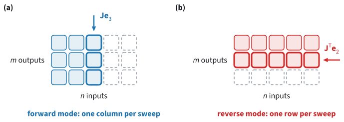

```{.python .input}
%load_ext d2lbook.tab
tab.interact_select('mxnet', 'pytorch', 'tensorflow', 'jax')
```

# Automatic Differentiation
:label:`sec_autograd`

In :numref:`sec_calculus`, we saw that calculating derivatives is the crucial
step in all of the optimization algorithms that we use to train deep networks.
Even for our toy line model with just two parameters, working out the gradient
of the loss by hand—deriving the Jacobian of the residuals and multiplying by
its transpose to obtain $\nabla_{\mathbf{w}} L = \mathbf{X}^\top (2\mathbf{r}) = (2, 4)$ at $\mathbf{w} = (1, 0)$—required
careful bookkeeping. While the underlying calculus is straightforward, deriving
and coding gradients by hand quickly becomes tedious and error-prone as models
grow. A modern deep network has millions or billions of parameters spread across
dozens of layers, and every change to its architecture would force us to derive,
implement, and debug the derivatives all over again.

Fortunately, modern deep learning frameworks take this work off our plates by
providing *automatic differentiation* (often shortened to *autograd*). As we pass
data through each successive operation to compute the loss, the framework records
the sequence of elementary operations—such as matrix–vector products, additions,
and elementwise squares—along with their inputs, building a *computational graph*
that tracks how every value depends on the others. Because the derivative of each
elementary operation is already built into the framework, once the loss is computed
the framework can walk backward through this graph from the loss to the parameters,
applying the chain rule at each step just as we did by hand for the line model.
The algorithm for applying the chain rule in this backward fashion is called
*backpropagation*. It computes the exact derivative of the program (up to
floating-point rounding) at only a small constant multiple of the cost of
computing the loss itself, regardless of whether the model has two parameters or
a hundred million.

We begin by letting the framework compute the gradient of our line model and
verifying that it matches $(2, 4)$. Next, we explore how to control which
operations are recorded on the computational graph and how automatic
differentiation seamlessly handles programs with loops and conditional branches.
Finally, at the end of the section, we look under the hood to see why deep
learning frameworks traverse the computational graph backward rather than forward.

```{.python .input #autograd-automatic-differentiation}
%%tab mxnet
from mxnet import autograd, np as mnp, npx
npx.set_np()
```

```{.python .input #autograd-automatic-differentiation}
%%tab pytorch
import torch
```

```{.python .input #autograd-automatic-differentiation}
%%tab tensorflow
import tensorflow as tf
```

```{.python .input #autograd-automatic-differentiation}
%%tab jax
import jax
from jax import numpy as jnp
```

## Computing Gradients

### The Forward Pass

Let us set up the line model from :numref:`sec_calculus` using our framework's
tensors. Each row $(1, x_i)$ of the design matrix $\mathbf{X}$ represents one of
the three training examples, $\mathbf{y}$ holds their target labels, and we
initialize the parameter vector at $\mathbf{w} = (1, 0)$. The function `loss`
computes the sum of squared residuals
$L(\mathbf{w}) = \|\mathbf{X}\mathbf{w} - \mathbf{y}\|^2$. Notice that we write
only the forward pass—no derivative formula appears anywhere in our code.

```{.python .input #autograd-a-simple-function-1}
%%tab mxnet
X = mnp.array([[1.0, 0.0], [1.0, 1.0], [1.0, 2.0]])  # [1, input]
y = mnp.array([1.0, 1.0, 0.0])
w = mnp.array([1.0, 0.0])

def loss(w):
    return ((X @ w - y) ** 2).sum()
```

```{.python .input #autograd-a-simple-function-1}
%%tab pytorch
X = torch.tensor([[1.0, 0.0], [1.0, 1.0], [1.0, 2.0]])  # [1, input]
y = torch.tensor([1.0, 1.0, 0.0])
w = torch.tensor([1.0, 0.0])

def loss(w):
    return ((X @ w - y) ** 2).sum()
```

```{.python .input #autograd-a-simple-function-1}
%%tab tensorflow
X = tf.constant([[1.0, 0.0], [1.0, 1.0], [1.0, 2.0]])  # [1, input]
y = tf.constant([1.0, 1.0, 0.0])
w = tf.constant([1.0, 0.0])

def loss(w):
    return tf.reduce_sum((tf.linalg.matvec(X, w) - y) ** 2)
```

```{.python .input #autograd-a-simple-function-1}
%%tab jax
X = jnp.array([[1.0, 0.0], [1.0, 1.0], [1.0, 2.0]])  # [1, input]
y = jnp.array([1.0, 1.0, 0.0])
w = jnp.array([1.0, 0.0])

def loss(w):
    return ((X @ w - y) ** 2).sum()
```

:begin_tab:`mxnet, pytorch, tensorflow`
Tracking operations and storing intermediate values consumes both time and memory.
Because deep learning requires computing derivatives with respect to the same
parameters thousands or millions of times, frameworks do not record every tensor
operation by default. Instead, they track only the operations whose results depend
on tensors that we explicitly mark as requiring gradients. Here we mark the
parameter vector $\mathbf{w}$.
:end_tab:

:begin_tab:`mxnet`
Calling `w.attach_grad()` marks `w` for gradient tracking and pre-allocates the
array `w.grad` (initialized to zeros) where the backward pass will store the
gradient. To save overhead during inference, MXNet records operations only inside
an explicit `autograd.record()` context.
:end_tab:

:begin_tab:`pytorch`
Calling `w.requires_grad_(True)` marks `w` for gradient tracking; the trailing
underscore is PyTorch's convention for an in-place method. From this point on,
PyTorch records every operation involving `w`, and the backward pass will store
the resulting gradient in the `w.grad` attribute.
:end_tab:

:begin_tab:`tensorflow`
In TensorFlow, a `tf.GradientTape` context records all operations executed inside
its `with` block. Because a tape automatically tracks trainable `tf.Variable`
objects, we wrap `w` in `tf.Variable` (for an ordinary constant tensor, we would
need to call the tape's `watch` method explicitly).
:end_tab:

:begin_tab:`jax`
JAX takes a functional approach: tensors themselves do not carry mutable state or
gradient buffers. Instead, JAX traces operations only when a function
transformation such as `jax.grad` executes a function. Calling `jax.grad(loss)`
transforms the Python function `loss` into a new function that computes its
gradient. Consequently, there is no tensor to mark beforehand, and evaluating the
forward pass is just an ordinary function call.
:end_tab:

```{.python .input #autograd-a-simple-function-2}
%%tab mxnet
w.attach_grad()
w.grad
```

```{.python .input #autograd-a-simple-function-2}
%%tab pytorch
w.requires_grad_(True)
```

```{.python .input #autograd-a-simple-function-2}
%%tab tensorflow
w = tf.Variable(w)
```

We now execute the forward pass to evaluate the loss at $\mathbf{w} = (1, 0)$.

```{.python .input #autograd-a-simple-function-3}
%%tab mxnet
with autograd.record():  # record the operations that compute the loss
    L = loss(w)
L
```

```{.python .input #autograd-a-simple-function-3}
%%tab pytorch
L = loss(w)
L
```

```{.python .input #autograd-a-simple-function-3}
%%tab tensorflow
with tf.GradientTape() as t:  # record the operations on the tape t
    L = loss(w)
L
```

```{.python .input #autograd-a-simple-function-3}
%%tab jax
loss(w)
```

:begin_tab:`pytorch`
Notice that the output tensor `L` carries `grad_fn=<SumBackward0>`: it remembers
the elementary operation that produced it—the final link in the recorded
computational graph.
:end_tab:

The recorded trace forms a *computational graph* (:numref:`fig_autograd_graph`).
Each node in the graph represents a value computed along the way from the
parameters $\mathbf{w}$ to the loss $L$, and directed edges point from the inputs
of each operation to its output. Because the framework records operations at the
granularity of its primitive differentiable kernels, the line-model loss breaks
down into four elementary steps: a matrix–vector product
$\hat{\mathbf{y}} = \mathbf{X}\mathbf{w}$, a subtraction of the labels
$\mathbf{r} = \hat{\mathbf{y}} - \mathbf{y}$, an elementwise square
$\mathbf{s} = \mathbf{r} \odot \mathbf{r}$, and a sum $L = \sum_i s_i$.

![The computational graph of $L = \|\mathbf{X}\mathbf{w} - \mathbf{y}\|^2$ at $\mathbf{w} = (1, 0)$, with one node for $\mathbf{w}$ and for each value computed from it; the constants $\mathbf{X}$ and $\mathbf{y}$ are not drawn, and $\mathbf{r} \odot \mathbf{r}$ is the elementwise square. Each node shows its value (black) and the gradient of $L$ with respect to it (red). The forward pass (blue) runs from left to right; the backward pass (red) starts from $1$ at $L$ and applies the local rule of each operation, from right to left.](../img/autograd-comp-graph.svg)
:label:`fig_autograd_graph`

### The Backward Pass

Now we can ask the framework to compute the gradient of the loss with respect to
$\mathbf{w}$ and compare the result against the vector $(2, 4)$ that we derived by
hand in :numref:`sec_calculus`.

:begin_tab:`mxnet, pytorch`
Calling `L.backward()` triggers the backward pass through the computational graph
and stores the resulting gradient in `w.grad`.
:end_tab:

:begin_tab:`tensorflow`
Calling `t.gradient(L, w)` runs the backward pass over the operations recorded on
the tape `t` and returns the gradient of its first argument (`L`) with respect to
its second (`w`).
:end_tab:

:begin_tab:`jax`
Calling `jax.grad(loss)` returns a function that computes the gradient of `loss`
with respect to its first argument, which we immediately evaluate at `w`.
:end_tab:

```{.python .input #autograd-a-simple-function-4}
%%tab mxnet
L.backward()
w.grad
```

```{.python .input #autograd-a-simple-function-4}
%%tab pytorch
L.backward()
w.grad
```

```{.python .input #autograd-a-simple-function-4}
%%tab tensorflow
t.gradient(L, w)
```

```{.python .input #autograd-a-simple-function-4}
%%tab jax
jax.grad(loss)(w)
```

As expected, the automatic gradient computation returns $(2, 4)$. How did the
framework arrive at this answer without ever being told the symbolic formula
$\nabla_{\mathbf{w}} L = 2\mathbf{X}^\top(\mathbf{X}\mathbf{w} - \mathbf{y})$?
When we differentiated the loss by hand, we multiplied by two factors:
$2\mathbf{r}$ and $\mathbf{X}^\top$. The backward pass in
:numref:`fig_autograd_graph` assembles this exact product step by step from four
simple local derivative rules—one for each recorded operation:

1. It begins at the output node with $\partial L / \partial L = 1$.
2. Moving backward through the sum $L = s_1 + s_2 + s_3$, which has derivative $1$
   with respect to each summand, it distributes the incoming scalar $1$ to all
   three entries, yielding $\nabla_{\mathbf{s}} L = (1, 1, 1)$.
3. Moving backward through the elementwise square $\mathbf{s} = \mathbf{r} \odot \mathbf{r}$,
   it multiplies entrywise by the local derivative $2\mathbf{r}$, yielding
   $\nabla_{\mathbf{r}} L = 2\mathbf{r} = (0, 0, 2)$.
4. Moving backward through the subtraction $\mathbf{r} = \hat{\mathbf{y}} - \mathbf{y}$
   (where $\mathbf{y}$ is constant), the gradient passes through unchanged:
   $\nabla_{\hat{\mathbf{y}}} L = (0, 0, 2)$.
5. Finally, moving backward through the matrix–vector product
   $\hat{\mathbf{y}} = \mathbf{X}\mathbf{w}$, it multiplies by the transpose of the
   Jacobian, $\mathbf{X}^\top$, yielding
   $\nabla_{\mathbf{w}} L = \mathbf{X}^\top (2\mathbf{r}) = (2, 4)$.

Notice that each step requires only the local derivative rule of a single
operation together with intermediate values saved during the forward pass (such as
$\mathbf{r}$ and $\mathbf{X}$). This explains why training a deep network consumes
significantly more memory than running inference: during training, the framework
must retain intermediate activations from the forward pass until the backward pass
has consumed them.

### Gradient Accumulation

During training, we evaluate the loss and compute a new gradient at every
iteration, so it is crucial to understand what happens to the gradient buffer from
one step to the next.

:begin_tab:`mxnet, pytorch, tensorflow`
To see how the framework behaves, let us run the forward and backward passes a
second time at the same parameter vector $\mathbf{w}$.
:end_tab:

:begin_tab:`jax`
Because `jax.grad` is a pure function transformation that returns a newly
allocated array on every call and stores no state on `w`, gradients never
accumulate implicitly between calls.
:end_tab:

```{.python .input #autograd-a-simple-function-6}
%%tab mxnet
with autograd.record():
    L = loss(w)
L.backward()
w.grad  # overwritten by the new gradient
```

```{.python .input #autograd-a-simple-function-6}
%%tab pytorch
L = loss(w)
L.backward()
w.grad  # the new gradient was added to the old one
```

```{.python .input #autograd-a-simple-function-6}
%%tab tensorflow
with tf.GradientTape() as t:
    L = loss(w)
t.gradient(L, w)  # a new tensor; nothing is stored in w
```

:begin_tab:`mxnet`
By default, MXNet resets the gradient buffer and overwrites `w.grad` whenever a
new backward pass runs, so `w.grad` holds $(2, 4)$ as before.
:end_tab:

:begin_tab:`pytorch`
In PyTorch, `w.grad` is now $(4, 8)$—twice the actual gradient! PyTorch does not
automatically overwrite `w.grad` when a new gradient is computed; instead, it
*adds* the new gradient to whatever is already stored in the buffer. This
accumulation behavior is very handy when optimizing the sum of multiple objective
functions or when accumulating gradients across several micro-batches before
taking an optimizer step. However, in a standard training loop where each step
requires a fresh gradient, we must explicitly clear the buffer before calling
`backward()`—for example, by invoking `w.grad.zero_()`. Forgetting to zero out the
gradients is one of the most common bugs in PyTorch code, and because the shapes
still match, it fails silently without raising an error.
:end_tab:

:begin_tab:`tensorflow`
In TensorFlow, `t.gradient(L, w)` returns the gradient as a freshly created tensor
and stores nothing inside `w`, so we obtain $(2, 4)$ again. Note that a
`tf.GradientTape` releases its recorded resources immediately after a single
`gradient` call unless it was created with `persistent=True`.
:end_tab:

### Vector-Valued Functions

So far, the function we differentiated produced a single scalar output $L$. In
practice, we often compute a vector of outputs—for example, the individual loss
$r_i^2$ for each example in a minibatch before reducing them to a single number.
When an output $\mathbf{u}$ is a vector, the full derivative of $\mathbf{u}$ with
respect to an input vector $\mathbf{x}$ is not a gradient vector, but a matrix of
partial derivatives: the *Jacobian* $\mathbf{J}$.

Rather than materializing the full Jacobian matrix, reverse-mode automatic
differentiation computes the gradient of a weighted sum of the outputs,
$\mathbf{v}^\top \mathbf{u} = \sum_j v_j u_j$, for a weight vector $\mathbf{v}$
that we supply. Choosing $\mathbf{v} = \mathbf{1}$ (the vector of all ones)
computes the gradient of the plain sum $\sum_j u_j$—which, for a vector of
per-example losses, is simply the sum of the individual gradients across the
minibatch. Let us verify this on the vector of per-example squared residuals
$(r_1^2, r_2^2, r_3^2)$ of our line model.

:begin_tab:`mxnet`
In MXNet, `backward` accepts the weight vector $\mathbf{v}$ as an optional
argument. If no argument is passed on a non-scalar array, MXNet defaults to
$\mathbf{v} = \mathbf{1}$, implicitly differentiating the sum of all entries.
:end_tab:

:begin_tab:`pytorch`
Because different frameworks handle non-scalar outputs differently, PyTorch
refuses to guess: calling `backward()` on a non-scalar tensor raises a runtime
error unless we explicitly pass the weight vector $\mathbf{v}$ via the `gradient`
keyword argument. The argument is named `gradient` because, in the chain rule,
$\mathbf{v}$ represents the upstream gradient arriving from a subsequent scalar
objective. Passing a vector of ones (`torch.ones(3)`) produces the exact same
result as summing first via `losses.sum().backward()`.
:end_tab:

:begin_tab:`tensorflow`
In TensorFlow, the tape's `gradient` method accepts $\mathbf{v}$ via the
`output_gradients` argument. When `output_gradients` is omitted on a non-scalar
tensor, TensorFlow defaults to $\mathbf{v} = \mathbf{1}$ and differentiates the
sum of the outputs.
:end_tab:

:begin_tab:`jax`
In JAX, `jax.grad` accepts only functions that return a scalar. To run a backward
pass on a vector-valued function `losses`, we use `jax.vjp(losses, w)`
(*vector–Jacobian product*), which returns a pair: the forward value `losses(w)`
and a function that maps any weight vector $\mathbf{v}$ to the gradient of
$\mathbf{v}^\top \mathbf{u}$ (returned as a tuple with one entry per input
argument of `losses`).
:end_tab:

```{.python .input #autograd-backward-for-non-scalar-variables}
%%tab mxnet
with autograd.record():
    losses = (X @ w - y) ** 2  # one loss per example
losses.backward(mnp.ones(3))  # v = 1: differentiates losses.sum()
w.grad
```

```{.python .input #autograd-backward-for-non-scalar-variables}
%%tab pytorch
w.grad.zero_()
losses = (X @ w - y) ** 2  # one loss per example
losses.backward(gradient=torch.ones(3))  # = losses.sum().backward()
w.grad
```

```{.python .input #autograd-backward-for-non-scalar-variables}
%%tab tensorflow
with tf.GradientTape() as t:
    losses = (tf.linalg.matvec(X, w) - y) ** 2  # per-example losses
t.gradient(losses, w, output_gradients=tf.ones(3))  # v = 1
```

```{.python .input #autograd-backward-for-non-scalar-variables}
%%tab jax
def losses(w):
    return (X @ w - y) ** 2  # one loss per example

_, vjp = jax.vjp(losses, w)  # vjp maps v to J^T v
vjp(jnp.ones(3))[0]  # v = 1
```

Once again, we recover $(2, 4)$, the gradient of the total loss.

To connect this directly to the multivariate chain rule of :numref:`sec_calculus`,
suppose $\mathbf{u} \in \mathbb{R}^m$ is a vector of $m$ outputs computed from $n$
inputs $\mathbf{x} \in \mathbb{R}^n$, with $m \times n$ Jacobian matrix
$\mathbf{J}$ whose entries are $J_{ji} = \partial u_j / \partial x_i$ (so row $j$
of $\mathbf{J}$ is $\nabla_{\mathbf{x}} u_j^\top$). Starting the backward pass from
a seed vector $\mathbf{v} \in \mathbb{R}^m$ at $\mathbf{u}$ computes

$$\mathbf{J}^\top \mathbf{v} = \nabla_{\mathbf{x}} \left(\mathbf{v}^\top \mathbf{u}\right) = \sum_{j=1}^m v_j \nabla_{\mathbf{x}} u_j$$

without ever constructing the $m \times n$ matrix $\mathbf{J}$ in memory. This is
precisely the vector chain rule
$\nabla_{\mathbf{x}} z = \mathbf{J}^\top \nabla_{\mathbf{u}} z$ when $z$ is a
downstream scalar objective whose gradient with respect to $\mathbf{u}$ is
$\nabla_{\mathbf{u}} z = \mathbf{v}$. In particular, if we choose $\mathbf{v}$ to
be the $j$-th standard basis vector $\mathbf{e}_j$ (with a $1$ in position $j$ and
$0$ elsewhere; see :numref:`sec_linear-algebra`), the backward pass extracts the
gradient of $u_j$ alone—that is, the $j$-th row of the Jacobian $\mathbf{J}$. We
will return to this perspective in :numref:`subsec_autograd_fwd_rev`.

## Controlling the Graph

By default, frameworks record every operation involving a tracked tensor. Sometimes,
however, we want to move certain calculations outside the recorded computational
graph—either to treat an intermediate tensor as a constant whose *provenance*
(how it was computed from the parameters) is ignored during backpropagation, or to
execute housekeeping steps such as parameter updates and model evaluation without
recording them at all.

### Detaching Values

To *detach* a tensor is to create a view or copy that shares the same numerical
values but severs its connection to its ancestors in the computational graph, so
that the backward pass treats it as a constant. A simple example makes the effect
on gradients clear. Suppose we compute $u = x^2$ and $z = u x$ for each element of
$\mathbf{x} = (0, 1, 2, 3)$, so that numerically $z = x^3$. In the attached graph
of :numref:`fig_autograd_detach`(a), $x$ influences $z$ along two distinct paths:
indirectly through $u = x^2$ and directly as the second factor in $u x$. By the
chain rule (and the product rule), the backward pass sums the contributions of both
paths, $x \cdot (2x) + u \cdot 1$, yielding $\partial z / \partial x = 3x^2$.

If instead we want to measure only the *direct* influence of $x$ on $z = u x$ while
holding $u$ fixed at its current value, we replace $u$ by a detached tensor $c$.
Because $c$ has no history linking it back to $x$, the upper path in
:numref:`fig_autograd_detach`(b) is severed. No gradient flows through $c$ to $x$,
and differentiating $z = c x$ with respect to $x$ yields simply
$\partial z / \partial x = c = x^2$ rather than $3x^2$.


:label:`fig_autograd_detach`

:begin_tab:`mxnet`
In MXNet, `u.detach()` returns a new array carrying the values of `u` but stripped
of its computational history.
:end_tab:

:begin_tab:`pytorch`
In PyTorch, `u.detach()` returns a new tensor sharing the values of `u` but
detached from the computational graph.
:end_tab:

:begin_tab:`tensorflow`
In TensorFlow, `tf.stop_gradient(u)` passes the values of `u` unchanged during the
forward pass while blocking any gradient from flowing backward through it.
:end_tab:

:begin_tab:`jax`
In JAX, `jax.lax.stop_gradient(u)` returns the values of `u` while blocking
gradients during reverse-mode or forward-mode differentiation. Because `jax.grad`
traces the function being differentiated, `stop_gradient` must be called inside
that function (any array computed outside the differentiated function is already
treated as a constant by `jax.grad`).
:end_tab:

```{.python .input #autograd-detaching-computation-1}
%%tab mxnet
x = mnp.arange(4.0)
x.attach_grad()
with autograd.record():
    u = x * x
    c = u.detach()  # values of u, no history
    z = c * x
z.backward()
x.grad
```

```{.python .input #autograd-detaching-computation-1}
%%tab pytorch
x = torch.arange(4.0, requires_grad=True)
u = x * x
c = u.detach()  # values of u, no history
z = c * x
z.sum().backward()
x.grad
```

```{.python .input #autograd-detaching-computation-1}
%%tab tensorflow
x = tf.Variable(tf.range(4.0))
with tf.GradientTape() as t:
    u = x * x
    c = tf.stop_gradient(u)  # values of u, no history
    z = c * x
t.gradient(z, x)
```

```{.python .input #autograd-detaching-computation-1}
%%tab jax
x = jnp.arange(4.0)

def z(x):
    u = x * x
    c = jax.lax.stop_gradient(u)  # values of u, no history
    return c * x

jax.grad(lambda x: z(x).sum())(x)
```

As predicted, the gradient with respect to `x` is $(0, 1, 4, 9)$, which equals
$c = x^2$. Contrast this with the attached computation, where both paths carry
gradient:

:begin_tab:`pytorch`
Note that calling `u.detach()` did not alter `u` itself—the computational graph
leading from `x` to `u` remains intact, so we can reuse `u` directly.
:end_tab:

```{.python .input #autograd-detaching-computation-2}
%%tab mxnet
with autograd.record():
    u = x * x
    z = u * x
z.backward()
x.grad
```

```{.python .input #autograd-detaching-computation-2}
%%tab pytorch
x.grad.zero_()
z = u * x
z.sum().backward()
x.grad
```

```{.python .input #autograd-detaching-computation-2}
%%tab tensorflow
with tf.GradientTape() as t:
    u = x * x
    z = u * x
t.gradient(z, x)
```

```{.python .input #autograd-detaching-computation-2}
%%tab jax
jax.grad(lambda x: (x * x * x).sum())(x)
```

Without detaching, the gradient is $3x^2 = (0, 3, 12, 27)$, even though the forward
value $z = (0, 1, 8, 27)$ is identical in both runs. Detaching alters the backward
graph without changing the forward values.

In deep learning, detaching is indispensable whenever a model computes its own
training targets. In Q-learning (:numref:`sec_qlearning`) and self-supervised
distillation, for example, we train a network's prediction to match a bootstrap
target computed from the network's own outputs. We must detach that target so the
optimizer moves the prediction toward the target, rather than cheating by shifting
the target toward the prediction.

### Disabling Gradient Tracking

When we only need forward values—for instance, when evaluating a trained model on
validation data or serving predictions in production—building a computational graph
wastes memory and compute, so we disable gradient tracking altogether. Updating
model parameters during training is another operation that must run outside the
computational graph: the gradient descent update
$\mathbf{w} \leftarrow \mathbf{w} - \eta \nabla L(\mathbf{w})$ is how we adjust the
parameters *after* differentiating the loss, not part of the loss function to be
differentiated on the next step. Let us perform one step of gradient descent on our
line model with learning rate $\eta = 0.1$.

:begin_tab:`mxnet`
Because MXNet records operations only inside an `autograd.record()` block, any code
outside that block runs unrecorded (and inside one, `autograd.pause()` temporarily
suspends recording). Writing the update via slice assignment `w[:] = ...` updates
the entries of `w` in place while preserving the attached gradient buffer `w.grad`,
which currently holds $(2, 4)$.
:end_tab:

:begin_tab:`pytorch`
In PyTorch, wrapping code in a `with torch.no_grad():` block disables gradient
tracking for all operations inside the block. In fact, an in-place update such as
`w -= 0.1 * w.grad` *must* run inside `torch.no_grad()`: while tracking is active,
PyTorch forbids in-place modifications of a *leaf tensor* that requires gradients
(a tensor like `w` that we created and marked directly, rather than the output of a
recorded operation). Here `w.grad` holds the gradient $(2, 4)$ computed earlier.
:end_tab:

:begin_tab:`tensorflow`
Because a `tf.GradientTape` records only the operations executed inside its `with`
block, any code outside the block runs unrecorded (and inside one,
`t.stop_recording()` temporarily suspends recording). We update a `tf.Variable` in
place using its `assign_sub` method, which subtracts its argument from the variable.
:end_tab:

:begin_tab:`jax`
Because JAX traces operations only inside a transformation such as `jax.grad`, the
parameter update is simply ordinary array arithmetic. Since JAX arrays are
immutable, `w = w - 0.1 * jax.grad(loss)(w)` binds `w` to a newly created array.
:end_tab:

```{.python .input #autograd-turning-off-gradient-tracking-1}
%%tab mxnet
w[:] = w - 0.1 * w.grad  # outside autograd.record(): not recorded
w, loss(w)
```

```{.python .input #autograd-turning-off-gradient-tracking-1}
%%tab pytorch
with torch.no_grad():  # nothing in this block is recorded
    w -= 0.1 * w.grad
    L = loss(w)
w, L
```

```{.python .input #autograd-turning-off-gradient-tracking-1}
%%tab tensorflow
with tf.GradientTape() as t:
    L = loss(w)
w.assign_sub(0.1 * t.gradient(L, w))  # outside the tape
w.numpy(), round(float(loss(w)), 4)
```

```{.python .input #autograd-turning-off-gradient-tracking-1}
%%tab jax
w = w - 0.1 * jax.grad(loss)(w)
w, loss(w)
```

This step moves $\mathbf{w}$ from $(1, 0)$ to $(0.8, -0.4)$ and reduces the loss
from $1$ to $0.4$—reproducing the exact parameter update and loss value that we
calculated by hand in :numref:`sec_calculus`. Repeating this forward–backward–update
cycle across batches of data is how we will train the models of the upcoming chapters.

:begin_tab:`pytorch`
Notice that the loss `L` evaluated inside `torch.no_grad()` carries no `grad_fn`
attribute: it is not attached to any computational graph.
:end_tab:

## Differentiating Programs

So far we have differentiated fixed mathematical formulas such as
$L(\mathbf{w}) = \|\mathbf{X}\mathbf{w} - \mathbf{y}\|^2$. General computer
programs, however, offer much greater flexibility: a calculation can pass through
a maze of Python control flow—`while` loops, `if`/`else` conditionals, and
arbitrary function calls—where the number of iterations or the choice of branch
depends dynamically on the input data or intermediate values. Remarkably, automatic
differentiation handles such dynamic programs right out of the box. Even more,
because the backward pass is itself just a program built from tensor operations,
the framework can record and differentiate a backward pass to compute higher-order
derivatives.

### Control Flow
:label:`subsec_autograd_control_flow`

Dynamic control flow arises naturally in deep learning; for instance, when a
recurrent or autoregressive model processes text, the depth of the computational
graph depends on the length of the input sequence. Even though no single fixed
algebraic expression describes the program across all inputs, automatic
differentiation does not need one: whenever we execute the program on a specific
input, the framework records the exact sequence of elementary operations that
*actually ran* during that execution, realizing a concrete computational graph
through which `backward` can propagate gradients.

To see this in action, consider the following function `f`, where both the number
of iterations of the `while` loop and the branch selected by the `if` statement
depend on the value of the input `a`: `f` repeatedly doubles `a` until the norm of
`b` reaches at least $1000$, and then returns either `b` (if the sum of its
entries is positive) or `100 * b` (otherwise).

```{.python .input #autograd-gradients-and-python-control-flow-1}
%%tab mxnet
def f(a):
    b = a * 2
    while mnp.linalg.norm(b) < 1000:
        b = b * 2
    if b.sum() > 0:
        c = b
    else:
        c = 100 * b
    return c
```

```{.python .input #autograd-gradients-and-python-control-flow-1}
%%tab pytorch
def f(a):
    b = a * 2
    while torch.linalg.vector_norm(b) < 1000:
        b = b * 2
    if b.sum() > 0:
        c = b
    else:
        c = 100 * b
    return c
```

```{.python .input #autograd-gradients-and-python-control-flow-1}
%%tab tensorflow
def f(a):
    b = a * 2
    while tf.norm(b) < 1000:
        b = b * 2
    if tf.reduce_sum(b) > 0:
        c = b
    else:
        c = 100 * b
    return c
```

```{.python .input #autograd-gradients-and-python-control-flow-1}
%%tab jax
def f(a):
    b = a * 2
    while jnp.linalg.norm(b) < 1000:
        b = b * 2
    if b.sum() > 0:
        c = b
    else:
        c = 100 * b
    return c
```

Although `f` is slightly contrived for demonstration purposes, its mathematical
dependence on a scalar input $a$ is easy to analyze: it is a *piecewise linear*
function $f(a) = k a$, where the scale factor $k$ (a power of two, multiplied by
$100$ when $a < 0$) is constant on each interval between the thresholds where the
loop count changes. Within any such interval, the derivative is simply the slope
$f'(a) = k = f(a) / a$. Let us evaluate both $f(a) / a$ and the automatic
derivative at $a = 0.3$ and $a = -0.75$.

```{.python .input #autograd-gradients-and-python-control-flow-2}
%%tab mxnet
for value in (0.3, -0.75):
    a = mnp.array(value)
    a.attach_grad()
    with autograd.record():
        fa = f(a)
    fa.backward()
    print(f'a = {value:5.2f}   f(a) / a = {float(fa) / value:6.0f}   '
          f'gradient = {float(a.grad):6.0f}')
```

```{.python .input #autograd-gradients-and-python-control-flow-2}
%%tab pytorch
for value in (0.3, -0.75):
    a = torch.tensor(value, requires_grad=True)
    fa = f(a)
    fa.backward()
    print(f'a = {value:5.2f}   f(a) / a = {fa.item() / value:6.0f}   '
          f'gradient = {a.grad.item():6.0f}')
```

```{.python .input #autograd-gradients-and-python-control-flow-2}
%%tab tensorflow
for value in (0.3, -0.75):
    a = tf.Variable(value)
    with tf.GradientTape() as t:
        fa = f(a)
    print(f'a = {value:5.2f}   f(a) / a = {float(fa) / value:6.0f}   '
          f'gradient = {float(t.gradient(fa, a)):6.0f}')
```

```{.python .input #autograd-gradients-and-python-control-flow-2}
%%tab jax
for value in (0.3, -0.75):
    a = jnp.array(value)
    print(f'a = {value:5.2f}   f(a) / a = {f(a) / a:6.0f}   '
          f'gradient = {jax.grad(f)(a):6.0f}')
```

The two inputs produce two distinct computational graphs (:numref:`fig_autograd_dynamic`).
At $a = 0.3$, `f` doubles its input $12$ times and takes the first branch, so
$k = 2^{12} = 4096$. At $a = -0.75$, `f` doubles its input $11$ times and takes
the second branch, multiplying by $100$ to give $k = 100 \cdot 2^{11} = 204{,}800$.
In both cases, the gradient computed by autograd matches $f(a)/a$ exactly.


:label:`fig_autograd_dynamic`

Keep in mind that automatic differentiation differentiates the sequence of
operations that *executed* on a particular run, not the abstract mathematical
function defined by the program. At a boundary point where the loop iteration
count jumps—such as $a = 1000 / 2^{12} \approx 0.24414$—the mathematical function
$f(a)$ is discontinuous and not differentiable. Even so, autograd traces whichever
branch ran at that input and returns the slope of that linear piece. Thus, for
piecewise smooth programs like `f`, autograd returns the true derivative everywhere
the derivative exists, and the derivative of the active branch at the boundary
points.

Finally, because the backward pass is itself a sequence of elementary tensor
operations, the framework can record the backward pass on a graph and differentiate
it a second time. This yields second derivatives—such as the Hessian matrix or the
curvature of the loss along a chosen direction—whose computational cost we explore
in the exercises.

## Forward and Reverse Mode
:label:`subsec_autograd_fwd_rev`

The remainder of this section looks deeper into how automatic differentiation works
and can be skipped on a first reading. The essential takeaway for the chapters
ahead is simple: *a single backward pass computes the full gradient of a scalar
loss with respect to all model parameters.*

Every backward pass we have run so far started at the output and worked backward
toward the inputs. Notice, however, that the chain rule itself does not dictate the
direction of traversal: because it multiplies local derivatives along paths through
the computational graph, we can accumulate those matrix products starting from
either end. *Reverse-mode automatic differentiation*—the backward pass we have used
throughout this section—starts at an output and propagates sensitivities backward
to the inputs. *Forward-mode automatic differentiation* starts at an input and
propagates derivatives forward alongside the intermediate values. Both modes
compute the exact same derivatives, but at dramatically different computational
costs depending on the dimensions of the problem—and that cost difference is why
deep learning relies on reverse mode.

### Rows and Columns of the Jacobian

A single traversal of the computational graph in either direction is called a
*sweep* (so a backward pass is one reverse sweep). Consider a differentiable
mapping $\mathbf{f} : \mathbb{R}^n \to \mathbb{R}^m$ with $n$ inputs, $m$ outputs,
and an $m \times n$ Jacobian matrix $\mathbf{J}$. A single forward sweep and a
single reverse sweep each cost a small constant multiple of evaluating
$\mathbf{f}$ itself, and each sweep extracts either one column or one row of
$\mathbf{J}$ (:numref:`fig_autograd_fwd_rev`):

* **Reverse mode (vector–Jacobian product).** As we saw for vector-valued
  functions, a reverse sweep seeded with a vector $\mathbf{v} \in \mathbb{R}^m$ at
  the outputs computes $\mathbf{J}^\top \mathbf{v}$ (the transpose of the
  *vector–Jacobian product* $\mathbf{v}^\top \mathbf{J}$). Seeding with the $j$-th
  standard basis vector $\mathbf{v} = \mathbf{e}_j$ extracts row $j$ of
  $\mathbf{J}$—the gradient of the $j$-th output with respect to all $n$ inputs.
  Assembling the full $m \times n$ Jacobian in reverse mode therefore requires $m$
  reverse sweeps, one per row.
* **Forward mode (Jacobian–vector product).** A forward sweep seeded with a tangent
  direction $\mathbf{d} \in \mathbb{R}^n$ at the inputs computes the
  *Jacobian–vector product* $\mathbf{J}\mathbf{d}$—the directional derivative
  measuring how all $m$ outputs change as the inputs move along $\mathbf{d}$.
  Seeding with the $i$-th standard basis vector $\mathbf{d} = \mathbf{e}_i$
  extracts column $i$ of $\mathbf{J}$—the partial derivatives of all $m$ outputs
  with respect to the single input $x_i$. Assembling the full Jacobian in forward
  mode therefore requires $n$ forward sweeps, one per column.


:label:`fig_autograd_fwd_rev`

For the residual vector of our line model,
$\mathbf{r}(\mathbf{w}) = \mathbf{X}\mathbf{w} - \mathbf{y}$, the Jacobian is
$\mathbf{J} = \mathbf{X}$, which has $m = 3$ outputs and $n = 2$ inputs. Thus
reverse mode fills $\mathbf{J}$ in three sweeps (one per example), whereas forward
mode fills it in two sweeps (one per parameter).

:begin_tab:`mxnet`
MXNet implements reverse-mode automatic differentiation only.
:end_tab:

:begin_tab:`pytorch`
In PyTorch, `torch.func.vjp` and `torch.func.jvp` compute a single reverse sweep
and a single forward sweep, respectively, while `torch.func.jacrev` and
`torch.func.jacfwd` assemble full Jacobians by batching those sweeps.
:end_tab:

:begin_tab:`tensorflow`
In TensorFlow, a tape's `jacobian` method assembles a full Jacobian via reverse
sweeps, while `tf.autodiff.ForwardAccumulator` performs forward-mode sweeps.
:end_tab:

:begin_tab:`jax`
In JAX, `jax.vjp` and `jax.jvp` compute a single reverse sweep and a single forward
sweep, respectively, while `jax.jacrev` and `jax.jacfwd` assemble full Jacobians
from those sweeps.
:end_tab:

### The Cost of a Gradient

When we train a machine learning model by minimizing a scalar loss function, the
comparison between the two modes is completely one-sided. A loss function has a
single scalar output ($m = 1$) and $n$ parameters, so its Jacobian has just one
row—the transposed gradient $\nabla_{\mathbf{w}} L^\top$. Reverse mode computes all
$n$ components of this gradient in *a single reverse sweep*, at only a small
multiple of the cost of evaluating the loss itself, regardless of how large $n$ is.
Forward mode, by contrast, computes only one partial derivative per sweep and would
require $n$ separate sweeps—no faster than numerical finite differences. For a deep
network with $n = 10^8$ parameters, a single reverse sweep accomplishes the work of
$10^8$ forward sweeps. That is why every deep learning framework trains neural
networks using reverse-mode automatic differentiation, where it is universally
known as *backpropagation*.

Reverse mode does pay a price in memory: because the local derivative rules during
the backward sweep depend on intermediate activations computed during the forward
pass, the memory footprint of reverse mode grows with the depth of the
computational graph. Forward mode, by contrast, propagates a single derivative
tangent alongside each intermediate value and can discard intermediate values as
soon as they are used, requiring roughly twice the memory of a plain forward
evaluation regardless of graph depth. Forward mode is therefore the method of
choice when differentiating functions with few inputs and many outputs ($n \ll m$),
or for computing directional derivatives (Jacobian–vector products) along a single
direction.

While automatic differentiation libraries have become central to machine learning
over the past decade, their mathematical and algorithmic foundations go back more
than half a century. Forward-mode automatic differentiation was introduced by
:citet:`Wengert.1964`, and the general reverse-mode algorithm on computational
graphs was formulated in the master's thesis of :citet:`Linnainmaa.1970` (with key
developments in compiler-driven automatic differentiation by
:citet:`Speelpenning.1980` and :citet:`Griewank.1989`). While we use autograd to
*optimize* models in a statistical sense, the *optimization* of autograd engines
themselves—leveraging compiler technology and graph transformations to minimize
compute and memory overhead—is one of the foundational pillars of modern deep
learning systems. We derive both forward and reverse mode in full detail, including
their exact time and memory complexities, in
:numref:`sec_mdl-matrix-calculus-autodiff`, and we trace backpropagation step by
step through a multilayer neural network in :numref:`sec_backprop`.

Before moving on, let us note what a gradient *cannot* tell us. A gradient tells us
how to adjust the parameters to reduce the loss on the data we have already seen.
Whether a lower loss on our training sample reflects a genuine underlying pattern
that will generalize to new data—or merely random noise in a small sample—is a
question of probability and statistics, the subject of :numref:`sec_prob`.

## Summary

* Automatic differentiation (*autograd*) computes exact derivatives (up to
  floating-point rounding) directly from the code that evaluates the forward pass,
  sparing us from deriving and implementing gradients by hand.
* To compute a gradient, we (i) mark the parameters with respect to which we need
  derivatives, (ii) record the forward computation of the loss on a computational
  graph, (iii) trigger the backward pass to apply the chain rule from output to
  inputs, and (iv) read off the resulting gradient (for our line model at
  $\mathbf{w} = (1, 0)$, this reproduces $\nabla_{\mathbf{w}} L = (2, 4)$).
* Detaching an intermediate tensor severs its connection to its ancestors in the
  computational graph so that the backward pass treats it as a constant, while
  disabling gradient tracking keeps parameter updates and inference evaluations
  out of the graph altogether.
* Because the computational graph records the elementary operations that actually
  executed on a given run, autograd seamlessly differentiates programs containing
  data-dependent loops and conditional branches, and can differentiate a backward
  pass to obtain higher-order derivatives.
* A single forward sweep computes one column of an $m \times n$ Jacobian
  ($\mathbf{J}\mathbf{d}$), whereas a single reverse sweep computes one row
  ($\mathbf{J}^\top \mathbf{v}$). For a scalar loss ($m = 1$) with $n$ parameters,
  reverse mode yields the entire gradient in a single sweep.

## Exercises

:begin_tab:`mxnet`
1. [code] **Detached intermediates.** Let `u = x * x` and `c = u.detach()`,
   and consider `z = c * c`, `z = u * c`, and `z = u * u`. For each `z`,
   compute `u`, `c`, and `z` afresh inside an `autograd.record()` scope and
   call `z.backward()`. Before running any code, predict the outcome of each
   call, including the resulting `x.grad`. Check your predictions, and
   explain the ratio between the gradients for `z = u * c` and `z = u * u`.

2. [code] **Manual parameter updates.** Perform the gradient step of this
   section as `w = w - 0.1 * w.grad` instead of `w[:] = w - 0.1 * w.grad`,
   and inspect `w.grad`. Explain what the rebinding has done to the buffer
   allocated by `attach_grad`, predict what a second recorded forward pass
   followed by `backward` does, and check.
:end_tab:

:begin_tab:`pytorch`
1. [code] **Detached intermediates.** Let `u = x * x` and `c = u.detach()`,
   and consider `z = c * c`, `z = u * c`, and `z = u * u`. For each `z`,
   recompute `u` and `c`, reset `x.grad`, and call `backward` on the sum of
   the entries of `z`. Before running any code, predict the outcome of each
   call, including the resulting `x.grad`. Check your predictions, and
   explain the ratio between the gradients for `z = u * c` and `z = u * u`.

2. [code] **Manual parameter updates.** Perform the gradient step of this
   section as `w = w - 0.1 * w.grad`, outside `torch.no_grad()`, and inspect
   `w.requires_grad`, `w.grad_fn`, `w.is_leaf`, and `w.grad`. Explain what
   the update has done to the graph, predict what a second forward and
   backward pass leaves in `w.grad`, and check.
:end_tab:

:begin_tab:`tensorflow`
1. [code] **Detached intermediates.** Let `u = x * x` and
   `c = tf.stop_gradient(u)` inside a persistent `tf.GradientTape` `t`.
   Before running any code, predict `t.gradient(z, x)` for each of
   `z = c * c`, `z = u * c`, and `z = u * u`, all computed inside `t`. Check
   your predictions, and explain the ratio between the results for
   `z = u * c` and `z = u * u`.

2. [code] **Manual parameter updates.** Perform the gradient step of this
   section as `w = w - 0.1 * g`, where `g` is the gradient returned by the
   tape, instead of with `assign_sub`, and inspect `type(w)`. Predict what
   `gradient` returns for a second forward pass under a new tape, check, and
   explain why a training loop updates variables with `assign_sub`.
:end_tab:

:begin_tab:`jax`
1. [code] **Detached intermediates.** Write three functions of `x` that
   compute `u = x * x` and `c = jax.lax.stop_gradient(u)` and return
   `c * c`, `u * c`, and `u * u`, respectively. Before running any code,
   predict the gradient of the sum of the entries of each result with
   respect to `x`. Check your predictions with `jax.grad`, and explain the
   ratio between the results for `u * c` and `u * u`.

2. [code] **Manual parameter updates.** Let `w = jnp.arange(4.0)` and
   `g = lambda x: (w * x).sum()`, which reads `w` from the enclosing scope.
   Predict `jax.grad(g)(x)`, check, and state with respect to which array
   `jax.grad` differentiates. Then rewrite `g` so that `jax.grad` returns
   the gradient of `(w * x).sum()` with respect to `w`, use it for one
   update of `w` with learning rate 0.1, and explain what this implies for
   how a JAX training loop must pass the parameters to the loss function.
:end_tab:

3. [code] **From scalar to vector input.** Replace the scalar input `a` of
   the function `f` defined in :numref:`subsec_autograd_control_flow` by a
   random vector of length 5, and differentiate the sum of the entries of
   `fa = f(a)` with respect to `a`.
    1. Express `f(a)` in terms of `a`, and give the Jacobian of `f` at `a`
       and the gradient of the sum of the entries of `fa`.
    1. Compute this gradient with automatic differentiation and check
       whether it still equals `fa / a` elementwise.
    1. Describe the set of inputs `a` at which `f` jumps. Which part of
       this set has no counterpart for a scalar input?

1. [code] **Programs versus functions.** Automatic differentiation
   differentiates the operations that a program executes, not the function
   that the program computes.
    1. The functions $|x|$ and $\sqrt{x^2}$ are equal. Compute the
       derivative of each at $x = 0$ by automatic differentiation, using the
       framework's absolute value and square root. Explain both results from
       the local derivatives of the operations involved. Neither function
       has a derivative at $0$; which of the two results does more harm in
       training, and why?
    1. Write a program that returns $x^2$ for every input $x$ but whose
       automatic derivative at $x = 0$ is $1$ instead of $0$. Explain why
       automatic differentiation cannot detect the difference.

1. [code] **Manual tracing.** Let $f(x, y, z) = (x + y) \cdot z$ with
   $x = -2$, $y = 5$, and $z = -4$.
    1. Draw the computational graph of $f$ with one node per value,
       compute the forward pass by hand, and trace
       $\partial f/\partial x$, $\partial f/\partial y$, and
       $\partial f/\partial z$ backward from $f$ through the multiplication
       and addition nodes (reverse mode).
    1. Compute the same three derivatives in forward mode, propagating the
       derivative with respect to one input at a time from the inputs to
       $f$. Compare the number of sweeps each mode needs and the
       intermediate values each must keep in memory.
    1. Verify every value using automatic differentiation.

    *Adapted from Stanford CS231n,
    ["An Exercise in Backpropagation"](https://cs231n.stanford.edu/slides/2026/section_2_backprop.pdf).*

1. **Cost of second derivatives.** ● The counting argument in
   :numref:`subsec_autograd_fwd_rev` puts the cost of the gradient of a
   scalar loss with $n$ parameters at one reverse sweep. Use the same argument to
   estimate, in units of function evaluations, the cost of the full Hessian
   (the $n \times n$ matrix of second derivatives) and the cost of a single
   Hessian–vector product. Explain the difference between the two costs.

:begin_tab:`mxnet`
[Discussions](https://d2l.discourse.group/t/34)
:end_tab:

:begin_tab:`pytorch`
[Discussions](https://d2l.discourse.group/t/35)
:end_tab:

:begin_tab:`tensorflow`
[Discussions](https://d2l.discourse.group/t/200)
:end_tab:

:begin_tab:`jax`
[Discussions](https://d2l.discourse.group/t/17970)
:end_tab:

<!-- slides -->

::: {.slide}
::: {.cover}
[Dive into Deep Learning · §2.5]{.kicker}

Gradients from a recorded forward pass<br>
**the backward pass · detaching · control flow · forward and reverse mode**
:::
:::

::: {.slide title="Hand-Written Backward Passes Do Not Scale to Deep Networks"}
[The problem]{.kicker}

Line model: rows $(1, \textrm{input})$ of $\mathbf{X}$, labels $\mathbf{y}$,
loss $L(\mathbf{w}) = \|\mathbf{X}\mathbf{w} - \mathbf{y}\|^2$.

- By hand: $\nabla L = \mathbf{X}^\top (2\mathbf{r})$, with errors
  $\mathbf{r} = \mathbf{X}\mathbf{w} - \mathbf{y}$. At $\mathbf{w} = (1, 0)$:
  $\nabla L = (2, 4)$.
- A deep network: one Jacobian per layer to derive, code, and test, again
  after every change to the model.
- Finite differences: $10^8$ loss evaluations per step for $10^8$
  parameters, and 3–4 correct digits in float32.

::: {.d2l-note}
Autograd records the forward pass and applies the chain rule backward: the
gradient, exact up to rounding, for a small multiple of the cost of the loss.
:::
:::

::: {.slide title="By the End of This Deck You Can"}
[Goals]{.kicker}

- compute a gradient in your framework and check it against one derived by
  hand;
- predict what accumulation, detaching, and disabling recording do;
- differentiate programs with loops and branches, and say what autograd
  returns where a program jumps;
- count the passes through the graph that forward and reverse mode need
  for a Jacobian.

**Running example:** the line model at $\mathbf{w} = (1, 0)$, where
$\nabla L = (2, 4)$.
:::

::: {.slide title="Autograd Gets Derivatives Without Algebra"}
[Where this fits]{.kicker}

::: {.cols .vc}
::: {.col}
| section | tool |
|---|---|
| Data Manipulation | tensors |
| Data Preprocessing | pandas |
| Linear Algebra | matrix products, norms, eigenvalues |
| Calculus | derivatives, gradients, chain rule |
| **Automatic Differentiation** | **autograd** |
| Probability and Statistics | standard error, Bayes' theorem |
| Documentation | `help`, small tests |
:::

::: {.col .narrow}
- **Uses:** the chain rule and the line model of the calculus deck.
- **Skips:** backpropagation through a multilayer network (a later
  chapter) and the proofs (the mathematics appendix).
:::
:::
:::

::: {.slide}
::: {.divider}
[01]{.dnum}

[Computing gradients]{.dtitle}

[record forward · sweep backward]{.dsub}
:::
:::

::: {.slide title="We Write Only the Forward Pass"}
[Gradients]{.kicker}

Rows of $\mathbf{X}$ are $(1, \textrm{input})$ for the inputs $0, 1, 2$;
the labels are $\mathbf{y} = (1, 1, 0)$.

@-autograd-a-simple-function-1

No derivative appears anywhere in the code.
:::

::: {.slide title="Mark w, and the Framework Records Every Operation on It" except="jax"}
[Gradients]{.kicker}

Recording costs memory, so only operations on marked tensors are recorded:

@autograd-a-simple-function-2

@autograd-a-simple-function-3
:::

::: {.slide title="jax.grad Turns loss Into a Function That Returns (2, 4)" only="jax"}
[Gradients]{.kicker}

Nothing is marked, and the call `loss(w)` records nothing. JAX records the
operations of `loss` only while `jax.grad` runs it:

@autograd-a-simple-function-3

@autograd-a-simple-function-4

This is $\nabla L = 2\mathbf{X}^\top(\mathbf{X}\mathbf{w} - \mathbf{y})$ at
$\mathbf{w} = (1, 0)$, without a derivative written by hand.
:::

::: {.slide title="The Backward Pass Applies One Local Rule per Operation"}
[Gradients]{.kicker}

@fig:autograd-comp-graph

Start from $1$ at $L$. The sum copies it, the square multiplies by
$2\mathbf{r}$, subtracting $\mathbf{y}$ passes it on, and the product with
$\mathbf{X}$ multiplies by $\mathbf{X}^\top$.
:::

::: {.slide title="One Backward Pass Returns (2, 4), the Gradient Derived by Hand" except="jax"}
[Gradients]{.kicker}

@autograd-a-simple-function-4

This is $\nabla L = 2\mathbf{X}^\top(\mathbf{X}\mathbf{w} - \mathbf{y})$ at
$\mathbf{w} = (1, 0)$, without a derivative written by hand.
:::

::: {.slide title="PyTorch Adds Each New Gradient to w.grad" only="pytorch"}
[Gradients]{.kicker}

A second forward and backward pass at the same $\mathbf{w}$:

@autograd-a-simple-function-6

::: {.d2l-note .warn}
Reset with `w.grad.zero_()` before every backward pass that needs a fresh
gradient.
:::
:::

::: {.slide title="Each Backward Pass Returns a Fresh Gradient" only="mxnet,tensorflow"}
[Gradients]{.kicker}

A second forward and backward pass at the same $\mathbf{w}$ gives $(2, 4)$
again:

@autograd-a-simple-function-6
:::

::: {.slide title="For Vector Outputs, the Backward Pass Returns Jᵀv"}
[Gradients]{.kicker}

$m$ outputs $\mathbf{u}$ of $n$ inputs $\mathbf{x}$, with Jacobian
$J_{ji} = \partial u_j / \partial x_i$. The backward pass starts from
$\mathbf{v}$ and returns $\mathbf{J}^\top\mathbf{v} =
\nabla_{\mathbf{x}}(\mathbf{v}^\top\mathbf{u})$; $\mathbf{v} = \mathbf{1}$,
the vector of all ones, gives the gradient of the sum.

Per-example squared errors, passing $\mathbf{v} = \mathbf{1}$:

@autograd-backward-for-non-scalar-variables
:::

::: {.slide title="Check: The Mean Instead of the Sum"}
[Check]{.kicker}

The loss becomes the mean of the three squared errors instead of their sum.
Which local rule of the backward pass changes, and what gradient does it
return at $\mathbf{w} = (1, 0)$?

::: {.fragment .fade-up}
::: {.d2l-note}
**Answer.** Only the rule of the last operation: the mean passes $1/3$ to
each input, where the sum passed $1$. The other rules are unchanged, so
$\nabla L = (2, 4)/3 = (2/3, 4/3)$.
:::
:::
:::

::: {.slide}
::: {.divider}
[02]{.dnum}

[Controlling the graph]{.dtitle}

[detached values · unrecorded updates]{.dsub}
:::
:::

::: {.slide title="Detaching Keeps the Value and Cuts the Edge"}
[Controlling the graph]{.kicker}

@fig:autograd-detach

Why: a target that the model computes must stay fixed while the prediction moves.
:::

::: {.slide title="Detached, ∂z/∂x = x² = (0, 1, 4, 9); Attached, 3x²"}
[Controlling the graph]{.kicker}

@autograd-detaching-computation-1

Without the detach, both paths carry gradient:

@!autograd-detaching-computation-2
:::

::: {.slide title="A Gradient Step Runs Unrecorded and Lowers the Loss From 1 to 0.4"}
[Controlling the graph]{.kicker}

The update $\mathbf{w} \leftarrow \mathbf{w} - 0.1\, \nabla L(\mathbf{w})$
is not part of any loss, so it is not recorded:

@autograd-turning-off-gradient-tracking-1

$\mathbf{w} = (0.8, -0.4)$, as computed by hand in the calculus deck.
:::

::: {.slide}
::: {.divider}
[03]{.dnum}

[Differentiating programs]{.dtitle}

[loops and branches: the graph is what ran]{.dsub}
:::
:::

::: {.slide title="A Loop and a Branch That Depend on the Input"}
[Programs]{.kicker}

`f` doubles its input until the norm reaches 1000, then multiplies by 100
unless the entries have a positive sum:

@-autograd-gradients-and-python-control-flow-1
:::

::: {.slide title="Each Input Records Its Own Graph, With Its Own Slope"}
[Programs]{.kicker}

@fig:autograd-dynamic

@!autograd-gradients-and-python-control-flow-2

Where the number of doublings changes, $f$ jumps; autograd still reports
the slope of the piece that ran.
:::

::: {.slide title="Check: The Gradient of f at a = 0.1"}
[Check]{.kicker}

How many times does `f` double $a = 0.1$, which branch runs, and what
gradient does autograd return?

::: {.fragment .fade-up}
::: {.d2l-note}
**Answer.** $0.1 \cdot 2^{13} = 819.2 < 1000$ and
$0.1 \cdot 2^{14} = 1638.4$: 14 doublings, the first branch, and gradient
$2^{14} = 16384$.
:::
:::
:::

::: {.slide}
::: {.divider}
[04]{.dnum}

[Forward and reverse mode]{.dtitle}

[columns or rows of the Jacobian]{.dsub}
:::
:::

::: {.slide title="A Forward Sweep Fills a Column of J, a Reverse Sweep a Row"}
[Forward and reverse mode]{.kicker}

@fig:autograd-fwd-vs-rev

A sweep is one traversal of the graph, costing a small multiple of one
evaluation of the function. Forward: $\mathbf{d} \mapsto
\mathbf{J}\mathbf{d}$. Reverse:
$\mathbf{v} \mapsto \mathbf{J}^\top\mathbf{v}$.
:::

::: {.slide title="The Errors' Jacobian Is X: Three Reverse or Two Forward Sweeps"}
[Forward and reverse mode]{.kicker}

$\mathbf{r}(\mathbf{w}) = \mathbf{X}\mathbf{w} - \mathbf{y}$ has $m = 3$
outputs and $n = 2$ inputs, and its Jacobian is

$$\mathbf{J} = \mathbf{X} = \begin{bmatrix} 1 & 0 \\ 1 & 1 \\ 1 & 2 \end{bmatrix}.$$

- Reverse sweep from $\mathbf{v} = \mathbf{e}_j$: $\mathbf{J}^\top \mathbf{e}_j$,
  the gradient of error $j$, is **row** $j$. Three sweeps fill $\mathbf{J}$.
- Forward sweep along $\mathbf{d} = \mathbf{e}_i$: $\mathbf{J}\mathbf{e}_i$,
  how all three errors change with $w_i$, is **column** $i$. Two sweeps
  fill $\mathbf{J}$.

::: {.d2l-note}
Few inputs, many outputs: forward mode. Many inputs, one output, as for a
loss: reverse mode.
:::
:::

::: {.slide title="One Reverse Sweep Computes the Gradient of 10⁸ Parameters"}
[Forward and reverse mode]{.kicker}

A loss has $m = 1$ output and, say, $n = 10^8$ parameters. Its Jacobian is
one row, the transposed gradient.

| method | work for the whole gradient |
|---|---|
| reverse mode | 1 sweep |
| forward mode | $10^8$ sweeps |
| finite differences | $10^8 + 1$ loss evaluations |

::: {.d2l-note}
Backpropagation is reverse mode. Its cost in memory: forward values are kept
until the backward pass has used them.
:::
:::

::: {.slide title="Check: Which Mode for 3 Inputs and 10⁶ Outputs?"}
[Check]{.kicker}

A simulation maps 3 parameters to $10^6$ outputs. How many sweeps does each
mode need for the full Jacobian?

::: {.fragment .fade-up}
::: {.d2l-note}
**Answer.** Forward mode: 3 sweeps, one per column. Reverse mode: $10^6$
sweeps, one per row. Forward mode wins.
:::
:::
:::

::: {.slide title="Recap"}
[Wrap-up]{.kicker}

- **Record, then sweep backward:** line model, $\nabla L = (2, 4)$.
- **Vector outputs:** the backward pass returns $\mathbf{J}^\top\mathbf{v}$.
- **Detach:** $\partial z/\partial x = x^2$ instead of $3x^2$.
- **Unrecorded step:** loss $1 \to 0.4$.
- **Programs:** the graph is what ran; slopes 4096 and 204,800.
- **Modes:** reverse fills a row per sweep, forward a column; a loss needs
  one reverse sweep.

**Next:** probability, to tell a pattern in the data from noise.
:::
