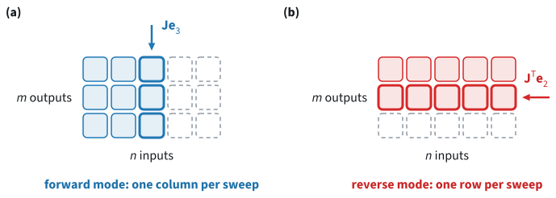

```{.python .input}
%load_ext d2lbook.tab
tab.interact_select('mxnet', 'pytorch', 'tensorflow', 'jax')
```

# Automatic Differentiation
:label:`sec_autograd`

In :numref:`sec_calculus` we computed the gradient of a loss by hand. The
line model of that section fits three examples, and its loss is the squared
norm of the errors $\mathbf{r} = \mathbf{X}\mathbf{w} - \mathbf{y}$. To
differentiate the loss, we noticed that the errors depend linearly on the
parameters $\mathbf{w}$, with Jacobian $\mathbf{X}$, and wrote out the
backward pass $\nabla_{\mathbf{w}} L = \mathbf{X}^\top (2\mathbf{r})$
ourselves. At $\mathbf{w} = (1, 0)$ it gave $(2, 4)$. A deep
network chains dozens of layers, and each of them needs the same work: derive
its Jacobian, code the product with it, and test the code. Every change to
the model means doing this again. Finite differences avoid the derivation,
but they cost one evaluation of the loss per parameter, and in float32 they
give only three or four correct digits.

Deep learning frameworks do this work for us. While our code computes the
loss, the framework records each operation that it executes, such as a
matrix–vector product or a sum, along with the inputs of the operation. The
derivative of every such operation is built into the framework. Once the loss
is known, the framework walks through the record backward, from the loss to
the parameters, and applies the chain rule at each operation, as we did by
hand for the line model. This procedure is called *automatic
differentiation*, or *autograd* for short. It returns the derivative of the
computation up to floating-point rounding, at a small multiple of the cost
of computing the loss, whatever the number of parameters.

We first let the framework compute the gradient of the line model and
compare it with $(2, 4)$. We then control which operations are
recorded, differentiate programs with loops and branches, differentiate a
derivative, and finally see why frameworks walk the record backward rather
than forward.

```{.python .input #autograd-automatic-differentiation}
%%tab mxnet
from mxnet import autograd, np as mnp, npx
npx.set_np()
```

```{.python .input #autograd-automatic-differentiation}
%%tab pytorch
import torch
```

```{.python .input #autograd-automatic-differentiation}
%%tab tensorflow
import tensorflow as tf
```

```{.python .input #autograd-automatic-differentiation}
%%tab jax
import jax
from jax import numpy as jnp
```

## Computing Gradients

### The Forward Pass

We set up the line model with the framework's tensors. Each row
$(1, \textrm{input})$ of $\mathbf{X}$ describes one of the three examples,
$\mathbf{y}$ holds their labels, and the parameters start at
$\mathbf{w} = (1, 0)$. The function `loss` computes
$L(\mathbf{w}) = \|\mathbf{X}\mathbf{w} - \mathbf{y}\|^2$. It is the forward
pass only: no derivative appears anywhere in the code.

```{.python .input #autograd-a-simple-function-1}
%%tab mxnet
X = mnp.array([[1.0, 0.0], [1.0, 1.0], [1.0, 2.0]])  # [1, input]
y = mnp.array([1.0, 1.0, 0.0])
w = mnp.array([1.0, 0.0])

def loss(w):
    return ((X @ w - y) ** 2).sum()
```

```{.python .input #autograd-a-simple-function-1}
%%tab pytorch
X = torch.tensor([[1.0, 0.0], [1.0, 1.0], [1.0, 2.0]])  # [1, input]
y = torch.tensor([1.0, 1.0, 0.0])
w = torch.tensor([1.0, 0.0])

def loss(w):
    return ((X @ w - y) ** 2).sum()
```

```{.python .input #autograd-a-simple-function-1}
%%tab tensorflow
X = tf.constant([[1.0, 0.0], [1.0, 1.0], [1.0, 2.0]])  # [1, input]
y = tf.constant([1.0, 1.0, 0.0])
w = tf.constant([1.0, 0.0])

def loss(w):
    return tf.reduce_sum((tf.linalg.matvec(X, w) - y) ** 2)
```

```{.python .input #autograd-a-simple-function-1}
%%tab jax
X = jnp.array([[1.0, 0.0], [1.0, 1.0], [1.0, 2.0]])  # [1, input]
y = jnp.array([1.0, 1.0, 0.0])
w = jnp.array([1.0, 0.0])

def loss(w):
    return ((X @ w - y) ** 2).sum()
```

:begin_tab:`mxnet, pytorch, tensorflow`
Recording costs memory and time, so the framework records only the
operations whose results depend on tensors that we mark as needing a
gradient. We mark $\mathbf{w}$.
:end_tab:

:begin_tab:`mxnet`
`attach_grad` marks `w` and allocates the array `w.grad`, in which the
backward pass will store the gradient. It starts at zero. MXNet records
operations only inside an `autograd.record()` scope.
:end_tab:

:begin_tab:`pytorch`
`requires_grad_(True)` marks `w`; the trailing underscore is PyTorch's
convention for a method that changes its tensor in place. From now on every
operation on `w` is recorded, and the gradient will appear in the attribute
`w.grad`, which is `None` until the first backward pass.
:end_tab:

:begin_tab:`tensorflow`
A `tf.GradientTape` records the operations executed inside its `with` block.
It marks trainable `tf.Variable`s automatically, so we turn `w` into one. An
ordinary tensor is marked only by a call to the tape's `watch` method.
:end_tab:

:begin_tab:`jax`
JAX works differently. It records operations only while a transformation
such as `jax.grad` runs a function: `jax.grad` turns a Python function such
as `loss` into a new function that computes its gradient. There is nothing
to mark, and the forward pass is an ordinary call.
:end_tab:

```{.python .input #autograd-a-simple-function-2}
%%tab mxnet
w.attach_grad()
w.grad
```

```{.python .input #autograd-a-simple-function-2}
%%tab pytorch
w.requires_grad_(True)
```

```{.python .input #autograd-a-simple-function-2}
%%tab tensorflow
w = tf.Variable(w)
```

We now run the forward pass.

```{.python .input #autograd-a-simple-function-3}
%%tab mxnet
with autograd.record():  # record the operations that compute the loss
    L = loss(w)
L
```

```{.python .input #autograd-a-simple-function-3}
%%tab pytorch
L = loss(w)
L
```

```{.python .input #autograd-a-simple-function-3}
%%tab tensorflow
with tf.GradientTape() as t:  # record the operations on the tape t
    L = loss(w)
L
```

```{.python .input #autograd-a-simple-function-3}
%%tab jax
loss(w)
```

:begin_tab:`pytorch`
The loss carries `grad_fn=<SumBackward0>`: it remembers the operation that
produced it, the last one in the record.
:end_tab:

The record forms a *computational graph* (:numref:`fig_autograd_graph`). Its
nodes are the values computed along the way, from the parameters to the
loss, and an edge runs from each input of an operation to its result. The
framework records operations at the level at which it knows their
derivatives, so the loss of the line model becomes four operations: a
matrix–vector product, the subtraction of the labels, an elementwise square,
and a sum.

![The computational graph of $L = \|\mathbf{X}\mathbf{w} - \mathbf{y}\|^2$ at $\mathbf{w} = (1, 0)$, with one node for $\mathbf{w}$ and for each value computed from it; the constants $\mathbf{X}$ and $\mathbf{y}$ are not drawn, and $\mathbf{r} \odot \mathbf{r}$ is the elementwise square. Each node shows its value (black) and the gradient of $L$ with respect to it (red). The forward pass (blue) runs from left to right; the backward pass (red) starts from $1$ at $L$ and applies the local rule of each operation, from right to left.](../img/autograd-comp-graph.svg)
:label:`fig_autograd_graph`

### The Backward Pass

:begin_tab:`mxnet, pytorch`
Calling `backward` on the loss runs the backward pass and stores the
gradient in `w.grad`.
:end_tab:

:begin_tab:`tensorflow`
The tape's `gradient` method runs the backward pass over the recorded
operations and returns the gradient of its first argument with respect to its
second.
:end_tab:

:begin_tab:`jax`
`jax.grad(loss)` is a function that returns the gradient of `loss`, and we
call it at `w`.
:end_tab:

```{.python .input #autograd-a-simple-function-4}
%%tab mxnet
L.backward()
w.grad
```

```{.python .input #autograd-a-simple-function-4}
%%tab pytorch
L.backward()
w.grad
```

```{.python .input #autograd-a-simple-function-4}
%%tab tensorflow
t.gradient(L, w)
```

```{.python .input #autograd-a-simple-function-4}
%%tab jax
jax.grad(loss)(w)
```

The result is $(2, 4)$, the gradient
$2\mathbf{X}^\top(\mathbf{X}\mathbf{w} - \mathbf{y})$ that we derived by
hand in :numref:`sec_calculus`. There we multiplied by two factors,
$2\mathbf{r}$ and $\mathbf{X}^\top$. The backward pass of
:numref:`fig_autograd_graph` produces them from four local rules, one per
operation. It starts from the derivative $1$ of $L$ with respect to itself.
The sum copies this gradient to each of its three inputs, the square
multiplies it entry by entry by $2\mathbf{r}$, subtracting the constant
labels leaves it unchanged, and the matrix–vector product multiplies it by
$\mathbf{X}^\top$. Each rule uses only the local derivative of one operation
and values saved during the forward pass, here $\mathbf{r}$ and
$\mathbf{X}$. This is why training needs more memory than prediction: the
framework must keep such values until the backward pass has used them.

### Gradient Accumulation

Training computes a new gradient at every step, so it matters what happens
to the gradient of the previous step.

:begin_tab:`mxnet, pytorch, tensorflow`
We run the forward and the backward pass a second time, at the same
$\mathbf{w}$.
:end_tab:

:begin_tab:`mxnet`
By default, MXNet overwrites `w.grad` with the new gradient, so it holds
$(2, 4)$ again.
:end_tab:

:begin_tab:`pytorch`
PyTorch adds the new gradient to the one already stored in `w.grad`, so
`w.grad` now holds twice the gradient. Accumulation is useful when a loss is
a sum of parts whose gradients are computed separately: calling `backward`
on each part adds up their gradients. A training step that needs a fresh
gradient must therefore first reset `w.grad`, for instance with
`w.grad.zero_()`. A forgotten reset is a common bug.
:end_tab:

:begin_tab:`tensorflow`
A tape returns the gradient as a new tensor and stores nothing in `w`, so the
new tape returns $(2, 4)$ again. A tape can compute gradients only once,
unless it is created with `persistent=True`.
:end_tab:

:begin_tab:`jax`
`jax.grad` returns a new array at every call and keeps nothing between calls,
so there is no stored gradient that could accumulate.
:end_tab:

```{.python .input #autograd-a-simple-function-6}
%%tab mxnet
with autograd.record():
    L = loss(w)
L.backward()
w.grad  # overwritten by the new gradient
```

```{.python .input #autograd-a-simple-function-6}
%%tab pytorch
L = loss(w)
L.backward()
w.grad  # the new gradient was added to the old one
```

```{.python .input #autograd-a-simple-function-6}
%%tab tensorflow
with tf.GradientTape() as t:
    L = loss(w)
t.gradient(L, w)  # a new tensor; nothing is stored in w
```

### Vector-Valued Functions

So far the function that we differentiated returned a scalar. Often it
returns a vector, for instance the loss of each example in a minibatch,
before the losses are added up. Let $\mathbf{u}$ be a vector of $m$ values
computed from $n$ inputs $\mathbf{x}$. Its derivative is the $m \times n$
Jacobian $\mathbf{J}$ with entries $J_{ji} = \partial u_j / \partial x_i$,
whose row $j$ is the transposed gradient of $u_j$. The backward pass does not
compute $\mathbf{J}$. It starts from a vector $\mathbf{v}$ with one entry
per output and returns

$$\mathbf{J}^\top \mathbf{v} = \nabla_{\mathbf{x}} \left(\mathbf{v}^\top \mathbf{u}\right) = \sum_{j=1}^m v_j \nabla_{\mathbf{x}} u_j,$$

the gradient of a weighted sum of the outputs. This is the chain rule of
:numref:`sec_calculus`, $\nabla_{\mathbf{x}} z = \mathbf{J}^\top
\nabla_{\mathbf{u}} z$, for a scalar $z$ computed from $\mathbf{u}$ whose
gradient $\nabla_{\mathbf{u}} z$ is $\mathbf{v}$.

With $\mathbf{v} = \mathbf{1}$, the vector of all ones, the backward pass
returns the gradient of the sum of the outputs. For per-example losses this
is what we want: the gradient of the total loss. We differentiate the
per-example squared errors $r_i^2$ of the line model, whose sum is $L$.

:begin_tab:`mxnet`
`backward` takes $\mathbf{v}$ as its argument. Without one, it uses
$\mathbf{v} = \mathbf{1}$ for an array that is not a scalar.
:end_tab:

:begin_tab:`pytorch`
PyTorch does not choose $\mathbf{v}$ for us: calling `backward` on a tensor
that is not a scalar raises an error unless we pass $\mathbf{v}$ as the
argument `gradient`. The name reflects the chain rule, since $\mathbf{v}$ is
the gradient arriving from the rest of a larger computation. Passing a
vector of ones is the same as calling `losses.sum().backward()`.
:end_tab:

:begin_tab:`tensorflow`
The tape's `gradient` method takes $\mathbf{v}$ as the argument
`output_gradients`. Without it, `gradient` uses $\mathbf{v} = \mathbf{1}$
for a tensor that is not a scalar.
:end_tab:

:begin_tab:`jax`
`jax.grad` accepts only functions with a scalar output. `jax.vjp(losses, w)`
returns the value of `losses` at `w` and a function that maps $\mathbf{v}$
to $\mathbf{J}^\top \mathbf{v}$. That function returns a tuple with one
entry per argument of `losses`, here only `w`.
:end_tab:

```{.python .input #autograd-backward-for-non-scalar-variables}
%%tab mxnet
with autograd.record():
    losses = (X @ w - y) ** 2  # one loss per example
losses.backward(mnp.ones(3))  # v = 1: differentiates losses.sum()
w.grad
```

```{.python .input #autograd-backward-for-non-scalar-variables}
%%tab pytorch
w.grad.zero_()
losses = (X @ w - y) ** 2  # one loss per example
losses.backward(gradient=torch.ones(3))  # = losses.sum().backward()
w.grad
```

```{.python .input #autograd-backward-for-non-scalar-variables}
%%tab tensorflow
with tf.GradientTape() as t:
    losses = (tf.linalg.matvec(X, w) - y) ** 2  # per-example losses
t.gradient(losses, w, output_gradients=tf.ones(3))  # v = 1
```

```{.python .input #autograd-backward-for-non-scalar-variables}
%%tab jax
def losses(w):
    return (X @ w - y) ** 2  # one loss per example

_, vjp = jax.vjp(losses, w)  # vjp maps v to J^T v
vjp(jnp.ones(3))[0]  # v = 1
```

The result is $(2, 4)$, the gradient of the total loss.
Choosing instead $\mathbf{v} = \mathbf{e}_j$, the coordinate vector with a
$1$ in position $j$ and $0$ elsewhere (:numref:`sec_linear-algebra`), makes
the backward pass return the gradient of $u_j$ alone, which is row $j$ of the
Jacobian. :numref:`subsec_autograd_fwd_rev` uses this to compute whole
Jacobians.

## Controlling the Graph

Frameworks record every operation on a marked tensor, and sometimes that is
more than we want. A value computed from the parameters may need to act as a
constant, and some computations, such as the update of the parameters,
should not be recorded at all.

### Detaching Values

A common case of the first kind is a target: a value that the output of a
model should move toward, but that the model itself computes. Reinforcement
learning trains models this way, with targets built from the model's own
predictions. The update should move the prediction toward the target. If
gradients also flowed into the target, the update could lower the loss by
moving the target toward the prediction instead, without improving the
prediction. We therefore *detach* the target: we keep its value but cut its
connection to the parameters, so that the backward pass treats it as a
constant.

A small example shows what detaching does to a gradient. Let $u = x^2$ and
$z = ux$ for each entry $x$ of $\mathbf{x} = (0, 1, 2, 3)$, so that
$z = x^3$. In the graph of :numref:`fig_autograd_detach`(a), $x$ reaches $z$
along two paths, through $u$ and directly. The chain rule adds their
contributions, $x \cdot 2x$ and $u$, to give $\partial z / \partial x =
3x^2$. If we replace $u$ by a detached copy $c$, which has the same value
but no history, the path through $u$ disappears
(:numref:`fig_autograd_detach`(b)), and $\partial z / \partial x = c = x^2$.


:label:`fig_autograd_detach`

:begin_tab:`mxnet`
`u.detach()` returns a new array with the values of `u` and no history.
:end_tab:

:begin_tab:`pytorch`
`u.detach()` returns a new tensor with the values of `u` and no history.
:end_tab:

:begin_tab:`tensorflow`
`tf.stop_gradient(u)` returns the values of `u` in the forward pass and lets
no gradient through in the backward pass.
:end_tab:

:begin_tab:`jax`
`jax.lax.stop_gradient(u)` returns the values of `u` and lets no gradient
through. Since `jax.grad` differentiates a function, the call belongs inside
the function that we differentiate. A value computed outside that function is
a constant for `jax.grad` anyway, so `stop_gradient` would have no effect
there.
:end_tab:

```{.python .input #autograd-detaching-computation-1}
%%tab mxnet
x = mnp.arange(4.0)
x.attach_grad()
with autograd.record():
    u = x * x
    c = u.detach()  # values of u, no history
    z = c * x
z.backward()
x.grad
```

```{.python .input #autograd-detaching-computation-1}
%%tab pytorch
x = torch.arange(4.0, requires_grad=True)
u = x * x
c = u.detach()  # values of u, no history
z = c * x
z.sum().backward()
x.grad
```

```{.python .input #autograd-detaching-computation-1}
%%tab tensorflow
x = tf.Variable(tf.range(4.0))
with tf.GradientTape() as t:
    u = x * x
    c = tf.stop_gradient(u)  # values of u, no history
    z = c * x
t.gradient(z, x)
```

```{.python .input #autograd-detaching-computation-1}
%%tab jax
x = jnp.arange(4.0)

def z(x):
    u = x * x
    c = jax.lax.stop_gradient(u)  # values of u, no history
    return c * x

jax.grad(lambda x: z(x).sum())(x)
```

The gradient is $(0, 1, 4, 9)$, which is $c = x^2$. Without the detach,
both paths carry gradient.

:begin_tab:`pytorch`
Detaching did not change `u`, which keeps its history, so we can reuse it.
:end_tab:

```{.python .input #autograd-detaching-computation-2}
%%tab mxnet
with autograd.record():
    u = x * x
    z = u * x
z.backward()
x.grad
```

```{.python .input #autograd-detaching-computation-2}
%%tab pytorch
x.grad.zero_()
z = u * x
z.sum().backward()
x.grad
```

```{.python .input #autograd-detaching-computation-2}
%%tab tensorflow
with tf.GradientTape() as t:
    u = x * x
    z = u * x
t.gradient(z, x)
```

```{.python .input #autograd-detaching-computation-2}
%%tab jax
jax.grad(lambda x: (x * x * x).sum())(x)
```

The gradient is now $3x^2 = (0, 3, 12, 27)$, although $z$ has the same
value $(0, 1, 8, 27)$ in both computations. Detaching changes the
graph, not the values.

### Disabling Gradient Tracking

When we need only values, as when a trained model makes predictions,
recording wastes time and memory, and we switch it off. Updating the
parameters is another such computation: the step
$\mathbf{w} \leftarrow \mathbf{w} - \eta \nabla L(\mathbf{w})$ is not part
of any loss that we want to differentiate. We take one step of gradient
descent on the line model with the learning rate $\eta = 0.1$.

:begin_tab:`mxnet`
MXNet records only inside `autograd.record()`, so code outside such a scope
is not recorded; inside one, `autograd.pause()` suspends recording. Writing
the update as `w[:] = ...` changes the values of `w` in place and keeps the
gradient buffer attached to `w`. The buffer holds the gradient $(2, 4)$
computed above.
:end_tab:

:begin_tab:`pytorch`
Operations inside a `torch.no_grad()` block are not recorded. The update must
happen inside such a block: while it records, PyTorch does not allow an
in-place change of a leaf tensor that requires gradients, such as `w`. The
gradient in `w.grad` is the $(2, 4)$ computed above.
:end_tab:

:begin_tab:`tensorflow`
A tape records only the operations inside its `with` block, so code outside
every tape is not recorded; inside one, the tape's `stop_recording` method
suspends recording. A variable is changed in place by methods such as
`assign_sub`, which subtracts its argument.
:end_tab:

:begin_tab:`jax`
JAX records operations only while a transformation such as `jax.grad` runs,
so the update is ordinary arithmetic. It creates a new array, since JAX
arrays cannot be changed in place.
:end_tab:

```{.python .input #autograd-turning-off-gradient-tracking-1}
%%tab mxnet
w[:] = w - 0.1 * w.grad  # outside autograd.record(): not recorded
w, loss(w)
```

```{.python .input #autograd-turning-off-gradient-tracking-1}
%%tab pytorch
with torch.no_grad():  # nothing in this block is recorded
    w -= 0.1 * w.grad
    L = loss(w)
w, L
```

```{.python .input #autograd-turning-off-gradient-tracking-1}
%%tab tensorflow
with tf.GradientTape() as t:
    L = loss(w)
w.assign_sub(0.1 * t.gradient(L, w))  # outside the tape
w.numpy(), round(float(loss(w)), 4)
```

```{.python .input #autograd-turning-off-gradient-tracking-1}
%%tab jax
w = w - 0.1 * jax.grad(loss)(w)
w, loss(w)
```

The step moves $\mathbf{w}$ to $(0.8, -0.4)$ and lowers the loss from
$1$ to $0.4$, as we computed by hand in :numref:`sec_calculus`. Repeating
this step is how the models of the next chapter are trained.

:begin_tab:`pytorch`
The loss computed inside the block has no `grad_fn`: it is not attached to
any graph.
:end_tab:

## Differentiating Programs

The loss of the line model is a fixed formula. Programs often are not: how
many times a loop runs, or which branch an `if` statement takes, can depend
on the data. Automatic differentiation handles such programs as they are,
and it can even differentiate a derivative that it computed.

### Control Flow
:label:`subsec_autograd_control_flow`

A language model reads sentences of different lengths, so its computation
runs for a different number of steps on each input. No single formula
describes such a program for all inputs, but none is needed. The framework
records the operations that actually run for the input at hand, and these
form an ordinary computational graph that the backward pass can walk. The
function `f` below doubles its input until the norm of the result reaches
1000, and then returns the result, multiplied by 100 unless its entries have
a positive sum.

```{.python .input #autograd-gradients-and-python-control-flow-1}
%%tab mxnet
def f(a):
    b = a * 2
    while mnp.linalg.norm(b) < 1000:
        b = b * 2
    if b.sum() > 0:
        c = b
    else:
        c = 100 * b
    return c
```

```{.python .input #autograd-gradients-and-python-control-flow-1}
%%tab pytorch
def f(a):
    b = a * 2
    while torch.linalg.vector_norm(b) < 1000:
        b = b * 2
    if b.sum() > 0:
        c = b
    else:
        c = 100 * b
    return c
```

```{.python .input #autograd-gradients-and-python-control-flow-1}
%%tab tensorflow
def f(a):
    b = a * 2
    while tf.norm(b) < 1000:
        b = b * 2
    if tf.reduce_sum(b) > 0:
        c = b
    else:
        c = 100 * b
    return c
```

```{.python .input #autograd-gradients-and-python-control-flow-1}
%%tab jax
def f(a):
    b = a * 2
    while jnp.linalg.norm(b) < 1000:
        b = b * 2
    if b.sum() > 0:
        c = b
    else:
        c = 100 * b
    return c
```

For a scalar input $a$, the result is $f(a) = ka$ with a factor $k$ that
depends on $a$: a power of two, multiplied by $100$ when $a$ is negative.
Between the inputs at which $k$ changes, $f$ is linear, and its derivative
is $k = f(a)/a$. We compute both sides of this equation at $a = 0.3$ and at
$a = -0.75$.

```{.python .input #autograd-gradients-and-python-control-flow-2}
%%tab mxnet
for value in (0.3, -0.75):
    a = mnp.array(value)
    a.attach_grad()
    with autograd.record():
        fa = f(a)
    fa.backward()
    print(f'a = {value:5.2f}   f(a) / a = {float(fa) / value:6.0f}   '
          f'gradient = {float(a.grad):6.0f}')
```

```{.python .input #autograd-gradients-and-python-control-flow-2}
%%tab pytorch
for value in (0.3, -0.75):
    a = torch.tensor(value, requires_grad=True)
    fa = f(a)
    fa.backward()
    print(f'a = {value:5.2f}   f(a) / a = {fa.item() / value:6.0f}   '
          f'gradient = {a.grad.item():6.0f}')
```

```{.python .input #autograd-gradients-and-python-control-flow-2}
%%tab tensorflow
for value in (0.3, -0.75):
    a = tf.Variable(value)
    with tf.GradientTape() as t:
        fa = f(a)
    print(f'a = {value:5.2f}   f(a) / a = {float(fa) / value:6.0f}   '
          f'gradient = {float(t.gradient(fa, a)):6.0f}')
```

```{.python .input #autograd-gradients-and-python-control-flow-2}
%%tab jax
for value in (0.3, -0.75):
    a = jnp.array(value)
    print(f'a = {value:5.2f}   f(a) / a = {f(a) / a:6.0f}   '
          f'gradient = {jax.grad(f)(a):6.0f}')
```

The two inputs record different graphs (:numref:`fig_autograd_dynamic`).
For $a = 0.3$, the function doubles $12$ times and keeps the result, so
$k = 2^{12} = 4096$. For $a = -0.75$, it doubles $11$ times and multiplies
by $100$, so $k = 100 \cdot 2^{11} = 204{,}800$. In both cases the gradient
equals $f(a)/a$.


:label:`fig_autograd_dynamic`

Automatic differentiation differentiates the operations that ran, not the
function that the program represents. Where the number of doublings
changes, at $a = 1000/2^{12} \approx 0.24$ for instance, $f$ jumps and has
no derivative. Autograd still returns the slope of the piece that ran. For
`f`, the result is the derivative wherever the derivative exists, and a
number with no meaning at the jumps.

### Higher-Order Derivatives

Some methods need the derivative of a derivative: the curvature of a loss,
for instance, or the products of a vector with the matrix of second
derivatives, the *Hessian*, which some optimizers use. The backward pass is
a computation like any other, so the framework can record it and
differentiate it again. We take $g(x) = x^3$, with $g'(x) = 3x^2$ and
$g''(x) = 6x$, which at $x = 1$ equal $3$ and $6$.

:begin_tab:`mxnet`
Most operations of `mxnet.np`, including multiplication and
powers, cannot be differentiated a second time, so MXNet cannot compute this
example, and it has no MXNet version.
:end_tab:

:begin_tab:`pytorch`
`torch.autograd.grad` returns a gradient instead of storing it in `.grad`.
With `create_graph=True` it also records the backward pass, so the first
derivative is a tensor with a history, which we differentiate again.
:end_tab:

:begin_tab:`tensorflow`
We nest two tapes. The inner tape records $x^3$, and the outer tape records
the inner tape's gradient computation, so it can differentiate $3x^2$.
:end_tab:

:begin_tab:`jax`
`jax.grad` turns a function into its derivative, which is again a function,
so we apply it twice.
:end_tab:

```{.python .input #autograd-higher-order-derivatives-1}
%%tab pytorch
x = torch.tensor(1.0, requires_grad=True)
dg = torch.autograd.grad(x ** 3, x, create_graph=True)[0]  # 3x²
d2g = torch.autograd.grad(dg, x)[0]                         # 6x
dg, d2g
```

```{.python .input #autograd-higher-order-derivatives-1}
%%tab tensorflow
x = tf.Variable(1.0)
with tf.GradientTape() as outer:
    with tf.GradientTape() as inner:
        g = x ** 3
    dg = inner.gradient(g, x)  # 3x², recorded by the outer tape
d2g = outer.gradient(dg, x)    # 6x
dg, d2g
```

```{.python .input #autograd-higher-order-derivatives-1}
%%tab jax
def g(x):
    return x ** 3

jax.grad(g)(1.0), jax.grad(jax.grad(g))(1.0)  # 3x² and 6x
```

Both values match the formulas.

## Forward and Reverse Mode
:label:`subsec_autograd_fwd_rev`

Every backward pass in this section started at an output and worked toward
the inputs. The chain rule does not prescribe this order. It multiplies the
local derivatives along each path through the graph, and the products can
be formed from either end. *Reverse mode*, the backward pass that we have
used, starts at an output. *Forward mode* starts at an input and carries
derivatives forward together with the values. Both compute the same
derivatives, at very different costs, and the costs decide which mode
trains networks.

### Rows and Columns of the Jacobian

One traversal of the graph, in either mode, is called a *sweep*; a reverse
sweep is a backward pass. Consider a function with $n$ inputs and $m$
outputs and its $m \times n$ Jacobian $\mathbf{J}$. Either sweep costs a
small multiple of one evaluation of the function, and each one fills one row
or one column of $\mathbf{J}$ (:numref:`fig_autograd_fwd_rev`).

As we saw for vector-valued functions, a reverse sweep starts from a vector
$\mathbf{v}$ at the outputs and returns $\mathbf{J}^\top \mathbf{v}$, the
transpose of the *vector–Jacobian product* $\mathbf{v}^\top \mathbf{J}$.
With $\mathbf{v} = \mathbf{e}_j$, this is row $j$ of $\mathbf{J}$: the
gradient of output $j$ with respect to all inputs. Filling the whole
Jacobian takes $m$ reverse sweeps, one per row.

A forward sweep starts from a direction $\mathbf{d}$ at the inputs and
returns the *Jacobian–vector product* $\mathbf{J}\mathbf{d}$, the rate at
which all outputs change as the inputs move along $\mathbf{d}$. With
$\mathbf{d} = \mathbf{e}_i$, this is column $i$: the derivatives of all
outputs with respect to input $i$. Filling the whole Jacobian takes $n$
forward sweeps, one per column.


:label:`fig_autograd_fwd_rev`

We fill the Jacobian of the line model's errors
$\mathbf{r}(\mathbf{w}) = \mathbf{X}\mathbf{w} - \mathbf{y}$ both ways. The
errors are $m = 3$ outputs of $n = 2$ inputs, and their Jacobian is
$\mathbf{X}$, so reverse mode needs three sweeps and forward mode two. The
rows of the $k \times k$ identity matrix `eye(k)` are the coordinate vectors
$\mathbf{e}_1, \ldots, \mathbf{e}_k$, so a loop over its rows supplies one
coordinate vector per sweep, and `stack` joins the results into a matrix
(:numref:`sec_ndarray`).

:begin_tab:`mxnet`
MXNet implements only reverse mode. Passing $\mathbf{v}$ to `backward`
computes $\mathbf{J}^\top \mathbf{v}$, so we fill the Jacobian row by row.
:end_tab:

:begin_tab:`pytorch`
`torch.func.vjp(errors, w0)` returns the value of `errors` at `w0` and a
function that maps $\mathbf{v}$ to $\mathbf{J}^\top \mathbf{v}$.
`torch.func.jvp(errors, (w0,), (d,))` returns the value and
$\mathbf{J}\mathbf{d}$, computed in one forward sweep.
:end_tab:

:begin_tab:`tensorflow`
The tape's `gradient` method computes $\mathbf{J}^\top \mathbf{v}$ when we
pass $\mathbf{v}$ as `output_gradients`. A `tf.autodiff.ForwardAccumulator`
computes $\mathbf{J}\mathbf{d}$ in forward mode, for the direction
$\mathbf{d}$ that it is given.
:end_tab:

:begin_tab:`jax`
As for the per-example losses, `jax.vjp(errors, w0)` returns a function that
maps $\mathbf{v}$ to $\mathbf{J}^\top \mathbf{v}$.
`jax.jvp(errors, (w0,), (d,))` returns the value and $\mathbf{J}\mathbf{d}$,
computed in one forward sweep.
:end_tab:

```{.python .input #autograd-rows-and-columns-of-the-jacobian}
%%tab mxnet
def errors(w):
    return X @ w - y

w0 = mnp.array([1.0, 0.0])
w0.attach_grad()
rows = []
for v in mnp.eye(3):  # row by row, one reverse sweep each
    with autograd.record():
        r = errors(w0)
    r.backward(v)
    rows.append(w0.grad.copy())
print('reverse sweeps:', mnp.stack(rows).tolist())
```

```{.python .input #autograd-rows-and-columns-of-the-jacobian}
%%tab pytorch
def errors(w):
    return X @ w - y

w0 = torch.tensor([1.0, 0.0])
_, vjp = torch.func.vjp(errors, w0)
rows = torch.stack([vjp(v)[0] for v in torch.eye(3)])  # row by row
cols = torch.stack([torch.func.jvp(errors, (w0,), (d,))[1]
                    for d in torch.eye(2)], dim=1)  # column by column
print('reverse sweeps:', rows.tolist())
print('forward sweeps:', cols.tolist())
```

```{.python .input #autograd-rows-and-columns-of-the-jacobian}
%%tab tensorflow
def errors(w):
    return tf.linalg.matvec(X, w) - y

w0 = tf.constant([1.0, 0.0])
with tf.GradientTape(persistent=True) as t:
    t.watch(w0)
    r = errors(w0)
rows = tf.stack([t.gradient(r, w0, output_gradients=v)
                 for v in tf.eye(3)])  # row by row
cols = []
for d in tf.eye(2):  # column by column
    with tf.autodiff.ForwardAccumulator(w0, d) as acc:
        r = errors(w0)
    cols.append(acc.jvp(r))
print('reverse sweeps:', rows.numpy().tolist())
print('forward sweeps:', tf.stack(cols, axis=1).numpy().tolist())
```

```{.python .input #autograd-rows-and-columns-of-the-jacobian}
%%tab jax
def errors(w):
    return X @ w - y

w0 = jnp.array([1.0, 0.0])
_, vjp = jax.vjp(errors, w0)
rows = jnp.stack([vjp(v)[0] for v in jnp.eye(3)])  # row by row
cols = jnp.stack([jax.jvp(errors, (w0,), (d,))[1]
                  for d in jnp.eye(2)], axis=1)  # column by column
print('reverse sweeps:', rows.tolist())
print('forward sweeps:', cols.tolist())
```

:begin_tab:`mxnet`
The three rows assemble $\mathbf{X}$. Filling it column by column would
need forward mode.
:end_tab:

:begin_tab:`pytorch, tensorflow, jax`
Both ways recover $\mathbf{X}$. For these errors, forward mode needs fewer
sweeps, because there are more outputs than inputs.
:end_tab:

:begin_tab:`pytorch`
`torch.func.jacrev` and `torch.func.jacfwd` assemble a Jacobian from such
reverse and forward sweeps.
:end_tab:

:begin_tab:`tensorflow`
The tape's `jacobian` method assembles a Jacobian from reverse sweeps.
:end_tab:

:begin_tab:`jax`
`jax.jacrev` and `jax.jacfwd` assemble a Jacobian from such reverse and
forward sweeps.
:end_tab:

### The Cost of a Gradient

For a loss, the comparison is lopsided. A loss has a single output, $m = 1$,
so its Jacobian is one row, the transposed gradient, with an entry for each
of the $n$ parameters. Reverse mode computes the whole gradient in one
sweep, at a small multiple of the cost of computing the loss, whatever the
number of parameters. Forward mode needs one sweep per parameter, $n$ in
all, as many evaluations of the loss as finite differences. For a network with
$n = 10^8$ parameters, one reverse sweep does the work of $10^8$ forward
sweeps. This is the general form of what we found for the line model in
:numref:`sec_calculus`, whose backward pass cost about as much as its
forward pass, and it is why deep learning frameworks train networks in
reverse mode. Backpropagation is reverse mode applied to a neural network.

Reverse mode needs more memory than forward mode, since the forward values
that the backward pass uses grow with the number of operations. Forward mode
carries one derivative along with each value, so it needs about twice the
memory of evaluating the function, however many operations there are. It is
the better choice
for functions with few inputs and many outputs, and the two modes combine
well: forward mode applied to a gradient computed in reverse mode yields a
Hessian–vector product at the cost of a few gradients.

Both modes are older than deep learning. Forward mode goes back to
:citet:`Wengert.1964`, and reverse mode was developed by
:citet:`Linnainmaa.1970`. :numref:`sec_mdl-matrix-calculus-autodiff`
derives both modes in detail, including their costs in time and memory.

We can now compute the gradient of any loss that our code computes, control
which parts of the computation the gradient flows through, and take a
gradient step. We have treated the backward pass through a network as a
black box; :numref:`sec_backprop` opens it for a network with one hidden
layer. A gradient tells us how to lower the loss on the data at hand.
Whether a lower loss reflects a pattern that will hold on new data, or only
noise in the data we have, is a question of probability and statistics,
the subject of the next section.

## Summary

Automatic differentiation computes the gradient of a loss from the code
that computes the loss, without any derivative written by hand. The framework records the
operations of the forward pass as a computational graph and then applies the
chain rule backward through the graph, one operation at a time; for the line
model this reproduces the gradient $(2, 4)$ that we derived by hand.
Detaching a value turns it into a constant for the backward pass, and
disabling recording keeps computations such as parameter updates out of the
graph. Since the graph records what actually ran, loops and branches need no
special treatment, and the backward pass can itself be differentiated.
Reverse mode computes a whole gradient in one sweep, whatever the number of
parameters, which is why it trains the networks of this book.

## Exercises

:begin_tab:`mxnet`
1. [code] **Detached intermediates.** Let `u = x * x` and `c = u.detach()`,
   and consider `z = c * c`, `z = u * c`, and `z = u * u`. For each `z`,
   compute `u`, `c`, and `z` afresh inside an `autograd.record()` scope and
   call `z.backward()`. Before running any code, predict the outcome of each
   call, including the resulting `x.grad`. Check your predictions, and
   explain the ratio between the gradients for `z = u * c` and `z = u * u`.

2. [code] **Manual parameter updates.** Perform the gradient step of this
   section as `w = w - 0.1 * w.grad` instead of `w[:] = w - 0.1 * w.grad`,
   and inspect `w.grad`. Explain what the rebinding has done to the buffer
   allocated by `attach_grad`, predict what a second recorded forward pass
   followed by `backward` does, and check.
:end_tab:

:begin_tab:`pytorch`
1. [code] **Detached intermediates.** Let `u = x * x` and `c = u.detach()`,
   and consider `z = c * c`, `z = u * c`, and `z = u * u`. For each `z`,
   recompute `u` and `c`, reset `x.grad`, and call `backward` on the sum of
   the entries of `z`. Before running any code, predict the outcome of each
   call, including the resulting `x.grad`. Check your predictions, and
   explain the ratio between the gradients for `z = u * c` and `z = u * u`.

2. [code] **Manual parameter updates.** Perform the gradient step of this
   section as `w = w - 0.1 * w.grad`, outside `torch.no_grad()`, and inspect
   `w.requires_grad`, `w.grad_fn`, `w.is_leaf`, and `w.grad`. Explain what
   the update has done to the graph, predict what a second forward and
   backward pass leaves in `w.grad`, and check.
:end_tab:

:begin_tab:`tensorflow`
1. [code] **Detached intermediates.** Let `u = x * x` and
   `c = tf.stop_gradient(u)` inside a persistent `tf.GradientTape` `t`.
   Before running any code, predict `t.gradient(z, x)` for each of
   `z = c * c`, `z = u * c`, and `z = u * u`, all computed inside `t`. Check
   your predictions, and explain the ratio between the results for
   `z = u * c` and `z = u * u`.

2. [code] **Manual parameter updates.** Perform the gradient step of this
   section as `w = w - 0.1 * g`, where `g` is the gradient returned by the
   tape, instead of with `assign_sub`, and inspect `type(w)`. Predict what
   `gradient` returns for a second forward pass under a new tape, check, and
   explain why a training loop updates variables with `assign_sub`.
:end_tab:

:begin_tab:`jax`
1. [code] **Detached intermediates.** Write three functions of `x` that
   compute `u = x * x` and `c = jax.lax.stop_gradient(u)` and return
   `c * c`, `u * c`, and `u * u`, respectively. Before running any code,
   predict the gradient of the sum of the entries of each result with
   respect to `x`. Check your predictions with `jax.grad`, and explain the
   ratio between the results for `u * c` and `u * u`.

2. [code] **Manual parameter updates.** Let `w = jnp.arange(4.0)` and
   `g = lambda x: (w * x).sum()`, which reads `w` from the enclosing scope.
   Predict `jax.grad(g)(x)`, check, and state with respect to which array
   `jax.grad` differentiates. Then rewrite `g` so that `jax.grad` returns
   the gradient of `(w * x).sum()` with respect to `w`, use it for one
   update of `w` with learning rate 0.1, and explain what this implies for
   how a JAX training loop must pass the parameters to the loss function.
:end_tab:

3. [code] **From scalar to vector input.** Replace the scalar input `a` of
   the function `f` defined in :numref:`subsec_autograd_control_flow` by a
   random vector of length 5, and differentiate the sum of the entries of
   `fa = f(a)` with respect to `a`.
    1. Express `f(a)` in terms of `a`, and give the Jacobian of `f` at `a`
       and the gradient of the sum of the entries of `fa`.
    1. Compute this gradient with automatic differentiation and check
       whether it still equals `fa / a` elementwise.
    1. Describe the set of inputs `a` at which `f` jumps. Which part of
       this set has no counterpart for a scalar input?

1. [code] **Programs versus functions.** Automatic differentiation
   differentiates the operations that a program executes, not the function
   that the program computes.
    1. The functions $|x|$ and $\sqrt{x^2}$ are equal. Compute the
       derivative of each at $x = 0$ by automatic differentiation, using the
       framework's absolute value and square root. Explain both results from
       the local derivatives of the operations involved. Neither function
       has a derivative at $0$; which of the two results does more harm in
       training, and why?
    1. Write a program that returns $x^2$ for every input $x$ but whose
       automatic derivative at $x = 0$ is $1$ instead of $0$. Explain why
       automatic differentiation cannot detect the difference.

1. [code] **Manual tracing.** Let $f(x, y, z) = (x + y) \cdot z$ with
   $x = -2$, $y = 5$, and $z = -4$.
    1. Draw the computational graph of $f$ with one node per value,
       compute the forward pass by hand, and trace
       $\partial f/\partial x$, $\partial f/\partial y$, and
       $\partial f/\partial z$ backward from $f$ through the multiplication
       and addition nodes (reverse mode).
    1. Compute the same three derivatives in forward mode, propagating the
       derivative with respect to one input at a time from the inputs to
       $f$. Compare the number of sweeps each mode needs and the
       intermediate values each must keep in memory.
    1. Verify every value using automatic differentiation.

    *Adapted from Stanford CS231n,
    ["An Exercise in Backpropagation"](https://cs231n.stanford.edu/slides/2026/section_2_backprop.pdf).*

1. **Cost of second derivatives.** ● The counting argument in
   :numref:`subsec_autograd_fwd_rev` puts the cost of the gradient of a
   scalar loss with $n$ parameters at one reverse sweep. Use the same argument to
   estimate, in units of function evaluations, the cost of the full Hessian
   (the $n \times n$ matrix of second derivatives) and the cost of a single
   Hessian–vector product. Explain the difference between the two costs.

:begin_tab:`mxnet`
[Discussions](https://d2l.discourse.group/t/34)
:end_tab:

:begin_tab:`pytorch`
[Discussions](https://d2l.discourse.group/t/35)
:end_tab:

:begin_tab:`tensorflow`
[Discussions](https://d2l.discourse.group/t/200)
:end_tab:

:begin_tab:`jax`
[Discussions](https://d2l.discourse.group/t/17970)
:end_tab:

<!-- slides -->

::: {.slide}
::: {.cover}
[Dive into Deep Learning · §2.5]{.kicker}

Gradients from a recorded forward pass<br>
**the backward pass · detaching · control flow · forward and reverse mode**
:::
:::

::: {.slide title="Hand-Written Backward Passes Do Not Scale to Deep Networks"}
[The problem]{.kicker}

Line model: rows $(1, \textrm{input})$ of $\mathbf{X}$, labels $\mathbf{y}$,
loss $L(\mathbf{w}) = \|\mathbf{X}\mathbf{w} - \mathbf{y}\|^2$.

- By hand: $\nabla L = \mathbf{X}^\top (2\mathbf{r})$, with errors
  $\mathbf{r} = \mathbf{X}\mathbf{w} - \mathbf{y}$. At $\mathbf{w} = (1, 0)$:
  $\nabla L = (2, 4)$.
- A deep network: one Jacobian per layer to derive, code, and test, again
  after every change to the model.
- Finite differences: $10^8$ loss evaluations per step for $10^8$
  parameters, and 3–4 correct digits in float32.

::: {.d2l-note}
Autograd records the forward pass and applies the chain rule backward: the
gradient, exact up to rounding, for a small multiple of the cost of the loss.
:::
:::

::: {.slide title="By the End of This Deck You Can"}
[Goals]{.kicker}

- compute a gradient in your framework and check it against one derived by
  hand;
- predict what accumulation, detaching, and disabling recording do;
- differentiate programs with loops and branches, and say what autograd
  returns where a program jumps;
- count the passes through the graph that forward and reverse mode need
  for a Jacobian.

**Running example:** the line model at $\mathbf{w} = (1, 0)$, where
$\nabla L = (2, 4)$.
:::

::: {.slide title="Autograd Gets Derivatives Without Algebra"}
[Where this fits]{.kicker}

::: {.cols .vc}
::: {.col}
| section | tool |
|---|---|
| Data Manipulation | tensors |
| Data Preprocessing | pandas |
| Linear Algebra | matrix products, norms, eigenvalues |
| Calculus | derivatives, gradients, chain rule |
| **Automatic Differentiation** | **autograd** |
| Probability and Statistics | Bayes' theorem, standard error |
| Documentation | `help`, small tests |
:::

::: {.col .narrow}
- **Uses:** the chain rule and the line model of the calculus deck.
- **Skips:** backpropagation through a multilayer network (a later
  chapter) and the proofs (the mathematics appendix).
:::
:::
:::

::: {.slide}
::: {.divider}
[01]{.dnum}

[Computing gradients]{.dtitle}

[record forward · sweep backward]{.dsub}
:::
:::

::: {.slide title="We Write Only the Forward Pass"}
[Gradients]{.kicker}

Rows of $\mathbf{X}$ are $(1, \textrm{input})$ for the inputs $0, 1, 2$;
the labels are $\mathbf{y} = (1, 1, 0)$.

@-autograd-a-simple-function-1

No derivative appears anywhere in the code.
:::

::: {.slide title="Mark w, and the Framework Records Every Operation on It" except="jax"}
[Gradients]{.kicker}

Recording costs memory, so only operations on marked tensors are recorded:

@autograd-a-simple-function-2

@autograd-a-simple-function-3
:::

::: {.slide title="jax.grad Turns loss Into a Function That Returns (2, 4)" only="jax"}
[Gradients]{.kicker}

Nothing is marked, and the call `loss(w)` records nothing. JAX records the
operations of `loss` only while `jax.grad` runs it:

@autograd-a-simple-function-3

@autograd-a-simple-function-4

This is $\nabla L = 2\mathbf{X}^\top(\mathbf{X}\mathbf{w} - \mathbf{y})$ at
$\mathbf{w} = (1, 0)$, without a derivative written by hand.
:::

::: {.slide title="The Backward Pass Applies One Local Rule per Operation"}
[Gradients]{.kicker}

@fig:autograd-comp-graph

Start from $1$ at $L$. The sum copies it, the square multiplies by
$2\mathbf{r}$, subtracting $\mathbf{y}$ passes it on, and the product with
$\mathbf{X}$ multiplies by $\mathbf{X}^\top$.
:::

::: {.slide title="One Backward Pass Returns (2, 4), the Gradient Derived by Hand" except="jax"}
[Gradients]{.kicker}

@autograd-a-simple-function-4

This is $\nabla L = 2\mathbf{X}^\top(\mathbf{X}\mathbf{w} - \mathbf{y})$ at
$\mathbf{w} = (1, 0)$, without a derivative written by hand.
:::

::: {.slide title="PyTorch Adds Each New Gradient to w.grad" only="pytorch"}
[Gradients]{.kicker}

A second forward and backward pass at the same $\mathbf{w}$:

@autograd-a-simple-function-6

::: {.d2l-note .warn}
Reset with `w.grad.zero_()` before every backward pass that needs a fresh
gradient.
:::
:::

::: {.slide title="Each Backward Pass Returns a Fresh Gradient" only="mxnet,tensorflow"}
[Gradients]{.kicker}

A second forward and backward pass at the same $\mathbf{w}$ gives $(2, 4)$
again:

@autograd-a-simple-function-6
:::

::: {.slide title="For Vector Outputs, the Backward Pass Returns Jᵀv"}
[Gradients]{.kicker}

$m$ outputs $\mathbf{u}$ of $n$ inputs $\mathbf{x}$, with Jacobian
$J_{ji} = \partial u_j / \partial x_i$. The backward pass starts from
$\mathbf{v}$ and returns $\mathbf{J}^\top\mathbf{v} =
\nabla_{\mathbf{x}}(\mathbf{v}^\top\mathbf{u})$; $\mathbf{v} = \mathbf{1}$,
the vector of all ones, gives the gradient of the sum.

Per-example squared errors, passing $\mathbf{v} = \mathbf{1}$:

@autograd-backward-for-non-scalar-variables
:::

::: {.slide title="Check: The Mean Instead of the Sum"}
[Check]{.kicker}

The loss becomes the mean of the three squared errors instead of their sum.
Which local rule of the backward pass changes, and what gradient does it
return at $\mathbf{w} = (1, 0)$?

::: {.fragment .fade-up}
::: {.d2l-note}
**Answer.** Only the rule of the last operation: the mean passes $1/3$ to
each input, where the sum passed $1$. The other rules are unchanged, so
$\nabla L = (2, 4)/3 = (2/3, 4/3)$.
:::
:::
:::

::: {.slide}
::: {.divider}
[02]{.dnum}

[Controlling the graph]{.dtitle}

[detached values · unrecorded updates]{.dsub}
:::
:::

::: {.slide title="Detaching Keeps the Value and Cuts the Edge"}
[Controlling the graph]{.kicker}

@fig:autograd-detach

Why: a target that the model computes must stay fixed while the prediction moves.
:::

::: {.slide title="Detached, ∂z/∂x = x² = (0, 1, 4, 9); Attached, 3x²"}
[Controlling the graph]{.kicker}

@autograd-detaching-computation-1

Without the detach, both paths carry gradient:

@!autograd-detaching-computation-2
:::

::: {.slide title="A Gradient Step Runs Unrecorded and Lowers the Loss From 1 to 0.4"}
[Controlling the graph]{.kicker}

The update $\mathbf{w} \leftarrow \mathbf{w} - 0.1\, \nabla L(\mathbf{w})$
is not part of any loss, so it is not recorded:

@autograd-turning-off-gradient-tracking-1

$\mathbf{w} = (0.8, -0.4)$, as computed by hand in the calculus deck.
:::

::: {.slide}
::: {.divider}
[03]{.dnum}

[Differentiating programs]{.dtitle}

[loops and branches: the graph is what ran]{.dsub}
:::
:::

::: {.slide title="A Loop and a Branch That Depend on the Input"}
[Programs]{.kicker}

`f` doubles its input until the norm reaches 1000, then multiplies by 100
unless the entries have a positive sum:

@-autograd-gradients-and-python-control-flow-1
:::

::: {.slide title="Each Input Records Its Own Graph, With Its Own Slope"}
[Programs]{.kicker}

@fig:autograd-dynamic

@!autograd-gradients-and-python-control-flow-2

Where the number of doublings changes, $f$ jumps; autograd still reports
the slope of the piece that ran.
:::

::: {.slide title="A Derivative Can Be Differentiated: g′(1) = 3, g″(1) = 6" except="mxnet"}
[Programs]{.kicker}

$g(x) = x^3$, $g'(x) = 3x^2$, $g''(x) = 6x$. The backward pass is a
computation, so it can be recorded and differentiated again:

@autograd-higher-order-derivatives-1
:::

::: {.slide title="Check: The Gradient of f at a = 0.1"}
[Check]{.kicker}

How many times does `f` double $a = 0.1$, which branch runs, and what
gradient does autograd return?

::: {.fragment .fade-up}
::: {.d2l-note}
**Answer.** $0.1 \cdot 2^{13} = 819.2 < 1000$ and
$0.1 \cdot 2^{14} = 1638.4$: 14 doublings, the first branch, and gradient
$2^{14} = 16384$.
:::
:::
:::

::: {.slide}
::: {.divider}
[04]{.dnum}

[Forward and reverse mode]{.dtitle}

[columns or rows of the Jacobian]{.dsub}
:::
:::

::: {.slide title="A Forward Sweep Fills a Column of J, a Reverse Sweep a Row"}
[Forward and reverse mode]{.kicker}

@fig:autograd-fwd-vs-rev

A sweep is one traversal of the graph, costing a small multiple of one
evaluation of the function. Forward: $\mathbf{d} \mapsto
\mathbf{J}\mathbf{d}$. Reverse:
$\mathbf{v} \mapsto \mathbf{J}^\top\mathbf{v}$.
:::

::: {.slide title="The Errors' Jacobian Is X: Three Reverse or Two Forward Sweeps" except="mxnet"}
[Forward and reverse mode]{.kicker}

$\mathbf{X}\mathbf{w} - \mathbf{y}$: $m = 3$ outputs, $n = 2$ inputs;
rows by reverse sweeps, columns by forward sweeps.

@!autograd-rows-and-columns-of-the-jacobian
:::

::: {.slide title="The Errors' Jacobian Is X, Filled Row by Row" only="mxnet"}
[Forward and reverse mode]{.kicker}

$\mathbf{r}(\mathbf{w}) = \mathbf{X}\mathbf{w} - \mathbf{y}$ has $m = 3$
outputs and $n = 2$ inputs. MXNet has only reverse mode: three sweeps, one
per row.

@!autograd-rows-and-columns-of-the-jacobian
:::

::: {.slide title="One Reverse Sweep Computes the Gradient of 10⁸ Parameters"}
[Forward and reverse mode]{.kicker}

A loss has $m = 1$ output and, say, $n = 10^8$ parameters. Its Jacobian is
one row, the transposed gradient.

| method | work for the whole gradient |
|---|---|
| reverse mode | 1 sweep |
| forward mode | $10^8$ sweeps |
| finite differences | $10^8 + 1$ loss evaluations |

::: {.d2l-note}
Backpropagation is reverse mode. Its cost in memory: forward values are kept
until the backward pass has used them.
:::
:::

::: {.slide title="Check: Which Mode for 3 Inputs and 10⁶ Outputs?"}
[Check]{.kicker}

A simulation maps 3 parameters to $10^6$ outputs. How many sweeps does each
mode need for the full Jacobian?

::: {.fragment .fade-up}
::: {.d2l-note}
**Answer.** Forward mode: 3 sweeps, one per column. Reverse mode: $10^6$
sweeps, one per row. Forward mode wins.
:::
:::
:::

::: {.slide title="Recap"}
[Wrap-up]{.kicker}

- **Record, then sweep backward:** line model, $\nabla L = (2, 4)$.
- **Vector outputs:** the backward pass returns $\mathbf{J}^\top\mathbf{v}$.
- **Detach:** $\partial z/\partial x = x^2$ instead of $3x^2$.
- **Unrecorded step:** loss $1 \to 0.4$.
- **Programs:** the graph is what ran; slopes 4096 and 204,800.
- **Modes:** reverse fills a row per sweep, forward a column; a loss needs
  one reverse sweep.

**Next:** probability, to tell a pattern in the data from noise.
:::
