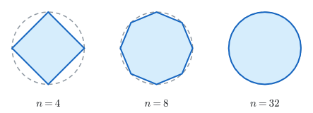
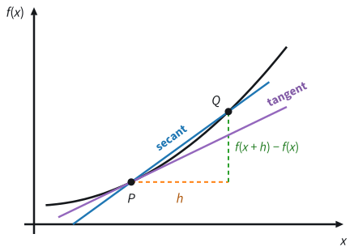

```{.python .input}
%load_ext d2lbook.tab
tab.interact_select('mxnet', 'pytorch', 'tensorflow', 'jax')
```

# Calculus
:label:`sec_calculus`

Training a model means adjusting its parameters until the loss, a number
that measures how badly the model fits its training data, is small. Suppose
that a model has a single parameter, currently set to $1$, and that its loss
is $1$. Should the parameter go up or down, and how much will the loss
change if the parameter moves by $0.01$? With one parameter we could try
both directions and compare. A deep network has millions of parameters, and
probing each of them separately costs one evaluation of the loss per
parameter for every update, which is far too slow.

Calculus answers both questions with a formula instead of a probe. The
derivative of the loss with respect to a parameter is the rate at which
the loss changes when that parameter changes. Its sign tells us which way to
move, and its size tells us how fast the loss responds. With many
parameters, the derivatives form a vector, the gradient, which points in
the direction in which the loss increases fastest. A small step against the
gradient is the basic move of nearly every training algorithm in this book.
Since a network computes its loss through many nested functions, we also
need the chain rule, which assembles the derivative of a composition from
the derivatives of its parts.

We develop these three tools on a running example small enough to check by
hand, using the vectors and dot products of :numref:`sec_linear-algebra`.
The next section lets the framework apply them for us. Calculus tells us how
to fit a model to its training data, which is an optimization problem. Our
real goal is to predict well on data that the model has not seen, the
problem of generalization, which later chapters take up.

```{.python .input #calculus}
%%tab mxnet
%matplotlib inline
from d2l import mxnet as d2l
from matplotlib_inline import backend_inline
from mxnet import np as mnp, npx
import numpy as np
npx.set_np()
```

```{.python .input #calculus}
%%tab pytorch
%matplotlib inline
from d2l import torch as d2l
from matplotlib_inline import backend_inline
import numpy as np
import torch
```

```{.python .input #calculus}
%%tab tensorflow
%matplotlib inline
from d2l import tensorflow as d2l
from matplotlib_inline import backend_inline
import numpy as np
import tensorflow as tf
```

```{.python .input #calculus}
%%tab jax
%matplotlib inline
from d2l import jax as d2l
from matplotlib_inline import backend_inline
from jax import numpy as jnp
import numpy as np
```

## Derivatives

### The Derivative as a Limit

Let us make the opening question concrete. A model predicts the same number
$w$ for every example, and we measure its error on three examples with
labels $1$, $1$, and $0$ by the sum of the squared differences between
prediction and label:

$$L(w) = (w-1)^2 + (w-1)^2 + (w-0)^2 = 3w^2 - 4w + 2.$$

At $w = 1$ the first two predictions are correct and the third is off by
one, so $L(1) = 1$.

```{.python .input #calculus-derivatives-and-differentiation-1}
def loss(w):
    return 3 * w ** 2 - 4 * w + 2
```

To see how the loss responds when $w$ changes, we move $w$ from $1$ to
$1 + h$ and divide the change in the loss by the change in the parameter.
The ratio

$$\frac{L(1+h) - L(1)}{h}$$

is the average rate of change of $L$ between $1$ and $1 + h$: the number of
units by which the loss changes per unit of $w$. We compute it for $h$ from
$10^{-1}$ down to $10^{-5}$.

```{.python .input #calculus-derivatives-and-differentiation-2}
for h in 10.0 ** -np.arange(1, 6):
    print(f'h = {h:.0e}   ratio = {(loss(1 + h) - loss(1)) / h:.5f}')
```

The ratios approach $2$, and algebra shows why. Expanding
$L(1+h) = 3(1+h)^2 - 4(1+h) + 2 = 1 + 2h + 3h^2$ gives

$$\frac{L(1+h) - L(1)}{h} = 2 + 3h,$$

which is the printed sequence $2.3, 2.03, 2.003, \ldots$ and which comes as
close to $2$ as we like once $h$ is small enough. The value $2$ is the
*derivative* of $L$ at $w = 1$, written $L'(1) = 2$. In general, for a
function $f: \mathbb{R} \rightarrow \mathbb{R}$ that maps a number to a
number, the derivative of $f$ at $x$ is

$$f'(x) = \lim_{h \rightarrow 0} \frac{f(x+h) - f(x)}{h}.$$
:eqlabel:`eq_derivative`

The *limit* on the right is the value that the ratio approaches as $h$
shrinks toward zero, from above and from below. The ratio itself is never
evaluated at $h = 0$, where it would be $0/0$. When the limit exists, $f$ is
*differentiable* at $x$.

The idea behind the limit is much older than the derivative. Archimedes
found the area of a circle of radius $r$ by squeezing it between inscribed
and circumscribed regular polygons with more and more sides
(:numref:`fig_circle_area` shows inscribed ones). An inscribed polygon with
$n$ sides splits into $n$ triangles that meet at the center. As $n$ grows,
the height of each triangle approaches $r$ and the bases add up to nearly
the circumference $2\pi r$, so the area of the polygon approaches
$\frac{1}{2} \cdot 2\pi r \cdot r = \pi r^2$. The derivative uses the same
device. We cannot compute a rate of change at a single point directly, so we
compute average rates over shrinking intervals and take the limit.


:label:`fig_circle_area`

The ratio has a geometric meaning. It is the slope of the *secant*, the line
through the two points $(x, f(x))$ and $(x+h, f(x+h))$ on the graph of $f$.
As $h$ shrinks, the second point slides along the graph toward the first,
and the secant turns into the *tangent*, the line that touches the graph at
$(x, f(x))$. The derivative is the slope of the tangent
(:numref:`fig_calc_secant_tangent`).


:label:`fig_calc_secant_tangent`

Not every function is differentiable everywhere. The absolute value $|x|$
has no derivative at $x = 0$: the ratio $|h|/h$ equals $1$ for every
$h > 0$ and $-1$ for every $h < 0$, so it approaches no single value.
Classification accuracy, the fraction of correctly classified examples, is
worse. A small change of a parameter rarely changes any predicted class, so
the accuracy stays constant and its derivative is zero wherever it exists.
At the parameter values where a prediction flips, the accuracy jumps, and
the derivative does not exist. Neither tells us which way to move. We
therefore train with a differentiable *surrogate* loss, such as the squared
error above, and report the accuracy separately.

### Finite Differences

The ratio $(f(x+h) - f(x))/h$ with a small, fixed $h$ is called a *finite
difference*. It looks like a practical way to compute derivatives, since its
error, $3h$ in our example, shrinks with $h$. That is true in exact
arithmetic but not on a computer. A floating-point number keeps a fixed
number of significant digits: about 16 decimal digits in the 64-bit format
(`float64`, the default in NumPy) and about 7 in the 32-bit format
(`float32`) that deep learning frameworks use by default
(:numref:`sec_ndarray`). The relative rounding error of each arithmetic
operation is at most about $\epsilon$, where
$\epsilon \approx 2 \times 10^{-16}$ for float64 and
$\epsilon \approx 10^{-7}$ for float32.

When $h$ is small, $L(1+h)$ and $L(1)$ agree in their leading digits, and
subtracting them cancels those digits. The rounding errors of the two
values, each of order $\epsilon$, survive the subtraction, and dividing by
the small $h$ turns them into an error of up to about $\epsilon / h$ in the
ratio. Shrinking $h$ therefore reduces one error, the *truncation error*
$3h$, and increases the other, the *rounding error* $\epsilon / h$. We
measure the total error $\left|(L(1+h) - L(1))/h - 2\right|$ for $h$ from
$10^{-1}$ to $10^{-16}$, first in float64 with NumPy and then in float32
with the framework's tensors.

```{.python .input #calculus-derivatives-and-differentiation-3}
def quotient_error(f, x, df, h):
    """Error of (f(x + h) - f(x)) / h as an estimate of f'(x) = df."""
    return abs((f(x + h) - f(x)) / h - df)

h = np.logspace(-1, -16, 61)  # 61 values of h, evenly spaced on a log scale
```

```{.python .input #calculus-finite-differences-1}
%%tab mxnet
h32 = mnp.array(h, dtype='float32')
```

```{.python .input #calculus-finite-differences-1}
%%tab pytorch
h32 = torch.tensor(h, dtype=torch.float32)
```

```{.python .input #calculus-finite-differences-1}
%%tab tensorflow
h32 = tf.constant(h, dtype=tf.float32)
```

```{.python .input #calculus-finite-differences-1}
%%tab jax
h32 = jnp.asarray(h, dtype=jnp.float32)
```

We draw the two error curves with `d2l.plot`, which plots several curves in
one figure and which we define at the end of this section. Two reference
lines show the truncation error $3h$ and the bound $\epsilon / h$ on the
rounding error in float32.

```{.python .input #calculus-finite-differences-2}
eps32 = np.finfo(np.float32).eps
d2l.plot(h, [quotient_error(loss, 1, 2, h), quotient_error(loss, 1, 2, h32),
             3 * h, eps32 / h], 'h', 'error', xscale='log', yscale='log',
         ylim=(1e-10, 1e1), legend=['float64', 'float32', '3h', 'ε/h'],
         figsize=(5, 3.5))
```

On log–log axes both error curves form a V. On the right, where $h$ is
large, both follow the line $3h$ of slope $1$: the truncation error does not
depend on the precision. On the left, rounding dominates. The float32 error
jumps from one $h$ to the next but stays below the line $\epsilon / h$ of
slope $-1$, and the float64 error does the same below the corresponding line
for its much smaller $\epsilon$, which is not drawn. Once $1 + h$ rounds to
$1$ itself, the computed ratio is $0$ and the error is $2$.

The best $h$ balances the two errors, $3h \approx \epsilon / h$, which gives
$h \approx \sqrt{\epsilon / 3}$. In float64 this is near $h = 10^{-8}$, with
an error of about $10^{-8}$: half of the 16 available digits are lost. In
float32 the best $h$ is near $10^{-4}$, and the derivative is accurate to
only three or four digits.

This is one reason why frameworks do not compute derivatives by finite
differences; the other is their cost, which we meet in
:numref:`subsec_calculus-grad`. Instead, they apply the rules of
differentiation, to which we turn next, to the operations that computed the
loss.

### Rules of Differentiation

Computing limits is tedious, and for most functions we never need to: a few
derivatives of basic functions, combined with a few rules, cover every
function built from them. For $y = f(x)$ we write the derivative either as
$f'(x)$ or as $\frac{dy}{dx}$. The second form, due to Leibniz, recalls the
ratio of a small change in $y$ to a small change in $x$, and it names the
variable we differentiate with respect to, which helps once several variables
are involved. The derivatives of the basic functions are

$$
\frac{d}{dx} C = 0, \quad \frac{d}{dx} x^n = n x^{n-1}, \quad
\frac{d}{dx} e^x = e^x, \quad \frac{d}{dx} \log x = \frac{1}{x},
$$

for any constant $C$ and any real exponent $n$. The logarithm requires
$x > 0$, as does a power with a non-integer exponent, and a negative integer
exponent requires $x \neq 0$. A constant does not
change, so its rate of change is zero, and $e^x$ is the function that grows
at a rate equal to its own value.

Multiples, sums, products, and quotients of differentiable functions $f$
and $g$ are differentiable, with

$$
\begin{aligned}
\frac{d}{dx} [C f(x)] & = C f'(x) && \textrm{constant multiple rule,} \\
\frac{d}{dx} [f(x) + g(x)] & = f'(x) + g'(x) && \textrm{sum rule,} \\
\frac{d}{dx} [f(x) g(x)] & = f'(x) g(x) + f(x) g'(x) && \textrm{product rule,} \\
\frac{d}{dx} \frac{f(x)}{g(x)} & = \frac{f'(x) g(x) - f(x) g'(x)}{g(x)^2} && \textrm{quotient rule,}
\end{aligned}
$$

where the quotient rule requires $g(x) \neq 0$. The difference rule,
$(f - g)' = f' - g'$, follows from the sum rule and the constant multiple
rule with $C = -1$. The sum rule says that rates of change add. The product rule has a picture: $f(x) g(x)$ is the area of a
rectangle with sides $f(x)$ and $g(x)$. When $x$ grows by a small $h$, the
sides grow by about $f'(x) h$ and $g'(x) h$, and the area grows by two thin
strips of areas $f'(x) h \cdot g(x)$ and $f(x) \cdot g'(x) h$, plus a corner
of area $f'(x) g'(x) h^2$, which is negligible for small $h$. Each rule
follows from the limit definition; :numref:`sec_mdl-single_variable_calculus`
gives the proofs and a longer table of derivatives.

For our loss the rules give

$$L'(w) = \frac{d}{dw}\left[3w^2 - 4w + 2\right] = 3 \cdot 2w - 4 \cdot 1 + 0 = 6w - 4,$$

and $L'(1) = 2$, the value that the finite differences approached. Unlike a
limit computed at one point, the formula gives the derivative at every $w$
at once.

### Linear Approximation and Minima

The definition :eqref:`eq_derivative` says that for small $h$ the ratio
$(f(x+h) - f(x))/h$ is close to $f'(x)$. Multiplying by $h$ turns this into
a prediction of how $f$ changes:

$$f(x + h) \approx f(x) + f'(x)\, h.$$
:eqlabel:`eq_calculus-linear-1d`

The right-hand side is the tangent line at $x$, so near $x$ the function
stays close to its tangent. This approximation answers the opening question.
At $w = 1$ the derivative $L'(1) = 2$ is positive, so increasing $w$ by
$0.01$ raises the loss by about $0.02$, and decreasing $w$ by $0.01$ lowers
it by about as much. To lower the loss, we move $w$ against the sign of the
derivative. A step of $0.1$ times the derivative, against its sign, moves
$w$ by $-0.1 \cdot L'(1) = -0.2$ to $0.8$, where $L(0.8) = 0.72$. The
approximation predicted $1 - 2 \cdot 0.2 = 0.6$. The gap of $0.12$ is the
term $3h^2$ of $L(1+h) = 1 + 2h + 3h^2$, with $h = -0.2$, which the tangent
ignores. It grows with the square of the step, which is why steps must be
small.

The derivative also locates the best parameter. At a minimum of a
differentiable function, the derivative is zero, since otherwise a small
step against its sign would lower the function further. Solving
$L'(w) = 6w - 4 = 0$ gives $w = 2/3$, the mean of the three labels, with
loss $L(2/3) = 2/3$. The converse does not hold in general: the derivative
is also zero at a maximum and at points such as $x = 0$ for $x^3$. Our
parabola, however, curves upward everywhere, so $w = 2/3$ is its minimum.

We plot $L$ together with its tangent at $w = 1$, the line
$L(1) + L'(1)(w - 1) = 2w - 1$.

```{.python .input #calculus-visualization-utilities-5}
w = np.linspace(0, 2, 101)
d2l.plot(w, [loss(w), 2 * w - 1], 'w', 'L(w)',
         legend=['L(w)', 'tangent at w = 1'])
```

Near $w = 1$ the parabola and its tangent are hard to tell apart. Farther
away the curvature separates them, and the lowest point of the parabola lies
at $w = 2/3$, where its own tangent would be horizontal.

## Partial Derivatives and Gradients
:label:`subsec_calculus-grad`

A model with one parameter is rare. Here we extend the derivative
to functions of many variables, and find that the extension answers a new
question: among all the directions in which the parameters could move,
which one lowers the loss fastest?

### Partial Derivatives

Let us give our model a second parameter. The three examples now come with
inputs $0$, $1$, and $2$, and the model predicts $w_1 + w_2 \cdot
\textrm{input}$, a line with intercept $w_1$ and slope $w_2$. The loss is
again the sum of the squared errors,

$$L(w_1, w_2) = (w_1 - 1)^2 + (w_1 + w_2 - 1)^2 + (w_1 + 2 w_2 - 0)^2.$$

Setting $w_2 = 0$ turns the line into the constant model, so $L(w_1, 0)$ is
the loss $3w_1^2 - 4w_1 + 2$ from before. At $(w_1, w_2) = (1, 0)$ the loss
is again $1$, and the opening question returns in two parts: how does the
loss change when we change $w_1$, and how when we change $w_2$?

The answer is the derivative with respect to one variable while all others
are held fixed. For a function $f(x_1, \ldots, x_n)$ of $n$ variables, the
*partial derivative* with respect to $x_i$ is

$$\frac{\partial f}{\partial x_i} = \lim_{h \rightarrow 0} \frac{f(x_1, \ldots, x_i + h, \ldots, x_n) - f(x_1, \ldots, x_i, \ldots, x_n)}{h}.$$

Only the $i^\textrm{th}$ variable moves. The curly $\partial$ is a reminder
that $f$ has other variables, which stay fixed; in running text we also write
$\partial_{x_i} f$. Since the other variables act as constants, a partial
derivative is an ordinary derivative, and the rules of differentiation
apply. Geometrically, fixing all variables but one cuts a curve out of the
graph of $f$, and the partial derivative is the slope of that curve.

For the line model, holding $w_2 = 0$ leaves the curve
$L(w_1, 0) = 3w_1^2 - 4w_1 + 2$, whose derivative at $w_1 = 1$ we know, so
$\partial L / \partial w_1 = 2$. Holding $w_1 = 1$ leaves
$L(1, w_2) = w_2^2 + (1 + 2w_2)^2 = 5w_2^2 + 4w_2 + 1$, with derivative
$10 w_2 + 4$, so $\partial L / \partial w_2 = 4$ at $w_2 = 0$. Increasing the
slope raises the loss twice as fast as increasing the intercept
(:numref:`fig_calc_partial_slices`).


:label:`fig_calc_partial_slices`

We can check these numbers with finite differences, as we did for $L'(1)$,
by moving one parameter at a time. For the code we write the model with
vectors and matrices. Each example becomes a row $(1, \textrm{input})$ of a
matrix $\mathbf{X}$, the labels form a vector $\mathbf{y}$, and the
parameters a vector $\mathbf{w} = (w_1, w_2)$:

$$\mathbf{X} = \begin{bmatrix} 1 & 0 \\ 1 & 1 \\ 1 & 2 \end{bmatrix}, \quad \mathbf{y} = \begin{bmatrix} 1 \\ 1 \\ 0 \end{bmatrix}, \quad L(\mathbf{w}) = \|\mathbf{X}\mathbf{w} - \mathbf{y}\|^2.$$

Entry $i$ of the matrix–vector product $\mathbf{X}\mathbf{w}$ is the
prediction $w_1 + w_2 \cdot \textrm{input}_i$, so $\mathbf{X}\mathbf{w} -
\mathbf{y}$ is the vector of errors, and the squared norm adds up their
squares. We use NumPy in float64, since finite differences need the
precision.

```{.python .input #calculus-partial-derivatives-1}
X = np.array([[1.0, 0.0], [1.0, 1.0], [1.0, 2.0]])  # rows [1, input]
y = np.array([1.0, 1.0, 0.0])

def line_loss(w):
    return np.sum((X @ w - y) ** 2)

def numerical_gradient(f, w, h=1e-6):
    """Finite differences of f at w, moving one coordinate at a time."""
    grad = np.zeros_like(w)
    for i in range(len(w)):
        step = np.zeros_like(w)
        step[i] = h
        grad[i] = (f(w + step) - f(w)) / h
    return grad
```

```{.python .input #calculus-partial-derivatives-2}
w = np.array([1.0, 0.0])
numerical_gradient(line_loss, w)
```

The finite differences agree with $2$ and $4$ to within $10^{-5}$. They
also show what the opening called too slow: the loop evaluates the loss once
more for every parameter. For a model with $10^8$ parameters, one estimate of
all the partial derivatives costs $10^8$ evaluations of the loss, and
training needs such an estimate at every step.

### The Gradient

Collecting the partial derivatives of $f$ with respect to all $n$ variables
$\mathbf{x} = (x_1, \ldots, x_n)$ gives a vector, the *gradient* of $f$:

$$\nabla_{\mathbf{x}} f(\mathbf{x}) = \left(\frac{\partial f}{\partial x_1}, \frac{\partial f}{\partial x_2}, \ldots, \frac{\partial f}{\partial x_n}\right).$$

We write $\nabla f(\mathbf{x})$ when the variable is clear. The gradient has
one entry per variable, so it has the same shape as $\mathbf{x}$; the
gradient of a loss has the shape of the parameters. For the line model,
$\nabla L(\mathbf{w}) = (2, 4)$ at $\mathbf{w} = (1, 0)$.

The gradient extends the approximation :eqref:`eq_calculus-linear-1d` to
moves of all variables at once. Suppose that we change $\mathbf{x}$ by a
small vector $\mathbf{h}$, one coordinate after another. Changing $x_1$ by
$h_1$ changes $f$ by about $h_1\, \partial f / \partial x_1$, then changing
$x_2$ by $h_2$ adds about $h_2\, \partial f / \partial x_2$, and so on. The
changes add up to a dot product:

$$f(\mathbf{x} + \mathbf{h}) \approx f(\mathbf{x}) + \sum_{i=1}^n \frac{\partial f}{\partial x_i} h_i = f(\mathbf{x}) + \nabla f(\mathbf{x})^\top \mathbf{h}.$$
:eqlabel:`eq_calculus-linear`

The function changes by the dot product of the gradient with the move. The
argument evaluates each partial derivative at a point that has already moved
a little, so the approximation needs partial derivatives that change
continuously; :numref:`sec_mdl-multivariable_calculus` states the condition
and proves the approximation. For the line model, lowering both
parameters by $0.01$ predicts a loss of $1 + 2 \cdot (-0.01) + 4 \cdot
(-0.01) = 0.94$, and the exact value is $L(0.99, -0.01) = 0.9414$.

### Steepest Descent

Among all moves of a given small length, which one lowers $f$ the most? We
write the move as $\mathbf{h} = t\mathbf{d}$, where the unit vector
$\mathbf{d}$ gives the direction and the small number $t > 0$ gives the
length. By :eqref:`eq_calculus-linear`, $f$ changes by about
$t\, \nabla f(\mathbf{x})^\top \mathbf{d}$. The dot product of two vectors
equals the product of their lengths and the cosine of the angle between
them, $\mathbf{a}^\top \mathbf{b} = \|\mathbf{a}\| \|\mathbf{b}\| \cos
\theta$. In more than three dimensions this formula defines the angle, and
the Cauchy–Schwarz inequality $|\mathbf{a}^\top \mathbf{b}| \leq
\|\mathbf{a}\| \|\mathbf{b}\|$ keeps $\cos\theta$ between $-1$ and $1$, with
$\cos\theta = \pm 1$ only when one vector is a multiple of the other
(:numref:`sec_linear-algebra`). Since $\|\mathbf{d}\| = 1$,

$$f(\mathbf{x} + t\mathbf{d}) - f(\mathbf{x}) \approx t\, \|\nabla f(\mathbf{x})\| \cos\theta,$$

where $\theta$ is the angle between $\mathbf{d}$ and the gradient. The
change depends on the direction only through $\cos\theta$, and three
directions stand out. The change is largest for $\theta = 0$, when
$\mathbf{d}$ points along the gradient. The gradient is therefore the
direction of *steepest ascent*, and its length $\|\nabla f(\mathbf{x})\|$ is
the rate at which $f$ grows in that direction. The change is most negative
for $\theta = 180^\circ$, so the negative gradient $-\nabla f(\mathbf{x})$ is
the direction of *steepest descent*.

The change is zero for $\theta = 90^\circ$: to first order, moving
perpendicular to the gradient leaves $f$ unchanged. The curves along which
$f$ is constant are called its *level sets*, like the contour lines of a
map, so the gradient is perpendicular to the level sets and points uphill
(:numref:`fig_calc_gradient_field`).


:label:`fig_calc_gradient_field`

*Gradient descent* repeats a small step along the negative gradient,

$$\mathbf{w} \leftarrow \mathbf{w} - \eta \nabla L(\mathbf{w}),$$

where the *learning rate* $\eta > 0$ sets the size of the step; the factor
$0.1$ in the one-parameter step above was a learning rate. From
$\mathbf{w} = (1, 0)$ with $\eta = 0.1$, one step reaches
$(0.8, -0.4)$ and lowers the loss from $1$ to $0.4$. Steepest descent
is a local property, however. The minimum of the line model's loss lies at
$(7/6, -1/2)$, and the negative gradient at $(1, 0)$ points
$45^\circ$ away from it, because the level sets are elongated ellipses rather
than circles. Repeated steps still approach the minimum, but along a zigzag
path. Later optimizers modify the step with momentum, per-parameter step
sizes, or curvature, yet each of them starts from the gradient.

### Gradients of Common Functions

A few gradients recur throughout the book. Each follows from writing the
function out coordinate by coordinate and differentiating, much as the
scalar rules follow from the limit. For a constant vector $\mathbf{a}$, the
linear function $\mathbf{a}^\top \mathbf{x} = \sum_i a_i x_i$ has partial
derivative $a_i$ with respect to $x_i$, so

$$\nabla_{\mathbf{x}}\, \mathbf{a}^\top \mathbf{x} = \mathbf{a}.$$

For a constant square matrix $\mathbf{A}$, the quadratic function
$\mathbf{x}^\top \mathbf{A} \mathbf{x} = \sum_{i,j} x_i a_{ij} x_j$
contains $x_k$ in the terms with $i = k$ and in those with $j = k$.
Differentiating with respect to $x_k$ gives $\sum_j a_{kj} x_j + \sum_i
a_{ik} x_i$, the $k^\textrm{th}$ entry of $\mathbf{A}\mathbf{x} +
\mathbf{A}^\top\mathbf{x}$, so

$$\nabla_{\mathbf{x}}\, \mathbf{x}^\top \mathbf{A} \mathbf{x} = (\mathbf{A} + \mathbf{A}^\top)\mathbf{x}.$$

For a symmetric matrix this is $2\mathbf{A}\mathbf{x}$, and with
$\mathbf{A} = \mathbf{I}$ it gives $\nabla_{\mathbf{x}} \|\mathbf{x}\|^2 =
2\mathbf{x}$. These are the vector versions of $\frac{d}{dx} ax = a$ and
$\frac{d}{dx} ax^2 = 2ax$. The gradient with respect to a matrix
$\mathbf{W}$ collects the partial derivatives with respect to its entries in
a matrix of the same shape. Since $\|\mathbf{W}\|_\textrm{F}^2$ is the sum
of the squared entries, the computation for $\|\mathbf{x}\|^2$ applies entry
by entry and gives $\nabla_{\mathbf{W}} \|\mathbf{W}\|_\textrm{F}^2 =
2\mathbf{W}$. :numref:`sec_mdl-matrix-calculus-autodiff` derives many more
such identities.

These identities give the gradient of the line model's loss. Expanding the
square,
$L(\mathbf{w}) = \mathbf{w}^\top \mathbf{X}^\top \mathbf{X} \mathbf{w} - 2
(\mathbf{X}^\top \mathbf{y})^\top \mathbf{w} + \mathbf{y}^\top \mathbf{y}$,
and the symmetric matrix $\mathbf{X}^\top \mathbf{X}$ yields

$$\nabla L(\mathbf{w}) = 2\mathbf{X}^\top \mathbf{X} \mathbf{w} - 2\mathbf{X}^\top \mathbf{y} = 2\mathbf{X}^\top (\mathbf{X}\mathbf{w} - \mathbf{y}).$$
:eqlabel:`eq_calculus-line-grad`

At $\mathbf{w} = (1, 0)$ the errors are $\mathbf{X}\mathbf{w} -
\mathbf{y} = (0, 0, 1)$, and the gradient is $2 \cdot (1, 2) =
(2, 4)$, as before.

## The Chain Rule

A network computes its loss in stages. Each layer transforms the output of
the previous one, and the loss compares the final output with the label. The
loss is thus a *composition* of functions, and expanding it into one formula,
as we just did for the line model, quickly becomes unmanageable. The *chain
rule* differentiates a composition stage by stage instead.

### Functions of One Variable

Suppose that $z = f(u)$ and $u = g(x)$ are differentiable, so that
$z = f(g(x))$. Then

$$\frac{dz}{dx} = \frac{dz}{du} \frac{du}{dx}.$$

Rates of change multiply. If $u$ changes twice as fast as $x$, and $z$
changes three times as fast as $u$, then $z$ changes six times as fast as
$x$. In terms of the linear approximation :eqref:`eq_calculus-linear-1d`, a
small change $h$ in $x$ changes $u$ by about $g'(x) h$, which in turn
changes $z$ by about $f'(u) g'(x) h$. The proof in
:numref:`sec_mdl-single_variable_calculus` makes this argument precise.

For example, the last term of the line model's loss, $(w_1 + 2 w_2)^2$, is
$z = u^2$ with $u = w_1 + 2 w_2$. With respect to $w_2$, we have
$dz/du = 2u$ and $\partial u / \partial w_2 = 2$, the input of the third
example, so the term changes at the rate $2u \cdot 2 = 4$ at $(1, 0)$, where
$u = 1$. The other two terms have zero error at that point and change at
rate zero, which is why $\partial L / \partial w_2 = 4$.

### Functions of Many Variables

In a network, a parameter usually affects the loss along many paths.
Suppose that $z$ depends on $m$ intermediate variables $u_1, \ldots, u_m$,
each of which depends on $n$ inputs $x_1, \ldots, x_n$. A small change in
$x_i$ changes every $u_j$, and each of those changes reaches $z$. The chain
rule adds up the contributions of all paths:

$$\frac{\partial z}{\partial x_i} = \sum_{j=1}^m \frac{\partial z}{\partial u_j} \frac{\partial u_j}{\partial x_i}.$$

Each term multiplies the rates along one path $x_i \to u_j \to z$, as in
the one-variable chain rule. To write the sum in vector form, we collect the
derivatives of the intermediate variables in an $m \times n$ matrix
$\mathbf{J}$, the *Jacobian* of $\mathbf{u}$ with respect to $\mathbf{x}$,
with entries $J_{ji} = \partial u_j / \partial x_i$. Row $j$ of the
Jacobian is the transposed gradient of $u_j$. The sum over $j$ is then entry
$i$ of the matrix–vector product $\mathbf{J}^\top \nabla_{\mathbf{u}} z$:

$$\nabla_{\mathbf{x}} z = \mathbf{J}^\top \nabla_{\mathbf{u}} z.$$

The gradient with respect to the inputs is the gradient with respect to the
intermediate variables, multiplied by the transposed Jacobian. For a linear
map $\mathbf{u} = \mathbf{A}\mathbf{x}$, entry $u_j = \sum_i a_{ji} x_i$
has $\partial u_j / \partial x_i = a_{ji}$, so the Jacobian is $\mathbf{A}$
itself and $\nabla_{\mathbf{x}} z = \mathbf{A}^\top \nabla_{\mathbf{u}} z$.

The line model has this structure. Its loss $L = \|\mathbf{r}\|^2$ is a
function of the vector of errors $\mathbf{r} = \mathbf{X}\mathbf{w} -
\mathbf{y}$, which depends linearly on $\mathbf{w}$, with Jacobian
$\mathbf{X}$. Since $\nabla_{\mathbf{r}} L = 2\mathbf{r}$, the chain rule
gives

$$\nabla_{\mathbf{w}} L = \mathbf{X}^\top (2\mathbf{r}) = 2\mathbf{X}^\top (\mathbf{X}\mathbf{w} - \mathbf{y}),$$

the gradient :eqref:`eq_calculus-line-grad`, obtained this time without
expanding the square. The computation splits into two passes. The *forward
pass* computes the errors and then the loss. The *backward pass* starts at
the loss, computes its gradient with respect to the errors, and multiplies
by the transposed Jacobian to reach the parameters.

```{.python .input #calculus-functions-of-many-variables}
r = X @ w - y    # forward: errors, from which the loss is r @ r
grad_r = 2 * r   # backward: gradient of the loss with respect to r
X.T @ grad_r     # backward: gradient with respect to w
```

The result matches the finite differences, $(2, 4)$. The forward and the
backward pass each cost one matrix–vector product, so the whole gradient of
the line model costs about as much as a second evaluation of the loss, where
finite differences need one evaluation per parameter. A deep network repeats
this pattern layer by layer. The forward pass evaluates the layers from the
input to the loss, and the backward pass multiplies by one transposed
Jacobian per layer, from the loss back to the parameters. This backward application of the chain rule is called
*backpropagation*.

We can now say how the loss changes when the parameters move, in which
direction it falls fastest, and how the chain rule computes that direction
stage by stage. What remains is the labor. Deriving the Jacobian of every
layer by hand, for networks with dozens of layers and millions of parameters,
is slow and error-prone. :numref:`sec_autograd` shows how the framework
records the forward pass and runs the backward pass for us, and why the
gradient then costs a small multiple of the cost of computing the loss,
whatever the number of parameters.

## Plotting Utilities

The plots in this section were drawn by `d2l.plot`, which later sections
reuse; none of its code is needed to follow the calculus. The comment
`#@save` stores a definition in the `d2l` package so that later sections can
call it. The first cell sets the format and size of a figure and the labels,
ranges, and scales of its axes.

```{.python .input #calculus-visualization-utilities-1}
def use_svg_display():  #@save
    """Use the svg format to display a plot in Jupyter."""
    backend_inline.set_matplotlib_formats('svg')

def set_figsize(figsize=(3.5, 2.5)):  #@save
    """Set the figure size for matplotlib."""
    use_svg_display()
    d2l.plt.rcParams['figure.figsize'] = figsize

#@save
def set_axes(axes, xlabel, ylabel, xlim, ylim, xscale, yscale, legend):
    """Set the axes for matplotlib."""
    axes.set_xlabel(xlabel), axes.set_ylabel(ylabel)
    axes.set_xscale(xscale), axes.set_yscale(yscale)
    axes.set_xlim(xlim),     axes.set_ylim(ylim)
    if legend:
        axes.legend(legend)
    axes.grid()
```

The function `plot` draws one or more curves in one set of axes; most of
its code brings the inputs into the form of a list of curves.

```{.python .input #calculus-visualization-utilities-4}
#@save
def plot(X, Y=None, xlabel=None, ylabel=None, legend=None, xlim=None,
         ylim=None, xscale='linear', yscale='linear',
         fmts=('-', 'm--', 'g-.', 'r:'), figsize=(3.5, 2.5), axes=None):
    """Plot data points."""
    legend = [] if legend is None else legend

    def has_one_axis(X):  # True if X (tensor or list) has 1 axis
        return (hasattr(X, "ndim") and X.ndim == 1 or isinstance(X, list)
                and not hasattr(X[0], "__len__"))
    
    if has_one_axis(X): X = [X]
    if Y is None:
        X, Y = [[]] * len(X), X
    elif has_one_axis(Y):
        Y = [Y]
    if len(X) != len(Y):
        X = X * len(Y)
        
    set_figsize(figsize)
    if axes is None:
        axes = d2l.plt.gca()
    axes.cla()
    for x, y, fmt in zip(X, Y, fmts):
        axes.plot(x,y,fmt) if len(x) else axes.plot(y,fmt)
    set_axes(axes, xlabel, ylabel, xlim, ylim, xscale, yscale, legend)
```

## Summary

Training needs to know how the loss changes when the parameters change, and
for one parameter the derivative answers this. It is the limit of the ratio of
the change in the loss to a small change in the parameter, which is the slope
of the tangent, and for small steps $f(x + h) \approx f(x) + f'(x) h$. Computing
that ratio with a small $h$ in floating point loses about half of the
available digits, which in float32 leaves three or four. For many
parameters, the partial derivatives form the gradient, whose negative is the
direction of steepest descent, and gradient descent takes small steps along
it. The chain rule differentiates compositions by multiplying rates along
each path and adding over paths. In vector form it multiplies a gradient by
transposed Jacobians, from the loss back to the parameters, which is
backpropagation.

## Exercises

1. **Derivatives from first principles.** The derivatives and rules of this
   section were stated without proof. Prove the following from the limit
   definition :eqref:`eq_derivative`.
    1. $f(x) = C$ for a constant $C$, and $f(x) = x^n$ for a positive
       integer $n$.
    1. $f(x) = e^x$ and $f(x) = \log x$. Identify the limit involving $e$
       on which both proofs rely.
    1. The sum, product, and quotient rules for differentiable $f$ and
       $g$, assuming $g(x) \neq 0$ for the quotient rule.

1. **Derivative of $x^x$.** For $x > 0$, the base and the exponent of
   $f(x) = x^x$ both vary, so neither the power rule nor the rule for an
   exponential applies.
    1. Explain why the power-rule answer $x \cdot x^{x-1}$ and the
       exponential-rule answer $x^x \log x$ are both wrong.
    1. Write $x^x = e^{x \log x}$ and compute $f'(x)$ with the chain rule.
       Show that the correct derivative is the sum of the two wrong
       answers, and explain why.

1. **Mean and median.** A model predicts the same number $w$ for every
   example, and the labels are $y_1, \ldots, y_n$.
    1. Show that the squared error $\sum_i (w - y_i)^2$ is minimized by
       the mean of the labels.
    1. Show that, wherever it exists, the derivative of the absolute error
       $\sum_i |w - y_i|$ equals the number of labels below $w$ minus the
       number of labels above $w$. Where does it fail to exist? Conclude
       that a median of the labels minimizes the absolute error.
    1. For the labels $1$, $1$, $0$, $10$, find both minimizers. Which of
       them changes when the label $10$ becomes $100$?

1. **Gradient of the $\ell_2$ norm.** Find the gradient of the function
   $f(\mathbf{x}) = \|\mathbf{x}\|$ for $\mathbf{x} \neq \mathbf{0}$ and
   show that it has length $1$. State what happens at $\mathbf{x} =
   \mathbf{0}$ and why.

1. **Multivariate chain rule.** Let $z = u_1 u_2 u_3$, where
   $u_1 = x_1 + x_2$, $u_2 = x_1 - x_2$, and $u_3 = x_1 x_2$.
    1. Compute $\nabla_{\mathbf{u}} z$ and the Jacobian $\mathbf{J}$ of
       $\mathbf{u}$ with respect to $\mathbf{x}$, and obtain
       $\nabla_{\mathbf{x}} z$ as the product
       $\mathbf{J}^\top \nabla_{\mathbf{u}} z$.
    1. Substitute $u_1$, $u_2$, and $u_3$ into $z$, differentiate the
       result with respect to $x_1$ and $x_2$ directly, and compare with
       the product.

1. **Gradient-descent step.** Consider $f(\mathbf{x}) = \|\mathbf{x}\|^2$
   and the gradient-descent step with learning rate $\eta > 0$,
   $$\mathbf{x} \leftarrow \mathbf{x} - \eta \nabla f(\mathbf{x}).$$
    1. Starting from $\mathbf{x} = (1, 1)$, take one step for each of
       $\eta = 0.1$, $\eta = 1$, and $\eta = 2$, and compute $f$ before
       and after the step.
    1. Write the step for this $f$ in closed form for arbitrary
       $\mathbf{x}$ and $\eta$. Find the range of $\eta$ for which a step
       decreases $f$ at every $\mathbf{x} \neq \mathbf{0}$, and the value
       of $\eta$ that reaches the minimizer in one step.
    1. Characterize the points at which a step leaves $\mathbf{x}$
       unchanged, for this $f$ and for a general differentiable $f$.

1. [code] **Central differences.** ● The forward difference
   $(f(x+h) - f(x))/h$ of this section has a truncation error proportional
   to $h$. The central difference $(f(x+h) - f(x-h))/(2h)$ evaluates $f$ on
   both sides of $x$. Write a central-difference counterpart of
   `quotient_error` and use the values of $h$ from this section, in float64.
    1. For the loss $L(w) = 3w^2 - 4w + 2$ at $w = 1$, plot the errors of
       the forward and the central difference in one figure, and explain
       the shape of the new curve.
    1. Repeat both computations for $f(x) = e^x$ at $x = 0$, where
       $f'(0) = 1$. Compare the slopes of the large-$h$ branches of the two
       curves and the $h$ at which each difference is most accurate, and
       explain both with the expansion
       $e^h = 1 + h + h^2/2 + h^3/6 + \cdots$.

1. [code] **Gradient checking.** ● Finite differences are too slow for
   training, but they are the standard test for a gradient derived or
   coded by hand.
    1. Write a function that estimates the gradient of
       $f: \mathbb{R}^n \to \mathbb{R}$ with central differences. Use it in
       float64 to check $\nabla_{\mathbf{x}}\, \mathbf{x}^\top \mathbf{A}
       \mathbf{x} = (\mathbf{A} + \mathbf{A}^\top)\mathbf{x}$ for a random
       $5 \times 5$ matrix $\mathbf{A}$ that is not symmetric, at a random
       $\mathbf{x}$, and report the largest relative error over the five
       entries.
    1. Check the incorrect formula $2\mathbf{A}\mathbf{x}$ in the same way.
       How large is the relative error now?
    1. Repeat the check of the correct formula in float32 with the
       framework's tensors, for $h = 10^{-1}, 10^{-2}, \ldots, 10^{-6}$.
       Which $h$ gives the smallest error, and why is it not the best $h$
       of this section's experiment? Which tolerance on the relative error
       separates the correct formula from the incorrect one in float32?

:begin_tab:`mxnet`
[Discussions](https://d2l.discourse.group/t/32)
:end_tab:

:begin_tab:`pytorch`
[Discussions](https://d2l.discourse.group/t/33)
:end_tab:

:begin_tab:`tensorflow`
[Discussions](https://d2l.discourse.group/t/197)
:end_tab:

:begin_tab:`jax`
[Discussions](https://d2l.discourse.group/t/17969)
:end_tab:

<!-- slides -->

::: {.slide}
::: {.cover}
[Dive into Deep Learning · §2.4]{.kicker}

Derivatives for the line model<br>
**the derivative · finite differences · the gradient · steepest descent · the chain rule**
:::
:::

::: {.slide title="Probing Costs One Loss Evaluation per Parameter per Step"}
[The problem]{.kicker}

A model predicts the same number $w$ for three examples with labels
$1, 1, 0$:

$$L(w) = (w-1)^2 + (w-1)^2 + (w-0)^2 = 3w^2 - 4w + 2, \qquad L(1) = 1.$$

- Should $w$ go up or down? Probe: evaluate $L(1.01)$ and compare.
- A network with $10^8$ parameters: $10^8$ evaluations for **one** update.

::: {.d2l-note}
Calculus replaces the probe by a formula: the **derivative** gives the
direction and the rate, for every parameter at once.
:::
:::

::: {.slide title="By the End of This Deck You Can"}
[Goals]{.kicker}

- compute a derivative as a limit and with the rules;
- say how accurate a finite difference can be in float32 and float64;
- compute a gradient and the direction of steepest descent;
- apply the chain rule to a composition, in vector form.

**Running example:** labels $1, 1, 0$, fit by a constant $w$, then by a
line $w_1 + w_2 \cdot \textrm{input}$.
:::

::: {.slide title="Calculus Finds the Way Down the Loss"}
[Where this fits]{.kicker}

::: {.cols .vc}
::: {.col}
| section | tool |
|---|---|
| Data Manipulation | tensors |
| Data Preprocessing | pandas |
| Linear Algebra | matrix products, norms, eigenvalues |
| **Calculus** | **derivatives, gradients, chain rule** |
| Automatic Differentiation | autograd |
| Probability and Statistics | Bayes' theorem, standard error |
| Documentation | `help`, small tests |
:::

::: {.col .narrow}
- **Uses:** dot products, norms, and matrix–vector products.
- **Skips:** integrals and the proofs, in the mathematics appendix.
:::
:::
:::

::: {.slide}
::: {.divider}
[01]{.dnum}

[Derivatives]{.dtitle}

[one parameter: which way, and how fast]{.dsub}
:::
:::

::: {.slide title="The Difference Quotient Approaches 2"}
[Derivatives]{.kicker}

Move $w$ from $1$ to $1 + h$ and divide the change in $L$ by $h$:

@calculus-derivatives-and-differentiation-2

Algebra: $L(1+h) = 1 + 2h + 3h^2$, so

$$\frac{L(1+h) - L(1)}{h} = 2 + 3h \;\to\; 2 = L'(1).$$
:::

::: {.slide title="The Derivative Is the Slope of the Tangent"}
[Derivatives]{.kicker}

::: {.cols .vc}
::: {.col}
$$f'(x) = \lim_{h \to 0} \frac{f(x+h) - f(x)}{h}$$

- The ratio is the slope of the **secant** through $P$ and $Q$.
- As $h \to 0$, the secant turns into the **tangent** at $P$.
:::

::: {.col .fig}
@fig:calculus-secant-tangent
:::
:::
:::

::: {.slide title="Some Functions Have No Derivative Where It Matters"}
[Derivatives]{.kicker}

- $|x|$ at $0$: the ratio $|h|/h$ is $+1$ for $h > 0$ and $-1$ for
  $h < 0$. No limit.
- Classification accuracy: flat almost everywhere (derivative $0$), with
  jumps where a prediction flips (no derivative).

::: {.d2l-note}
Neither tells us which way to move. We train on a differentiable
**surrogate** loss, such as the squared error, and report the accuracy.
:::
:::

::: {.slide title="Float32 Finite Differences Are Good to Three or Four Digits"}
[Derivatives · finite differences]{.kicker}

@!calculus-finite-differences-2

- Right branch: truncation error $3h$, slope $+1$.
- Left branch: rounding error below $\epsilon/h$, slope $-1$, with
  $\epsilon \approx 2 \times 10^{-16}$ (float64) or $10^{-7}$ (float32).
:::

::: {.slide title="Check: The Best Step in Float32"}
[Check]{.kicker}

Balance the two errors, $3h = \epsilon / h$, with $\epsilon = 10^{-7}$.
Which $h$ is best, and how large is the error there?

::: {.fragment .fade-up}
$h = \sqrt{\epsilon/3} \approx 2 \times 10^{-4}$, and the error is at most
$3h + \epsilon/h \approx 10^{-3}$. The plot shows about $3 \times 10^{-4}$
near $h = 10^{-4}$: three to four correct digits of $L'(1) = 2$.
:::
:::

::: {.slide title="A Handful of Rules Replaces the Limit"}
[Derivatives]{.kicker}

::: {.cols}
::: {.col}
**Basic functions**

::: {.d2l-note .rule}
$\dfrac{d}{dx} C = 0, \quad \dfrac{d}{dx} x^n = n\,x^{n-1},$

$\dfrac{d}{dx} e^x = e^x, \quad \dfrac{d}{dx}\log x = \dfrac{1}{x}$
:::
:::

::: {.col}
**Combinations**

::: {.d2l-note .rule}
Constant multiple: $(Cf)' = C f'$

Sum: $(f+g)' = f' + g'$

Product: $(fg)' = f' g + f g'$

Quotient: $\left(\dfrac{f}{g}\right)' = \dfrac{f' g - f g'}{g^2}$
:::
:::
:::

For the running example: $L'(w) = 6w - 4$, so $L'(1) = 2$, and the formula
holds at every $w$.
:::

::: {.slide title="The Sign Says Which Way, the Size Says How Fast"}
[Derivatives]{.kicker}

::: {.cols .vc}
::: {.col}
$$L(w + h) \approx L(w) + L'(w)\, h$$

- $w = 1$: $+0.01$ raises $L$ by about $0.02$.
- Step $w \leftarrow w - 0.1\,L'(w)$: $L(0.8) = 0.72$ (tangent: $0.6$).
- $L'(w) = 0$ at $w = 2/3$, the mean of the labels.
:::

::: {.col .fig}
@!calculus-visualization-utilities-5
:::
:::
:::

::: {.slide}
::: {.divider}
[02]{.dnum}

[Partial derivatives and gradients]{.dtitle}

[many parameters: the steepest way down]{.dsub}
:::
:::

::: {.slide title="A Line Model Adds a Second Parameter"}
[Gradients]{.kicker}

Inputs $0, 1, 2$; prediction $w_1 + w_2 \cdot \textrm{input}$:

$$L(w_1, w_2) = (w_1 - 1)^2 + (w_1 + w_2 - 1)^2 + (w_1 + 2w_2)^2 = \|\mathbf{X}\mathbf{w} - \mathbf{y}\|^2$$

$$\mathbf{X} = \begin{bmatrix} 1 & 0 \\ 1 & 1 \\ 1 & 2 \end{bmatrix}, \qquad \mathbf{y} = \begin{bmatrix} 1 \\ 1 \\ 0 \end{bmatrix}$$

- $w_2 = 0$ gives back the constant model; $L(1, 0) = 1$ again.
:::

::: {.slide title="A Partial Derivative Is the Slope of a Slice"}
[Gradients]{.kicker}

::: {.cols .vc}
::: {.col}
Hold every variable but one fixed:

- $w_2 = 0$: $L = 3w_1^2 - 4w_1 + 2$, so $\partial L / \partial w_1 = 2$.
- $w_1 = 1$: $L = 5w_2^2 + 4w_2 + 1$, so $\partial L / \partial w_2 = 4$.

Raising $w_2$ (the slope of the line) increases the loss twice as fast
as raising $w_1$.
:::

::: {.col .fig}
@fig:calculus-partial-slices
:::
:::
:::

::: {.slide title="Check: Two Slices Through the Origin"}
[Check]{.kicker}

Compute $\partial L / \partial w_1$ and $\partial L / \partial w_2$ at
$(w_1, w_2) = (0, 0)$ by slicing. Which parameters should grow?

::: {.fragment .fade-up}
$L(w_1, 0) = 3w_1^2 - 4w_1 + 2$ gives $-4$; $L(0, w_2) = 5w_2^2 - 2w_2 + 2$
gives $-2$. Both are negative: increasing either parameter lowers the loss.
:::
:::

::: {.slide title="The Gradient Collects One Partial Derivative per Parameter"}
[Gradients]{.kicker}

$$\nabla f(\mathbf{x}) = \left(\frac{\partial f}{\partial x_1}, \ldots, \frac{\partial f}{\partial x_n}\right), \qquad \nabla L(1, 0) = (2, 4)$$

Finite differences, one parameter at a time, in float64:

@!calculus-partial-derivatives-2

- Correct to within $10^{-5}$, but one extra loss evaluation per
  parameter: $10^8$ for a large network, at every step.
:::

::: {.slide title="The Negative Gradient Is the Steepest Way Down"}
[Gradients · derivation]{.kicker}

I. Changes add up, one coordinate at a time:
$f(\mathbf{x} + \mathbf{h}) \approx f(\mathbf{x}) + \nabla f(\mathbf{x})^\top \mathbf{h}$.

II. Move a small $t > 0$ along a unit vector $\mathbf{d}$. With
$\mathbf{a}^\top\mathbf{b} = \|\mathbf{a}\|\|\mathbf{b}\|\cos\theta$, the
change is $t\, \|\nabla f(\mathbf{x})\| \cos\theta$, where $\theta$ is the
angle between $\mathbf{d}$ and $\nabla f(\mathbf{x})$.

III. Largest at $\theta = 0$, most negative at $\theta = 180^\circ$, zero
at $\theta = 90^\circ$.

::: {.d2l-note .rule}
$\nabla f$ points uphill and is perpendicular to the level sets;
$-\nabla f$ is the direction of steepest descent.
:::
:::

::: {.slide title="Gradient Descent Zigzags Down the Line Model's Valley"}
[Gradients]{.kicker}

::: {.cols .vc}
::: {.col}
$$\mathbf{w} \leftarrow \mathbf{w} - \eta\, \nabla L(\mathbf{w})$$

- Learning rate $\eta = 0.1$: $(1, 0) \to (0.8, -0.4)$, loss $1 \to 0.4$.
- $-\nabla L$ points $45^\circ$ away from the minimum $(7/6, -1/2)$:
  steepest is a local property.
:::

::: {.col .fig .big}
@fig:calculus-gradient-field
:::
:::
:::

::: {.slide title="Linear and Quadratic Functions Have One-Line Gradients"}
[Gradients]{.kicker}

::: {.d2l-note .rule}
$\nabla_{\mathbf{x}}\, \mathbf{a}^\top\mathbf{x} = \mathbf{a}, \qquad
\nabla_{\mathbf{x}}\, \mathbf{x}^\top\mathbf{A}\mathbf{x} = (\mathbf{A} + \mathbf{A}^\top)\,\mathbf{x}, \qquad
\nabla_{\mathbf{x}}\, \|\mathbf{x}\|^2 = 2\mathbf{x}$
:::

- Why: $\frac{\partial}{\partial x_k} \sum_{i,j} x_i a_{ij} x_j = (\mathbf{A}\mathbf{x})_k + (\mathbf{A}^\top\mathbf{x})_k$.
- Line model: $\nabla L = 2\mathbf{X}^\top(\mathbf{X}\mathbf{w} - \mathbf{y})$.
  At $(1, 0)$ the errors are $(0, 0, 1)$, so $\nabla L = 2\,(1, 2) = (2, 4)$.
:::

::: {.slide}
::: {.divider}
[03]{.dnum}

[The chain rule]{.dtitle}

[compositions, differentiated stage by stage]{.dsub}
:::
:::

::: {.slide title="Rates Multiply Along a Chain"}
[Chain rule]{.kicker}

::: {.cols .vc}
::: {.col}
- If $u$ changes $2\times$ as fast as $x$ and $z$ changes $3\times$ as
  fast as $u$, then $z$ changes $6\times$ as fast as $x$.
- Last term of the line loss: $z = u^2$, $u = w_1 + 2w_2$. At $(1, 0)$:
  $\frac{dz}{du} = 2u = 2$ and $\frac{\partial u}{\partial w_2} = 2$, so
  the term contributes $4$.
:::

::: {.col .fig .big}
@fig:calculus-chain-graph
:::
:::
:::

::: {.slide title="Many Paths Add Up to a Transposed-Jacobian Product"}
[Chain rule]{.kicker}

$z$ depends on $u_1, \ldots, u_m$, each of which depends on
$x_1, \ldots, x_n$:

$$\frac{\partial z}{\partial x_i} = \sum_{j=1}^m \frac{\partial z}{\partial u_j} \frac{\partial u_j}{\partial x_i}
\quad\Longrightarrow\quad
\nabla_{\mathbf{x}} z = \mathbf{J}^\top \nabla_{\mathbf{u}} z, \quad J_{ji} = \frac{\partial u_j}{\partial x_i}$$

- One term per path $x_i \to u_j \to z$.
- For a linear map $\mathbf{u} = \mathbf{A}\mathbf{x}$ the Jacobian is
  $\mathbf{A}$.
:::

::: {.slide title="Backpropagation Runs the Chain Rule From the Loss Backward"}
[Chain rule]{.kicker}

Line model: $L = \|\mathbf{r}\|^2$ with errors
$\mathbf{r} = \mathbf{X}\mathbf{w} - \mathbf{y}$ (Jacobian $\mathbf{X}$).

@calculus-functions-of-many-variables

::: {.d2l-note}
Forward: errors, then loss. Backward: $2\mathbf{r}$, then
$\mathbf{X}^\top(2\mathbf{r})$. Each pass is one matrix–vector product, so
the whole gradient costs about one more evaluation of the loss.
:::
:::

::: {.slide title="Check: One More Step"}
[Check]{.kicker}

From $\mathbf{w} = (0.8, -0.4)$ with $\eta = 0.1$: run the forward pass
(errors), the backward pass (gradient), and take the step.

::: {.fragment .fade-up}
Errors $(-0.2, -0.6, 0)$; gradient $2\mathbf{X}^\top(-0.2, -0.6, 0) =
(-1.6, -1.2)$; next point $(0.96, -0.28)$, with loss $0.264$.
:::
:::

::: {.slide title="Recap"}
[Wrap-up]{.kicker}

- **Derivative:** $L'(1) = \lim (2 + 3h) = 2$; $L(w + h) \approx L(w) + L'(w)h$;
  minimum at the mean, $w = 2/3$.
- **Finite differences:** best error about $10^{-8}$ in float64 and
  $3 \times 10^{-4}$ in float32, and one loss evaluation per parameter.
- **Gradient:** $\nabla L(1, 0) = (2, 4)$; $-\nabla L$ is the steepest way
  down; one step lowers the loss from $1$ to $0.4$.
- **Chain rule:** $\nabla_{\mathbf{w}} L = \mathbf{X}^\top (2\mathbf{r})$,
  forward then backward: backpropagation.

**Next:** automatic differentiation records the forward pass of any
program and runs the backward pass for us.
:::
