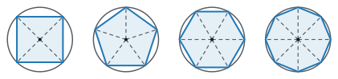
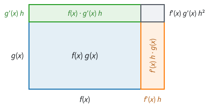

```{.python .input}
%load_ext d2lbook.tab
tab.interact_select('mxnet', 'pytorch', 'tensorflow', 'jax')
```

# Calculus
:label:`sec_calculus`

For a long time, calculating the exact area of a circle remained a mystery. Then, in Ancient Greece, the mathematician Archimedes came up with the clever idea of inscribing a sequence of regular polygons with increasing numbers of vertices inside the circle (:numref:`fig_circle_area`). A regular polygon with $n$ sides decomposes into $n$ congruent triangles meeting at the center. As we partition the circle more and more finely ($n \to \infty$), the height (altitude) of each triangle approaches the circle's radius $r$, while the combined bases of the $n$ triangles approach the circle's circumference $2\pi r$. Consequently, the area of the inscribed polygon approaches $\frac{1}{2} \cdot r \cdot (2\pi r) = \pi r^2$.


:label:`fig_circle_area`

This limiting procedure---approximating a curved or instantaneous quantity by simple linear pieces and taking the limit as the pieces become infinitesimally small---lies at the root of both *integral calculus* and *differential calculus*. While integral calculus accumulates tiny pieces to compute areas, volumes, and expectations, differential calculus tells us how rapidly a function's output changes when we perturb its inputs by a tiny amount.

In deep learning, differential calculus is the engine of *optimization*. Training a model means adjusting its parameters until the loss function---a scalar score measuring how poorly the model fits its training examples---is as small as possible. Suppose a simple model has a single scalar parameter $w$, currently set to $w = 1$, where its training loss is $L(1) = 1$. To reduce the loss, should we nudge $w$ upward or downward, and by how much will the loss drop if we shift $w$ by $0.01$? With just one parameter, we could simply try both $w = 1.01$ and $w = 0.99$ and compare the resulting losses. A modern neural network, however, has millions or billions of parameters: probing each parameter individually by trial and error would require millions of separate forward passes for a single parameter update, bringing training to a standstill.

Differential calculus answers both questions analytically in a single backward pass. The *derivative* of the loss with respect to a parameter gives the instantaneous rate at which the loss changes when that parameter moves: its sign tells us which direction decreases the loss, and its magnitude tells us how steeply the loss responds. When a model has many parameters, collecting all of their partial derivatives into a single vector gives the *gradient*, which points in the direction of steepest ascent; taking a small step in the opposite direction---against the gradient---is the fundamental update of nearly every training algorithm in this book. And because a deep network computes its loss by composing many nested layers of transformations, we use the *chain rule* to assemble the gradient of the entire network from the derivatives of its individual layers.

In this section, we develop derivatives, gradients, and the chain rule on a running linear-regression example small enough that every number can be verified by hand. In the next section (:numref:`sec_autograd`), we will see how deep learning frameworks automate these calculations for arbitrary programs. Keep in mind that calculus and optimization address how to fit a model to the *training* data we already have; ensuring that the fitted model performs well on *previously unseen* data---the problem of *generalization*---is a statistical question that we will confront in the chapters ahead.

```{.python .input #calculus}
%%tab mxnet
import math
import numpy as np
from mxnet import autograd, gluon, init, np as mnp, npx
from mxnet.gluon import nn
from d2l import mxnet as d2l
npx.set_np()
```

```{.python .input #calculus}
%%tab pytorch
import math
import numpy as np
import torch
from torch import nn
from torch.nn import functional as F
from d2l import torch as d2l
```

```{.python .input #calculus}
%%tab tensorflow
import math
import numpy as np
import tensorflow as tf
from d2l import tensorflow as d2l
```

```{.python .input #calculus}
%%tab jax
import math
import numpy as np
import jax
from jax import numpy as jnp
from flax import nnx
import optax
from d2l import jax as d2l
```

## Derivatives

### The Derivative as a Limit

Let us make our opening one-parameter optimization problem completely concrete. Suppose a trivial model predicts the exact same scalar number $w$ for every example, and we evaluate its predictions on three training examples whose ground-truth labels are $1$, $1$, and $0$. Measuring the model's total error by the sum of squared residuals gives the quadratic loss function

$$L(w) = (w-1)^2 + (w-1)^2 + (w-0)^2 = 3w^2 - 4w + 2.$$

At our initial guess $w = 1$, the first two predictions are exact ($(1 - 1)^2 = 0$) and the third is off by one ($(1 - 0)^2 = 1$), yielding a total loss of $L(1) = 1$:

```{.python .input #calculus-derivatives-and-differentiation-1}
def loss(w):
    return 3 * w ** 2 - 4 * w + 2
```

To see how $L(w)$ responds when we perturb $w$ slightly away from $1$, we shift $w$ to $1 + h$ (for a small perturbation $h \neq 0$) and divide the resulting change in loss, $L(1+h) - L(1)$, by the parameter change $h$. This difference quotient,

$$\frac{L(1+h) - L(1)}{h},$$

measures the *average rate of change* of the loss over the interval between $1$ and $1 + h$. Let us evaluate this ratio in code as $h$ shrinks from $10^{-1}$ down to $10^{-5}$:

```{.python .input #calculus-derivatives-and-differentiation-2}
for h in 10.0 ** -np.arange(1, 6):
    print(f'h = {h:.0e}   ratio = {(loss(1 + h) - loss(1)) / h:.5f}')
```

As $h$ approaches zero, the numerical ratios converge unmistakably toward $2$. A line of elementary algebra confirms why: expanding $L(1+h) = 3(1+h)^2 - 4(1+h) + 2 = 1 + 2h + 3h^2$ and subtracting $L(1) = 1$ yields

$$\frac{L(1+h) - L(1)}{h} = \frac{2h + 3h^2}{h} = 2 + 3h,$$

which reproduces our printed sequence $2.3, 2.03, 2.003, \ldots$ and approaches $2$ as $h \to 0$. That limiting value $2$ is the *derivative* of $L$ at $w = 1$, written $L'(1) = 2$.

Formally, for any scalar function $f: \mathbb{R} \rightarrow \mathbb{R}$, the *derivative* of $f$ at a point $x$ is defined as the limit

$$f'(x) = \lim_{h \rightarrow 0} \frac{f(x+h) - f(x)}{h}.$$
:eqlabel:`eq_derivative`

The *limit* on the right-hand side denotes the value that the difference quotient approaches as the perturbation $h$ shrinks arbitrarily close to $0$ (from both positive and negative directions), without ever setting $h = 0$ directly (which would produce the undefined expression $0/0$). Whenever this limit exists and is finite, we say that $f$ is *differentiable* at $x$ (and if it exists at every point in an interval or domain, we say that $f$ is differentiable on that domain).

Geometrically, the difference quotient $\frac{f(x+h) - f(x)}{h}$ is the slope of the *secant line* passing through the two points $P = (x, f(x))$ and $Q = (x+h, f(x+h))$ on the graph of $f$. As $h \to 0$, the point $Q$ slides along the curve toward $P$, and the secant line rotates into the *tangent line* that just touches the curve at $P$. The derivative $f'(x)$ is the slope of that tangent line (:numref:`fig_calc_secant_tangent`).


:label:`fig_calc_secant_tangent`

Not every function we encounter in machine learning is differentiable everywhere. For example, the absolute value function $|x|$ (used in $\ell_1$ loss and regularization) has a sharp corner at $x = 0$: the difference quotient $\frac{|0 + h| - |0|}{h} = \frac{|h|}{h}$ equals $+1$ for every $h > 0$ and $-1$ for every $h < 0$, so the left-hand and right-hand limits disagree and no derivative exists at $x = 0$.

Classification error rate (or accuracy---the fraction of examples classified correctly) is even more problematic for gradient-based optimization. Because predicted class labels are discrete, nudging a continuous model weight by a tiny amount $h$ almost never flips any example's predicted class, meaning the accuracy remains completely flat and its derivative is $0$ almost everywhere; at the isolated threshold values where a prediction does flip, the accuracy jumps discontinuously and the derivative fails to exist. A derivative that is zero everywhere it exists provides no guidance on which direction improves the model! That is why we train classifiers by minimizing a smooth, differentiable *surrogate loss* (such as cross-entropy) and evaluate discrete classification accuracy separately.

### Rules of Differentiation

Evaluating limits from first principles every time we meet a new function would be exhausting. Fortunately, a small catalog of elementary derivatives together with a few algebraic combination rules allows us to differentiate virtually any symbolic expression mechanically. Given $y = f(x)$, several equivalent notations are used interchangeably for the derivative:

$$f'(x) = y' = \frac{dy}{dx} = \frac{df}{dx} = \frac{d}{dx} f(x) = Df(x) = D_x f(x),$$

where $\frac{d}{dx}$ and $D$ denote differentiation operators. Leibniz's fractional notation $\frac{dy}{dx}$ is particularly suggestive: it reminds us that the derivative is the limit of a ratio of small changes $\frac{\Delta y}{\Delta x}$, and it explicitly records which variable we are differentiating with respect to.

For any constant $C$ and any real exponent $n$, the derivatives of the four most common elementary functions are

$$
\frac{d}{dx} C = 0, \quad \frac{d}{dx} x^n = n x^{n-1}, \quad
\frac{d}{dx} e^x = e^x, \quad \frac{d}{dx} \log x = \frac{1}{x} \quad (x > 0).
$$

Notice the intuition behind each formula: a constant never changes, so its rate of change is zero; the natural exponential $e^x$ is the unique function whose rate of growth at every point equals its current value; and the natural logarithm $\log x$ grows more and more slowly as $x$ increases, at rate $1/x$.

When differentiable functions $f(x)$ and $g(x)$ are combined by scaling, addition, multiplication, or division, their derivatives obey four standard rules:

$$
\begin{aligned}
\frac{d}{dx} [C f(x)] & = C f'(x) && \textrm{constant multiple rule,} \\
\frac{d}{dx} [f(x) + g(x)] & = f'(x) + g'(x) && \textrm{sum rule,} \\
\frac{d}{dx} [f(x) g(x)] & = f'(x) g(x) + f(x) g'(x) && \textrm{product rule,} \\
\frac{d}{dx} \frac{f(x)}{g(x)} & = \frac{f'(x) g(x) - f(x) g'(x)}{g(x)^2} \quad (g(x) \neq 0) && \textrm{quotient rule.}
\end{aligned}
$$

The constant multiple and sum rules state that differentiation is a *linear operator*: rates of change scale and add directly. To see why the product rule contains two terms rather than simply $f'(x)g'(x)$, picture $f(x)g(x)$ as the area of a rectangle with width $f(x)$ and height $g(x)$ (:numref:`fig_calc_product_rule`). When $x$ increases by a small amount $h$, the width expands by roughly $f'(x)h$ and the height expands by roughly $g'(x)h$. The rectangle's area grows by two thin side strips---one of area $f'(x)h \cdot g(x)$ along the right edge and one of area $f(x) \cdot g'(x)h$ along the top edge---plus a tiny corner square of area $f'(x)g'(x)h^2$ that vanishes relative to $h$ as $h \to 0$. Dividing the added area by $h$ leaves $f'(x)g(x) + f(x)g'(x)$. (Complete proofs of these rules and a fuller derivative table appear in :numref:`sec_mdl-single_variable_calculus`.)


:label:`fig_calc_product_rule`

Applying the power, constant multiple, and sum rules to our quadratic loss $L(w) = 3w^2 - 4w + 2$ gives its derivative at any parameter value $w$ in one line:

$$L'(w) = \frac{d}{dw}\left[3w^2 - 4w + 2\right] = 3 \cdot (2w) - 4 \cdot 1 + 0 = 6w - 4.$$

Evaluating this formula at $w = 1$ immediately yields $L'(1) = 6(1) - 4 = 2$, matching our numerical limit without needing to test a sequence of $h$ values.

### First-Order Linear Approximation and Minima

Because $\frac{f(x+h) - f(x)}{h} \approx f'(x)$ when the step $h$ is small, multiplying both sides by $h$ gives the *first-order linear approximation* (or *tangent-line approximation*) of $f$ near $x$:

$$f(x + h) \approx f(x) + f'(x)\, h.$$
:eqlabel:`eq_calculus-linear-1d`

This simple formula directly answers our opening optimization question. At $w = 1$, the derivative $L'(1) = 2$ is positive, telling us that increasing $w$ by $h = +0.01$ will *increase* the loss by roughly $2 \times 0.01 = 0.02$, whereas decreasing $w$ by $h = -0.01$ will *decrease* the loss by roughly $0.02$. To reduce the loss, we must step in the direction *opposite* to the sign of the derivative: $w \leftarrow w - \eta L'(w)$ for a small positive step size $\eta > 0$.

For instance, taking a step with $\eta = 0.1$ from $w = 1$ moves the parameter by $h = -0.1 \times L'(1) = -0.2$ to $w = 0.8$. The linear approximation :eqref:`eq_calculus-linear-1d` predicts a new loss of $L(1) + L'(1)(-0.2) = 1 - 0.4 = 0.6$, while the exact quadratic loss at $w = 0.8$ is $L(0.8) = 0.72$. The $0.12$ discrepancy between the tangent-line prediction ($0.60$) and the true curve ($0.72$) is the second-order curvature term $3h^2 = 3(-0.2)^2 = 0.12$ that the tangent line ignores. Because that neglected curvature term scales with $h^2$, taking sufficiently small steps guarantees that the linear term $f'(x)h$ dominates and the loss decreases.

The derivative also characterizes optimal parameter settings: at any smooth local minimum of $f$, the derivative must vanish ($f'(x) = 0$), because if $f'(x)$ were nonzero, a tiny step against its sign would decrease $f$ further. Setting $L'(w) = 6w - 4 = 0$ solves for the unique minimizer $w^* = 2/3$---which is simply the arithmetic mean $(1 + 1 + 0)/3$ of the three target labels---achieving the minimum possible loss $L(2/3) = 2/3$. (Keep in mind that $f'(x) = 0$ is a *necessary* condition for a smooth local minimum, not a sufficient one: the derivative also vanishes at local maxima and at horizontal inflection points such as $x = 0$ for $f(x) = x^3$. Because our parabola $3w^2 - 4w + 2$ curves upward everywhere, $w^* = 2/3$ is guaranteed to be its global minimum.)

We can visualize $L(w)$ alongside its tangent line $L(1) + L'(1)(w - 1) = 2w - 1$ at $w = 1$ using `d2l.plot` (whose implementation is documented in :numref:`sec_utils`):

```{.python .input #calculus-visualization-utilities-5}
w = np.linspace(0, 2, 101)
d2l.plot(w, [loss(w), 2 * w - 1], 'w', 'L(w)',
         legend=['L(w)', 'tangent at w = 1'])
```

As the plot shows, in a small neighborhood around $w = 1$ the quadratic loss curve and its tangent line are nearly indistinguishable. Farther away from $w = 1$, upward curvature bends the parabola above the tangent line, and the bottom of the bowl sits at $w^* = 2/3$, where the tangent line becomes completely horizontal (slope $0$).

## Partial Derivatives and Gradients
:label:`subsec_calculus-grad`

Thus far, we have differentiated functions of a single scalar parameter. Real machine learning models depend on many parameters simultaneously. Extending derivatives to multivariate functions not only handles multiple parameters at once, but also answers a geometric question that a one-dimensional parameter line could not even pose: *among the infinitely many directions in high-dimensional space, which direction decreases the loss fastest?*

### Partial Derivatives

Let us give our running model a second parameter by introducing an input feature for each of the three training examples. Suppose our three examples have scalar inputs $0$, $1$, and $2$ paired with the same labels $1$, $1$, and $0$ as before, and our model predicts an affine line $w_1 + w_2 \cdot \textrm{input}$ with intercept $w_1$ and slope $w_2$. Summing the squared errors across the three examples gives a two-variable loss function:

$$L(w_1, w_2) = (w_1 - 1)^2 + (w_1 + w_2 - 1)^2 + (w_1 + 2 w_2 - 0)^2.$$

Notice that when the slope is $w_2 = 0$, our line reduces to the constant prediction $w_1$, and $L(w_1, 0) = 3w_1^2 - 4w_1 + 2$ recovers our one-parameter loss from the previous subsection. At the parameter point $(w_1, w_2) = (1, 0)$, the loss is once again $L(1, 0) = 1$, and our sensitivity question now has two parts: how rapidly does the loss change if we nudge $w_1$ while holding $w_2$ fixed, and how rapidly does it change if we nudge $w_2$ while holding $w_1$ fixed?

Differentiating a function of several variables with respect to one variable while treating all other variables as constants produces a *partial derivative*. Formally, for a multivariate function $y = f(x_1, x_2, \ldots, x_n)$, the partial derivative of $f$ with respect to $x_i$ is defined as

$$\frac{\partial f}{\partial x_i} = \lim_{h \rightarrow 0} \frac{f(x_1, \ldots, x_{i-1}, x_i + h, x_{i+1}, \ldots, x_n) - f(x_1, \ldots, x_i, \ldots, x_n)}{h}.$$

Only the $i^\textrm{th}$ coordinate is perturbed by $h$; the rounded symbol $\partial$ (read *"partial"*) serves as a visual reminder that $f$ depends on additional variables that are being held constant.(Common alternative notations for $\frac{\partial f}{\partial x_i}$ include $\frac{\partial y}{\partial x_i}$, $\partial_{x_i} f$, $\partial_i f$, $f_{x_i}$, and $D_i f$.) Because the other variables act as fixed constants during the limit, computing a partial derivative requires no new rules---you simply apply the ordinary single-variable differentiation rules to $x_i$ while treating every $x_j$ ($j \neq i$) as a constant. Geometrically, holding all variables except $x_i$ constant slices the multidimensional loss surface with a vertical plane parallel to the $x_i$-axis, and $\frac{\partial f}{\partial x_i}$ is the slope of the resulting 1D cross-sectional curve (:numref:`fig_calc_partial_slices`).

For our two-parameter line model at $(w_1, w_2) = (1, 0)$:
* Holding $w_2 = 0$ fixed yields the slice $L(w_1, 0) = 3w_1^2 - 4w_1 + 2$, whose derivative at $w_1 = 1$ we already computed: $\frac{\partial L}{\partial w_1}(1, 0) = 2$.
* Holding $w_1 = 1$ fixed yields the slice $L(1, w_2) = 0^2 + w_2^2 + (1 + 2w_2)^2 = 5w_2^2 + 4w_2 + 1$, whose derivative with respect to $w_2$ is $10w_2 + 4$; evaluating at $w_2 = 0$ gives $\frac{\partial L}{\partial w_2}(1, 0) = 4$.

Thus, at $(1, 0)$, increasing the slope $w_2$ drives the loss upward twice as fast as increasing the intercept $w_1$ (:numref:`fig_calc_partial_slices`).


:label:`fig_calc_partial_slices`

We can verify both partial derivatives numerically by evaluating the *finite-difference* quotient $\frac{f(x_1, \ldots, x_i + h, \ldots) - f(\mathbf{x})}{h}$ for a small fixed step $h = 10^{-6}$ along one coordinate axis at a time. Using the matrix--vector notation of :numref:`sec_linear-algebra`, we write each example's features as a row $(1, \textrm{input}_i)$ of a $3 \times 2$ design matrix $\mathbf{X}$, collect the three labels into $\mathbf{y} \in \mathbb{R}^3$, and write the parameters as $\mathbf{w} = (w_1, w_2) \in \mathbb{R}^2$:

$$\mathbf{X} = \begin{bmatrix} 1 & 0 \\ 1 & 1 \\ 1 & 2 \end{bmatrix}, \quad \mathbf{y} = \begin{bmatrix} 1 \\ 1 \\ 0 \end{bmatrix}, \quad L(\mathbf{w}) = \|\mathbf{X}\mathbf{w} - \mathbf{y}\|^2.$$

Here row $i$ of $\mathbf{X}\mathbf{w}$ evaluates $w_1 \cdot 1 + w_2 \cdot \textrm{input}_i$, so $\mathbf{X}\mathbf{w} - \mathbf{y}$ is the 3D vector of residuals and its squared $\ell_2$ norm sums the three squared errors. We evaluate our finite differences in 64-bit floating point (`float64`) in NumPy (for reasons the next subsection makes clear):

```{.python .input #calculus-partial-derivatives-1}
X = np.array([[1.0, 0.0], [1.0, 1.0], [1.0, 2.0]])  # rows [1, input]
y = np.array([1.0, 1.0, 0.0])

def line_loss(w):
    return np.sum((X @ w - y) ** 2)

def numerical_gradient(f, w, h=1e-6):
    """Finite differences of f at w, moving one coordinate at a time."""
    grad = np.zeros_like(w)
    for i in range(len(w)):
        step = np.zeros_like(w)
        step[i] = h
        grad[i] = (f(w + step) - f(w)) / h
    return grad
```

```{.python .input #calculus-partial-derivatives-2}
w = np.array([1.0, 0.0])
numerical_gradient(line_loss, w)
```

The numerical finite-difference estimates match our exact analytical partial derivatives $(2, 4)$ to five decimal places. At the same time, look at the `for i in range(len(w)):` loop inside `numerical_gradient`: estimating $n$ partial derivatives via finite differences requires $n$ additional evaluations of the loss function $f$. For a small model with $2$ parameters, two extra evaluations are harmless; for a language model with $n = 10^{11}$ parameters, a single gradient step would require $10^{11}$ forward passes through the network!

### Numerical Precision Limits of Finite Differences

Prohibitive computational cost is not the only reason deep learning avoids finite differences for training. Look closely at what happens to the accuracy of the finite-difference ratio $\frac{L(1+h) - L(1)}{h}$ when we make the perturbation $h$ very small. In exact real arithmetic, the approximation error $|(L(1+h) - L(1))/h - L'(1)| = 3h$ shrinks linearly to zero as $h \to 0$. On a physical computer, however, numbers are stored with finite precision: roughly $16$ significant decimal digits in 64-bit `float64` (machine epsilon $\epsilon \approx 2.2 \times 10^{-16}$) and only about $7$ significant decimal digits in 32-bit `float32` ($\epsilon \approx 1.2 \times 10^{-7}$), the standard precision of deep learning tensors (:numref:`sec_ndarray`).

When $h$ is tiny, $L(1+h)$ and $L(1)$ agree across almost all of their leading significant digits. Subtracting two nearly equal floating-point numbers cancels those shared leading digits, leaving behind only the least-significant rounding errors (of magnitude $\sim \epsilon$)---a classic numerical pathology known as *catastrophic cancellation*. Dividing that $\sim \epsilon$ rounding residual by the tiny denominator $h$ amplifies the rounding error to order $\epsilon / h$!

Thus, shrinking $h$ creates a fundamental tug-of-war between two competing errors:
* **Truncation error** ($\propto h$), caused by approximating the tangent slope with a finite secant over width $h$, which *decreases* as $h$ shrinks.
* **Floating-point rounding error** ($\propto \epsilon / h$), caused by catastrophic cancellation in $f(x+h) - f(x)$ divided by $h$, which *explodes* as $h$ shrinks.

Let us measure the total error $\left|\frac{L(1+h) - L(1)}{h} - 2\right|$ across $61$ values of $h$ spanning $10^{-1}$ down to $10^{-16}$, comparing 64-bit `float64` against 32-bit `float32`:

```{.python .input #calculus-derivatives-and-differentiation-3}
def quotient_error(f, x, df, h):
    """Error of (f(x + h) - f(x)) / h as an estimate of f'(x) = df."""
    return abs((f(x + h) - f(x)) / h - df)

h = np.logspace(-1, -16, 61)  # 61 values of h, evenly spaced on a log scale
```

```{.python .input #calculus-finite-differences-1}
%%tab mxnet
h32 = mnp.array(h, dtype='float32')
```

```{.python .input #calculus-finite-differences-1}
%%tab pytorch
h32 = torch.tensor(h, dtype=torch.float32)
```

```{.python .input #calculus-finite-differences-1}
%%tab tensorflow
h32 = tf.constant(h, dtype=tf.float32)
```

```{.python .input #calculus-finite-differences-1}
%%tab jax
h32 = jnp.asarray(h, dtype=jnp.float32)
```

We plot both error curves on log--log axes alongside the theoretical truncation error line $3h$ and the `float32` rounding error envelope $\epsilon / h$:

```{.python .input #calculus-finite-differences-2}
eps32 = np.finfo(np.float32).eps
d2l.plot(h, [quotient_error(loss, 1, 2, h), quotient_error(loss, 1, 2, h32),
             3 * h, eps32 / h], 'h', 'error', xscale='log', yscale='log',
         ylim=(1e-10, 1e1), legend=['float64', 'float32', '3h', 'ε/h'],
         figsize=(5, 3.5))
```

Read the log--log plot from right (large $h$) to left (small $h$). On the right, where $h$ is large, both `float64` and `float32` lie directly on the truncation-error line $3h$ of slope $+1$. As $h$ decreases, each curve hits a V-shaped floor where rounding error $\sim \epsilon / h$ (of slope $-1$) overtakes truncation error, after which making $h$ smaller degrades accuracy rapidly! Finally, once $h < \epsilon$, floating-point addition rounds $1 + h$ to $1$ exactly, so $L(1+h) - L(1) = 0$ and the relative error saturates at $100\%$ (an absolute error of $|0 - 2| = 2$, seen as the flat plateau on the left of the `float32` curve for $h \lesssim 10^{-7}$).

The optimal step size $h^*$ balances truncation error against rounding error ($3h \approx \epsilon / h$, or $h^* \approx \sqrt{\epsilon / 3}$), sacrificing roughly *half* of the floating-point format's significant digits:
* In `float64` ($\epsilon \approx 2 \times 10^{-16}$), the best accuracy is $\sim 10^{-8}$ at $h^* \approx 10^{-8}$.
* In `float32` ($\epsilon \approx 10^{-7}$), the best accuracy is only $\sim 10^{-4}$ (three to four decimal digits) at $h^* \approx 10^{-4}$.

By applying exact differentiation rules via the chain rule (:numref:`sec_autograd`), deep learning frameworks avoid both the $O(n)$ evaluation bottleneck and the $\sqrt{\epsilon}$ precision loss of finite differences, computing derivatives to full machine precision at a cost proportional to a single forward pass. Finite differences remain invaluable for one task: *gradient checking* in unit tests (using `float64`), where verifying a custom layer's analytical gradient on a tiny input of $5$ variables to $8$ digits of precision catches derivation bugs immediately.

### The Gradient

Each partial derivative $\frac{\partial f}{\partial x_i}$ tells us how a multivariate function $f: \mathbb{R}^n \to \mathbb{R}$ responds when we move along a single coordinate axis. During training, however, we update all $n$ parameters simultaneously. Concatenating all $n$ partial derivatives of $f(\mathbf{x})$ into a column vector produces the *gradient* of $f$ with respect to $\mathbf{x} = (x_1, \ldots, x_n)^\top$:

$$\nabla_{\mathbf{x}} f(\mathbf{x}) = \left(\frac{\partial f}{\partial x_1}, \frac{\partial f}{\partial x_2}, \ldots, \frac{\partial f}{\partial x_n}\right).$$

When the variable of differentiation is clear from context, we simply write $\nabla f(\mathbf{x})$. Notice that the gradient $\nabla_{\mathbf{x}} f(\mathbf{x})$ has one component for each entry of $\mathbf{x}$ and therefore always has the exact same shape as $\mathbf{x}$. For our two-parameter line model at $\mathbf{w} = (1, 0)$, the gradient is $\nabla L(1, 0) = (2, 4)$.

Just as the scalar derivative $f'(x)$ gave the 1D tangent-line approximation $f(x+h) \approx f(x) + f'(x)h$ in :eqref:`eq_calculus-linear-1d`, the gradient vector gives the multivariate first-order linear approximation when all $n$ coordinates are perturbed simultaneously by a small vector $\mathbf{h} = (h_1, \ldots, h_n)^\top$. Perturbing $x_1$ by $h_1$ shifts $f$ by roughly $\frac{\partial f}{\partial x_1} h_1$, perturbing $x_2$ by $h_2$ adds roughly $\frac{\partial f}{\partial x_2} h_2$, and summing across all $n$ coordinates expresses the total first-order change as the dot product of the gradient with the perturbation $\mathbf{h}$:

$$f(\mathbf{x} + \mathbf{h}) \approx f(\mathbf{x}) + \sum_{i=1}^n \frac{\partial f}{\partial x_i} h_i = f(\mathbf{x}) + \nabla f(\mathbf{x})^\top \mathbf{h}.$$
:eqlabel:`eq_calculus-linear`

(For a rigorous proof when the partial derivatives of $f$ are continuous, see :numref:`sec_mdl-multivariable_calculus`.) On our line model at $\mathbf{w} = (1, 0)$ where $L(1, 0) = 1$ and $\nabla L(1, 0) = (2, 4)$, shifting both parameters by $\mathbf{h} = (-0.01, -0.01)$ yields a predicted loss of $1 + (2, 4)^\top(-0.01, -0.01) = 1 - 0.02 - 0.04 = 0.94$, closely matching the exact value $L(0.99, -0.01) = 0.9414$.

### Geometry of the Gradient and Steepest Descent

The linear approximation :eqref:`eq_calculus-linear` immediately answers our geometric question: *among all small steps $\mathbf{h}$ of a fixed Euclidean length $t > 0$, which direction changes $f(\mathbf{x})$ the most?*

Write the step as $\mathbf{h} = t\mathbf{d}$, where $\mathbf{d} \in \mathbb{R}^n$ is a unit direction vector ($\|\mathbf{d}\|_2 = 1$) and $t > 0$ is the step length. Substituting $\mathbf{h} = t\mathbf{d}$ into :eqref:`eq_calculus-linear` and applying our geometric dot-product formula $\mathbf{a}^\top \mathbf{b} = \|\mathbf{a}\| \|\mathbf{b}\| \cos\theta$ from :eqref:`eq_dot_cos` (with $\|\mathbf{d}\| = 1$) gives

$$f(\mathbf{x} + t\mathbf{d}) - f(\mathbf{x}) \approx t\, \nabla f(\mathbf{x})^\top \mathbf{d} = t\, \|\nabla f(\mathbf{x})\|\, \cos\theta,$$

where $\theta$ is the angle between our chosen step direction $\mathbf{d}$ and the gradient $\nabla f(\mathbf{x})$. Because $t$ and $\|\nabla f(\mathbf{x})\|$ are fixed nonnegative scalars, the first-order change in $f$ depends on the direction $\mathbf{d}$ solely through $\cos\theta \in [-1, 1]$:

* **Steepest ascent ($\theta = 0^\circ$, $\cos\theta = +1$):** The increase is maximized when $\mathbf{d}$ points in the exact direction of $\nabla f(\mathbf{x})$. Thus, the gradient $\nabla f(\mathbf{x})$ points in the direction of *steepest ascent*, and its Euclidean norm $\|\nabla f(\mathbf{x})\|$ equals the maximum rate of increase per unit step.
* **Steepest descent ($\theta = 180^\circ$, $\cos\theta = -1$):** The change is most negative when $\mathbf{d}$ points directly opposite to the gradient, along $-\nabla f(\mathbf{x})$. Thus, the negative gradient $-\nabla f(\mathbf{x})$ is the direction of *steepest descent*.
* **Level sets ($\theta = 90^\circ$, $\cos\theta = 0$):** Moving orthogonal to the gradient ($\nabla f(\mathbf{x})^\top \mathbf{d} = 0$) leaves $f$ unchanged to first order. Consequently, at every point, the gradient vector $\nabla f(\mathbf{x})$ is *orthogonal (perpendicular) to the contour line (level set)* $\{ \mathbf{x}' : f(\mathbf{x}') = f(\mathbf{x}) \}$ passing through $\mathbf{x}$, pointing straight uphill across the contours (:numref:`fig_calc_gradient_field`).


:label:`fig_calc_gradient_field`

This geometry motivates *gradient descent*, which iteratively updates the model parameters by taking a small step of size governed by the *learning rate* $\eta > 0$ in the direction of the negative gradient:

$$\mathbf{w} \leftarrow \mathbf{w} - \eta \nabla L(\mathbf{w}).$$

Starting from $\mathbf{w} = (1, 0)$ with $\eta = 0.1$ on our line model, a single gradient descent step moves to $(1, 0) - 0.1(2, 4) = (0.8, -0.4)$, cutting the loss from $1.0$ down to $0.4$. Notice an instructive geometric subtlety in :numref:`fig_calc_gradient_field`, however: "steepest descent" is a purely *local* property! Because the level sets of $L(w_1, w_2)$ are elongated ellipses rather than circles, the perpendicular to the contour at $(1, 0)$ points roughly $45^\circ$ away from the true global minimum at $\mathbf{w}^* = (7/6, -1/2)$, causing repeated gradient descent steps to zigzag across the valley as they converge. How to tame that zigzagging on elongated, ill-conditioned loss surfaces is a central topic of :numref:`chap_optimization`.

### Matrix Calculus Identities for Common Functions

Earlier, we found the gradient $\nabla L(1, 0) = (2, 4)$ of our line model by differentiating with respect to $w_1$ and $w_2$ separately. When a vector of parameters $\mathbf{x} \in \mathbb{R}^n$ has thousands or millions of entries, writing out individual coordinates is impractical; instead, we differentiate vector and matrix expressions directly using a few fundamental multivariate gradient identities (developed systematically in :numref:`sec_mdl-matrix-calculus`):

* **Linear forms:** For any constant vector $\mathbf{a} \in \mathbb{R}^n$, the dot product $f(\mathbf{x}) = \mathbf{a}^\top \mathbf{x} = \sum_{i=1}^n a_i x_i$ has partial derivative $\frac{\partial f}{\partial x_i} = a_i$, so collecting all $n$ components yields

  $$\nabla_{\mathbf{x}}\, (\mathbf{a}^\top \mathbf{x}) = \mathbf{a}.$$

* **Quadratic forms:** For any constant square matrix $\mathbf{A} \in \mathbb{R}^{n \times n}$, the quadratic form $f(\mathbf{x}) = \mathbf{x}^\top \mathbf{A} \mathbf{x} = \sum_{i=1}^n \sum_{j=1}^n x_i a_{ij} x_j$ depends on coordinate $x_k$ whenever $i = k$ or $j = k$. Differentiating with respect to $x_k$ via the product rule gives $\sum_{j=1}^n a_{kj} x_j + \sum_{i=1}^n a_{ik} x_i$, which is the $k^\textrm{th}$ component of $\mathbf{A}\mathbf{x} + \mathbf{A}^\top\mathbf{x}$, so

  $$\nabla_{\mathbf{x}}\, (\mathbf{x}^\top \mathbf{A} \mathbf{x}) = (\mathbf{A} + \mathbf{A}^\top)\mathbf{x}.$$

* **Symmetric quadratic forms and squared Euclidean norm:** When $\mathbf{A}$ is symmetric ($\mathbf{A} = \mathbf{A}^\top$), this simplifies to $\nabla_{\mathbf{x}}(\mathbf{x}^\top \mathbf{A} \mathbf{x}) = 2\mathbf{A}\mathbf{x}$. In the special case $\mathbf{A} = \mathbf{I}$, where $\mathbf{x}^\top \mathbf{I} \mathbf{x} = \|\mathbf{x}\|^2 = \sum_i x_i^2$, we obtain

  $$\nabla_{\mathbf{x}} \|\mathbf{x}\|^2 = 2\mathbf{x}.$$

Notice how naturally these vector rules mirror the familiar scalar derivatives $\frac{d}{dx}(ax) = a$ and $\frac{d}{dx}(ax^2) = 2ax$!

Let us apply these identities to find the gradient of our line model's loss $L(\mathbf{w}) = \|\mathbf{X}\mathbf{w} - \mathbf{y}\|^2$ for all $\mathbf{w}$ at once. Expanding the squared norm as a dot product gives

$$L(\mathbf{w}) = (\mathbf{X}\mathbf{w} - \mathbf{y})^\top(\mathbf{X}\mathbf{w} - \mathbf{y}) = \mathbf{w}^\top (\mathbf{X}^\top \mathbf{X}) \mathbf{w} - 2 (\mathbf{X}^\top \mathbf{y})^\top \mathbf{w} + \mathbf{y}^\top \mathbf{y}.$$

Because $\mathbf{X}^\top \mathbf{X}$ is symmetric, applying our quadratic, linear, and constant gradient rules term by term yields

$$\nabla L(\mathbf{w}) = 2\mathbf{X}^\top \mathbf{X} \mathbf{w} - 2\mathbf{X}^\top \mathbf{y} = 2\mathbf{X}^\top (\mathbf{X}\mathbf{w} - \mathbf{y}).$$
:eqlabel:`eq_calculus-line-grad`

Plugging in $\mathbf{w} = (1, 0)$ gives the residual vector $\mathbf{X}\mathbf{w} - \mathbf{y} = (0, 0, 1)^\top$, and multiplying by $2\mathbf{X}^\top$ recovers $\nabla L(1, 0) = (2, 4)^\top$ immediately.

## The Chain Rule
:label:`subsec_calculus-chain-rule`

In a deep neural network, the loss is never a single flat polynomial that we can expand out by hand as we just did for the line model; instead, the inputs pass through dozens or hundreds of nested layers---$y = f_L(f_{L-1}(\cdots f_1(\mathbf{x})\cdots))$---before reaching the loss function. Differentiating deeply nested compositions of functions without expanding them requires the *chain rule*.

### Functions of a Single Variable

Suppose that $z = f(u)$ and $u = g(x)$ are both differentiable scalar functions, forming the composition $z = f(g(x))$. The single-variable chain rule states that

$$\frac{dz}{dx} = \frac{dz}{du} \frac{du}{dx}.$$

In words, *rates of change along a chain of dependencies multiply*: if $u$ changes twice as fast as $x$ ($\frac{du}{dx} = 2$), and $z$ changes three times as fast as $u$ ($\frac{dz}{du} = 3$), then $z$ changes $3 \times 2 = 6$ times as fast as $x$. You can see this directly from the linear approximation :eqref:`eq_calculus-linear-1d`: perturbing $x$ by a tiny $h$ perturbs $u$ by $\Delta u \approx g'(x)h$, which in turn perturbs $z$ by $\Delta z \approx f'(u)\Delta u \approx f'(u)g'(x)h$ (a formal proof is given in :numref:`sec_mdl-single_variable_calculus`).

For example, the third example's contribution to our line model's loss is $z = (w_1 + 2w_2)^2$, which is the composition of the squaring function $z = u^2$ with the linear prediction $u = w_1 + 2w_2$. To differentiate $z$ with respect to $w_2$, the chain rule multiplies the outer derivative $\frac{dz}{du} = 2u$ by the inner partial derivative $\frac{\partial u}{\partial w_2} = 2$, yielding $\frac{\partial z}{\partial w_2} = 2u \cdot 2 = 4(w_1 + 2w_2)$. At $(w_1, w_2) = (1, 0)$ where $u = 1$, this single term gives $4$ (while the first two examples have residual $u = 0$ and contribute $0$).

### Functions of Many Variables and Backpropagation

In a multi-layer network, perturbing a single parameter $x_i$ typically affects multiple intermediate variables $u_1, u_2, \ldots, u_m$ simultaneously, and every one of those intermediate variables influences the final scalar loss $z$. Suppose $z = f(u_1, \ldots, u_m)$, where each intermediate variable $u_j = g_j(x_1, \ldots, x_n)$ is a differentiable function of the $n$ inputs $\mathbf{x} = (x_1, \ldots, x_n)^\top$. By the multivariate first-order approximation :eqref:`eq_calculus-linear`, nudging $x_i$ by a tiny amount $h$ shifts each $u_j$ by $\Delta u_j \approx \frac{\partial u_j}{\partial x_i} h$, and those $m$ intermediate shifts combine additively to shift $z$ by $\Delta z \approx \sum_{j=1}^m \frac{\partial z}{\partial u_j} \Delta u_j$. Dividing by $h$ yields the *multivariate chain rule*:

$$\frac{\partial z}{\partial x_i} = \sum_{j=1}^m \frac{\partial z}{\partial u_j} \frac{\partial u_j}{\partial x_i}.$$

Notice the clear structural rule: *rates of change multiply along each path $x_i \to u_j \to z$, and sum across all parallel paths connecting $x_i$ to $z$*.

We can write all $n$ of these sums simultaneously as a single matrix--vector product! Collect the partial derivatives of the $m$-dimensional intermediate vector $\mathbf{u}$ with respect to the $n$-dimensional input vector $\mathbf{x}$ into an $m \times n$ matrix $\mathbf{J} \in \mathbb{R}^{m \times n}$ called the *Jacobian matrix* of $\mathbf{u}$ with respect to $\mathbf{x}$, defined by

$$J_{ji} = \frac{\partial u_j}{\partial x_i},$$

so that row $j$ of $\mathbf{J}$ is the transposed gradient $\nabla_{\mathbf{x}} u_j^\top$. Then the sum over $j$ in the multivariate chain rule is simply the $i^\textrm{th}$ row of $\mathbf{J}^\top$ multiplied by the column vector $\nabla_{\mathbf{u}} z$:

$$\nabla_{\mathbf{x}} z = \mathbf{J}^\top \nabla_{\mathbf{u}} z.$$

In words, *to propagate a gradient backward from the outputs $\mathbf{u}$ of a layer to its inputs $\mathbf{x}$, we multiply the upstream gradient $\nabla_{\mathbf{u}} z$ by the transposed Jacobian $\mathbf{J}^\top$ of the layer*. For a linear transformation $\mathbf{u} = \mathbf{A}\mathbf{x}$ (or affine transformation $\mathbf{u} = \mathbf{A}\mathbf{x} - \mathbf{y}$), entry $u_j = \sum_i a_{ji} x_i - y_j$ has partial derivative $\frac{\partial u_j}{\partial x_i} = a_{ji}$, so the Jacobian is the matrix $\mathbf{A}$ itself, and the backward pass simply multiplies by $\mathbf{A}^\top$: $\nabla_{\mathbf{x}} z = \mathbf{A}^\top \nabla_{\mathbf{u}} z$.

Let us see how cleanly this two-stage decomposition computes the gradient of our line model $L(\mathbf{w}) = \|\mathbf{X}\mathbf{w} - \mathbf{y}\|^2$ without ever expanding the quadratic form:
1. **Stage 1 (inner affine map):** $\mathbf{r} = \mathbf{X}\mathbf{w} - \mathbf{y} \in \mathbb{R}^3$ maps the parameters $\mathbf{w} \in \mathbb{R}^2$ to the 3D residual vector $\mathbf{r}$, with Jacobian $\mathbf{J} = \mathbf{X} \in \mathbb{R}^{3 \times 2}$.
2. **Stage 2 (outer squared norm):** $L = \|\mathbf{r}\|^2 = \mathbf{r}^\top\mathbf{r}$ maps the residual vector $\mathbf{r}$ to the scalar loss $L$, with gradient $\nabla_{\mathbf{r}} L = 2\mathbf{r} \in \mathbb{R}^3$.

Applying the multivariate chain rule $\nabla_{\mathbf{w}} L = \mathbf{J}^\top \nabla_{\mathbf{r}} L$ immediately gives

$$\nabla_{\mathbf{w}} L = \mathbf{X}^\top (2\mathbf{r}) = 2\mathbf{X}^\top (\mathbf{X}\mathbf{w} - \mathbf{y}),$$

recovering :eqref:`eq_calculus-line-grad` in two elementary steps!

Notice how the calculation naturally separates into two passes over the stages of the model:
* The **forward pass** flows from inputs to outputs: first compute the intermediate residuals $\mathbf{r} = \mathbf{X}\mathbf{w} - \mathbf{y}$, and then compute the scalar loss $L = \mathbf{r}^\top\mathbf{r}$.
* The **backward pass** flows in reverse, from the scalar loss back to the parameters: first compute the gradient of the loss with respect to the intermediate residuals ($\nabla_{\mathbf{r}} L = 2\mathbf{r}$), and then multiply by the transposed Jacobian $\mathbf{X}^\top$ to obtain the gradient with respect to the parameters ($\nabla_{\mathbf{w}} L = \mathbf{X}^\top \nabla_{\mathbf{r}} L$).

In code, the forward and backward passes take three lines:

```{.python .input #calculus-functions-of-many-variables}
r = X @ w - y    # forward: errors, from which the loss is r @ r
grad_r = 2 * r   # backward: gradient of the loss with respect to r
X.T @ grad_r     # backward: gradient with respect to w
```

Once again we obtain the exact gradient $(2, 4)$. And look at the computational cost: the forward pass required one matrix--vector product (`X @ w`) and the backward pass required one transposed matrix--vector product (`X.T @ grad_r`). Computing the exact gradient with respect to *all* parameters cost roughly the same amount of work as evaluating the loss itself once---whereas finite differences required one extra loss evaluation *per parameter*!

Every deep neural network in this book is trained by repeating this exact forward-and-backward pattern across all of its layers: the forward pass evaluates the layers in order from the input data to the scalar loss, and the backward pass propagates gradients in reverse from the loss back to every layer's parameters by multiplying by one transposed Jacobian after another. In deep learning, this reverse-mode traversal of the chain rule is called *backpropagation*.

Because applying the differentiation rules and multiplying by transposed Jacobians stage by stage is completely mechanical, there is no reason for human engineers to derive and code backward passes by hand for every new network architecture. In the next section (:numref:`sec_autograd`), we hand that mechanical bookkeeping over to the deep learning framework's *automatic differentiation* engine.

## Summary

Differential calculus provides the mathematical machinery for optimizing machine learning models by telling us how a loss function responds to small parameter changes. For a function of one variable, the derivative $f'(x) = \lim_{h \to 0} \frac{f(x+h) - f(x)}{h}$ gives the instantaneous rate of change (the slope of the tangent line) and yields the local linear approximation $f(x+h) \approx f(x) + f'(x)h$. For a function of many variables $f: \mathbb{R}^n \to \mathbb{R}$, concatenating the $n$ partial derivatives forms the gradient vector $\nabla_{\mathbf{x}} f(\mathbf{x})$, which generalizes the linear approximation to $f(\mathbf{x}+\mathbf{h}) \approx f(\mathbf{x}) + \nabla f(\mathbf{x})^\top \mathbf{h}$. Geometrically, $\nabla f(\mathbf{x})$ is perpendicular to the level sets of $f$ and points in the direction of steepest ascent, while $-\nabla f(\mathbf{x})$ points in the direction of steepest descent---motivating the gradient descent update $\mathbf{w} \leftarrow \mathbf{w} - \eta \nabla L(\mathbf{w})$. Estimating gradients numerically via finite differences is both too slow for large models (costing $O(n)$ forward evaluations) and limited in precision by catastrophic floating-point cancellation ($\sim \sqrt{\epsilon}$ error). Instead, the multivariate chain rule differentiates compositions of functions exactly stage by stage ($\nabla_{\mathbf{x}} z = \mathbf{J}^\top \nabla_{\mathbf{u}} z$), propagating gradients backward from the loss to all parameters in a single backward pass (*backpropagation*).

## Exercises

1. **Derivatives from first principles.** Using the limit definition :eqref:`eq_derivative`, prove the following foundational differentiation rules:
    1. Show that $\frac{d}{dx} C = 0$ for any constant $C$, and $\frac{d}{dx} x^n = n x^{n-1}$ for any positive integer $n$ (using the binomial expansion $(x+h)^n = x^n + nx^{n-1}h + \cdots + h^n$).
    1. Show that $\frac{d}{dx} e^x = e^x$ and $\frac{d}{dx} \log x = \frac{1}{x}$ ($x > 0$), taking as given the fundamental limit $\lim_{h \to 0} \frac{e^h - 1}{h} = 1$. (Hint: for $\log x$, write $\log(x+h) - \log x = \log(1 + h/x)$ and substitute $1 + h/x = e^t$.)
    1. Prove the sum rule, the product rule, and the quotient rule ($g(x) \neq 0$) for any differentiable functions $f$ and $g$.

1. **Tangent-line approximations and curvature.** The square-root function $f(x) = \sqrt{x} = x^{1/2}$ has derivative $f'(x) = \frac{1}{2\sqrt{x}}$, and at $x = 4$ we know $\sqrt{4} = 2$.
    1. Use the first-order linear approximation :eqref:`eq_calculus-linear-1d` anchored at $x = 4$ to estimate $\sqrt{4.1}$ and $\sqrt{4.5}$ by hand without a calculator, and compare your estimates against the exact values.
    1. Notice that both tangent-line estimates err in the same direction (overestimating the true square root). Explain why geometrically from the concavity of the graph of $\sqrt{x}$, and verify numerically that the approximation error scales roughly with the square of the step size $h^2$.

1. **Differentiating $x^x$ when both base and exponent vary.** For $x > 0$, consider the function $f(x) = x^x$, in which $x$ appears in both the base and the exponent.
    1. Explain why applying the power rule alone (treating the exponent as constant to get $x \cdot x^{x-1} = x^x$) and applying the exponential rule alone (treating the base as constant to get $x^x \log x$) are both incorrect.
    1. Rewrite $x^x = e^{x \log x}$ and apply the chain rule and product rule to find $f'(x)$. Notice that the true derivative is the *sum* of the two naive answers from Part 1; explain why this happens using the two-variable chain rule applied to $g(u, v) = u^v$ along $u = x, v = x$.

1. **Why squared error yields the mean and absolute error yields the median.** Suppose a single-parameter model predicts the constant value $w \in \mathbb{R}$ for $n$ training examples with scalar labels $y_1, \ldots, y_n$.
    1. Differentiate the sum of squared errors $L_2(w) = \sum_{i=1}^n (w - y_i)^2$ with respect to $w$, set the derivative to zero, and prove that the unique minimizer is the sample *mean* $w^* = \frac{1}{n}\sum_{i=1}^n y_i$.
    1. Now consider the sum of absolute errors $L_1(w) = \sum_{i=1}^n |w - y_i|$. Show that at any point $w$ not equal to one of the labels $y_i$, the derivative $L_1'(w)$ equals the number of labels strictly less than $w$ minus the number of labels strictly greater than $w$. At which values of $w$ does $L_1'(w)$ fail to exist? Conclude that $L_1(w)$ is minimized by any sample *median* of $\{y_1, \ldots, y_n\}$.
    1. For the four labels $\{1, 1, 0, 10\}$, compute the $L_2$ minimizer (mean) and the $L_1$ minimizer (median). What happens to each minimizer if the outlier label $10$ is corrupted to $100$?

1. **Gradient of the Euclidean norm.** Compute the gradient $\nabla_{\mathbf{x}} f(\mathbf{x})$ of the unsquared Euclidean norm $f(\mathbf{x}) = \|\mathbf{x}\|_2 = \sqrt{\sum_{i=1}^n x_i^2}$ for any nonzero vector $\mathbf{x} \neq \mathbf{0}$, and verify that $\|\nabla_{\mathbf{x}} f(\mathbf{x})\|_2 = 1$ everywhere it exists. What happens to the gradient at the origin $\mathbf{x} = \mathbf{0}$, and why?

1. **Practicing the multivariate chain rule.** Let $z = u_1 u_2 u_3$, where the intermediate variables are defined in terms of $(x_1, x_2)$ by $u_1 = x_1 + x_2$, $u_2 = x_1 - x_2$, and $u_3 = x_1 x_2$.
    1. Compute the upstream gradient $\nabla_{\mathbf{u}} z \in \mathbb{R}^3$ and the $3 \times 2$ Jacobian matrix $\mathbf{J} = \frac{\partial \mathbf{u}}{\partial \mathbf{x}}$, and evaluate the matrix--vector product $\nabla_{\mathbf{x}} z = \mathbf{J}^\top \nabla_{\mathbf{u}} z$.
    1. Verify your answer by substituting $u_1, u_2, u_3$ directly into $z$ to express $z$ as a polynomial in $(x_1, x_2)$ and differentiating with respect to $x_1$ and $x_2$.

1. **Step-size stability of gradient descent.** Consider minimizing the isotropic quadratic bowl $f(\mathbf{x}) = \|\mathbf{x}\|_2^2$ via the gradient descent update $\mathbf{x}_{k+1} = \mathbf{x}_k - \eta \nabla f(\mathbf{x}_k)$ with learning rate $\eta > 0$.
    1. Starting from $\mathbf{x}_0 = (1, 1)^\top$, compute $\mathbf{x}_1$ and the new objective value $f(\mathbf{x}_1)$ after a single step for three choices of learning rate: $\eta = 0.1$, $\eta = 1.0$, and $\eta = 2.0$.
    1. Write $\mathbf{x}_{k+1}$ in closed form in terms of $\mathbf{x}_k$ and $\eta$. For what range of learning rates $\eta > 0$ does a gradient descent step strictly decrease $f(\mathbf{x})$ from any nonzero starting point $\mathbf{x}_k \neq \mathbf{0}$? Which special value of $\eta$ jumps directly to the global minimum $\mathbf{x}^* = \mathbf{0}$ in a single step, and what happens when $\eta > 1$?
    1. Characterize the stationary points $\mathbf{x}$ at which a gradient descent step leaves the parameter vector unchanged ($\mathbf{x}_{k+1} = \mathbf{x}_k$), both for $f(\mathbf{x}) = \|\mathbf{x}\|_2^2$ and for a general differentiable objective $f$.

1. [code] **Central differences versus forward differences.** ● The one-sided *forward difference* $\frac{f(x+h) - f(x)}{h}$ analyzed in this section has truncation error $O(h)$. The symmetric *central difference*

   $$\frac{f(x+h) - f(x-h)}{2h}$$

   evaluates $f$ at $x+h$ and $x-h$ so that the $O(h)$ quadratic terms cancel out! Write a central-difference version of `quotient_error` and evaluate it across our logarithmic grid of $h$ values in `float64`:
    1. For the quadratic loss $L(w) = 3w^2 - 4w + 2$ at $w = 1$, plot the forward-difference and central-difference error curves on the same log--log axes. Why does the central-difference error drop straight to machine epsilon ($\sim 10^{-16}$) even at large $h = 10^{-1}$ on a quadratic function?
    1. Now repeat the comparison on a non-quadratic function, $f(x) = e^x$ at $x = 0$ (where $f'(0) = 1$). Compare the slope of the large-$h$ truncation branch of the central-difference curve against the slope-$1$ forward-difference branch, identify the optimal step size $h^*$ and minimum achievable error for each method, and explain both using the Taylor expansion $e^{\pm h} = 1 \pm h + \frac{h^2}{2} \pm \frac{h^3}{6} + \cdots$.

1. [code] **Gradient checking in `float64` versus `float32`.** ● Although finite differences are far too slow for training, central finite differences are the gold standard for unit-testing hand-derived or custom-kernel gradients.
    1. Write a function `central_gradient(f, x, h=1e-5)` that estimates $\nabla f(\mathbf{x})$ for $f: \mathbb{R}^n \to \mathbb{R}$ via central differences. Use it in `float64` to test the quadratic-form gradient identity $\nabla_{\mathbf{x}}(\mathbf{x}^\top \mathbf{A} \mathbf{x}) = (\mathbf{A} + \mathbf{A}^\top)\mathbf{x}$ on a random *non-symmetric* $5 \times 5$ matrix $\mathbf{A}$ at a random vector $\mathbf{x} \in \mathbb{R}^5$, and report the maximum relative error across the five coordinates.
    1. Now run the same check against the *buggy* formula $2\mathbf{A}\mathbf{x}$ (a common mistake made when forgetting that $\mathbf{A}$ is not symmetric). How large is the relative error now?
    1. Finally, repeat the check of the correct formula $(\mathbf{A} + \mathbf{A}^\top)\mathbf{x}$ in 32-bit `float32` using framework tensors across $h \in \{10^{-1}, 10^{-2}, \ldots, 10^{-6}\}$. Which $h$ achieves the smallest relative error in `float32`, why does it differ from the forward-difference optimum $h^* \approx 10^{-4}$, and what relative-error threshold cleanly separates a correct gradient implementation from a buggy one in `float32`?

:begin_tab:`mxnet`
[Discussions](https://d2l.discourse.group/t/32)
:end_tab:

:begin_tab:`pytorch`
[Discussions](https://d2l.discourse.group/t/33)
:end_tab:

:begin_tab:`tensorflow`
[Discussions](https://d2l.discourse.group/t/197)
:end_tab:

:begin_tab:`jax`
[Discussions](https://d2l.discourse.group/t/17969)
:end_tab:

<!-- slides -->

::: {.slide}
::: {.cover}
[Dive into Deep Learning · §2.4]{.kicker}

Derivatives for the line model<br>
**the derivative · the gradient · finite differences · steepest descent · the chain rule**
:::
:::

::: {.slide title="Probing Costs One Loss Evaluation per Parameter per Step"}
[The problem]{.kicker}

A model predicts the same number $w$ for three examples with labels
$1, 1, 0$:

$$L(w) = (w-1)^2 + (w-1)^2 + (w-0)^2 = 3w^2 - 4w + 2, \qquad L(1) = 1.$$

- Should $w$ go up or down? Probe: evaluate $L(1.01)$ and compare.
- A network with $10^8$ parameters: $10^8$ evaluations for **one** update.

::: {.d2l-note}
Calculus replaces the probe by a formula: the **derivative** gives the
direction and the rate, for every parameter at once.
:::
:::

::: {.slide title="By the End of This Deck You Can"}
[Goals]{.kicker}

- compute a derivative as a limit and with the rules;
- say how accurate a finite difference can be in float32 and float64;
- compute a gradient and the direction of steepest descent;
- apply the chain rule to a composition, in vector form.

**Running example:** labels $1, 1, 0$, fit by a constant $w$, then by a
line $w_1 + w_2 \cdot \textrm{input}$.
:::

::: {.slide title="Calculus Finds the Way Down the Loss"}
[Where this fits]{.kicker}

::: {.cols .vc}
::: {.col}
| section | tool |
|---|---|
| Data Manipulation | tensors |
| Data Preprocessing | pandas |
| Linear Algebra | matrix products, norms, eigenvalues |
| **Calculus** | **derivatives, gradients, chain rule** |
| Automatic Differentiation | autograd |
| Probability and Statistics | standard error, Bayes' theorem |
| Documentation | `help`, small tests |
:::

::: {.col .narrow}
- **Uses:** dot products, norms, and matrix–vector products.
- **Skips:** integrals and the proofs, in the mathematics appendix.
:::
:::
:::

::: {.slide}
::: {.divider}
[01]{.dnum}

[Derivatives]{.dtitle}

[one parameter: which way, and how fast]{.dsub}
:::
:::

::: {.slide title="The Difference Quotient Approaches 2"}
[Derivatives]{.kicker}

Move $w$ from $1$ to $1 + h$ and divide the change in $L$ by $h$:

@calculus-derivatives-and-differentiation-2

Algebra: $L(1+h) = 1 + 2h + 3h^2$, so

$$\frac{L(1+h) - L(1)}{h} = 2 + 3h \;\to\; 2 = L'(1).$$
:::

::: {.slide title="The Derivative Is the Slope of the Tangent"}
[Derivatives]{.kicker}

::: {.cols .vc}
::: {.col}
$$f'(x) = \lim_{h \to 0} \frac{f(x+h) - f(x)}{h}$$

- The ratio is the slope of the **secant** through $P$ and $Q$.
- As $h \to 0$, the secant turns into the **tangent** at $P$.
:::

::: {.col .fig .big}
@fig:calculus-secant-tangent
:::
:::
:::

::: {.slide title="Some Functions Have No Derivative Where It Matters"}
[Derivatives]{.kicker}

- $|x|$ at $0$: the ratio $|h|/h$ is $+1$ for $h > 0$ and $-1$ for
  $h < 0$. No limit.
- Classification accuracy: flat almost everywhere (derivative $0$), with
  jumps where a prediction flips (no derivative).

::: {.d2l-note}
Neither tells us which way to move. We train on a differentiable
**surrogate** loss, such as the squared error, and report the accuracy.
:::
:::

::: {.slide title="A Handful of Rules Replaces the Limit"}
[Derivatives]{.kicker}

::: {.cols}
::: {.col}
**Basic functions**

::: {.d2l-note .rule}
$\dfrac{d}{dx} C = 0, \quad \dfrac{d}{dx} x^n = n\,x^{n-1},$

$\dfrac{d}{dx} e^x = e^x, \quad \dfrac{d}{dx}\log x = \dfrac{1}{x}$
:::

**Combinations**

::: {.d2l-note .rule}
Constant multiple: $(Cf)' = C f'$

Sum: $(f+g)' = f' + g'$

Product: $(fg)' = f' g + f g'$

Quotient: $\left(\dfrac{f}{g}\right)' = \dfrac{f' g - f g'}{g^2}$
:::
:::

::: {.col .fig}
@fig:calculus-product-rule
:::
:::

The product rule is the area of a rectangle gaining two strips. For the
running example: $L'(w) = 6w - 4$, so $L'(1) = 2$, at every $w$ at once.
:::

::: {.slide title="The Sign Says Which Way, the Size Says How Fast"}
[Derivatives]{.kicker}

::: {.cols .vc}
::: {.col}
$$L(w + h) \approx L(w) + L'(w)\, h$$

- $w = 1$: $+0.01$ raises $L$ by about $0.02$.
- Step $w \leftarrow w - 0.1\,L'(w)$: $L(0.8) = 0.72$ (tangent: $0.6$).
- $L'(w) = 0$ at $w = 2/3$, the mean of the labels.
:::

::: {.col .fig .big}
@!calculus-visualization-utilities-5
:::
:::
:::

::: {.slide}
::: {.divider}
[02]{.dnum}

[Partial derivatives and gradients]{.dtitle}

[many parameters: the steepest way down]{.dsub}
:::
:::

::: {.slide title="A Line Model Adds a Second Parameter"}
[Gradients]{.kicker}

Inputs $0, 1, 2$; prediction $w_1 + w_2 \cdot \textrm{input}$:

$$L(w_1, w_2) = (w_1 - 1)^2 + (w_1 + w_2 - 1)^2 + (w_1 + 2w_2)^2 = \|\mathbf{X}\mathbf{w} - \mathbf{y}\|^2$$

$$\mathbf{X} = \begin{bmatrix} 1 & 0 \\ 1 & 1 \\ 1 & 2 \end{bmatrix}, \qquad \mathbf{y} = \begin{bmatrix} 1 \\ 1 \\ 0 \end{bmatrix}$$

- $w_2 = 0$ gives back the constant model; $L(1, 0) = 1$ again.
:::

::: {.slide title="A Partial Derivative Is the Slope of a Slice"}
[Gradients]{.kicker}

::: {.cols .vc}
::: {.col}
Hold every variable but one fixed:

- $w_2 = 0$: $L = 3w_1^2 - 4w_1 + 2$, so $\partial L / \partial w_1 = 2$.
- $w_1 = 1$: $L = 5w_2^2 + 4w_2 + 1$, so $\partial L / \partial w_2 = 4$.

Raising $w_2$ (the slope of the line) increases the loss twice as fast
as raising $w_1$.
:::

::: {.col .fig}
@fig:calculus-partial-slices
:::
:::
:::

::: {.slide title="Check: Two Slices Through the Origin"}
[Check]{.kicker}

Compute $\partial L / \partial w_1$ and $\partial L / \partial w_2$ at
$(w_1, w_2) = (0, 0)$ by slicing. Which parameters should grow?

::: {.fragment .fade-up}
::: {.d2l-note}
**Answer.** $L(w_1, 0) = 3w_1^2 - 4w_1 + 2$ gives $-4$;
$L(0, w_2) = 5w_2^2 - 2w_2 + 2$ gives $-2$. Both are negative: increasing
either parameter lowers the loss.
:::
:::
:::

::: {.slide title="The Gradient Collects One Partial Derivative per Parameter"}
[Gradients]{.kicker}

$$\nabla f(\mathbf{x}) = \left(\frac{\partial f}{\partial x_1}, \ldots, \frac{\partial f}{\partial x_n}\right), \qquad \nabla L(1, 0) = (2, 4)$$

Finite differences, one parameter at a time, in float64:

@!calculus-partial-derivatives-2

- Correct to within $10^{-5}$, but one extra loss evaluation per
  parameter: $10^8$ for a large network, at every step.
:::

::: {.slide title="Float32 Finite Differences Are Good to Three or Four Digits"}
[Gradients · finite differences]{.kicker}

::: {.cols .vc}
::: {.col}
Error of $\big(L(1+h) - L(1)\big)/h$ against $L'(1) = 2$:

- Right branch: truncation error $3h$, slope $+1$.
- Left branch: rounding error below $\epsilon/h$, slope $-1$, with
  $\epsilon \approx 2 \times 10^{-16}$ (float64) or $10^{-7}$ (float32).
- Below $h \approx 10^{-7}$ in float32, $1 + h$ rounds to $1$: the ratio
  is $0$ and the error is $2$.
:::

::: {.col .fig .big}
@!calculus-finite-differences-2
:::
:::
:::

::: {.slide title="Check: The Best Step in Float32"}
[Check]{.kicker}

Balance the two errors, $3h = \epsilon / h$, with $\epsilon = 10^{-7}$.
Which $h$ is best, and how large is the error there?

::: {.fragment .fade-up}
::: {.d2l-note}
**Answer.** $h = \sqrt{\epsilon/3} \approx 2 \times 10^{-4}$, and the
error is at most $3h + \epsilon/h \approx 10^{-3}$. The plot shows about
$3 \times 10^{-4}$ near $h = 10^{-4}$: three to four correct digits of
$L'(1) = 2$. Cost and precision together are why frameworks differentiate
by the rules instead.
:::
:::
:::

::: {.slide title="The Negative Gradient Is the Steepest Way Down"}
[Gradients · derivation]{.kicker}

**Step 1.** Changes add up, one coordinate at a time:
$f(\mathbf{x} + \mathbf{h}) \approx f(\mathbf{x}) + \nabla f(\mathbf{x})^\top \mathbf{h}$.

**Step 2.** Move a small $t > 0$ along a unit vector $\mathbf{d}$. With
$\mathbf{a}^\top\mathbf{b} = \|\mathbf{a}\|\|\mathbf{b}\|\cos\theta$, the
change is $t\, \|\nabla f(\mathbf{x})\| \cos\theta$, where $\theta$ is the
angle between $\mathbf{d}$ and $\nabla f(\mathbf{x})$.

**Step 3.** Largest at $\theta = 0$, most negative at $\theta = 180^\circ$, zero
at $\theta = 90^\circ$.

::: {.d2l-note .rule}
$\nabla f$ points uphill and is perpendicular to the level sets;
$-\nabla f$ is the direction of steepest descent.
:::
:::

::: {.slide title="Gradient Descent Zigzags Down the Line Model's Valley"}
[Gradients]{.kicker}

::: {.cols .vc}
::: {.col}
$$\mathbf{w} \leftarrow \mathbf{w} - \eta\, \nabla L(\mathbf{w})$$

- Learning rate $\eta = 0.1$: $(1, 0) \to (0.8, -0.4)$, loss $1 \to 0.4$.
- $-\nabla L$ points $45^\circ$ away from the minimum $(7/6, -1/2)$:
  steepest is a local property.
:::

::: {.col .fig .big}
@fig:calculus-gradient-field
:::
:::
:::

::: {.slide title="Linear and Quadratic Functions Have One-Line Gradients"}
[Gradients]{.kicker}

::: {.d2l-note .rule}
$\nabla_{\mathbf{x}}\, \mathbf{a}^\top\mathbf{x} = \mathbf{a}, \qquad
\nabla_{\mathbf{x}}\, \mathbf{x}^\top\mathbf{A}\mathbf{x} = (\mathbf{A} + \mathbf{A}^\top)\,\mathbf{x}, \qquad
\nabla_{\mathbf{x}}\, \|\mathbf{x}\|^2 = 2\mathbf{x}$
:::

- Why: $\frac{\partial}{\partial x_k} \sum_{i,j} x_i a_{ij} x_j = (\mathbf{A}\mathbf{x})_k + (\mathbf{A}^\top\mathbf{x})_k$.
- Line model: $\nabla L = 2\mathbf{X}^\top(\mathbf{X}\mathbf{w} - \mathbf{y})$.
  At $(1, 0)$ the errors are $(0, 0, 1)$, so $\nabla L = 2\,(1, 2) = (2, 4)$.
:::

::: {.slide}
::: {.divider}
[03]{.dnum}

[The chain rule]{.dtitle}

[compositions, differentiated stage by stage]{.dsub}
:::
:::

::: {.slide title="Rates Multiply Along a Chain"}
[Chain rule]{.kicker}

::: {.cols .vc}
::: {.col}
- If $u$ changes $2\times$ as fast as $x$ and $z$ changes $3\times$ as
  fast as $u$, then $z$ changes $6\times$ as fast as $x$.
- Last term of the line loss: $z = u^2$ with $u = w_1 + 2w_2$. At
  $(1, 0)$, where $u = 1$:

$$\frac{\partial z}{\partial w_2} = \frac{dz}{du}\,\frac{\partial u}{\partial w_2} = 2u \cdot 2 = 4.$$
:::

::: {.col .fig .big}
@fig:calculus-chain-graph
:::
:::
:::

::: {.slide title="Many Paths Add Up to a Transposed-Jacobian Product"}
[Chain rule]{.kicker}

$z$ depends on $u_1, \ldots, u_m$, each of which depends on
$x_1, \ldots, x_n$:

$$\frac{\partial z}{\partial x_i} = \sum_{j=1}^m \frac{\partial z}{\partial u_j} \frac{\partial u_j}{\partial x_i}
\quad\Longrightarrow\quad
\nabla_{\mathbf{x}} z = \mathbf{J}^\top \nabla_{\mathbf{u}} z, \quad J_{ji} = \frac{\partial u_j}{\partial x_i}$$

- One term per path $x_i \to u_j \to z$.
- For a linear map $\mathbf{u} = \mathbf{A}\mathbf{x}$ the Jacobian is
  $\mathbf{A}$.
:::

::: {.slide title="Backpropagation Runs the Chain Rule From the Loss Backward"}
[Chain rule]{.kicker}

Line model: $L = \|\mathbf{r}\|^2$ with errors
$\mathbf{r} = \mathbf{X}\mathbf{w} - \mathbf{y}$ (Jacobian $\mathbf{X}$).

@calculus-functions-of-many-variables

::: {.d2l-note}
Forward: errors, then loss. Backward: $2\mathbf{r}$, then
$\mathbf{X}^\top(2\mathbf{r})$. Each pass is one matrix–vector product, so
the whole gradient costs about one more evaluation of the loss.
:::
:::

::: {.slide title="Check: One More Step"}
[Check]{.kicker}

From $\mathbf{w} = (0.8, -0.4)$ with $\eta = 0.1$: run the forward pass
(errors), the backward pass (gradient), and take the step.

::: {.fragment .fade-up}
::: {.d2l-note}
**Answer.** Errors $(-0.2, -0.6, 0)$; gradient
$2\mathbf{X}^\top(-0.2, -0.6, 0) = (-1.6, -1.2)$; next point
$(0.96, -0.28)$, with loss $0.264$.
:::
:::
:::

::: {.slide title="Recap"}
[Wrap-up]{.kicker}

- **Derivative:** $L'(1) = \lim (2 + 3h) = 2$; $L(w + h) \approx L(w) + L'(w)h$;
  minimum at the mean, $w = 2/3$.
- **Gradient:** $\nabla L(1, 0) = (2, 4)$; $-\nabla L$ is the steepest way
  down; one step lowers the loss from $1$ to $0.4$.
- **Finite differences:** one loss evaluation per parameter, and a best
  error of about $10^{-8}$ in float64 and $3 \times 10^{-4}$ in float32.
- **Chain rule:** $\nabla_{\mathbf{w}} L = \mathbf{X}^\top (2\mathbf{r})$,
  forward then backward: backpropagation.

**Next:** automatic differentiation records the forward pass of any
program and runs the backward pass for us.
:::
