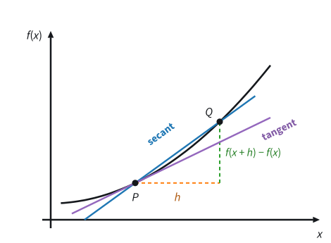

```{.python .input}
%load_ext d2lbook.tab
tab.interact_select('mxnet', 'pytorch', 'tensorflow', 'jax')
```

# Calculus
:label:`sec_calculus`

In Ancient Greece, Archimedes calculated the area of a circle by inscribing regular polygons with increasing numbers of sides $n \to \infty$ (:numref:`fig_circle_area`): as the triangles become thinner, their height approaches $r$ and their combined bases approach the circumference $2\pi r$, giving area $\frac{1}{2} r (2\pi r) = \pi r^2$. Approximating curved quantities by simple linear pieces in the limit of small steps lies at the root of both integral calculus and *differential calculus*.


:label:`fig_circle_area`

In deep learning, differential calculus is the engine of *optimization*. Training a model means adjusting its parameters to minimize a scalar loss function measuring how poorly the model fits its training examples. With millions or billions of parameters, probing each parameter by trial and error would require millions of forward passes per update. Instead, the *derivative* gives the instantaneous rate at which the loss changes with respect to each parameter; collecting all partial derivatives into the *gradient* vector identifies the direction of steepest ascent, and the *chain rule* assembles gradients across nested layers in a single backward pass.

In this section, we develop derivatives, gradients, and the chain rule on a running linear-regression example small enough that every number can be verified by hand. In :numref:`sec_autograd`, we will see how deep learning frameworks automate these calculations for arbitrary programs.

```{.python .input #calculus}
%%tab mxnet
import math
import numpy as np
from mxnet import autograd, gluon, init, np as mnp, npx
from mxnet.gluon import nn
from d2l import mxnet as d2l
npx.set_np()
```

```{.python .input #calculus}
%%tab pytorch
import math
import numpy as np
import torch
from torch import nn
from torch.nn import functional as F
from d2l import torch as d2l
```

```{.python .input #calculus}
%%tab tensorflow
import math
import numpy as np
import tensorflow as tf
from d2l import tensorflow as d2l
```

```{.python .input #calculus}
%%tab jax
import math
import numpy as np
import jax
from jax import numpy as jnp
from flax import nnx
import optax
from d2l import jax as d2l
```

## Derivatives

### The Derivative as a Limit

Suppose a single-parameter model predicts the constant value $w$ for every example, and we evaluate it on three training examples with labels $1$, $1$, and $0$. Summing the squared errors gives

$$L(w) = (w-1)^2 + (w-1)^2 + (w-0)^2 = 3w^2 - 4w + 2.$$

At $w = 1$, the loss is $L(1) = 1$:

```{.python .input #calculus-derivatives-and-differentiation-1}
def loss(w):
    return 3 * w ** 2 - 4 * w + 2
```

To see how $L(w)$ responds to a small perturbation $h \neq 0$, we evaluate the difference quotient $\frac{L(1+h) - L(1)}{h}$ as $h$ shrinks from $10^{-1}$ to $10^{-5}$:

```{.python .input #calculus-derivatives-and-differentiation-2}
for h in 10.0 ** -np.arange(1, 6):
    print(f'h = {h:.0e}   ratio = {(loss(1 + h) - loss(1)) / h:.5f}')
```

Expanding $L(1+h) = 1 + 2h + 3h^2$ shows that $\frac{L(1+h) - L(1)}{h} = 2 + 3h \to 2$ as $h \to 0$. Formally, for $f: \mathbb{R} \rightarrow \mathbb{R}$, the *derivative* of $f$ at $x$ is the limit

$$f'(x) = \lim_{h \rightarrow 0} \frac{f(x+h) - f(x)}{h}.$$
:eqlabel:`eq_derivative`

Geometrically, the difference quotient is the slope of the *secant line* through $P = (x, f(x))$ and $Q = (x+h, f(x+h))$; as $h \to 0$, the secant rotates into the *tangent line* at $P$ with slope $f'(x)$ (:numref:`fig_calc_secant_tangent`).


:label:`fig_calc_secant_tangent`

Not every function is differentiable everywhere: $|x|$ has a corner at $x = 0$ (slope $-1$ from the left, $+1$ from the right). Even worse, discrete classification accuracy is flat ($f'(x) = 0$) almost everywhere and jumps discontinuously where a prediction flips, providing no gradient signal—which is why classifiers are trained by minimizing smooth surrogate losses such as cross-entropy.

### Rules of Differentiation

Given $y = f(x)$, we write $f'(x) = y' = \frac{dy}{dx} = \frac{df}{dx} = \frac{d}{dx} f(x) = Df(x)$. Common elementary derivatives are

$$
\frac{d}{dx} C = 0, \quad \frac{d}{dx} x^n = n x^{n-1}, \quad
\frac{d}{dx} e^x = e^x, \quad \frac{d}{dx} \log x = \frac{1}{x} \quad (x > 0),
$$

and combinations of differentiable functions $f, g$ obey

$$
\begin{aligned}
\frac{d}{dx} [C f(x)] & = C f'(x), &
\frac{d}{dx} [f(x) + g(x)] & = f'(x) + g'(x), \\
\frac{d}{dx} [f(x) g(x)] & = f'(x) g(x) + f(x) g'(x), &
\frac{d}{dx} \frac{f(x)}{g(x)} & = \frac{f'(x) g(x) - f(x) g'(x)}{g(x)^2}.
\end{aligned}
$$

:numref:`fig_calc_product_rule` illustrates the product rule geometrically via the area of a $f(x) \times g(x)$ rectangle (full proofs appear in :numref:`sec_mdl-single_variable_calculus`). Applying these rules to $L(w) = 3w^2 - 4w + 2$ immediately gives $L'(w) = 6w - 4$, so $L'(1) = 2$.


:label:`fig_calc_product_rule`

### First-Order Linear Approximation and Minima

Multiplying $\frac{f(x+h) - f(x)}{h} \approx f'(x)$ by $h$ gives the *first-order linear approximation*

$$f(x + h) \approx f(x) + f'(x)\, h.$$
:eqlabel:`eq_calculus-linear-1d`

Because $L'(1) = 2 > 0$, decreasing $w$ reduces the loss: stepping opposite the derivative via $w \leftarrow w - \eta L'(w)$ with step size $\eta = 0.1$ moves $w$ from $1$ to $1 - 0.1(2) = 0.8$, lowering $L$ from $1$ to $L(0.8) = 0.72$ (close to the tangent prediction $1 + 2(-0.2) = 0.60$, with the $0.12$ difference equal to the quadratic curvature $3h^2$). At any smooth local minimum, the derivative must vanish ($f'(x) = 0$); setting $L'(w) = 6w - 4 = 0$ yields the unique global minimizer $w^* = 2/3$ (the mean of the labels $1, 1, 0$).

```{.python .input #calculus-visualization-utilities-5}
w = np.linspace(0, 2, 101)
d2l.plot(w, [loss(w), 2 * w - 1], 'w', 'L(w)',
         legend=['L(w)', 'tangent at w = 1'])
```

## Partial Derivatives and Gradients
:label:`subsec_calculus-grad`

### Partial Derivatives

Now give our three-example problem scalar inputs $0$, $1$, and $2$ paired with labels $1$, $1$, and $0$, and fit an affine line $w_1 + w_2 \cdot \textrm{input}$:

$$L(w_1, w_2) = (w_1 - 1)^2 + (w_1 + w_2 - 1)^2 + (w_1 + 2 w_2 - 0)^2.$$

For a multivariate function $y = f(x_1, \ldots, x_n)$, the *partial derivative* with respect to $x_i$ perturbs only coordinate $i$ while holding all other variables fixed:

$$\frac{\partial f}{\partial x_i} = \lim_{h \rightarrow 0} \frac{f(x_1, \ldots, x_i + h, \ldots, x_n) - f(x_1, \ldots, x_i, \ldots, x_n)}{h}.$$

At $(w_1, w_2) = (1, 0)$, holding $w_2 = 0$ fixed gives $L(w_1, 0) = 3w_1^2 - 4w_1 + 2$, so $\frac{\partial L}{\partial w_1}(1, 0) = 2$; holding $w_1 = 1$ fixed gives $L(1, w_2) = 5w_2^2 + 4w_2 + 1$, with derivative $10w_2 + 4$, so $\frac{\partial L}{\partial w_2}(1, 0) = 4$ (:numref:`fig_calc_partial_slices`).


:label:`fig_calc_partial_slices`

In matrix--vector form (:numref:`sec_linear-algebra`), writing each example as a row $(1, \textrm{input}_i)$ of $\mathbf{X}$ gives

$$\mathbf{X} = \begin{bmatrix} 1 & 0 \\ 1 & 1 \\ 1 & 2 \end{bmatrix}, \quad \mathbf{y} = \begin{bmatrix} 1 \\ 1 \\ 0 \end{bmatrix}, \quad L(\mathbf{w}) = \|\mathbf{X}\mathbf{w} - \mathbf{y}\|^2.$$

We can check $(2, 4)$ numerically by perturbing one coordinate at a time by $h = 10^{-6}$ in `float64`:

```{.python .input #calculus-partial-derivatives-1}
X = np.array([[1.0, 0.0], [1.0, 1.0], [1.0, 2.0]])  # rows [1, input]
y = np.array([1.0, 1.0, 0.0])

def line_loss(w):
    return np.sum((X @ w - y) ** 2)

def numerical_gradient(f, w, h=1e-6):
    """Finite differences of f at w, moving one coordinate at a time."""
    grad = np.zeros_like(w)
    for i in range(len(w)):
        step = np.zeros_like(w)
        step[i] = h
        grad[i] = (f(w + step) - f(w)) / h
    return grad
```

```{.python .input #calculus-partial-derivatives-2}
w = np.array([1.0, 0.0])
numerical_gradient(line_loss, w)
```

Note that `numerical_gradient` requires $n$ extra evaluations of $f$ for $n$ parameters—prohibitive when $n = 10^8$.

### Numerical Precision Limits of Finite Differences

Finite differences also suffer from floating-point cancellation when $h$ is too small. In finite precision (machine epsilon $\epsilon \approx 2.2 \times 10^{-16}$ in `float64`, $\epsilon \approx 1.2 \times 10^{-7}$ in `float32`), subtracting nearly equal numbers $f(x+h) - f(x)$ cancels leading digits (*catastrophic cancellation*) and divides the $\sim \epsilon$ rounding residual by $h$. Thus *truncation error* ($\propto h$) and *rounding error* ($\propto \epsilon / h$) compete:

```{.python .input #calculus-derivatives-and-differentiation-3}
def quotient_error(f, x, df, h):
    """Error of (f(x + h) - f(x)) / h as an estimate of f'(x) = df."""
    return abs((f(x + h) - f(x)) / h - df)

h = np.logspace(-1, -16, 61)  # 61 values of h, evenly spaced on a log scale
```

```{.python .input #calculus-finite-differences-1}
%%tab mxnet
h32 = mnp.array(h, dtype='float32')
```

```{.python .input #calculus-finite-differences-1}
%%tab pytorch
h32 = torch.tensor(h, dtype=torch.float32)
```

```{.python .input #calculus-finite-differences-1}
%%tab tensorflow
h32 = tf.constant(h, dtype=tf.float32)
```

```{.python .input #calculus-finite-differences-1}
%%tab jax
h32 = jnp.asarray(h, dtype=jnp.float32)
```

```{.python .input #calculus-finite-differences-2}
eps32 = np.finfo(np.float32).eps
d2l.plot(h, [quotient_error(loss, 1, 2, h), quotient_error(loss, 1, 2, h32),
             3 * h, eps32 / h], 'h', 'error', xscale='log', yscale='log',
         ylim=(1e-10, 1e1), legend=['float64', 'float32', '3h', 'ε/h'],
         figsize=(5, 3.5))
```

Balancing $3h \approx \epsilon / h$ puts the optimal step at $h^* \approx \sqrt{\epsilon / 3}$, losing half the format's digits (best error $\sim 10^{-8}$ at $h \approx 10^{-8}$ in `float64`, and $\sim 10^{-4}$ at $h \approx 10^{-4}$ in `float32`). Analytical differentiation via the chain rule avoids both the $O(n)$ cost and the $\sqrt{\epsilon}$ precision loss, leaving `float64` finite differences for unit-test gradient checking.

### The Gradient and Steepest Descent

Concatenating all $n$ partial derivatives of $f: \mathbb{R}^n \to \mathbb{R}$ forms the *gradient* vector $\nabla_{\mathbf{x}} f(\mathbf{x}) = (\frac{\partial f}{\partial x_1}, \ldots, \frac{\partial f}{\partial x_n})^\top$ (matching the shape of $\mathbf{x}$), which generalizes :eqref:`eq_calculus-linear-1d` to simultaneous perturbations $\mathbf{h} \in \mathbb{R}^n$:

$$f(\mathbf{x} + \mathbf{h}) \approx f(\mathbf{x}) + \nabla f(\mathbf{x})^\top \mathbf{h}.$$
:eqlabel:`eq_calculus-linear`

For a step $\mathbf{h} = t\mathbf{d}$ of length $t > 0$ along unit vector $\mathbf{d}$ ($\|\mathbf{d}\|_2 = 1$), :eqref:`eq_dot_cos` gives $f(\mathbf{x} + t\mathbf{d}) - f(\mathbf{x}) \approx t\,\|\nabla f(\mathbf{x})\|\cos\theta$. Thus $\nabla f(\mathbf{x})$ points in the direction of *steepest ascent* ($\theta = 0^\circ$), $-\nabla f(\mathbf{x})$ points in the direction of *steepest descent* ($\theta = 180^\circ$), and $\nabla f(\mathbf{x})$ is perpendicular to the level set passing through $\mathbf{x}$ ($\theta = 90^\circ$) (:numref:`fig_calc_gradient_field`).


:label:`fig_calc_gradient_field`

This motivates *gradient descent*, $\mathbf{w} \leftarrow \mathbf{w} - \eta \nabla L(\mathbf{w})$: from $\mathbf{w} = (1, 0)$ with learning rate $\eta = 0.1$, one step moves to $(1, 0) - 0.1(2, 4) = (0.8, -0.4)$, cutting the loss from $1.0$ to $0.4$ (while zigzagging across the elliptical contours toward the global minimum $\mathbf{w}^* = (7/6, -1/2)$; see :numref:`chap_optimization`).

### Matrix Calculus Identities

Three vector gradient identities (:numref:`sec_mdl-matrix-calculus`) allow us to differentiate vector expressions without writing out coordinates:

$$\nabla_{\mathbf{x}}\, (\mathbf{a}^\top \mathbf{x}) = \mathbf{a}, \qquad \nabla_{\mathbf{x}}\, (\mathbf{x}^\top \mathbf{A} \mathbf{x}) = (\mathbf{A} + \mathbf{A}^\top)\mathbf{x}, \qquad \nabla_{\mathbf{x}} \|\mathbf{x}\|^2 = 2\mathbf{x}.$$

Expanding $L(\mathbf{w}) = \|\mathbf{X}\mathbf{w} - \mathbf{y}\|^2 = \mathbf{w}^\top(\mathbf{X}^\top\mathbf{X})\mathbf{w} - 2(\mathbf{X}^\top\mathbf{y})^\top\mathbf{w} + \mathbf{y}^\top\mathbf{y}$ and applying these rules gives

$$\nabla L(\mathbf{w}) = 2\mathbf{X}^\top \mathbf{X} \mathbf{w} - 2\mathbf{X}^\top \mathbf{y} = 2\mathbf{X}^\top (\mathbf{X}\mathbf{w} - \mathbf{y}).$$
:eqlabel:`eq_calculus-line-grad`

## The Chain Rule
:label:`subsec_calculus-chain-rule`

Deep networks compose many nested layers $y = f_L(f_{L-1}(\cdots f_1(\mathbf{x})\cdots))$; differentiating compositions without expanding them relies on the *chain rule*.

For scalar functions $z = f(u)$ and $u = g(x)$, rates of change multiply: $\frac{dz}{dx} = \frac{dz}{du}\frac{du}{dx}$. More generally, if $z = f(u_1, \ldots, u_m)$ where each $u_j = g_j(x_1, \ldots, x_n)$, rates multiply along each path $x_i \to u_j \to z$ and sum across all parallel paths:

$$\frac{\partial z}{\partial x_i} = \sum_{j=1}^m \frac{\partial z}{\partial u_j} \frac{\partial u_j}{\partial x_i} \quad \Longrightarrow \quad \nabla_{\mathbf{x}} z = \mathbf{J}^\top \nabla_{\mathbf{u}} z,$$

where $\mathbf{J} \in \mathbb{R}^{m \times n}$ is the *Jacobian matrix* of $\mathbf{u}$ with respect to $\mathbf{x}$, with entries $J_{ji} = \frac{\partial u_j}{\partial x_i}$. For an affine map $\mathbf{u} = \mathbf{A}\mathbf{x} - \mathbf{y}$, the Jacobian is simply $\mathbf{J} = \mathbf{A}$.

Decomposing our line loss $L(\mathbf{w}) = \|\mathbf{X}\mathbf{w} - \mathbf{y}\|^2$ into two stages—(1) inner residuals $\mathbf{r} = \mathbf{X}\mathbf{w} - \mathbf{y}$ with Jacobian $\mathbf{J} = \mathbf{X}$, and (2) outer squared norm $L = \|\mathbf{r}\|^2$ with gradient $\nabla_{\mathbf{r}} L = 2\mathbf{r}$—the multivariate chain rule immediately recovers $\nabla_{\mathbf{w}} L = \mathbf{X}^\top(2\mathbf{r})$ in two passes:

```{.python .input #calculus-functions-of-many-variables}
r = X @ w - y    # forward: errors, from which the loss is r @ r
grad_r = 2 * r   # backward: gradient of the loss with respect to r
X.T @ grad_r     # backward: gradient with respect to w
```

The *forward pass* computes $\mathbf{r} = \mathbf{X}\mathbf{w} - \mathbf{y}$ and $L = \mathbf{r}^\top\mathbf{r}$; the *backward pass* (*backpropagation*) multiplies $2\mathbf{r}$ by $\mathbf{X}^\top$, computing the exact gradient with respect to all parameters at roughly the cost of one forward evaluation. In :numref:`sec_autograd`, we hand this mechanical backward pass over to the framework's automatic differentiation engine.

## Summary

The derivative $f'(x) = \lim_{h \to 0} \frac{f(x+h) - f(x)}{h}$ gives the slope of the tangent line and the local linear approximation $f(x+h) \approx f(x) + f'(x)h$. For $f: \mathbb{R}^n \to \mathbb{R}$, the gradient $\nabla_{\mathbf{x}} f(\mathbf{x})$ collects all partial derivatives, satisfies $f(\mathbf{x}+\mathbf{h}) \approx f(\mathbf{x}) + \nabla f(\mathbf{x})^\top \mathbf{h}$, and points in the direction of steepest ascent (perpendicular to level sets), motivating gradient descent $\mathbf{w} \leftarrow \mathbf{w} - \eta \nabla L(\mathbf{w})$. Unlike finite differences—which cost $O(n)$ evaluations and lose precision to catastrophic cancellation ($\sim \sqrt{\epsilon}$)—the multivariate chain rule $\nabla_{\mathbf{x}} z = \mathbf{J}^\top \nabla_{\mathbf{u}} z$ propagates exact gradients backward from the loss to all parameters in a single backward pass (*backpropagation*).

## Exercises

1. **Differentiating $x^x$ when both base and exponent vary.** For $x > 0$, consider the function $f(x) = x^x$, in which $x$ appears in both the base and the exponent.
    1. Explain why applying the power rule alone (treating the exponent as constant to get $x \cdot x^{x-1} = x^x$) and applying the exponential rule alone (treating the base as constant to get $x^x \log x$) are both incorrect.
    1. Rewrite $x^x = e^{x \log x}$ and apply the chain rule and product rule to find $f'(x)$. Notice that the true derivative is the *sum* of the two naive answers from Part 1; explain why this happens using the two-variable chain rule applied to $g(u, v) = u^v$ along $u = x, v = x$.

1. **Why squared error yields the mean and absolute error yields the median.** Suppose a single-parameter model predicts the constant value $w \in \mathbb{R}$ for $n$ training examples with scalar labels $y_1, \ldots, y_n$.
    1. Differentiate the sum of squared errors $L_2(w) = \sum_{i=1}^n (w - y_i)^2$ with respect to $w$, set the derivative to zero, and prove that the unique minimizer is the sample *mean* $w^* = \frac{1}{n}\sum_{i=1}^n y_i$.
    1. Now consider the sum of absolute errors $L_1(w) = \sum_{i=1}^n |w - y_i|$. Show that at any point $w$ not equal to one of the labels $y_i$, the derivative $L_1'(w)$ equals the number of labels strictly less than $w$ minus the number of labels strictly greater than $w$. At which values of $w$ does $L_1'(w)$ fail to exist? Conclude that $L_1(w)$ is minimized by any sample *median* of $\{y_1, \ldots, y_n\}$.
    1. For the four labels $\{1, 1, 0, 10\}$, compute the $L_2$ minimizer (mean) and the $L_1$ minimizer (median). What happens to each minimizer if the outlier label $10$ is corrupted to $100$?

1. **Gradient of the Euclidean norm.** Compute the gradient $\nabla_{\mathbf{x}} f(\mathbf{x})$ of the unsquared Euclidean norm $f(\mathbf{x}) = \|\mathbf{x}\|_2 = \sqrt{\sum_{i=1}^n x_i^2}$ for any nonzero vector $\mathbf{x} \neq \mathbf{0}$, and verify that $\|\nabla_{\mathbf{x}} f(\mathbf{x})\|_2 = 1$ everywhere it exists. What happens to the gradient at the origin $\mathbf{x} = \mathbf{0}$, and why?

1. **Step-size stability of gradient descent.** Consider minimizing the isotropic quadratic bowl $f(\mathbf{x}) = \|\mathbf{x}\|_2^2$ via the gradient descent update $\mathbf{x}_{k+1} = \mathbf{x}_k - \eta \nabla f(\mathbf{x}_k)$ with learning rate $\eta > 0$.
    1. Starting from $\mathbf{x}_0 = (1, 1)^\top$, compute $\mathbf{x}_1$ and the new objective value $f(\mathbf{x}_1)$ after a single step for three choices of learning rate: $\eta = 0.1$, $\eta = 1.0$, and $\eta = 2.0$.
    1. Write $\mathbf{x}_{k+1}$ in closed form in terms of $\mathbf{x}_k$ and $\eta$. For what range of learning rates $\eta > 0$ does a gradient descent step strictly decrease $f(\mathbf{x})$ from any nonzero starting point $\mathbf{x}_k \neq \mathbf{0}$? Which special value of $\eta$ jumps directly to the global minimum $\mathbf{x}^* = \mathbf{0}$ in a single step, and what happens when $\eta > 1$?
    1. Characterize the stationary points $\mathbf{x}$ at which a gradient descent step leaves the parameter vector unchanged ($\mathbf{x}_{k+1} = \mathbf{x}_k$), both for $f(\mathbf{x}) = \|\mathbf{x}\|_2^2$ and for a general differentiable objective $f$.

1. [code] **Central differences versus forward differences.** ● The one-sided *forward difference* $\frac{f(x+h) - f(x)}{h}$ analyzed in this section has truncation error $O(h)$. The symmetric *central difference*

   $$\frac{f(x+h) - f(x-h)}{2h}$$

   evaluates $f$ at $x+h$ and $x-h$ so that the $O(h)$ quadratic terms cancel out! Write a central-difference version of `quotient_error` and evaluate it across our logarithmic grid of $h$ values in `float64`:
    1. For the quadratic loss $L(w) = 3w^2 - 4w + 2$ at $w = 1$, plot the forward-difference and central-difference error curves on the same log--log axes. Why does the central-difference error drop straight to machine epsilon ($\sim 10^{-16}$) even at large $h = 10^{-1}$ on a quadratic function?
    1. Now repeat the comparison on a non-quadratic function, $f(x) = e^x$ at $x = 0$ (where $f'(0) = 1$). Compare the slope of the large-$h$ truncation branch of the central-difference curve against the slope-$1$ forward-difference branch, identify the optimal step size $h^*$ and minimum achievable error for each method, and explain both using the Taylor expansion $e^{\pm h} = 1 \pm h + \frac{h^2}{2} \pm \frac{h^3}{6} + \cdots$.

1. [code] **Gradient checking in `float64` versus `float32`.** ● Although finite differences are far too slow for training, central finite differences are the gold standard for unit-testing hand-derived or custom-kernel gradients.
    1. Write a function `central_gradient(f, x, h=1e-5)` that estimates $\nabla f(\mathbf{x})$ for $f: \mathbb{R}^n \to \mathbb{R}$ via central differences. Use it in `float64` to test the quadratic-form gradient identity $\nabla_{\mathbf{x}}(\mathbf{x}^\top \mathbf{A} \mathbf{x}) = (\mathbf{A} + \mathbf{A}^\top)\mathbf{x}$ on a random *non-symmetric* $5 \times 5$ matrix $\mathbf{A}$ at a random vector $\mathbf{x} \in \mathbb{R}^5$, and report the maximum relative error across the five coordinates.
    1. Now run the same check against the *buggy* formula $2\mathbf{A}\mathbf{x}$ (a common mistake made when forgetting that $\mathbf{A}$ is not symmetric). How large is the relative error now?
    1. Finally, repeat the check of the correct formula $(\mathbf{A} + \mathbf{A}^\top)\mathbf{x}$ in 32-bit `float32` using framework tensors across $h \in \{10^{-1}, 10^{-2}, \ldots, 10^{-6}\}$. Which $h$ achieves the smallest relative error in `float32`, why does it differ from the forward-difference optimum $h^* \approx 10^{-4}$, and what relative-error threshold cleanly separates a correct gradient implementation from a buggy one in `float32`?

:begin_tab:`mxnet`
[Discussions](https://d2l.discourse.group/t/32)
:end_tab:

:begin_tab:`pytorch`
[Discussions](https://d2l.discourse.group/t/33)
:end_tab:

:begin_tab:`tensorflow`
[Discussions](https://d2l.discourse.group/t/197)
:end_tab:

:begin_tab:`jax`
[Discussions](https://d2l.discourse.group/t/17969)
:end_tab:

<!-- slides -->

::: {.slide}
::: {.cover}
[Dive into Deep Learning · §1.4]{.kicker}

Differential Calculus: Derivatives, Gradients, Jacobians, and the Chain Rule<br>**local linear approximations · tangent slopes · steepest descent · computation DAGs · finite-difference limits**
:::
:::

::: {.slide title="Why Calculus Drives Learning: The Compass of Optimization"}
[Motivation]{.kicker}

Training a deep network means finding parameters $\mathbf{w} \in \mathbb{R}^d$ (where $d$ ranges from $10^6$ to $10^{12}$) that minimize a differentiable scalar loss $\mathcal{L}(\mathbf{w})$.

::: {.cols}
::: {.col}
- **Why trial-and-error probing fails:** Perturbing one coordinate $w_i \mapsto w_i + h$ to test whether $\mathcal{L}$ decreases requires **$d + 1$ forward passes** for a *single* parameter update—utterly infeasible at $d = 10^9$.
- **Why smooth surrogate losses matter:** Classification accuracy is flat ($0$ derivative) almost everywhere and jumps discontinuously when a prediction flips; we minimize smooth surrogates (squared error, cross-entropy) instead.
:::

::: {.col}
- **First-order linear approximation:** Differential calculus approximates any smooth function locally by its tangent:
  $$f(x + h) \approx f(x) + f'(x)\,h$$
- Knowing the derivative $f'(x)$ (or gradient $\nabla_{\mathbf{w}}\mathcal{L}$) reveals **which direction** decreases the loss and **at what rate** across all $d$ parameters simultaneously.
:::
:::
:::

::: {.slide title="From Secant Slopes to the Derivative"}
[Single-Variable Calculus]{.kicker}

::: {.cols .vc}
::: {.col}
- The **derivative** $f'(x)$ is the instantaneous rate of change—the limit of the **secant slope** between $(x, f(x))$ and $(x+h, f(x+h))$ as $h \to 0$:
  $$f'(x) = \lim_{h \to 0} \frac{f(x+h) - f(x)}{h}$$
- On $f(x) = 3x^2 - 4x$ at $x = 1$, expanding $f(1+h) = -1 + 2h + 3h^2$ gives $\frac{f(1+h)-f(1)}{h} = 2 + 3h \to 2$:

@calculus-derivatives-and-differentiation-2
:::

::: {.col .fig}
@fig:calculus-secant-tangent
:::
:::
:::

::: {.slide title="Visualizing the Tangent Line as a Local Linear Approximation"}
[Local Linearity]{.kicker}

::: {.cols .vc}
::: {.col}
- **First-order Taylor expansion around $a$:**
  $$f(x) \approx f(a) + f'(a)(x - a)$$
  At $w = 1$ ($L(1) = 1$, $L'(1) = 2$), the tangent line is $T(w) = 1 + 2(w - 1) = 2w - 1$.
- **Why local linearity justifies gradient descent:** For a small step $\Delta w = -\eta L'(w)$ with learning rate $\eta > 0$:
  $$L\big(w - \eta L'(w)\big) \approx L(w) - \eta \big[L'(w)\big]^2 < L(w)$$
- Stepping from $w = 1$ with $\eta = 0.1$ gives $w = 1 - 0.1(2) = 0.8$, lowering $L$ from $1.0$ to $0.72$ (tangent prediction: $0.60$). Setting $L'(w^*) = 6w^* - 4 = 0$ locates the global minimum $w^* = 2/3$.
:::

::: {.col .fig .big}
@!calculus-visualization-utilities-5
:::
:::
:::

::: {.slide title="Elementary Differentiation Rules and the Product Rule"}
[Analytical Differentiation]{.kicker}

::: {.cols .vc}
::: {.col}
| Function | Derivative $\frac{d}{dx}$ | Rule | Formula |
| :--- | :--- | :--- | :--- |
| Constant $C$ | $0$ | **Linearity** | $(\alpha u + \beta v)' = \alpha u' + \beta v'$ |
| Power $x^n$ | $n x^{n-1}$ | **Product** | $(u\,v)' = u'v + u\,v'$ |
| Exp $e^x$ | $e^x$ | **Quotient** | $(u/v)' = (u'v - u\,v')/v^2$ |
| Log $\ln x$ | $1/x$ | **$3x^2 - 4x$** | $3(2x) - 4(1) = 6x - 4$ |

- **Product rule geometry:** Expanding a rectangle $f(x)g(x)$ by $h$ adds two strips $g(x)f'(x)h + f(x)g'(x)h$ plus an $O(h^2)$ corner that vanishes as $h \to 0$.
:::

::: {.col .fig}
@fig:calculus-product-rule
:::
:::
:::

::: {.slide title="Partial Derivatives: Slicing a Multivariate Surface"}
[Multivariate Calculus]{.kicker}

::: {.cols .vc}
::: {.col}
- For $f: \mathbb{R}^n \to \mathbb{R}$, the **partial derivative** $\frac{\partial f}{\partial x_i}$ holds all coordinates fixed except $x_i$, measuring the slope of a 1D slice:
  $$\frac{\partial f}{\partial x_i} = \lim_{h \to 0} \frac{f(x_1, \ldots, x_i + h, \ldots, x_n) - f(x_1, \ldots, x_n)}{h}$$
- On $f(x_1, x_2) = x_1^2 + 2x_2^2$ at $(1, 1)$ (and line loss $L(w_1, w_2)$ at $(1, 0)$), $\frac{\partial f}{\partial x_1} = 2$ and $\frac{\partial f}{\partial x_2} = 4$:

@calculus-partial-derivatives-2
:::

::: {.col .fig}
@fig:calculus-partial-slices
:::
:::
:::

::: {.slide title="The Gradient Vector: Steepest Ascent, Descent, and Level Curves"}
[Gradient Geometry]{.kicker}

::: {.cols .vc}
::: {.col}
- Stacking all $n$ partial derivatives forms the **gradient** $\nabla_{\mathbf{x}} f(\mathbf{x}) = \big[\frac{\partial f}{\partial x_1}, \ldots, \frac{\partial f}{\partial x_n}\big]^\top \in \mathbb{R}^n$.
- By Cauchy–Schwarz, the directional rate of change along unit vector $\mathbf{u}$ at angle $\theta$ to $\nabla f(\mathbf{x})$ is $D_{\mathbf{u}} f(\mathbf{x}) = \nabla f(\mathbf{x})^\top \mathbf{u} = \|\nabla f(\mathbf{x})\|_2 \cos\theta$:
  - **Steepest ascent ($\theta = 0^\circ$):** $\nabla f(\mathbf{x})$ points directly uphill.
  - **Steepest descent ($\theta = 180^\circ$):** $-\nabla f(\mathbf{x})$ points directly downhill.
  - **Orthogonal to level curves ($\theta = 90^\circ$):** $D_{\mathbf{u}} f = 0$ along contours $f(\mathbf{x}) = c$.
:::

::: {.col .fig}
@fig:calculus-gradient-field
:::
:::
:::

::: {.slide title="Multivariate Linear Approximation and the Gradient Descent Step"}
[First-Order Optimization]{.kicker}

Perturbing all $n$ coordinates simultaneously by $\boldsymbol{\epsilon} \in \mathbb{R}^n$ sums the linear changes across every axis:

$$f(\mathbf{x} + \boldsymbol{\epsilon}) \approx f(\mathbf{x}) + \nabla_{\mathbf{x}} f(\mathbf{x})^\top \boldsymbol{\epsilon}$$

::: {.cols}
::: {.col}
- **Guaranteed local decrease:** Choosing the gradient descent step $\boldsymbol{\epsilon} = -\eta \nabla_{\mathbf{x}} f(\mathbf{x})$ with a small learning rate $\eta > 0$ gives:
  $$f\big(\mathbf{x} - \eta \nabla_{\mathbf{x}} f(\mathbf{x})\big) \approx f(\mathbf{x}) - \eta \big\|\nabla_{\mathbf{x}} f(\mathbf{x})\big\|_2^2 \le f(\mathbf{x})$$
- So long as $\nabla_{\mathbf{x}} f(\mathbf{x}) \neq \mathbf{0}$ and $\eta$ is small enough for the linear approximation to hold, every step strictly decreases $f$.
:::

::: {.col}
- **Why gradient descent zigzags:** On our line model at $\mathbf{w}_0 = [1, 0]^\top$, $\nabla L(\mathbf{w}_0) = [2, 4]^\top$. One step with $\eta = 0.1$ updates:
  $$\mathbf{w}_1 = \begin{bmatrix} 1 \\ 0 \end{bmatrix} - 0.1 \begin{bmatrix} 2 \\ 4 \end{bmatrix} = \begin{bmatrix} 0.8 \\ -0.4 \end{bmatrix}, \quad L(\mathbf{w}_1) = 0.40 < 1.0$$
- Because $-\nabla L$ is perpendicular to the *elliptical* contours rather than pointing at the center $\mathbf{w}^* = [7/6, -1/2]^\top$, the trajectory zigzags down the valley.
:::
:::
:::

::: {.slide title="The Multivariate Chain Rule and Computation DAGs"}
[Compositions & DAGs]{.kicker}

::: {.cols .vc}
::: {.col}
- **Single-path chain rule:** When $z = f(u)$ and $u = g(x)$, local sensitivities multiply along the edge sequence $x \to u \to z$:
  $$\frac{dz}{dx} = \frac{dz}{du}\frac{du}{dx}$$
- **Multivariate chain rule on a DAG:** When $y = f(\mathbf{u})$ depends on intermediate nodes $u_1, \ldots, u_m$ and each $u_i = g_i(\mathbf{x})$ depends on inputs $x_1, \ldots, x_n$:
  $$\frac{\partial y}{\partial x_j} = \sum_{i=1}^m \frac{\partial y}{\partial u_i} \frac{\partial u_i}{\partial x_j} \quad \Longleftrightarrow \quad \nabla_{\mathbf{x}} y = \mathbf{J}^\top \nabla_{\mathbf{u}} y$$
- **Graph rule:** Multiply edge weights (local derivatives) along each directed path from $x_j$ to $y$, then **sum over all parallel paths**.
:::

::: {.col .fig .big}
@fig:calculus-chain-graph
:::
:::
:::

::: {.slide title="Worked Example: Summing Parallel Paths on a Computation DAG"}
[Multivariate Chain Rule in Action]{.kicker}

Consider $z = u^2 + v$ where $u = x_1 x_2$ and $v = x_2^2$, evaluated at $\mathbf{x} = (x_1, x_2) = (1, 2)$:

::: {.cols}
::: {.col}
**1. Forward Pass (Inputs $\to$ Output)**

- Evaluate intermediate nodes at $(x_1, x_2) = (1, 2)$:
  $$u = x_1 x_2 = 1 \cdot 2 = 2, \qquad v = x_2^2 = 2^2 = 4$$
- Evaluate final output:
  $$z = u^2 + v = 2^2 + 4 = 8$$
- Notice that $x_1$ influences $z$ through **one path** ($x_1 \to u \to z$), whereas $x_2$ fans out across **two parallel paths** ($x_2 \to u \to z$ and $x_2 \to v \to z$).
:::

::: {.col}
**2. Backward Pass (Output $\to$ Inputs)**

- Upstream sensitivities: $\frac{\partial z}{\partial u} = 2u = 4$ and $\frac{\partial z}{\partial v} = 1$.
- **Gradient w.r.t. $x_1$ (single path via $u$):**
  $$\frac{\partial z}{\partial x_1} = \frac{\partial z}{\partial u}\frac{\partial u}{\partial x_1} = (2u)(x_2) = 4 \cdot 2 = 8$$
- **Gradient w.r.t. $x_2$ (sum of two paths via $u$ and $v$):**
  $$\frac{\partial z}{\partial x_2} = \frac{\partial z}{\partial u}\frac{\partial u}{\partial x_2} + \frac{\partial z}{\partial v}\frac{\partial v}{\partial x_2} = 2u x_1 + 2x_2 = 4(1) + 4 = 8$$
:::
:::

::: {.d2l-note}
Assembling both coordinates yields $\nabla_{\mathbf{x}} z(1, 2) = [8, 8]^\top$—computed by reusing $\frac{\partial z}{\partial u} = 4$ and $\frac{\partial z}{\partial v} = 1$ without ever expanding $z(x_1, x_2) = x_1^2 x_2^2 + x_2^2$ symbolically.
:::
:::

::: {.slide title="Matrix Calculus Identities and Vector-Valued Jacobians"}
[Vector & Matrix Calculus]{.kicker}

| Expression | Function $f(\mathbf{x})$ | Gradient / Jacobian | Deep Learning Application |
| :--- | :--- | :--- | :--- |
| **Linear form** | $\mathbf{a}^\top \mathbf{x}$ | $\nabla_{\mathbf{x}}(\mathbf{a}^\top \mathbf{x}) = \mathbf{a}$ | Linear neuron $\mathbf{w}^\top \mathbf{x} + b$ |
| **Quadratic form** | $\mathbf{x}^\top \mathbf{A} \mathbf{x}$ | $\nabla_{\mathbf{x}}(\mathbf{x}^\top \mathbf{A} \mathbf{x}) = (\mathbf{A} + \mathbf{A}^\top)\mathbf{x}$ | Hessian terms ($2\mathbf{A}\mathbf{x}$ if $\mathbf{A} = \mathbf{A}^\top$) |
| **Squared $L_2$ norm** | $\|\mathbf{x}\|_2^2 = \mathbf{x}^\top \mathbf{x}$ | $\nabla_{\mathbf{x}}\|\mathbf{x}\|_2^2 = 2\mathbf{x}$ | Weight decay & MSE residuals |
| **Least squares** | $\|\mathbf{X}\mathbf{w} - \mathbf{y}\|_2^2$ | $\nabla_{\mathbf{w}} L = 2\mathbf{X}^\top(\mathbf{X}\mathbf{w} - \mathbf{y})$ | Linear regression batch gradient |
| **Vector map** | $\mathbf{f}: \mathbb{R}^n \to \mathbb{R}^m$ | $\mathbf{J}_{\mathbf{f}}(\mathbf{x}) \in \mathbb{R}^{m \times n},\; (\mathbf{J}_{\mathbf{f}})_{ij} = \frac{\partial f_i}{\partial x_j}$ | Chaining layers: $\mathbf{J}_{\mathbf{f} \circ \mathbf{g}} = \mathbf{J}_{\mathbf{f}}\mathbf{J}_{\mathbf{g}}$ |

::: {.d2l-note}
For any affine map $\mathbf{u} = \mathbf{A}\mathbf{x} + \mathbf{b}$, $\mathbf{J}_{\mathbf{u}}(\mathbf{x}) = \mathbf{A}$, so propagating $\nabla_{\mathbf{u}} y$ backward multiplies by $\mathbf{A}^\top$: $\nabla_{\mathbf{x}} y = \mathbf{A}^\top \nabla_{\mathbf{u}} y$.
:::
:::

::: {.slide title="From Chain Rule to Backpropagation: Vector–Jacobian Products"}
[Forward & Backward Passes]{.kicker}

::: {.cols .vc}
::: {.col}
Decompose $L(\mathbf{w}) = \|\mathbf{X}\mathbf{w} - \mathbf{y}\|_2^2$ into a 2-stage graph $\mathbf{w} \to \mathbf{r} \to L$:

1. **Forward pass:** Compute residual $\mathbf{r} = \mathbf{X}\mathbf{w} - \mathbf{y} \in \mathbb{R}^m$ ($\mathbf{J}_{\mathbf{r}} = \mathbf{X}$) and loss $L = \|\mathbf{r}\|_2^2$.
2. **Backward pass (VJP):** Propagate sensitivity from $L$ to $\mathbf{w}$ in $O(mn)$ FLOPs:
   $$\nabla_{\mathbf{r}} L = 2\mathbf{r} \;\Longrightarrow\; \nabla_{\mathbf{w}} L = \mathbf{J}_{\mathbf{r}}^\top \nabla_{\mathbf{r}} L = \mathbf{X}^\top (2\mathbf{r})$$
:::

::: {.col}
@calculus-functions-of-many-variables
:::
:::
:::

::: {.slide title="Why Not Just Use Numerical Finite Differences?"}
[Numerical vs. Analytical Differentiation]{.kicker}

::: {.cols .vc}
::: {.col}
Approximating $f'(x) \approx \frac{f(x+h) - f(x)}{h}$ has **two fatal flaws** in deep learning:

1. **The Numerical V-Curve:**
   - **Too large $h$:** Taylor truncation error grows as $O(h)$ (or $O(h^2)$ for central differences).
   - **Too small $h$:** Subtracting nearly equal floats $f(x+h) - f(x)$ erases mantissa bits (**catastrophic cancellation**, error $\sim \epsilon / h$, capping `float32` at $\sim 4$ valid digits!).
2. **Computational $O(d)$ Blowup:** Perturbing $d = 10^9$ weights requires **$10^9 + 1$ forward passes** per step, whereas reverse-mode AD (§1.5) takes **one backward pass**.
:::

::: {.col .fig .big}
@!calculus-finite-differences-2
:::
:::
:::

::: {.slide title="Concept Check: Gradients, Level Curves, and the Chain Rule"}
[Check Your Understanding]{.kicker}

1. **Gradient geometry:** At $\mathbf{x} = (1, 2)$, $\nabla f(\mathbf{x}) = [3, -4]^\top$. What is the unit vector $\mathbf{u}^*$ of **steepest descent**, the rate $D_{\mathbf{u}^*} f(\mathbf{x})$, and a vector tangent to the level curve?
2. **Matrix calculus trap:** For non-symmetric $\mathbf{A} = [[1, 2], [0, 1]]$ and $\mathbf{x} = [1, 1]^\top$, what is $\nabla_{\mathbf{x}}(\mathbf{x}^\top \mathbf{A} \mathbf{x})$? Why is $2\mathbf{A}\mathbf{x}$ wrong?
3. **Scaling to deep networks:** For $d = 10^8$ parameters, how many forward passes does central differencing require per step versus backpropagation?

::: {.d2l-note .fragment .fade-up}
**Answers:**

1. $\|\nabla f\|_2 = 5 \implies \mathbf{u}^* = \mathbf{[-3/5,\, 4/5]^\top}$ with rate $-\|\nabla f\|_2 = \mathbf{-5}$. Tangent vector: $\mathbf{[4, 3]^\top}$ ($3(4) - 4(3) = 0$).
2. $\nabla_{\mathbf{x}}(\mathbf{x}^\top \mathbf{A} \mathbf{x}) = (\mathbf{A} + \mathbf{A}^\top)\mathbf{x} = \mathbf{[4, 4]^\top}$ (since $\mathbf{A} \neq \mathbf{A}^\top$, $2\mathbf{A}\mathbf{x} = [6, 2]^\top$ misses the transposed product-rule term).
3. Central differences require **$2d = 2 \times 10^8$ forward passes**; backpropagation takes **1 forward + 1 backward pass** ($\approx 2\text{--}3\times$ one forward pass).
:::
:::

::: {.slide title="Summary: Calculus Objects, Shapes, Geometry, and Optimization Roles"}
[Key Takeaways]{.kicker}

| Calculus Object | Formula | Shape | Geometric Meaning | Deep Learning Role |
| :--- | :--- | :--- | :--- | :--- |
| **Derivative** $f'(x)$ | $\lim_{h \to 0} \frac{f(x+h)-f(x)}{h}$ | `()` | Tangent slope at $x$ | 1D linear approx $f(x+h) \approx f(x) + f'(x)h$ |
| **Partial** $\frac{\partial f}{\partial x_i}$ | Derivative with $x_{j \neq i}$ fixed | `()` | Axis-$i$ slice slope | Sensitivity of loss to single weight $w_i$ |
| **Gradient** $\nabla_{\mathbf{x}} f(\mathbf{x})$ | $[\partial f/\partial x_1, \ldots, \partial f/\partial x_n]^\top$ | **`(n,)`** | Points uphill $\perp$ contours | Descent step $\mathbf{w} \leftarrow \mathbf{w} - \eta \nabla_{\mathbf{w}}\mathcal{L}$ |
| **Jacobian** $\mathbf{J}_{\mathbf{f}}(\mathbf{x})$ | $(\mathbf{J}_{\mathbf{f}})_{ij} = \partial f_i / \partial x_j$ | **`(m, n)`** | Local linear map $\mathbf{J}\mathbf{h}$ | Layer-to-layer sensitivity matrix |
| **Chain rule (VJP)** | $\nabla_{\mathbf{x}} y = \mathbf{J}_{\mathbf{u}}(\mathbf{x})^\top \nabla_{\mathbf{u}} y$ | `(n,)` | Sum over all DAG paths | Reverse-mode backpropagation (§1.5) |
| **Finite difference** | $\frac{f(x+h)-f(x-h)}{2h}$ | $2d$ evals | Secant slope on $[x-h, x+h]$ | Unit-test gradient checks in `float64` |
:::

