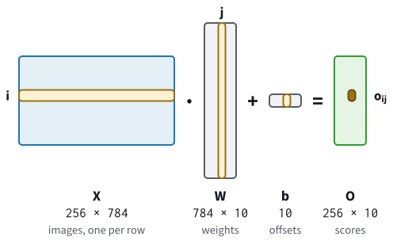
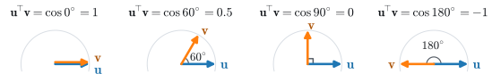
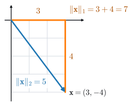

```{.python .input}
%load_ext d2lbook.tab
tab.interact_select('mxnet', 'pytorch', 'tensorflow', 'jax')
```

# Linear Algebra
:label:`sec_linear-algebra`

By now, we can load datasets into tensors and manipulate those tensors with basic elementwise operations. To start building and training expressive machine learning models, however, we need more than elementwise arithmetic: dividing an image minibatch by $255$ rescales each pixel in isolation, whereas a predictive model must combine hundreds or thousands of input features into a decision, weighing some features heavily and others lightly. *Linear algebra* is the mathematical language of such weighted combinations. It allows us to express the forward pass of an entire neural network layer across a minibatch of hundreds of examples in a single compact equation, and it tells us ahead of time what shape the output will take and how many floating-point operations the hardware must perform.

To see the power of linear-algebraic notation, consider a linear image classifier for $28 \times 28$ grayscale photographs of clothing (like the Fashion-MNIST benchmark we will train on in :numref:`chap_classification`), sorting images into $10$ categories such as T-shirts, sneakers, and handbags. Flattening each photograph yields $28 \times 28 = 784$ pixel intensities. For each of the $10$ categories, our classifier computes a numerical score by taking a weighted sum of the $784$ pixel values and adding a category-specific offset (or *bias*), predicting whichever category achieves the highest score. Because training evaluates minibatches of $256$ images at a time (:numref:`sec_ndarray`) over tens of thousands of iterations, computing those scores with nested Python loops is out of the question.

In linear algebra, scoring the entire minibatch takes a single line. We stack the $256$ flattened images as the rows of a data matrix $\mathbf{X} \in \mathbb{R}^{256 \times 784}$, arrange the $784$ pixel weights for each of the $10$ categories as the columns of a weight matrix $\mathbf{W} \in \mathbb{R}^{784 \times 10}$, and collect the $10$ category offsets into a bias vector $\mathbf{b} \in \mathbb{R}^{10}$. Together, $\mathbf{W}$ and $\mathbf{b}$ hold the $784 \times 10 + 10 = 7{,}850$ learnable parameters of the classifier. All $256 \times 10 = 2{,}560$ category scores across the minibatch are then given by the matrix equation

$$\mathbf{O} = \mathbf{X}\mathbf{W} + \mathbf{b},$$

where the bias vector $\mathbf{b}$ is added to every row via broadcasting (:numref:`fig_la_matmul`). Behind the scenes, the deep learning framework evaluates $\mathbf{X}\mathbf{W} + \mathbf{b}$ in a single call to highly optimized matrix-multiplication hardware kernels.


:label:`fig_la_matmul`

In this section, we build up to $\mathbf{O} = \mathbf{X}\mathbf{W} + \mathbf{b}$ piece by piece---starting from scalars, vectors, matrices, and higher-order tensors, and progressing through reductions, dot products, matrix--vector products, and matrix--matrix products. We then tackle two geometric questions that arise in every learning problem: how to measure the magnitude of an error vector or weight matrix using *norms*, and what happens to a signal when a deep network multiplies it by one matrix after another, which leads us to *eigenvectors and eigenvalues*. Whereas :numref:`sec_ndarray` treated tensors as data containers in code, here they acquire their geometric and algebraic meaning (our notational conventions are summarized in :numref:`chap_notation`).

```{.python .input #linear-algebra}
%%tab mxnet
from mxnet import np as mnp, npx
npx.set_np()
```

```{.python .input #linear-algebra}
%%tab pytorch
import torch
```

```{.python .input #linear-algebra}
%%tab tensorflow
import tensorflow as tf
```

```{.python .input #linear-algebra}
%%tab jax
import random
import jax
from jax import numpy as jnp
```

## Scalars, Vectors, Matrices, and Tensors

The building blocks of linear algebra are distinguished by how many indices are needed to specify a single numerical entry: zero indices for a scalar, one for a vector, two for a matrix, and $k$ indices for a $k^\textrm{th}$-order tensor. In code, this index count corresponds directly to the number of axes (`ndim`) of the tensor object.

### Scalars

Most everyday arithmetic manipulates single numbers one at a time---a single pixel intensity, the sale price of one house, or the bias offset of one category. Formally, we call single numerical quantities *scalars*. We denote scalars by ordinary lowercase italic letters (such as $x$, $y$, and $z$) and write $\mathbb{R}$ for the set of all continuous real-valued scalars. The notation $x \in \mathbb{R}$ (read *"$x$ in $\mathbb{R}$"*) simply states that $x$ is a real number, just as $y \in \{0, 1\}$ states that $y$ can only take the binary values $0$ or $1$. In code, a scalar is represented as a $0^\textrm{th}$-order tensor containing a single element and no axes, so its `shape` is the empty tuple `()`:

```{.python .input #linear-algebra-scalars}
%%tab mxnet
x = mnp.array(3.0)
x, x.shape
```

```{.python .input #linear-algebra-scalars}
%%tab pytorch
x = torch.tensor(3.0)
x, x.shape
```

```{.python .input #linear-algebra-scalars}
%%tab tensorflow
x = tf.constant(3.0)
x, x.shape
```

```{.python .input #linear-algebra-scalars}
%%tab jax
x = jnp.array(3.0)
x, x.shape
```

### Vectors

You can think of a *vector* as a fixed-length one-dimensional array of scalars. As with their code counterparts, we call the individual scalars the *elements* (or *entries*, or *components*) of the vector. When vectors represent examples from a real-world dataset, their entries hold concrete meaning: if we are predicting loan defaults, each applicant might be represented by a feature vector whose components record annual income, years of employment, and number of prior defaults; in our clothing classifier, each image is represented by a vector of $784$ pixel intensities, and each category's template is a vector of $784$ weights.

We denote vectors by bold lowercase letters (such as $\mathbf{x}$, $\mathbf{y}$, and $\mathbf{w}$) and write $\mathbf{x} \in \mathbb{R}^n$ for an $n$-dimensional real vector. By default, linear algebra treats vectors as *column vectors*, stacking their elements vertically:

$$\mathbf{x} =\begin{bmatrix}x_{1} \\ \vdots \\ x_{n}\end{bmatrix},$$
:eqlabel:`eq_vec_def`

where the unbolded scalar $x_i$ denotes the $i^\textrm{th}$ element of $\mathbf{x}$. To save vertical space in running text, we often write the same column vector inline as a tuple $\mathbf{x} = (x_1, \ldots, x_n)$ (and we use the same inline tuple notation when listing the entries of a matrix row, as in *"the rows $(0, 1, 2)$ and $(3, 4, 5)$"*). In code, a vector is a $1^\textrm{st}$-order tensor (a tensor with a single axis):

```{.python .input #linear-algebra-vectors-1}
%%tab mxnet
x = mnp.arange(3)
x
```

```{.python .input #linear-algebra-vectors-1}
%%tab pytorch
x = torch.arange(3, dtype=torch.float32)
x
```

```{.python .input #linear-algebra-vectors-1}
%%tab tensorflow
x = tf.range(3, dtype=tf.float32)
x
```

```{.python .input #linear-algebra-vectors-1}
%%tab jax
x = jnp.arange(3, dtype=jnp.float32)
x
```

Keep one indexing convention in mind: whereas mathematical notation indexes vector elements starting at $1$ ($x_1, x_2, \ldots, x_n$, *one-based indexing*), Python indexes tensors starting at $0$ (*zero-based indexing*). Thus, the third element $x_3$ of $\mathbf{x}$ is accessed in code as `x[2]`:

```{.python .input #linear-algebra-vectors-2}
x[2]
```

The number of elements $n$ in $\mathbf{x} \in \mathbb{R}^n$ is called the *dimensionality* of the vector. In code, this corresponds to the tensor's length (`len(x)`), as well as the sole entry in its 1-tuple `x.shape`:

```{.python .input #linear-algebra-vectors-4}
len(x), x.shape
```

Note that the word *"dimension"* is frequently overloaded in machine learning conversations to refer both to the number of axes of a tensor and to the number of elements along a specific axis. To prevent confusion, we refer to the number of axes as the *order* of a tensor (`ndim` in code) and reserve *dimensionality* for the number of components in a vector (so a flattened image vector $\mathbf{x} \in \mathbb{R}^{784}$ is a $1^\textrm{st}$-order tensor of dimensionality $784$).

### Matrices

Just as vectors generalize scalars from order $0$ to order $1$, *matrices* generalize vectors from order $1$ to order $2$. We denote matrices by bold uppercase letters (such as $\mathbf{A}$, $\mathbf{X}$, and $\mathbf{W}$), and represent them in code as tensors with two axes. The notation $\mathbf{A} \in \mathbb{R}^{m \times n}$ indicates that $\mathbf{A}$ is a rectangular table of real numbers arranged in $m$ horizontal rows and $n$ vertical columns (when $m = n$, we say that $\mathbf{A}$ is a *square* matrix). Throughout this book, tabular and flattened minibatch matrices $\mathbf{X} \in \mathbb{R}^{n \times d}$ store one example per row and one feature per column; thus, our minibatch of $256$ flattened $784$-pixel images forms a matrix $\mathbf{X} \in \mathbb{R}^{256 \times 784}$.

To refer to an individual entry of $\mathbf{A}$, we subscript both its row index $i$ and column index $j$, writing $a_{ij}$ (or $[\mathbf{A}]_{i,j}$):

$$\mathbf{A}=\begin{bmatrix} a_{11} & a_{12} & \cdots & a_{1n} \\ a_{21} & a_{22} & \cdots & a_{2n} \\ \vdots & \vdots & \ddots & \vdots \\ a_{m1} & a_{m2} & \cdots & a_{mn} \\ \end{bmatrix}.$$
:eqlabel:`eq_matrix_def`

In code, we can construct a $2 \times 3$ matrix `A` by reshaping a 6-element vector:

```{.python .input #linear-algebra-matrices-1}
%%tab mxnet
A = mnp.arange(6).reshape(2, 3)
A
```

```{.python .input #linear-algebra-matrices-1}
%%tab pytorch
A = torch.arange(6, dtype=torch.float32).reshape(2, 3)
A
```

```{.python .input #linear-algebra-matrices-1}
%%tab tensorflow
A = tf.reshape(tf.range(6, dtype=tf.float32), (2, 3))
A
```

```{.python .input #linear-algebra-matrices-1}
%%tab jax
A = jnp.arange(6, dtype=jnp.float32).reshape(2, 3)
A
```

When we exchange a matrix's rows and columns---flipping it across its main diagonal---the resulting matrix is called its *transpose*, denoted $\mathbf{A}^\top$. Formally, if $\mathbf{B} = \mathbf{A}^\top$, then $b_{ij} = a_{ji}$ for all $i$ and $j$, so the transpose of an $m \times n$ matrix is an $n \times m$ matrix:

$$
\mathbf{A}^\top =
\begin{bmatrix}
    a_{11} & a_{21} & \dots  & a_{m1} \\
    a_{12} & a_{22} & \dots  & a_{m2} \\
    \vdots & \vdots & \ddots  & \vdots \\
    a_{1n} & a_{2n} & \dots  & a_{mn}
\end{bmatrix}.
$$

For example, while our classifier's weight matrix $\mathbf{W} \in \mathbb{R}^{784 \times 10}$ stores one category's weights per column, its transpose $\mathbf{W}^\top \in \mathbb{R}^{10 \times 784}$ stores one category's weights per row. In code, the transpose is accessed via `.T` (or `tf.transpose`):

```{.python .input #linear-algebra-matrices-2}
%%tab mxnet, pytorch, jax
A.T
```

```{.python .input #linear-algebra-matrices-2}
%%tab tensorflow
tf.transpose(A)
```

An important special family of square matrices is the set of *symmetric* matrices, which remain unchanged under transposition ($\mathbf{S} = \mathbf{S}^\top$, meaning $s_{ij} = s_{ji}$ for all $i, j$). Symmetric matrices arise naturally whenever a table records pairwise undirected relationships---such as the distance, correlation, or covariance between pairs of features, or the second partial derivatives (Hessian) of a smooth loss function---and as we will see at the end of this section, they possess remarkably clean spectral properties:

```{.python .input #linear-algebra-matrices-3}
%%tab mxnet
S = mnp.array([[2.0, 1.0], [1.0, 2.0]])
(S == S.T).all()
```

```{.python .input #linear-algebra-matrices-3}
%%tab pytorch
S = torch.tensor([[2.0, 1.0], [1.0, 2.0]])
(S == S.T).all()
```

```{.python .input #linear-algebra-matrices-3}
%%tab tensorflow
S = tf.constant([[2.0, 1.0], [1.0, 2.0]])
tf.reduce_all(S == tf.transpose(S))
```

```{.python .input #linear-algebra-matrices-3}
%%tab jax
S = jnp.array([[2.0, 1.0], [1.0, 2.0]])
(S == S.T).all()
```

### Higher-Order Tensors

While scalars, vectors, and matrices take us far, raw perceptual data often arrive with three or more axes, which we denote mathematically using sans-serif uppercase letters such as $\mathsf{X}$, $\mathsf{Y}$, and $\mathsf{Z}$. As we saw in :numref:`sec_ndarray`, a single color image is a $3^\textrm{rd}$-order tensor (channels, height, width), and a minibatch of $256$ grayscale $28 \times 28$ images is a $4^\textrm{th}$-order tensor of shape $(256, 1, 28, 28)$. To pass this 4D minibatch into our linear classifier $\mathbf{O} = \mathbf{X}\mathbf{W} + \mathbf{b}$, we flatten the trailing three axes of each image into a single 784-dimensional row vector, producing the 2D design matrix $\mathbf{X} \in \mathbb{R}^{256 \times 784}$. Below, we generate a synthetic minibatch of rescaled pixel values in $[0, 1]$ and reshape it into $\mathbf{X}$:

```{.python .input #linear-algebra-tensors}
%%tab mxnet
images = mnp.random.uniform(size=(256, 1, 28, 28))
X = images.reshape(256, -1)  # One row of 784 pixels per image
images.shape, X.shape
```

```{.python .input #linear-algebra-tensors}
%%tab pytorch
images = torch.rand(256, 1, 28, 28)
X = images.reshape(256, -1)  # One row of 784 pixels per image
images.shape, X.shape
```

```{.python .input #linear-algebra-tensors}
%%tab tensorflow
images = tf.random.uniform((256, 1, 28, 28))
X = tf.reshape(images, (256, -1))  # One row of 784 pixels per image
images.shape, X.shape
```

```{.python .input #linear-algebra-tensors}
%%tab jax
key = jax.random.key(random.getrandbits(32))  # A new seed on each run
key, subkey = jax.random.split(key)
images = jax.random.uniform(subkey, (256, 1, 28, 28))
X = images.reshape(256, -1)  # One row of 784 pixels per image
images.shape, X.shape
```

## Elementwise Operations and Reductions

In our classifier equation $\mathbf{O} = \mathbf{X}\mathbf{W} + \mathbf{b}$ and its training loop, we repeatedly combine elementwise operations (such as adding the bias vector $\mathbf{b}$ to each row) with *reductions* (such as summing or averaging losses across a minibatch or normalizing row scores into probabilities).

### Elementwise Operations and the Hadamard Product

Any elementwise operation on two tensors of the same shape produces a tensor of that exact same shape. In linear algebra, the elementwise product of two matrices $\mathbf{A}, \mathbf{B} \in \mathbb{R}^{m \times n}$ is called their *Hadamard product* and is denoted by the symbol $\odot$, with entries $[\mathbf{A} \odot \mathbf{B}]_{ij} = a_{ij} b_{ij}$. Do not confuse the Hadamard product $\mathbf{A} \odot \mathbf{B}$ with the matrix product $\mathbf{A}\mathbf{B}$ defined below! In code, the standard multiplication operator `*` always computes the elementwise Hadamard product; thus `A * A` squares each entry of our $2 \times 3$ matrix `A` in place, whereas the matrix product of a $2 \times 3$ matrix with itself is not even dimensionally valid:

```{.python .input #linear-algebra-basic-properties-of-tensor-arithmetic-1}
A * A
```

### Reductions Along Axes
:label:`subsec_lin-alg-reduction`

Summing the components of an $n$-vector, $\sum_{i=1}^n x_i$, or summing all entries of an $m \times n$ matrix, $\sum_{i=1}^m \sum_{j=1}^n a_{ij}$, collapses the entire object to a single scalar. Often, however, we want to reduce a tensor along *only one specific axis* (or a subset of axes). On an $m \times n$ matrix $\mathbf{A}$:

* **Reducing along axis $0$ (rows)** sums over the row index $i$ for each column $j$, producing an $n$-dimensional vector of column sums $\sum_{i=1}^m a_{ij}$.
* **Reducing along axis $1$ (columns)** sums over the column index $j$ for each row $i$, producing an $m$-dimensional vector of row sums $\sum_{j=1}^n a_{ij}$.

In either case, the axis being reduced over is collapsed and disappears from the output tensor's shape (:numref:`fig_la_reduce`).


:label:`fig_la_reduce`

Passing the `axis` argument to `.sum()` (or `tf.reduce_sum`) selects which axis to collapse; omitting `axis` reduces across all axes simultaneously:

```{.python .input #linear-algebra-reduction-2}
%%tab mxnet, pytorch, jax
A.sum(), A.sum(axis=0), A.sum(axis=1)
```

```{.python .input #linear-algebra-reduction-2}
%%tab tensorflow
tf.reduce_sum(A), tf.reduce_sum(A, axis=0), tf.reduce_sum(A, axis=1)
```

Other reduction operations---such as `.mean()`, `.max()`, `.min()`, and `.std()`---accept the exact same `axis` parameter (and can even accept a tuple of axes, such as `axis=(0, 1)`).

### Keeping the Reduced Axis for Broadcasting
:label:`subsec_lin-alg-non-reduction`

Sometimes it is crucial to *preserve* the reduced axis as a singleton dimension of length $1$ rather than dropping it from the shape. Suppose we want to normalize each row of a nonnegative matrix $\mathbf{A}$ so that the entries in every row sum to $1$---the exact step a classifier performs when converting exponentiated category scores into a probability distribution over classes. If we compute the row sums of our $2 \times 3$ matrix `A` via `A.sum(axis=1)`, the result has shape `(2,)`. If we then try to divide `A` (shape `(2, 3)`) by `A.sum(axis=1)` (shape `(2,)`), broadcasting aligns `(2,)` with the *trailing* dimension `3` and crashes with a shape error!

Passing `keepdims=True` retains the collapsed axis with length $1$, giving `sum_A` the shape `(2, 1)` (:numref:`fig_la_reduce`, bottom right):

```{.python .input #linear-algebra-non-reduction-sum-1}
%%tab mxnet, pytorch, jax
sum_A = A.sum(axis=1, keepdims=True)
sum_A, sum_A.shape
```

```{.python .input #linear-algebra-non-reduction-sum-1}
%%tab tensorflow
sum_A = tf.reduce_sum(A, axis=1, keepdims=True)
sum_A, sum_A.shape
```

:begin_tab:`pytorch`
PyTorch's native argument names are `dim` and `keepdim` (singular), though recent PyTorch versions also accept the NumPy aliases `axis` and `keepdims` on most reduction methods; you will encounter both spellings in PyTorch code.
:end_tab:

Because `sum_A` has shape `(2, 1)`, dividing `A / sum_A` broadcasts the row sums cleanly across all three columns so that each row of the resulting $2 \times 3$ matrix sums to $1$:

```{.python .input #linear-algebra-non-reduction-sum-2}
A / sum_A
```

The same rule governs our $256 \times 784$ image minibatch $\mathbf{X}$. If we want to center each individual image by subtracting its own average pixel brightness (a row reduction along `axis=1`), we must pass `keepdims=True` so that `row_means` has shape `(256, 1)` and broadcasts across the $784$ columns. By contrast, if we subtract the average intensity at each pixel location across the batch (a column reduction along `axis=0`), `col_means` has shape `(784,)`, which already aligns with the trailing dimension of `(256, 784)` without needing `keepdims`:

```{.python .input #linear-algebra-keeping-reduced-axes-1}
%%tab mxnet, pytorch, jax
col_means = X.mean(axis=0)
row_means = X.mean(axis=1, keepdims=True)
col_means.shape, row_means.shape, (X - row_means).shape
```

```{.python .input #linear-algebra-keeping-reduced-axes-1}
%%tab tensorflow
col_means = tf.reduce_mean(X, axis=0)
row_means = tf.reduce_mean(X, axis=1, keepdims=True)
col_means.shape, row_means.shape, (X - row_means).shape
```

Watch out for a notorious trap: when a matrix happens to be *square* (say, a minibatch of $784$ images of $784$ pixels each), forgetting `keepdims=True` in `X - X.mean(axis=1)` does *not* raise an error---instead, it silently subtracts image $j$'s mean from column $j$ of every image, corrupting your data! Exercise :exref:`ex_linear-algebra-shape-prediction` explores this pitfall.

## Products

So far, we have only performed elementwise arithmetic, sums, and averages. If that were all we could do, linear algebra would hardly deserve its own section. What makes linear algebra the engine of deep learning is how it combines elementwise multiplication and summation into *products* of vectors and matrices.

### Dot Products

To score a single flattened image $\mathbf{x} \in \mathbb{R}^{784}$ against a single category's weight vector $\mathbf{w} \in \mathbb{R}^{784}$, our classifier multiplies each pixel intensity $x_i$ by its corresponding weight $w_i$ and sums the products: $\sum_{i=1}^{784} w_i x_i + b$. That sum of products is the *dot product* (or *inner product*). Given any two vectors $\mathbf{x}, \mathbf{y} \in \mathbb{R}^d$ of equal dimensionality, their dot product $\mathbf{x}^\top \mathbf{y}$ (also written $\langle \mathbf{x}, \mathbf{y} \rangle$) is defined as

$$\mathbf{x}^\top \mathbf{y} = \sum_{i=1}^{d} x_i y_i.$$

Notice why we write $\mathbf{x}^\top \mathbf{y}$: transposing the $d \times 1$ column vector $\mathbf{x}$ turns it into a $1 \times d$ row vector $\mathbf{x}^\top$, whose product with the $d \times 1$ column vector $\mathbf{y}$ yields a single scalar. The dot product is symmetric ($\mathbf{x}^\top \mathbf{y} = \mathbf{y}^\top \mathbf{x}$) and bilinear (linear in each argument separately: $(\alpha\mathbf{x} + \beta\mathbf{z})^\top \mathbf{y} = \alpha\,\mathbf{x}^\top \mathbf{y} + \beta\,\mathbf{z}^\top \mathbf{y}$ for any scalars $\alpha, \beta$).

In code, we compute the dot product of two vectors using `dot` (or `tf.tensordot(x, y, axes=1)`). When $\mathbf{y} = \mathbf{1}$ is the vector of all ones, $\mathbf{x}^\top \mathbf{1} = \sum_i x_i$ simply sums the entries of $\mathbf{x}$:

```{.python .input #linear-algebra-dot-products-1}
%%tab mxnet
y = mnp.ones(3)
x, y, mnp.dot(x, y)
```

```{.python .input #linear-algebra-dot-products-1}
%%tab pytorch
y = torch.ones(3)
x, y, torch.dot(x, y)
```

```{.python .input #linear-algebra-dot-products-1}
%%tab tensorflow
y = tf.ones(3)
x, y, tf.tensordot(x, y, axes=1)
```

```{.python .input #linear-algebra-dot-products-1}
%%tab jax
y = jnp.ones(3)
x, y, jnp.dot(x, y)
```

Equivalently, we can compute the dot product by taking the elementwise product `x * y` followed by a sum reduction:

```{.python .input #linear-algebra-dot-products-2}
%%tab mxnet
mnp.sum(x * y)
```

```{.python .input #linear-algebra-dot-products-2}
%%tab pytorch
torch.sum(x * y)
```

```{.python .input #linear-algebra-dot-products-2}
%%tab tensorflow
tf.reduce_sum(x * y)
```

```{.python .input #linear-algebra-dot-products-2}
%%tab jax
jnp.sum(x * y)
```

Dot products carry clean interpretations across statistics and geometry: when a weight vector $\mathbf{w}$ has nonnegative entries that sum to $1$ ($\sum_{i=1}^d w_i = 1$), the dot product $\mathbf{w}^\top \mathbf{x}$ computes a *weighted average* of the components of $\mathbf{x}$. And as we will prove shortly, when two vectors have unit length, their dot product equals the cosine of the angle between them.

### Matrix--Vector Products

Now suppose we want to compute the score for *one* clothing category across *all $256$ images* in our minibatch $\mathbf{X} \in \mathbb{R}^{256 \times 784}$ at once. For each image $i$, we need the dot product of row $i$ of $\mathbf{X}$ with the category's weight vector $\mathbf{w} \in \mathbb{R}^{784}$. Collecting all $256$ dot products into a single column vector defines the *matrix--vector product*.

To write this generally, let us partition an $m \times n$ matrix $\mathbf{A} \in \mathbb{R}^{m \times n}$ into its $m$ horizontal row vectors $\mathbf{a}_1^\top, \mathbf{a}_2^\top, \ldots, \mathbf{a}_m^\top \in \mathbb{R}^n$. The matrix--vector product $\mathbf{A}\mathbf{x}$ of $\mathbf{A}$ with a column vector $\mathbf{x} \in \mathbb{R}^n$ is the $m$-dimensional column vector whose $i^\textrm{th}$ component is the dot product $\mathbf{a}_i^\top \mathbf{x}$:

$$
\mathbf{A}\mathbf{x}
= \begin{bmatrix}
\mathbf{a}^\top_{1} \\
\mathbf{a}^\top_{2} \\
\vdots \\
\mathbf{a}^\top_m \\
\end{bmatrix}\mathbf{x}
= \begin{bmatrix}
 \mathbf{a}^\top_{1} \mathbf{x}  \\
 \mathbf{a}^\top_{2} \mathbf{x} \\
\vdots\\
 \mathbf{a}^\top_{m} \mathbf{x}\\
\end{bmatrix} \in \mathbb{R}^m.
$$

Notice the dimensional rule (:numref:`fig_la_matvec`): $\mathbf{A}\mathbf{x}$ is defined only when the number of columns of $\mathbf{A}$ ($n$) matches the dimensionality of $\mathbf{x}$ ($n$), and the resulting vector has one entry per row of $\mathbf{A}$ ($m$). On our image minibatch $\mathbf{X} \in \mathbb{R}^{256 \times 784}$, multiplying by a single weight vector $\mathbf{w} \in \mathbb{R}^{784}$ and adding a scalar offset $b$ produces $\mathbf{X}\mathbf{w} + b \in \mathbb{R}^{256}$---one prediction per example, which is the exact forward pass of *linear regression* (:numref:`chap_regression`).


:label:`fig_la_matvec`

In code, let us multiply our $2 \times 3$ matrix `A` (with rows $(0, 1, 2)$ and $(3, 4, 5)$) by the 3-vector `x = (0, 1, 2)`:

:begin_tab:`mxnet, pytorch, jax`
In Python, the infix matrix-multiplication operator `@` computes both matrix--vector and matrix--matrix products:
:end_tab:

:begin_tab:`tensorflow`
In TensorFlow, `@` requires both operands to be at least 2D matrices, so matrix--vector products use `tf.linalg.matvec(A, x)`:
:end_tab:

```{.python .input #linear-algebra-matrix-vector-products}
%%tab mxnet, pytorch, jax
A.shape, x.shape, A @ x
```

```{.python .input #linear-algebra-matrix-vector-products}
%%tab tensorflow
A.shape, x.shape, tf.linalg.matvec(A, x).numpy()
```

There is a second, equally illuminating way to view $\mathbf{A}\mathbf{x}$---not row by row as a list of dot products, but *column by column* as a linear transformation of space. Multiplying by $\mathbf{A} \in \mathbb{R}^{m \times n}$ defines a mapping from $\mathbb{R}^n$ to $\mathbb{R}^m$ that is *linear*: $\mathbf{A}(\alpha\mathbf{x} + \beta\mathbf{y}) = \alpha\mathbf{A}\mathbf{x} + \beta\mathbf{A}\mathbf{y}$. What does this transformation do to the standard basis (coordinate) vectors $\mathbf{e}_1, \ldots, \mathbf{e}_n$ of $\mathbb{R}^n$ (where $\mathbf{e}_j$ has a $1$ in position $j$ and $0$ everywhere else)? Multiplying $\mathbf{A}\mathbf{e}_j$ simply plucks out the $j^\textrm{th}$ column of $\mathbf{A}$! And because any vector $\mathbf{x} = (x_1, \ldots, x_n)$ is a weighted sum of basis vectors, $\mathbf{x} = \sum_{j=1}^n x_j \mathbf{e}_j$, linearity immediately implies that $\mathbf{A}\mathbf{x} = \sum_{j=1}^n x_j (\mathbf{A}\mathbf{e}_j)$ is the exact same linear combination of the *columns* of $\mathbf{A}$. For our $2 \times 3$ matrix `A` and `x = (0, 1, 2)`, $\mathbf{A}\mathbf{x}$ is $0 \cdot (0, 3) + 1 \cdot (1, 4) + 2 \cdot (2, 5) = (5, 14)$.

In two dimensions ($\mathbb{R}^2 \to \mathbb{R}^2$), we can picture the entire transformation geometrically (:numref:`fig_la_maps`): a $2 \times 2$ matrix maps the unit square spanned by $\mathbf{e}_1 = (1, 0)$ and $\mathbf{e}_2 = (0, 1)$ onto the parallelogram spanned by its two columns $\mathbf{A}\mathbf{e}_1$ and $\mathbf{A}\mathbf{e}_2$. For example, a $90^\circ$ counterclockwise rotation sends $\mathbf{e}_1 \mapsto (0, 1)$ and $\mathbf{e}_2 \mapsto (-1, 0)$, so those two vectors *are* the columns of the $90^\circ$ rotation matrix.


:label:`fig_la_maps`

### Matrix--Matrix Products

Once you understand dot products and matrix--vector products, *matrix--matrix multiplication* follows immediately. To compute the scores for all $10$ clothing categories across all $256$ images in $\mathbf{X} \in \mathbb{R}^{256 \times 784}$, we simply perform one matrix--vector product $\mathbf{X}\mathbf{w}_j$ for each of the $10$ columns $\mathbf{w}_1, \ldots, \mathbf{w}_{10}$ of $\mathbf{W} \in \mathbb{R}^{784 \times 10}$ and stack the resulting $10$ column vectors side by side.

In general, given an $m \times k$ matrix $\mathbf{A} \in \mathbb{R}^{m \times k}$ and a $k \times n$ matrix $\mathbf{B} \in \mathbb{R}^{k \times n}$, their matrix product $\mathbf{C} = \mathbf{A}\mathbf{B} \in \mathbb{R}^{m \times n}$ is the $m \times n$ matrix whose $(i, j)$ entry $c_{ij}$ is the dot product of row $i$ of $\mathbf{A}$ with column $j$ of $\mathbf{B}$:

$$c_{ij} = \sum_{l=1}^{k} a_{il}\, b_{lj}.$$
:eqlabel:`eq_matmul`

Notice that the inner dimension $k$ (the number of columns of $\mathbf{A}$ and rows of $\mathbf{B}$) must match and is summed out, leaving the outer dimensions $m \times n$. Also remember that matrix multiplication is *not* commutative: $\mathbf{A}\mathbf{B}$ and $\mathbf{B}\mathbf{A}$ generally differ, and when $m \neq n$, $\mathbf{B}\mathbf{A}$ is not even defined. In our clothing classifier (:numref:`fig_la_matmul`), multiplying $\mathbf{X} \in \mathbb{R}^{256 \times 784}$ by $\mathbf{W} \in \mathbb{R}^{784 \times 10}$ yields a $256 \times 10$ score matrix whose entry $o_{ij}$ measures how strongly image $i$ matches the 784-pixel template of category $j$.

Let us test `@` on a small example first, multiplying our $2 \times 3$ matrix `A` by a $3 \times 4$ matrix `B` of all ones (so each column of `A @ B` contains the row sums of `A`, namely $3$ and $12$):

```{.python .input #linear-algebra-matrix-matrix-multiplication}
%%tab mxnet
B = mnp.ones((3, 4))
A @ B
```

```{.python .input #linear-algebra-matrix-matrix-multiplication}
%%tab pytorch
B = torch.ones(3, 4)
A @ B
```

```{.python .input #linear-algebra-matrix-matrix-multiplication}
%%tab tensorflow
B = tf.ones((3, 4))
A @ B
```

```{.python .input #linear-algebra-matrix-matrix-multiplication}
%%tab jax
B = jnp.ones((3, 4))
A @ B
```

Now we can run the complete forward pass of our 10-class linear image classifier $\mathbf{O} = \mathbf{X}\mathbf{W} + \mathbf{b}$ on our $256 \times 784$ minibatch `X` (initialized with small Gaussian weights `W` and zero biases `b`). To obtain each image's predicted category ID in $\{0, \ldots, 9\}$, we find the column index of the largest score in each row using `argmax` along axis $1$:

```{.python .input #linear-algebra-matrix-matrix-products-1}
%%tab mxnet
W = 0.01 * mnp.random.normal(size=(784, 10))  # Column j: category j
b = mnp.zeros(10)                             # Entry j: category j
O = X @ W + b                                 # Row i: image i
O.shape, O.argmax(axis=1).shape
```

```{.python .input #linear-algebra-matrix-matrix-products-1}
%%tab pytorch
W = 0.01 * torch.randn(784, 10)  # Column j: category j
b = torch.zeros(10)              # Entry j: category j
O = X @ W + b                    # Row i: image i
O.shape, O.argmax(dim=1).shape
```

```{.python .input #linear-algebra-matrix-matrix-products-1}
%%tab tensorflow
W = 0.01 * tf.random.normal((784, 10))  # Column j: category j
b = tf.zeros(10)                        # Entry j: category j
O = X @ W + b                           # Row i: image i
O.shape, tf.argmax(O, axis=1).shape
```

```{.python .input #linear-algebra-matrix-matrix-products-1}
%%tab jax
key, subkey = jax.random.split(key)
W = 0.01 * jax.random.normal(subkey, (784, 10))  # Column j: category j
b = jnp.zeros(10)                             # Entry j: category j
O = X @ W + b                                 # Row i: image i
O.shape, O.argmax(axis=1).shape
```

How much computation did `X @ W` just perform? In the product of an $m \times k$ matrix and a $k \times n$ matrix, each of the $mn$ output entries requires a length-$k$ dot product ($k$ multiplications and $k - 1$ additions), totaling roughly $2mkn$ floating-point operations (FLOPs). For our single linear classifier layer on one minibatch, that is $2 \times 256 \times 784 \times 10 \approx 4 \times 10^6$ FLOPs---trivial for a modern CPU or GPU. When we multiply two square $n \times n$ matrices inside a large Transformer, however, the arithmetic cost $2n^3$ grows cubically while the memory footprint $3n^2$ grows only quadratically: multiplying two $4096 \times 4096$ matrices already demands $\approx 1.37 \times 10^{11}$ FLOPs! Understanding this ratio between arithmetic operations and memory traffic is the key to hardware performance (:numref:`chap_performance`).

Finally, two special square matrices deserve explicit mention:
* The **identity matrix** $\mathbf{I} \in \mathbb{R}^{n \times n}$ has $1$s along its main diagonal and $0$s everywhere else; its columns are the coordinate basis vectors $\mathbf{e}_1, \ldots, \mathbf{e}_n$, so multiplying by $\mathbf{I}$ leaves every vector unchanged ($\mathbf{I}\mathbf{x} = \mathbf{x}$).
* The **inverse** $\mathbf{A}^{-1}$ of a square matrix $\mathbf{A}$ is the unique matrix that reverses the transformation $\mathbf{A}$, satisfying $\mathbf{A}^{-1}\mathbf{A} = \mathbf{A}\mathbf{A}^{-1} = \mathbf{I}$. Not every square matrix is invertible: while the axis scaling in :numref:`fig_la_maps` (stretching by $2$ horizontally and $1/2$ vertically) is easily reversed by scaling by $1/2$ and $2$, any matrix that collapses two distinct vectors onto the same output---or squashes a nonzero vector to $\mathbf{0}$---destroys information irreversibly and has no inverse (:numref:`subsec_mdl-inverses`).

## Norms
:label:`subsec_lin-algebra-norms`

Some of the most useful operators in linear algebra are *norms*. Informally, the norm of a vector tells us how *big* it is. Why do we care about measuring the size of a vector or matrix? In machine learning, we use norms constantly for two fundamental purposes: (i) to define *objective functions* (losses) that quantify the magnitude of the residual error vector $\hat{\mathbf{y}} - \mathbf{y}$ between our model's predictions $\hat{\mathbf{y}}$ and the observed ground-truth labels $\mathbf{y}$; and (ii) to define *regularization penalties* that constrain how large the model's weight parameters $\mathbf{w}$ or $\mathbf{W}$ are allowed to grow during training. Different choices of norm weigh large and small components differently, leading to distinct statistical behaviors.

### Euclidean Length and Angle

The most familiar notion of vector length is the *$\ell_2$ norm* (or *Euclidean norm*), which generalizes the Pythagorean theorem to $n$ dimensions. Given a vector $\mathbf{x} \in \mathbb{R}^n$, its $\ell_2$ norm is the square root of the sum of the squares of its components---or equivalently, the square root of the dot product of $\mathbf{x}$ with itself:

$$\|\mathbf{x}\|_2 = \sqrt{\mathbf{x}^\top \mathbf{x}} = \sqrt{\sum_{i=1}^n x_i^2}.$$

Because the $\ell_2$ norm is the default measure of vector length throughout mathematics and machine learning, we often omit the subscript $2$ and simply write $\|\mathbf{x}\|$. Squaring the $\ell_2$ norm of the prediction error vector $\hat{\mathbf{y}} - \mathbf{y}$ and dividing by the number of examples $n$ yields the *mean squared error* (MSE), the workhorse loss function of regression (:numref:`chap_regression`). For the 2D vector $\mathbf{x} = (3, -4)$, the $\ell_2$ norm is $\sqrt{3^2 + (-4)^2} = \sqrt{9 + 16} = 5$.

Euclidean length also reveals the geometric meaning of the dot product. Consider two vectors $\mathbf{x}$ and $\mathbf{y}$ in the plane separated by an angle $\theta$, forming a triangle with third side $\mathbf{x} - \mathbf{y}$. By the law of cosines from trigonometry,

$$\|\mathbf{x} - \mathbf{y}\|^2 = \|\mathbf{x}\|^2 + \|\mathbf{y}\|^2 - 2\|\mathbf{x}\|\|\mathbf{y}\|\cos\theta.$$

On the other hand, writing the left-hand side as a dot product $(\mathbf{x} - \mathbf{y})^\top(\mathbf{x} - \mathbf{y})$ and expanding by bilinearity yields

$$\|\mathbf{x} - \mathbf{y}\|^2 = \mathbf{x}^\top\mathbf{x} - 2\mathbf{x}^\top\mathbf{y} + \mathbf{y}^\top\mathbf{y} = \|\mathbf{x}\|^2 - 2\mathbf{x}^\top\mathbf{y} + \|\mathbf{y}\|^2.$$

Matching the middle terms of these two expressions immediately gives the fundamental geometric identity

$$\mathbf{x}^\top \mathbf{y} = \|\mathbf{x}\| \|\mathbf{y}\| \cos\theta.$$
:eqlabel:`eq_dot_cos`

In words, the dot product $\mathbf{x}^\top \mathbf{y}$ equals the length of $\mathbf{x}$ multiplied by the signed length $\|\mathbf{y}\|\cos\theta$ of the orthogonal shadow (projection) that $\mathbf{y}$ casts along the line of $\mathbf{x}$ (:numref:`fig_la_dot`). Thus, $\mathbf{x}^\top \mathbf{y} > 0$ when the angle between the two vectors is acute ($\theta < 90^\circ$), $\mathbf{x}^\top \mathbf{y} = 0$ when the vectors are *orthogonal* (perpendicular, $\theta = 90^\circ$), and $\mathbf{x}^\top \mathbf{y} < 0$ when the angle is obtuse ($\theta > 90^\circ$).


:label:`fig_la_dot`

In $784$ dimensions we cannot visualize the angle between two flattened photographs with a protractor, so we read :eqref:`eq_dot_cos` in reverse and use it to *define* the cosine of the angle between any two nonzero vectors $\mathbf{x}, \mathbf{y} \in \mathbb{R}^d$:

$$\cos\theta = \frac{\mathbf{x}^\top \mathbf{y}}{\|\mathbf{x}\| \|\mathbf{y}\|}.$$
:eqlabel:`eq_cos_sim`

In machine learning, this normalized dot product is called the *cosine similarity*. Because dividing by $\|\mathbf{x}\|$ and $\|\mathbf{y}\|$ scales both vectors to unit length, cosine similarity compares pure *direction* while ignoring overall magnitude: a photograph $\mathbf{x}$ and a copy of the same photograph at twice the exposure ($2\mathbf{x}$) have cosine similarity $1$. When two vectors already have unit length ($\|\mathbf{u}\| = \|\mathbf{v}\| = 1$), their dot product $\mathbf{u}^\top \mathbf{v} = \cos\theta$ ranges smoothly from $+1$ (pointing in the exact same direction) through $0$ (orthogonal) down to $-1$ (pointing in opposite directions), as illustrated in :numref:`fig_la_cosine`.


:label:`fig_la_cosine`

Before we can call the ratio in :eqref:`eq_cos_sim` a cosine, we must verify one mathematical obligation: does $\frac{\mathbf{x}^\top \mathbf{y}}{\|\mathbf{x}\|\|\mathbf{y}\|}$ always lie in the interval $[-1, 1]$ in arbitrary dimension $d$? The famous Cauchy--Schwarz inequality guarantees that it does.

**Proposition (Cauchy--Schwarz inequality).** For all vectors $\mathbf{x}, \mathbf{y} \in \mathbb{R}^d$,

$$|\mathbf{x}^\top \mathbf{y}| \leq \|\mathbf{x}\| \|\mathbf{y}\|,$$

with equality if and only if one vector is a scalar multiple of the other.

**Proof.** If either $\mathbf{x} = \mathbf{0}$ or $\mathbf{y} = \mathbf{0}$, both sides equal $0$ and the inequality holds trivially. Otherwise, normalize both vectors to unit length by setting $\mathbf{u} = \mathbf{x}/\|\mathbf{x}\|$ and $\mathbf{v} = \mathbf{y}/\|\mathbf{y}\|$, so that $\|\mathbf{u}\| = \|\mathbf{v}\| = 1$. Because the squared $\ell_2$ norm of any vector is nonnegative, we have

$$0 \leq \|\mathbf{u} - \mathbf{v}\|^2 = \|\mathbf{u}\|^2 - 2\mathbf{u}^\top\mathbf{v} + \|\mathbf{v}\|^2 = 2 - 2\mathbf{u}^\top\mathbf{v},$$

which rearranges immediately to $\mathbf{u}^\top\mathbf{v} \leq 1$. Applying the exact same expansion to $0 \leq \|\mathbf{u} + \mathbf{v}\|^2 = 2 + 2\mathbf{u}^\top\mathbf{v}$ yields $\mathbf{u}^\top\mathbf{v} \geq -1$. Combining the two bounds gives $|\mathbf{u}^\top\mathbf{v}| \leq 1$, and multiplying both sides by $\|\mathbf{x}\|\|\mathbf{y}\|$ completes the proof. $\blacksquare$

In code, we can implement cosine similarity in a single line using `dot` and our framework's vector norm function. Below, the 4D vectors $\mathbf{x} = (1, 1, 1, 1)$ and $\mathbf{y} = (1, 1, 1, -1)$ each have $\ell_2$ norm $\sqrt{4} = 2$ and dot product $1 + 1 + 1 - 1 = 2$, so their cosine similarity is $2 / (2 \times 2) = 0.5$---corresponding to an angle of $\arccos(0.5) = \pi/3$ radians ($60^\circ$)---and doubling $\mathbf{x}$ leaves the cosine similarity unchanged:

```{.python .input #linear-algebra-dot-products-3}
%%tab mxnet
def cosine(x, y):
    return mnp.dot(x, y) / (mnp.linalg.norm(x) * mnp.linalg.norm(y))

x, y = mnp.array([1.0, 1, 1, 1]), mnp.array([1.0, 1, 1, -1])
cosine(x, y), cosine(2 * x, y), mnp.arccos(cosine(x, y))
```

```{.python .input #linear-algebra-dot-products-3}
%%tab pytorch
def cosine(x, y):
    return torch.dot(x, y) / (torch.linalg.vector_norm(x) *
                              torch.linalg.vector_norm(y))

x, y = torch.tensor([1.0, 1, 1, 1]), torch.tensor([1.0, 1, 1, -1])
cosine(x, y), cosine(2 * x, y), torch.acos(cosine(x, y))
```

```{.python .input #linear-algebra-dot-products-3}
%%tab tensorflow
def cosine(x, y):
    return tf.tensordot(x, y, axes=1) / (tf.norm(x) * tf.norm(y))

x, y = tf.constant([1.0, 1, 1, 1]), tf.constant([1.0, 1, 1, -1])
cosine(x, y).numpy(), cosine(2 * x, y).numpy(), tf.acos(cosine(x, y)).numpy()
```

```{.python .input #linear-algebra-dot-products-3}
%%tab jax
def cosine(x, y):
    return jnp.dot(x, y) / (jnp.linalg.norm(x) * jnp.linalg.norm(y))

x, y = jnp.array([1.0, 1, 1, 1]), jnp.array([1.0, 1, 1, -1])
cosine(x, y), cosine(2 * x, y), jnp.arccos(cosine(x, y))
```

### The $\ell_1$ Norm and General $\ell_p$ Norms

Because the $\ell_2$ norm squares every component before summing, a single large outlier component can easily dominate the entire norm. In many machine learning problems, we also encounter the *$\ell_1$ norm*, which sums the absolute values of the vector elements:

$$\|\mathbf{x}\|_1 = \sum_{i=1}^n |x_i|.$$

For $\mathbf{x} = (3, -4)$, the $\ell_1$ norm is $|3| + |-4| = 7$, whereas the $\ell_2$ norm is $5$. Geometrically, if the coordinate axes represent a grid of city streets, the $\ell_2$ norm is the straight-line ("as the crow flies") distance between two points, whereas the $\ell_1$ norm is the distance you must walk along the street grid---hence its nickname, the *Manhattan distance* (:numref:`fig_la_norms`).


:label:`fig_la_norms`

We can compute both the $\ell_2$ norm and the $\ell_1$ norm of $(3, -4)$ in code as follows:

```{.python .input #linear-algebra-norms-2}
%%tab mxnet
x = mnp.array([3.0, -4.0])
mnp.linalg.norm(x), mnp.abs(x).sum()
```

```{.python .input #linear-algebra-norms-2}
%%tab pytorch
x = torch.tensor([3.0, -4.0])
torch.linalg.vector_norm(x), torch.abs(x).sum()
```

```{.python .input #linear-algebra-norms-2}
%%tab tensorflow
x = tf.constant([3.0, -4.0])
tf.norm(x).numpy(), tf.reduce_sum(tf.abs(x)).numpy()
```

```{.python .input #linear-algebra-norms-2}
%%tab jax
x = jnp.array([3.0, -4.0])
jnp.linalg.norm(x), jnp.abs(x).sum()
```

Compared to the $\ell_2$ norm, the $\ell_1$ norm is far less sensitive to extreme outliers. Consider an error vector $\mathbf{e} = (1, -1, 1, -1, 10)$: the single large error of $10$ accounts for $100 / 104 \approx 96\%$ of the squared $\ell_2$ norm $\|\mathbf{e}\|_2^2$, but only $10 / 14 \approx 71\%$ of the $\ell_1$ norm $\|\mathbf{e}\|_1$. Consequently, regression models trained with $\ell_1$ loss (mean absolute error) are much more robust to corrupted outlier labels than models trained with squared $\ell_2$ loss. When applied as regularization penalties on model weights, the two norms behave differently as well: penalizing $\|\mathbf{w}\|_2^2$ (*weight decay*, :numref:`sec_weight_decay`) shrinks all weights smoothly toward zero, whereas penalizing $\|\mathbf{w}\|_1$ (Lasso regularization) drives many weights to *exact* zero, producing sparse models.

Both $\ell_1$ and $\ell_2$ are special cases of the general *$\ell_p$ norm*, defined for any real number $p \geq 1$ by

$$\|\mathbf{x}\|_p = \left(\sum_{i=1}^n |x_i|^p \right)^{1/p}.$$

As $p \to \infty$, the largest coordinate dominates the sum completely, yielding the *infinity norm* (or *max norm*) $\|\mathbf{x}\|_\infty = \max_i |x_i|$.

Mathematically, what qualifies a function $\|\cdot\|: \mathbb{R}^n \to \mathbb{R}$ to be called a *norm*? Any valid vector norm must satisfy three axioms for all vectors $\mathbf{x}, \mathbf{y} \in \mathbb{R}^n$ and all scalars $\alpha \in \mathbb{R}$:

1. **Absolute homogeneity (scaling):** $\|\alpha \mathbf{x}\| = |\alpha| \|\mathbf{x}\|$. Scaling a vector by a factor $\alpha$ scales its norm by $|\alpha|$.
2. **Triangle inequality (subadditivity):** $\|\mathbf{x} + \mathbf{y}\| \leq \|\mathbf{x}\| + \|\mathbf{y}\|$. The direct path from the origin to $\mathbf{x} + \mathbf{y}$ is never longer than taking a detour through $\mathbf{x}$ and then adding $\mathbf{y}$.
3. **Positive definiteness:** $\|\mathbf{x}\| > 0$ for all $\mathbf{x} \neq \mathbf{0}$, and $\|\mathbf{0}\| = 0$. Only the zero vector has length zero.

For the Euclidean ($\ell_2$) norm, the triangle inequality follows in one line from the Cauchy--Schwarz inequality, which bounds the cross term $2\mathbf{x}^\top\mathbf{y} \leq 2\|\mathbf{x}\|\|\mathbf{y}\|$ in

$$\|\mathbf{x} + \mathbf{y}\|^2 = \|\mathbf{x}\|^2 + 2\mathbf{x}^\top\mathbf{y} + \|\mathbf{y}\|^2 \leq \|\mathbf{x}\|^2 + 2\|\mathbf{x}\|\|\mathbf{y}\| + \|\mathbf{y}\|^2 = (\|\mathbf{x}\| + \|\mathbf{y}\|)^2.$$

Note that the condition $p \geq 1$ in the definition of the $\ell_p$ norm is essential: for $p = 1/2$, the basis vectors $\mathbf{e}_1 = (1, 0)$ and $\mathbf{e}_2 = (0, 1)$ each have $\|\mathbf{e}_i\|_{1/2} = 1$, yet their sum $(1, 1)$ has $\|(1, 1)\|_{1/2} = (1^{1/2} + 1^{1/2})^2 = 4 > 1 + 1$, violating the triangle inequality!

### Matrix Norms

Because the weights of a neural network layer form a matrix $\mathbf{W} \in \mathbb{R}^{m \times n}$, we also need ways to measure the magnitude of a matrix. The most common elementwise matrix norm is the *Frobenius norm*, which simply treats the $m \times n$ matrix as a flattened vector of $mn$ entries and computes its $\ell_2$ norm:

$$\|\mathbf{A}\|_\textrm{F} = \sqrt{\sum_{i=1}^m \sum_{j=1}^n a_{ij}^2}.$$

For a $4 \times 9$ matrix of all ones, the Frobenius norm is $\sqrt{36 \times 1^2} = 6$:

```{.python .input #linear-algebra-norms-3}
%%tab mxnet
mnp.linalg.norm(mnp.ones((4, 9)))
```

```{.python .input #linear-algebra-norms-3}
%%tab pytorch
torch.linalg.matrix_norm(torch.ones(4, 9))
```

```{.python .input #linear-algebra-norms-3}
%%tab tensorflow
tf.norm(tf.ones((4, 9)))
```

```{.python .input #linear-algebra-norms-3}
%%tab jax
jnp.linalg.norm(jnp.ones((4, 9)))
```

When we apply weight decay to a neural network layer, we add a multiple of $\|\mathbf{W}\|_\textrm{F}^2$ to the training loss to discourage large weights. In one important respect, however, the Frobenius norm is blind to the geometry of a matrix: it treats a matrix purely as a passive box of $mn$ numbers, forgetting that a matrix is a *linear operator* that transforms vectors. When we view a matrix as a transformation, a much deeper question arises: *by what maximum factor can multiplying by $\mathbf{A}$ stretch the length of an input vector $\mathbf{x}$?* Answering that question brings us to eigenvectors and eigenvalues.

## Eigenvectors and Eigenvalues
:label:`subsec_lin-alg-eigenvalues`

*(Note: This subsection develops the spectral intuition used when we analyze weight decay in :numref:`sec_weight_decay` and gradient stability in :numref:`sec_numerical_stability`; you may skim it on a first pass and return when those chapters reference it.)*

A deep neural network applies one layer of transformation after another. To see what repeated matrix multiplication does in its purest form, set aside nonlinear activations for a moment and imagine a 50-layer network in which every layer multiplies its input vector by the same square matrix $\mathbf{A} \in \mathbb{R}^{n \times n}$. After $k = 50$ layers, an input vector $\mathbf{x}$ becomes $\mathbf{A}^{50}\mathbf{x}$. How large is $\mathbf{A}^{50}\mathbf{x}$?

If $\mathbf{A}$ were just a single scalar $a$, the answer would be $a^{50} x$---and exponential growth or decay is unforgiving even when $a$ lies within $10\%$ of $1$: $1.1^{50} \approx 117.4$, whereas $0.9^{50} \approx 0.0052$. A mere $10\%$ amplification or attenuation per layer alters the signal magnitude by more than two orders of magnitude across $50$ layers! For a matrix $\mathbf{A}$, the stretch factor depends on the *direction* of $\mathbf{x}$---and along certain privileged directions of space, matrix multiplication simplifies directly to scalar multiplication.

### Eigenvectors

A nonzero vector $\mathbf{v} \neq \mathbf{0}$ is called an *eigenvector* of a square matrix $\mathbf{A} \in \mathbb{R}^{n \times n}$, with associated scalar *eigenvalue* $\lambda$, if multiplying $\mathbf{v}$ by $\mathbf{A}$ simply scales $\mathbf{v}$ without rotating its line of action:

$$\mathbf{A}\mathbf{v} = \lambda \mathbf{v}.$$

Along the direction of an eigenvector $\mathbf{v}$, the matrix $\mathbf{A}$ acts like the scalar $\lambda$: it stretches (or shrinks) $\mathbf{v}$ by a factor of $|\lambda|$, reversing its orientation if $\lambda < 0$. Consequently, applying $\mathbf{A}$ repeatedly $k$ times to an eigenvector simply multiplies it by $\lambda^k$:

$$\mathbf{A}^k\mathbf{v} = \lambda^k\mathbf{v}.$$

Looking back at the three $2 \times 2$ geometric transformations in :numref:`fig_la_maps`:
* The axis scaling matrix has eigenvectors $\mathbf{e}_1 = (1, 0)$ (with eigenvalue $\lambda_1 = 2$) and $\mathbf{e}_2 = (0, 1)$ (with eigenvalue $\lambda_2 = 1/2$).
* The horizontal shear preserves the horizontal axis $\mathbf{e}_1 = (1, 0)$ (an eigenvector with eigenvalue $\lambda = 1$) while tilting every other direction.
* The $90^\circ$ rotation turns *every* nonzero vector in the plane by $90^\circ$, so it has no real eigenvectors at all!

As a concrete worked example, consider our $2 \times 2$ symmetric matrix from earlier:

$$\mathbf{S} = \begin{bmatrix} 2 & 1 \\ 1 & 2 \end{bmatrix}.$$

We can spot both of its eigenvector directions by inspection. Multiplying $\mathbf{S}$ by $(1, 1)$ gives $(2+1,\ 1+2) = (3, 3) = 3(1, 1)$, so $(1, 1)$ is an eigenvector with eigenvalue $\lambda = 3$. Multiplying $\mathbf{S}$ by $(-1, 1)$ gives $(-2+1,\ -1+2) = (-1, 1) = 1(-1, 1)$, so $(-1, 1)$ is an eigenvector with eigenvalue $\lambda = 1$.

:numref:`fig_la_eigen` (left) shows the geometry of $\mathbf{S}$: it deforms the unit circle into an ellipse whose major and minor axes align with the two orthogonal eigenvectors $(1, 1)$ and $(-1, 1)$, stretched by their respective eigenvalues $\lambda = 3$ and $\lambda = 1$. Every vector that is not an eigenvector---such as $\mathbf{e}_1 = (1, 0)$, which maps to $\mathbf{S}\mathbf{e}_1 = (2, 1)$---is rotated toward the eigenvector with the larger eigenvalue ($\lambda = 3$).


:label:`fig_la_eigen`

In code, we compute the eigenvalues and eigenvectors of a real symmetric matrix using `linalg.eigh` (where the trailing `h` stands for Hermitian / symmetric):

```{.python .input #linear-algebra-eigenvalues-1}
%%tab mxnet
S = mnp.array([[2.0, 1.0], [1.0, 2.0]])
eigenvalues, eigenvectors = mnp.linalg.eigh(S)
eigenvalues, eigenvectors
```

```{.python .input #linear-algebra-eigenvalues-1}
%%tab pytorch
S = torch.tensor([[2.0, 1.0], [1.0, 2.0]])
eigenvalues, eigenvectors = torch.linalg.eigh(S)
eigenvalues, eigenvectors
```

```{.python .input #linear-algebra-eigenvalues-1}
%%tab tensorflow
S = tf.constant([[2.0, 1.0], [1.0, 2.0]])
eigenvalues, eigenvectors = tf.linalg.eigh(S)
eigenvalues, eigenvectors
```

```{.python .input #linear-algebra-eigenvalues-1}
%%tab jax
S = jnp.array([[2.0, 1.0], [1.0, 2.0]])
eigenvalues, eigenvectors = jnp.linalg.eigh(S)
eigenvalues, eigenvectors
```

`eigh` returns the eigenvalues in ascending order ($\lambda_1 = 1, \lambda_2 = 3$), and returns the corresponding unit-length eigenvectors $(1/\sqrt{2})(-1, 1)$ and $(1/\sqrt{2})(1, 1)$ as the *columns* of `eigenvectors` (note that if $\mathbf{v}$ is a unit eigenvector, so is $-\mathbf{v}$, so the sign of each column is arbitrary). Notice that the two eigenvectors of $\mathbf{S}$ are perpendicular: $(-1, 1)^\top(1, 1) = 0$. By the *spectral theorem* (proved in :numref:`sec_mdl-eigendecompositions`), **every real symmetric $n \times n$ matrix possesses $n$ real eigenvalues and a complete set of $n$ mutually orthogonal unit eigenvectors**. Non-symmetric matrices enjoy no such guarantee, as our $90^\circ$ rotation matrix demonstrated.

### Powers of a Matrix and Deep Signal Propagation

Having found the eigenvectors of $\mathbf{S}$, we can immediately answer what happens to *any* starting vector $\mathbf{x}$ after $k$ repeated multiplications $\mathbf{S}^k\mathbf{x}$: we decompose $\mathbf{x}$ into a sum of eigenvectors and let each eigenvector component grow at its own exponential rate $\lambda_i^k$.

For example, we can express $\mathbf{e}_1 = (1, 0)$ as half the difference of our two unnormalized eigenvectors:

$$\mathbf{e}_1 = \frac{1}{2}\begin{bmatrix} 1 \\ 1 \end{bmatrix} - \frac{1}{2}\begin{bmatrix} -1 \\ 1 \end{bmatrix}.$$

Each multiplication by $\mathbf{S}$ triples the first component ($\lambda = 3$) while leaving the second component ($\lambda = 1$) unchanged, so after $k$ steps we have the exact closed-form formula

$$\mathbf{S}^k\mathbf{e}_1 = \frac{1}{2} 3^k \begin{bmatrix} 1 \\ 1 \end{bmatrix} - \frac{1}{2} 1^k \begin{bmatrix} -1 \\ 1 \end{bmatrix} = \begin{bmatrix} (3^k + 1)/2 \\ (3^k - 1)/2 \end{bmatrix}.$$

For $k = 1, 2, 3, \ldots$, the iterates are $(2, 1)$, $(5, 4)$, $(14, 13)$, and so on: the $\lambda = 3$ component rapidly overwhelms the $\lambda = 1$ component, swinging the direction of $\mathbf{S}^k\mathbf{e}_1$ ever closer to the dominant eigenvector $(1, 1)$ (:numref:`fig_la_eigen`, right).

This exact analysis holds for any real symmetric matrix $\mathbf{A} \in \mathbb{R}^{n \times n}$. Because its orthonormal eigenvectors $\mathbf{v}_1, \ldots, \mathbf{v}_n$ span $\mathbb{R}^n$, any vector $\mathbf{x} \in \mathbb{R}^n$ can be expanded uniquely as $\mathbf{x} = \sum_{i=1}^n c_i \mathbf{v}_i$, where the coordinate $c_i = \mathbf{v}_i^\top \mathbf{x}$ is simply the dot product (projection) of $\mathbf{x}$ onto $\mathbf{v}_i$. Multiplying by $\mathbf{A}$ $k$ times scales each term by $\lambda_i^k$:

$$\mathbf{A}^k \mathbf{x} = \sum_{i=1}^n c_i \lambda_i^k \mathbf{v}_i.$$
:eqlabel:`eq_matrix_power`

As $k$ grows, the term with the largest eigenvalue magnitude $\max_i |\lambda_i|$ dominates the sum: the vector $\mathbf{A}^k\mathbf{x}$ aligns with the dominant eigenvector, and its Euclidean length grows by a factor of $\max_i |\lambda_i|$ per step. Running $10$ matrix--vector multiplications by $\mathbf{S}$ starting from $\mathbf{v} = (1, 0)$ confirms both predictions to four decimal places:

```{.python .input #linear-algebra-eigenvalues-2}
%%tab mxnet
v = mnp.array([1.0, 0.0])
for _ in range(10):
    v_prev, v = v, S @ v
growth = mnp.linalg.norm(v) / mnp.linalg.norm(v_prev)
growth, v / mnp.linalg.norm(v)
```

```{.python .input #linear-algebra-eigenvalues-2}
%%tab pytorch
norm = torch.linalg.vector_norm
v = torch.tensor([1.0, 0.0])
for _ in range(10):
    v_prev, v = v, S @ v
growth = norm(v) / norm(v_prev)
growth, v / norm(v)
```

```{.python .input #linear-algebra-eigenvalues-2}
%%tab tensorflow
v = tf.constant([1.0, 0.0])
for _ in range(10):
    v_prev, v = v, tf.linalg.matvec(S, v)
growth = tf.norm(v) / tf.norm(v_prev)
round(float(growth), 4), (v / tf.norm(v)).numpy().round(4)
```

```{.python .input #linear-algebra-eigenvalues-2}
%%tab jax
v = jnp.array([1.0, 0.0])
for _ in range(10):
    v_prev, v = v, S @ v
growth = jnp.linalg.norm(v) / jnp.linalg.norm(v_prev)
growth, v / jnp.linalg.norm(v)
```

Indeed, the step-over-step length ratio converges to $3.0$ (the dominant eigenvalue) and the normalized direction converges to $(1/\sqrt{2}, 1/\sqrt{2}) \approx (0.7071, 0.7071)$. When we normalize the vector to unit length after every multiplication step to prevent floating-point overflow, this procedure is known as *power iteration*---a simple, matrix-free algorithm for computing the dominant eigenvalue and eigenvector of a large matrix using only matrix--vector products.

The orthonormal expansion $\mathbf{x} = \sum_i c_i \mathbf{v}_i$ also answers the geometric matrix-norm question that the Frobenius norm left open: *what is the maximum stretch factor $\|\mathbf{A}\mathbf{x}\| / \|\mathbf{x}\|$ over all nonzero vectors $\mathbf{x}$?* This maximum stretch factor is called the *spectral norm* (or *operator norm*) of $\mathbf{A}$, denoted $\|\mathbf{A}\|_2$. For a symmetric matrix $\mathbf{A}$, orthogonality of the unit eigenvectors implies $\|\mathbf{x}\|^2 = \sum_i c_i^2$ and

$$\|\mathbf{A}\mathbf{x}\|^2 = \sum_{i=1}^n c_i^2 \lambda_i^2 \leq \left(\max_i \lambda_i^2\right) \sum_{i=1}^n c_i^2 = \left(\max_i |\lambda_i|\right)^2 \|\mathbf{x}\|^2,$$

with equality attained when $\mathbf{x}$ points along the dominant eigenvector. Thus, the spectral norm of a symmetric matrix is simply its largest eigenvalue magnitude, $\max_i |\lambda_i|$ (for general rectangular or non-symmetric matrices, the maximum stretch factor is given by the largest *singular value*, as developed in :numref:`sec_mdl-svd-low-rank`).

Now return to our 50-layer deep network thought experiment. Consider the innocent-looking symmetric matrix

$$\mathbf{M} = \begin{bmatrix} 1 & 0.1 \\ 0.1 & 1 \end{bmatrix},$$

which shares the exact same eigenvectors $(1, 1)/\sqrt{2}$ and $(-1, 1)/\sqrt{2}$ as $\mathbf{S}$, but has eigenvalues $\lambda_1 = 1 + 0.1 = 1.1$ and $\lambda_2 = 1 - 0.1 = 0.9$---both within $10\%$ of unity. Let us stack the two unit eigenvectors as the columns of a matrix $\mathbf{V}$, pass them through $50$ consecutive layers of multiplication by $\mathbf{M}$, and measure the final Euclidean norm of each column:

```{.python .input #linear-algebra-powers-of-a-matrix-1}
%%tab mxnet
M = mnp.array([[1.0, 0.1], [0.1, 1.0]])
# The eigenvectors (1, 1) and (-1, 1) of M, as columns of length 1
V = mnp.array([[1.0, -1.0], [1.0, 1.0]]) / 2 ** 0.5
for _ in range(50):  # 50 "layers"
    V = M @ V
mnp.linalg.norm(V, axis=0)
```

```{.python .input #linear-algebra-powers-of-a-matrix-1}
%%tab pytorch
M = torch.tensor([[1.0, 0.1], [0.1, 1.0]])
# The eigenvectors (1, 1) and (-1, 1) of M, as columns of length 1
V = torch.tensor([[1.0, -1.0], [1.0, 1.0]]) / 2 ** 0.5
for _ in range(50):  # 50 "layers"
    V = M @ V
torch.linalg.vector_norm(V, dim=0)
```

```{.python .input #linear-algebra-powers-of-a-matrix-1}
%%tab tensorflow
M = tf.constant([[1.0, 0.1], [0.1, 1.0]])
# The eigenvectors (1, 1) and (-1, 1) of M, as columns of length 1
V = tf.constant([[1.0, -1.0], [1.0, 1.0]]) / 2 ** 0.5
for _ in range(50):  # 50 "layers"
    V = M @ V
tf.norm(V, axis=0).numpy()
```

```{.python .input #linear-algebra-powers-of-a-matrix-1}
%%tab jax
M = jnp.array([[1.0, 0.1], [0.1, 1.0]])
# The eigenvectors (1, 1) and (-1, 1) of M, as columns of length 1
V = jnp.array([[1.0, -1.0], [1.0, 1.0]]) / 2 ** 0.5
for _ in range(50):  # 50 "layers"
    V = M @ V
jnp.linalg.norm(V, axis=0)
```

After 50 layers, the signal component along the first eigenvector has exploded by a factor of $1.1^{50} \approx 117.4$, while the component along the second eigenvector has withered to $0.9^{50} \approx 0.0052$ of its initial length! Even though real neural networks use distinct weight matrices at each layer and interleave nonlinear activation functions between them, this multiplicative instability remains a central challenge of deep learning: unless each layer's weight matrix preserves vector lengths close to $1$ on average, forward activations and backward gradients will either *explode* or *vanish* exponentially with depth (:numref:`sec_numerical_stability`).

Throughout this section, we treated our classifier's weight matrix $\mathbf{W}$ and bias vector $\mathbf{b}$ as fixed, given quantities. To *learn* good weights from data, we need a way to determine how the loss changes when we nudge each parameter---the subject of differential calculus in the next section.

## Summary

Linear algebra provides the compact mathematical and computational language for expressing machine learning models across whole minibatches at once: stacking $256$ flattened images as the rows of $\mathbf{X} \in \mathbb{R}^{256 \times 784}$ lets a 10-class linear classifier compute all $2{,}560$ category scores in one expression, $\mathbf{O} = \mathbf{X}\mathbf{W} + \mathbf{b}$. Scalars ($0^\textrm{th}$ order), vectors ($1^\textrm{st}$ order), matrices ($2^\textrm{nd}$ order), and higher-order tensors generalize numbers to arbitrary axes. Reductions aggregate values along specified axes, and passing `keepdims=True` preserves the reduced axis with length $1$ so the summary broadcasts cleanly back against the original tensor. Dot products $\mathbf{x}^\top\mathbf{y} = \sum_i x_i y_i$ combine elementwise multiplication with summation, serving as the building block for matrix--vector products $\mathbf{A}\mathbf{x}$ and matrix--matrix products $\mathbf{A}\mathbf{B}$ (which require $\approx 2mkn$ FLOPs for $m \times k$ and $k \times n$ matrices). Vector and matrix norms ($\ell_2$, $\ell_1$, $\ell_p$, Frobenius, and spectral norms) quantify the magnitude of prediction errors and weight parameters, while the normalized dot product defines the cosine of the angle between vectors ($\cos\theta = \mathbf{x}^\top\mathbf{y} / (\|\mathbf{x}\|\|\mathbf{y}\|)$). Finally, eigenvectors are the privileged directions that a square matrix scales without rotating ($\mathbf{A}\mathbf{v} = \lambda\mathbf{v}$), explaining why repeated matrix multiplication across many layers scales signal components by powers $\lambda^k$.

## Exercises

1. **Transposes and matrix products.** Prove the following algebraic identities:
    1. Show that the transpose of a matrix product reverses the order of the factors: $(\mathbf{A}\mathbf{B})^\top = \mathbf{B}^\top\mathbf{A}^\top$ whenever $\mathbf{A}\mathbf{B}$ is defined. (Write out the $(i, j)$ entry of both sides using :eqref:`eq_matmul`.)
    1. Show that for *any* rectangular matrix $\mathbf{X} \in \mathbb{R}^{m \times n}$, the product $\mathbf{X}\mathbf{X}^\top$ is always square and symmetric (and likewise for $\mathbf{X}^\top\mathbf{X}$). For our $256 \times 784$ image minibatch $\mathbf{X}$, what is the shape of $\mathbf{X}\mathbf{X}^\top$, and what does its $(i, j)$ entry measure?
1. **Identity and matrix inverses.** In :numref:`fig_la_maps`, the axis-scaling matrix has rows $(2, 0)$ and $(0, 1/2)$, and the horizontal shear matrix has rows $(1, 1)$ and $(0, 1)$.
    1. Write down the $2 \times 2$ inverse matrix $\mathbf{A}^{-1}$ for each of those two transformations, verify by matrix multiplication that $\mathbf{A}^{-1}\mathbf{A} = \mathbf{I}$, and describe geometrically how each inverse maps the deformed parallelogram back to the unit square.
    1. Show that the $2 \times 2$ matrix of all ones has no inverse: find a nonzero vector $\mathbf{x} \neq \mathbf{0}$ that it maps to $\mathbf{0}$, and explain why no linear transformation can recover $\mathbf{x}$ once it has been squashed to $\mathbf{0}$.
    1. The $90^\circ$ counterclockwise rotation matrix has columns $(0, 1)$ and $(-1, 0)$. Write down its inverse from geometric intuition, verify that their product is $\mathbf{I}$, and compare the inverse with the transpose of the rotation matrix.
1. [code] **Predicting reduction and broadcasting shapes.** Without running any code, predict the shape (or error) of each expression below for `images` of shape $(256, 1, 28, 28)$ and `X` of shape $(256, 784)$, then verify your answers in code:
    1. What does `len(images)` return? What are the shapes of `images.sum(axis=(2, 3))` with `keepdims=False` versus `keepdims=True`? Which of the two can divide `images` directly via broadcasting, and what does `images / images.sum(axis=(2, 3), keepdims=True)` compute?
    1. What happens when you evaluate `X - X.mean(axis=1)` on our $256 \times 784$ matrix `X`, and how does `keepdims=True` fix it?
    1. Now suppose your minibatch happens to contain $n = 784$ images, so that `X` is a square $784 \times 784$ matrix. Show that `X - X.mean(axis=1)` executes *without raising any error*! Write out what entry $(i, j)$ of `X - X.mean(axis=1)` actually computes in terms of the entries of `X`, and explain why a silent broadcasting bug on a square matrix is far more dangerous than a shape error.
   :exlabel:`ex_linear-algebra-shape-prediction`
1. **How mutually obtuse can a set of vectors be?** The following questions explore how negative all pairwise dot products among $k$ vectors can simultaneously be.
    1. Can three vectors $\mathbf{u}, \mathbf{v}, \mathbf{w} \in \mathbb{R}^2$ in the plane satisfy $\mathbf{u}^\top\mathbf{v} < 0$, $\mathbf{v}^\top\mathbf{w} < 0$, and $\mathbf{u}^\top\mathbf{w} < 0$ simultaneously? Provide a concrete numerical example, or prove that none exists.
    1. Suppose $k \geq 2$ unit vectors $\mathbf{u}_1, \ldots, \mathbf{u}_k \in \mathbb{R}^d$ ($d \geq k - 1$) are arranged symmetrically so that every distinct pair has the exact same dot product $\mathbf{u}_i^\top\mathbf{u}_j = c$ for all $i \neq j$. By expanding $0 \leq \|\mathbf{u}_1 + \cdots + \mathbf{u}_k\|_2^2$, prove that $c \geq -\frac{1}{k - 1}$. What does this bound imply about the pairwise cosine similarity of $10$ unit-length class templates in a 10-class classifier when all $10$ templates are separated by equal angles?

    *Adapted from MIT 18.06, [Problem Set 1](https://ocw.mit.edu/courses/18-06-linear-algebra-spring-2010/22297c2a6dcf06d82e93ee4af115e91a_MIT18_06S10_pset1_s10_soln.pdf), Section 1.2, Problem 28.*
1. **Manhattan ($\ell_1$) versus Euclidean ($\ell_2$) distance.** In midtown Manhattan, avenues and streets form a perpendicular grid along which pedestrians walk, with adjacent avenues spaced roughly $250\textrm{ m}$ apart and adjacent streets roughly $80\textrm{ m}$ apart.
    1. If two intersections differ by $\Delta a$ avenues and $\Delta s$ streets, express both the walking distance along the grid and the straight-line distance as norms of a single 2D displacement vector $\mathbf{d}$ (in meters).
    1. Using the Cauchy--Schwarz inequality (applied to the vectors $(|x_1|, \ldots, |x_n|)$ and $(1, \ldots, 1)$), prove that for every $\mathbf{x} \in \mathbb{R}^n$,

       $$\|\mathbf{x}\|_2 \leq \|\mathbf{x}\|_1 \leq \sqrt{n}\, \|\mathbf{x}\|_2,$$

       and characterize the vectors $\mathbf{x}$ for which each inequality holds with equality.
    1. On the Manhattan street grid, what is the maximum ratio by which the walking distance can exceed the straight-line distance, and at what ratio of blocks $\Delta s / \Delta a$ is that maximum reached?
1. [code] **Norms across multiple parameter tensors.** The vector-norm routines introduced in this section can also be applied to higher-order tensors (in PyTorch, use `torch.linalg.vector_norm`; note that `torch.linalg.matrix_norm` treats a 3D tensor as a batch of 2D matrices).
    1. Evaluate the vector norm with default arguments on a 3D tensor of shape $(2, 3, 4)$, state in words what mathematical formula it computes, and confirm your answer by squaring, summing, and taking the square root of the entries manually.
    1. A deep neural network stores its learnable parameters across a list of weight and bias tensors of varying orders and shapes. When monitoring training or clipping gradients (:numref:`sec_rnn-scratch`), we often need the single global $\ell_2$ norm of all parameters concatenated into one giant vector. Express this global $\ell_2$ norm in terms of the individual tensor norms without flattening or concatenating the tensors, and verify your formula in code on three tensors of shapes $(3, 4)$, $(4,)$, and $(2, 3, 5)$.
1. **Associativity of matrix multiplication and computational cost.** Although matrix multiplication is associative---$(\mathbf{A}\mathbf{B})\mathbf{C} = \mathbf{A}(\mathbf{B}\mathbf{C})$ mathematically---the order in which you parenthesize a chain of matrix products can change its computational cost by orders of magnitude. Given $\mathbf{A} \in \mathbb{R}^{1000 \times 50000}$, $\mathbf{B} \in \mathbb{R}^{50000 \times 20}$, and $\mathbf{C} \in \mathbb{R}^{20 \times 10000}$, calculate the total FLOP count and the number of entries in the intermediate product matrix under both $(\mathbf{A}\mathbf{B})\mathbf{C}$ and $\mathbf{A}(\mathbf{B}\mathbf{C})$. By what factors do the two evaluation orders differ in arithmetic work and intermediate memory?
1. [code] **All-pairs Euclidean distance matrix without loops.** ● Given two collections of $50$ vectors in $\mathbb{R}^8$ stacked as the rows of $\mathbf{X} \in \mathbb{R}^{50 \times 8}$ and $\mathbf{Y} \in \mathbb{R}^{50 \times 8}$, we want to compute the $50 \times 50$ matrix $\mathbf{D}$ of squared Euclidean distances $D_{ij} = \|\mathbf{x}_i - \mathbf{y}_j\|_2^2$ without Python loops:
    1. Compute $\mathbf{D}$ first via 3D broadcasting: reshape $\mathbf{X}$ to $(50, 1, 8)$ and $\mathbf{Y}$ to $(1, 50, 8)$, subtract, square, and sum along the last axis. Second, compute $\mathbf{D}$ via the quadratic expansion $\|\mathbf{x}_i - \mathbf{y}_j\|_2^2 = \|\mathbf{x}_i\|_2^2 + \|\mathbf{y}_j\|_2^2 - 2\mathbf{x}_i^\top\mathbf{y}_j$, which requires only row-norm reductions, 2D broadcasting, and a single matrix multiplication $\mathbf{X}\mathbf{Y}^\top$. Verify that both results match to floating-point precision.
    1. When $\mathbf{X}$ and $\mathbf{Y}$ each contain $10{,}000$ vectors in $\mathbb{R}^{128}$, how many intermediate floating-point numbers must the 3D-broadcasting method allocate compared with the matrix-product method? Which method should you use at scale?
    1. Explain why floating-point rounding in $\|\mathbf{x}_i\|_2^2 + \|\mathbf{y}_j\|_2^2 - 2\mathbf{x}_i^\top\mathbf{y}_j$ can occasionally produce tiny negative numbers (such as $-10^{-7}$) when $\mathbf{x}_i = \mathbf{y}_j$, and show how to clamp the output before taking a square root.

    *Adapted from Stanford CS231n, [Assignment 1](https://cs231n.github.io/assignments2026/assignment1/) ($k$-nearest-neighbor distances), and fast.ai, [Deep Learning from the Foundations](https://github.com/fastai/course-v3/blob/master/files/dl-2019/notes/notes-2-8.md), Lesson 8.*

1. **Orthogonal rotation matrices.** For any angle $\theta \in \mathbb{R}$, consider the 2D counterclockwise rotation matrix

   $$\mathbf{R}_\theta = \begin{bmatrix} \cos\theta & -\sin\theta \\ \sin\theta & \cos\theta \end{bmatrix}.$$

    1. Use the trigonometric angle-sum identities to prove that $\mathbf{R}_\alpha \mathbf{R}_\beta = \mathbf{R}_{\alpha + \beta}$, and interpret this equation geometrically.
    1. Prove that $\mathbf{R}_\theta^\top \mathbf{R}_\theta = \mathbf{I}$, and deduce that $\|\mathbf{R}_\theta \mathbf{x}\|_2 = \|\mathbf{x}\|_2$ for every $\mathbf{x} \in \mathbb{R}^2$. How does $\|\mathbf{R}_\theta^k \mathbf{x}\|_2$ behave as the depth $k \to \infty$, and how does this contrast with repeated multiplication by $\mathbf{S}$ or $\mathbf{M}$?
    1. Show algebraically that $\mathbf{R}_\theta \mathbf{v} = \lambda \mathbf{v}$ has no nonzero real solution $\mathbf{v} \in \mathbb{R}^2$ (and thus $\mathbf{R}_\theta$ has no real eigenvalues) unless $\theta$ is an integer multiple of $\pi$ ($180^\circ$).
1. [code] **Power iteration and convergence rate.** ● Implement normalized power iteration---repeatedly updating $\mathbf{v}_{k+1} = \mathbf{A}\mathbf{v}_k / \|\mathbf{A}\mathbf{v}_k\|_2$ from a random unit vector $\mathbf{v}_0$---on the $3 \times 3$ symmetric matrix

   $$\mathbf{A} = \begin{bmatrix} 1 & 2 & 3 \\ 2 & 0 & 4 \\ 3 & 4 & 5 \end{bmatrix}.$$

    1. Record the first iteration $k$ at which the absolute cosine similarity $|\mathbf{v}_k^\top \mathbf{v}_{k-1}|$ between consecutive iterates exceeds $0.999$. Compare your converged vector $\mathbf{v}_k$ against the dominant eigenvector returned by `eigh(A)`, and explain why the two vectors may differ by an overall sign $\pm 1$.
    1. At each step, measure the sine of the angle between $\mathbf{v}_k$ and the true dominant eigenvector $\mathbf{u}_{\max}$, $\sin\theta_k = \sqrt{1 - (\mathbf{v}_k^\top \mathbf{u}_{\max})^2}$, and compute the per-step shrinkage ratio $\sin\theta_{k+1} / \sin\theta_k$. Express this asymptotic ratio in terms of the eigenvalues of $\mathbf{A}$ using :eqref:`eq_matrix_power`, and use it to explain why power iteration converged in so few steps.
    1. Now run power iteration on the shifted matrix $\mathbf{B} = \mathbf{A} - 9\mathbf{I}$. Which eigenvalue and eigenvector of $\mathbf{A}$ does power iteration converge to now, what happens to the sign of consecutive iterates $\mathbf{v}_k$ and $\mathbf{v}_{k+1}$, and why?

    *Adapted from MIT 18.06, [Problem Set 1](https://ocw.mit.edu/courses/18-06-linear-algebra-spring-2010/22297c2a6dcf06d82e93ee4af115e91a_MIT18_06S10_pset1_s10_soln.pdf), Section 2.1, Problems 29–30.*

:begin_tab:`mxnet`
[Discussions](https://d2l.discourse.group/t/30)
:end_tab:

:begin_tab:`pytorch`
[Discussions](https://d2l.discourse.group/t/31)
:end_tab:

:begin_tab:`tensorflow`
[Discussions](https://d2l.discourse.group/t/196)
:end_tab:

:begin_tab:`jax`
[Discussions](https://d2l.discourse.group/t/17968)
:end_tab:

<!-- slides -->

::: {.slide}
::: {.cover}
[Dive into Deep Learning · §2.3]{.kicker}

Linear algebra for one minibatch of images<br>**shapes · reductions · dot and matrix products · cost · norms · eigenvalues**
:::
:::

::: {.slide title="One Matrix Product Turns 256 Images Into 2,560 Scores"}
[The problem]{.kicker}

::: {.cols .vc}
::: {.col}
- A linear classifier for $28 \times 28$ images: 784 pixels, 10
  categories, $784 \times 10 + 10 = 7{,}850$ parameters, minibatches
  of 256.
- $256 \times 10 \times 784 \approx 2$ million multiply--adds per
  minibatch, about $4 \times 10^6$ FLOPs.
- The scores $\mathbf{O} = \mathbf{X}\mathbf{W} + \mathbf{b}$ are one
  expression whose shape and cost we can read off before anything runs.
:::

::: {.col .fig .big}
@fig:linear-algebra-matmul
:::
:::
:::

::: {.slide title="By the End of This Deck You Can"}
[Goals]{.kicker}

- read the shape of every object in $\mathbf{X}\mathbf{W} + \mathbf{b}$;
- reduce along an axis and broadcast the result back;
- predict the shape and the FLOPs of a matrix product;
- measure errors and weights with norms;
- say how 50 layers of matrices scale a signal.

**Running example:** a minibatch
$\mathbf{X} \in \mathbb{R}^{256 \times 784}$, weights
$\mathbf{W} \in \mathbb{R}^{784 \times 10}$.
:::

::: {.slide title="Every Layer of a Network Starts With a Matrix Product"}
[Where this fits]{.kicker}

::: {.cols .vc}
::: {.col}
| section | tool |
|---|---|
| Data Manipulation | tensors |
| Data Preprocessing | pandas |
| **Linear Algebra** | **matrix products, norms, eigenvalues** |
| Calculus | derivatives, gradients, chain rule |
| Automatic Differentiation | autograd |
| Probability and Statistics | standard error, Bayes' theorem |
| Documentation | `help`, small tests |
:::

::: {.col .narrow}
- **Uses:** tensors, reshaping, and broadcasting, from the first deck.
- **Skips:** determinants, solving linear systems, and the SVD, which the
  mathematics appendix covers.
:::
:::
:::

::: {.slide title="Order Counts Axes; Dimensionality Counts Elements"}
[Objects]{.kicker}

| object | example | order | shape |
|---|---|---|---|
| scalar | one pixel | 0 | $()$ |
| vector | one flattened image | 1 | $(784,)$ |
| matrix | the minibatch $\mathbf{X}$ | 2 | $(256, 784)$ |
| tensor | the minibatch of images | 4 | $(256, 1, 28, 28)$ |

- A vector in $\mathbb{R}^{784}$ has order 1 and dimensionality 784.
- $\mathbf{X}$: one example per row, one feature (pixel position) per
  column.

::: {.d2l-note}
"Dimension" is used for both; libraries call the order `ndim`.
:::
:::

::: {.slide title="A Reduction Deletes an Axis; keepdims Keeps It as Length 1"}
[Reductions]{.kicker}

::: {.cols .vc}
::: {.col .narrow}
`axis=0` sums over rows: one sum per column. `axis=1`: one sum per row.

Broadcasting aligns shapes from the right: $(2,)$ cannot meet 3 columns,
but $(2, 1)$ stretches across them.
:::

::: {.col}
@fig:linear-algebra-reduce-axes
:::
:::
:::

::: {.slide title="Centering Images Needs keepdims; Centering Pixels Does Not"}
[Reductions]{.kicker}

@linear-algebra-keeping-reduced-axes-1

- Column means $(784,)$ align with the last axis of $(256, 784)$.
- Row means need shape $(256, 1)$. Without `keepdims` the shape is
  $(256,)$ and $256 \neq 784$: an error.
- For a square matrix the same mistake gives **no error**, just wrong
  numbers.
:::

::: {.slide title="A Score Is a Dot Product"}
[Dot products]{.kicker}

$$\mathbf{w}^\top \mathbf{x} + b = \sum_{i=1}^{784} w_i x_i + b$$

- Image $\mathbf{x}$, weights $\mathbf{w}$ of one category, offset $b$.
- Multiply matching entries, add them up.
- With all weights equal to 1: the sum of the pixels. With weights
  $\geq 0$ that sum to 1: a weighted average.
:::

::: {.slide title="Ax Takes One Dot Product per Row"}
[Matrix–vector]{.kicker}

$(\mathbf{A}\mathbf{x})_i = \mathbf{a}_i^\top\mathbf{x}$ for each row
$\mathbf{a}_i^\top$ of $\mathbf{A}$, so an $m \times n$ matrix maps
$\mathbb{R}^n$ to $\mathbb{R}^m$.

@linear-algebra-matrix-vector-products

::: {.cols .vc}
::: {.col}
::: {.d2l-note}
$\mathbf{X}\mathbf{w} + b$: one score per image. Fitted to one
real-valued label per example, such as a price, it is linear regression.
:::
:::

::: {.col .fig}
@fig:linear-algebra-matvec
:::
:::
:::

::: {.slide title="A Matrix Moves Space: Its Columns Are the Images of e₁ and e₂"}
[Matrix–vector]{.kicker}

{.nostretch width=100%}

Rotation by 90°, scaling by 2 and 1/2, shear. The unit square (dashed)
becomes the parallelogram spanned by the columns $\mathbf{A}\mathbf{e}_1$
and $\mathbf{A}\mathbf{e}_2$.
:::

::: {.slide title="A Linear Layer Compares Each Image With Ten Templates"}
[Matrix–matrix]{.kicker}

$$o_{ij} = \sum_{l=1}^{784} x_{il}\, w_{lj} + b_j = (\textrm{image } i)^\top (\textrm{template } j) + b_j$$

@linear-algebra-matrix-matrix-products-1

- $(256 \times 784)(784 \times 10) = 256 \times 10$: inner sizes must match.
- `argmax` along axis 1 picks one category per image.
:::

::: {.slide title="Check: A Shape Mismatch"}
[Check]{.kicker}

You stored the weights as $\mathbf{W}^\top \in \mathbb{R}^{10 \times 784}$,
one row per category. Does $\mathbf{X}\mathbf{W}^\top$ work? What should
you compute instead?

::: {.d2l-note .fragment .fade-up}
**Answer.** No: the inner sizes 784 and 10 differ. Transpose the stored
matrix: $(256 \times 784)(784 \times 10) = 256 \times 10$, the same scores.
:::
:::

::: {.slide title="AB Costs 2mkn FLOPs: About 4 Million for the Minibatch"}
[Cost]{.kicker}

$(m \times k)(k \times n)$: $mn$ entries, each a dot product of length $k$
($k$ multiplies, $k - 1$ adds).

| product | FLOPs | numbers involved |
|---|---|---|
| (256 × 784)(784 × 10) | $2 \cdot 256 \cdot 784 \cdot 10 \approx 4.0 \times 10^6$ | $2.1 \times 10^5$ |
| (4096 × 4096)(4096 × 4096) | $2 \cdot 4096^3 \approx 1.4 \times 10^{11}$ | $5.0 \times 10^7$ |

::: {.d2l-note}
For square matrices the work $2n^3$ grows faster than the $3n^2$ numbers:
doubling $n$ means 8× the work for 4× the numbers. How fast hardware gets
through them is a question for the Computational Performance chapter.
:::
:::

::: {.slide title="Two Rulers for (3, −4): ℓ₂ Reads 5, ℓ₁ Reads 7"}
[Norms]{.kicker}

::: {.cols .vc}
::: {.col}
$$\|\mathbf{x}\|_2 = \sqrt{\textstyle\sum_i x_i^2}, \qquad \|\mathbf{x}\|_1 = \textstyle\sum_i |x_i|$$

@linear-algebra-norms-2

::: {.d2l-note}
$\|\mathbf{x}\|_2 = \sqrt{\mathbf{x}^\top\mathbf{x}}$ is the length. A
norm scales with $|\alpha|$, obeys the triangle inequality, and is zero
only at $\mathbf{0}$.
:::
:::

::: {.col .narrow}
@fig:linear-algebra-norms
:::
:::
:::

::: {.slide title="Normalized, the Dot Product Is a Cosine"}
[Norms · angles]{.kicker}

::: {.cols .vc}
::: {.col}
In the plane, the law of cosines gives

$$\mathbf{x}^\top\mathbf{y} = \|\mathbf{x}\|\,\|\mathbf{y}\|\cos\theta.$$

In 784 dimensions, this *defines* the angle:

$$\cos\theta = \frac{\mathbf{x}^\top\mathbf{y}}{\|\mathbf{x}\|\,\|\mathbf{y}\|}.$$

::: {.d2l-note}
Cosine similarity ignores length: an image and the same image at twice
the brightness have cosine 1.
:::
:::

::: {.col .fig}
@fig:linear-algebra-dot
:::
:::
:::

::: {.slide title="Cosines Run From 1 (Aligned) to −1 (Opposed)"}
[Norms · angles]{.kicker}

{.nostretch width=100%}

$\mathbf{x} = (1, 1, 1, 1)$, $\mathbf{y} = (1, 1, 1, -1)$: lengths 2 and
2, dot product 2, so $\cos\theta = 1/2$ and $\theta = \pi/3$:

@!linear-algebra-dot-products-3
:::

::: {.slide title="Cauchy–Schwarz Keeps the Cosine in [−1, 1]"}
[Norms · angles]{.kicker}

$|\mathbf{x}^\top\mathbf{y}| \le \|\mathbf{x}\|\,\|\mathbf{y}\|$ in any
dimension. Proof for unit vectors $\mathbf{u} = \mathbf{x}/\|\mathbf{x}\|$,
$\mathbf{v} = \mathbf{y}/\|\mathbf{y}\|$:

**Step 1:** $0 \le \|\mathbf{u} - \mathbf{v}\|^2 = 1 - 2\mathbf{u}^\top\mathbf{v} + 1$,
so $\mathbf{u}^\top\mathbf{v} \le 1$.

**Step 2:** $0 \le \|\mathbf{u} + \mathbf{v}\|^2 = 1 + 2\mathbf{u}^\top\mathbf{v} + 1$,
so $\mathbf{u}^\top\mathbf{v} \ge -1$.

**Step 3:** multiply by $\|\mathbf{x}\|\,\|\mathbf{y}\|$. $\blacksquare$

::: {.d2l-note}
Equality only when one vector is a multiple of the other.
:::
:::

::: {.slide title="Check: Three Cosines"}
[Check]{.kicker}

Compute the cosine similarity of each pair.

1. $(1, 2, 2)$ and $(2, 1, -2)$
2. $(1, 0, 1)$ and $(2, 0, 2)$
3. $(1, 1)$ and $(1, -1)$

::: {.d2l-note .fragment .fade-up}
**Answers.**

1. Dot product $2 + 2 - 4 = 0$: perpendicular, cosine 0.
2. The second is twice the first: cosine 1.
3. Dot product $1 - 1 = 0$: perpendicular. These are the eigenvector
   directions at the end of the deck.
:::
:::

::: {.slide title="Squared Errors Chase Outliers"}
[Norms]{.kicker}

Errors $\mathbf{r} = \hat{\mathbf{y}} - \mathbf{y} = (1, -1, 1, -1, 10)$
(predictions minus labels): the one large error is

- $100/104 \approx 96\%$ of the squared $\ell_2$ norm,
- $10/14 \approx 71\%$ of the $\ell_1$ norm.

| norm | appears as |
|---|---|
| $\|\mathbf{r}\|_2^2 / n$ for $n$ examples | mean squared error |
| $\|\mathbf{W}\|_\textrm{F}^2$ | weight decay: shrinks all weights |
| $\|\mathbf{w}\|_1$ | sparsity: sets many weights to 0 |
| $\|\mathbf{g}\|_2$, $\mathbf{g}$ the gradient | gradient clipping |
:::

::: {.slide title="Eigenvectors Are Only Stretched"}
[Eigenvalues]{.kicker}

$\mathbf{A}\mathbf{v} = \lambda\mathbf{v} \;\Rightarrow\; \mathbf{A}^k\mathbf{v} = \lambda^k\mathbf{v}$ after $k$ multiplications.
For $\mathbf{S} = \left(\begin{smallmatrix} 2 & 1 \\ 1 & 2 \end{smallmatrix}\right)$:
$(1, 1) \mapsto (3, 3)$ and $(-1, 1) \mapsto (-1, 1)$, so $\lambda = 3$ and $1$.

{.nostretch width=72% fig-align="center"}
:::

::: {.slide title="Repeated Multiplication Finds the Largest Eigenvalue"}
[Eigenvalues]{.kicker}

Write $\mathbf{x} = \sum_i c_i\mathbf{v}_i$ in the perpendicular
eigenvectors of a symmetric $\mathbf{A}$. Then
$\mathbf{A}^k\mathbf{x} = \sum_i c_i\lambda_i^k\mathbf{v}_i$: the largest
$|\lambda_i|$ takes over.

@linear-algebra-eigenvalues-2

Growth per step 3, direction $(1, 1)/\sqrt{2}$. Rescaling to length 1
after each step is *power iteration*.
:::

::: {.slide title="Fifty Layers Turn 1.1 Into 117 and 0.9 Into 0.005"}
[Eigenvalues]{.kicker}

$\mathbf{M} = \left(\begin{smallmatrix} 1 & 0.1 \\ 0.1 & 1 \end{smallmatrix}\right)$
has eigenvalues 1.1 and 0.9. Each layer multiplies the part of a signal
along an eigenvector by its eigenvalue:

| layers *k* | 10 | 20 | 50 |
|---|---|---|---|
| 1.1^*k*^ | 2.59 | 6.73 | 117 |
| 0.9^*k*^ | 0.35 | 0.12 | 0.005 |

Applying $\mathbf{M}$ 50 times to both eigenvectors gives the last column:

@!linear-algebra-powers-of-a-matrix-1

::: {.d2l-note .rule}
Unless each layer stretches by a factor close to 1, signals and gradients
explode or vanish exponentially with depth.
:::
:::

::: {.slide title="Check: The Cost of One Layer"}
[Check]{.kicker}

A minibatch of 256 vectors of width 4096 passes through a layer with a
$4096 \times 4096$ weight matrix, on a GPU that sustains $10^{14}$ FLOP/s.

1. How many FLOPs?
2. About how long?

::: {.d2l-note .fragment .fade-up}
**Answers.**

1. $2 \times 256 \times 4096 \times 4096 \approx 8.6 \times 10^9$ FLOPs.
2. $8.6 \times 10^9 / 10^{14} \approx 86$ µs, if the arithmetic is the
   bottleneck.
:::
:::

::: {.slide title="Recap"}
[Wrap-up]{.kicker}

| rule | running example |
|---|---|
| shape: $(m \times k)(k \times n) = m \times n$ | $(256 \times 784)(784 \times 10) = 256 \times 10$ |
| `keepdims` keeps a reduced axis as length 1 | row means $(256, 1)$ |
| cost $2mkn$ FLOPs | $\approx 4 \times 10^6$ per minibatch |
| $\ell_2$ and $\ell_1$ norms | $(3, -4)$: 5 and 7 |
| $\cos\theta = \mathbf{x}^\top\mathbf{y} / (\|\mathbf{x}\|\,\|\mathbf{y}\|) \in [-1, 1]$ | brighter image, same cosine |
| each layer multiplies an eigenvector by $\lambda$ | 50 layers: $1.1^{50} \approx 117$, $0.9^{50} \approx 0.005$ |

**Next:** how the error changes when a parameter changes: calculus.
:::
