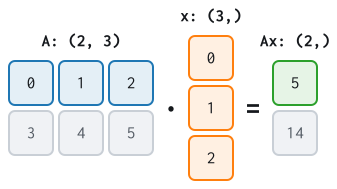
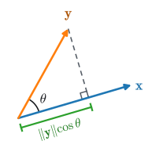
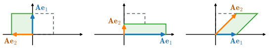
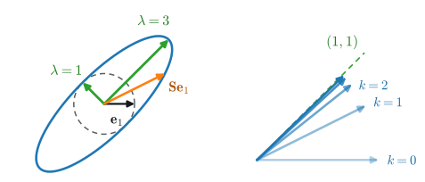

```{.python .input}
%load_ext d2lbook.tab
tab.interact_select('mxnet', 'pytorch', 'tensorflow', 'jax')
```

# Linear Algebra
:label:`sec_linear-algebra`

Dividing an image minibatch by $255$ rescales each pixel in isolation, whereas a predictive model must combine hundreds or thousands of input features into a decision. *Linear algebra* is the mathematical language of such weighted combinations, allowing us to express the forward pass of an entire layer across a minibatch in one compact equation and read off its output shape and floating-point cost ahead of time.

Consider a linear image classifier sorting $28 \times 28$ grayscale clothing images (:numref:`chap_classification`) into $10$ categories. Flattening each photograph yields $28 \times 28 = 784$ pixels. Stacking a minibatch of $256$ flattened images as the rows of a data matrix $\mathbf{X} \in \mathbb{R}^{256 \times 784}$, arranging the $784$ weights for each of the $10$ categories as the columns of $\mathbf{W} \in \mathbb{R}^{784 \times 10}$, and collecting the $10$ category offsets into $\mathbf{b} \in \mathbb{R}^{10}$ ($7{,}850$ parameters in all), all $256 \times 10 = 2{,}560$ category scores across the minibatch are given by

$$\mathbf{O} = \mathbf{X}\mathbf{W} + \mathbf{b},$$

where $\mathbf{b}$ is added to every row via broadcasting (:numref:`fig_la_matmul`).


:label:`fig_la_matmul`

In this section, we build up to $\mathbf{O} = \mathbf{X}\mathbf{W} + \mathbf{b}$ starting from scalars, vectors, matrices, and tensors, through reductions, dot products, and matrix products, and conclude with *norms* and *eigenvalues* (notational conventions are summarized in :numref:`chap_notation`).

```{.python .input #linear-algebra}
%%tab mxnet
from mxnet import np as mnp, npx
npx.set_np()
```

```{.python .input #linear-algebra}
%%tab pytorch
import torch
```

```{.python .input #linear-algebra}
%%tab tensorflow
import tensorflow as tf
```

```{.python .input #linear-algebra}
%%tab jax
import random
import jax
from jax import numpy as jnp
```

## Scalars, Vectors, Matrices, and Tensors

The building blocks of linear algebra are distinguished by how many indices (axes, or `ndim` in code) specify a single numerical entry.

### Scalars

Single numbers are called *scalars*, denoted by ordinary lowercase italic letters ($x, y, z$). Writing $x \in \mathbb{R}$ states that $x$ is a real number. In code, a scalar is a $0^\textrm{th}$-order tensor with empty shape `()`:

```{.python .input #linear-algebra-scalars}
%%tab mxnet
x = mnp.array(3.0)
x, x.shape
```

```{.python .input #linear-algebra-scalars}
%%tab pytorch
x = torch.tensor(3.0)
x, x.shape
```

```{.python .input #linear-algebra-scalars}
%%tab tensorflow
x = tf.constant(3.0)
x, x.shape
```

```{.python .input #linear-algebra-scalars}
%%tab jax
x = jnp.array(3.0)
x, x.shape
```

### Vectors

A *vector* is a fixed-length 1D array of scalars (its *elements* or *components*), denoted by bold lowercase letters ($\mathbf{x}, \mathbf{y}, \mathbf{w}$). We write $\mathbf{x} \in \mathbb{R}^n$ for an $n$-dimensional real vector, treated by default as a *column vector*:

$$\mathbf{x} =\begin{bmatrix}x_{1} \\ \vdots \\ x_{n}\end{bmatrix},$$
:eqlabel:`eq_vec_def`

or written inline as $\mathbf{x} = (x_1, \ldots, x_n)$. In code, a vector is a $1^\textrm{st}$-order tensor:

```{.python .input #linear-algebra-vectors-1}
%%tab mxnet
x = mnp.arange(3)
x
```

```{.python .input #linear-algebra-vectors-1}
%%tab pytorch
x = torch.arange(3, dtype=torch.float32)
x
```

```{.python .input #linear-algebra-vectors-1}
%%tab tensorflow
x = tf.range(3, dtype=tf.float32)
x
```

```{.python .input #linear-algebra-vectors-1}
%%tab jax
x = jnp.arange(3, dtype=jnp.float32)
x
```

Whereas mathematical notation uses 1-based indexing ($x_1, \ldots, x_n$), Python uses 0-based indexing, so $x_3$ is `x[2]`, and the vector's *dimensionality* $n$ is `len(x)` (or the sole entry in `x.shape`):

```{.python .input #linear-algebra-vectors-2}
x[2]
```

```{.python .input #linear-algebra-vectors-4}
len(x), x.shape
```

To prevent confusion when "dimension" is used informally, we reserve *order* (`ndim`) for the number of axes of a tensor and *dimensionality* for the number of components of a vector.

### Matrices

*Matrices* are $2^\textrm{nd}$-order tensors, denoted by bold uppercase letters ($\mathbf{A}, \mathbf{X}, \mathbf{W}$). Writing $\mathbf{A} \in \mathbb{R}^{m \times n}$ indicates $m$ rows and $n$ columns (when $m = n$, $\mathbf{A}$ is *square*), with entry $a_{ij}$ in row $i$ and column $j$:

$$\mathbf{A}=\begin{bmatrix} a_{11} & a_{12} & \cdots & a_{1n} \\ a_{21} & a_{22} & \cdots & a_{2n} \\ \vdots & \vdots & \ddots & \vdots \\ a_{m1} & a_{m2} & \cdots & a_{mn} \\ \end{bmatrix}.$$
:eqlabel:`eq_matrix_def`

Tabular and flattened minibatch matrices $\mathbf{X} \in \mathbb{R}^{n \times d}$ store one example per row and one feature per column. Below, we construct a $2 \times 3$ matrix `A`:

```{.python .input #linear-algebra-matrices-1}
%%tab mxnet
A = mnp.arange(6).reshape(2, 3)
A
```

```{.python .input #linear-algebra-matrices-1}
%%tab pytorch
A = torch.arange(6, dtype=torch.float32).reshape(2, 3)
A
```

```{.python .input #linear-algebra-matrices-1}
%%tab tensorflow
A = tf.reshape(tf.range(6, dtype=tf.float32), (2, 3))
A
```

```{.python .input #linear-algebra-matrices-1}
%%tab jax
A = jnp.arange(6, dtype=jnp.float32).reshape(2, 3)
A
```

Exchanging a matrix's rows and columns yields its *transpose* $\mathbf{A}^\top \in \mathbb{R}^{n \times m}$, with $[\mathbf{A}^\top]_{ij} = a_{ji}$, accessed in code via `.T` (or `tf.transpose`):

```{.python .input #linear-algebra-matrices-2}
%%tab mxnet, pytorch, jax
A.T
```

```{.python .input #linear-algebra-matrices-2}
%%tab tensorflow
tf.transpose(A)
```

A square matrix is *symmetric* if $\mathbf{S} = \mathbf{S}^\top$ ($s_{ij} = s_{ji}$ for all $i, j$):

```{.python .input #linear-algebra-matrices-3}
%%tab mxnet
S = mnp.array([[2.0, 1.0], [1.0, 2.0]])
(S == S.T).all()
```

```{.python .input #linear-algebra-matrices-3}
%%tab pytorch
S = torch.tensor([[2.0, 1.0], [1.0, 2.0]])
(S == S.T).all()
```

```{.python .input #linear-algebra-matrices-3}
%%tab tensorflow
S = tf.constant([[2.0, 1.0], [1.0, 2.0]])
tf.reduce_all(S == tf.transpose(S))
```

```{.python .input #linear-algebra-matrices-3}
%%tab jax
S = jnp.array([[2.0, 1.0], [1.0, 2.0]])
(S == S.T).all()
```

### Higher-Order Tensors

Tensors with three or more axes are denoted by sans-serif uppercase letters ($\mathsf{X}, \mathsf{Y}, \mathsf{Z}$). Below, we generate a synthetic 4D image minibatch `images` of shape $(256, 1, 28, 28)$ with entries in $[0, 1]$ and flatten each image to form the 2D matrix $\mathbf{X} \in \mathbb{R}^{256 \times 784}$:

```{.python .input #linear-algebra-tensors}
%%tab mxnet
images = mnp.random.uniform(size=(256, 1, 28, 28))
X = images.reshape(256, -1)  # One row of 784 pixels per image
images.shape, X.shape
```

```{.python .input #linear-algebra-tensors}
%%tab pytorch
images = torch.rand(256, 1, 28, 28)
X = images.reshape(256, -1)  # One row of 784 pixels per image
images.shape, X.shape
```

```{.python .input #linear-algebra-tensors}
%%tab tensorflow
images = tf.random.uniform((256, 1, 28, 28))
X = tf.reshape(images, (256, -1))  # One row of 784 pixels per image
images.shape, X.shape
```

```{.python .input #linear-algebra-tensors}
%%tab jax
key = jax.random.key(random.getrandbits(32))  # A new seed on each run
key, subkey = jax.random.split(key)
images = jax.random.uniform(subkey, (256, 1, 28, 28))
X = images.reshape(256, -1)  # One row of 784 pixels per image
images.shape, X.shape
```

## Elementwise Operations and Reductions

### Elementwise Operations and the Hadamard Product

The elementwise product of two identically shaped matrices $\mathbf{A}, \mathbf{B} \in \mathbb{R}^{m \times n}$ is their *Hadamard product* $\mathbf{A} \odot \mathbf{B}$, with entries $[\mathbf{A} \odot \mathbf{B}]_{ij} = a_{ij} b_{ij}$, computed in code with `*`:

```{.python .input #linear-algebra-basic-properties-of-tensor-arithmetic-1}
A * A
```

### Reductions Along Axes
:label:`subsec_lin-alg-reduction`

Passing `axis=0` to `.sum()` sums over rows to produce a vector of column sums ($\sum_{i=1}^m a_{ij}$), whereas `axis=1` sums over columns to produce a vector of row sums ($\sum_{j=1}^n a_{ij}$); omitting `axis` sums all entries (:numref:`fig_la_reduce`):


:label:`fig_la_reduce`

```{.python .input #linear-algebra-reduction-2}
%%tab mxnet, pytorch, jax
A.sum(), A.sum(axis=0), A.sum(axis=1)
```

```{.python .input #linear-algebra-reduction-2}
%%tab tensorflow
tf.reduce_sum(A), tf.reduce_sum(A, axis=0), tf.reduce_sum(A, axis=1)
```

### Keeping the Reduced Axis for Broadcasting
:label:`subsec_lin-alg-non-reduction`

To normalize each row of `A` (shape `(2, 3)`) by its row sum, `A.sum(axis=1)` (shape `(2,)`) cannot broadcast against `(2, 3)` because trailing dimensions $2$ and $3$ clash. Passing `keepdims=True` retains the reduced axis with length $1$ (shape `(2, 1)`), allowing `A / sum_A` to broadcast across columns:

```{.python .input #linear-algebra-non-reduction-sum-1}
%%tab mxnet, pytorch, jax
sum_A = A.sum(axis=1, keepdims=True)
sum_A, sum_A.shape
```

```{.python .input #linear-algebra-non-reduction-sum-1}
%%tab tensorflow
sum_A = tf.reduce_sum(A, axis=1, keepdims=True)
sum_A, sum_A.shape
```

:begin_tab:`pytorch`
PyTorch accepts both `dim`/`keepdim` and the NumPy aliases `axis`/`keepdims`.
:end_tab:

```{.python .input #linear-algebra-non-reduction-sum-2}
A / sum_A
```

On our $256 \times 784$ minibatch $\mathbf{X}$, subtracting per-pixel column means (`axis=0`, shape `(784,)`) broadcasts directly, whereas subtracting per-image row means (`axis=1`) requires `keepdims=True` (shape `(256, 1)`):

```{.python .input #linear-algebra-keeping-reduced-axes-1}
%%tab mxnet, pytorch, jax
col_means = X.mean(axis=0)
row_means = X.mean(axis=1, keepdims=True)
col_means.shape, row_means.shape, (X - row_means).shape
```

```{.python .input #linear-algebra-keeping-reduced-axes-1}
%%tab tensorflow
col_means = tf.reduce_mean(X, axis=0)
row_means = tf.reduce_mean(X, axis=1, keepdims=True)
col_means.shape, row_means.shape, (X - row_means).shape
```

Beware: if $\mathbf{X}$ happens to be square ($784 \times 784$), omitting `keepdims=True` in `X - X.mean(axis=1)` raises no error and silently subtracts image $j$'s mean from column $j$ of every image (Exercise :exref:`ex_linear-algebra-shape-prediction`).

## Products

### Dot Products

Given two vectors $\mathbf{x}, \mathbf{y} \in \mathbb{R}^d$, their *dot product* (or *inner product*) $\mathbf{x}^\top \mathbf{y}$ (also written $\langle \mathbf{x}, \mathbf{y} \rangle$) sums the products of corresponding entries:

$$\mathbf{x}^\top \mathbf{y} = \sum_{i=1}^{d} x_i y_i.$$

In code, we compute it via `dot` (or `tf.tensordot(x, y, axes=1)`), or equivalently by summing the elementwise product `x * y`:

```{.python .input #linear-algebra-dot-products-1}
%%tab mxnet
y = mnp.ones(3)
x, y, mnp.dot(x, y)
```

```{.python .input #linear-algebra-dot-products-1}
%%tab pytorch
y = torch.ones(3)
x, y, torch.dot(x, y)
```

```{.python .input #linear-algebra-dot-products-1}
%%tab tensorflow
y = tf.ones(3)
x, y, tf.tensordot(x, y, axes=1)
```

```{.python .input #linear-algebra-dot-products-1}
%%tab jax
y = jnp.ones(3)
x, y, jnp.dot(x, y)
```

```{.python .input #linear-algebra-dot-products-2}
%%tab mxnet
mnp.sum(x * y)
```

```{.python .input #linear-algebra-dot-products-2}
%%tab pytorch
torch.sum(x * y)
```

```{.python .input #linear-algebra-dot-products-2}
%%tab tensorflow
tf.reduce_sum(x * y)
```

```{.python .input #linear-algebra-dot-products-2}
%%tab jax
jnp.sum(x * y)
```

### Matrix--Vector Products

Partitioning $\mathbf{A} \in \mathbb{R}^{m \times n}$ into its $m$ row vectors $\mathbf{a}_1^\top, \ldots, \mathbf{a}_m^\top \in \mathbb{R}^n$, the *matrix--vector product* $\mathbf{A}\mathbf{x}$ with $\mathbf{x} \in \mathbb{R}^n$ is the $m$-vector of row dot products (:numref:`fig_la_matvec`):

$$
\mathbf{A}\mathbf{x}
= \begin{bmatrix}
\mathbf{a}^\top_{1} \\
\vdots \\
\mathbf{a}^\top_m \\
\end{bmatrix}\mathbf{x}
= \begin{bmatrix}
 \mathbf{a}^\top_{1} \mathbf{x}  \\
\vdots\\
 \mathbf{a}^\top_{m} \mathbf{x}\\
\end{bmatrix} \in \mathbb{R}^m.
$$


:label:`fig_la_matvec`

:begin_tab:`mxnet, pytorch, jax`
In Python, the infix operator `@` computes both matrix--vector and matrix--matrix products:
:end_tab:

:begin_tab:`tensorflow`
In TensorFlow, `@` requires 2D matrices, so matrix--vector products use `tf.linalg.matvec(A, x)`:
:end_tab:

```{.python .input #linear-algebra-matrix-vector-products}
%%tab mxnet, pytorch, jax
A.shape, x.shape, A @ x
```

```{.python .input #linear-algebra-matrix-vector-products}
%%tab tensorflow
A.shape, x.shape, tf.linalg.matvec(A, x).numpy()
```

Viewed column by column, $\mathbf{A}\mathbf{x} = \sum_{j=1}^n x_j (\mathbf{A}\mathbf{e}_j)$ is a linear combination of the columns of $\mathbf{A}$, where the $j^\textrm{th}$ column $\mathbf{A}\mathbf{e}_j$ is the image of the $j^\textrm{th}$ standard basis vector $\mathbf{e}_j$. In $\mathbb{R}^2$, a $2 \times 2$ matrix maps the unit square spanned by $\mathbf{e}_1, \mathbf{e}_2$ onto the parallelogram spanned by its columns (:numref:`fig_la_maps`).


:label:`fig_la_maps`

### Matrix--Matrix Products

Given $\mathbf{A} \in \mathbb{R}^{m \times k}$ and $\mathbf{B} \in \mathbb{R}^{k \times n}$, their matrix product $\mathbf{C} = \mathbf{A}\mathbf{B} \in \mathbb{R}^{m \times n}$ has $(i, j)$ entry equal to the dot product of row $i$ of $\mathbf{A}$ with column $j$ of $\mathbf{B}$:

$$c_{ij} = \sum_{l=1}^{k} a_{il}\, b_{lj}.$$
:eqlabel:`eq_matmul`

```{.python .input #linear-algebra-matrix-matrix-multiplication}
%%tab mxnet
B = mnp.ones((3, 4))
A @ B
```

```{.python .input #linear-algebra-matrix-matrix-multiplication}
%%tab pytorch
B = torch.ones(3, 4)
A @ B
```

```{.python .input #linear-algebra-matrix-matrix-multiplication}
%%tab tensorflow
B = tf.ones((3, 4))
A @ B
```

```{.python .input #linear-algebra-matrix-matrix-multiplication}
%%tab jax
B = jnp.ones((3, 4))
A @ B
```

We can now evaluate our 10-class linear classifier $\mathbf{O} = \mathbf{X}\mathbf{W} + \mathbf{b}$ on the $256 \times 784$ minibatch `X` and pick each image's highest-scoring category via `argmax` along axis $1$:

```{.python .input #linear-algebra-matrix-matrix-products-1}
%%tab mxnet
W = 0.01 * mnp.random.normal(size=(784, 10))  # Column j: category j
b = mnp.zeros(10)                             # Entry j: category j
O = X @ W + b                                 # Row i: image i
O.shape, O.argmax(axis=1).shape
```

```{.python .input #linear-algebra-matrix-matrix-products-1}
%%tab pytorch
W = 0.01 * torch.randn(784, 10)  # Column j: category j
b = torch.zeros(10)              # Entry j: category j
O = X @ W + b                    # Row i: image i
O.shape, O.argmax(dim=1).shape
```

```{.python .input #linear-algebra-matrix-matrix-products-1}
%%tab tensorflow
W = 0.01 * tf.random.normal((784, 10))  # Column j: category j
b = tf.zeros(10)                        # Entry j: category j
O = X @ W + b                           # Row i: image i
O.shape, tf.argmax(O, axis=1).shape
```

```{.python .input #linear-algebra-matrix-matrix-products-1}
%%tab jax
key, subkey = jax.random.split(key)
W = 0.01 * jax.random.normal(subkey, (784, 10))  # Column j: category j
b = jnp.zeros(10)                             # Entry j: category j
O = X @ W + b                                 # Row i: image i
O.shape, O.argmax(axis=1).shape
```

Multiplying an $m \times k$ matrix by a $k \times n$ matrix computes $mn$ dot products of length $k$, costing $\approx 2mkn$ FLOPs ($2 \times 256 \times 784 \times 10 \approx 4 \times 10^6$ FLOPs for `X @ W`, or $2n^3$ FLOPs for two $n \times n$ matrices against only $3n^2$ memory entries; see :numref:`chap_performance`). Finally, the *identity matrix* $\mathbf{I} \in \mathbb{R}^{n \times n}$ ($1$s on the main diagonal, $0$s elsewhere) satisfies $\mathbf{I}\mathbf{x} = \mathbf{x}$, and the *inverse* $\mathbf{A}^{-1}$ of an invertible square matrix $\mathbf{A}$ satisfies $\mathbf{A}^{-1}\mathbf{A} = \mathbf{A}\mathbf{A}^{-1} = \mathbf{I}$ (:numref:`subsec_mdl-inverses`).

## Norms
:label:`subsec_lin-algebra-norms`

*Norms* measure the magnitude of a vector or matrix—used in machine learning both for *loss functions* (measuring prediction error $\hat{\mathbf{y}} - \mathbf{y}$) and *regularization penalties* (constraining weight magnitude).

### Euclidean Length and Angle

The *$\ell_2$ norm* (or *Euclidean norm*) of $\mathbf{x} \in \mathbb{R}^n$ is

$$\|\mathbf{x}\|_2 = \sqrt{\mathbf{x}^\top \mathbf{x}} = \sqrt{\sum_{i=1}^n x_i^2},$$

often abbreviated $\|\mathbf{x}\|$. For two planar vectors $\mathbf{x}, \mathbf{y}$ separated by angle $\theta$, equating the law of cosines $\|\mathbf{x} - \mathbf{y}\|^2 = \|\mathbf{x}\|^2 + \|\mathbf{y}\|^2 - 2\|\mathbf{x}\|\|\mathbf{y}\|\cos\theta$ with the bilinear expansion $(\mathbf{x} - \mathbf{y})^\top(\mathbf{x} - \mathbf{y}) = \|\mathbf{x}\|^2 - 2\mathbf{x}^\top\mathbf{y} + \|\mathbf{y}\|^2$ yields

$$\mathbf{x}^\top \mathbf{y} = \|\mathbf{x}\| \|\mathbf{y}\| \cos\theta$$
:eqlabel:`eq_dot_cos`

(:numref:`fig_la_dot`). In arbitrary dimension $d$, we read :eqref:`eq_dot_cos` in reverse to define the *cosine similarity* between nonzero vectors:

$$\cos\theta = \frac{\mathbf{x}^\top \mathbf{y}}{\|\mathbf{x}\| \|\mathbf{y}\|},$$
:eqlabel:`eq_cos_sim`

which depends only on direction and ranges from $+1$ (aligned) through $0$ (orthogonal) to $-1$ (opposed) (:numref:`fig_la_cosine`).


:label:`fig_la_dot`


:label:`fig_la_cosine`

The *Cauchy--Schwarz inequality* guarantees that $|\mathbf{x}^\top\mathbf{y}| \leq \|\mathbf{x}\|\|\mathbf{y}\|$ (so $\cos\theta \in [-1, 1]$): for unit vectors $\mathbf{u} = \mathbf{x}/\|\mathbf{x}\|$ and $\mathbf{v} = \mathbf{y}/\|\mathbf{y}\|$, expanding $0 \leq \|\mathbf{u} \mp \mathbf{v}\|^2 = 2 \mp 2\mathbf{u}^\top\mathbf{v}$ gives $|\mathbf{u}^\top\mathbf{v}| \leq 1$.

```{.python .input #linear-algebra-dot-products-3}
%%tab mxnet
def cosine(x, y):
    return mnp.dot(x, y) / (mnp.linalg.norm(x) * mnp.linalg.norm(y))

x, y = mnp.array([1.0, 1, 1, 1]), mnp.array([1.0, 1, 1, -1])
cosine(x, y), cosine(2 * x, y), mnp.arccos(cosine(x, y))
```

```{.python .input #linear-algebra-dot-products-3}
%%tab pytorch
def cosine(x, y):
    return torch.dot(x, y) / (torch.linalg.vector_norm(x) *
                              torch.linalg.vector_norm(y))

x, y = torch.tensor([1.0, 1, 1, 1]), torch.tensor([1.0, 1, 1, -1])
cosine(x, y), cosine(2 * x, y), torch.acos(cosine(x, y))
```

```{.python .input #linear-algebra-dot-products-3}
%%tab tensorflow
def cosine(x, y):
    return tf.tensordot(x, y, axes=1) / (tf.norm(x) * tf.norm(y))

x, y = tf.constant([1.0, 1, 1, 1]), tf.constant([1.0, 1, 1, -1])
cosine(x, y).numpy(), cosine(2 * x, y).numpy(), tf.acos(cosine(x, y)).numpy()
```

```{.python .input #linear-algebra-dot-products-3}
%%tab jax
def cosine(x, y):
    return jnp.dot(x, y) / (jnp.linalg.norm(x) * jnp.linalg.norm(y))

x, y = jnp.array([1.0, 1, 1, 1]), jnp.array([1.0, 1, 1, -1])
cosine(x, y), cosine(2 * x, y), jnp.arccos(cosine(x, y))
```

### The $\ell_1$, $\ell_p$, and Frobenius Norms

The *$\ell_1$ norm* (or *Manhattan distance*) sums the absolute values of the components (:numref:`fig_la_norms`):

$$\|\mathbf{x}\|_1 = \sum_{i=1}^n |x_i|.$$


:label:`fig_la_norms`

```{.python .input #linear-algebra-norms-2}
%%tab mxnet
x = mnp.array([3.0, -4.0])
mnp.linalg.norm(x), mnp.abs(x).sum()
```

```{.python .input #linear-algebra-norms-2}
%%tab pytorch
x = torch.tensor([3.0, -4.0])
torch.linalg.vector_norm(x), torch.abs(x).sum()
```

```{.python .input #linear-algebra-norms-2}
%%tab tensorflow
x = tf.constant([3.0, -4.0])
tf.norm(x).numpy(), tf.reduce_sum(tf.abs(x)).numpy()
```

```{.python .input #linear-algebra-norms-2}
%%tab jax
x = jnp.array([3.0, -4.0])
jnp.linalg.norm(x), jnp.abs(x).sum()
```

Because $\ell_2$ squares components while $\ell_1$ does not, $\ell_1$ loss is more robust to large outlier errors, and $\ell_1$ weight penalties drive weights to exact zero (sparsity). Both belong to the family of *$\ell_p$ norms* $\|\mathbf{x}\|_p = (\sum_{i=1}^n |x_i|^p)^{1/p}$ ($p \geq 1$), with $\|\mathbf{x}\|_\infty = \max_i |x_i|$ as $p \to \infty$. Any valid norm satisfies (i) absolute homogeneity $\|\alpha\mathbf{x}\| = |\alpha|\|\mathbf{x}\|$, (ii) the triangle inequality $\|\mathbf{x} + \mathbf{y}\| \leq \|\mathbf{x}\| + \|\mathbf{y}\|$, and (iii) positive definiteness ($\|\mathbf{x}\| > 0$ for $\mathbf{x} \neq \mathbf{0}$).

For an $m \times n$ matrix $\mathbf{A}$, the *Frobenius norm* computes the $\ell_2$ norm of its $mn$ entries:

$$\|\mathbf{A}\|_\textrm{F} = \sqrt{\sum_{i=1}^m \sum_{j=1}^n a_{ij}^2}.$$

```{.python .input #linear-algebra-norms-3}
%%tab mxnet
mnp.linalg.norm(mnp.ones((4, 9)))
```

```{.python .input #linear-algebra-norms-3}
%%tab pytorch
torch.linalg.matrix_norm(torch.ones(4, 9))
```

```{.python .input #linear-algebra-norms-3}
%%tab tensorflow
tf.norm(tf.ones((4, 9)))
```

```{.python .input #linear-algebra-norms-3}
%%tab jax
jnp.linalg.norm(jnp.ones((4, 9)))
```

## Eigenvectors and Eigenvalues
:label:`subsec_lin-alg-eigenvalues`

What happens when a 50-layer network multiplies an input vector $\mathbf{x}$ by matrices repeatedly? A nonzero vector $\mathbf{v} \neq \mathbf{0}$ is an *eigenvector* of $\mathbf{A} \in \mathbb{R}^{n \times n}$ with scalar *eigenvalue* $\lambda$ if multiplying by $\mathbf{A}$ simply scales $\mathbf{v}$ without rotating it:

$$\mathbf{A}\mathbf{v} = \lambda \mathbf{v} \quad \Longrightarrow \quad \mathbf{A}^k\mathbf{v} = \lambda^k\mathbf{v}.$$

For our symmetric matrix $\mathbf{S} = \left[\begin{smallmatrix} 2 & 1 \\ 1 & 2 \end{smallmatrix}\right]$, $(1, 1)$ is an eigenvector with $\lambda = 3$ and $(-1, 1)$ is an eigenvector with $\lambda = 1$ (:numref:`fig_la_eigen`).


:label:`fig_la_eigen`

We compute eigenvalues and unit eigenvectors of a real symmetric matrix using `linalg.eigh`:

```{.python .input #linear-algebra-eigenvalues-1}
%%tab mxnet
S = mnp.array([[2.0, 1.0], [1.0, 2.0]])
eigenvalues, eigenvectors = mnp.linalg.eigh(S)
eigenvalues, eigenvectors
```

```{.python .input #linear-algebra-eigenvalues-1}
%%tab pytorch
S = torch.tensor([[2.0, 1.0], [1.0, 2.0]])
eigenvalues, eigenvectors = torch.linalg.eigh(S)
eigenvalues, eigenvectors
```

```{.python .input #linear-algebra-eigenvalues-1}
%%tab tensorflow
S = tf.constant([[2.0, 1.0], [1.0, 2.0]])
eigenvalues, eigenvectors = tf.linalg.eigh(S)
eigenvalues, eigenvectors
```

```{.python .input #linear-algebra-eigenvalues-1}
%%tab jax
S = jnp.array([[2.0, 1.0], [1.0, 2.0]])
eigenvalues, eigenvectors = jnp.linalg.eigh(S)
eigenvalues, eigenvectors
```

By the *spectral theorem* (:numref:`sec_mdl-eigendecompositions`), every real symmetric $n \times n$ matrix has $n$ real eigenvalues and a complete orthonormal basis of eigenvectors $\mathbf{v}_1, \ldots, \mathbf{v}_n$. Expanding any vector $\mathbf{x} = \sum_{i=1}^n c_i \mathbf{v}_i$ (with $c_i = \mathbf{v}_i^\top \mathbf{x}$) gives

$$\mathbf{A}^k \mathbf{x} = \sum_{i=1}^n c_i \lambda_i^k \mathbf{v}_i.$$
:eqlabel:`eq_matrix_power`

As $k$ grows, the term with the largest $|\lambda_i|$ dominates: $\mathbf{A}^k\mathbf{x}$ aligns with the dominant eigenvector and grows by $\max_i |\lambda_i|$ per step (*power iteration*), which also equals the matrix's maximum stretch factor or *spectral norm* $\|\mathbf{A}\|_2 = \max_{\mathbf{x}\neq\mathbf{0}} \|\mathbf{A}\mathbf{x}\|/\|\mathbf{x}\|$.

```{.python .input #linear-algebra-eigenvalues-2}
%%tab mxnet
v = mnp.array([1.0, 0.0])
for _ in range(10):
    v_prev, v = v, S @ v
growth = mnp.linalg.norm(v) / mnp.linalg.norm(v_prev)
growth, v / mnp.linalg.norm(v)
```

```{.python .input #linear-algebra-eigenvalues-2}
%%tab pytorch
norm = torch.linalg.vector_norm
v = torch.tensor([1.0, 0.0])
for _ in range(10):
    v_prev, v = v, S @ v
growth = norm(v) / norm(v_prev)
growth, v / norm(v)
```

```{.python .input #linear-algebra-eigenvalues-2}
%%tab tensorflow
v = tf.constant([1.0, 0.0])
for _ in range(10):
    v_prev, v = v, tf.linalg.matvec(S, v)
growth = tf.norm(v) / tf.norm(v_prev)
round(float(growth), 4), (v / tf.norm(v)).numpy().round(4)
```

```{.python .input #linear-algebra-eigenvalues-2}
%%tab jax
v = jnp.array([1.0, 0.0])
for _ in range(10):
    v_prev, v = v, S @ v
growth = jnp.linalg.norm(v) / jnp.linalg.norm(v_prev)
growth, v / jnp.linalg.norm(v)
```

Returning to our 50-layer thought experiment: for $\mathbf{M} = \left[\begin{smallmatrix} 1 & 0.1 \\ 0.1 & 1 \end{smallmatrix}\right]$, whose eigenvalues $\lambda_1 = 1.1$ and $\lambda_2 = 0.9$ differ from $1$ by just $10\%$, multiplying its two unit eigenvectors by $\mathbf{M}$ $50$ times amplifies the first by $1.1^{50} \approx 117.4$ and shrinks the second to $0.9^{50} \approx 0.0052$:

```{.python .input #linear-algebra-powers-of-a-matrix-1}
%%tab mxnet
M = mnp.array([[1.0, 0.1], [0.1, 1.0]])
# The eigenvectors (1, 1) and (-1, 1) of M, as columns of length 1
V = mnp.array([[1.0, -1.0], [1.0, 1.0]]) / 2 ** 0.5
for _ in range(50):  # 50 "layers"
    V = M @ V
mnp.linalg.norm(V, axis=0)
```

```{.python .input #linear-algebra-powers-of-a-matrix-1}
%%tab pytorch
M = torch.tensor([[1.0, 0.1], [0.1, 1.0]])
# The eigenvectors (1, 1) and (-1, 1) of M, as columns of length 1
V = torch.tensor([[1.0, -1.0], [1.0, 1.0]]) / 2 ** 0.5
for _ in range(50):  # 50 "layers"
    V = M @ V
torch.linalg.vector_norm(V, dim=0)
```

```{.python .input #linear-algebra-powers-of-a-matrix-1}
%%tab tensorflow
M = tf.constant([[1.0, 0.1], [0.1, 1.0]])
# The eigenvectors (1, 1) and (-1, 1) of M, as columns of length 1
V = tf.constant([[1.0, -1.0], [1.0, 1.0]]) / 2 ** 0.5
for _ in range(50):  # 50 "layers"
    V = M @ V
tf.norm(V, axis=0).numpy()
```

```{.python .input #linear-algebra-powers-of-a-matrix-1}
%%tab jax
M = jnp.array([[1.0, 0.1], [0.1, 1.0]])
# The eigenvectors (1, 1) and (-1, 1) of M, as columns of length 1
V = jnp.array([[1.0, -1.0], [1.0, 1.0]]) / 2 ** 0.5
for _ in range(50):  # 50 "layers"
    V = M @ V
jnp.linalg.norm(V, axis=0)
```

Unless each layer's weight matrix keeps vector lengths close to $1$ on average, activations and gradients *explode* or *vanish* exponentially with depth (:numref:`sec_numerical_stability`).

## Summary

Linear algebra expresses whole-minibatch models compactly: stacking $256$ flattened images as $\mathbf{X} \in \mathbb{R}^{256 \times 784}$ computes all $2{,}560$ category scores via $\mathbf{O} = \mathbf{X}\mathbf{W} + \mathbf{b}$. Reductions aggregate along specified axes (`keepdims=True` retains the axis as length $1$ for broadcasting). Dot products $\mathbf{x}^\top\mathbf{y} = \sum_i x_i y_i$ build matrix--vector products $\mathbf{A}\mathbf{x}$ and matrix--matrix products $\mathbf{A}\mathbf{B}$ (costing $\approx 2mkn$ FLOPs). Norms ($\ell_2$, $\ell_1$, $\ell_p$, Frobenius, and spectral) measure vector and matrix magnitudes, normalized dot products give cosine similarity $\cos\theta = \mathbf{x}^\top\mathbf{y}/(\|\mathbf{x}\|\|\mathbf{y}\|)$, and eigenvectors ($\mathbf{A}\mathbf{v} = \lambda\mathbf{v}$) explain why repeated matrix multiplication scales components as $\lambda^k$.

## Exercises

1. **Transposes and matrix products.** Prove the following algebraic identities:
    1. Show that the transpose of a matrix product reverses the order of the factors: $(\mathbf{A}\mathbf{B})^\top = \mathbf{B}^\top\mathbf{A}^\top$ whenever $\mathbf{A}\mathbf{B}$ is defined. (Write out the $(i, j)$ entry of both sides using :eqref:`eq_matmul`.)
    1. Show that for *any* rectangular matrix $\mathbf{X} \in \mathbb{R}^{m \times n}$, the product $\mathbf{X}\mathbf{X}^\top$ is always square and symmetric (and likewise for $\mathbf{X}^\top\mathbf{X}$). For our $256 \times 784$ image minibatch $\mathbf{X}$, what is the shape of $\mathbf{X}\mathbf{X}^\top$, and what does its $(i, j)$ entry measure?

1. [code] **Predicting reduction and broadcasting shapes.** Without running any code, predict the shape (or error) of each expression below for `images` of shape $(256, 1, 28, 28)$ and `X` of shape $(256, 784)$, then verify your answers in code:
    1. What does `len(images)` return? What are the shapes of `images.sum(axis=(2, 3))` with `keepdims=False` versus `keepdims=True`? Which of the two can divide `images` directly via broadcasting, and what does `images / images.sum(axis=(2, 3), keepdims=True)` compute?
    1. What happens when you evaluate `X - X.mean(axis=1)` on our $256 \times 784$ matrix `X`, and how does `keepdims=True` fix it?
    1. Now suppose your minibatch happens to contain $n = 784$ images, so that `X` is a square $784 \times 784$ matrix. Show that `X - X.mean(axis=1)` executes *without raising any error*! Write out what entry $(i, j)$ of `X - X.mean(axis=1)` actually computes in terms of the entries of `X`, and explain why a silent broadcasting bug on a square matrix is far more dangerous than a shape error.
   :exlabel:`ex_linear-algebra-shape-prediction`

1. **How mutually obtuse can a set of vectors be?** The following questions explore how negative all pairwise dot products among $k$ vectors can simultaneously be.
    1. Can three vectors $\mathbf{u}, \mathbf{v}, \mathbf{w} \in \mathbb{R}^2$ in the plane satisfy $\mathbf{u}^\top\mathbf{v} < 0$, $\mathbf{v}^\top\mathbf{w} < 0$, and $\mathbf{u}^\top\mathbf{w} < 0$ simultaneously? Provide a concrete numerical example, or prove that none exists.
    1. Suppose $k \geq 2$ unit vectors $\mathbf{u}_1, \ldots, \mathbf{u}_k \in \mathbb{R}^d$ ($d \geq k - 1$) are arranged symmetrically so that every distinct pair has the exact same dot product $\mathbf{u}_i^\top\mathbf{u}_j = c$ for all $i \neq j$. By expanding $0 \leq \|\mathbf{u}_1 + \cdots + \mathbf{u}_k\|_2^2$, prove that $c \geq -\frac{1}{k - 1}$. What does this bound imply about the pairwise cosine similarity of $10$ unit-length class templates in a 10-class classifier when all $10$ templates are separated by equal angles?

    *Adapted from MIT 18.06, [Problem Set 1](https://ocw.mit.edu/courses/18-06-linear-algebra-spring-2010/22297c2a6dcf06d82e93ee4af115e91a_MIT18_06S10_pset1_s10_soln.pdf), Section 1.2, Problem 28.*

1. [code] **Norms across multiple parameter tensors.** The vector-norm routines introduced in this section can also be applied to higher-order tensors (in PyTorch, use `torch.linalg.vector_norm`; note that `torch.linalg.matrix_norm` treats a 3D tensor as a batch of 2D matrices).
    1. Evaluate the vector norm with default arguments on a 3D tensor of shape $(2, 3, 4)$, state in words what mathematical formula it computes, and confirm your answer by squaring, summing, and taking the square root of the entries manually.
    1. A deep neural network stores its learnable parameters across a list of weight and bias tensors of varying orders and shapes. When monitoring training or clipping gradients (:numref:`sec_rnn-scratch`), we often need the single global $\ell_2$ norm of all parameters concatenated into one giant vector. Express this global $\ell_2$ norm in terms of the individual tensor norms without flattening or concatenating the tensors, and verify your formula in code on three tensors of shapes $(3, 4)$, $(4,)$, and $(2, 3, 5)$.

1. **Associativity of matrix multiplication and computational cost.** Although matrix multiplication is associative---$(\mathbf{A}\mathbf{B})\mathbf{C} = \mathbf{A}(\mathbf{B}\mathbf{C})$ mathematically---the order in which you parenthesize a chain of matrix products can change its computational cost by orders of magnitude. Given $\mathbf{A} \in \mathbb{R}^{1000 \times 50000}$, $\mathbf{B} \in \mathbb{R}^{50000 \times 20}$, and $\mathbf{C} \in \mathbb{R}^{20 \times 10000}$, calculate the total FLOP count and the number of entries in the intermediate product matrix under both $(\mathbf{A}\mathbf{B})\mathbf{C}$ and $\mathbf{A}(\mathbf{B}\mathbf{C})$. By what factors do the two evaluation orders differ in arithmetic work and intermediate memory?

1. [code] **All-pairs Euclidean distance matrix without loops.** ● Given two collections of $50$ vectors in $\mathbb{R}^8$ stacked as the rows of $\mathbf{X} \in \mathbb{R}^{50 \times 8}$ and $\mathbf{Y} \in \mathbb{R}^{50 \times 8}$, we want to compute the $50 \times 50$ matrix $\mathbf{D}$ of squared Euclidean distances $D_{ij} = \|\mathbf{x}_i - \mathbf{y}_j\|_2^2$ without Python loops:
    1. Compute $\mathbf{D}$ first via 3D broadcasting: reshape $\mathbf{X}$ to $(50, 1, 8)$ and $\mathbf{Y}$ to $(1, 50, 8)$, subtract, square, and sum along the last axis. Second, compute $\mathbf{D}$ via the quadratic expansion $\|\mathbf{x}_i - \mathbf{y}_j\|_2^2 = \|\mathbf{x}_i\|_2^2 + \|\mathbf{y}_j\|_2^2 - 2\mathbf{x}_i^\top\mathbf{y}_j$, which requires only row-norm reductions, 2D broadcasting, and a single matrix multiplication $\mathbf{X}\mathbf{Y}^\top$. Verify that both results match to floating-point precision.
    1. When $\mathbf{X}$ and $\mathbf{Y}$ each contain $10{,}000$ vectors in $\mathbb{R}^{128}$, how many intermediate floating-point numbers must the 3D-broadcasting method allocate compared with the matrix-product method? Which method should you use at scale?
    1. Explain why floating-point rounding in $\|\mathbf{x}_i\|_2^2 + \|\mathbf{y}_j\|_2^2 - 2\mathbf{x}_i^\top\mathbf{y}_j$ can occasionally produce tiny negative numbers (such as $-10^{-7}$) when $\mathbf{x}_i = \mathbf{y}_j$, and show how to clamp the output before taking a square root.

    *Adapted from Stanford CS231n, [Assignment 1](https://cs231n.github.io/assignments2026/assignment1/) ($k$-nearest-neighbor distances), and fast.ai, [Deep Learning from the Foundations](https://github.com/fastai/course-v3/blob/master/files/dl-2019/notes/notes-2-8.md), Lesson 8.*

1. [code] **Power iteration and convergence rate.** ● Implement normalized power iteration---repeatedly updating $\mathbf{v}_{k+1} = \mathbf{A}\mathbf{v}_k / \|\mathbf{A}\mathbf{v}_k\|_2$ from a random unit vector $\mathbf{v}_0$---on the $3 \times 3$ symmetric matrix

   $$\mathbf{A} = \begin{bmatrix} 1 & 2 & 3 \\ 2 & 0 & 4 \\ 3 & 4 & 5 \end{bmatrix}.$$

    1. Record the first iteration $k$ at which the absolute cosine similarity $|\mathbf{v}_k^\top \mathbf{v}_{k-1}|$ between consecutive iterates exceeds $0.999$. Compare your converged vector $\mathbf{v}_k$ against the dominant eigenvector returned by `eigh(A)`, and explain why the two vectors may differ by an overall sign $\pm 1$.
    1. At each step, measure the sine of the angle between $\mathbf{v}_k$ and the true dominant eigenvector $\mathbf{u}_{\max}$, $\sin\theta_k = \sqrt{1 - (\mathbf{v}_k^\top \mathbf{u}_{\max})^2}$, and compute the per-step shrinkage ratio $\sin\theta_{k+1} / \sin\theta_k$. Express this asymptotic ratio in terms of the eigenvalues of $\mathbf{A}$ using :eqref:`eq_matrix_power`, and use it to explain why power iteration converged in so few steps.
    1. Now run power iteration on the shifted matrix $\mathbf{B} = \mathbf{A} - 9\mathbf{I}$. Which eigenvalue and eigenvector of $\mathbf{A}$ does power iteration converge to now, what happens to the sign of consecutive iterates $\mathbf{v}_k$ and $\mathbf{v}_{k+1}$, and why?

    *Adapted from MIT 18.06, [Problem Set 1](https://ocw.mit.edu/courses/18-06-linear-algebra-spring-2010/22297c2a6dcf06d82e93ee4af115e91a_MIT18_06S10_pset1_s10_soln.pdf), Section 2.1, Problems 29–30.*

:begin_tab:`mxnet`
[Discussions](https://d2l.discourse.group/t/30)
:end_tab:

:begin_tab:`pytorch`
[Discussions](https://d2l.discourse.group/t/31)
:end_tab:

:begin_tab:`tensorflow`
[Discussions](https://d2l.discourse.group/t/196)
:end_tab:

:begin_tab:`jax`
[Discussions](https://d2l.discourse.group/t/17968)
:end_tab:

<!-- slides -->

::: {.slide}
::: {.cover}
[Dive into Deep Learning · §2.3]{.kicker}

Linear algebra for one minibatch of images<br>**shapes · reductions · dot and matrix products · cost · norms · eigenvalues**
:::
:::

::: {.slide title="One Matrix Product Turns 256 Images Into 2,560 Scores"}
[The problem]{.kicker}

::: {.cols .vc}
::: {.col}
- A linear classifier for $28 \times 28$ images: 784 pixels, 10
  categories, $784 \times 10 + 10 = 7{,}850$ parameters, minibatches
  of 256.
- $256 \times 10 \times 784 \approx 2$ million multiply--adds per
  minibatch, about $4 \times 10^6$ FLOPs.
- The scores $\mathbf{O} = \mathbf{X}\mathbf{W} + \mathbf{b}$ are one
  expression whose shape and cost we can read off before anything runs.
:::

::: {.col .fig .big}
@fig:linear-algebra-matmul
:::
:::
:::

::: {.slide title="By the End of This Deck You Can"}
[Goals]{.kicker}

- read the shape of every object in $\mathbf{X}\mathbf{W} + \mathbf{b}$;
- reduce along an axis and broadcast the result back;
- predict the shape and the FLOPs of a matrix product;
- measure errors and weights with norms;
- say how 50 layers of matrices scale a signal.

**Running example:** a minibatch
$\mathbf{X} \in \mathbb{R}^{256 \times 784}$, weights
$\mathbf{W} \in \mathbb{R}^{784 \times 10}$.
:::

::: {.slide title="Every Layer of a Network Starts With a Matrix Product"}
[Where this fits]{.kicker}

::: {.cols .vc}
::: {.col}
| section | tool |
|---|---|
| Data Manipulation | tensors |
| Data Preprocessing | pandas |
| **Linear Algebra** | **matrix products, norms, eigenvalues** |
| Calculus | derivatives, gradients, chain rule |
| Automatic Differentiation | autograd |
| Probability and Statistics | standard error, Bayes' theorem |
| Documentation | `help`, small tests |
:::

::: {.col .narrow}
- **Uses:** tensors, reshaping, and broadcasting, from the first deck.
- **Skips:** determinants, solving linear systems, and the SVD, which the
  mathematics appendix covers.
:::
:::
:::

::: {.slide title="Order Counts Axes; Dimensionality Counts Elements"}
[Objects]{.kicker}

| object | example | order | shape |
|---|---|---|---|
| scalar | one pixel | 0 | $()$ |
| vector | one flattened image | 1 | $(784,)$ |
| matrix | the minibatch $\mathbf{X}$ | 2 | $(256, 784)$ |
| tensor | the minibatch of images | 4 | $(256, 1, 28, 28)$ |

- A vector in $\mathbb{R}^{784}$ has order 1 and dimensionality 784.
- $\mathbf{X}$: one example per row, one feature (pixel position) per
  column.

::: {.d2l-note}
"Dimension" is used for both; libraries call the order `ndim`.
:::
:::

::: {.slide title="A Reduction Deletes an Axis; keepdims Keeps It as Length 1"}
[Reductions]{.kicker}

::: {.cols .vc}
::: {.col .narrow}
`axis=0` sums over rows: one sum per column. `axis=1`: one sum per row.

Broadcasting aligns shapes from the right: $(2,)$ cannot meet 3 columns,
but $(2, 1)$ stretches across them.
:::

::: {.col}
@fig:linear-algebra-reduce-axes
:::
:::
:::

::: {.slide title="Centering Images Needs keepdims; Centering Pixels Does Not"}
[Reductions]{.kicker}

@linear-algebra-keeping-reduced-axes-1

- Column means $(784,)$ align with the last axis of $(256, 784)$.
- Row means need shape $(256, 1)$. Without `keepdims` the shape is
  $(256,)$ and $256 \neq 784$: an error.
- For a square matrix the same mistake gives **no error**, just wrong
  numbers.
:::

::: {.slide title="A Score Is a Dot Product"}
[Dot products]{.kicker}

$$\mathbf{w}^\top \mathbf{x} + b = \sum_{i=1}^{784} w_i x_i + b$$

- Image $\mathbf{x}$, weights $\mathbf{w}$ of one category, offset $b$.
- Multiply matching entries, add them up.
- With all weights equal to 1: the sum of the pixels. With weights
  $\geq 0$ that sum to 1: a weighted average.
:::

::: {.slide title="Ax Takes One Dot Product per Row"}
[Matrix–vector]{.kicker}

$(\mathbf{A}\mathbf{x})_i = \mathbf{a}_i^\top\mathbf{x}$ for each row
$\mathbf{a}_i^\top$ of $\mathbf{A}$, so an $m \times n$ matrix maps
$\mathbb{R}^n$ to $\mathbb{R}^m$.

@linear-algebra-matrix-vector-products

::: {.cols .vc}
::: {.col}
::: {.d2l-note}
$\mathbf{X}\mathbf{w} + b$: one score per image. Fitted to one
real-valued label per example, such as a price, it is linear regression.
:::
:::

::: {.col .fig}
@fig:linear-algebra-matvec
:::
:::
:::

::: {.slide title="A Matrix Moves Space: Its Columns Are the Images of e₁ and e₂"}
[Matrix–vector]{.kicker}

{.nostretch width=100%}

Rotation by 90°, scaling by 2 and 1/2, shear. The unit square (dashed)
becomes the parallelogram spanned by the columns $\mathbf{A}\mathbf{e}_1$
and $\mathbf{A}\mathbf{e}_2$.
:::

::: {.slide title="A Linear Layer Compares Each Image With Ten Templates"}
[Matrix–matrix]{.kicker}

$$o_{ij} = \sum_{l=1}^{784} x_{il}\, w_{lj} + b_j = (\textrm{image } i)^\top (\textrm{template } j) + b_j$$

@linear-algebra-matrix-matrix-products-1

- $(256 \times 784)(784 \times 10) = 256 \times 10$: inner sizes must match.
- `argmax` along axis 1 picks one category per image.
:::

::: {.slide title="Check: A Shape Mismatch"}
[Check]{.kicker}

You stored the weights as $\mathbf{W}^\top \in \mathbb{R}^{10 \times 784}$,
one row per category. Does $\mathbf{X}\mathbf{W}^\top$ work? What should
you compute instead?

::: {.d2l-note .fragment .fade-up}
**Answer.** No: the inner sizes 784 and 10 differ. Transpose the stored
matrix: $(256 \times 784)(784 \times 10) = 256 \times 10$, the same scores.
:::
:::

::: {.slide title="AB Costs 2mkn FLOPs: About 4 Million for the Minibatch"}
[Cost]{.kicker}

$(m \times k)(k \times n)$: $mn$ entries, each a dot product of length $k$
($k$ multiplies, $k - 1$ adds).

| product | FLOPs | numbers involved |
|---|---|---|
| (256 × 784)(784 × 10) | $2 \cdot 256 \cdot 784 \cdot 10 \approx 4.0 \times 10^6$ | $2.1 \times 10^5$ |
| (4096 × 4096)(4096 × 4096) | $2 \cdot 4096^3 \approx 1.4 \times 10^{11}$ | $5.0 \times 10^7$ |

::: {.d2l-note}
For square matrices the work $2n^3$ grows faster than the $3n^2$ numbers:
doubling $n$ means 8× the work for 4× the numbers. How fast hardware gets
through them is a question for the Computational Performance chapter.
:::
:::

::: {.slide title="Two Rulers for (3, −4): ℓ₂ Reads 5, ℓ₁ Reads 7"}
[Norms]{.kicker}

::: {.cols .vc}
::: {.col}
$$\|\mathbf{x}\|_2 = \sqrt{\textstyle\sum_i x_i^2}, \qquad \|\mathbf{x}\|_1 = \textstyle\sum_i |x_i|$$

@linear-algebra-norms-2

::: {.d2l-note}
$\|\mathbf{x}\|_2 = \sqrt{\mathbf{x}^\top\mathbf{x}}$ is the length. A
norm scales with $|\alpha|$, obeys the triangle inequality, and is zero
only at $\mathbf{0}$.
:::
:::

::: {.col .narrow}
@fig:linear-algebra-norms
:::
:::
:::

::: {.slide title="Normalized, the Dot Product Is a Cosine"}
[Norms · angles]{.kicker}

::: {.cols .vc}
::: {.col}
In the plane, the law of cosines gives

$$\mathbf{x}^\top\mathbf{y} = \|\mathbf{x}\|\,\|\mathbf{y}\|\cos\theta.$$

In 784 dimensions, this *defines* the angle:

$$\cos\theta = \frac{\mathbf{x}^\top\mathbf{y}}{\|\mathbf{x}\|\,\|\mathbf{y}\|}.$$

::: {.d2l-note}
Cosine similarity ignores length: an image and the same image at twice
the brightness have cosine 1.
:::
:::

::: {.col .fig}
@fig:linear-algebra-dot
:::
:::
:::

::: {.slide title="Cosines Run From 1 (Aligned) to −1 (Opposed)"}
[Norms · angles]{.kicker}

{.nostretch width=100%}

$\mathbf{x} = (1, 1, 1, 1)$, $\mathbf{y} = (1, 1, 1, -1)$: lengths 2 and
2, dot product 2, so $\cos\theta = 1/2$ and $\theta = \pi/3$:

@!linear-algebra-dot-products-3
:::

::: {.slide title="Cauchy–Schwarz Keeps the Cosine in [−1, 1]"}
[Norms · angles]{.kicker}

$|\mathbf{x}^\top\mathbf{y}| \le \|\mathbf{x}\|\,\|\mathbf{y}\|$ in any
dimension. Proof for unit vectors $\mathbf{u} = \mathbf{x}/\|\mathbf{x}\|$,
$\mathbf{v} = \mathbf{y}/\|\mathbf{y}\|$:

**Step 1:** $0 \le \|\mathbf{u} - \mathbf{v}\|^2 = 1 - 2\mathbf{u}^\top\mathbf{v} + 1$,
so $\mathbf{u}^\top\mathbf{v} \le 1$.

**Step 2:** $0 \le \|\mathbf{u} + \mathbf{v}\|^2 = 1 + 2\mathbf{u}^\top\mathbf{v} + 1$,
so $\mathbf{u}^\top\mathbf{v} \ge -1$.

**Step 3:** multiply by $\|\mathbf{x}\|\,\|\mathbf{y}\|$. $\blacksquare$

::: {.d2l-note}
Equality only when one vector is a multiple of the other.
:::
:::

::: {.slide title="Check: Three Cosines"}
[Check]{.kicker}

Compute the cosine similarity of each pair.

1. $(1, 2, 2)$ and $(2, 1, -2)$
2. $(1, 0, 1)$ and $(2, 0, 2)$
3. $(1, 1)$ and $(1, -1)$

::: {.d2l-note .fragment .fade-up}
**Answers.**

1. Dot product $2 + 2 - 4 = 0$: perpendicular, cosine 0.
2. The second is twice the first: cosine 1.
3. Dot product $1 - 1 = 0$: perpendicular. These are the eigenvector
   directions at the end of the deck.
:::
:::

::: {.slide title="Squared Errors Chase Outliers"}
[Norms]{.kicker}

Errors $\mathbf{r} = \hat{\mathbf{y}} - \mathbf{y} = (1, -1, 1, -1, 10)$
(predictions minus labels): the one large error is

- $100/104 \approx 96\%$ of the squared $\ell_2$ norm,
- $10/14 \approx 71\%$ of the $\ell_1$ norm.

| norm | appears as |
|---|---|
| $\|\mathbf{r}\|_2^2 / n$ for $n$ examples | mean squared error |
| $\|\mathbf{W}\|_\textrm{F}^2$ | weight decay: shrinks all weights |
| $\|\mathbf{w}\|_1$ | sparsity: sets many weights to 0 |
| $\|\mathbf{g}\|_2$, $\mathbf{g}$ the gradient | gradient clipping |
:::

::: {.slide title="Eigenvectors Are Only Stretched"}
[Eigenvalues]{.kicker}

$\mathbf{A}\mathbf{v} = \lambda\mathbf{v} \;\Rightarrow\; \mathbf{A}^k\mathbf{v} = \lambda^k\mathbf{v}$ after $k$ multiplications.
For $\mathbf{S} = \left(\begin{smallmatrix} 2 & 1 \\ 1 & 2 \end{smallmatrix}\right)$:
$(1, 1) \mapsto (3, 3)$ and $(-1, 1) \mapsto (-1, 1)$, so $\lambda = 3$ and $1$.

{.nostretch width=72% fig-align="center"}
:::

::: {.slide title="Repeated Multiplication Finds the Largest Eigenvalue"}
[Eigenvalues]{.kicker}

Write $\mathbf{x} = \sum_i c_i\mathbf{v}_i$ in the perpendicular
eigenvectors of a symmetric $\mathbf{A}$. Then
$\mathbf{A}^k\mathbf{x} = \sum_i c_i\lambda_i^k\mathbf{v}_i$: the largest
$|\lambda_i|$ takes over.

@linear-algebra-eigenvalues-2

Growth per step 3, direction $(1, 1)/\sqrt{2}$. Rescaling to length 1
after each step is *power iteration*.
:::

::: {.slide title="Fifty Layers Turn 1.1 Into 117 and 0.9 Into 0.005"}
[Eigenvalues]{.kicker}

$\mathbf{M} = \left(\begin{smallmatrix} 1 & 0.1 \\ 0.1 & 1 \end{smallmatrix}\right)$
has eigenvalues 1.1 and 0.9. Each layer multiplies the part of a signal
along an eigenvector by its eigenvalue:

| layers *k* | 10 | 20 | 50 |
|---|---|---|---|
| 1.1^*k*^ | 2.59 | 6.73 | 117 |
| 0.9^*k*^ | 0.35 | 0.12 | 0.005 |

Applying $\mathbf{M}$ 50 times to both eigenvectors gives the last column:

@!linear-algebra-powers-of-a-matrix-1

::: {.d2l-note .rule}
Unless each layer stretches by a factor close to 1, signals and gradients
explode or vanish exponentially with depth.
:::
:::

::: {.slide title="Check: The Cost of One Layer"}
[Check]{.kicker}

A minibatch of 256 vectors of width 4096 passes through a layer with a
$4096 \times 4096$ weight matrix, on a GPU that sustains $10^{14}$ FLOP/s.

1. How many FLOPs?
2. About how long?

::: {.d2l-note .fragment .fade-up}
**Answers.**

1. $2 \times 256 \times 4096 \times 4096 \approx 8.6 \times 10^9$ FLOPs.
2. $8.6 \times 10^9 / 10^{14} \approx 86$ µs, if the arithmetic is the
   bottleneck.
:::
:::

::: {.slide title="Recap"}
[Wrap-up]{.kicker}

| rule | running example |
|---|---|
| shape: $(m \times k)(k \times n) = m \times n$ | $(256 \times 784)(784 \times 10) = 256 \times 10$ |
| `keepdims` keeps a reduced axis as length 1 | row means $(256, 1)$ |
| cost $2mkn$ FLOPs | $\approx 4 \times 10^6$ per minibatch |
| $\ell_2$ and $\ell_1$ norms | $(3, -4)$: 5 and 7 |
| $\cos\theta = \mathbf{x}^\top\mathbf{y} / (\|\mathbf{x}\|\,\|\mathbf{y}\|) \in [-1, 1]$ | brighter image, same cosine |
| each layer multiplies an eigenvector by $\lambda$ | 50 layers: $1.1^{50} \approx 117$, $0.9^{50} \approx 0.005$ |

**Next:** how the error changes when a parameter changes: calculus.
:::
