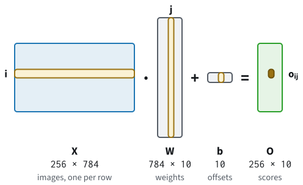
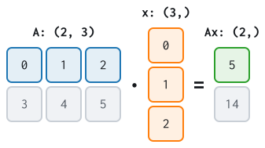
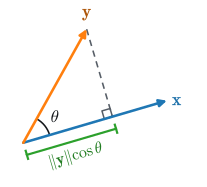
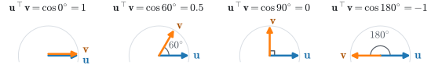
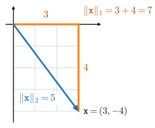
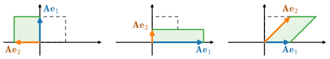
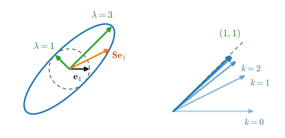

```{.python .input}
%load_ext d2lbook.tab
tab.interact_select('mxnet', 'pytorch', 'tensorflow', 'jax')
```

# Linear Algebra
:label:`sec_linear-algebra`

Suppose that we want to sort small grayscale images of clothing, like those
of the Fashion-MNIST dataset that later chapters use, into ten categories
such as shirts, sneakers, and bags. Each image has $28 \times 28 = 784$
pixels. A simple classifier gives every category a score, a weighted sum of
the 784 pixel intensities plus an offset, and predicts the category with the
highest score. Training processes the images in minibatches of, say, 256 at
a time, so scoring one minibatch takes $256 \times 10 \times 784 \approx 2$
million multiply--adds, about $4 \times 10^6$ floating-point operations, and
training repeats this for thousands of minibatches. As in
:numref:`sec_ndarray`, such work runs as one call to compiled code rather
than as Python loops over the numbers. Before we run it, however, we want to
know what shape the result has and how much work it takes.

Linear algebra writes the computation as one expression that answers both
questions. Stack the images as the rows of a matrix $\mathbf{X}$, the
weights of each category as the columns of a matrix $\mathbf{W}$, and the
ten offsets (also called biases) in a vector $\mathbf{b}$. Together,
$\mathbf{W}$ and $\mathbf{b}$ hold the $784 \times 10 + 10 = 7{,}850$
parameters of the classifier. The $256 \times 10 = 2{,}560$ scores of the
minibatch are then

$$\mathbf{O} = \mathbf{X}\mathbf{W} + \mathbf{b},$$

where $\mathbf{b}$ is added to every row (:numref:`fig_la_matmul`). The
shapes of $\mathbf{X}$ and $\mathbf{W}$ fix the shape of $\mathbf{O}$ and
the number of operations before we compute anything, and a library
evaluates the expression with a single call to a routine tuned for the
hardware.


:label:`fig_la_matmul`

This section builds that expression piece by piece and then asks two
questions that every model raises: how large is a vector, such as a list of
prediction errors, and what happens to a vector when a deep network
multiplies it by one matrix after another. :numref:`sec_ndarray` introduced
tensors as arrays in code; here they acquire their mathematical meaning.
The book's notation is collected in :numref:`chap_notation`.

```{.python .input #linear-algebra}
%%tab mxnet
from mxnet import np as mnp, npx
npx.set_np()
```

```{.python .input #linear-algebra}
%%tab pytorch
import torch
```

```{.python .input #linear-algebra}
%%tab tensorflow
import tensorflow as tf
```

```{.python .input #linear-algebra}
%%tab jax
import jax
from jax import numpy as jnp
```

## Scalars, Vectors, Matrices, and Tensors

The objects of linear algebra differ in how many indices it takes to pick
out one of their numbers: none for a scalar, one for a vector, two for a
matrix, and more for a general tensor. In code, this count is the number of
axes of the tensor that stores the object.

### Scalars

A single number is a scalar: one pixel intensity, the offset of one
category, or the price of one home. We denote scalars by lowercase letters
such as $x$ and $y$, and the set of real numbers by $\mathbb{R}$; the
expression $x \in \mathbb{R}$, read "$x$ in $\mathbb{R}$", states that $x$
is a real number. In code, a scalar is a tensor with one element and no
axes, so its shape is the empty tuple:

```{.python .input #linear-algebra-scalars}
%%tab mxnet
x = mnp.array(3.0)
x, x.shape
```

```{.python .input #linear-algebra-scalars}
%%tab pytorch
x = torch.tensor(3.0)
x, x.shape
```

```{.python .input #linear-algebra-scalars}
%%tab tensorflow
x = tf.constant(3.0)
x, x.shape
```

```{.python .input #linear-algebra-scalars}
%%tab jax
x = jnp.array(3.0)
x, x.shape
```

### Vectors

A fixed-length list of scalars is a *vector*, and the scalars are its
elements (also called entries or components). Flattening one image into
its 784 pixel intensities gives a vector, and so do the 784 weights that
one category assigns to the pixels. We denote vectors by bold lowercase
letters such as $\mathbf{x}$ and $\mathbf{w}$, and write
$\mathbf{x} \in \mathbb{R}^n$ for a vector of $n$ real elements. By
default we write a vector as a column,

$$\mathbf{x} =\begin{bmatrix}x_{1} \\ \vdots \\ x_{n}\end{bmatrix},$$
:eqlabel:`eq_vec_def`

where the scalar $x_i$ is its $i^\textrm{th}$ element. In running text we
write the same column vector as $\mathbf{x} = (x_1, \ldots, x_n)$. In code,
a vector is a tensor with one axis:

```{.python .input #linear-algebra-vectors-1}
%%tab mxnet
x = mnp.arange(3)
x
```

```{.python .input #linear-algebra-vectors-1}
%%tab pytorch
x = torch.arange(3, dtype=torch.float32)
x
```

```{.python .input #linear-algebra-vectors-1}
%%tab tensorflow
x = tf.range(3, dtype=tf.float32)
x
```

```{.python .input #linear-algebra-vectors-1}
%%tab jax
x = jnp.arange(3, dtype=jnp.float32)
x
```

Mathematics numbers the elements from $1$, whereas Python numbers them
from $0$. The third element $x_3$ is therefore `x[2]`:

```{.python .input #linear-algebra-vectors-2}
x[2]
```

The number of elements $n$ is the *dimensionality* of the vector. In code
it is the length of the tensor, and the only entry of its `shape`:

```{.python .input #linear-algebra-vectors-4}
len(x), x.shape
```

The word "dimension" is used both for the number of axes of a tensor, which
:numref:`sec_ndarray` called its order, and for the length along one axis.
We keep "dimensionality" for the number of elements, so a vector in
$\mathbb{R}^{784}$ has order 1 and dimensionality 784. (Libraries call the
order `ndim`, and some call it the rank, which is unrelated to the rank of a
matrix.)

### Matrices

A table of scalars with $m$ rows and $n$ columns is a *matrix*, written
$\mathbf{A} \in \mathbb{R}^{m \times n}$. A minibatch of 256 flattened
images is a matrix $\mathbf{X} \in \mathbb{R}^{256 \times 784}$ with one
example per row and one feature, the intensity of one pixel position, per
column; the book uses this layout throughout. We denote matrices by bold
capital letters and write $a_{ij}$ for the element in row $i$ and
column $j$:

$$\mathbf{A}=\begin{bmatrix} a_{11} & a_{12} & \cdots & a_{1n} \\ a_{21} & a_{22} & \cdots & a_{2n} \\ \vdots & \vdots & \ddots & \vdots \\ a_{m1} & a_{m2} & \cdots & a_{mn} \\ \end{bmatrix}.$$
:eqlabel:`eq_matrix_def`

A matrix with as many rows as columns is *square*. In code, a matrix is a
tensor with two axes, and `reshape` arranges a vector's elements into one.
The $2 \times 3$ matrix $\mathbf{A}$ below serves as a small example for
the rest of the section:

```{.python .input #linear-algebra-matrices-1}
%%tab mxnet
A = mnp.arange(6).reshape(2, 3)
A
```

```{.python .input #linear-algebra-matrices-1}
%%tab pytorch
A = torch.arange(6, dtype=torch.float32).reshape(2, 3)
A
```

```{.python .input #linear-algebra-matrices-1}
%%tab tensorflow
A = tf.reshape(tf.range(6, dtype=tf.float32), (2, 3))
A
```

```{.python .input #linear-algebra-matrices-1}
%%tab jax
A = jnp.arange(6, dtype=jnp.float32).reshape(2, 3)
A
```

Exchanging the rows and columns of a matrix gives its *transpose*. If
$\mathbf{B} = \mathbf{A}^\top$, then $b_{ij} = a_{ji}$ for all $i$ and
$j$, so the transpose of an $m \times n$ matrix is an $n \times m$ matrix:

$$
\mathbf{A}^\top =
\begin{bmatrix}
    a_{11} & a_{21} & \dots  & a_{m1} \\
    a_{12} & a_{22} & \dots  & a_{m2} \\
    \vdots & \vdots & \ddots  & \vdots \\
    a_{1n} & a_{2n} & \dots  & a_{mn}
\end{bmatrix}.
$$

The classifier stores the weights of one category per column of
$\mathbf{W}$; its transpose $\mathbf{W}^\top$ holds the same weights with
one category per row.

```{.python .input #linear-algebra-matrices-2}
%%tab mxnet, pytorch, jax
A.T
```

```{.python .input #linear-algebra-matrices-2}
%%tab tensorflow
tf.transpose(A)
```

A square matrix that equals its transpose is *symmetric*. Symmetric
matrices record symmetric relations, such as the similarity between every
pair of examples. Their eigenvalues, which we meet at the end of this
section, are particularly well behaved. The following matrix $\mathbf{S}$
is symmetric:

```{.python .input #linear-algebra-matrices-3}
%%tab mxnet
S = mnp.array([[2.0, 1.0], [1.0, 2.0]])
(S == S.T).all()
```

```{.python .input #linear-algebra-matrices-3}
%%tab pytorch
S = torch.tensor([[2.0, 1.0], [1.0, 2.0]])
(S == S.T).all()
```

```{.python .input #linear-algebra-matrices-3}
%%tab tensorflow
S = tf.constant([[2.0, 1.0], [1.0, 2.0]])
tf.reduce_all(S == tf.transpose(S))
```

```{.python .input #linear-algebra-matrices-3}
%%tab jax
S = jnp.array([[2.0, 1.0], [1.0, 2.0]])
(S == S.T).all()
```

### Tensors

Images do not arrive as rows. A minibatch of 256 grayscale images is a tensor
of shape $(256, 1, 28, 28)$ and order 4; scalars, vectors, and matrices are the
tensors of order 0, 1, and 2. (Color images have three channels, and some
frameworks put the channel axis last.) We denote general tensors by capital
letters in a special font, such as $\mathsf{X}$, and index them like matrices,
as in $x_{ijk}$. To feed the classifier, we flatten each image into a row of
784 pixels. Random numbers between 0 and 1 stand in for real images whose
pixels have already been rescaled to $[0, 1]$, as in :numref:`sec_ndarray`;
only the shapes matter here:

```{.python .input #linear-algebra-tensors}
%%tab mxnet
images = mnp.random.uniform(size=(256, 1, 28, 28))
X = images.reshape(256, -1)  # One row of 784 pixels per image
images.shape, X.shape
```

```{.python .input #linear-algebra-tensors}
%%tab pytorch
images = torch.rand(256, 1, 28, 28)
X = images.reshape(256, -1)  # One row of 784 pixels per image
images.shape, X.shape
```

```{.python .input #linear-algebra-tensors}
%%tab tensorflow
images = tf.random.uniform((256, 1, 28, 28))
X = tf.reshape(images, (256, -1))  # One row of 784 pixels per image
images.shape, X.shape
```

```{.python .input #linear-algebra-tensors}
%%tab jax
images = jax.random.uniform(jax.random.key(0), (256, 1, 28, 28))
X = images.reshape(256, -1)  # One row of 784 pixels per image
images.shape, X.shape
```

We build the classifier on this minibatch `X` in the rest of the section.

## Elementwise Operations and Reductions

The classifier adds the offsets $\mathbf{b}$ to every row of
$\mathbf{X}\mathbf{W}$, and training averages a measure of error over all the
examples in a minibatch. The first is an elementwise operation; the second is
a *reduction*, which summarizes many numbers by one.

### Elementwise Operations

Elementwise operations and broadcasting work as described in
:numref:`sec_ndarray`: a scalar operation is applied to each element, or to
each pair of elements at the same position, and the result has the shape
of the operands. Adding $\mathbf{b} \in \mathbb{R}^{10}$ to a
$256 \times 10$ matrix of scores adds the same ten offsets to each row.
The elementwise product of two matrices of the same shape is called their
*Hadamard product* and written $\odot$:
$[\mathbf{A} \odot \mathbf{B}]_{ij} = a_{ij} b_{ij}$. It is not the matrix
product that appears in $\mathbf{X}\mathbf{W}$, which we define below. In
code, `*` computes the Hadamard product, so `A * A` squares every entry of
the $2 \times 3$ matrix $\mathbf{A}$, whereas the matrix product of
$\mathbf{A}$ with itself is not even defined:

```{.python .input #linear-algebra-basic-properties-of-tensor-arithmetic-1}
A * A
```

### Reductions
:label:`subsec_lin-alg-reduction`

A reduction summarizes many elements by one number. The sum of a vector,
$\sum_{i=1}^n x_i$, and the sum of all elements of a matrix, $\sum_{i=1}^m
\sum_{j=1}^n a_{ij}$, are reductions; so are the mean, the maximum, and the
average error over a minibatch. Often we reduce along one axis only. Summing a
matrix over its row index $i$ (axis 0) leaves one sum per column, $\sum_i
a_{ij}$, a vector of length $n$. Summing over its column index $j$ (axis 1)
leaves one sum per row, a vector of length $m$. Either way, the axis that we
reduce over disappears from the shape (:numref:`fig_la_reduce`).


:label:`fig_la_reduce`

The argument `axis` selects the axis to reduce; without it, the sum runs
over all elements:

```{.python .input #linear-algebra-reduction-2}
%%tab mxnet, pytorch, jax
A.sum(), A.sum(axis=0), A.sum(axis=1)
```

```{.python .input #linear-algebra-reduction-2}
%%tab tensorflow
tf.reduce_sum(A), tf.reduce_sum(A, axis=0), tf.reduce_sum(A, axis=1)
```

The mean divides a sum by the number of terms, so `A.mean(axis=0)` equals
`A.sum(axis=0) / 2`. The mean, the maximum, and the other reductions take
the same `axis` argument.

### Reduced Axes Kept for Broadcasting
:label:`subsec_lin-alg-non-reduction`

A reduction often feeds back into an elementwise operation with the tensor
it came from. Dividing each row of a nonnegative matrix by the row's sum
turns the row into proportions that add up to 1, which is the last step
when a classifier turns its scores into probabilities. The row sums of
$\mathbf{A}$ have shape $(2,)$, however, and broadcasting lines up shapes
from the right (:numref:`subsec_broadcasting`). It would pair the two row
sums with the three columns of $\mathbf{A}$, and fail. The argument
`keepdims=True` keeps the reduced axis with length 1. The row sums then
form a $2 \times 1$ column, which broadcasting stretches across the columns
(:numref:`fig_la_reduce`):

```{.python .input #linear-algebra-non-reduction-sum-1}
%%tab mxnet, pytorch, jax
sum_A = A.sum(axis=1, keepdims=True)
sum_A, sum_A.shape
```

```{.python .input #linear-algebra-non-reduction-sum-1}
%%tab tensorflow
sum_A = tf.reduce_sum(A, axis=1, keepdims=True)
sum_A, sum_A.shape
```

:begin_tab:`pytorch`
PyTorch's own names for the arguments `axis` and `keepdims` are `dim` and
`keepdim`. Its reductions accept both spellings, so the cells that this
section shares with MXNet and JAX use the NumPy names.
:end_tab:

Each row of the quotient now sums to 1:

```{.python .input #linear-algebra-non-reduction-sum-2}
A / sum_A
```

On the minibatch $\mathbf{X}$, subtracting from each image its mean
intensity needs one mean per row. :numref:`subsec_broadcasting` showed that
256 numbers of shape $(256,)$ do not broadcast against shape $(256, 784)$,
whereas shape $(256, 1)$ does, and `keepdims=True` produces that shape
directly. Subtracting the mean of each pixel position, one per column,
needs no `keepdims`, because the 784 column means have shape $(784,)$ and
line up with the last axis:

```{.python .input #linear-algebra-keeping-reduced-axes-1}
%%tab mxnet, pytorch, jax
col_means = X.mean(axis=0)
row_means = X.mean(axis=1, keepdims=True)
col_means.shape, row_means.shape, (X - row_means).shape
```

```{.python .input #linear-algebra-keeping-reduced-axes-1}
%%tab tensorflow
col_means = tf.reduce_mean(X, axis=0)
row_means = tf.reduce_mean(X, axis=1, keepdims=True)
col_means.shape, row_means.shape, (X - row_means).shape
```

For a square matrix, forgetting `keepdims` raises no error and subtracts
the wrong numbers, as Exercise :exref:`ex_linear-algebra-shape-prediction`
shows.

## Products

Elementwise operations combine numbers at the same position, and
reductions summarize them. A score needs both: multiply each pixel by its
weight, then add up the products. This combination is the dot product, and
all products of vectors and matrices are built from it.

### Dot Products

For one image $\mathbf{x} \in \mathbb{R}^{784}$ and the weights
$\mathbf{w} \in \mathbb{R}^{784}$ of one category, the score is
$\sum_{i=1}^{784} w_i x_i + b$. The sum is the *dot product* of the two
vectors. For $\mathbf{x}, \mathbf{y} \in \mathbb{R}^d$ it is

$$\mathbf{x}^\top \mathbf{y} = \sum_{i=1}^{d} x_i y_i.$$

It multiplies the elements at the same position and adds the products.
The dot product is also called the *inner product* and written
$\langle \mathbf{x}, \mathbf{y} \rangle$. It is symmetric,
$\mathbf{x}^\top \mathbf{y} = \mathbf{y}^\top \mathbf{x}$, and linear in
each argument:
$(\alpha\mathbf{x} + \beta\mathbf{z})^\top \mathbf{y} = \alpha\,
\mathbf{x}^\top \mathbf{y} + \beta\, \mathbf{z}^\top \mathbf{y}$ for
scalars $\alpha$ and $\beta$. When $\mathbf{y}$ is the vector of all ones,
the dot product is the sum of the elements of $\mathbf{x}$; for the vector
$\mathbf{x} = (0, 1, 2)$ from above, it is 3:

```{.python .input #linear-algebra-dot-products-1}
%%tab mxnet
y = mnp.ones(3)
x, y, mnp.dot(x, y)
```

```{.python .input #linear-algebra-dot-products-1}
%%tab pytorch
y = torch.ones(3)
x, y, torch.dot(x, y)
```

```{.python .input #linear-algebra-dot-products-1}
%%tab tensorflow
y = tf.ones(3)
x, y, tf.tensordot(x, y, axes=1)
```

```{.python .input #linear-algebra-dot-products-1}
%%tab jax
y = jnp.ones(3)
x, y, jnp.dot(x, y)
```

Equivalently, a dot product is a Hadamard product followed by a sum:

```{.python .input #linear-algebra-dot-products-2}
%%tab mxnet
mnp.sum(x * y)
```

```{.python .input #linear-algebra-dot-products-2}
%%tab pytorch
torch.sum(x * y)
```

```{.python .input #linear-algebra-dot-products-2}
%%tab tensorflow
tf.reduce_sum(x * y)
```

```{.python .input #linear-algebra-dot-products-2}
%%tab jax
jnp.sum(x * y)
```

If the weights are nonnegative and sum to 1, the dot product
$\mathbf{w}^\top \mathbf{x}$ is a *weighted average* of the elements of
$\mathbf{x}$.

### Matrix--Vector Products

Now score one category for all 256 images of the minibatch. Each score is the
dot product of one row of $\mathbf{X}$ with the same weight vector
$\mathbf{w}$, and the 256 scores together form a *matrix--vector product*.
In general, write a matrix $\mathbf{A} \in \mathbb{R}^{m \times n}$ in
terms of its rows $\mathbf{a}_1^\top, \ldots, \mathbf{a}_m^\top$, each a
row vector of length $n$. Its product with a vector
$\mathbf{x} \in \mathbb{R}^n$ is the vector of the $m$ dot products,

$$
\mathbf{A}\mathbf{x}
= \begin{bmatrix}
\mathbf{a}^\top_{1} \\
\mathbf{a}^\top_{2} \\
\vdots \\
\mathbf{a}^\top_m \\
\end{bmatrix}\mathbf{x}
= \begin{bmatrix}
 \mathbf{a}^\top_{1} \mathbf{x}  \\
 \mathbf{a}^\top_{2} \mathbf{x} \\
\vdots\\
 \mathbf{a}^\top_{m} \mathbf{x}\\
\end{bmatrix} \in \mathbb{R}^m.
$$

The product exists only if the number of columns of $\mathbf{A}$ equals
the length of $\mathbf{x}$, and it has one element per row of $\mathbf{A}$
(:numref:`fig_la_matvec`). For the minibatch, the scores
$\mathbf{X}\mathbf{w} + b$ of one category form a vector in
$\mathbb{R}^{256}$, one score per image. The same product, fitted to one
real-valued label per example such as a price, is *linear regression*,
the subject of the next chapter.


:label:`fig_la_matvec`

:begin_tab:`mxnet, pytorch, jax`
In code, the operator `@` computes the matrix--vector product. For the
matrix $\mathbf{A}$, with rows $(0, 1, 2)$ and $(3, 4, 5)$, and the vector
$\mathbf{x} = (0, 1, 2)$ from above:
:end_tab:

:begin_tab:`tensorflow`
In TensorFlow, `@` requires two matrices, so the matrix--vector product
has its own function, `tf.linalg.matvec`. For the matrix $\mathbf{A}$,
with rows $(0, 1, 2)$ and $(3, 4, 5)$, and the vector
$\mathbf{x} = (0, 1, 2)$ from above:
:end_tab:

```{.python .input #linear-algebra-matrix-vector-products}
%%tab mxnet, pytorch, jax
A.shape, x.shape, A @ x
```

```{.python .input #linear-algebra-matrix-vector-products}
%%tab tensorflow
A.shape, x.shape, tf.linalg.matvec(A, x)
```

Multiplication by $\mathbf{A} \in \mathbb{R}^{m \times n}$ maps vectors
in $\mathbb{R}^n$ to vectors in $\mathbb{R}^m$, and the map is *linear*:
$\mathbf{A}(\alpha\mathbf{x} + \beta\mathbf{y}) = \alpha\mathbf{A}\mathbf{x}
+ \beta\mathbf{A}\mathbf{y}$. Linearity means that the map is determined
by what it does to the *coordinate vectors* $\mathbf{e}_j$, which have a
1 in position $j$ and 0 elsewhere. The product $\mathbf{A}\mathbf{e}_j$ is
column $j$ of $\mathbf{A}$, and any $\mathbf{x} = \sum_j x_j \mathbf{e}_j$
is mapped to $\sum_j x_j \mathbf{A}\mathbf{e}_j$. In the plane we can draw
the whole map: a $2 \times 2$ matrix turns the unit square, spanned by
$\mathbf{e}_1$ and $\mathbf{e}_2$, into the parallelogram spanned by its
two columns (:numref:`fig_la_maps`). The rotation by $90^\circ$, for
instance, sends $\mathbf{e}_1$ to $\mathbf{e}_2$ and $\mathbf{e}_2$ to
$-\mathbf{e}_1$, so its columns are $(0, 1)$ and $(-1, 0)$. A layer of a
neural network applies such a map, adds an offset, and then applies a
nonlinear function to every element.


:label:`fig_la_maps`

### Matrix--Matrix Products

Scoring all ten categories takes one matrix--vector product per category,
that is, per column of $\mathbf{W}$. Placing the ten results side by side
gives the *matrix--matrix product* $\mathbf{X}\mathbf{W}$, usually called
simply the matrix product. In general, the product of
$\mathbf{A} \in \mathbb{R}^{m \times k}$ and
$\mathbf{B} \in \mathbb{R}^{k \times n}$ is the matrix
$\mathbf{C} = \mathbf{A}\mathbf{B} \in \mathbb{R}^{m \times n}$ whose
entry $c_{ij}$ is the dot product of row $i$ of $\mathbf{A}$ with column
$j$ of $\mathbf{B}$:

$$c_{ij} = \sum_{l=1}^{k} a_{il}\, b_{lj}.$$
:eqlabel:`eq_matmul`

Column $j$ of $\mathbf{C}$ is the matrix--vector product of $\mathbf{A}$
with column $j$ of $\mathbf{B}$. The inner sizes must agree, and the order
of the factors matters: $\mathbf{B}\mathbf{A}$ need not even exist. For
the classifier, $(256 \times 784)(784 \times 10)$ gives $256 \times 10$,
and score $o_{ij}$ is the dot product of image $i$ with the weights of
category $j$ (:numref:`fig_la_matmul`). Each column of $\mathbf{W}$ acts
as a template of 784 pixel weights, and the classifier scores how well
each image matches each template.

A small example first. Every column of $\mathbf{B}$ below is the all-ones
vector, so every column of $\mathbf{A}\mathbf{B}$ holds the row sums of
$\mathbf{A}$, 3 and 12:

```{.python .input #linear-algebra-matrix-matrix-multiplication}
%%tab mxnet
B = mnp.ones((3, 4))
A @ B
```

```{.python .input #linear-algebra-matrix-matrix-multiplication}
%%tab pytorch
B = torch.ones(3, 4)
A @ B
```

```{.python .input #linear-algebra-matrix-matrix-multiplication}
%%tab tensorflow
B = tf.ones((3, 4))
A @ B
```

```{.python .input #linear-algebra-matrix-matrix-multiplication}
%%tab jax
B = jnp.ones((3, 4))
A @ B
```

Now the classifier itself, with small random weights in place of trained
ones. Its prediction for an image is the category with the largest score,
the position of the maximum along axis 1, which `argmax` computes:

```{.python .input #linear-algebra-matrix-matrix-products-1}
%%tab mxnet
W = 0.01 * mnp.random.normal(size=(784, 10))  # Column j: category j
b = mnp.zeros(10)                             # Entry j: category j
O = X @ W + b                                 # Row i: image i
O.shape, O.argmax(axis=1).shape
```

```{.python .input #linear-algebra-matrix-matrix-products-1}
%%tab pytorch
W = 0.01 * torch.randn(784, 10)  # Column j: category j
b = torch.zeros(10)              # Entry j: category j
O = X @ W + b                    # Row i: image i
O.shape, O.argmax(dim=1).shape
```

```{.python .input #linear-algebra-matrix-matrix-products-1}
%%tab tensorflow
W = 0.01 * tf.random.normal((784, 10))  # Column j: category j
b = tf.zeros(10)                        # Entry j: category j
O = X @ W + b                           # Row i: image i
O.shape, tf.argmax(O, axis=1).shape
```

```{.python .input #linear-algebra-matrix-matrix-products-1}
%%tab jax
key = jax.random.key(1)
W = 0.01 * jax.random.normal(key, (784, 10))  # Column j: category j
b = jnp.zeros(10)                             # Entry j: category j
O = X @ W + b                                 # Row i: image i
O.shape, O.argmax(axis=1).shape
```

What did this cost? Each of the $mn$ entries of $\mathbf{A}\mathbf{B}$ is a
dot product of length $k$, which takes $k$ multiplications and $k - 1$
additions, so the product takes about $2mkn$ floating-point operations
(FLOPs). For the minibatch, that is
$2 \times 256 \times 784 \times 10 \approx 4 \times 10^6$ FLOPs. The
product must also read $\mathbf{X}$, $256 \times 784 = 200{,}704$ numbers
or about 0.8 MB at 4 bytes each, so it performs only about 5 FLOPs per
byte that it moves. For square matrices of size $n$, the work $2n^3$ grows
faster than the $3n^2$ numbers to move: a product of two
$4096 \times 4096$ matrices takes about $1.4 \times 10^{11}$ FLOPs, about
680 per byte. Hardware for deep learning is built for such large products,
which perform hundreds of operations per byte moved. Small products such as
$\mathbf{X}\mathbf{W}$ are limited by moving data rather than by
arithmetic, and a Hadamard product, with one multiplication for every two
numbers it reads, even more so.

## Norms
:label:`subsec_lin-algebra-norms`

Once the classifier makes predictions, training must measure how wrong
they are, and often also how large the weights have become. Both are
questions about the size of a vector: of the errors
$\hat{\mathbf{y}} - \mathbf{y} \in \mathbb{R}^{256}$ of the predictions
$\hat{\mathbf{y}}$ against the labels $\mathbf{y}$ of a minibatch, or of
the weights $\mathbf{w}$. A *norm* answers such a question with one
nonnegative number. Training minimizes a *loss*, a single number that
measures how wrong the predictions are, and a norm of the errors, or its
square, is a common choice. Norms differ in how they measure size, and when
a norm serves as a loss or as a penalty on the weights, the choice changes
what the model learns.

### Length and Angle

The *$\ell_2$ norm* of a vector is its Euclidean length. It follows from
the theorem of Pythagoras, applied one coordinate at a time, and equals the
square root of the dot product of the vector with itself:

$$\|\mathbf{x}\|_2 = \sqrt{\mathbf{x}^\top \mathbf{x}} = \sqrt{\sum_{i=1}^n x_i^2}.$$

It is the default norm, so we often write $\|\mathbf{x}\|$ without the
subscript. Its square, applied to the errors, is the sum of squared
errors; divided by the number of examples, it becomes the mean squared
error, the standard loss for predicting real numbers. For
$\mathbf{x} = (3, -4)$ the $\ell_2$ norm is $\sqrt{9 + 16} = 5$:

```{.python .input #linear-algebra-norms-1}
%%tab mxnet
x = mnp.array([3.0, -4.0])
mnp.linalg.norm(x)
```

```{.python .input #linear-algebra-norms-1}
%%tab pytorch
x = torch.tensor([3.0, -4.0])
torch.linalg.vector_norm(x)
```

```{.python .input #linear-algebra-norms-1}
%%tab tensorflow
x = tf.constant([3.0, -4.0])
tf.norm(x)
```

```{.python .input #linear-algebra-norms-1}
%%tab jax
x = jnp.array([3.0, -4.0])
jnp.linalg.norm(x)
```

Length also explains why the dot product serves to compare vectors. Take
two vectors $\mathbf{x}$ and $\mathbf{y}$ in the plane, at angle $\theta$,
and the triangle with sides $\mathbf{x}$, $\mathbf{y}$, and
$\mathbf{x} - \mathbf{y}$. The law of cosines states that
$\|\mathbf{x} - \mathbf{y}\|^2 = \|\mathbf{x}\|^2 + \|\mathbf{y}\|^2 -
2\|\mathbf{x}\|\|\mathbf{y}\|\cos\theta$. Writing the left side as a dot
product and expanding it gives
$(\mathbf{x} - \mathbf{y})^\top(\mathbf{x} - \mathbf{y}) =
\|\mathbf{x}\|^2 - 2\mathbf{x}^\top\mathbf{y} + \|\mathbf{y}\|^2$ instead.
Comparing the two expressions,

$$\mathbf{x}^\top \mathbf{y} = \|\mathbf{x}\| \|\mathbf{y}\| \cos\theta.$$
:eqlabel:`eq_dot_cos`

The dot product is thus the length of $\mathbf{x}$ times the signed length
$\|\mathbf{y}\|\cos\theta$ of the shadow that $\mathbf{y}$ casts on the
line through $\mathbf{x}$ (:numref:`fig_la_dot`). It is positive when the
angle between the vectors is less than $90^\circ$, zero when they are
perpendicular, and negative when the angle exceeds $90^\circ$.


:label:`fig_la_dot`

In 784 dimensions we cannot draw the angle between two images, so we read
:eqref:`eq_dot_cos` backward and use it to define the angle:

$$\cos\theta = \frac{\mathbf{x}^\top \mathbf{y}}{\|\mathbf{x}\| \|\mathbf{y}\|}.$$
:eqlabel:`eq_cos_sim`

This ratio is called the *cosine similarity*. It compares the directions of
two vectors and ignores their lengths: an image and a copy of it at twice
the brightness, $2\mathbf{x}$, have cosine similarity 1. Two vectors of
length 1 at angle $\theta$ have dot product $\cos\theta$, which ranges from
$1$ for vectors that point the same way to $-1$ for opposite ones
(:numref:`fig_la_cosine`).


:label:`fig_la_cosine`

The definition :eqref:`eq_cos_sim` makes sense only if the ratio lies
between $-1$ and $1$, as a cosine must. It does, in any number of
dimensions.

**Proposition (Cauchy--Schwarz inequality).** For all
$\mathbf{x}, \mathbf{y} \in \mathbb{R}^d$,
$|\mathbf{x}^\top \mathbf{y}| \leq \|\mathbf{x}\| \|\mathbf{y}\|$.

**Proof.** If $\mathbf{x}$ or $\mathbf{y}$ is zero, both sides vanish.
Otherwise, let $\mathbf{u} = \mathbf{x}/\|\mathbf{x}\|$ and
$\mathbf{v} = \mathbf{y}/\|\mathbf{y}\|$, two vectors of length 1. A
squared length cannot be negative, so

$$0 \leq \|\mathbf{u} - \mathbf{v}\|^2 = \|\mathbf{u}\|^2 - 2\mathbf{u}^\top\mathbf{v} + \|\mathbf{v}\|^2 = 2 - 2\mathbf{u}^\top\mathbf{v},$$

which gives $\mathbf{u}^\top\mathbf{v} \leq 1$. The same argument applied to
$\|\mathbf{u} + \mathbf{v}\|^2$ gives $\mathbf{u}^\top\mathbf{v} \geq -1$.
Multiplying both bounds by $\|\mathbf{x}\|\|\mathbf{y}\|$ proves the
claim. $\blacksquare$

Equality holds only if $\mathbf{u} = \pm\mathbf{v}$, that is, if one
vector is a multiple of the other. In code, the cosine similarity takes
one line. The two vectors below have length 2 and dot product 2, so their
cosine similarity is $1/2$ and their angle is $\pi/3$, or $60^\circ$.
Doubling one of them changes nothing:

```{.python .input #linear-algebra-dot-products-3}
%%tab mxnet
def cosine(x, y):
    return mnp.dot(x, y) / (mnp.linalg.norm(x) * mnp.linalg.norm(y))

x, y = mnp.array([1.0, 1, 1, 1]), mnp.array([1.0, 1, 1, -1])
cosine(x, y), cosine(2 * x, y), mnp.arccos(cosine(x, y))
```

```{.python .input #linear-algebra-dot-products-3}
%%tab pytorch
def cosine(x, y):
    return torch.dot(x, y) / (torch.linalg.vector_norm(x) *
                              torch.linalg.vector_norm(y))

x, y = torch.tensor([1.0, 1, 1, 1]), torch.tensor([1.0, 1, 1, -1])
cosine(x, y), cosine(2 * x, y), torch.acos(cosine(x, y))
```

```{.python .input #linear-algebra-dot-products-3}
%%tab tensorflow
def cosine(x, y):
    return tf.tensordot(x, y, axes=1) / (tf.norm(x) * tf.norm(y))

x, y = tf.constant([1.0, 1, 1, 1]), tf.constant([1.0, 1, 1, -1])
cosine(x, y), cosine(2 * x, y), tf.acos(cosine(x, y))
```

```{.python .input #linear-algebra-dot-products-3}
%%tab jax
def cosine(x, y):
    return jnp.dot(x, y) / (jnp.linalg.norm(x) * jnp.linalg.norm(y))

x, y = jnp.array([1.0, 1, 1, 1]), jnp.array([1.0, 1, 1, -1])
cosine(x, y), cosine(2 * x, y), jnp.arccos(cosine(x, y))
```

### Other Vector Norms

The *$\ell_1$ norm* sums the absolute values of the elements,

$$\|\mathbf{x}\|_1 = \sum_{i=1}^n |x_i|.$$

For $\mathbf{x} = (3, -4)$ it is $3 + 4 = 7$. If the coordinates count city
blocks, the $\ell_2$ norm is the distance in a straight line and the
$\ell_1$ norm the distance walked along the streets, hence the name
*Manhattan distance* (:numref:`fig_la_norms`).


:label:`fig_la_norms`

```{.python .input #linear-algebra-norms-2}
%%tab mxnet
x = mnp.array([3.0, -4.0])
mnp.abs(x).sum()
```

```{.python .input #linear-algebra-norms-2}
%%tab pytorch
x = torch.tensor([3.0, -4.0])
torch.abs(x).sum()
```

```{.python .input #linear-algebra-norms-2}
%%tab tensorflow
x = tf.constant([3.0, -4.0])
tf.reduce_sum(tf.abs(x))
```

```{.python .input #linear-algebra-norms-2}
%%tab jax
x = jnp.array([3.0, -4.0])
jnp.abs(x).sum()
```

The two norms weigh large entries differently. In the error vector
$(1, -1, 1, -1, 10)$, the one large error contributes $100/104 \approx
96\%$ of the squared $\ell_2$ norm but only $10/14 \approx 71\%$ of the
$\ell_1$ norm. A loss built from squared errors is therefore dominated by
a few outliers, while a loss built from absolute errors limits their
influence. As penalties on the weights, the squared $\ell_2$ norm shrinks
all weights toward zero, while the $\ell_1$ norm tends to set many of them
to zero.

Both are special cases of the *$\ell_p$ norm*, defined for $p \geq 1$ by

$$\|\mathbf{x}\|_p = \left(\sum_{i=1}^n |x_i|^p \right)^{1/p}.$$

As $p$ grows, the largest element dominates the sum, and in the limit
$\|\mathbf{x}\|_\infty = \max_i |x_i|$.

In general, a norm is any function $\|\cdot\|$ from vectors to scalars
with three properties:

1. *Scaling*: $\|\alpha \mathbf{x}\| = |\alpha| \|\mathbf{x}\|$ for every
   scalar $\alpha$. Doubling a vector doubles its size.
2. *Triangle inequality*:
   $\|\mathbf{x} + \mathbf{y}\| \leq \|\mathbf{x}\| + \|\mathbf{y}\|$.
   A detour is never shorter than the direct path.
3. *Positivity*: $\|\mathbf{x}\| > 0$ for every $\mathbf{x} \neq
   \mathbf{0}$. Only the zero vector has size zero.

For the $\ell_2$ norm, the triangle inequality follows from the
Cauchy--Schwarz inequality, which bounds the middle term in

$$\|\mathbf{x} + \mathbf{y}\|^2 = \|\mathbf{x}\|^2 + 2\mathbf{x}^\top\mathbf{y} + \|\mathbf{y}\|^2 \leq \|\mathbf{x}\|^2 + 2\|\mathbf{x}\|\|\mathbf{y}\| + \|\mathbf{y}\|^2 = (\|\mathbf{x}\| + \|\mathbf{y}\|)^2.$$

The condition $p \geq 1$ is needed. For $p = 1/2$, the vectors $(1, 0)$
and $(0, 1)$ both have size 1, but their sum has size
$(1 + 1)^2 = 4 > 2$, which violates the triangle inequality.

### Matrix Norms

The weights of the classifier form a matrix, so we also need the size of a
matrix. The simplest answer treats the matrix as one long vector. The
*Frobenius norm* is the $\ell_2$ norm of all the entries,

$$\|\mathbf{A}\|_\textrm{F} = \sqrt{\sum_{i=1}^m \sum_{j=1}^n a_{ij}^2}.$$

For the $4 \times 9$ matrix of ones it is $\sqrt{36} = 6$:

```{.python .input #linear-algebra-norms-3}
%%tab mxnet
mnp.linalg.norm(mnp.ones((4, 9)))
```

```{.python .input #linear-algebra-norms-3}
%%tab pytorch
torch.linalg.matrix_norm(torch.ones(4, 9))
```

```{.python .input #linear-algebra-norms-3}
%%tab tensorflow
tf.norm(tf.ones((4, 9)))
```

```{.python .input #linear-algebra-norms-3}
%%tab jax
jnp.linalg.norm(jnp.ones((4, 9)))
```

*Weight decay*, a common way to keep the weights of a model small, adds a
multiple of $\|\mathbf{W}\|_\textrm{F}^2$ to the loss. A matrix is also a
map, which raises a second question: by how much can it stretch a vector?
The largest ratio $\|\mathbf{A}\mathbf{x}\| / \|\mathbf{x}\|$ over all
$\mathbf{x} \neq \mathbf{0}$ is the *spectral norm* of $\mathbf{A}$. It
bounds how much a layer can amplify its input; we return to it for
symmetric matrices at the end of this section, and
:numref:`sec_mdl-svd-low-rank` treats general ones. Norms appear throughout
the book: as losses, as penalties on weights, and as the size of a
gradient, which training cuts back when it grows too large.

## Eigenvectors and Eigenvalues
:label:`subsec_lin-alg-eigenvalues`

A deep network applies one layer after another. Ignore everything but the
matrices, and let every layer use the same matrix $\mathbf{A}$: after $k$
layers, an input $\mathbf{x}$ has become $\mathbf{A}^k\mathbf{x}$. How
large is the result? For a scalar $a$ the answer is $a^k$, and it is
extreme even for values of $a$ close to 1: $1.1^{50} \approx 117$, while
$0.9^{50} \approx 0.005$. A 10% deviation from 1 per layer changes the size
of a signal by a factor of more than 100, in either direction, after 50
layers. For a matrix, the answer depends on the direction of $\mathbf{x}$,
and in a few special directions it reduces to the scalar case.

### Eigenvectors

A nonzero vector $\mathbf{v}$ is an *eigenvector* of a square matrix
$\mathbf{A}$, with *eigenvalue* $\lambda$, if

$$\mathbf{A}\mathbf{v} = \lambda \mathbf{v}.$$

The matrix does not turn an eigenvector; it only stretches it by the
factor $\lambda$, and reverses it if $\lambda < 0$. Along $\mathbf{v}$,
multiplying by $\mathbf{A}$ is the same as multiplying by the number
$\lambda$, so $\mathbf{A}^k\mathbf{v} = \lambda^k\mathbf{v}$. In
:numref:`fig_la_maps`, the scaling has eigenvectors $\mathbf{e}_1$ and
$\mathbf{e}_2$ with eigenvalues 2 and $1/2$, and the shear keeps the
direction of $\mathbf{e}_1$, with eigenvalue 1. The rotation turns every
direction, so it has no real eigenvector at all.

As a worked example, take the symmetric matrix from above,

$$\mathbf{S} = \begin{bmatrix} 2 & 1 \\ 1 & 2 \end{bmatrix}.$$

Since $\mathbf{S}$ maps $(1, 1)$ to $(3, 3)$ and $(-1, 1)$ to $(-1, 1)$,
the directions $(1, 1)$ and $(-1, 1)$ are eigenvectors with eigenvalues 3
and 1.
:numref:`fig_la_eigen` (left) shows what this means: $\mathbf{S}$ maps the
unit circle to an ellipse whose axes lie along the two eigenvectors, with
half-lengths 3 and 1. Every other direction is turned toward the
eigenvector with the larger eigenvalue; $\mathbf{e}_1 = (1, 0)$, for
instance, is mapped to $(2, 1)$.


:label:`fig_la_eigen`

For symmetric matrices, libraries compute eigenvalues and eigenvectors
with `eigh`:

```{.python .input #linear-algebra-eigenvalues-1}
%%tab mxnet
S = mnp.array([[2.0, 1.0], [1.0, 2.0]])
eigenvalues, eigenvectors = mnp.linalg.eigh(S)
eigenvalues, eigenvectors
```

```{.python .input #linear-algebra-eigenvalues-1}
%%tab pytorch
S = torch.tensor([[2.0, 1.0], [1.0, 2.0]])
eigenvalues, eigenvectors = torch.linalg.eigh(S)
eigenvalues, eigenvectors
```

```{.python .input #linear-algebra-eigenvalues-1}
%%tab tensorflow
S = tf.constant([[2.0, 1.0], [1.0, 2.0]])
eigenvalues, eigenvectors = tf.linalg.eigh(S)
eigenvalues, eigenvectors
```

```{.python .input #linear-algebra-eigenvalues-1}
%%tab jax
S = jnp.array([[2.0, 1.0], [1.0, 2.0]])
eigenvalues, eigenvectors = jnp.linalg.eigh(S)
eigenvalues, eigenvectors
```

The eigenvalues come in increasing order, and the eigenvectors are the
columns of the second result, scaled to length 1; their signs are
arbitrary, since $-\mathbf{v}$ is an eigenvector whenever $\mathbf{v}$ is.
The two eigenvectors of $\mathbf{S}$ are perpendicular. This holds for
every symmetric matrix: its eigenvalues are real, and it has a full set of
perpendicular eigenvectors, one per dimension (for a proof, see
:numref:`sec_mdl-eigendecompositions`). A matrix that is not symmetric need
not have either property, as the rotation shows.

### Powers of a Matrix

For a symmetric $n \times n$ matrix $\mathbf{A}$, the perpendicular
eigenvectors $\mathbf{v}_1, \ldots, \mathbf{v}_n$ of length 1 let us take
any vector apart, as $\mathbf{x} = \sum_i c_i \mathbf{v}_i$ with
$c_i = \mathbf{v}_i^\top \mathbf{x}$. Applying $\mathbf{A}$ to
$\mathbf{x}$ $k$ times multiplies each part by its own eigenvalue $k$
times:

$$\mathbf{A}^k \mathbf{x} = \sum_{i=1}^n c_i \lambda_i^k \mathbf{v}_i.$$
:eqlabel:`eq_matrix_power`

The part with the largest $|\lambda_i|$ grows fastest, so it soon
dominates: $\mathbf{A}^k\mathbf{x}$ turns toward the corresponding
eigenvector, and its length grows by a factor of about
$\max_i |\lambda_i|$ per step. For $\mathbf{S}$ and $\mathbf{x} =
\mathbf{e}_1$, the iterates are $(2, 1)$, $(5, 4)$, $(14, 13)$, and in
general $\left((3^k + 1)/2,\ (3^k - 1)/2\right)$, whose direction
approaches $(1, 1)$ (:numref:`fig_la_eigen`, right). Ten multiplications
confirm both predictions:

```{.python .input #linear-algebra-eigenvalues-2}
%%tab mxnet
v = mnp.array([1.0, 0.0])
for _ in range(10):
    v_prev, v = v, S @ v
growth = mnp.linalg.norm(v) / mnp.linalg.norm(v_prev)
growth, v / mnp.linalg.norm(v)
```

```{.python .input #linear-algebra-eigenvalues-2}
%%tab pytorch
norm = torch.linalg.vector_norm
v = torch.tensor([1.0, 0.0])
for _ in range(10):
    v_prev, v = v, S @ v
growth = norm(v) / norm(v_prev)
growth, v / norm(v)
```

```{.python .input #linear-algebra-eigenvalues-2}
%%tab tensorflow
v = tf.constant([1.0, 0.0])
for _ in range(10):
    v_prev, v = v, tf.linalg.matvec(S, v)
growth = tf.norm(v) / tf.norm(v_prev)
growth, v / tf.norm(v)
```

```{.python .input #linear-algebra-eigenvalues-2}
%%tab jax
v = jnp.array([1.0, 0.0])
for _ in range(10):
    v_prev, v = v, S @ v
growth = jnp.linalg.norm(v) / jnp.linalg.norm(v_prev)
growth, v / jnp.linalg.norm(v)
```

The length grows by a factor of 3, the largest eigenvalue, per step, and
the direction agrees with the eigenvector
$(1, 1)/\sqrt{2} \approx (0.7071, 0.7071)$ to four decimals. Repeated
multiplication, with the vector rescaled to length 1 after each step so
that its entries stay in range, is called *power iteration*. It finds the
largest eigenvalue in absolute value and its eigenvector using nothing but
matrix--vector products, provided that this eigenvalue is strictly larger
in absolute value than all others and the starting vector has a nonzero
component along its eigenvector. The same decomposition gives the spectral
norm of a symmetric matrix: it equals the largest $|\lambda_i|$, because no
vector is stretched more than the eigenvector of that eigenvalue (see
:numref:`sec_mdl-eigendecompositions`).

Now return to the deep network. The matrix

$$\mathbf{M} = \begin{bmatrix} 1 & 0.1 \\ 0.1 & 1 \end{bmatrix}$$

has the same eigenvectors as $\mathbf{S}$, with eigenvalues $1.1$ and
$0.9$, both within 10% of 1. We apply it 50 times to both eigenvectors at
once, stored as the columns of a matrix, and then measure the length of
each column:

```{.python .input #linear-algebra-powers-of-a-matrix-1}
%%tab mxnet
M = mnp.array([[1.0, 0.1], [0.1, 1.0]])
# The eigenvectors (1, 1) and (-1, 1) of M, as columns of length 1
V = mnp.array([[1.0, -1.0], [1.0, 1.0]]) / 2 ** 0.5
for _ in range(50):  # 50 "layers"
    V = M @ V
mnp.linalg.norm(V, axis=0)
```

```{.python .input #linear-algebra-powers-of-a-matrix-1}
%%tab pytorch
M = torch.tensor([[1.0, 0.1], [0.1, 1.0]])
# The eigenvectors (1, 1) and (-1, 1) of M, as columns of length 1
V = torch.tensor([[1.0, -1.0], [1.0, 1.0]]) / 2 ** 0.5
for _ in range(50):  # 50 "layers"
    V = M @ V
torch.linalg.vector_norm(V, dim=0)
```

```{.python .input #linear-algebra-powers-of-a-matrix-1}
%%tab tensorflow
M = tf.constant([[1.0, 0.1], [0.1, 1.0]])
# The eigenvectors (1, 1) and (-1, 1) of M, as columns of length 1
V = tf.constant([[1.0, -1.0], [1.0, 1.0]]) / 2 ** 0.5
for _ in range(50):  # 50 "layers"
    V = M @ V
tf.norm(V, axis=0)
```

```{.python .input #linear-algebra-powers-of-a-matrix-1}
%%tab jax
M = jnp.array([[1.0, 0.1], [0.1, 1.0]])
# The eigenvectors (1, 1) and (-1, 1) of M, as columns of length 1
V = jnp.array([[1.0, -1.0], [1.0, 1.0]]) / 2 ** 0.5
for _ in range(50):  # 50 "layers"
    V = M @ V
jnp.linalg.norm(V, axis=0)
```

After 50 layers, the part of a signal along the first eigenvector has grown
by a factor of about 117, and the part along the second has shrunk to
about 0.005 of its size, as $1.1^{50}$ and $0.9^{50}$ predict. Real
networks use a different matrix in each layer, with nonlinear functions in
between, but the effect persists: unless the layers stretch vectors by
factors close to 1, signals, and during training gradients, grow or vanish
exponentially with depth. :numref:`sec_numerical_stability` shows how
careful initialization keeps these factors close to 1.

We can now write the computation of a linear model on a whole minibatch as one
matrix product, read off its shape and cost before running it, measure errors
and weights with norms, and predict how repeated multiplication scales a
vector. What we cannot do yet is improve the weights. That requires knowing how
the error changes when $\mathbf{W}$ changes, which is the subject of the next
section.

## Summary

Linear algebra writes the computation of a model on a whole minibatch as a few
operations on vectors and matrices: with one image per row of
$\mathbf{X}$, a linear classifier computes all its scores as
$\mathbf{O} = \mathbf{X}\mathbf{W} + \mathbf{b}$. Reductions summarize a
tensor along an axis, and `keepdims` keeps that axis so that the result
broadcasts back. A matrix product is a table of dot products: an
$m \times k$ matrix times a $k \times n$ matrix gives an $m \times n$
matrix at a cost of about $2mkn$ FLOPs. Norms measure the size of errors
and weights. The $\ell_2$ norm is the Euclidean length, and a dot product
divided by the two lengths is the cosine of the angle between the vectors.
Eigenvectors are the directions that a matrix only stretches, by a factor
$\lambda$ per multiplication, so repeated multiplication scales them by
powers of $\lambda$, which is why deep networks must keep the stretch of
their layers close to 1.

## Exercises

1. **Transposes and products.** Prove the following statements.
    1. $(\mathbf{A}\mathbf{B})^\top = \mathbf{B}^\top\mathbf{A}^\top$
       whenever the product is defined. Compare the entries of both sides
       using :eqref:`eq_matmul`.
    1. For every matrix $\mathbf{X}$, the matrix
       $\mathbf{X}\mathbf{X}^\top$ is symmetric. For the minibatch $\mathbf{X}$
       of this section, state its shape and what its entry in row $i$ and
       column $j$ measures.
1. [code] **Shape prediction.** Without running code, predict the result of
   each operation below, then check your answers. The tensor `images` has
   shape $(256, 1, 28, 28)$, and `X` has shape $(256, 784)$, as in this
   section.
    1. `len(images)`, and the shapes of the sums of `images` along axes 2
       and 3 together (`axis=(2, 3)`), without and with `keepdims=True`.
       Which of the two results can divide `images` by broadcasting, and
       what does the division compute?
    1. `X - X.mean(axis=1)`. What goes wrong, and how does `keepdims` fix
       it?
    1. The same expression for a square minibatch of 784 images, with `X` of
       shape $(784, 784)$. Show that it runs without error, and write
       the entry in row $i$ and column $j$ of the result in terms of the
       entries of `X`. Why is this outcome worse than an error?
   :exlabel:`ex_linear-algebra-shape-prediction`
1. **A pairwise-obtuse triple.** The following questions ask how
   negative the pairwise dot products of several vectors can be.
    1. Determine whether three vectors $\mathbf{u}$, $\mathbf{v}$,
       $\mathbf{w}$ in the plane can satisfy
       $\mathbf{u}^\top\mathbf{v} < 0$, $\mathbf{v}^\top\mathbf{w} < 0$,
       and $\mathbf{u}^\top\mathbf{w} < 0$ simultaneously. Give a
       concrete numeric example or a short argument that none exists.
    1. Suppose $k \geq 2$ unit vectors
       $\mathbf{u}_1, \ldots, \mathbf{u}_k$ have the same dot product $c$
       for every pair. Expand
       $\|\mathbf{u}_1 + \cdots + \mathbf{u}_k\|_2^2$ to show that
       $c \geq -1/(k-1)$. What does this bound say about the cosine
       similarity of ten class templates that are all equally far apart?

    *Adapted from MIT 18.06,
    [problem set 1](https://ocw.mit.edu/courses/18-06-linear-algebra-spring-2010/22297c2a6dcf06d82e93ee4af115e91a_MIT18_06S10_pset1_s10_soln.pdf),
    Section 1.2, Problem 28.*
1. **Manhattan distance.** In midtown Manhattan, avenues and streets
   form a rectangular grid, and a pedestrian can walk only along them.
   Adjacent avenues lie about 250 m apart and adjacent streets about
   80 m apart.
    1. Two intersections differ by $\Delta a$ avenues and $\Delta s$
       streets. Write the length of the shortest walk between them and
       the straight-line distance between them as two norms of one
       displacement vector measured in meters.
    1. Prove that, for every $\mathbf{x} \in \mathbb{R}^n$,

       $$\|\mathbf{x}\|_2 \leq \|\mathbf{x}\|_1 \leq \sqrt{n}\, \|\mathbf{x}\|_2,$$

       and identify the vectors for which each bound holds with equality.
    1. Find the largest factor by which the shortest walk can exceed the
       straight-line distance, and the ratio $\Delta s / \Delta a$ at
       which this factor is attained.
1. [code] **Norms of higher-order tensors.** The vector norm functions of
   this section also accept tensors with three or more axes (in PyTorch,
   use `torch.linalg.vector_norm`; `matrix_norm` treats a tensor with
   three axes as a stack of matrices).
    1. Call the vector norm with its default arguments on a tensor with
       three axes. State in words what it computes, and confirm your
       statement by computing the same number directly from the tensor's
       entries.
    1. A model stores its parameters in several tensors of different
       shapes. Flatten each tensor and concatenate the results into one
       vector. Express the $\ell_2$ norm of that vector in terms of the
       norms of the individual tensors, and confirm the formula
       numerically for tensors of shapes $(3, 4)$, $(4,)$, and
       $(2, 3, 5)$.
1. **Matrix-product order and cost.** Consider three large
   matrices $\mathbf{A} \in \mathbb{R}^{2^{10} \times 2^{16}}$,
   $\mathbf{B} \in \mathbb{R}^{2^{16} \times 2^{5}}$, and
   $\mathbf{C} \in \mathbb{R}^{2^{5} \times 2^{14}}$. You want the product
   $\mathbf{A} \mathbf{B} \mathbf{C}$. Determine whether memory footprint
   and speed differ between computing $(\mathbf{A} \mathbf{B}) \mathbf{C}$
   and $\mathbf{A} (\mathbf{B} \mathbf{C})$, and justify your answer by
   counting operations and intermediate storage.
1. [code] **Pairwise distances.** ● Two sets of 50 vectors in 8 dimensions
   are stored as the rows of
   $\mathbf{X}, \mathbf{Y} \in \mathbb{R}^{50 \times 8}$. Compute the
   $50 \times 50$ squared Euclidean distances between every row of
   $\mathbf{X}$ and every row of $\mathbf{Y}$ in two ways, without loops.
    1. First, broadcast the differences of all pairs into a tensor of shape
       $(50, 50, 8)$ and sum over its last axis. Second, use
       $\|\mathbf{x}-\mathbf{y}\|^2 = \|\mathbf{x}\|^2 + \|\mathbf{y}\|^2 -
       2\mathbf{x}^\top\mathbf{y}$, which needs one matrix product and no
       intermediate tensor of that shape. Confirm that the two results
       agree to floating-point tolerance.
    1. Count the numbers that each version stores along the way when each
       set holds 10,000 vectors, and decide which version you would use.
    1. Explain why the matrix-product version can return slightly negative
       values, and how to correct them.

    *Adapted from Stanford CS231n,
    [Assignment 1](https://cs231n.github.io/assignments2026/assignment1/),
    k-nearest-neighbor distances, and fast.ai,
    [Deep Learning from the Foundations](https://github.com/fastai/course-v3/blob/master/files/dl-2019/notes/notes-2-8.md),
    Lesson 8.*

1. **Rotation matrices.** For an angle $\theta$, consider the rotation
   matrix

   $$\mathbf{R}_\theta = \begin{bmatrix} \cos\theta & -\sin\theta \\ \sin\theta & \cos\theta \end{bmatrix}.$$

    1. Show that
       $\mathbf{R}_\alpha \mathbf{R}_\beta = \mathbf{R}_{\alpha + \beta}$,
       and interpret this identity as one rotation applied after another.
    1. Show that $\|\mathbf{R}_\theta \mathbf{x}\|_2 = \|\mathbf{x}\|_2$
       for every $\mathbf{x} \in \mathbb{R}^2$. State how the norm of
       $\mathbf{R}_\theta^k \mathbf{x}$ depends on $k$, and contrast this
       with repeated multiplication by the matrix $\mathbf{S}$ of this
       section.
    1. Show that $\mathbf{R}_\theta$ has no real eigenvalue unless
       $\theta$ is a multiple of $180^\circ$.
1. [code] **Power iteration.** ● Implement power iteration, which
   multiplies a random starting vector by a matrix and rescales the
   result to length 1 after every step, for the symmetric matrix
   $\mathbf{A}$ with rows $(1, 2, 3)$, $(2, 0, 4)$, and $(3, 4, 5)$.
    1. Report the first iteration at which the cosine similarity between
       successive iterates exceeds $0.999$. Compare the final vector with
       the eigenvector of the largest eigenvalue returned by `eigh`, and
       explain why the two may differ in sign.
    1. Measure the factor by which the sine of the angle between the
       iterate and that eigenvector shrinks per step. Express it in terms
       of the eigenvalues of $\mathbf{A}$, and use it to explain the
       iteration count from the first part.
    1. Run the same iteration on $\mathbf{A} - 9\mathbf{I}$, where
       $\mathbf{I}$ is the identity matrix. Which eigenvalue and
       eigenvector does it find now, and why?

    *Adapted from MIT 18.06,
    [problem set 1](https://ocw.mit.edu/courses/18-06-linear-algebra-spring-2010/22297c2a6dcf06d82e93ee4af115e91a_MIT18_06S10_pset1_s10_soln.pdf),
    Section 2.1, Problems 29–30.*

:begin_tab:`mxnet`
[Discussions](https://d2l.discourse.group/t/30)
:end_tab:

:begin_tab:`pytorch`
[Discussions](https://d2l.discourse.group/t/31)
:end_tab:

:begin_tab:`tensorflow`
[Discussions](https://d2l.discourse.group/t/196)
:end_tab:

:begin_tab:`jax`
[Discussions](https://d2l.discourse.group/t/17968)
:end_tab:

<!-- slides -->

::: {.slide}
::: {.cover}
[Dive into Deep Learning · §2.3]{.kicker}

Linear algebra for one minibatch of images<br>**shapes · reductions · dot and matrix products · cost · norms · eigenvalues**
:::
:::

::: {.slide title="One Matrix Product Turns 256 Images Into 2,560 Scores"}
[The problem]{.kicker}

::: {.cols .vc}
::: {.col}
- A linear classifier for $28 \times 28$ images: 784 pixels, 10
  categories, $784 \times 10 + 10 = 7{,}850$ parameters, minibatches of
  256.
- $256 \times 10 \times 784 \approx 2$ million multiply--adds per
  minibatch, about $4 \times 10^6$ FLOPs.
- As one expression, $\mathbf{O} = \mathbf{X}\mathbf{W} + \mathbf{b}$:
  its shape and its cost follow from the shapes, before anything runs.
:::

::: {.col .fig .big}
@fig:linear-algebra-matmul
:::
:::
:::

::: {.slide title="By the End of This Deck You Can"}
[Goals]{.kicker}

- read the shape of every object in $\mathbf{X}\mathbf{W} + \mathbf{b}$;
- reduce along an axis and broadcast the result back;
- predict the shape and the FLOPs of a matrix product;
- measure errors and weights with norms;
- say how 50 layers of matrices scale a signal.

**Running example:** a minibatch
$\mathbf{X} \in \mathbb{R}^{256 \times 784}$, weights
$\mathbf{W} \in \mathbb{R}^{784 \times 10}$.
:::

::: {.slide title="Every Layer of a Network Starts With a Matrix Product"}
[Where this fits]{.kicker}

::: {.cols .vc}
::: {.col}
| section | tool |
|---|---|
| Data Manipulation | tensors |
| Data Preprocessing | pandas |
| **Linear Algebra** | **matrix products, norms, eigenvalues** |
| Calculus | derivatives, gradients, chain rule |
| Automatic Differentiation | autograd |
| Probability and Statistics | Bayes' theorem, standard error |
| Documentation | `help`, small tests |
:::

::: {.col .narrow}
- **Uses:** tensors, reshaping, and broadcasting, from the first deck.
- **Skips:** inverses, determinants, and the SVD, which the mathematics
  appendix covers.
:::
:::
:::

::: {.slide title="Order Counts Axes; Dimensionality Counts Elements"}
[Objects]{.kicker}

| object | example | order | shape |
|---|---|---|---|
| scalar | one pixel | 0 | $()$ |
| vector | one flattened image | 1 | $(784,)$ |
| matrix | the minibatch $\mathbf{X}$ | 2 | $(256, 784)$ |
| tensor | the minibatch of images | 4 | $(256, 1, 28, 28)$ |

- A vector in $\mathbb{R}^{784}$ has order 1 and dimensionality 784.
- $\mathbf{X}$: one example per row, one feature (pixel position) per
  column.

::: {.d2l-note}
"Dimension" is used for both; libraries call the order `ndim`.
:::
:::

::: {.slide title="A Reduction Deletes an Axis; keepdims Keeps It as Length 1"}
[Reductions]{.kicker}

::: {.cols .vc}
::: {.col .narrow}
`axis=0` sums over rows: one sum per column. `axis=1`: one sum per row.

Broadcasting aligns shapes from the right: $(2,)$ cannot meet 3 columns,
but $(2, 1)$ stretches across them.
:::

::: {.col}
@fig:linear-algebra-reduce-axes
:::
:::
:::

::: {.slide title="Centering Images Needs keepdims; Centering Pixels Does Not"}
[Reductions]{.kicker}

@linear-algebra-keeping-reduced-axes-1

- Column means $(784,)$ align with the last axis of $(256, 784)$.
- Row means need shape $(256, 1)$. Without `keepdims` the shape is
  $(256,)$ and $256 \neq 784$: an error.
- For a square matrix the same mistake gives **no error**, just wrong
  numbers.
:::

::: {.slide title="A Score Is a Dot Product"}
[Dot products]{.kicker}

$$\mathbf{w}^\top \mathbf{x} + b = \sum_{i=1}^{784} w_i x_i + b$$

- Image $\mathbf{x}$, weights $\mathbf{w}$ of one category, offset $b$.
- Multiply matching entries, add them up.
- With all weights equal to 1: the sum of the pixels. With weights
  $\geq 0$ that sum to 1: a weighted average.
:::

::: {.slide title="Ax Takes One Dot Product per Row"}
[Matrix–vector]{.kicker}

::: {.cols .vc}
::: {.col}
$(\mathbf{A}\mathbf{x})_i = \mathbf{a}_i^\top\mathbf{x}$: an
$m \times n$ matrix maps $\mathbb{R}^n \to \mathbb{R}^m$.

@linear-algebra-matrix-vector-products

::: {.d2l-note}
$\mathbf{X}\mathbf{w} + b$: one score per image. Fitted to one
real-valued label per example, such as a price, it is linear regression.
:::
:::

::: {.col .fig}
@fig:linear-algebra-matvec
:::
:::
:::

::: {.slide title="A Matrix Moves Space: Its Columns Are the Images of e₁ and e₂"}
[Matrix–vector]{.kicker}

{.nostretch width=100%}

Rotation by 90°, scaling by 2 and 1/2, shear. The unit square (dashed)
becomes the parallelogram spanned by the columns $\mathbf{A}\mathbf{e}_1$
and $\mathbf{A}\mathbf{e}_2$.
:::

::: {.slide title="A Linear Layer Compares Each Image With Ten Templates"}
[Matrix–matrix]{.kicker}

$$o_{ij} = \sum_{l=1}^{784} x_{il}\, w_{lj} + b_j = (\textrm{image } i)^\top (\textrm{template } j) + b_j$$

@linear-algebra-matrix-matrix-products-1

- $(256 \times 784)(784 \times 10) = 256 \times 10$: inner sizes must match.
- `argmax` along axis 1 picks one category per image.
:::

::: {.slide title="Check: A Shape Mismatch"}
[Check]{.kicker}

You stored the weights as $\mathbf{W}^\top \in \mathbb{R}^{10 \times 784}$,
one row per category. Does $\mathbf{X}\mathbf{W}^\top$ work? What should
you compute instead?

::: {.fragment .fade-up}
No: the inner sizes 784 and 10 differ. Transpose the stored matrix:
$(256 \times 784)(784 \times 10) = 256 \times 10$, the same scores.
:::
:::

::: {.slide title="AB Costs 2mkn FLOPs: About 4 Million for the Minibatch"}
[Cost]{.kicker}

$(m \times k)(k \times n)$: $mn$ entries, each a dot product of length $k$
($k$ multiplies, $k - 1$ adds).

| product | FLOPs | data moved (float32) | FLOPs per byte |
|---|---|---|---|
| $(256 \times 784)(784 \times 10)$ | $4.0 \times 10^6$ | 0.8 MB | about 5 |
| $(4096 \times 4096)(4096 \times 4096)$ | $1.4 \times 10^{11}$ | 200 MB | about 680 |

::: {.d2l-note}
Double $n$: 8× the work, 4× the data. Accelerators are built for large
products; small ones are limited by moving data.
:::
:::

::: {.slide title="Two Rulers for (3, −4): ℓ₂ Reads 5, ℓ₁ Reads 7"}
[Norms]{.kicker}

::: {.cols .vc}
::: {.col}
$$\|\mathbf{x}\|_2 = \sqrt{\textstyle\sum_i x_i^2}, \qquad \|\mathbf{x}\|_1 = \textstyle\sum_i |x_i|$$

@linear-algebra-norms-1

@linear-algebra-norms-2

::: {.d2l-note}
$\|\mathbf{x}\|_2 = \sqrt{\mathbf{x}^\top\mathbf{x}}$ is the length. A
norm scales with $|\alpha|$, obeys the triangle inequality, and is zero
only at $\mathbf{0}$.
:::
:::

::: {.col .fig}
@fig:linear-algebra-norms
:::
:::
:::

::: {.slide title="Normalized, the Dot Product Is a Cosine"}
[Norms · angles]{.kicker}

::: {.cols .vc}
::: {.col}
In the plane, the law of cosines gives

$$\mathbf{x}^\top\mathbf{y} = \|\mathbf{x}\|\,\|\mathbf{y}\|\cos\theta.$$

In 784 dimensions, this *defines* the angle:
$\cos\theta = \frac{\mathbf{x}^\top\mathbf{y}}{\|\mathbf{x}\|\,\|\mathbf{y}\|}$.

::: {.d2l-note}
Cosine similarity ignores length: an image and the same image at twice
the brightness have cosine 1.
:::
:::

::: {.col .fig}
@fig:linear-algebra-dot
:::
:::
:::

::: {.slide title="Cosines Run From 1 (Aligned) to −1 (Opposed)"}
[Norms · angles]{.kicker}

{.nostretch width=100%}

$\mathbf{x} = (1, 1, 1, 1)$, $\mathbf{y} = (1, 1, 1, -1)$: lengths 2 and
2, dot product 2, so $\cos\theta = 1/2$ and $\theta = \pi/3$:

@!linear-algebra-dot-products-3
:::

::: {.slide title="Cauchy–Schwarz Keeps the Cosine in [−1, 1]"}
[Norms · angles]{.kicker}

$|\mathbf{x}^\top\mathbf{y}| \le \|\mathbf{x}\|\,\|\mathbf{y}\|$ in any
dimension. Proof for unit vectors $\mathbf{u} = \mathbf{x}/\|\mathbf{x}\|$,
$\mathbf{v} = \mathbf{y}/\|\mathbf{y}\|$:

**Step 1:** $0 \le \|\mathbf{u} - \mathbf{v}\|^2 = 1 - 2\mathbf{u}^\top\mathbf{v} + 1$,
so $\mathbf{u}^\top\mathbf{v} \le 1$.

**Step 2:** $0 \le \|\mathbf{u} + \mathbf{v}\|^2 = 1 + 2\mathbf{u}^\top\mathbf{v} + 1$,
so $\mathbf{u}^\top\mathbf{v} \ge -1$.

**Step 3:** multiply by $\|\mathbf{x}\|\,\|\mathbf{y}\|$. $\blacksquare$

::: {.d2l-note}
Equality only when one vector is a multiple of the other.
:::
:::

::: {.slide title="Check: Three Cosines"}
[Check]{.kicker}

Compute the cosine similarity of each pair.

1. $(1, 2, 2)$ and $(2, 1, -2)$
2. $(1, 0, 1)$ and $(2, 0, 2)$
3. $(1, 1)$ and $(1, -1)$

::: {.fragment .fade-up}
1. Dot product $2 + 2 - 4 = 0$: perpendicular, cosine 0.
2. The second is twice the first: cosine 1.
3. Dot product $1 - 1 = 0$: perpendicular. These are the eigenvector
   directions at the end of the deck.
:::
:::

::: {.slide title="Squared Errors Chase Outliers"}
[Norms]{.kicker}

Errors $\mathbf{r} = \hat{\mathbf{y}} - \mathbf{y} = (1, -1, 1, -1, 10)$
(predictions minus labels): the one large error is

- $100/104 \approx 96\%$ of the squared $\ell_2$ norm,
- $10/14 \approx 71\%$ of the $\ell_1$ norm.

| norm | appears as |
|---|---|
| $\|\mathbf{r}\|_2^2 / n$ for $n$ examples | mean squared error |
| $\|\mathbf{W}\|_\textrm{F}^2$ | weight decay: shrinks all weights |
| $\|\mathbf{w}\|_1$ | sparsity: sets many weights to 0 |
| $\|\mathbf{g}\|_2$, $\mathbf{g}$ the gradient | gradient clipping |
:::

::: {.slide title="Eigenvectors Are Only Stretched"}
[Eigenvalues]{.kicker}

$\mathbf{A}\mathbf{v} = \lambda\mathbf{v} \;\Rightarrow\; \mathbf{A}^k\mathbf{v} = \lambda^k\mathbf{v}$ after $k$ multiplications.
For $\mathbf{S} = \left(\begin{smallmatrix} 2 & 1 \\ 1 & 2 \end{smallmatrix}\right)$:
$(1, 1) \mapsto (3, 3)$ and $(-1, 1) \mapsto (-1, 1)$, so $\lambda = 3$ and $1$.

{.nostretch width=72% fig-align="center"}
:::

::: {.slide title="Repeated Multiplication Finds the Largest Eigenvalue"}
[Eigenvalues]{.kicker}

Write $\mathbf{x} = \sum_i c_i\mathbf{v}_i$ in the perpendicular
eigenvectors of a symmetric $\mathbf{A}$. Then
$\mathbf{A}^k\mathbf{x} = \sum_i c_i\lambda_i^k\mathbf{v}_i$: the largest
$|\lambda_i|$ takes over.

@linear-algebra-eigenvalues-2

Growth per step 3, direction $(1, 1)/\sqrt{2}$. Rescaling to length 1
after each step is *power iteration*.
:::

::: {.slide title="Fifty Layers Turn 1.1 Into 117 and 0.9 Into 0.005"}
[Eigenvalues]{.kicker}

$\mathbf{M} = \left(\begin{smallmatrix} 1 & 0.1 \\ 0.1 & 1 \end{smallmatrix}\right)$
has eigenvalues 1.1 and 0.9. Apply it 50 times to both eigenvectors:

@!linear-algebra-powers-of-a-matrix-1

::: {.d2l-note .rule}
Unless each layer stretches by a factor close to 1, signals and gradients
explode or vanish exponentially with depth.
:::
:::

::: {.slide title="Check: The Cost of One Layer"}
[Check]{.kicker}

A minibatch of 256 vectors of width 4096 passes through a layer with a
$4096 \times 4096$ weight matrix, on a GPU that sustains $10^{14}$ FLOP/s.

1. How many FLOPs?
2. About how long?

::: {.fragment .fade-up}
1. $2 \times 256 \times 4096 \times 4096 \approx 8.6 \times 10^9$ FLOPs.
2. $8.6 \times 10^9 / 10^{14} \approx 86$ µs, if the arithmetic is the
   bottleneck.
:::
:::

::: {.slide title="Recap"}
[Wrap-up]{.kicker}

| rule | running example |
|---|---|
| shape: $(m \times k)(k \times n) = m \times n$ | $(256 \times 784)(784 \times 10) = 256 \times 10$ |
| `keepdims` keeps a reduced axis as length 1 | row means $(256, 1)$ |
| cost $2mkn$ FLOPs | $\approx 4 \times 10^6$ per minibatch |
| $\ell_2$ and $\ell_1$ norms | $(3, -4)$: 5 and 7 |
| $\cos\theta = \mathbf{x}^\top\mathbf{y} / (\|\mathbf{x}\|\,\|\mathbf{y}\|) \in [-1, 1]$ | brighter image, same cosine |
| each layer multiplies an eigenvector by $\lambda$ | 50 layers: $1.1^{50} \approx 117$, $0.9^{50} \approx 0.005$ |

**Next:** how the error changes when $\mathbf{W}$ changes: calculus.
:::
