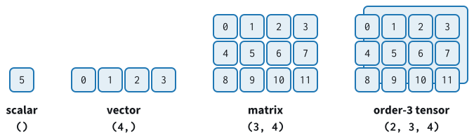

```{.python .input}
%load_ext d2lbook.tab
tab.interact_select('mxnet', 'pytorch', 'tensorflow', 'jax')
```

# Data Manipulation
:label:`sec_ndarray`

To get anything done in machine learning, we need a way to store and manipulate data efficiently in memory. We start with $n$-dimensional arrays, which in deep learning are called *tensors*.

To see why specialized array containers are indispensable, consider a single *minibatch* of $256$ grayscale photographs of resolution $28 \times 28$ pixels, containing $256 \times 28 \times 28 = 200{,}704$ numbers. Image files store each pixel as an integer in $\{0, \ldots, 255\}$, which we rescale to $[0, 1]$ by dividing by $255$. In plain Python, three nested loops would execute $200{,}704$ separate scalar divisions in the interpreter. In a tensor library, the single expression `images / 255` dispatches to compiled C++ or CUDA kernels that divide all $200{,}704$ numbers in parallel on a CPU or GPU. Throughout deep learning, we operate on whole tensors at once rather than iterating over individual scalar elements in Python loops.

Across all modern deep learning frameworks, the tensor class (`ndarray` in MXNet, `Tensor` in PyTorch and TensorFlow, and `jax.Array` in JAX) closely mirrors NumPy's `ndarray` :cite:`Harris.Millman.Walt.ea.2020`, with two crucial additions:

1. **Hardware acceleration:** framework tensors execute across GPUs and specialized AI accelerators, whereas NumPy runs on CPUs.
2. **Automatic differentiation:** frameworks track computations on tensors and compute gradients automatically via backpropagation (:numref:`sec_autograd`).

:begin_tab:`mxnet`
We import MXNet's NumPy-compatible array module as `mnp` (keeping `np` for standard NumPy) along with `npx` (`numpy_extension`), and call `npx.set_np()` to activate NumPy-compatible tensor semantics.
:end_tab:

:begin_tab:`pytorch`
We import PyTorch (`torch`).
:end_tab:

:begin_tab:`tensorflow`
We import TensorFlow under its customary alias `tf`.
:end_tab:

:begin_tab:`jax`
We import `jax` and its NumPy-compatible array interface `jax.numpy` as `jnp`.
:end_tab:

```{.python .input #ndarray-getting-started-1}
%%tab mxnet
from mxnet import np as mnp, npx
npx.set_np()
```

```{.python .input #ndarray-getting-started-1}
%%tab pytorch
import torch
```

```{.python .input #ndarray-getting-started-1}
%%tab tensorflow
import tensorflow as tf
```

```{.python .input #ndarray-getting-started-1}
%%tab jax
import random
import jax
from jax import numpy as jnp
```

## Tensor Creation

### Shape

A tensor arranges numerical values along one or more *axes*. A tensor with one axis is a *vector*, with two axes a *matrix*, and with $k > 2$ axes a $k^\textrm{th}$-*order tensor* (its number of axes is its *order*, exposed in code as `ndim`). Our running minibatch of grayscale images is a $4^\textrm{th}$-order tensor of shape $(256, 1, 28, 28)$: axis $0$ indexes the image in the batch, axis $1$ the color channel ($1$ for grayscale, $3$ for RGB), axis $2$ the vertical pixel row, and axis $3$ the horizontal pixel column.

Calling `arange(n)` creates a 1D vector of evenly spaced values from $0$ (included) to $n$ (excluded). Newly created tensors reside in main memory for CPU computation by default; here we request 32-bit floating-point values (`float32`):

:begin_tab:`tensorflow`
In TensorFlow, this function is named `tf.range`.
:end_tab:

```{.python .input #ndarray-getting-started-2}
%%tab mxnet
x = mnp.arange(12)
x
```

```{.python .input #ndarray-getting-started-2}
%%tab pytorch
x = torch.arange(12, dtype=torch.float32)
x
```

```{.python .input #ndarray-getting-started-2}
%%tab tensorflow
x = tf.range(12, dtype=tf.float32)
x
```

```{.python .input #ndarray-getting-started-2}
%%tab jax
x = jnp.arange(12, dtype=jnp.float32)
x
```

Each value in a tensor is an *element*. We can query the total number of elements in `x`---its *size*:

:begin_tab:`pytorch`
In PyTorch, the total element count is returned by `numel()`.
:end_tab:

```{.python .input #ndarray-getting-started-3}
%%tab mxnet, jax
x.size
```

```{.python .input #ndarray-getting-started-3}
%%tab pytorch
x.numel()
```

```{.python .input #ndarray-getting-started-3}
%%tab tensorflow
tf.size(x)
```

Next, we inspect the tensor's *shape* tuple via `x.shape`, which lists its length along each axis (here a 1-tuple `(12,)` for our 12-element vector):

```{.python .input #ndarray-getting-started-4}
x.shape
```

:numref:`fig_ndarray_shapes` illustrates tensors of orders $0$ through $3$. A single number (*scalar*) is a $0^\textrm{th}$-order tensor with empty shape `()`. For any tensor, the size equals the product of the lengths in its shape tuple ($256 \times 1 \times 28 \times 28 = 200{,}704$ for our image minibatch).


:label:`fig_ndarray_shapes`

### Data Types

Every tensor carries a *data type* (`dtype`) specifying the binary representation of each element. Deep learning models perform most arithmetic in 32-bit floating point (`float32`, $4$ bytes per element, $\approx 7$ decimal digits of precision) or 16-bit formats (`float16` / `bfloat16`, $2$ bytes per element; see :numref:`sec_numerics`). Raw image pixels are typically stored as 8-bit unsigned integers (`uint8`, $1$ byte per pixel for $\{0, \ldots, 255\}$), so our $200{,}704$-pixel minibatch occupies $0.2\textrm{ MB}$ as `uint8` and $0.8\textrm{ MB}$ as `float32`.

:begin_tab:`mxnet`
MXNet defaults to `float32`; cast with `x.astype('int32')`.
:end_tab:

:begin_tab:`pytorch`
`torch.arange` defaults to `int64` on integer arguments; cast with `x.to(torch.int32)`.
:end_tab:

:begin_tab:`tensorflow`
`tf.range` defaults to `int32` on integer arguments; cast with `tf.cast(x, tf.int32)`.
:end_tab:

:begin_tab:`jax`
`jnp.arange` defaults to `int32` on integer arguments; cast with `x.astype(jnp.int32)`.
:end_tab:

### Initial Values

The functions `zeros` and `ones` construct a tensor of any shape filled with $0$s or $1$s (used for biases or buffers):

```{.python .input #ndarray-getting-started-6}
%%tab mxnet
mnp.zeros((2, 3, 4))
```

```{.python .input #ndarray-getting-started-6}
%%tab pytorch
torch.zeros((2, 3, 4))
```

```{.python .input #ndarray-getting-started-6}
%%tab tensorflow
tf.zeros((2, 3, 4))
```

```{.python .input #ndarray-getting-started-6}
%%tab jax
jnp.zeros((2, 3, 4))
```

Neural network weights are typically initialized by sampling elements independently from a probability distribution (:numref:`sec_numerical_stability`). Below, we draw a $3 \times 4$ matrix from a standard Gaussian distribution (mean $0$, standard deviation $1$):

```{.python .input #ndarray-getting-started-8}
%%tab mxnet
mnp.random.normal(0, 1, size=(3, 4))
```

```{.python .input #ndarray-getting-started-8}
%%tab pytorch
torch.randn(3, 4)
```

```{.python .input #ndarray-getting-started-8}
%%tab tensorflow
tf.random.normal(shape=[3, 4])
```

```{.python .input #ndarray-getting-started-8}
%%tab jax
# A key determines the sample: the same key always gives the same numbers
key = jax.random.key(random.getrandbits(32))  # A new seed on each run
jax.random.normal(key, (3, 4))
```

Computer-generated random numbers are *pseudorandom*: a deterministic algorithm computes them from an integer *seed*, so resetting the seed reproduces the exact same sequence (`a` and `c` below match, whereas `b` is drawn after the generator has advanced):

:begin_tab:`mxnet`
MXNet resets its global generator via `mnp.random.seed`.
:end_tab:

:begin_tab:`pytorch`
PyTorch resets its global generator via `torch.manual_seed`.
:end_tab:

:begin_tab:`tensorflow`
TensorFlow resets its global generator via `tf.random.set_seed`.
:end_tab:

:begin_tab:`jax`
JAX is purely functional and has no global random state: every random function takes an explicit PRNG *key*, and `jax.random.split` derives new independent subkeys deterministically.
:end_tab:

```{.python .input #ndarray-initial-values-1}
%%tab mxnet
mnp.random.seed(42)
a = mnp.random.normal(size=3)
b = mnp.random.normal(size=3)  # The generator has moved on
mnp.random.seed(42)
c = mnp.random.normal(size=3)  # Same seed: c repeats a
a, b, c
```

```{.python .input #ndarray-initial-values-1}
%%tab pytorch
torch.manual_seed(42)
a = torch.randn(3)
b = torch.randn(3)  # The generator has moved on
torch.manual_seed(42)
c = torch.randn(3)  # Same seed: c repeats a
a, b, c
```

```{.python .input #ndarray-initial-values-1}
%%tab tensorflow
tf.random.set_seed(42)
a = tf.random.normal([3])
b = tf.random.normal([3])  # The generator has moved on
tf.random.set_seed(42)
c = tf.random.normal([3])  # Same seed: c repeats a
print(a, b, c, sep='\n')
```

```{.python .input #ndarray-initial-values-1}
%%tab jax
key_a, key_b = jax.random.split(jax.random.key(42))
a = jax.random.normal(key_a, (3,))
b = jax.random.normal(key_b, (3,))  # A different key
c = jax.random.normal(key_a, (3,))  # Same key: c repeats a
a, b, c
```

When we know the exact entries of a small tensor ahead of time, we can construct it directly from nested Python lists (here creating a $3 \times 4$ matrix where the outer list gives the three rows and each inner list supplies four columns):

```{.python .input #ndarray-getting-started-9}
%%tab mxnet
mnp.array([[2, 1, 4, 3], [1, 2, 3, 4], [4, 3, 2, 1]])
```

```{.python .input #ndarray-getting-started-9}
%%tab pytorch
torch.tensor([[2, 1, 4, 3], [1, 2, 3, 4], [4, 3, 2, 1]])
```

```{.python .input #ndarray-getting-started-9}
%%tab tensorflow
tf.constant([[2, 1, 4, 3], [1, 2, 3, 4], [4, 3, 2, 1]])
```

```{.python .input #ndarray-getting-started-9}
%%tab jax
jnp.array([[2, 1, 4, 3], [1, 2, 3, 4], [4, 3, 2, 1]])
```

Finally, we construct our running synthetic minibatch `images` of shape `(256, 1, 28, 28)` and type `uint8`, filled with random integers in $\{0, \ldots, 255\}$:

```{.python .input #ndarray-initial-values-2}
%%tab mxnet
# 256 grayscale images of 28 x 28 pixels, each pixel an integer in [0, 255]
images = mnp.random.randint(0, 256, size=(256, 1, 28, 28)).astype('uint8')
images.shape, images.dtype
```

```{.python .input #ndarray-initial-values-2}
%%tab pytorch
# 256 grayscale images of 28 x 28 pixels, each pixel an integer in [0, 255]
images = torch.randint(0, 256, (256, 1, 28, 28), dtype=torch.uint8)
images.shape, images.dtype
```

```{.python .input #ndarray-initial-values-2}
%%tab tensorflow
# 256 grayscale images of 28 x 28 pixels, each pixel an integer in [0, 255];
# TensorFlow draws random integers as int32 or int64, so we cast them
images = tf.random.uniform((256, 1, 28, 28), maxval=256, dtype=tf.int32)
images = tf.cast(images, tf.uint8)
images.shape, images.dtype
```

```{.python .input #ndarray-initial-values-2}
%%tab jax
# 256 grayscale images of 28 x 28 pixels, each pixel an integer in [0, 255]
key, subkey = jax.random.split(key)
images = jax.random.randint(subkey, (256, 1, 28, 28), 0, 256,
                            dtype=jnp.uint8)
images.shape, images.dtype
```

## Reshaping and Indexing

### Reshaping

Calling `reshape` reconfigures a tensor's axes while preserving its element count and row-major order in memory (:numref:`fig_ndarray_reshape`). Here we reshape our 12-element vector `x` into a $3 \times 4$ matrix `X`:


:label:`fig_ndarray_reshape`

```{.python .input #ndarray-getting-started-5}
%%tab mxnet, pytorch, jax
X = x.reshape(3, 4)
X
```

```{.python .input #ndarray-getting-started-5}
%%tab tensorflow
X = tf.reshape(x, (3, 4))
X
```

Because the total size is fixed, passing `-1` for one dimension lets the framework infer its length automatically—for example, flattening our $(256, 1, 28, 28)$ image minibatch into a $(256, 784)$ matrix with one image per row:

:begin_tab:`tensorflow`
In TensorFlow, `reshape` is a function `tf.reshape(x, (-1, 4))`.
:end_tab:

```{.python .input #ndarray-reshaping-1}
%%tab mxnet, pytorch, jax
images.reshape(256, -1).shape
```

```{.python .input #ndarray-reshaping-1}
%%tab tensorflow
tf.reshape(images, (256, -1)).shape
```

Indexing with `None` inserts a new singleton axis of length $1$ at that position, while `squeeze` removes an axis of length $1$:

:begin_tab:`pytorch`
In PyTorch, `image.unsqueeze(0)` also inserts a singleton axis at position `0`.
:end_tab:

:begin_tab:`tensorflow`
In TensorFlow, `squeeze` is called as `tf.squeeze`.
:end_tab:

```{.python .input #ndarray-reshaping-2}
%%tab mxnet, pytorch, jax
image = images[0]
image[None].shape, image.squeeze(0).shape
```

```{.python .input #ndarray-reshaping-2}
%%tab tensorflow
image = images[0]
image[None].shape, tf.squeeze(image, 0).shape
```

### Indexing and Slicing

Elements and sub-tensors are accessed via $0$-based integer indexing (negative indices count backward from the end) and half-open slices `start:stop` (including `start`, excluding `stop`), separated by commas across axes:

```{.python .input #ndarray-indexing-and-slicing-1}
X[-1], X[1:3]
```

Notice the shape difference (:numref:`fig_ndarray_index`): an integer index (`X[-1]`) collapses that axis to return a vector of shape `(4,)`, whereas a slice (`X[1:3]`) preserves the axis to return a matrix of shape `(2, 4)`.

![Indexing a $3 \times 4$ matrix. The integer index `X[-1]` selects the last row and removes axis 0, leaving shape $(4,)$. The slice `X[1:3]` selects rows 1 and 2 and keeps axis 0, leaving shape $(2, 4)$.](../img/ndarray-index-read.svg)
:label:`fig_ndarray_index`

On our image minibatch of shape $(256, 1, 28, 28)$, `images[0]` extracts the first image $(1, 28, 28)$, `images[:32]` slices the first $32$ images $(32, 1, 28, 28)$, and `images[:, 0, 14, 14]` extracts the center pixel across all $256$ images $(256,)$:

```{.python .input #ndarray-indexing-and-slicing-4}
images[0].shape, images[:32].shape, images[:, 0, 14, 14].shape
```

We can also index a tensor using *integer index tensors* (*gather*): passing two 1D integer tensors `rows = (0, 1, 2)` and `cols = (3, 0, 2)` selects entries `(0, 3)`, `(1, 0)`, and `(2, 2)`:

:begin_tab:`tensorflow`
In TensorFlow, `tf.gather(X, cols, batch_dims=1)` gathers entry `cols[i]` from each row `i` of `X`:
:end_tab:

```{.python .input #ndarray-indexing-and-slicing-5}
%%tab mxnet
rows, cols = mnp.arange(3), mnp.array([3, 0, 2])
X[rows, cols]
```

```{.python .input #ndarray-indexing-and-slicing-5}
%%tab pytorch
rows, cols = torch.arange(3), torch.tensor([3, 0, 2])
X[rows, cols]
```

```{.python .input #ndarray-indexing-and-slicing-5}
%%tab tensorflow
cols = tf.constant([3, 0, 2])
tf.gather(X, cols, batch_dims=1)
```

```{.python .input #ndarray-indexing-and-slicing-5}
%%tab jax
rows, cols = jnp.arange(3), jnp.array([3, 0, 2])
X[rows, cols]
```

Similarly, an elementwise comparison produces a *Boolean mask* of `True`/`False` values (combinable with `&`, `|`, `~`). Indexing `X[mask]` extracts all entries where `mask` is `True` into a flattened 1D vector:

:begin_tab:`jax`
Because the output length of `X[mask]` is data-dependent, Boolean mask indexing works only in eager mode; inside `jax.jit`-compiled functions, use `jnp.where`.
:end_tab:

```{.python .input #ndarray-indexing-and-slicing-6}
mask = (X > 2) & (X < 8)
X[mask]
```

When we instead want to preserve the $3 \times 4$ shape of `X`, `where(mask, X, 0)` selects from `X` wherever `mask` is `True` and fills all remaining positions with `0`:

```{.python .input #ndarray-indexing-and-slicing-7}
%%tab mxnet
mnp.where(mask, X, 0)
```

```{.python .input #ndarray-indexing-and-slicing-7}
%%tab pytorch
torch.where(mask, X, 0)
```

```{.python .input #ndarray-indexing-and-slicing-7}
%%tab tensorflow
tf.where(mask, X, 0)
```

```{.python .input #ndarray-indexing-and-slicing-7}
%%tab jax
jnp.where(mask, X, 0)
```

### Writing Elements

MXNet and PyTorch tensors are *mutable* (`X[i, j] = val` overwrites memory in place), whereas TensorFlow and JAX tensors are *immutable*. Moreover, when `reshape` returns a zero-copy *view* sharing the original buffer (as in PyTorch), mutating `X` also mutates `x`:

:begin_tab:`mxnet, pytorch`
We assign `17` to `X[1, 2]` (flat index $6$) and inspect both `X` and `x`:
:end_tab:

:begin_tab:`tensorflow`
Learnable parameters live in mutable `tf.Variable` containers updated via `.assign()`:
:end_tab:

:begin_tab:`jax`
JAX provides functional updates `X.at[1, 2].set(17)`, returning a new array while leaving `X` unchanged:
:end_tab:

```{.python .input #ndarray-indexing-and-slicing-2}
%%tab mxnet, pytorch
X[1, 2] = 17
X, x
```

```{.python .input #ndarray-indexing-and-slicing-2}
%%tab tensorflow
X_var = tf.Variable(X)
X_var[1, 2].assign(17)
X_var
```

```{.python .input #ndarray-indexing-and-slicing-2}
%%tab jax
X_new = X.at[1, 2].set(17)  # X is unchanged
X_new
```

:begin_tab:`mxnet`
In MXNet, `x[6]` remains `6.0` because `reshape` allocated a copy.
:end_tab:

:begin_tab:`pytorch`
In PyTorch, `x[6]` changed to `17.` because `reshape` returned a view sharing storage with `x`.
:end_tab:

Slicing on the left-hand side assigns to an entire block at once:

```{.python .input #ndarray-indexing-and-slicing-3}
%%tab mxnet, pytorch
X[:2, :] = 12
X
```

```{.python .input #ndarray-indexing-and-slicing-3}
%%tab tensorflow
X_var[:2, :].assign(12)
X_var
```

```{.python .input #ndarray-indexing-and-slicing-3}
%%tab jax
X_new = X_new.at[:2, :].set(12)
X_new
```

## Operations

### Elementwise Operations

Standard binary arithmetic operators (`+`, `-`, `*`, `/`, `**`) lift scalar arithmetic to act independently on every pair of corresponding elements of two identically shaped tensors `x` and `y`:

```{.python .input #ndarray-operations-2}
%%tab mxnet
x = mnp.array([1.0, 2, 4, 8])
y = mnp.array([2.0, 2, 2, 2])
x + y, x - y, x * y, x / y, x ** y
```

```{.python .input #ndarray-operations-2}
%%tab pytorch
x = torch.tensor([1.0, 2, 4, 8])
y = torch.tensor([2.0, 2, 2, 2])
x + y, x - y, x * y, x / y, x ** y
```

```{.python .input #ndarray-operations-2}
%%tab tensorflow
x = tf.constant([1.0, 2, 4, 8])
y = tf.constant([2.0, 2, 2, 2])
x + y, x - y, x * y, x / y, x ** y
```

```{.python .input #ndarray-operations-2}
%%tab jax
x = jnp.array([1.0, 2, 4, 8])
y = jnp.array([2.0, 2, 2, 2])
x + y, x - y, x * y, x / y, x ** y
```

Unary mathematical functions such as `exp` likewise apply elementwise, computing $e^{x_i}$ for each entry of `x`:

```{.python .input #ndarray-operations-1}
%%tab mxnet
mnp.exp(x)
```

```{.python .input #ndarray-operations-1}
%%tab pytorch
torch.exp(x)
```

```{.python .input #ndarray-operations-1}
%%tab tensorflow
tf.exp(x)
```

```{.python .input #ndarray-operations-1}
%%tab jax
jnp.exp(x)
```

Dividing our `uint8` minibatch `images` by `255` rescales all $200{,}704$ pixels at once and promotes the result to `float32`:

```{.python .input #ndarray-elementwise-operations-1}
scaled = images / 255
print(scaled.dtype, images[0, 0, 0, :4], scaled[0, 0, 0, :4], sep='\n')
```

Relational operators such as `x == y` also act elementwise, returning a Boolean tensor with `True` at positions where `x` and `y` agree (here only index $1$, where both equal `2.0`):

```{.python .input #ndarray-operations-4}
x == y
```

Summing a tensor via `sum()` collapses all its entries into a single scalar ($1 + 2 + 4 + 8 = 15$ for `x`); because `True` counts as $1$ and `False` as $0$, summing the Boolean mask `(x == y).sum()` counts how many entries match:

:begin_tab:`tensorflow`
In TensorFlow, use `tf.reduce_sum` (casting Booleans via `tf.cast` first).
:end_tab:

```{.python .input #ndarray-operations-5}
%%tab mxnet, pytorch, jax
x.sum(), (x == y).sum()
```

```{.python .input #ndarray-operations-5}
%%tab tensorflow
tf.reduce_sum(x), tf.reduce_sum(tf.cast(x == y, tf.int32))
```

### Broadcasting
:label:`subsec_broadcasting`

Often we combine tensors of *different* shapes, such as adding a 4-element bias vector `v` to every row of a $3 \times 4$ matrix `X`:

```{.python .input #ndarray-broadcasting-4}
%%tab mxnet
X = mnp.arange(12).reshape(3, 4)
v = mnp.array([100.0, 200, 300, 400])
X + v
```

```{.python .input #ndarray-broadcasting-4}
%%tab pytorch
X = torch.arange(12, dtype=torch.float32).reshape(3, 4)
v = torch.tensor([100.0, 200, 300, 400])
X + v
```

```{.python .input #ndarray-broadcasting-4}
%%tab tensorflow
X = tf.reshape(tf.range(12, dtype=tf.float32), (3, 4))
v = tf.constant([100.0, 200, 300, 400])
X + v
```

```{.python .input #ndarray-broadcasting-4}
%%tab jax
X = jnp.arange(12, dtype=jnp.float32).reshape(3, 4)
v = jnp.array([100.0, 200, 300, 400])
X + v
```

Rather than materializing physical copies, tensor libraries apply a two-step *broadcasting* rule:

1. **Align shapes from the right:** Prepend $1$s on the left of the lower-order tensor's shape tuple until both shapes have the same length. Two aligned dimensions are compatible if they are equal or if one of them is $1$.
2. **Stretch singleton axes:** Virtually replicate any length-$1$ axis to match the other tensor's length $k > 1$ without copying memory, then apply the elementwise operation.

To watch both tensors stretch simultaneously (:numref:`fig_ndarray_broadcasting`), let us construct a $3 \times 1$ column vector `a` and a $1 \times 2$ row vector `b`:


:label:`fig_ndarray_broadcasting`

```{.python .input #ndarray-broadcasting-1}
%%tab mxnet
a = mnp.arange(3).reshape(3, 1)
b = mnp.arange(2).reshape(1, 2)
a, b
```

```{.python .input #ndarray-broadcasting-1}
%%tab pytorch
a = torch.arange(3).reshape(3, 1)
b = torch.arange(2).reshape(1, 2)
a, b
```

```{.python .input #ndarray-broadcasting-1}
%%tab tensorflow
a = tf.reshape(tf.range(3), (3, 1))
b = tf.reshape(tf.range(2), (1, 2))
a, b
```

```{.python .input #ndarray-broadcasting-1}
%%tab jax
a = jnp.arange(3).reshape(3, 1)
b = jnp.arange(2).reshape(1, 2)
a, b
```

Adding `a + b` virtually replicates `a` across two columns and `b` across three rows to produce the $3 \times 2$ matrix of all pairwise sums $a_{i0} + b_{0j}$:

```{.python .input #ndarray-broadcasting-2}
a + b
```

If any pair of aligned dimensions differs and neither is $1$---such as `(3, 2)` and `(2, 3)`---broadcasting raises an error:

:begin_tab:`mxnet`
We print the final summary line of MXNet's exception:
:end_tab:

:begin_tab:`tensorflow`
We print the exception class name:
:end_tab:

```{.python .input #ndarray-broadcasting-3}
%%tab mxnet
try:
    mnp.ones((3, 2)) + mnp.ones((2, 3))
except Exception as e:
    print(str(e).splitlines()[-1].rsplit(': ', 1)[-1])
```

```{.python .input #ndarray-broadcasting-3}
%%tab pytorch
try:
    torch.ones((3, 2)) + torch.ones((2, 3))
except Exception as e:
    print(e)
```

```{.python .input #ndarray-broadcasting-3}
%%tab tensorflow
try:
    tf.ones((3, 2)) + tf.ones((2, 3))
except Exception as e:
    print(type(e).__name__)
```

```{.python .input #ndarray-broadcasting-3}
%%tab jax
try:
    jnp.ones((3, 2)) + jnp.ones((2, 3))
except Exception as e:
    print(e)
```

Thus, subtracting a $(28, 28)$ mean image from `images` of shape $(256, 1, 28, 28)$ broadcasts cleanly as $(1, 1, 28, 28)$, whereas adding a per-image vector of shape $(256,)$ to flattened images $(256, 784)$ fails unless reshaped to a column $(256, 1)$.

### Concatenation

`concatenate` (or `cat` / `concat`) joins tensors end to end along an *existing* axis (all other axes must have matching lengths): joining two $3 \times 4$ matrices `X` and `Y` along `axis=0` stacks their rows into shape `(6, 4)`, whereas `axis=1` joins their columns into shape `(3, 8)`:

```{.python .input #ndarray-operations-3}
%%tab mxnet
X = mnp.arange(12).reshape(3, 4)
Y = mnp.array([[2, 1, 4, 3], [1, 2, 3, 4], [4, 3, 2, 1]])
mnp.concatenate([X, Y], axis=0), mnp.concatenate([X, Y], axis=1)
```

```{.python .input #ndarray-operations-3}
%%tab pytorch
X = torch.arange(12, dtype=torch.float32).reshape(3, 4)
Y = torch.tensor([[2.0, 1, 4, 3], [1, 2, 3, 4], [4, 3, 2, 1]])
torch.cat((X, Y), dim=0), torch.cat((X, Y), dim=1)
```

```{.python .input #ndarray-operations-3}
%%tab tensorflow
X = tf.reshape(tf.range(12, dtype=tf.float32), (3, 4))
Y = tf.constant([[2.0, 1, 4, 3], [1, 2, 3, 4], [4, 3, 2, 1]])
tf.concat([X, Y], axis=0), tf.concat([X, Y], axis=1)
```

```{.python .input #ndarray-operations-3}
%%tab jax
X = jnp.arange(12, dtype=jnp.float32).reshape(3, 4)
Y = jnp.array([[2.0, 1, 4, 3], [1, 2, 3, 4], [4, 3, 2, 1]])
jnp.concatenate((X, Y), axis=0), jnp.concatenate((X, Y), axis=1)
```

By contrast, `stack` joins identically shaped tensors along a *new* axis, bundling `X` and `Y` into a $3^\textrm{rd}$-order tensor of shape `(2, 3, 4)` by default (`axis=0`) or `(3, 4, 2)` when stacked along `axis=2`:

```{.python .input #ndarray-concatenation-1}
%%tab mxnet
mnp.stack([X, Y]).shape, mnp.stack([X, Y], axis=2).shape
```

```{.python .input #ndarray-concatenation-1}
%%tab pytorch
torch.stack((X, Y)).shape, torch.stack((X, Y), dim=2).shape
```

```{.python .input #ndarray-concatenation-1}
%%tab tensorflow
tf.stack([X, Y]).shape, tf.stack([X, Y], axis=2).shape
```

```{.python .input #ndarray-concatenation-1}
%%tab jax
jnp.stack((X, Y)).shape, jnp.stack((X, Y), axis=2).shape
```

## Memory and Conversion

### Allocation and In-Place Updates
:label:`subsec_saving_memory`

Standard expressions like `Y = Y + X` allocate a new buffer and rebind `Y` to the new address, as verified with Python's `id()`:

```{.python .input #ndarray-saving-memory-1}
before = id(Y)
Y = Y + X
id(Y) == before
```

For models with gigabytes of parameters, unnecessary allocations waste memory bandwidth and can leave other references pointing to stale buffers (though inside forward passes, you must not overwrite activations still needed by automatic differentiation; see :numref:`sec_autograd`).

:begin_tab:`mxnet, pytorch`
In MXNet and PyTorch, slice assignment `Z[:] = X + Y` writes the result into an existing preallocated buffer `Z` so `id(Z)` never changes:
:end_tab:

:begin_tab:`tensorflow`
In TensorFlow, `Z.assign(X + Y)` updates a mutable `tf.Variable` buffer `Z` in place so `id(Z)` remains unchanged:
:end_tab:

:begin_tab:`jax`
In JAX, arrays are immutable; buffer reuse is handled automatically by the XLA compiler under `@jax.jit`.
:end_tab:

```{.python .input #ndarray-saving-memory-2}
%%tab mxnet
Z = mnp.zeros_like(Y)
before = id(Z)
Z[:] = X + Y
id(Z) == before
```

```{.python .input #ndarray-saving-memory-2}
%%tab pytorch
Z = torch.zeros_like(Y)
before = id(Z)
Z[:] = X + Y
id(Z) == before
```

```{.python .input #ndarray-saving-memory-2}
%%tab tensorflow
Z = tf.Variable(tf.zeros_like(Y))
before = id(Z)
Z.assign(X + Y)
id(Z) == before
```

When the old value of `X` is no longer needed, augmented assignment `X += Y` avoids allocating even a separate destination tensor `Z`:

```{.python .input #ndarray-saving-memory-3}
before = id(X)
X += Y
id(X) == before
```

:begin_tab:`mxnet, pytorch`
`id(X) == before` is `True`: `X` was updated in place.
:end_tab:

:begin_tab:`tensorflow, jax`
Because `X` is an immutable tensor, `id(X) == before` is `False`.
:end_tab:

### Conversion to Other Python Objects

Converting between framework tensors and NumPy arrays is routine at the boundary with plotting or data libraries, but frameworks differ in whether conversion shares memory or copies:

:begin_tab:`mxnet`
`X.asnumpy()` and `mnp.array(A)` each allocate an independent copy.
:end_tab:

:begin_tab:`pytorch`
On the CPU, `X.numpy()` and `torch.from_numpy(A)` **share the exact same underlying memory buffer**, so mutating one in place immediately modifies the other!
:end_tab:

:begin_tab:`tensorflow`
`X.numpy()` and `tf.constant(A)` each allocate an independent copy.
:end_tab:

:begin_tab:`jax`
`jax.device_get(X)` returns a read-only NumPy array (potentially zero-copy on CPU), and `jax.device_put(A)` transfers it back.
:end_tab:

```{.python .input #ndarray-conversion-to-other-python-objects-1}
%%tab mxnet
A = X.asnumpy()
B = mnp.array(A)
type(A), type(B)
```

```{.python .input #ndarray-conversion-to-other-python-objects-1}
%%tab pytorch
A = X.numpy()
B = torch.from_numpy(A)
type(A), type(B)
```

```{.python .input #ndarray-conversion-to-other-python-objects-1}
%%tab tensorflow
A = X.numpy()
B = tf.constant(A)
type(A), type(B)
```

```{.python .input #ndarray-conversion-to-other-python-objects-1}
%%tab jax
A = jax.device_get(X)
B = jax.device_put(A)
type(A), type(B)
```

We can verify whether `A`, `B`, and `X` share memory by overwriting `A[0, 0] = 100` in the NumPy array and inspecting `X[0, 0]` and `B[0, 0]` (which change to `100.` in PyTorch, remain untouched in MXNet and TensorFlow copies, and raise a read-only `ValueError` in JAX):

```{.python .input #ndarray-conversion-to-other-python-objects-3}
%%tab mxnet
A[0, 0] = 100  # Write to the NumPy copy
X[0, 0], B[0, 0]
```

```{.python .input #ndarray-conversion-to-other-python-objects-3}
%%tab pytorch
A[0, 0] = 100  # Write to the NumPy array
X[0, 0], B[0, 0]
```

```{.python .input #ndarray-conversion-to-other-python-objects-3}
%%tab tensorflow
A[0, 0] = 100  # Write to the NumPy copy
X[0, 0].numpy(), B[0, 0].numpy()
```

```{.python .input #ndarray-conversion-to-other-python-objects-3}
%%tab jax
try:
    A[0, 0] = 100
except ValueError as e:
    print(e)
```

To extract a single-element ($0^\textrm{th}$-order) tensor into a Python `float` or `int` (for example, when logging the scalar loss), call `.item()` or `float()`/`int()` (which forces the CPU to synchronize with any pending GPU kernels):

:begin_tab:`tensorflow`
TensorFlow tensors use `.numpy()`, `float()`, or `int()` instead of `.item()`.
:end_tab:

```{.python .input #ndarray-conversion-to-other-python-objects-2}
%%tab mxnet
a = mnp.array(3.5)
a, a.item(), float(a), int(a)
```

```{.python .input #ndarray-conversion-to-other-python-objects-2}
%%tab pytorch
a = torch.tensor(3.5)
a, a.item(), float(a), int(a)
```

```{.python .input #ndarray-conversion-to-other-python-objects-2}
%%tab tensorflow
a = tf.constant(3.5)
a, a.numpy(), float(a), int(a)
```

```{.python .input #ndarray-conversion-to-other-python-objects-2}
%%tab jax
a = jnp.array(3.5)
a, a.item(), float(a), int(a)
```

> **Tip: Exploring Framework APIs.** Whenever you encounter an unfamiliar module or function, use `dir(obj)` (or Tab completion) to list available attributes, `help(fn)` or `fn?` in Jupyter to inspect its signature and docstring (and `fn??` to view its Python source), and verify your understanding with a tiny test input whose expected output you can predict by hand.

## Summary

Tensors store inputs, parameters, activations, and gradients as $n$-dimensional arrays characterized by a `shape` and a `dtype`. Deep learning code expresses computations over whole tensors at once—rescaling all $200{,}704$ pixels of a minibatch in a single compiled operation (`images / 255`). We reconfigure axes with `reshape`, extract or modify subsets with integer indices, slices, and Boolean masks (`where`), join tensors with `concatenate` and `stack`, and combine differently shaped tensors via *broadcasting* (aligning shapes from the right and stretching singleton axes). Finally, mutable frameworks (PyTorch and MXNet) support in-place updates (`Z[:] = ...`, `X += Y`), while immutable frameworks (TensorFlow and JAX) manage memory reuse through `Variable` containers or compiler optimizations.

## Exercises

1. [code] **Inferred reshape axes.** Suppose a minibatch of $n$ grayscale images of resolution $28 \times 28$ arrives as a tensor of shape $(n, 1, 28, 28)$, and each image must be flattened into a row vector of $784$ pixel values. Verify each prediction below in code:
    1. Predict the output shape of reshaping the minibatch to `(-1, 784)` versus `(256, -1)`, first for a full minibatch of $n = 256$ images and then for the final, smaller minibatch of an epoch with $n = 100$ images. Which of the two target shapes works reliably for *any* batch size $n$?
    1. Suppose the images were accidentally loaded in 3-channel RGB format of shape $(n, 3, 28, 28)$. What happens when you reshape that tensor to `(-1, 784)`? Does `reshape(-1, 784)` catch the channel-count mistake, or does it silently scramble the batch dimension?

1. [code] **Broadcasting shapes and silent bugs.** Broadcasting aligns two shape tuples from the right.
    1. Construct two $3^\textrm{rd}$-order tensors `a` and `b` whose shapes differ along every single axis yet are broadcast-compatible. Predict the shape of `a + b` by hand, then run the code to verify your prediction.
    1. A regression model outputs a column of predictions `y_hat` of shape $(5, 1)$ for five examples whose ground-truth targets `y` are stored as a 1D vector of shape $(5,)$. Predict the shape of the residual `y_hat - y`. Next, let `y` hold `[0.0, 1.0, 2.0, 3.0, 4.0]` and set `y_hat = y.reshape(5, 1)` so that every prediction equals its true label identically. Compute the mean of the squared entries of `y_hat - y`, explain why this "mean squared error" is nonzero even though the predictions are perfect, and show how to reshape `y` (or `y_hat`) so that each prediction is compared only against its own label.

1. [code] **Arithmetic limits of data types.** Raw pixels in `images` are stored as 8-bit unsigned integers (`uint8`), whereas neural network layers compute in floating point (`float32`).
    1. Predict the numerical result of adding `100` to a `uint8` tensor entry holding the value `200`, and verify your prediction in code. Explain why this wrap-around occurs, and show how to brighten the first image of `images` by $100$ intensity levels (clamped or promoted) without integer overflow.
    1. An IEEE 754 `float32` number allocates $24$ bits of significand (mantissa) precision. Explain why `float32` can represent every consecutive integer up to $2^{24} = 16{,}777{,}216$ exactly, and verify in code that evaluating `float32(2**24) + float32(1)` leaves the number unchanged at $16{,}777{,}216$. If a training loop accumulates the total number of examples or tokens processed in a `float32` scalar counter (incrementing by $1$ each time), after how many examples will the counter freeze completely, and what data type should be used instead?

:begin_tab:`pytorch`
4. [code] **In-place composition.** ● Evaluate `(A + B) * (-A / 2)` for two identically shaped `float32` tensors `A` and `B` *without allocating any intermediate tensor*, using only PyTorch's in-place methods (`add_`, `div_`, `neg_`, `mul_`) or `out=` keyword arguments. Confirm that `A.data_ptr()` and `B.data_ptr()` remain unchanged and that the final result matches the out-of-place expression `(A + B) * (-A / 2)`. Explain why writing `A[:] = A + B` would *not* satisfy the zero-temporary-allocation requirement.

    *Adapted from Nicolas P. Rougier, [100 numpy exercises](https://github.com/rougier/numpy-100/blob/master/100_Numpy_exercises.md), problem 35.*
:end_tab:

:begin_tab:`mxnet`
4. [code] **In-place composition.** ● Evaluate `(A + B) * (-A / 2)` for two identically shaped `float32` arrays `A` and `B` *without allocating any intermediate array*, using only the in-place augmented assignment operators `+=`, `*=`, and `/=`. Confirm that the final result matches the out-of-place expression `(A + B) * (-A / 2)`, and explain why writing `A[:] = A + B` would *not* satisfy the zero-temporary-allocation requirement.

    *Adapted from Nicolas P. Rougier, [100 numpy exercises](https://github.com/rougier/numpy-100/blob/master/100_Numpy_exercises.md), problem 35.*
:end_tab:

:begin_tab:`tensorflow`
4. [code] **In-place composition.** ● Because ordinary TensorFlow tensors are immutable, every arithmetic operator allocates a new tensor. Wrap two identically shaped `float32` tensors `A` and `B` in `tf.Variable` containers and compute `(A + B) * (-A / 2)` so that the final result is stored inside one of the two variables, using `assign`, `assign_add`, and related variable methods. List each step of your calculation, identify which steps still allocate a temporary `Tensor` under eager execution, and explain why eager execution cannot eliminate those temporaries without `@tf.function` graph compilation.

    *Adapted from Nicolas P. Rougier, [100 numpy exercises](https://github.com/rougier/numpy-100/blob/master/100_Numpy_exercises.md), problem 35.*
:end_tab:

:begin_tab:`jax`
4. [code] **In-place composition and compiler fusion.** ● Because JAX arrays are immutable, every eager arithmetic operation allocates a new array. Write `(A + B) * (-A / 2)` inside a Python function `f(A, B)` and count how many intermediate arrays eager evaluation creates. Then compile `f` with `jax.jit(f)` and inspect the lowered HLO program via `jax.jit(f).lower(A, B).compile().as_text()` to see how many fused kernels remain. Compare this compiled execution with a mutable NumPy in-place implementation that overwrites `A`: which eager intermediate allocations does `jax.jit` eliminate automatically, and when does the compiled function still allocate an output buffer (unless `donate_argnums` is specified)?

    *Adapted from Nicolas P. Rougier, [100 numpy exercises](https://github.com/rougier/numpy-100/blob/master/100_Numpy_exercises.md), problem 35.*
:end_tab:

5. [code] **Python loops versus broadcasting.** ● Given a 1D vector `a` of $200$ elements and a 1D vector `b` of $300$ elements, we want to compute the $200 \times 300$ pairwise absolute-difference matrix $D$ with entries $d_{ij} = |a_i - b_j|$.
    1. Compute $D$ first using two nested Python `for` loops, and then using a single broadcasted subtraction after reshaping `a` to `(200, 1)` and `b` to `(1, 300)`. Verify that both matrices agree numerically, measure the wall-clock execution time of each method, and report the speedup factor.
    1. Even though broadcasting avoids copying the inputs `a` and `b`, the output matrix $D$ must still be materialized in memory. How many megabytes does $D$ occupy in `float32` if `a` and `b` each contain $10{,}000$ elements? What lesson does this teach about the peak memory footprint of broadcasted outer operations?

:begin_tab:`mxnet`
[Discussions](https://d2l.discourse.group/t/26)
:end_tab:

:begin_tab:`pytorch`
[Discussions](https://d2l.discourse.group/t/27)
:end_tab:

:begin_tab:`tensorflow`
[Discussions](https://d2l.discourse.group/t/187)
:end_tab:

:begin_tab:`jax`
[Discussions](https://d2l.discourse.group/t/17966)
:end_tab:

<!-- slides -->

::: {.slide}
::: {.cover}
[Dive into Deep Learning · §1.1]{.kicker}

Tensors as Contiguous Memory, Geometric Views, and Parallel Compute<br>**storage buffers · shapes & dtypes · zero-copy views · broadcasting · memory control**
:::
:::

::: {.slide title="Why Tensors? From Python Pointers to Parallel Kernels"}
[Motivation]{.kicker}

::: {.cols .vc}
::: {.col}
- **Batch scale:** One 256-image Fashion-MNIST batch ($28 \times 28$) holds $200{,}704$ pixels; modern networks update billions of parameters per step.
- **Python lists (`PyObject*`):** Chasing 8-byte pointers to scattered 24-byte heap boxes causes cache misses and interpreter loop overhead.
- **Contiguous tensor buffers:** Unboxed values (`uint8`, `float32`, `bfloat16`) sit back-to-back in RAM/HBM, feeding one vectorized CPU/GPU kernel + autograd.
:::

::: {.col .fig .big}
@fig:ndarray-pointers-vs-contiguous
:::
:::
:::

::: {.slide title="The Unifying Mental Model: Storage Buffer + Metadata Header"}
[Systems View]{.kicker}

::: {.cols .vc}
::: {.col}
Every tensor pairs a **1D contiguous storage buffer** with a small **metadata header** (`shape`, `strides`, `offset`, `dtype`):

$$\textrm{index}(i_0, \ldots, i_{k-1}) = \textrm{offset} + \sum_{r=0}^{k-1} i_r s_r$$

- **$O(1)$ zero-copy views** (`reshape`, slices `X[1:3]`, transpose, broadcasting $s_r = 0$) create a new header pointing to the *same* buffer.
- **$O(N)$ allocations** (`X + Y`, gather, mask, `cat`) write a brand-new buffer.
:::

::: {.col .fig}
@fig:ndarray-header-buffer
:::
:::
:::

::: {.slide title="Axes, Order (Rank), and Shape"}
[Geometry]{.kicker}

@fig:ndarray-rank-ladder

- **Order (rank)** is the number of axes; **shape** lists each axis length; **size** is their product:
  - **0D scalar `()`** (e.g., loss $\mathcal{L}$) $\;\to\;$ **1D vector `(d,)`** (bias $\mathbf{b}$) $\;\to\;$ **2D matrix `(n, d)`** (weights $\mathbf{W}$).
  - **4D image batch `(N, C, H, W)`:** our running Fashion-MNIST minibatch `(256, 1, 28, 28)` holds $256 \times 1 \times 28 \times 28 = 200{,}704$ pixels.
:::

::: {.slide title="Creating a Tensor and Inspecting Its Metadata"}
[Getting Started]{.kicker}

::: {.cols}
::: {.col}
- `arange(n)` allocates a 1D tensor of $n$ sequential values $[0, 1, \ldots, n-1]$ in a single contiguous buffer.
- When debugging any model, check `.shape` (axis lengths) and element count (`.numel()` or `.size`, always equal to $\prod_r d_r$).

@ndarray-getting-started-2
:::

::: {.col}
@ndarray-getting-started-4

@ndarray-getting-started-3
:::
:::
:::

::: {.slide title="Data Types Control Precision, Range, and Memory Footprint"}
[Data Types]{.kicker}

::: {.cols .vc}
::: {.col}
- **`float32` (4 B):** Default for master weights, gradients, and loss reductions ($4\text{ GB} / 10^9$ params).
- **`bfloat16` (2 B):** Keeps `float32`'s 8-bit exponent (**same dynamic range**, no overflow!) while halving HBM traffic for Tensor Core matmuls.
- **`uint8` (1 B) & `int64` (8 B):** Compact raw image pixels ($0\ldots 255$) and exact class/token indices.

@ndarray-initial-values-2
:::

::: {.col .fig}
@fig:ndarray-dtypes
:::
:::
:::

::: {.slide title="Deterministic Construction vs. Random Weight Initialization"}
[Initialization]{.kicker}

::: {.cols .vc}
::: {.col}
- **Constants and literals:** `zeros` and `ones` allocate fixed buffers for biases, padding masks, and accumulators; Python lists build small lookup tables.
- **Why weights must be random:** If all neurons in a layer started with identical weights, every neuron would compute the exact same activation and receive the exact same gradient. Sampling from $\mathcal{N}(0, 1)$ (`randn`) breaks symmetry.
:::

::: {.col}
@ndarray-getting-started-8

@ndarray-getting-started-9
:::
:::
:::

::: {.slide title="Reproducible Randomness: Seeds and PRNG State" except="jax"}
[Reproducibility]{.kicker}

::: {.cols .vc}
::: {.col}
- Training uses randomness everywhere: weight initialization, minibatch shuffling, dropout masks, and data augmentation.
- Pseudorandom number generators (PRNGs) are deterministic state machines: resetting the **seed** reproduces the exact sequence of draws for repeatable experiments.
- **Global state:** The framework advances a stateful generator with every draw, so a seed fixes the whole sequence that follows.
:::

::: {.col}
@ndarray-initial-values-1
:::
:::
:::

::: {.slide title="Reproducible Randomness: Seeds and PRNG State" only="jax"}
[Reproducibility]{.kicker}

::: {.cols .vc}
::: {.col}
- Training uses randomness everywhere: weight initialization, minibatch shuffling, dropout masks, and data augmentation.
- Pseudorandom number generators (PRNGs) are deterministic state machines: resetting the **seed** reproduces the exact sequence of draws for repeatable experiments.
- **Explicit state:** JAX splits an explicit `PRNGKey` instead of advancing a global generator, so parallel JIT code stays pure.
:::

::: {.col}
@ndarray-initial-values-1
:::
:::
:::

::: {.slide title="Reshaping Reinterprets Axes in Row-Major Order"}
[Reshaping]{.kicker}

::: {.cols .vc}
::: {.col}
- `x.reshape(3, 4)` replaces shape `(12,)` with `(3, 4)` without moving the 12 elements (**row-major order**: column stride $1$, row stride $4$).
- For contiguous memory, `reshape` is an $O(1)$ metadata operation returning a **view** over the same buffer.

@ndarray-getting-started-5
:::

::: {.col .fig .big}
@fig:ndarray-reshape
:::
:::
:::

::: {.slide title="Automatic Dimension Inference (-1) and Singleton Axes"}
[Reshaping in Pipelines]{.kicker}

::: {.cols .vc}
::: {.col}
- **Flattening with `-1`:** `images.reshape(-1, 784)` infers batch size $\textrm{size}/784 = 256$ and survives smaller final epoch batches.
- **Singleton axes (`None` / `squeeze`):** `None` inserts a length-1 axis for batching or broadcasting; `squeeze` drops length-1 axes.

@ndarray-reshaping-1
:::

::: {.col .fig}
@fig:ndarray-singleton-axes
:::
:::
:::

::: {.slide title="Indexing vs. Slicing: Rank Reduction vs. Rank Preservation"}
[Subsetting]{.kicker}

::: {.cols .vc}
::: {.col}
- **Integer indexing collapses an axis** (order drops by 1): `X[-1]` returns the last row as a 1D vector `(4,)`; `images[0]` returns one image `(1, 28, 28)`.
- **Slicing (`start:stop`) preserves the axis** (order stays unchanged): `X[1:3]` returns rows 1 and 2 as a `(2, 4)` matrix view; `images[:32]` takes a 32-image sub-batch.

@ndarray-indexing-and-slicing-4
:::

::: {.col .fig}
@fig:ndarray-index-read
:::
:::
:::

::: {.slide title="Concept Check: Predicting Shapes and Zero-Copy Views"}
[Check Your Understanding]{.kicker}

Given `images` of shape `(256, 1, 28, 28)`, predict the output shape and memory behavior of each expression:

1. `images[5]` versus `images[5:6]`
2. `images[:64, :, ::2, ::2]`
3. `images.reshape(256, -1)` versus `images.reshape(-1, 784)` on a final epoch batch of 96 images `(96, 1, 28, 28)`

::: {.d2l-note .fragment .fade-up}
**Answers:**

1. `images[5]` has shape **`(1, 28, 28)`** (axis 0 removed); `images[5:6]` has shape **`(1, 1, 28, 28)`** (axis 0 kept with length 1). Both are $O(1)$ zero-copy views.
2. **`(64, 1, 14, 14)`**: takes 64 images and every second row/column by doubling spatial strides—still a zero-copy view!
3. `reshape(256, -1)` **raises an error** ($96 \times 784$ is not divisible by 256); `reshape(-1, 784)` safely infers **`(96, 784)`**.
:::
:::

::: {.slide title="Integer Gather and Boolean Masking in Machine Learning"}
[Selective Indexing]{.kicker}

::: {.cols .vc}
::: {.col}
- **Integer gather:** Pairs row and column indices—used in cross-entropy to pluck the true-class score per example.
- **Mask vs. `where`:** Masking collapses matches to a **1D vector**, whereas `where(mask, X, 0)` preserves the 2D shape for ReLU and attention masks.

@ndarray-indexing-and-slicing-5
:::

::: {.col .fig}
@fig:ndarray-gather-mask
:::
:::
:::

::: {.slide title="Views and Mutability: Writing Through a Reshaped Tensor" only="pytorch"}
[Views & Mutation]{.kicker}

::: {.cols .vc}
::: {.col}
- Because `X = x.reshape(3, 4)` is a **view** sharing `x`'s storage buffer, `X[1, 2] = 17` writes to offset $1 \times 4 + 2 = 6$ in place—mutating `x[6]` to `17` as well!

@ndarray-indexing-and-slicing-2
:::

::: {.col .fig}
@fig:ndarray-index-write

@ndarray-indexing-and-slicing-3
:::
:::
:::

::: {.slide title="In-Place Assignment on Mutable Tensors" only="mxnet"}
[Views & Mutation]{.kicker}

::: {.cols .vc}
::: {.col}
- Indexing on the left of `=` overwrites elements inside `X`'s storage buffer (`X[1, 2] = 17`, `X[:2, :] = 12`). In MXNet, `reshape` copies the buffer, so `x` stays unchanged.

@ndarray-indexing-and-slicing-2
:::

::: {.col .fig}
@fig:ndarray-index-write

@ndarray-indexing-and-slicing-3
:::
:::
:::

::: {.slide title="Functional Purity: Immutable Arrays and .at[].set() in JAX" only="jax"}
[Views & Mutation]{.kicker}

::: {.cols .vc}
::: {.col}
- JAX arrays are **immutable** so XLA can safely fuse and differentiate pure functions. Updates use `X.at[1, 2].set(17)` and `X.at[:2, :].set(12)` (compiled to in-place buffer reuse inside `@jax.jit`).

@ndarray-indexing-and-slicing-2
:::

::: {.col .fig}
@fig:ndarray-index-write@jax

@ndarray-indexing-and-slicing-3
:::
:::
:::

::: {.slide title="Immutable Tensors vs. Mutable tf.Variable State" only="tensorflow"}
[Views & Mutation]{.kicker}

::: {.cols .vc}
::: {.col}
- In TensorFlow, `tf.Tensor` values are **immutable**, whereas trainable parameters live in mutable **`tf.Variable`** containers updated in place via `.assign(...)`.

@ndarray-indexing-and-slicing-2
:::

::: {.col .fig}
@fig:ndarray-index-write@tensorflow
:::
:::
:::

::: {.slide title="Vectorized Elementwise Operations and Type Promotion"}
[Elementwise Compute]{.kicker}

::: {.cols}
::: {.col}
- Scalar operators (`+`, `-`, `*`, `/`, `**`, `exp`) apply element-by-element: $c_i = f(x_i, y_i)$. Note that `x * y` is the **Hadamard product** $\mathbf{x} \odot \mathbf{y}$, not a matrix product.

@ndarray-operations-2
:::

::: {.col}
- **Type promotion:** Dividing `uint8` pixels `images` by `255` promotes the output to `float32` in $[0, 1]$ ($0.8\text{ MB}$), ready for gradient computation.

@ndarray-elementwise-operations-1
:::
:::
:::

::: {.slide title="Boolean Comparisons and Axis Reductions"}
[Comparisons & Reductions]{.kicker}

::: {.cols .vc}
::: {.col}
- **Elementwise comparisons** (`x == y`, `x < y`, `x >= y`) return a Boolean mask tensor of the exact same shape.
- **Reductions** (`sum`, `mean`, `max`) aggregate across one or all axes; reducing all axes yields a **0D scalar tensor** `()`.
- **Batch accuracy in one call:** Since `True` counts as `1` and `False` as `0`, `(predictions == labels).sum()` counts correct predictions without loops.
:::

::: {.col}
@ndarray-operations-4

@ndarray-operations-5
:::
:::
:::

::: {.slide title="Broadcasting: Virtual Replication Without Copying Memory"}
[Broadcasting]{.kicker}

::: {.cols .vc}
::: {.col}
When two shapes differ, **broadcasting** aligns and virtually expands length-1 axes in two steps:

1. **Right-align shapes** and prepend length-`1` axes to the lower-order tensor: `(3, 4)` and `(4,)` align as `(3, 4)` and `(1, 4)`.
2. **Match or stretch:** At each axis, lengths must match or one must be `1`.

::: {.d2l-note}
**Zero-copy trick:** Stretching a length-1 axis to length $n$ sets its **stride to `0`**—the kernel reads the same memory address $n$ times without copying data!
:::
:::

::: {.col .fig .big}
@fig:ndarray-broadcasting

@ndarray-broadcasting-4
:::
:::
:::

::: {.slide title="When Broadcasting Fails—and When It Silently Bugs!"}
[Broadcasting Pitfalls]{.kicker}

::: {.cols .vc}
::: {.col}
- **Loud error (`(3, 2)` + `(2, 3)`):** Trailing axes $2 \neq 3$ neither match nor equal `1`.
- **Silent bug (`(B, 1)` − `(B,)` $\to$ `(B, B)`):** Right-alignment treats `y: (B,)` as `(1, B)`, turning `y_hat - y` into all $B^2$ pairwise differences!

@ndarray-broadcasting-3
:::

::: {.col .fig}
@fig:ndarray-broadcast-bug
:::
:::
:::

::: {.slide title="Joining Tensors: Concatenation vs. Stacking"}
[Combining Tensors]{.kicker}

::: {.cols .vc}
::: {.col}
- **`concatenate` / `cat` joins along an *existing* axis** (order unchanged):
  - `axis=0` stacks rows: $(3, 4) + (3, 4) \to (6, 4)$ (merging batches).
  - `axis=1` joins columns: $(3, 4) + (3, 4) \to (3, 8)$ (fusing features).
- **`stack` creates a *new* axis** (order $+1$): stacking two $(3, 4)$ matrices gives $(2, 3, 4)$ on `axis=0` or $(3, 4, 2)$ on `axis=2`.

@ndarray-concatenation-1
:::

::: {.col .fig}
@fig:ndarray-concat
:::
:::
:::

::: {.slide title="Controlling Memory Allocation: Rebinding vs. In-Place Updates" except="jax,tensorflow"}
[Memory Efficiency]{.kicker}

::: {.cols .vc}
::: {.col}
- **Rebinding (`Y = Y + X`):** Evaluates `Y + X` into a **new buffer** and rebinds `Y` (`id(Y)` changes; costs $4\text{ GB}$ per temporary on $10^9$ `float32` parameters).
- **In-place (`Z[:] = X + Y` or `X += Y`):** Writes directly into the existing buffer (`id` unchanged). Use for optimizer steps, never on activations needed for backward gradients.

@ndarray-saving-memory-2
:::

::: {.col .fig}
@fig:ndarray-saving-memory
:::
:::
:::

::: {.slide title="Controlling Memory Allocation: Variables vs. Immutable Tensors" only="tensorflow"}
[Memory Efficiency]{.kicker}

::: {.cols .vc}
::: {.col}
- **Immutable `tf.Tensor` (`Y = Y + X` or `X += Y`):** Allocates a new buffer and rebinds the Python name (`id` changes).
- **Mutable `tf.Variable` (`Z.assign(X + Y)`):** Updates trainable parameter buffers in place without allocating a second copy.

@ndarray-saving-memory-2
:::

::: {.col .fig}
@fig:ndarray-saving-memory@tensorflow
:::
:::
:::

::: {.slide title="Controlling Memory Allocation: Immutable Arrays and XLA Buffer Reuse" only="jax"}
[Memory Efficiency]{.kicker}

::: {.cols .vc}
::: {.col}
- In eager Python, `Y = Y + X` and `X += Y` both allocate a new JAX array and rebind the name (`id` changes).
- Inside **`@jax.jit`**, the XLA compiler fuses operations and **donates/reuses input buffers** automatically once old values are no longer live.

@ndarray-saving-memory-3
:::

::: {.col .fig}
@fig:ndarray-saving-memory@jax
:::
:::
:::

::: {.slide title="Zero-Copy Interoperability with NumPy and Python Scalars" only="pytorch"}
[Ecosystem Bridge]{.kicker}

::: {.cols .vc}
::: {.col}
- **Shared CPU buffer (`X.numpy()` / `torch.from_numpy(A)`):** Shares the same contiguous RAM buffer (**zero copy**)—mutating `A` mutates `X` and `B`!
- **Scalar extraction (`.item()`, `float()`):** Converts a 1-element tensor to a Python number (triggers a GPU–CPU sync barrier, so log periodically).

@ndarray-conversion-to-other-python-objects-3
:::

::: {.col .fig}
@fig:ndarray-numpy-share

@ndarray-conversion-to-other-python-objects-2
:::
:::
:::

::: {.slide title="Crossing the Framework–NumPy Boundary and Scalar Extraction" only="mxnet,tensorflow"}
[Ecosystem Bridge]{.kicker}

::: {.cols .vc}
::: {.col}
- **Converting to NumPy (`X.asnumpy()` / `X.numpy()`):** Copies the buffer into an independent NumPy `ndarray` for plotting, pandas, or SciPy (mutating `A` leaves `X` and `B` unchanged).
- **Scalar extraction (`.item()`, `float()`, `int()`):** Pulls a 1-element tensor into a Python scalar (waits for queued GPU kernels to finish).

@ndarray-conversion-to-other-python-objects-1
:::

::: {.col}
@ndarray-conversion-to-other-python-objects-3

@ndarray-conversion-to-other-python-objects-2
:::
:::
:::

::: {.slide title="Zero-Copy Read-Only NumPy Views and Scalar Extraction in JAX" only="jax"}
[Ecosystem Bridge]{.kicker}

::: {.cols .vc}
::: {.col}
- **`jax.device_get(X)` / `np.asarray(X)`:** Converts a JAX array to a NumPy `ndarray`. On CPU it may share memory, so JAX marks the NumPy view **read-only** to preserve immutability.
- **Scalar extraction (`.item()`, `float()`, `int()`):** Pulls a 1-element array into a Python number (synchronizing host and device).

@ndarray-conversion-to-other-python-objects-1
:::

::: {.col}
@ndarray-conversion-to-other-python-objects-3

@ndarray-conversion-to-other-python-objects-2
:::
:::
:::

::: {.slide title="Summary: Metadata Views vs. Memory Allocations"}
[Key Takeaways]{.kicker}

| Operation | Example | Output Shape | Memory Behavior | Primary Deep Learning Role |
| :--- | :--- | :--- | :--- | :--- |
| **Reshape / Flatten** | `images.reshape(-1, 784)` | `(256, 784)` | **Zero-copy view** ($O(1)$) | Bridge 4D spatial tensors to 2D linear layers |
| **Slice / Stride** | `images[:32]`, `X[1:3]` | `(32, 1, 28, 28)` | **Zero-copy view** ($O(1)$) | Micro-batching, cropping, strided subsampling |
| **Broadcasting** | `X + b` (`(3, 4) + (4,)`) | `(3, 4)` | **Virtual stride $= 0$** | Per-channel biases, batch normalization |
| **Gather / Mask** | `X[rows, cols]`, `X[mask]` | `(3,)`, `(k,)` | **New buffer** ($O(k)$ copy) | Cross-entropy target log-probs, filtering |
| **Concat / Stack** | `cat([X, Y], 0)`, `stack` | `(6, 4)`, `(2, 3, 4)` | **New buffer** ($O(N)$ copy) | Feature fusion (`axis=1`), minibatch assembly |
| **In-Place Update** | `X += Y`, `Z[:] = X + Y` | Unchanged | **Reuses buffer** | Optimizer parameter steps ($W \leftarrow W - \eta \nabla \mathcal{L}$) |
:::

