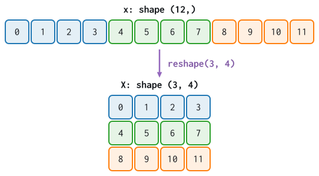

```{.python .input}
%load_ext d2lbook.tab
tab.interact_select('mxnet', 'pytorch', 'tensorflow', 'jax')
```

# Data Manipulation
:label:`sec_ndarray`

In order to get anything done in machine learning, we need some way to store and manipulate data. Generally, there are two important things we need to do with data: (i) acquire them, and (ii) process them once they are inside the computer. There is no point in acquiring data without a way to represent and compute with them efficiently, so let us start by getting our hands dirty with $n$-dimensional arrays, which in deep learning we call *tensors*.

Consider a simple concrete operation to see why specialized array containers are indispensable. When we train an image classifier, we process photographs in small groups called *minibatches*. A single minibatch of $256$ grayscale photographs, each of resolution $28 \times 28$ pixels, contains $256 \times 28 \times 28 = 200{,}704$ numbers. Image files typically store each pixel as an integer between $0$ and $255$, and before feeding the images into a neural network we rescale every pixel to a floating-point number in $[0, 1]$ by dividing by $255$. In plain Python, rescaling that one minibatch would require three nested loops over the images, rows, and columns, forcing the interpreter to execute $200{,}704$ separate scalar divisions one at a time. In a tensor library, the entire operation is written as a single expression, `images / 255`, which dispatches to compiled C++ or CUDA kernels that divide all $200{,}704$ numbers in parallel on a CPU or GPU. Throughout deep learning, we write code that operates on whole tensors at once rather than iterating over individual scalar elements in Python loops.

If you already know the NumPy scientific computing package :cite:`Harris.Millman.Walt.ea.2020`, this section will be a breeze. Across all modern deep learning frameworks, the *tensor class* (`ndarray` in MXNet, `Tensor` in PyTorch and TensorFlow, and `jax.Array` in JAX) closely mirrors NumPy's `ndarray`, with two killer features added:

1. **Hardware acceleration:** whereas NumPy runs exclusively on CPUs, framework tensors can reside on and execute operations across GPUs and specialized AI accelerators.
2. **Automatic differentiation:** deep learning frameworks can automatically track computations on tensors and compute their derivatives via backpropagation (:numref:`sec_autograd`).

Together, these two capabilities make neural networks both concise to express and fast to execute. In this section, we cover how to create tensors and inspect their shape and data type, how to reshape, slice, index, and modify their entries, and how to compute across whole tensors using elementwise operations, broadcasting, and concatenation. We conclude with the memory semantics of in-place updates and zero-copy conversions to and from NumPy. Throughout, a minibatch of $256$ grayscale images serves as our running example.

:begin_tab:`mxnet`
To start, we import MXNet's NumPy-compatible array module under the alias `mnp` (so that `np` can continue to refer unambiguously to standard NumPy) along with `npx` (`numpy_extension`), which contains deep learning extensions. Calling `npx.set_np()` activates NumPy-compatible tensor semantics across MXNet.
:end_tab:

:begin_tab:`pytorch`
To start, we import the PyTorch library. Note that the Python package is named `torch`.
:end_tab:

:begin_tab:`tensorflow`
To start, we import TensorFlow under its customary alias `tf`.
:end_tab:

:begin_tab:`jax`
To start, we import `jax` and its NumPy-compatible array interface `jax.numpy` under its customary alias `jnp`.
:end_tab:

```{.python .input #ndarray-getting-started-1}
%%tab mxnet
from mxnet import np as mnp, npx
npx.set_np()
```

```{.python .input #ndarray-getting-started-1}
%%tab pytorch
import torch
```

```{.python .input #ndarray-getting-started-1}
%%tab tensorflow
import tensorflow as tf
```

```{.python .input #ndarray-getting-started-1}
%%tab jax
import random
import jax
from jax import numpy as jnp
```

## Tensor Creation

### Shape

A tensor represents a (possibly multidimensional) array of numerical values arranged along one or more *axes*. In the one-dimensional case---when only a single axis is needed---a tensor is called a *vector*. With two axes, a tensor is called a *matrix*. With $k > 2$ axes, we drop the specialized names and refer to the object as a $k^\textrm{th}$-*order tensor* (its number of axes is its *order*, exposed in code as `ndim`). Our running minibatch of grayscale images is a $4^\textrm{th}$-order tensor: axis $0$ indexes the image in the batch, axis $1$ indexes the color channel (a grayscale image has $1$ channel, whereas an RGB image has $3$), axis $2$ indexes the vertical pixel row, and axis $3$ indexes the horizontal pixel column.

To create a first tensor, we can call `arange(n)`, which returns a vector of evenly spaced values starting at $0$ (included) and ending at $n$ (not included) with a default step size of $1$. Unless otherwise specified, newly created tensors reside in main memory for CPU-based computation. Here we request 32-bit floating-point values (`float32`), the default working precision of deep learning:

:begin_tab:`tensorflow`
In TensorFlow, this function is named `tf.range`.
:end_tab:

```{.python .input #ndarray-getting-started-2}
%%tab mxnet
x = mnp.arange(12)
x
```

```{.python .input #ndarray-getting-started-2}
%%tab pytorch
x = torch.arange(12, dtype=torch.float32)
x
```

```{.python .input #ndarray-getting-started-2}
%%tab tensorflow
x = tf.range(12, dtype=tf.float32)
x
```

```{.python .input #ndarray-getting-started-2}
%%tab jax
x = jnp.arange(12, dtype=jnp.float32)
x
```

Each value stored in a tensor is called an *element*. Our vector `x` contains $12$ elements. We can query the total number of elements in a tensor---its *size*---as follows:

:begin_tab:`pytorch`
In PyTorch, the total element count is returned by the `numel()` method ("number of elements").
:end_tab:

```{.python .input #ndarray-getting-started-3}
%%tab mxnet, jax
x.size
```

```{.python .input #ndarray-getting-started-3}
%%tab pytorch
x.numel()
```

```{.python .input #ndarray-getting-started-3}
%%tab tensorflow
tf.size(x)
```

We can inspect a tensor's *shape*---the tuple listing its length along each axis---via its `shape` attribute. Because `x` is a one-dimensional vector, its `shape` tuple contains a single entry equal to its size:

```{.python .input #ndarray-getting-started-4}
x.shape
```

:numref:`fig_ndarray_shapes` illustrates tensors with zero, one, two, and three axes. A single standalone number---a *scalar*---is a $0^\textrm{th}$-order tensor with no axes and an empty shape `()`. For any tensor, the total number of elements (its size) equals the product of the lengths in its shape tuple. For our minibatch of grayscale images of shape $(256, 1, 28, 28)$, the size is $256 \times 1 \times 28 \times 28 = 200{,}704$.


:label:`fig_ndarray_shapes`

### Data Types

Every tensor also carries a *data type* (`dtype`) that specifies the binary representation of each element. Deep learning models perform most of their arithmetic in 32-bit floating point (`float32`), which uses $4$ bytes per element and retains roughly $7$ decimal digits of precision---fewer digits than a pocket scientific calculator displays, yet more than enough for gradient-based learning.

Other data modalities call for different types. Raw image pixels are typically stored as 8-bit unsigned integers (`uint8`), occupying just $1$ byte per pixel to represent integers from $0$ to $255$. A tensor's `dtype` directly determines its memory footprint: our $200{,}704$-pixel image minibatch occupies $200{,}704$ bytes ($\approx 0.2\textrm{ MB}$) as `uint8`, and four times as much ($\approx 0.8\textrm{ MB}$) once converted to `float32`. When training large foundation models, practitioners routinely use 16-bit floating-point formats (`float16` or `bfloat16`), cutting memory consumption and memory-bandwidth traffic in half again (:numref:`sec_numerics`).

:begin_tab:`mxnet`
MXNet creates `float32` arrays by default even when passed integer arguments, so `mnp.arange(12)` above required no explicit `dtype`. You can cast an array to another type with `astype`, as in `x.astype('int32')`.
:end_tab:

:begin_tab:`pytorch`
When given integer arguments, `torch.arange` defaults to 64-bit integers (`int64`), which is why we passed `dtype=torch.float32` explicitly above. You can cast a tensor to another type with the `to` method, as in `x.to(torch.int32)`.
:end_tab:

:begin_tab:`tensorflow`
When given integer arguments, `tf.range` defaults to 32-bit integers (`int32`), which is why we passed `dtype=tf.float32` explicitly above. You can cast a tensor to another type with `tf.cast(x, tf.int32)`.
:end_tab:

:begin_tab:`jax`
When given integer arguments, `jnp.arange` defaults to 32-bit integers (`int32`), which is why we passed `dtype=jnp.float32` explicitly above. You can cast an array to another type with `astype`, as in `x.astype(jnp.int32)`.
:end_tab:

### Initial Values

Practitioners frequently need to initialize tensors with constant values, such as all $0$s or all $1$s (for example, to initialize bias vectors or accumulation buffers). The functions `zeros` and `ones` construct a tensor of any desired shape filled with $0$s or $1$s. Here we construct a $3^\textrm{rd}$-order tensor of zeros with shape $(2, 3, 4)$, matching the right-most panel of :numref:`fig_ndarray_shapes`:

```{.python .input #ndarray-getting-started-6}
%%tab mxnet
mnp.zeros((2, 3, 4))
```

```{.python .input #ndarray-getting-started-6}
%%tab pytorch
torch.zeros((2, 3, 4))
```

```{.python .input #ndarray-getting-started-6}
%%tab tensorflow
tf.zeros((2, 3, 4))
```

```{.python .input #ndarray-getting-started-6}
%%tab jax
jnp.zeros((2, 3, 4))
```

Most weight matrices of a neural network, however, must be initialized by sampling each element randomly and independently from a probability distribution (we will see why identical initial weights break symmetry in :numref:`sec_numerical_stability`). The snippet below creates a $3 \times 4$ matrix whose entries are drawn independently from a standard Gaussian (normal) distribution with mean $0$ and standard deviation $1$---a bell-shaped distribution that places roughly $95\%$ of its draws between $-2$ and $2$:

```{.python .input #ndarray-getting-started-8}
%%tab mxnet
mnp.random.normal(0, 1, size=(3, 4))
```

```{.python .input #ndarray-getting-started-8}
%%tab pytorch
torch.randn(3, 4)
```

```{.python .input #ndarray-getting-started-8}
%%tab tensorflow
tf.random.normal(shape=[3, 4])
```

```{.python .input #ndarray-getting-started-8}
%%tab jax
# A key determines the sample: the same key always gives the same numbers
key = jax.random.key(random.getrandbits(32))  # A new seed on each run
jax.random.normal(key, (3, 4))
```

Because fresh random draws vary from run to run, unseeded random initialization can be inconvenient when debugging code or reproducing an exact numerical trace. Of course, computer-generated "random" numbers are actually *pseudorandom*: a deterministic algorithm computes them from an initial integer state called the *seed*, so resetting the generator to the same seed reproduces the exact same sequence of numbers. Below, `a` and `c` are drawn immediately after setting the seed to `42` and are therefore identical, whereas `b` is drawn after the generator's internal state has advanced:

:begin_tab:`mxnet`
MXNet maintains a global random number generator that advances on each draw and is reset via `mnp.random.seed`.
:end_tab:

:begin_tab:`pytorch`
PyTorch maintains a global random number generator that advances on each draw and is reset via `torch.manual_seed`.
:end_tab:

:begin_tab:`tensorflow`
TensorFlow maintains a global random number generator that advances on each draw and is reset via `tf.random.set_seed`.
:end_tab:

:begin_tab:`jax`
Because JAX is purely functional, it has no hidden global random state. Every random function takes an explicit PRNG *key*, and `jax.random.split` deterministically derives new, statistically independent subkeys from an existing key.
:end_tab:

```{.python .input #ndarray-initial-values-1}
%%tab mxnet
mnp.random.seed(42)
a = mnp.random.normal(size=3)
b = mnp.random.normal(size=3)  # The generator has moved on
mnp.random.seed(42)
c = mnp.random.normal(size=3)  # Same seed: c repeats a
a, b, c
```

```{.python .input #ndarray-initial-values-1}
%%tab pytorch
torch.manual_seed(42)
a = torch.randn(3)
b = torch.randn(3)  # The generator has moved on
torch.manual_seed(42)
c = torch.randn(3)  # Same seed: c repeats a
a, b, c
```

```{.python .input #ndarray-initial-values-1}
%%tab tensorflow
tf.random.set_seed(42)
a = tf.random.normal([3])
b = tf.random.normal([3])  # The generator has moved on
tf.random.set_seed(42)
c = tf.random.normal([3])  # Same seed: c repeats a
print(a, b, c, sep='\n')
```

```{.python .input #ndarray-initial-values-1}
%%tab jax
key_a, key_b = jax.random.split(jax.random.key(42))
a = jax.random.normal(key_a, (3,))
b = jax.random.normal(key_b, (3,))  # A different key
c = jax.random.normal(key_a, (3,))  # Same key: c repeats a
a, b, c
```

Note that most training experiments in the *Basics* part deliberately avoid fixing a magic random seed. Every training run starts from freshly drawn initial weights and shuffles its minibatches in a new random order, so any single run represents one draw from a distribution of outcomes. Consequently, when you execute a notebook yourself, the numbers on your screen will differ slightly from the saved outputs printed in the text. That is why we report experimental accuracies and losses in the prose as realistic intervals---such as *"between $82\%$ and $84\%$*"---reflecting the spread observed across repeated unseeded runs rather than pretending that a four-decimal-place result from one lucky seed is universal truth.

We can also construct a tensor by supplying the exact numerical values directly as (possibly nested) Python lists. Below, we construct a $3 \times 4$ matrix from a list of three lists, where the outer list runs along axis $0$ (rows) and each inner list runs along axis $1$ (columns):

```{.python .input #ndarray-getting-started-9}
%%tab mxnet
mnp.array([[2, 1, 4, 3], [1, 2, 3, 4], [4, 3, 2, 1]])
```

```{.python .input #ndarray-getting-started-9}
%%tab pytorch
torch.tensor([[2, 1, 4, 3], [1, 2, 3, 4], [4, 3, 2, 1]])
```

```{.python .input #ndarray-getting-started-9}
%%tab tensorflow
tf.constant([[2, 1, 4, 3], [1, 2, 3, 4], [4, 3, 2, 1]])
```

```{.python .input #ndarray-getting-started-9}
%%tab jax
jnp.array([[2, 1, 4, 3], [1, 2, 3, 4], [4, 3, 2, 1]])
```

We now have everything we need to construct our running minibatch of $256$ grayscale images. Until we load real clothing photographs in :numref:`chap_classification`, we populate `images` with random integers in $\{0, \ldots, 255\}$ stored as `uint8`. Visually, these synthetic images look like television static rather than shirts, but their shape and data type are identical to a real minibatch:

```{.python .input #ndarray-initial-values-2}
%%tab mxnet
# 256 grayscale images of 28 x 28 pixels, each pixel an integer in [0, 255]
images = mnp.random.randint(0, 256, size=(256, 1, 28, 28)).astype('uint8')
images.shape, images.dtype
```

```{.python .input #ndarray-initial-values-2}
%%tab pytorch
# 256 grayscale images of 28 x 28 pixels, each pixel an integer in [0, 255]
images = torch.randint(0, 256, (256, 1, 28, 28), dtype=torch.uint8)
images.shape, images.dtype
```

```{.python .input #ndarray-initial-values-2}
%%tab tensorflow
# 256 grayscale images of 28 x 28 pixels, each pixel an integer in [0, 255];
# TensorFlow draws random integers as int32 or int64, so we cast them
images = tf.random.uniform((256, 1, 28, 28), maxval=256, dtype=tf.int32)
images = tf.cast(images, tf.uint8)
images.shape, images.dtype
```

```{.python .input #ndarray-initial-values-2}
%%tab jax
# 256 grayscale images of 28 x 28 pixels, each pixel an integer in [0, 255]
key, subkey = jax.random.split(key)
images = jax.random.randint(subkey, (256, 1, 28, 28), 0, 256,
                            dtype=jnp.uint8)
images.shape, images.dtype
```

The resulting shape tuple `(256, 1, 28, 28)` tells us at a glance that we have $256$ images, $1$ grayscale channel, $28$ pixel rows, and $28$ pixel columns.

## Reshaping and Indexing

### Reshaping

We often need to rearrange the axes of a tensor without altering its underlying numerical values or total size. For example, a linear classifier that treats each $28 \times 28$ image as a flat vector of $784$ pixel intensities needs our image minibatch reshaped into a two-dimensional matrix of shape $(256, 784)$, with one image per row. Calling `reshape` reconfigures a tensor's shape while preserving both its element count and their linear order in memory. To see this on a small example, let us reshape our 12-element vector `x` of shape `(12,)` into a $3 \times 4$ matrix `X`. Notice that the elements are laid out one row at a time (row-major order), so that `x[3]` lands at `X[0, 3]` (:numref:`fig_ndarray_reshape`):


:label:`fig_ndarray_reshape`

```{.python .input #ndarray-getting-started-5}
%%tab mxnet, pytorch, jax
X = x.reshape(3, 4)
X
```

```{.python .input #ndarray-getting-started-5}
%%tab tensorflow
X = tf.reshape(x, (3, 4))
X
```

Note that specifying every single dimension to `reshape` is redundant: because the total size $n$ is fixed, knowing all but one dimension uniquely determines the remaining one (for a matrix of size $n$ and height $h$, the width must be $w = n/h$). By passing `-1` for the dimension we want the framework to deduce automatically, we could equivalently have written `x.reshape(-1, 4)` or `x.reshape(3, -1)`. Using `-1` is especially convenient when flattening our image minibatch into a matrix of $256$ rows without multiplying $1 \times 28 \times 28 = 784$ by hand:

:begin_tab:`tensorflow`
In TensorFlow, `reshape` is called as a standalone function `tf.reshape(x, (-1, 4))` rather than a tensor method.
:end_tab:

```{.python .input #ndarray-reshaping-1}
%%tab mxnet, pytorch, jax
images.reshape(256, -1).shape
```

```{.python .input #ndarray-reshaping-1}
%%tab tensorflow
tf.reshape(images, (256, -1)).shape
```

We can also insert or remove singleton axes (axes of length $1$) without touching the underlying elements. Extracting the very first image from our minibatch via `images[0]` yields a tensor of shape $(1, 28, 28)$. If we want to pass that single image into a neural network layer that expects a 4D minibatch, we must insert a leading batch axis of length $1$ to obtain shape $(1, 1, 28, 28)$; conversely, if we want to display the image with a 2D plotting routine, we must strip away the singleton channel axis to obtain shape $(28, 28)$. Indexing with `None` inserts a new axis of length $1$ at that position, while `squeeze` removes an axis of length $1$:

:begin_tab:`pytorch`
In PyTorch, `image.unsqueeze(0)` also inserts a singleton axis at position `0`.
:end_tab:

:begin_tab:`tensorflow`
In TensorFlow, `squeeze` is invoked as the function `tf.squeeze`.
:end_tab:

```{.python .input #ndarray-reshaping-2}
%%tab mxnet, pytorch, jax
image = images[0]
image[None].shape, image.squeeze(0).shape
```

```{.python .input #ndarray-reshaping-2}
%%tab tensorflow
image = images[0]
image[None].shape, tf.squeeze(image, 0).shape
```

### Indexing and Slicing

Just as with standard Python lists, we can access tensor elements by integer indexing (starting at $0$ from the front, or using negative indices to count backward from the end) and extract contiguous ranges via slicing (`start:stop`, which includes `start` *but excludes* `stop`). Indices across multiple axes are separated by commas, and when fewer indices than axes are provided, the missing trailing axes default to a full slice `:`. Thus, on our $3 \times 4$ matrix `X`, `X[-1]` selects the last row and `X[1:3]` selects the second and third rows:

```{.python .input #ndarray-indexing-and-slicing-1}
X[-1], X[1:3]
```

Pay close attention to the difference in shape between those two outputs (:numref:`fig_ndarray_index`). Indexing with a single integer (`X[-1]`) collapses that axis, reducing the $2^\textrm{nd}$-order matrix to a $1^\textrm{st}$-order vector of shape `(4,)`. Slicing (`X[1:3]`), by contrast, preserves the axis, returning a $2^\textrm{nd}$-order matrix of shape `(2, 4)` (and similarly, `X[-1:]` would return a 1-row matrix of shape `(1, 4)`). Keeping track of whether an indexing operation collapses or preserves an axis will save you from many shape-mismatch bugs.

![Indexing a $3 \times 4$ matrix. The integer index `X[-1]` selects the last row and removes axis 0, leaving shape $(4,)$. The slice `X[1:3]` selects rows 1 and 2 and keeps axis 0, leaving shape $(2, 4)$.](../img/ndarray-index-read.svg)
:label:`fig_ndarray_index`

Applying the same rules to our image minibatch of shape $(256, 1, 28, 28)$: `images[0]` extracts the first image of shape $(1, 28, 28)$, `images[:32]` slices out a sub-batch of the first $32$ images of shape $(32, 1, 28, 28)$, and `images[:, 0, 14, 14]` extracts the center pixel at row $14$, column $14$ across all $256$ images as a vector of shape $(256,)$:

```{.python .input #ndarray-indexing-and-slicing-4}
images[0].shape, images[:32].shape, images[:, 0, 14, 14].shape
```

We can also index a tensor using *other tensors* of integer coordinates---a powerful operation known as *integer array indexing* (or *gather*). Passing two 1D integer tensors `rows` and `cols` of equal length extracts one element `(rows[k], cols[k])` for each coordinate pair. We will use this pattern in classification (:numref:`chap_classification`) to pluck out the predicted probability assigned to each example's true target class from a matrix of class probabilities. Because `X` holds the integers $0$ through $11$ row by row, pairing rows $(0, 1, 2)$ with columns $(3, 0, 2)$ selects `X[0, 3]`, `X[1, 0]`, and `X[2, 2]`, which equal $3$, $4$, and $10$:

:begin_tab:`tensorflow`
TensorFlow tensors do not support paired integer-tensor indexing inside square brackets; instead, `tf.gather(X, cols, batch_dims=1)` gathers the entry at column `cols[i]` from each row `i` of `X`:
:end_tab:

```{.python .input #ndarray-indexing-and-slicing-5}
%%tab mxnet
rows, cols = mnp.arange(3), mnp.array([3, 0, 2])
X[rows, cols]
```

```{.python .input #ndarray-indexing-and-slicing-5}
%%tab pytorch
rows, cols = torch.arange(3), torch.tensor([3, 0, 2])
X[rows, cols]
```

```{.python .input #ndarray-indexing-and-slicing-5}
%%tab tensorflow
cols = tf.constant([3, 0, 2])
tf.gather(X, cols, batch_dims=1)
```

```{.python .input #ndarray-indexing-and-slicing-5}
%%tab jax
rows, cols = jnp.arange(3), jnp.array([3, 0, 2])
X[rows, cols]
```

Similarly, we can index a tensor with a *Boolean mask*---a tensor of `True`/`False` values having the same shape as `X`. Evaluating an elementwise inequality such as `X > 2` produces a Boolean mask, and we can combine masks using bitwise logical operators (`&` for *and*, `|` for *or*, `~` for *not*). Indexing `X[mask]` extracts all elements where the mask is `True`. Because the matching positions need not form a rectangular subgrid, `X[mask]` always returns a flattened 1D vector:

:begin_tab:`jax`
Because the output length of `X[mask]` depends on the runtime data values inside `mask`, Boolean mask indexing can only be used in eager mode outside `jax.jit`-compiled functions. Inside compiled JAX functions, use `jnp.where` (shown next), whose output shape is fixed statically.
:end_tab:

```{.python .input #ndarray-indexing-and-slicing-6}
mask = (X > 2) & (X < 8)
X[mask]
```

When we want to filter or replace values conditionally while *preserving* the original tensor shape, we use `where(mask, A, B)`, which selects the entry from `A` wherever `mask` is `True` and from `B` wherever `mask` is `False`. Passing a scalar constant for `A` or `B` applies that scalar everywhere, so the call below zeroes out every entry of `X` that falls outside the mask while keeping its $3 \times 4$ shape intact:

```{.python .input #ndarray-indexing-and-slicing-7}
%%tab mxnet
mnp.where(mask, X, 0)
```

```{.python .input #ndarray-indexing-and-slicing-7}
%%tab pytorch
torch.where(mask, X, 0)
```

```{.python .input #ndarray-indexing-and-slicing-7}
%%tab tensorflow
tf.where(mask, X, 0)
```

```{.python .input #ndarray-indexing-and-slicing-7}
%%tab jax
jnp.where(mask, X, 0)
```

### Writing Elements

Beyond reading elements, how do we modify them? Here our four frameworks split into two design camps. MXNet and PyTorch tensors are *mutable*: standard indexed assignment (`X[i, j] = val`) overwrites the underlying memory in place. TensorFlow and JAX tensors, by contrast, are *immutable*: once a tensor is created, its contents can never be altered in place (allowing functional compilers to optimize computation graphs safely).

In mutable frameworks, writing elements also exposes an important subtlety about `reshape`. When we reshaped our 12-element vector `x` into the $3 \times 4$ matrix `X` earlier, did the library copy the $12$ numbers into a new buffer? When possible, it avoids the copy: because the elements of `x` and the row-major elements of `X` occupy the exact same contiguous sequence in memory, the library simply creates a new tensor header---called a *view*---that points to the same underlying memory buffer with a new shape `(3, 4)`. Whenever two tensors share storage as views, mutating an element through one variable immediately alters the value seen through the other:

:begin_tab:`mxnet, pytorch`
We assign `17` to `X[1, 2]` (row $1$, column $2$, which corresponds to flat index $1 \times 4 + 2 = 6$) and print both `X` and the original vector `x`:
:end_tab:

:begin_tab:`tensorflow`
Because ordinary TensorFlow `Tensor`s are immutable, mutable state (such as learnable model parameters) is stored in a `tf.Variable` container, whose entries can be modified in place via `.assign()`:
:end_tab:

:begin_tab:`jax`
Because JAX arrays are immutable, JAX provides functional index-update syntax `X.at[1, 2].set(17)`, which returns a new array identical to `X` except at position `(1, 2)`, leaving `X` itself untouched:
:end_tab:

```{.python .input #ndarray-indexing-and-slicing-2}
%%tab mxnet, pytorch
X[1, 2] = 17
X, x
```

```{.python .input #ndarray-indexing-and-slicing-2}
%%tab tensorflow
X_var = tf.Variable(X)
X_var[1, 2].assign(17)
X_var
```

```{.python .input #ndarray-indexing-and-slicing-2}
%%tab jax
X_new = X.at[1, 2].set(17)  # X is unchanged
X_new
```

:begin_tab:`mxnet`
In MXNet, `x[6]` remains `6.0` because MXNet's `reshape` allocated a fresh copy of the data.
:end_tab:

:begin_tab:`pytorch`
In PyTorch, notice that `x[6]` has changed to `17.` even though we only assigned to `X[1, 2]`! That is because PyTorch's `reshape` returned a zero-copy *view* sharing storage with `x`. (Whenever a tensor's memory layout is non-contiguous so that a view is impossible, `reshape` falls back to copying the data automatically.)
:end_tab:

If we want to assign the same value to an entire block of elements at once, we can index with a slice on the left-hand side of the update. For instance, `[:2, :]` selects the first two rows across all columns:

```{.python .input #ndarray-indexing-and-slicing-3}
%%tab mxnet, pytorch
X[:2, :] = 12
X
```

```{.python .input #ndarray-indexing-and-slicing-3}
%%tab tensorflow
X_var[:2, :].assign(12)
X_var
```

```{.python .input #ndarray-indexing-and-slicing-3}
%%tab jax
X_new = X_new.at[:2, :].set(12)
X_new
```

## Operations

### Elementwise Operations

Now that we know how to construct tensors and access their elements, we can manipulate them with mathematical operations. Among the most fundamental are *elementwise* operations. Given a binary scalar operator $f: \mathbb{R}, \mathbb{R} \to \mathbb{R}$ (mapping a pair of real numbers to a real number) and any two tensors $\mathbf{u}$ and $\mathbf{v}$ *of identical shape*, we can *lift* $f$ to an elementwise tensor operation $\mathbf{c} = F(\mathbf{u}, \mathbf{v})$ by evaluating $c_i = f(u_i, v_i)$ independently at every coordinate $i$. All of the standard Python arithmetic operators---addition (`+`), subtraction (`-`), multiplication (`*`), division (`/`), and exponentiation (`**`)---have been lifted to operate elementwise on identically shaped tensors of any order:

```{.python .input #ndarray-operations-2}
%%tab mxnet
x = mnp.array([1.0, 2, 4, 8])
y = mnp.array([2.0, 2, 2, 2])
x + y, x - y, x * y, x / y, x ** y
```

```{.python .input #ndarray-operations-2}
%%tab pytorch
x = torch.tensor([1.0, 2, 4, 8])
y = torch.tensor([2.0, 2, 2, 2])
x + y, x - y, x * y, x / y, x ** y
```

```{.python .input #ndarray-operations-2}
%%tab tensorflow
x = tf.constant([1.0, 2, 4, 8])
y = tf.constant([2.0, 2, 2, 2])
x + y, x - y, x * y, x / y, x ** y
```

```{.python .input #ndarray-operations-2}
%%tab jax
x = jnp.array([1.0, 2, 4, 8])
y = jnp.array([2.0, 2, 2, 2])
x + y, x - y, x * y, x / y, x ** y
```

Every output above retains the exact shape of `x` and `y`, with each coordinate computed purely from the corresponding entries of the inputs (`x / y` halves each entry of `x`, while `x ** y` squares it).

In the exact same way, unary scalar functions $f: \mathbb{R} \to \mathbb{R}$, such as the exponential function $e^x$, apply independently to every element of a tensor:

```{.python .input #ndarray-operations-1}
%%tab mxnet
mnp.exp(x)
```

```{.python .input #ndarray-operations-1}
%%tab pytorch
torch.exp(x)
```

```{.python .input #ndarray-operations-1}
%%tab tensorflow
tf.exp(x)
```

```{.python .input #ndarray-operations-1}
%%tab jax
jnp.exp(x)
```

We are now ready to perform the image-rescaling operation from the opening of this section. Dividing our `uint8` image minibatch `images` by `255` divides all $200{,}704$ pixel intensities at once and promotes the result to `float32` (true division `/` in Python and tensor libraries always returns floating-point numbers, whereas integer addition or multiplication on `uint8` tensors stays in `uint8` and can silently overflow, as you will explore in the exercises). Strictly speaking, `images / 255` combines a 4D tensor with a scalar rather than two tensors of identical shape---a preview of *broadcasting*, which we formalize in the very next subsection:

```{.python .input #ndarray-elementwise-operations-1}
scaled = images / 255
print(scaled.dtype, images[0, 0, 0, :4], scaled[0, 0, 0, :4], sep='\n')
```

As promised, `scaled` has type `float32`, and the first four pixels of the top row of the first image---originally integers in $[0, 255]$---are now floating-point numbers in $[0, 1]$.

Logical comparisons such as `x == y` or `X > 2` are elementwise binary operations as well, returning a Boolean tensor of the same shape containing `True` wherever the relation holds and `False` elsewhere:

```{.python .input #ndarray-operations-4}
x == y
```

Of course, not every tensor operation is elementwise. *Reduction* operations collapse one or more axes into summary statistics: for instance, calling `sum()` aggregates all elements of a tensor into a single scalar ($0^\textrm{th}$-order tensor). When we sum a Boolean tensor, `True` is treated as $1$ and `False` as $0$, so `(x == y).sum()` counts how many entries match---the exact idiom we will use to count how many examples in a minibatch a classifier predicted correctly:

:begin_tab:`tensorflow`
In TensorFlow, summation is called `tf.reduce_sum`, and Boolean tensors must be cast to a numeric type via `tf.cast` before summing.
:end_tab:

```{.python .input #ndarray-operations-5}
%%tab mxnet, pytorch, jax
x.sum(), (x == y).sum()
```

```{.python .input #ndarray-operations-5}
%%tab tensorflow
tf.reduce_sum(x), tf.reduce_sum(tf.cast(x == y, tf.int32))
```

Reductions can also be restricted to specific axes (such as summing along rows or columns while preserving the remaining dimensions), as we will see in :numref:`subsec_lin-alg-reduction`.

### Broadcasting
:label:`subsec_broadcasting`

Thus far, we have seen how to perform elementwise binary operations on two tensors of identical shape. In practice, however, we constantly need to combine tensors of *different* shapes: for instance, adding a 1D bias vector (with one entry per output feature) to every row of a 2D minibatch matrix, or subtracting a per-channel mean from every pixel of an image batch. Materializing explicit copies of the smaller vector for every example in the minibatch just to make the shapes match would waste both memory and memory bandwidth.

Instead, under well-defined compatibility conditions, tensor libraries perform elementwise operations across differently shaped tensors automatically by invoking the *broadcasting mechanism* inherited from NumPy. To see broadcasting in action, let us add a 4-element vector `v` to our $3 \times 4$ matrix `X`:

```{.python .input #ndarray-broadcasting-4}
%%tab mxnet
X = mnp.arange(12).reshape(3, 4)
v = mnp.array([100.0, 200, 300, 400])
X + v
```

```{.python .input #ndarray-broadcasting-4}
%%tab pytorch
X = torch.arange(12, dtype=torch.float32).reshape(3, 4)
v = torch.tensor([100.0, 200, 300, 400])
X + v
```

```{.python .input #ndarray-broadcasting-4}
%%tab tensorflow
X = tf.reshape(tf.range(12, dtype=tf.float32), (3, 4))
v = tf.constant([100.0, 200, 300, 400])
X + v
```

```{.python .input #ndarray-broadcasting-4}
%%tab jax
X = jnp.arange(12, dtype=jnp.float32).reshape(3, 4)
v = jnp.array([100.0, 200, 300, 400])
X + v
```

Notice that `v` was added to every row of `X`.

Broadcasting follows a simple two-step rule that is well worth committing to memory:
1. **Align shapes from the right and check compatibility:** Line up the shape tuples of the two tensors starting from their *trailing* (right-most) axis, prepending $1$s on the left of the lower-order tensor's shape if one tensor has fewer axes. Two aligned dimensions are compatible if they are equal, or if one of them is $1$.
2. **Stretch singleton axes and apply elementwise:** Along every axis where one tensor has length $1$ and the other has length $k > 1$, the library virtually replicates (stretches) the length-$1$ slice $k$ times without copying memory, and then applies the elementwise operation to the resulting identically shaped arrays.

If any pair of aligned dimensions differs and neither is $1$, the library raises a shape-mismatch error rather than guessing. For `X + v` above, aligning `(3, 4)` and `(4,)` from the right yields `(3, 4)` and `(1, 4)`, so the single row of `v` is broadcast across all $3$ rows of `X`. Similarly, our image rescaling `images / 255` combined a tensor of shape `(256, 1, 28, 28)` with a scalar of shape `()`, which prepends four $1$s to become `(1, 1, 1, 1)` and broadcasts across all four axes.

Both operands can be stretched simultaneously along different axes. In :numref:`fig_ndarray_broadcasting`, `a` is a $3 \times 1$ column vector and `b` is a $1 \times 2$ row vector:


:label:`fig_ndarray_broadcasting`

```{.python .input #ndarray-broadcasting-1}
%%tab mxnet
a = mnp.arange(3).reshape(3, 1)
b = mnp.arange(2).reshape(1, 2)
a, b
```

```{.python .input #ndarray-broadcasting-1}
%%tab pytorch
a = torch.arange(3).reshape(3, 1)
b = torch.arange(2).reshape(1, 2)
a, b
```

```{.python .input #ndarray-broadcasting-1}
%%tab tensorflow
a = tf.reshape(tf.range(3), (3, 1))
b = tf.reshape(tf.range(2), (1, 2))
a, b
```

```{.python .input #ndarray-broadcasting-1}
%%tab jax
a = jnp.arange(3).reshape(3, 1)
b = jnp.arange(2).reshape(1, 2)
a, b
```

Because `(3, 1)` and `(1, 2)` do not match directly, broadcasting replicates `a` across the $2$ columns and `b` across the $3$ rows to produce a $3 \times 2$ matrix containing every pairwise sum $a_{i,0} + b_{0,j}$:

```{.python .input #ndarray-broadcasting-2}
a + b
```

What happens when two shapes are incompatible? If we attempt to add a matrix of shape `(3, 2)` and a matrix of shape `(2, 3)`, aligning them from the right pairs $2$ with $3$ on axis $1$ and $3$ with $2$ on axis $0$. Neither dimension is $1$, so every framework rejects the operation with an error:

:begin_tab:`mxnet`
MXNet includes a C++ stack trace in its exception message, so we print the final summary line:
:end_tab:

:begin_tab:`tensorflow`
TensorFlow's exception message includes the device placement and op name, so we print the exception class name:
:end_tab:

```{.python .input #ndarray-broadcasting-3}
%%tab mxnet
try:
    mnp.ones((3, 2)) + mnp.ones((2, 3))
except Exception as e:
    print(str(e).splitlines()[-1].rsplit(': ', 1)[-1])
```

```{.python .input #ndarray-broadcasting-3}
%%tab pytorch
try:
    torch.ones((3, 2)) + torch.ones((2, 3))
except Exception as e:
    print(e)
```

```{.python .input #ndarray-broadcasting-3}
%%tab tensorflow
try:
    tf.ones((3, 2)) + tf.ones((2, 3))
except Exception as e:
    print(type(e).__name__)
```

```{.python .input #ndarray-broadcasting-3}
%%tab jax
try:
    jnp.ones((3, 2)) + jnp.ones((2, 3))
except Exception as e:
    print(e)
```

This right-alignment rule immediately tells us how to broadcast across our image minibatch. Subtracting a $28 \times 28$ mean image from `images` of shape `(256, 1, 28, 28)` works directly because `(28, 28)` aligns with the trailing two axes as `(1, 1, 28, 28)`. On the other hand, if we flatten `images` to shape `(256, 784)` and try to add a per-image offset vector of shape `(256,)`, broadcasting fails because `(256,)` aligns from the right against `784`! Reshaping the offset vector to a column `(256, 1)` (or indexing it as `offset[:, None]`) makes the shapes `(256, 784)` and `(256, 1)` compatible.

### Concatenation

Whereas broadcasting combines tensors element by element, *concatenation* stacks multiple tensors end to end along an existing axis to form a larger tensor. You simply supply a sequence of tensors whose lengths match on every axis *except* the concatenation axis, and specify which axis to join along. For example, concatenating two minibatches of $256$ images along axis $0$ produces a combined minibatch of $512$ images, whereas concatenating two feature tables for the same examples along axis $1$ widens each example's feature vector.

Below, we concatenate two $3 \times 4$ matrices `X` and `Y` first along rows (axis $0$) and then along columns (axis $1$). Along axis $0$, the output has $3 + 3 = 6$ rows and $4$ columns; along axis $1$, it has $3$ rows and $4 + 4 = 8$ columns:

```{.python .input #ndarray-operations-3}
%%tab mxnet
X = mnp.arange(12).reshape(3, 4)
Y = mnp.array([[2, 1, 4, 3], [1, 2, 3, 4], [4, 3, 2, 1]])
mnp.concatenate([X, Y], axis=0), mnp.concatenate([X, Y], axis=1)
```

```{.python .input #ndarray-operations-3}
%%tab pytorch
X = torch.arange(12, dtype=torch.float32).reshape(3, 4)
Y = torch.tensor([[2.0, 1, 4, 3], [1, 2, 3, 4], [4, 3, 2, 1]])
torch.cat((X, Y), dim=0), torch.cat((X, Y), dim=1)
```

```{.python .input #ndarray-operations-3}
%%tab tensorflow
X = tf.reshape(tf.range(12, dtype=tf.float32), (3, 4))
Y = tf.constant([[2.0, 1, 4, 3], [1, 2, 3, 4], [4, 3, 2, 1]])
tf.concat([X, Y], axis=0), tf.concat([X, Y], axis=1)
```

```{.python .input #ndarray-operations-3}
%%tab jax
X = jnp.arange(12, dtype=jnp.float32).reshape(3, 4)
Y = jnp.array([[2.0, 1, 4, 3], [1, 2, 3, 4], [4, 3, 2, 1]])
jnp.concatenate((X, Y), axis=0), jnp.concatenate((X, Y), axis=1)
```

When we instead want to join identically shaped tensors along a *brand-new* axis, we use `stack`. For instance, data loaders assemble a 4D minibatch of shape `(256, 1, 28, 28)` by stacking $256$ individual 3D images of shape `(1, 28, 28)` along a new leading axis $0$. Stacking our two $3 \times 4$ matrices `X` and `Y` along a new axis $0$ yields a tensor of shape `(2, 3, 4)`, whereas stacking them along a new axis $2$ yields shape `(3, 4, 2)`:

```{.python .input #ndarray-concatenation-1}
%%tab mxnet
mnp.stack([X, Y]).shape, mnp.stack([X, Y], axis=2).shape
```

```{.python .input #ndarray-concatenation-1}
%%tab pytorch
torch.stack((X, Y)).shape, torch.stack((X, Y), dim=2).shape
```

```{.python .input #ndarray-concatenation-1}
%%tab tensorflow
tf.stack([X, Y]).shape, tf.stack([X, Y], axis=2).shape
```

```{.python .input #ndarray-concatenation-1}
%%tab jax
jnp.stack((X, Y)).shape, jnp.stack((X, Y), axis=2).shape
```

## Memory and Conversion

### Allocation and In-Place Updates
:label:`subsec_saving_memory`

Running standard tensor operations allocates new memory to store the result. For example, if we write `Y = Y + X`, Python first evaluates `Y + X` in a newly allocated buffer, dereferences the tensor that `Y` previously pointed to, and rebinds the variable name `Y` to the new memory address. We can verify this behavior using Python's built-in `id()` function, which returns the unique memory identifier of an object:

```{.python .input #ndarray-saving-memory-1}
before = id(Y)
Y = Y + X
id(Y) == before
```

Unnecessary memory allocations can be undesirable for two reasons. First, in deep learning we routinely work with models holding hundreds of megabytes or gigabytes of parameters and update all of them many times per second; allocating fresh buffers on every parameter update would double peak memory consumption and waste precious memory bandwidth. Second, multiple parts of a program (such as a model layer and its optimizer) may hold references to the same parameter tensor; if an update rebound a local variable name instead of updating the storage *in place*, other references would continue pointing to stale parameter values. (One important caveat, which we will explore in :numref:`sec_autograd`, is that you must not overwrite an intermediate activation tensor in place if automatic differentiation still needs its original value to compute gradients during the backward pass.)

:begin_tab:`mxnet, pytorch`
In MXNet and PyTorch, performing an in-place assignment into a preallocated tensor `Z` is as simple as using slice notation on the left-hand side: `Z[:] = <expression>`. Here we initialize `Z` to have the same shape and `dtype` as `Y` using `zeros_like`, and verify that `id(Z)` remains unchanged after writing `X + Y` into it:
:end_tab:

:begin_tab:`tensorflow`
Because ordinary TensorFlow `Tensor`s are immutable, learnable parameters are stored in mutable `tf.Variable` containers. Calling `Z.assign(X + Y)` updates the storage of `Z` in place without changing `id(Z)`:
:end_tab:

:begin_tab:`jax`
Because JAX arrays are strictly immutable, eager expressions like `Y + X` or `X.at[...].set(...)` always return a new array object. In JAX, eliminating redundant allocations and reusing parameter buffers in place is handled automatically by the XLA compiler when you wrap your training step in `@jax.jit` (including its `donate_argnums` buffer-donation feature).
:end_tab:

```{.python .input #ndarray-saving-memory-2}
%%tab mxnet
Z = mnp.zeros_like(Y)
before = id(Z)
Z[:] = X + Y
id(Z) == before
```

```{.python .input #ndarray-saving-memory-2}
%%tab pytorch
Z = torch.zeros_like(Y)
before = id(Z)
Z[:] = X + Y
id(Z) == before
```

```{.python .input #ndarray-saving-memory-2}
%%tab tensorflow
Z = tf.Variable(tf.zeros_like(Y))
before = id(Z)
Z.assign(X + Y)
id(Z) == before
```

:begin_tab:`mxnet, pytorch`
Note that `Z[:] = X + Y` still evaluates `X + Y` in a temporary buffer before copying the result into `Z`. If the old value of `X` is no longer needed, we can use augmented assignment `X += Y` (or `X[:] = X + Y`) to add `Y` directly into `X`'s existing storage without allocating a temporary tensor:
:end_tab:

:begin_tab:`tensorflow`
On ordinary immutable TensorFlow `Tensor`s, `X += Y` is simply syntactic sugar for `X = X + Y` and therefore binds `X` to a newly allocated tensor (to update a `tf.Variable` in place, use `X_var.assign_add(Y)`):
:end_tab:

:begin_tab:`jax`
On immutable JAX arrays, `X += Y` is simply syntactic sugar for `X = X + Y`, binding `X` to a new array object:
:end_tab:

```{.python .input #ndarray-saving-memory-3}
before = id(X)
X += Y
id(X) == before
```

:begin_tab:`mxnet, pytorch`
As expected, `id(X) == before` evaluates to `True`: `X` was updated in place.
:end_tab:

:begin_tab:`tensorflow, jax`
Because `X` is an immutable tensor, `id(X) == before` evaluates to `False`: `X` now refers to the newly created sum tensor.
:end_tab:

### Conversion to Other Python Objects

Converting between deep learning framework tensors and standard NumPy arrays (or built-in Python scalars) is straightforward, and we do so frequently at the boundary with plotting libraries, pandas DataFrames, or SciPy routines. An important detail to keep in mind is whether the conversion allocates an independent copy or shares the underlying memory buffer.

:begin_tab:`mxnet`
Calling `X.asnumpy()` converts an MXNet `ndarray` to a NumPy `ndarray`, and `mnp.array(A)` converts it back. Both calls allocate an independent copy (waiting for any pending asynchronous GPU computation to finish before copying to host RAM).
:end_tab:

:begin_tab:`pytorch`
Calling `X.numpy()` converts a CPU PyTorch `Tensor` to a NumPy `ndarray`, and `torch.from_numpy(A)` converts a NumPy array back to a PyTorch `Tensor`. Crucially, on the CPU **neither operation copies data**: the PyTorch tensor and the NumPy array share the exact same underlying memory locations, so mutating one in place immediately modifies the other!
:end_tab:

:begin_tab:`tensorflow`
Calling `X.numpy()` copies a TensorFlow `Tensor` into a new NumPy `ndarray`, and `tf.constant(A)` copies a NumPy array back into a TensorFlow `Tensor`.
:end_tab:

:begin_tab:`jax`
Calling `jax.device_get(X)` converts a JAX array into a host NumPy `ndarray`, and `jax.device_put(A)` transfers a NumPy array back to a JAX device array. When `X` already resides on the CPU, `device_get` may share memory without copying, but the returned NumPy array is marked read-only so that JAX's immutability guarantee cannot be violated.
:end_tab:

```{.python .input #ndarray-conversion-to-other-python-objects-1}
%%tab mxnet
A = X.asnumpy()
B = mnp.array(A)
type(A), type(B)
```

```{.python .input #ndarray-conversion-to-other-python-objects-1}
%%tab pytorch
A = X.numpy()
B = torch.from_numpy(A)
type(A), type(B)
```

```{.python .input #ndarray-conversion-to-other-python-objects-1}
%%tab tensorflow
A = X.numpy()
B = tf.constant(A)
type(A), type(B)
```

```{.python .input #ndarray-conversion-to-other-python-objects-1}
%%tab jax
A = jax.device_get(X)
B = jax.device_put(A)
type(A), type(B)
```

:begin_tab:`mxnet`
Because `A`, `X`, and `B` each own their own memory buffer in MXNet, mutating `A[0, 0]` leaves `X` and `B` untouched:
:end_tab:

:begin_tab:`pytorch`
Because `A`, `X`, and `B` all share the same CPU memory buffer in PyTorch, mutating `A[0, 0]` updates `X[0, 0]` and `B[0, 0]` simultaneously:
:end_tab:

:begin_tab:`tensorflow`
Because `A`, `X`, and `B` each own an independent copy in TensorFlow, mutating `A[0, 0]` leaves `X` and `B` untouched:
:end_tab:

:begin_tab:`jax`
Because `jax.device_get` returns a read-only NumPy array, attempting to mutate `A[0, 0]` in place raises a `ValueError`:
:end_tab:

```{.python .input #ndarray-conversion-to-other-python-objects-3}
%%tab mxnet
A[0, 0] = 100  # Write to the NumPy copy
X[0, 0], B[0, 0]
```

```{.python .input #ndarray-conversion-to-other-python-objects-3}
%%tab pytorch
A[0, 0] = 100  # Write to the NumPy array
X[0, 0], B[0, 0]
```

```{.python .input #ndarray-conversion-to-other-python-objects-3}
%%tab tensorflow
A[0, 0] = 100  # Write to the NumPy copy
X[0, 0].numpy(), B[0, 0].numpy()
```

```{.python .input #ndarray-conversion-to-other-python-objects-3}
%%tab jax
try:
    A[0, 0] = 100
except ValueError as e:
    print(e)
```

Finally, to convert a single-element ($0^\textrm{th}$-order or size-$1$) tensor into a standard Python `float` or `int`---for example, to log the scalar loss at the end of a training epoch---we can call `.item()` or pass the tensor to Python's built-in `float()` or `int()` constructors. Keep in mind that when a tensor lives on a GPU, extracting a Python scalar forces the CPU to wait (synchronize) until the GPU finishes all queued kernels leading up to that number, so inside performance-critical training loops we convert to Python scalars only when logging or checkpointing:

:begin_tab:`tensorflow`
TensorFlow tensors do not define an `.item()` method; call `.numpy()` or pass the scalar tensor to `float()` or `int()` instead.
:end_tab:

```{.python .input #ndarray-conversion-to-other-python-objects-2}
%%tab mxnet
a = mnp.array(3.5)
a, a.item(), float(a), int(a)
```

```{.python .input #ndarray-conversion-to-other-python-objects-2}
%%tab pytorch
a = torch.tensor(3.5)
a, a.item(), float(a), int(a)
```

```{.python .input #ndarray-conversion-to-other-python-objects-2}
%%tab tensorflow
a = tf.constant(3.5)
a, a.numpy(), float(a), int(a)
```

```{.python .input #ndarray-conversion-to-other-python-objects-2}
%%tab jax
a = jnp.array(3.5)
a, a.item(), float(a), int(a)
```

All of the tensors in this section were created synthetically in memory. Real-world data, however, often arrive on disk as messy tables containing missing values, mixed numeric scales, and categorical text strings. The next section shows how to load, clean, and convert such tables into tensors.

## Summary

Tensors are the fundamental data structure of deep learning, storing inputs, model parameters, intermediate activations, and gradients as $n$-dimensional arrays characterized by a `shape` and a `dtype`. Rather than iterating over individual scalar numbers in Python loops, deep learning code expresses computations over entire tensors at once---dividing all $200{,}704$ pixels of an image minibatch by $255$ in a single compiled operation. We can reconfigure axes with `reshape`, extract or update subsets via integer indexing, slicing, and Boolean masks, join tensors with `concatenate` and `stack`, and combine differently shaped tensors without copying memory via *broadcasting* (which aligns shapes from the right and stretches singleton axes). Finally, while standard expressions allocate new tensors, mutable frameworks (PyTorch and MXNet) support in-place updates (`Z[:] = ...`, `X += Y`), while immutable frameworks (TensorFlow and JAX) manage memory reuse through explicit `Variable` containers or whole-step compiler optimizations.

## Exercises

1. [code] **Inferred reshape axes.** Suppose a minibatch of $n$ grayscale images of resolution $28 \times 28$ arrives as a tensor of shape $(n, 1, 28, 28)$, and each image must be flattened into a row vector of $784$ pixel values. Verify each prediction below in code:
    1. Predict the output shape of reshaping the minibatch to `(-1, 784)` versus `(256, -1)`, first for a full minibatch of $n = 256$ images and then for the final, smaller minibatch of an epoch with $n = 100$ images. Which of the two target shapes works reliably for *any* batch size $n$?
    1. Suppose the images were accidentally loaded in 3-channel RGB format of shape $(n, 3, 28, 28)$. What happens when you reshape that tensor to `(-1, 784)`? Does `reshape(-1, 784)` catch the channel-count mistake, or does it silently scramble the batch dimension?

1. **Shifted slices for next-token prediction.** A tensor `tokens` of shape $(4, 11)$ holds four sequences of integer token IDs, one sequence per row. An autoregressive language model reads the first $10$ tokens of each row as input and predicts, at every position $t$, the token immediately following it. Write slice expressions for the `inputs` tensor and the `targets` tensor, each of shape $(4, 10)$, so that `targets[:, t]` is the token that follows `inputs[:, t]`. Then write slice expressions for both tensors that remain valid without modification whenever each row has length $T + 1$ for any $T \geq 1$.

1. [code] **Broadcasting shapes and silent bugs.** Broadcasting aligns two shape tuples from the right.
    1. Construct two $3^\textrm{rd}$-order tensors `a` and `b` whose shapes differ along every single axis yet are broadcast-compatible. Predict the shape of `a + b` by hand, then run the code to verify your prediction.
    1. A regression model outputs a column of predictions `y_hat` of shape $(5, 1)$ for five examples whose ground-truth targets `y` are stored as a 1D vector of shape $(5,)$. Predict the shape of the residual `y_hat - y`. Next, let `y` hold `[0.0, 1.0, 2.0, 3.0, 4.0]` and set `y_hat = y.reshape(5, 1)` so that every prediction equals its true label identically. Compute the mean of the squared entries of `y_hat - y`, explain why this "mean squared error" is nonzero even though the predictions are perfect, and show how to reshape `y` (or `y_hat`) so that each prediction is compared only against its own label.

1. [code] **Arithmetic limits of data types.** Raw pixels in `images` are stored as 8-bit unsigned integers (`uint8`), whereas neural network layers compute in floating point (`float32`).
    1. Predict the numerical result of adding `100` to a `uint8` tensor entry holding the value `200`, and verify your prediction in code. Explain why this wrap-around occurs, and show how to brighten the first image of `images` by $100$ intensity levels (clamped or promoted) without integer overflow.
    1. An IEEE 754 `float32` number allocates $24$ bits of significand (mantissa) precision. Explain why `float32` can represent every consecutive integer up to $2^{24} = 16{,}777{,}216$ exactly, and verify in code that evaluating `float32(2**24) + float32(1)` leaves the number unchanged at $16{,}777{,}216$. If a training loop accumulates the total number of examples or tokens processed in a `float32` scalar counter (incrementing by $1$ each time), after how many examples will the counter freeze completely, and what data type should be used instead?

1. [code] **Boolean masks versus `where`.** Because the entries of our synthetic `images` tensor were drawn uniformly from $\{0, \ldots, 255\}$, roughly half of its $200{,}704$ pixels exceed $127$.
    1. Using a single comparison and a single sum reduction, count how many pixels in `images` exceed $127$, and compare that count against half the total size of `images`. Explain why summing a Boolean mask counts `True` entries.
    1. Use `where` to construct a binarized tensor of the same shape as `images` in which every pixel above $127$ is set to $255$ and every other pixel is set to $0$. Confirm that its shape matches `images.shape` and that it contains only the values $0$ and $255$.
    1. Now evaluate `images[images > 127]`. Predict its shape, check in code, and explain why indexing with a Boolean mask must always return a 1D vector regardless of the order of `images`, whereas `where` preserves the original shape. Give one practical use case for each form, and write an expression using a slice and a mask that extracts only the bright pixels ($> 127$) of the very first image in the minibatch.

:begin_tab:`pytorch`
6. [code] **In-place composition.** ● Evaluate `(A + B) * (-A / 2)` for two identically shaped `float32` tensors `A` and `B` *without allocating any intermediate tensor*, using only PyTorch's in-place methods (`add_`, `div_`, `neg_`, `mul_`) or `out=` keyword arguments. Confirm that `A.data_ptr()` and `B.data_ptr()` remain unchanged and that the final result matches the out-of-place expression `(A + B) * (-A / 2)`. Explain why writing `A[:] = A + B` would *not* satisfy the zero-temporary-allocation requirement.

    *Adapted from Nicolas P. Rougier, [100 numpy exercises](https://github.com/rougier/numpy-100/blob/master/100_Numpy_exercises.md), problem 35.*
:end_tab:

:begin_tab:`mxnet`
6. [code] **In-place composition.** ● Evaluate `(A + B) * (-A / 2)` for two identically shaped `float32` arrays `A` and `B` *without allocating any intermediate array*, using only the in-place augmented assignment operators `+=`, `*=`, and `/=`. Confirm that the final result matches the out-of-place expression `(A + B) * (-A / 2)`, and explain why writing `A[:] = A + B` would *not* satisfy the zero-temporary-allocation requirement.

    *Adapted from Nicolas P. Rougier, [100 numpy exercises](https://github.com/rougier/numpy-100/blob/master/100_Numpy_exercises.md), problem 35.*
:end_tab:

:begin_tab:`tensorflow`
6. [code] **In-place composition.** ● Because ordinary TensorFlow tensors are immutable, every arithmetic operator allocates a new tensor. Wrap two identically shaped `float32` tensors `A` and `B` in `tf.Variable` containers and compute `(A + B) * (-A / 2)` so that the final result is stored inside one of the two variables, using `assign`, `assign_add`, and related variable methods. List each step of your calculation, identify which steps still allocate a temporary `Tensor` under eager execution, and explain why eager execution cannot eliminate those temporaries without `@tf.function` graph compilation.

    *Adapted from Nicolas P. Rougier, [100 numpy exercises](https://github.com/rougier/numpy-100/blob/master/100_Numpy_exercises.md), problem 35.*
:end_tab:

:begin_tab:`jax`
6. [code] **In-place composition and compiler fusion.** ● Because JAX arrays are immutable, every eager arithmetic operation allocates a new array. Write `(A + B) * (-A / 2)` inside a Python function `f(A, B)` and count how many intermediate arrays eager evaluation creates. Then compile `f` with `jax.jit(f)` and inspect the lowered HLO program via `jax.jit(f).lower(A, B).compile().as_text()` to see how many fused kernels remain. Compare this compiled execution with a mutable NumPy in-place implementation that overwrites `A`: which eager intermediate allocations does `jax.jit` eliminate automatically, and when does the compiled function still allocate an output buffer (unless `donate_argnums` is specified)?

    *Adapted from Nicolas P. Rougier, [100 numpy exercises](https://github.com/rougier/numpy-100/blob/master/100_Numpy_exercises.md), problem 35.*
:end_tab:

7. [code] **Python loops versus broadcasting.** ● Given a 1D vector `a` of $200$ elements and a 1D vector `b` of $300$ elements, we want to compute the $200 \times 300$ pairwise absolute-difference matrix $D$ with entries $d_{ij} = |a_i - b_j|$.
    1. Compute $D$ first using two nested Python `for` loops, and then using a single broadcasted subtraction after reshaping `a` to `(200, 1)` and `b` to `(1, 300)`. Verify that both matrices agree numerically, measure the wall-clock execution time of each method, and report the speedup factor.
    1. Even though broadcasting avoids copying the inputs `a` and `b`, the output matrix $D$ must still be materialized in memory. How many megabytes does $D$ occupy in `float32` if `a` and `b` each contain $10{,}000$ elements? What lesson does this teach about the peak memory footprint of broadcasted outer operations?

:begin_tab:`mxnet`
[Discussions](https://d2l.discourse.group/t/26)
:end_tab:

:begin_tab:`pytorch`
[Discussions](https://d2l.discourse.group/t/27)
:end_tab:

:begin_tab:`tensorflow`
[Discussions](https://d2l.discourse.group/t/187)
:end_tab:

:begin_tab:`jax`
[Discussions](https://d2l.discourse.group/t/17966)
:end_tab:

<!-- slides -->

::: {.slide}
::: {.cover}
[Dive into Deep Learning · §2.1]{.kicker}

Tensors for one minibatch of images<br>**shapes · types · reshaping · indexing · elementwise operations · broadcasting · memory**
:::
:::

::: {.slide title="One Expression Rescales 200,704 Pixels"}
[The problem]{.kicker}

- A minibatch (examples processed together): 256 grayscale images of $28 \times 28$ pixels, so
  $256 \times 28 \times 28 = 200{,}704$ numbers.
- Stored as integers from 0 to 255; the model wants real numbers in
  $[0, 1]$.
- Python loops: 200,704 divisions, one at a time, in the interpreter.
- Tensor code: `images / 255`, one call, in compiled code, on a CPU or a
  GPU.

::: {.d2l-note}
A **tensor** is an array with a shape and a data type. Deep learning code
computes with whole tensors, not with loops over their elements.
:::
:::

::: {.slide title="By the End of This Deck You Can"}
[Goals]{.kicker}

- create a tensor and read its shape, size, and data type;
- reshape and index it, and predict the shape of the result;
- predict whether two shapes broadcast, and to which shape;
- tell when an operation allocates new memory.

**Running example:** `images`, shape $(256, 1, 28, 28)$, type `uint8`.
:::

::: {.slide title="Every Later Deck Computes With Tensors"}
[Where this fits]{.kicker}

::: {.cols .vc}
::: {.col}
| section | tool |
|---|---|
| **Data Manipulation** | **tensors** |
| Data Preprocessing | pandas |
| Linear Algebra | matrix products, norms, eigenvalues |
| Calculus | derivatives, gradients, chain rule |
| Automatic Differentiation | autograd |
| Probability and Statistics | standard error, Bayes' theorem |
| Documentation | `help`, small tests |
:::

::: {.col .narrow}
- **Uses:** Python numbers, lists, and loops.
- **Skips:** sums along an axis and matrix products (Linear Algebra),
  derivatives (Automatic Differentiation), and GPUs.
:::
:::
:::

::: {.slide title="A Tensor Arranges Numbers Along Axes; Its Shape Lists the Lengths"}
[Shapes]{.kicker}

@fig:ndarray-rank-ladder

- Size = product of the shape: $3 \times 4 = 12$; for the minibatch,
  ${256 \times 1 \times 28 \times 28 = 200{,}704}$.
- Order = number of axes: the minibatch (image, channel, row, column) has
  order 4.
:::

::: {.slide title="The Minibatch Takes 200,704 Bytes as uint8 and 0.8 MB as float32"}
[Data types]{.kicker}

`images`: random integers stand in for 256 images of $28 \times 28$ pixels.

@!ndarray-initial-values-2

| type | bytes per element | holds | the minibatch |
|---|---|---|---|
| `uint8` | 1 | integers 0 to 255 | 200,704 × 1 = 200,704 B |
| `float32` | 4 | about 7 significant digits | 200,704 × 4 = 802,816 B |
:::

::: {.slide title="Reshape Keeps the Order and Changes Only the Shape"}
[Reshaping]{.kicker}

::: {.cols .vc}
::: {.col}
@ndarray-getting-started-5

A length of $-1$ is inferred, giving one row of 784 pixels per image:

@ndarray-reshaping-1
:::

::: {.col .fig .big}
@fig:ndarray-reshape
:::
:::
:::

::: {.slide title="An Integer Index Drops Its Axis; a Slice Keeps It"}
[Indexing]{.kicker}

@ndarray-indexing-and-slicing-4

::: {.cols .vc}
::: {.col}
- `images[0]`: one image; `images[:32]`: 32 images.
- `images[:, 0, 14, 14]`: one pixel of every image.
- Slices are half-open: `1:3` selects 1 and 2.
:::

::: {.col .fig}
@fig:ndarray-index-read
:::
:::
:::

::: {.slide title="Check: Predict the Shapes"}
[Check]{.kicker}

`images` has shape $(256, 1, 28, 28)$. Predict the shape of each result.

1. `images[5]`
2. `images[:, 0]`
3. `images[:64, :, :14]`
4. `images[:, :, 14, :]`

::: {.d2l-note .fragment .fade-up}
**Answers.**

1. $(1, 28, 28)$: the integer removes axis 0.
2. $(256, 28, 28)$: the channel axis is gone.
3. $(64, 1, 14, 28)$: slices keep their axes.
4. $(256, 1, 28)$: row 14 of every image.
:::
:::

::: {.slide title="Index Tensors Pick Entries; Masks Select or Replace Them"}
[Indexing]{.kicker}

`X` holds $0, \ldots, 11$ as a $3 \times 4$ matrix. An index tensor picks
one entry per row, at columns $(3, 0, 2)$:

@ndarray-indexing-and-slicing-5

::: {.cols}
::: {.col}
A boolean mask selects; the result is a vector:

@ndarray-indexing-and-slicing-6
:::

::: {.col}
`where` replaces the elements outside the mask; the shape stays:

@ndarray-indexing-and-slicing-7
:::
:::
:::

::: {.slide title="Assignment Writes Into the Tensor, and Into Its Views" only="pytorch"}
[Writing]{.kicker}

Training overwrites parameters at every step. Indexing on the left writes
one element, then a slice, in place:

::: {.cols .vc}
::: {.col}
@ndarray-indexing-and-slicing-2

@ndarray-indexing-and-slicing-3
:::

::: {.col .fig}
@fig:ndarray-index-write
:::
:::

::: {.d2l-note}
`x` changed too, although we never assigned to it: `reshape` returned a
**view**, a tensor that shares memory with `x`. A write through either name
is seen through both.
:::
:::

::: {.slide title="Assignment Writes Into the Tensor" only="mxnet"}
[Writing]{.kicker}

Training overwrites parameters at every step. Indexing on the left writes
one element, then a slice, in place:

::: {.cols .vc}
::: {.col}
@ndarray-indexing-and-slicing-2

@ndarray-indexing-and-slicing-3
:::

::: {.col .fig}
@fig:ndarray-index-write
:::
:::

::: {.d2l-note}
`x` still holds 6: MXNet's `reshape` copied the data. A tensor that shares
memory with another is a **view**; a write through either name is then seen
through both.
:::
:::

::: {.slide title="JAX Arrays Are Immutable: .at[].set Returns a New Array" only="jax"}
[Writing]{.kicker}

::: {.cols .vc}
::: {.col}
Training changes parameters at every step; in JAX each change makes a new
array:

@ndarray-indexing-and-slicing-2

@ndarray-indexing-and-slicing-3
:::

::: {.col .fig}
@fig:ndarray-index-write@jax
:::
:::
:::

::: {.slide title="Tensors Are Immutable; a Variable Can Be Assigned" only="tensorflow"}
[Writing]{.kicker}

::: {.cols .vc}
::: {.col}
Parameters change at every training step, so they live in a
`tf.Variable`, whose method `assign` overwrites elements in place:

@ndarray-indexing-and-slicing-2
:::

::: {.col .fig}
@fig:ndarray-index-write@tensorflow
:::
:::
:::

::: {.slide title="A Function of Numbers Applies at Every Position"}
[Elementwise operations]{.kicker}

$$c_i = f(u_i, v_i) \quad \textrm{for all } i$$

@ndarray-operations-2
:::

::: {.slide title="Dividing by 255 Turns uint8 Pixels Into float32 Values"}
[Elementwise operations]{.kicker}

@ndarray-elementwise-operations-1

- A new tensor: 4 bytes per pixel, 0.8 MB for the minibatch.
- The single number 255 is applied to every pixel (broadcasting, below).
:::

::: {.slide title="Comparisons Give Masks; Summing a Mask Counts"}
[Elementwise operations]{.kicker}

With $\mathbf{x} = (1, 2, 4, 8)$ and $\mathbf{y} = (2, 2, 2, 2)$:

A comparison gives a boolean tensor, a *mask*:

@ndarray-operations-4

@ndarray-operations-5

::: {.d2l-note}
`True` counts as 1, so summing `predictions == labels` counts the correct
predictions.
:::
:::

::: {.slide title="Broadcasting Adds One Vector to Every Row Without Copying It"}
[Broadcasting]{.kicker}

@ndarray-broadcasting-4

- $(3, 4)$ and $(4,)$ line up from the right as $(3, 4)$ and $(1, 4)$.
- The single row of `v` is stretched, virtually, to three rows.
- Preprocessing subtracts one vector of column means from every example
  this way.
:::

::: {.slide title="Align Shapes From the Right; Each Pair Must Be Equal or 1"}
[Broadcasting]{.kicker}

::: {.cols .vc}
::: {.col}
@-ndarray-broadcasting-1

@ndarray-broadcasting-2

::: {.d2l-note .rule}
A missing leading axis counts as 1, and an axis of length 1 is stretched
to match the other.
:::
:::

::: {.col .fig .big}
@fig:ndarray-broadcasting
:::
:::
:::

::: {.slide title="Incompatible Shapes Raise an Error"}
[Broadcasting]{.kicker}

$(3, 2)$ and $(2, 3)$, lined up from the right: 2 against 3, then 3
against 2. Neither pair is equal, and neither length is 1:

@ndarray-broadcasting-3
:::

::: {.slide title="Check: Which Shapes Broadcast?"}
[Check]{.kicker}

Predict the shape of the result, or an error.

1. images $(256, 1, 28, 28)$ minus a mean image $(28, 28)$
2. flattened images $(256, 784)$ plus $(256,)$
3. flattened images $(256, 784)$ plus $(256, 1)$
4. predictions $(5, 1)$ minus labels $(5,)$

::: {.d2l-note .fragment .fade-up}
**Answers.**

1. $(256, 1, 28, 28)$: the mean image is stretched over images and channels.
2. Error: from the right, 784 meets 256.
3. $(256, 784)$: one number per image, stretched across its pixels.
4. $(5, 5)$ and no error: every prediction meets every label.
:::
:::

::: {.slide title="Concatenation Joins Tensors Along an Existing Axis"}
[Concatenation]{.kicker}

@-ndarray-operations-3

::: {.cols .vc}
::: {.col}
- Two minibatches of 256 images along axis 0: one minibatch of 512.
- All other axes must agree.
- `stack` joins along a new axis: 256 images of shape $(1, 28, 28)$ give
  the minibatch $(256, 1, 28, 28)$.
:::

::: {.col .fig}
@fig:ndarray-concat
:::
:::
:::

::: {.slide title="Y = Y + X Allocates a New Tensor"}
[Memory]{.kicker}

@ndarray-saving-memory-1

- `Y` now names a new tensor; the sum was written to newly allocated
  memory.
- $10^9$ float32 parameters take 4 GB, and an update written this way
  allocates another 4 GB at every training step.
:::

::: {.slide title="In-Place Updates Reuse the Tensor's Memory" except="jax,tensorflow"}
[Memory]{.kicker}

::: {.cols .vc}
::: {.col}
Updating parameters in place needs no second copy. Slice assignment
writes into the memory of `Z`:

@ndarray-saving-memory-2

`X += Y` also avoids the temporary `X + Y`:

@ndarray-saving-memory-3
:::

::: {.col .fig}
@fig:ndarray-saving-memory
:::
:::
:::

::: {.slide title="Variables Are Updated In Place; Tensors Never Are" only="tensorflow"}
[Memory]{.kicker}

::: {.cols .vc}
::: {.col}
Parameters live in variables, so updates need no second copy:

@ndarray-saving-memory-2

For a tensor, `X += Y` means `X = X + Y`:

@ndarray-saving-memory-3
:::

::: {.col .fig}
@fig:ndarray-saving-memory@tensorflow
:::
:::
:::

::: {.slide title="JAX Never Updates an Array in Place" only="jax"}
[Memory]{.kicker}

::: {.cols .vc}
::: {.col}
`X += Y` means `X = X + Y`: a new array, and `id(X)` changes.

@ndarray-saving-memory-3

::: {.d2l-note}
The old array's memory is freed once no name refers to it. Compiled
training steps avoid the extra copy.
:::
:::

::: {.col .fig}
@fig:ndarray-saving-memory@jax
:::
:::
:::

::: {.slide title="numpy() and from_numpy() Share Memory" only="pytorch"}
[Conversion]{.kicker}

::: {.cols .vc}
::: {.col}
Plotting and pandas take NumPy arrays, so we convert at the boundary:

@ndarray-conversion-to-other-python-objects-1

A write through `A` shows up in `X` and `B`:

@ndarray-conversion-to-other-python-objects-3
:::

::: {.col .fig}
@fig:ndarray-numpy-share
:::
:::
:::

::: {.slide title="Conversion to NumPy Copies the Data" only="mxnet,tensorflow"}
[Conversion]{.kicker}

Plotting and pandas take NumPy arrays, so we convert at the boundary:

@ndarray-conversion-to-other-python-objects-1

A write to the copy `A` leaves `X` and `B` unchanged:

@ndarray-conversion-to-other-python-objects-3

::: {.d2l-note}
On a GPU, a conversion waits for the computation to finish, so training
code converts rarely.
:::
:::

::: {.slide title="The NumPy Array From device_get Is Read-Only" only="jax"}
[Conversion]{.kicker}

Plotting and pandas take NumPy arrays, so we convert at the boundary:

@ndarray-conversion-to-other-python-objects-1

A write to `A` fails:

@ndarray-conversion-to-other-python-objects-3

::: {.d2l-note}
On the CPU, `A` may share the memory of `X`; either way it is read-only.
:::
:::

::: {.slide title="Check: How Much Memory Does One Update Allocate?"}
[Check]{.kicker}

A model has $10^9$ parameters `W` and gradients `G`, all float32. Without
compilation, how much new memory does `W = W - 0.01 * G` allocate, and how
much memory is in use at the peak?

::: {.d2l-note .fragment .fade-up}
**Answer.**

- Two new tensors of 4 GB each: `0.01 * G` and the difference.
- Peak: `W`, `G`, and both new tensors, 16 GB, until the old `W` and the
  temporary are freed.
:::
:::

::: {.slide title="Recap"}
[Wrap-up]{.kicker}

| rule | running example |
|---|---|
| size = product of the shape | minibatch $(256, 1, 28, 28)$: 200,704 pixels |
| the data type sets the bytes per element | `uint8`: 0.2 MB; `float32`: 0.8 MB |
| an integer index drops its axis; a slice keeps it | `images[0]`: $(1, 28, 28)$ |
| reshape keeps the order; $-1$ infers a length | `reshape(256, -1)`: $(256, 784)$ |
| `None` adds an axis of length 1; `squeeze` removes one | `images[0]`: $(1, 28, 28)$ to $(1, 1, 28, 28)$ or $(28, 28)$ |
| a mask selects elements; `where` replaces them | `X[(X > 2) & (X < 8)]` |
| elementwise operations act at every position | `images / 255` |
| broadcasting: align right; equal or 1 | $(256, 784)$ with $(256, 1)$, not $(256,)$ |
| `Y = Y + X` allocates new memory | 4 GB per copy of $10^9$ parameters |

**Next:** a table with missing values, turned into tensors.
:::
