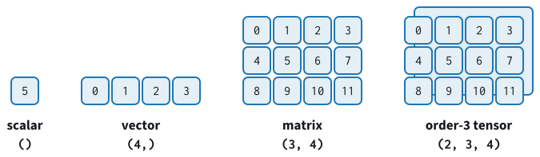
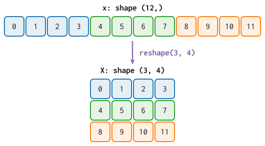

```{.python .input}
%load_ext d2lbook.tab
tab.interact_select('mxnet', 'pytorch', 'tensorflow', 'jax')
```

# Data Manipulation
:label:`sec_ndarray`

Training a model processes its examples in small groups called
*minibatches*. A minibatch of 256 grayscale images of $28 \times 28$ pixels
holds $256 \times 28 \times 28 = 200{,}704$ numbers. Image files store each
pixel as an integer from 0 to 255, and before a model sees the images we
rescale every pixel to a real number between 0 and 1 by dividing it by 255.
In plain Python, this takes three nested loops over the images, the rows,
and the columns, and the interpreter carries out the 200,704 divisions one
at a time. In deep learning code it takes one expression, `images / 255`,
which the library applies to the whole minibatch at once in compiled code,
on a CPU or a GPU. Deep learning code computes with whole arrays in this way
throughout, rather than with loops over their elements.

An array of numbers arranged along any number of axes is called a *tensor*.
Tensors hold everything a model touches: its inputs, its parameters, the
values it computes along the way, and the gradients used to train it. If you
know NumPy :cite:`Harris.Millman.Walt.ea.2020`, much of this section will
look familiar. The tensor classes of deep learning libraries (`ndarray` in
MXNet, `Tensor` in PyTorch and TensorFlow, `jax.Array` in JAX) resemble
NumPy's `ndarray`, with two additions. They run their operations on GPUs and
other accelerators as well as on CPUs, and the libraries can compute
derivatives of computations on them automatically, as we will see later in
this chapter.

This section shows how to create tensors and inspect their shape and type,
how to rearrange, select, and change their elements, and how to compute with
whole tensors at once, including tensors whose shapes differ. It ends with
what these computations cost in memory and how to convert tensors to other
Python objects. The minibatch of images is our running example. Where a
tensor lives, in main memory or on a GPU, changes no result in this chapter;
a later chapter shows how to choose.

:begin_tab:`mxnet`
We import MXNet's array module, which follows the NumPy interface, under the
name `mnp`, so that `np` can keep meaning NumPy. The module `npx` adds
operations for deep learning, and `set_np` makes the rest of MXNet work with
these arrays.
:end_tab:

:begin_tab:`pytorch`
We import PyTorch, whose package is called `torch`.
:end_tab:

:begin_tab:`tensorflow`
We import TensorFlow under its usual alias `tf`.
:end_tab:

:begin_tab:`jax`
We import `jax` and its NumPy-like interface `jax.numpy`, by convention
under the alias `jnp`.
:end_tab:

```{.python .input #ndarray-getting-started-1}
%%tab mxnet
from mxnet import np as mnp, npx
npx.set_np()
```

```{.python .input #ndarray-getting-started-1}
%%tab pytorch
import torch
```

```{.python .input #ndarray-getting-started-1}
%%tab tensorflow
import tensorflow as tf
```

```{.python .input #ndarray-getting-started-1}
%%tab jax
import jax
from jax import numpy as jnp
```

## Tensor Creation

### Shape

A tensor arranges its numbers along its *axes*. A vector has one axis and a
matrix has two. The minibatch of images has four: one for the image, one for
the color channel (a grayscale image has a single channel), and one each for
the rows and the columns of pixels. Axes are numbered from 0, so for the
minibatch, axis 0 indexes the images and axis 3 the columns. The number of
axes is the *order* of a tensor, and the minibatch has order 4.

The simplest way to create a tensor is `arange(n)`, which returns a vector of
the integers from 0 up to, but not including, $n$. We ask for 32-bit
floating-point numbers, the type that we compute with throughout:

:begin_tab:`tensorflow`
In TensorFlow, this function is called `range`.
:end_tab:

```{.python .input #ndarray-getting-started-2}
%%tab mxnet
x = mnp.arange(12)
x
```

```{.python .input #ndarray-getting-started-2}
%%tab pytorch
x = torch.arange(12, dtype=torch.float32)
x
```

```{.python .input #ndarray-getting-started-2}
%%tab tensorflow
x = tf.range(12, dtype=tf.float32)
x
```

```{.python .input #ndarray-getting-started-2}
%%tab jax
x = jnp.arange(12, dtype=jnp.float32)
x
```

The numbers in a tensor are its *elements*, and the number of elements is
its *size*:

:begin_tab:`mxnet`
In MXNet, the size is the attribute `size`.
:end_tab:

:begin_tab:`pytorch`
In PyTorch, the method `numel` returns the size.
:end_tab:

:begin_tab:`tensorflow`
In TensorFlow, the function `tf.size` returns the size.
:end_tab:

:begin_tab:`jax`
In JAX, the size is the attribute `size`.
:end_tab:

```{.python .input #ndarray-getting-started-3}
%%tab mxnet, jax
x.size
```

```{.python .input #ndarray-getting-started-3}
%%tab pytorch
x.numel()
```

```{.python .input #ndarray-getting-started-3}
%%tab tensorflow
tf.size(x)
```

The *shape* of a tensor lists its length along each axis. The shape of a
vector has one entry, which equals the size:

```{.python .input #ndarray-getting-started-4}
x.shape
```

:numref:`fig_ndarray_shapes` shows tensors with zero to three axes. A single
number, a *scalar*, is a tensor with no axes; its shape is empty. The size
of every tensor is the product of the entries of its shape. For the minibatch
of images, whose shape is $(256, 1, 28, 28)$, it is
$256 \times 1 \times 28 \times 28 = 200{,}704$.


:label:`fig_ndarray_shapes`

### Data Types

Every tensor also has a *data type*, its `dtype`, which fixes how each
element is stored. Deep learning computes mostly with 32-bit floating-point
numbers, `float32`, which take 4 bytes each and keep about 7 significant
decimal digits. Other data need other types. The pixels of an image are
8-bit unsigned integers, `uint8`, which take one byte each and hold the
integers from 0 to 255. The data type determines how much memory a tensor
needs: the minibatch of images takes 200,704 bytes as `uint8` and four times as
much, about 0.8 MB, as `float32`. Large models also compute with 16-bit
floating-point numbers, which halve the memory again at some cost in
precision.

:begin_tab:`mxnet`
MXNet creates `float32` arrays by default, even from integers, so the `arange`
cell above needs no `dtype`. The method `astype` converts an array to another
type, as in `x.astype('int32')`.
:end_tab:

:begin_tab:`pytorch`
With integer arguments, `torch.arange` creates a tensor of 64-bit integers,
which is why the `arange` cell above asks for `float32`. The method `to` converts a
tensor to another type, as in `x.to(torch.int32)`.
:end_tab:

:begin_tab:`tensorflow`
With integer arguments, `tf.range` creates a tensor of 32-bit integers,
which is why the `arange` cell above asks for `float32`. The function `tf.cast`
converts a tensor to another type, as in `tf.cast(x, tf.int32)`.
:end_tab:

:begin_tab:`jax`
With integer arguments, `jnp.arange` creates an array of 32-bit integers,
which is why the `arange` cell above asks for `float32`. The method `astype` converts
an array to another type, as in `x.astype(jnp.int32)`.
:end_tab:

### Initial Values

A model needs tensors with initial values before training can change them.
The functions `zeros` and `ones` create a tensor of a given shape filled with
0s or with 1s; the offsets that a layer adds to its outputs, for example,
usually start at zero. Here is a tensor of zeros with the shape $(2, 3, 4)$
of :numref:`fig_ndarray_shapes`:

```{.python .input #ndarray-getting-started-6}
%%tab mxnet
mnp.zeros((2, 3, 4))
```

```{.python .input #ndarray-getting-started-6}
%%tab pytorch
torch.zeros((2, 3, 4))
```

```{.python .input #ndarray-getting-started-6}
%%tab tensorflow
tf.zeros((2, 3, 4))
```

```{.python .input #ndarray-getting-started-6}
%%tab jax
jnp.zeros((2, 3, 4))
```

The weights of a model, by contrast, start at random values. If all the
weights of a layer started at the same value, all its outputs would be
equal and would receive equal updates during training, so they could never
come to differ. Random initial values *break this symmetry*. The following
tensor holds numbers drawn independently from the standard normal
distribution, a bell-shaped distribution centered at 0 that places about 95%
of its draws between $-2$ and $2$:

```{.python .input #ndarray-getting-started-8}
%%tab mxnet
mnp.random.normal(0, 1, size=(3, 4))
```

```{.python .input #ndarray-getting-started-8}
%%tab pytorch
torch.randn(3, 4)
```

```{.python .input #ndarray-getting-started-8}
%%tab tensorflow
tf.random.normal(shape=[3, 4])
```

```{.python .input #ndarray-getting-started-8}
%%tab jax
# A key determines the sample: the same key always gives the same numbers
jax.random.normal(jax.random.key(0), (3, 4))
```

Random numbers differ from one run to the next. For debugging, and for
results that others can reproduce, we fix the *seed* of the random number
generator, the value from which it computes its sequence of numbers:

:begin_tab:`mxnet`
MXNet keeps one global generator, which every draw advances, and
`mnp.random.seed` resets it. Below, `a` and `c` are the first draws after the
same seed, so they agree, whereas `b` is a second draw and differs.
:end_tab:

:begin_tab:`pytorch`
PyTorch keeps one global generator, which every draw advances, and
`torch.manual_seed` resets it. Below, `a` and `c` are the first draws after
the same seed, so they agree, whereas `b` is a second draw and differs.
:end_tab:

:begin_tab:`tensorflow`
TensorFlow keeps one global generator, which every draw advances, and
`tf.random.set_seed` resets it. Below, `a` and `c` are the first draws after
the same seed, so they agree, whereas `b` is a second draw and differs.
:end_tab:

:begin_tab:`jax`
JAX has no global generator. Every draw takes an explicit *key*, the same
key always gives the same numbers, and `jax.random.split` derives new,
independent keys from an existing one. Below, `a` and `c` use the same key,
so they agree, whereas `b` uses a different key and differs.
:end_tab:

```{.python .input #ndarray-initial-values-1}
%%tab mxnet
mnp.random.seed(42)
a = mnp.random.normal(size=3)
b = mnp.random.normal(size=3)  # The generator has moved on
mnp.random.seed(42)
c = mnp.random.normal(size=3)  # Same seed: c repeats a
a, b, c
```

```{.python .input #ndarray-initial-values-1}
%%tab pytorch
torch.manual_seed(42)
a = torch.randn(3)
b = torch.randn(3)  # The generator has moved on
torch.manual_seed(42)
c = torch.randn(3)  # Same seed: c repeats a
a, b, c
```

```{.python .input #ndarray-initial-values-1}
%%tab tensorflow
tf.random.set_seed(42)
a = tf.random.normal([3])
b = tf.random.normal([3])  # The generator has moved on
tf.random.set_seed(42)
c = tf.random.normal([3])  # Same seed: c repeats a
print(a, b, c, sep='\n')
```

```{.python .input #ndarray-initial-values-1}
%%tab jax
key_a, key_b = jax.random.split(jax.random.key(42))
a = jax.random.normal(key_a, (3,))
b = jax.random.normal(key_b, (3,))  # A different key
c = jax.random.normal(key_a, (3,))  # Same key: c repeats a
a, b, c
```

Finally, we can write down the elements of a tensor ourselves, as nested
Python lists in which the outermost list runs along axis 0:

```{.python .input #ndarray-getting-started-9}
%%tab mxnet
mnp.array([[2, 1, 4, 3], [1, 2, 3, 4], [4, 3, 2, 1]])
```

```{.python .input #ndarray-getting-started-9}
%%tab pytorch
torch.tensor([[2, 1, 4, 3], [1, 2, 3, 4], [4, 3, 2, 1]])
```

```{.python .input #ndarray-getting-started-9}
%%tab tensorflow
tf.constant([[2, 1, 4, 3], [1, 2, 3, 4], [4, 3, 2, 1]])
```

```{.python .input #ndarray-getting-started-9}
%%tab jax
jnp.array([[2, 1, 4, 3], [1, 2, 3, 4], [4, 3, 2, 1]])
```

We can now build the running example. Until we load a real dataset, random
integers from 0 to 255 stand in for the pixels, because only the shape and
the type of the minibatch matter here:

```{.python .input #ndarray-initial-values-2}
%%tab mxnet
# 256 grayscale images of 28 x 28 pixels, each pixel an integer in [0, 255]
images = mnp.random.randint(0, 256, size=(256, 1, 28, 28)).astype('uint8')
images.shape, images.dtype
```

```{.python .input #ndarray-initial-values-2}
%%tab pytorch
# 256 grayscale images of 28 x 28 pixels, each pixel an integer in [0, 255]
images = torch.randint(0, 256, (256, 1, 28, 28), dtype=torch.uint8)
images.shape, images.dtype
```

```{.python .input #ndarray-initial-values-2}
%%tab tensorflow
# 256 grayscale images of 28 x 28 pixels, each pixel an integer in [0, 255];
# TensorFlow draws random integers as int32 or int64, so we cast them
images = tf.random.uniform((256, 1, 28, 28), maxval=256, dtype=tf.int32)
images = tf.cast(images, tf.uint8)
images.shape, images.dtype
```

```{.python .input #ndarray-initial-values-2}
%%tab jax
# 256 grayscale images of 28 x 28 pixels, each pixel an integer in [0, 255]
images = jax.random.randint(jax.random.key(1), (256, 1, 28, 28), 0, 256,
                            dtype=jnp.uint8)
images.shape, images.dtype
```

The shape reads: 256 images, 1 channel, 28 rows, and 28 columns.

## Reshaping and Indexing

### Reshaping

The same numbers often need a different arrangement. A classifier that
treats each image as a list of 784 pixel values needs the minibatch as a
matrix with one image per row, of shape $(256, 784)$. The function `reshape`
changes the shape of a tensor but neither its size nor the order of its
elements. On a small example, we turn the vector `x` of shape $(12,)$ into a
matrix `X` of shape $(3, 4)$. The elements fill the matrix one row at a
time, so `x[3]` becomes `X[0, 3]` (:numref:`fig_ndarray_reshape`):


:label:`fig_ndarray_reshape`

```{.python .input #ndarray-getting-started-5}
%%tab mxnet, pytorch, jax
X = x.reshape(3, 4)
X
```

```{.python .input #ndarray-getting-started-5}
%%tab tensorflow
X = tf.reshape(x, (3, 4))
X
```

Since the size is fixed, one entry of the target shape follows from the
others: 12 elements in 3 rows make 4 columns. Writing $-1$ for one entry
lets the library infer it, so `x.reshape(-1, 4)` and `x.reshape(3, -1)` give
the same matrix as `x.reshape(3, 4)`. In the same way, we flatten every
image of the minibatch into a row of 784 pixels without writing out 784:

:begin_tab:`tensorflow`
In TensorFlow, `reshape` is a function rather than a method, as in
`tf.reshape(x, (-1, 4))`.
:end_tab:

```{.python .input #ndarray-reshaping-1}
%%tab mxnet, pytorch, jax
images.reshape(256, -1).shape
```

```{.python .input #ndarray-reshaping-1}
%%tab tensorflow
tf.reshape(images, (256, -1)).shape
```

A reshape need not move any data. The elements of `x` lie in memory one
after another, and the rows of `X` lie in memory one after another too, so a
library can implement the reshape by recording a new shape for the same
memory. Whether it does so matters only if elements can later be changed in
place, which some libraries allow.

:begin_tab:`mxnet`
MXNet's `reshape` copies the data, so writing to `X` below leaves `x`
unchanged.
:end_tab:

:begin_tab:`pytorch`
PyTorch's `reshape` returns a *view* here: `X` shares its memory with `x`,
so writing an element of `X` below also changes the corresponding element of
`x`. When the arrangement in memory does not allow a view, `reshape` copies
the data instead.
:end_tab:

:begin_tab:`tensorflow`
TensorFlow tensors cannot be changed in place, so whether `tf.reshape`
copies the data cannot change any result.
:end_tab:

:begin_tab:`jax`
JAX arrays cannot be changed in place, so whether `reshape` copies the data
cannot change any result.
:end_tab:

### Indexing and Slicing

As with Python lists, we select elements of a tensor by *indexing*. Indices
start at 0, and negative indices count from the end. A *slice* `start:stop`
selects the positions from `start` up to, but not including, `stop`, and a
colon alone selects all positions. Indices for several axes are separated by
commas, and an index given alone applies to axis 0. Thus `X[-1]` selects the
last row of `X`, and `X[1:3]` selects the second and third rows:

```{.python .input #ndarray-indexing-and-slicing-1}
X[-1], X[1:3]
```

The two results differ in shape. An integer index removes its axis, so
`X[-1]` is a vector, whereas a slice keeps its axis, so `X[1:3]` is a matrix
with two rows (:numref:`fig_ndarray_index`).

![Indexing a $3 \times 4$ matrix. The integer index `X[-1]` selects the last row and removes axis 0, leaving shape $(4,)$. The slice `X[1:3]` selects rows 1 and 2 and keeps axis 0, leaving shape $(2, 4)$.](../img/ndarray-index-read.svg)
:label:`fig_ndarray_index`

On the minibatch, `images[0]` is the first image, `images[:32]` a smaller
minibatch of the first 32 images, and `images[:, 0, 14, 14]` the pixel in row 14 and
column 14 of every image:

```{.python .input #ndarray-indexing-and-slicing-4}
images[0].shape, images[:32].shape, images[:, 0, 14, 14].shape
```

### Writing Elements

:begin_tab:`mxnet, pytorch`
An index on the left side of an assignment writes elements in place:
:end_tab:

:begin_tab:`tensorflow`
TensorFlow tensors are immutable: their elements cannot be assigned.
Mutable state, such as the parameters of a model, is held in a `Variable`,
whose elements the method `assign` overwrites. We copy `X` into a variable
and change one element:
:end_tab:

:begin_tab:`jax`
JAX arrays are immutable: their elements cannot be assigned. Instead,
`X.at[1, 2].set(17)` returns a new array that agrees with `X` except at
position $(1, 2)$, and leaves `X` unchanged:
:end_tab:

```{.python .input #ndarray-indexing-and-slicing-2}
%%tab mxnet, pytorch
X[1, 2] = 17
X
```

```{.python .input #ndarray-indexing-and-slicing-2}
%%tab tensorflow
X_var = tf.Variable(X)
X_var[1, 2].assign(17)
X_var
```

```{.python .input #ndarray-indexing-and-slicing-2}
%%tab jax
X_new = X.at[1, 2].set(17)  # A new array; X itself is unchanged
X_new
```

To give many elements the same value, we index with a slice. Here
`[:2, :]` selects the first two rows, with the colon taking all columns:

```{.python .input #ndarray-indexing-and-slicing-3}
%%tab mxnet, pytorch
X[:2, :] = 12
X
```

```{.python .input #ndarray-indexing-and-slicing-3}
%%tab tensorflow
X_var[:2, :].assign(12)
X_var
```

```{.python .input #ndarray-indexing-and-slicing-3}
%%tab jax
X_new = X_new.at[:2, :].set(12)
X_new
```

## Operations

### Elementwise Operations

An operation is *elementwise* if it applies a function of numbers to each
element of a tensor separately, or to each pair of elements at the same
position in two tensors of the same shape. Given a function $f$ of two
numbers, and two vectors $\mathbf{u}$ and $\mathbf{v}$ of the same length,
the elementwise operation returns the vector $\mathbf{c}$ with elements

$$c_i = f(u_i, v_i) \quad \textrm{for all } i.$$

One formula, applied at every position, thus turns a function of two numbers
into a function of two tensors of any shape. The arithmetic operators `+`,
`-`, `*`, `/`, and `**` (power) all work this way:

```{.python .input #ndarray-operations-2}
%%tab mxnet
x = mnp.array([1.0, 2, 4, 8])
y = mnp.array([2.0, 2, 2, 2])
x + y, x - y, x * y, x / y, x ** y
```

```{.python .input #ndarray-operations-2}
%%tab pytorch
x = torch.tensor([1.0, 2, 4, 8])
y = torch.tensor([2.0, 2, 2, 2])
x + y, x - y, x * y, x / y, x ** y
```

```{.python .input #ndarray-operations-2}
%%tab tensorflow
x = tf.constant([1.0, 2, 4, 8])
y = tf.constant([2.0, 2, 2, 2])
x + y, x - y, x * y, x / y, x ** y
```

```{.python .input #ndarray-operations-2}
%%tab jax
x = jnp.array([1.0, 2, 4, 8])
y = jnp.array([2.0, 2, 2, 2])
x + y, x - y, x * y, x / y, x ** y
```

Each result has the shape of the operands, and each element depends only on
the two elements at its position: `x / y` halves every element of `x`, and
`x ** y` squares it.

Functions of a single number, such as $e^x$, apply to each element in the
same way:

```{.python .input #ndarray-operations-1}
%%tab mxnet
mnp.exp(x)
```

```{.python .input #ndarray-operations-1}
%%tab pytorch
torch.exp(x)
```

```{.python .input #ndarray-operations-1}
%%tab tensorflow
tf.exp(x)
```

```{.python .input #ndarray-operations-1}
%%tab jax
jnp.exp(x)
```

The rescaling from the beginning of the section is elementwise as well.
Dividing the minibatch by 255 divides every pixel and returns a new tensor.
Division with `/` always returns floating-point numbers, here `float32`,
even where a quotient happens to be an integer. The second operand is a
single number rather than a tensor of the same shape, a case we return to
in the next subsection:

```{.python .input #ndarray-elementwise-operations-1}
scaled = images / 255
print(scaled.dtype, images[0, 0, 0, :4], scaled[0, 0, 0, :4], sep='\n')
```

The type has changed from `uint8` to `float32`, and the first four pixels of
the first image, integers from 0 to 255, have become numbers between 0
and 1.

Comparisons are elementwise too. They return a tensor of booleans that is
`True` where the comparison holds:

```{.python .input #ndarray-operations-4}
x == y
```

Not every operation is elementwise. Summing all the elements of a tensor
gives a tensor with a single element. Summing a tensor of booleans counts
its `True` entries, because `True` counts as 1 and `False` as 0; this is how
we will count the correct predictions of a classifier:

:begin_tab:`tensorflow`
TensorFlow calls the sum `reduce_sum`, and booleans must first be converted
to numbers with `tf.cast`.
:end_tab:

```{.python .input #ndarray-operations-5}
%%tab mxnet, pytorch, jax
x.sum(), (x == y).sum()
```

```{.python .input #ndarray-operations-5}
%%tab tensorflow
tf.reduce_sum(x), tf.reduce_sum(tf.cast(x == y, tf.int32))
```

A sum can also run along a single axis and leave, for instance, one sum per
row of a matrix. Such reductions along an axis are the subject of
:numref:`subsec_lin-alg-reduction`.

### Broadcasting
:label:`subsec_broadcasting`

Elementwise operations are simple when the two tensors have the same shape.
Model code, however, constantly combines a minibatch, stored with one example
per row, with a vector that holds one number per column. A layer adds the same
vector of offsets to its outputs for every example, and preprocessing subtracts
the same vector of column means from every example. Copying the vector once for
every example, only to match the shape of the minibatch, would waste memory and
time. *Broadcasting*, a convention that deep learning libraries adopted from
NumPy, applies the vector to every row without copying it. Here we add the
vector $(100, 200, 300, 400)$ to each row of a $3 \times 4$ matrix `X`:

```{.python .input #ndarray-broadcasting-4}
%%tab mxnet
X = mnp.arange(12).reshape(3, 4)
v = mnp.array([100.0, 200, 300, 400])
X + v
```

```{.python .input #ndarray-broadcasting-4}
%%tab pytorch
X = torch.arange(12, dtype=torch.float32).reshape(3, 4)
v = torch.tensor([100.0, 200, 300, 400])
X + v
```

```{.python .input #ndarray-broadcasting-4}
%%tab tensorflow
X = tf.reshape(tf.range(12, dtype=tf.float32), (3, 4))
v = tf.constant([100.0, 200, 300, 400])
X + v
```

```{.python .input #ndarray-broadcasting-4}
%%tab jax
X = jnp.arange(12, dtype=jnp.float32).reshape(3, 4)
v = jnp.array([100.0, 200, 300, 400])
X + v
```

Every row received the same four offsets, one per column.

Broadcasting follows a simple rule. Line the two shapes up from the *right*
and compare them axis by axis: two axes are compatible when they are equal
or when one of them is $1$ (a missing leading axis counts as $1$). Each axis
of length $1$ is then *stretched* to match the other, by virtually copying
its entries, and the elementwise operation is applied to the results. If any
pair of axes is incompatible, the operation raises an error rather than
guessing. For `X + v`, the shapes $(3, 4)$ and $(4,)$ line up as $(3, 4)$
and $(1, 4)$, so the single row of `v` is stretched to three rows. The
division of the minibatch by 255 was the simplest case: a scalar has no axes,
so it is stretched along all of them.

Both operands can be stretched at once. In
:numref:`fig_ndarray_broadcasting`, a column of shape $(3, 1)$ and a row of
shape $(1, 2)$ are each stretched to shape $(3, 2)$:


:label:`fig_ndarray_broadcasting`

```{.python .input #ndarray-broadcasting-1}
%%tab mxnet
a = mnp.arange(3).reshape(3, 1)
b = mnp.arange(2).reshape(1, 2)
a, b
```

```{.python .input #ndarray-broadcasting-1}
%%tab pytorch
a = torch.arange(3).reshape(3, 1)
b = torch.arange(2).reshape(1, 2)
a, b
```

```{.python .input #ndarray-broadcasting-1}
%%tab tensorflow
a = tf.reshape(tf.range(3), (3, 1))
b = tf.reshape(tf.range(2), (1, 2))
a, b
```

```{.python .input #ndarray-broadcasting-1}
%%tab jax
a = jnp.arange(3).reshape(3, 1)
b = jnp.arange(2).reshape(1, 2)
a, b
```

Their sum adds every element of the column to every element of the row:

```{.python .input #ndarray-broadcasting-2}
a + b
```

Shapes that are not compatible raise an error. Lining up $(3, 2)$ and
$(2, 3)$ from the right pairs $2$ with $3$ and $3$ with $2$; in both pairs
the lengths differ and neither is $1$:

```{.python .input #ndarray-broadcasting-3}
%%tab mxnet
try:
    mnp.ones((3, 2)) + mnp.ones((2, 3))
except Exception as e:
    print(e)
```

```{.python .input #ndarray-broadcasting-3}
%%tab pytorch
try:
    torch.ones((3, 2)) + torch.ones((2, 3))
except Exception as e:
    print(e)
```

```{.python .input #ndarray-broadcasting-3}
%%tab tensorflow
try:
    tf.ones((3, 2)) + tf.ones((2, 3))
except Exception as e:
    print(e)
```

```{.python .input #ndarray-broadcasting-3}
%%tab jax
try:
    jnp.ones((3, 2)) + jnp.ones((2, 3))
except Exception as e:
    print(e)
```

The rule also predicts what happens on the minibatch of images. Subtracting a
mean image of shape $(28, 28)$ from the minibatch of shape $(256, 1, 28, 28)$
works: the last two axes agree, and the mean image is stretched along the first
two. Adding a vector of 256 numbers, one per image, to the flattened minibatch
of shape $(256, 784)$ fails, because lining up the shapes from the right pairs
256 with 784. Reshaping the vector to shape $(256, 1)$ repairs this, since
$(256, 1)$ and $(256, 784)$ are compatible.

### Concatenation

Broadcasting combines tensors position by position. *Concatenation* instead
joins tensors end to end along an existing axis. Joining two minibatches of
256 images along axis 0 gives one minibatch of 512 images;
joining two sets of features for the same examples along axis 1 gives every
example more features. The lengths along all other axes must agree. We
concatenate two $3 \times 4$ matrices in both ways. Along axis 0, the result
has $3 + 3 = 6$ rows; along axis 1, it has $4 + 4 = 8$ columns:

```{.python .input #ndarray-operations-3}
%%tab mxnet
X = mnp.arange(12).reshape(3, 4)
Y = mnp.array([[2, 1, 4, 3], [1, 2, 3, 4], [4, 3, 2, 1]])
mnp.concatenate([X, Y], axis=0), mnp.concatenate([X, Y], axis=1)
```

```{.python .input #ndarray-operations-3}
%%tab pytorch
X = torch.arange(12, dtype=torch.float32).reshape(3, 4)
Y = torch.tensor([[2.0, 1, 4, 3], [1, 2, 3, 4], [4, 3, 2, 1]])
torch.cat((X, Y), dim=0), torch.cat((X, Y), dim=1)
```

```{.python .input #ndarray-operations-3}
%%tab tensorflow
X = tf.reshape(tf.range(12, dtype=tf.float32), (3, 4))
Y = tf.constant([[2.0, 1, 4, 3], [1, 2, 3, 4], [4, 3, 2, 1]])
tf.concat([X, Y], axis=0), tf.concat([X, Y], axis=1)
```

```{.python .input #ndarray-operations-3}
%%tab jax
X = jnp.arange(12, dtype=jnp.float32).reshape(3, 4)
Y = jnp.array([[2.0, 1, 4, 3], [1, 2, 3, 4], [4, 3, 2, 1]])
jnp.concatenate((X, Y), axis=0), jnp.concatenate((X, Y), axis=1)
```

## Memory and Conversion

### Allocation and In-Place Updates
:label:`subsec_saving_memory`

Most operations return a new tensor, which needs new memory. The statement
`Y = Y + X` computes the sum in newly allocated memory and then binds the
name `Y` to the new tensor. Python's `id` function, which returns a number
that identifies an object for as long as the object exists, shows that `Y`
now names a different object:

```{.python .input #ndarray-saving-memory-1}
before = id(Y)
Y = Y + X
id(Y) == before
```

For small tensors this costs little. A model with a billion parameters,
however, needs 4 GB to store them as `float32` numbers, and training updates
all of them at every step. If every update allocated new memory for
its result, the program would need room for the old and the new values at
the same time, and would spend time on the allocations. An *in-place*
update writes the result into the memory that the tensor already occupies.
It also reaches every part of the program that refers to the tensor,
whereas rebinding one name leaves other names pointing at the old values.
In-place updates have one restriction: a library that records operations to
compute derivatives may still need an old value, so an in-place update must
not overwrite it.

:begin_tab:`mxnet, pytorch`
Slice assignment, `Z[:] = <expression>`, writes the result into the
existing tensor `Z`. We create `Z` with `zeros_like`, which returns zeros
with the shape and type of its argument. After the assignment, `Z` names the
same tensor as before, and its elements hold `X + Y`:
:end_tab:

:begin_tab:`tensorflow`
Ordinary TensorFlow tensors are immutable, so every operation on them
returns a new tensor. Model parameters are therefore stored in variables,
and `assign` writes a new value into a variable in place. (Inside a function
compiled with `tf.function`, TensorFlow can also reuse the memory of
intermediate results.) After the assignment, the variable `Z` is the same
object as before, and its elements hold `X + Y`:
:end_tab:

:begin_tab:`jax`
JAX arrays are immutable, so JAX has no in-place updates: `Y + X` and
`X.at[...].set(...)` always produce a new array, and the memory of an old
array is freed once no name refers to it. Avoiding the extra copy is the
job of JAX's compiler: training code compiles its update step, and the
compiled step can reuse memory that is no longer needed.
:end_tab:

```{.python .input #ndarray-saving-memory-2}
%%tab mxnet
Z = mnp.zeros_like(Y)
before = id(Z)
Z[:] = X + Y
id(Z) == before
```

```{.python .input #ndarray-saving-memory-2}
%%tab pytorch
Z = torch.zeros_like(Y)
before = id(Z)
Z[:] = X + Y
id(Z) == before
```

```{.python .input #ndarray-saving-memory-2}
%%tab tensorflow
Z = tf.Variable(tf.zeros_like(Y))
before = id(Z)
Z.assign(X + Y)
id(Z) == before
```

:begin_tab:`mxnet, pytorch`
Slice assignment still computes `X + Y` in a temporary tensor before copying
it into `Z`. Augmented assignment avoids the temporary. If we no longer need
the old value of `X`, then `X += Y` adds `Y` to `X` in place:
:end_tab:

:begin_tab:`tensorflow`
For ordinary tensors, `X += Y` is shorthand for `X = X + Y`, so it binds
`X` to a new tensor:
:end_tab:

:begin_tab:`jax`
In particular, `X += Y` is shorthand for `X = X + Y`, so it binds `X` to a
new array:
:end_tab:

```{.python .input #ndarray-saving-memory-3}
before = id(X)
X += Y
id(X) == before
```

### Conversion to Other Python Objects

Plotting, pandas, and many scientific libraries take NumPy arrays or Python
numbers rather than tensors, so we convert tensors at the boundary between
our code and theirs.

:begin_tab:`mxnet`
The method `asnumpy` converts an MXNet array to a NumPy array, and
`mnp.array` converts it back. Both copy the data. MXNet may still be
computing an array, possibly on a GPU, when we ask for it, whereas NumPy
works on memory of the CPU. So `asnumpy` waits for the computation to
finish and copies the result, and the two libraries never access the same
memory.
:end_tab:

:begin_tab:`pytorch`
The method `numpy` converts a tensor on the CPU to a NumPy array, and
`torch.from_numpy` converts a NumPy array to a tensor. Neither copies the
data: the tensor and the array share their memory, so an in-place change to
one also changes the other.
:end_tab:

:begin_tab:`tensorflow`
The method `numpy` copies a tensor into a NumPy array, and `tf.constant`
converts the array back, again by copying.
:end_tab:

:begin_tab:`jax`
The function `jax.device_get` returns a JAX array as a NumPy array, and
`jax.device_put` converts it back. For an array on an accelerator,
`device_get` copies the data to main memory. For an array that is already in
main memory, the NumPy array may share its memory with the JAX array, but
then it is read-only, so the JAX array stays immutable.
:end_tab:

```{.python .input #ndarray-conversion-to-other-python-objects-1}
%%tab mxnet
A = X.asnumpy()
B = mnp.array(A)
type(A), type(B)
```

```{.python .input #ndarray-conversion-to-other-python-objects-1}
%%tab pytorch
A = X.numpy()
B = torch.from_numpy(A)
type(A), type(B)
```

```{.python .input #ndarray-conversion-to-other-python-objects-1}
%%tab tensorflow
A = X.numpy()
B = tf.constant(A)
type(A), type(B)
```

```{.python .input #ndarray-conversion-to-other-python-objects-1}
%%tab jax
A = jax.device_get(X)
B = jax.device_put(A)
type(A), type(B)
```

A tensor with a single element converts to a Python number with the method
`item` or with the built-in functions `float` and `int`. Printing a
summary number such as an average error, or comparing it with a threshold in
Python, needs such a conversion. When the
computation runs on a GPU, the conversion has to wait for it to finish, so
training code converts as rarely as possible.

:begin_tab:`tensorflow`
TensorFlow tensors have no `item` method; the method `numpy` returns the
value as a NumPy number instead.
:end_tab:

```{.python .input #ndarray-conversion-to-other-python-objects-2}
%%tab mxnet
a = mnp.array(3.5)
a, a.item(), float(a), int(a)
```

```{.python .input #ndarray-conversion-to-other-python-objects-2}
%%tab pytorch
a = torch.tensor(3.5)
a, a.item(), float(a), int(a)
```

```{.python .input #ndarray-conversion-to-other-python-objects-2}
%%tab tensorflow
a = tf.constant(3.5)
a, a.numpy(), float(a), int(a)
```

```{.python .input #ndarray-conversion-to-other-python-objects-2}
%%tab jax
a = jnp.array(3.5)
a, a.item(), float(a), int(a)
```

We can now create tensors, select and rearrange their elements, and compute
with whole tensors at once, including tensors whose shapes differ, and we
know when such computations allocate memory. The numbers in this section
were made up. Real data arrive in files, often as tables with missing
entries and with text in some of the columns; the next section turns such a
table into tensors.

## Summary

Deep learning code stores its data, parameters, and intermediate results in
tensors, arrays with a shape and a data type. It computes with whole tensors
rather than with loops over their elements: one expression divides all
200,704 pixels of a minibatch by 255. Reshaping, indexing, and
concatenation rearrange, select, and join elements. Elementwise operations
apply a function of numbers at every position, and broadcasting combines
tensors of different shapes by lining up their shapes from the right and
stretching axes of length 1. Most operations allocate a new tensor; where
memory matters, libraries with mutable tensors update them in place, and
libraries with immutable tensors reuse memory through mutable variables or
through their compiler.

## Exercises

1. [code] **Inferred reshape axis.** A minibatch of $n$ grayscale images of
   $28 \times 28$ pixels arrives as a tensor of shape $(n, 1, 28, 28)$.
   Each image must be flattened into a row of 784 values. Check every
   prediction below in code.
    1. Predict the result of reshaping the minibatch to $(-1, 784)$ and to
       $(256, -1)$, once for a full minibatch of $n = 256$ images and once
       for a final minibatch of $n = 100$ images. State which of the two
       targets works for every minibatch size.
    1. Suppose the images were loaded with three color channels by
       mistake, so that the minibatch has shape $(n, 3, 28, 28)$. Predict the
       result of the reshape to $(-1, 784)$, and state whether this step
       detects the mistake.

1. **Shifted slices.** A tensor `tokens` of shape $(4, 11)$ holds four token
   sequences, one per row. A model reads the first 10 tokens of each row
   and predicts, at every position, the token that follows. Write slice
   expressions for the input tensor and the target tensor, each of shape
   $(4, 10)$, so that the target at position $t$ is the token that
   follows the input at position $t$. Then give expressions for both
   tensors that stay correct without change when each row holds $T + 1$
   tokens and the model reads the first $T$, for every $T \geq 1$.

1. [code] **Broadcasting shapes.** Broadcasting aligns two shapes from the
   right.
    1. Replace `a` and `b` with two tensors that each have three axes,
       whose shapes differ on every axis and that still broadcast. Predict the shape of `a + b`,
       then run the code and check your prediction.
    1. A model returns predictions `y_hat` of shape $(5, 1)$ for five
       examples whose labels `y` form a vector of shape $(5,)$. Predict the
       shape of `y_hat - y`. Then let `y` hold the labels $0, 1, 2, 3, 4$
       as floating-point numbers and set `y_hat` to `y` reshaped to
       $(5, 1)$, so that every prediction equals its label. Compute the
       mean of the squared entries of `y_hat - y`, explain the value, and
       give the reshape of `y` that pairs each prediction with its own
       label.

1. [code] **Limits of data types.** The pixels of `images` are stored as
   `uint8`, and the rest of the book computes in `float32`.
    1. Predict the result of adding 100 to a `uint8` tensor that holds the
       value 200, and check your prediction. Explain the result, and
       brighten the first image of the minibatch by 100 intensity levels
       without this error by converting its type first.
    1. A `float32` number stores 24 significant binary digits. Explain why
       `float32` represents every integer up to $2^{24} = 16{,}777{,}216$,
       and check that adding 1 to $2^{24}$ in `float32` leaves it
       unchanged. A training loop counts the examples it has processed in a
       `float32` tensor. After how many examples does the count stop
       growing, and which data type should the counter have instead?

:begin_tab:`pytorch`
5. [code] **Object identity versus storage.** The cells in
   :numref:`subsec_saving_memory` compare `id(Y)` before and after
   `Y = Y + X`, and `id(X)` before and after `X += Y`. The method
   `X.data_ptr()` returns the memory address of the first element of `X`.
    1. Record whether `id(X)` changes and whether `X.data_ptr()` changes
       under each of `X += Y`, `X = X + Y`, `X = X.reshape(-1)`, and
       `X.set_(X + Y)`, which makes `X` use the memory of the new tensor
       `X + Y`.
    1. Use these observations to explain why a changed `id()` does not
       show that new storage was allocated. Then explain why an unchanged
       `id()` does not by itself show that the old storage was reused.

6. [code] **In-place composition.** ● Compute `(A + B) * (-A / 2)` for two
   same-shaped tensors without allocating any intermediate tensor, using
   only in-place methods such as `add_`, `div_`, `neg_`, and `mul_`, or
   the `out=` argument of the corresponding functions. Confirm that
   `A.data_ptr()` and `B.data_ptr()` are unchanged and that the result
   equals the direct expression. Explain why `Z[:] = A + B` would not have
   met the requirement.

    *Adapted from Nicolas P. Rougier,
    [100 numpy exercises](https://github.com/rougier/numpy-100/blob/master/100_Numpy_exercises.md),
    problem 35.*
:end_tab:

:begin_tab:`mxnet`
5. [code] **Object identity versus storage.** The cells in
   :numref:`subsec_saving_memory` compare `id(Y)` before and after
   `Y = Y + X`, and `id(X)` before and after `X += Y`.
    1. MXNet's `reshape` copies the data. Find out, by writing an element
       of `X` and reading the corresponding element of the result, whether
       the slice `X[:2]` shares memory with `X`.
    1. Explain why a changed `id()` does not by itself show that new
       storage was allocated, and why an unchanged `id()`, as after
       `X += Y`, does not by itself show that the old storage was reused.

6. [code] **In-place composition.** ● Compute `(A + B) * (-A / 2)` for two
   same-shaped tensors without allocating any intermediate tensor, using
   only the in-place operators `+=`, `*=`, and `/=`. Confirm that the
   result equals the direct expression and explain why `Z[:] = A + B`
   would not have met the requirement.

    *Adapted from Nicolas P. Rougier,
    [100 numpy exercises](https://github.com/rougier/numpy-100/blob/master/100_Numpy_exercises.md),
    problem 35.*
:end_tab:

:begin_tab:`tensorflow`
5. [code] **Variables and tensors as shared state.** Let `W = tf.Variable(X)`
   and `V = W`, so that two names refer to one variable, and let
   `T = tf.constant(X)` and `S = T`.
    1. Predict the value of `V` after `W.assign_add(Y)` and the value of
       `S` after `T += Y`, then check your predictions.
    1. Model parameters are referred to from several parts of a program
       and change at every training step. Explain from your results why
       TensorFlow stores them in variables rather than in tensors.

6. [code] **In-place composition.** ● Ordinary tensors are immutable, so
   every arithmetic operation on them allocates a new tensor. Hold `A` and
   `B` in `tf.Variable`s and compute `(A + B) * (-A / 2)` so that the
   result ends up in one of the two variables, using `assign`,
   `assign_add`, and related methods. List the steps of your solution,
   mark each step that still allocates a temporary tensor, and explain why
   eager execution cannot avoid these temporaries.

    *Adapted from Nicolas P. Rougier,
    [100 numpy exercises](https://github.com/rougier/numpy-100/blob/master/100_Numpy_exercises.md),
    problem 35.*
:end_tab:

:begin_tab:`jax`
5. [code] **Immutability and shared names.** Let `Z = X`, and then run
   `X += Y`.
    1. Predict whether `Z` changes, check your prediction, and compare with
       NumPy, where `+=` updates an array in place.
    1. Explain why, for immutable arrays, whether two arrays share memory
       cannot change any value that a program computes, and why this
       leaves a compiler free to reuse memory.

6. [code] **In-place composition.** ● JAX arrays are immutable, so every
   eager operation allocates a new array. Write `(A + B) * (-A / 2)` as a
   function `f(A, B)`, count the intermediate arrays that eager evaluation
   creates. The function `jax.jit(f)` compiles `f` into one optimized
   program; inspect that program with
   `jax.jit(f).lower(A, B).compile().as_text()` and report how many fused
   computations remain. An in-place implementation, as in NumPy, writes
   the result into the memory of `A` and allocates no new array. State
   which of the eager allocations the compiled program removes, and
   whether it still allocates an array that the in-place implementation
   avoids.

    *Adapted from Nicolas P. Rougier,
    [100 numpy exercises](https://github.com/rougier/numpy-100/blob/master/100_Numpy_exercises.md),
    problem 35.*
:end_tab:

7. [code] **Loops against broadcasting.** ● For a vector `a` of 200
   elements and a vector `b` of 300 elements, compute the table of all
   absolute differences $d_{ij} = |a_i - b_j|$, of shape $(200, 300)$.
    1. Compute the table once with two nested Python loops, and once with
       a single broadcast expression after reshaping `a` to $(200, 1)$ and
       `b` to $(1, 300)$. Confirm that the two results agree, time both,
       and report the speedup.
    1. The broadcast expression copies neither input. How many bytes does
       its result take in `float32` when both vectors have 10,000
       elements? What does this say about the memory that broadcasting
       can create?

:begin_tab:`mxnet`
[Discussions](https://d2l.discourse.group/t/26)
:end_tab:

:begin_tab:`pytorch`
[Discussions](https://d2l.discourse.group/t/27)
:end_tab:

:begin_tab:`tensorflow`
[Discussions](https://d2l.discourse.group/t/187)
:end_tab:

:begin_tab:`jax`
[Discussions](https://d2l.discourse.group/t/17966)
:end_tab:

<!-- slides -->

::: {.slide}
::: {.cover}
[Dive into Deep Learning · §2.1]{.kicker}

Tensors for one minibatch of images<br>**shapes · types · reshaping · indexing · elementwise operations · broadcasting · memory**
:::
:::

::: {.slide title="One Expression Rescales 200,704 Pixels"}
[The problem]{.kicker}

- A minibatch (examples processed together): 256 grayscale images of $28 \times 28$ pixels, so
  $256 \times 28 \times 28 = 200{,}704$ numbers.
- Stored as integers from 0 to 255; the model wants real numbers in
  $[0, 1]$.
- Python loops: 200,704 divisions, one at a time, in the interpreter.
- Tensor code: `images / 255`, one call, in compiled code, on a CPU or a
  GPU.

::: {.d2l-note}
A **tensor** is an array with a shape and a data type. Deep learning code
computes with whole tensors, not with loops over their elements.
:::
:::

::: {.slide title="By the End of This Deck You Can"}
[Goals]{.kicker}

- create a tensor and read its shape, size, and data type;
- reshape and index it, and predict the shape of the result;
- predict whether two shapes broadcast, and to which shape;
- tell when an operation allocates new memory.

**Running example:** `images`, shape $(256, 1, 28, 28)$, type `uint8`.
:::

::: {.slide title="Every Later Deck Computes With Tensors"}
[Where this fits]{.kicker}

::: {.cols .vc}
::: {.col}
| section | tool |
|---|---|
| **Data Manipulation** | **tensors** |
| Data Preprocessing | pandas |
| Linear Algebra | matrix products, norms, eigenvalues |
| Calculus | derivatives, gradients, chain rule |
| Automatic Differentiation | autograd |
| Probability and Statistics | Bayes' theorem, standard error |
| Documentation | `help`, small tests |
:::

::: {.col .narrow}
- **Uses:** Python numbers, lists, and loops.
- **Skips:** sums along an axis and matrix products (Linear Algebra),
  derivatives (Automatic Differentiation), and GPUs.
:::
:::
:::

::: {.slide title="A Tensor Arranges Numbers Along Axes; Its Shape Lists the Lengths"}
[Shapes]{.kicker}

@fig:ndarray-rank-ladder

- Size = product of the shape: $3 \times 4 = 12$, and for the minibatch
  $256 \times 1 \times 28 \times 28 = 200{,}704$.
- Order = number of axes: the minibatch (image, channel, row, column) has
  order 4. Axes are numbered from 0.
:::

::: {.slide title="The Minibatch Takes 200,704 Bytes as uint8 and 0.8 MB as float32"}
[Data types]{.kicker}

`images`: random integers stand in for 256 images of $28 \times 28$ pixels.

@!ndarray-initial-values-2

| type | bytes per element | holds | the minibatch |
|---|---|---|---|
| `uint8` | 1 | integers 0 to 255 | $200{,}704 \times 1$ = 200,704 B |
| `float32` | 4 | about 7 significant digits | $200{,}704 \times 4$ = 802,816 B |
:::

::: {.slide title="Reshape Keeps the Order and Changes Only the Shape"}
[Reshaping]{.kicker}

::: {.cols .vc}
::: {.col}
@ndarray-getting-started-5

A length of $-1$ is inferred, giving one row of 784 pixels per image:

@ndarray-reshaping-1
:::

::: {.col .fig .big}
@fig:ndarray-reshape
:::
:::
:::

::: {.slide title="An Integer Index Drops Its Axis; a Slice Keeps It"}
[Indexing]{.kicker}

::: {.cols .vc}
::: {.col}
@ndarray-indexing-and-slicing-4

- `images[0]`: one image; `images[:32]`: 32 images.
- `images[:, 0, 14, 14]`: one pixel of every image.
- Slices are half-open: `1:3` selects 1 and 2.
:::

::: {.col .fig}
@fig:ndarray-index-read
:::
:::
:::

::: {.slide title="Check: Predict the Shapes"}
[Check]{.kicker}

`images` has shape $(256, 1, 28, 28)$. Predict the shape of each result.

1. `images[5]`
2. `images[:, 0]`
3. `images[:64, :, :14]`
4. `images[:, :, 14, :]`

::: {.fragment .fade-up}
1. $(1, 28, 28)$: the integer removes axis 0.
2. $(256, 28, 28)$: the channel axis is gone.
3. $(64, 1, 14, 28)$: slices keep their axes.
4. $(256, 1, 28)$: row 14 of every image.
:::
:::

::: {.slide title="Assignment Writes Into the Tensor" except="jax,tensorflow"}
[Writing]{.kicker}

::: {.cols .vc}
::: {.col}
Training overwrites parameters at every step. Indexing on the left writes
one element, then a whole slice, in place:

@ndarray-indexing-and-slicing-2

@ndarray-indexing-and-slicing-3
:::

::: {.col .fig}
@fig:ndarray-index-write
:::
:::
:::

::: {.slide title="JAX Arrays Are Immutable: .at[].set Returns a New Array" only="jax"}
[Writing]{.kicker}

::: {.cols .vc}
::: {.col}
Training changes parameters at every step; in JAX each change makes a new
array:

@ndarray-indexing-and-slicing-2

@ndarray-indexing-and-slicing-3
:::

::: {.col .fig}
@fig:ndarray-index-write@jax
:::
:::
:::

::: {.slide title="Tensors Are Immutable; a Variable Can Be Assigned" only="tensorflow"}
[Writing]{.kicker}

::: {.cols .vc}
::: {.col}
Parameters change at every training step, so they live in a
`tf.Variable`; `assign` overwrites one element or a whole slice:

@ndarray-indexing-and-slicing-2

@-ndarray-indexing-and-slicing-3
:::

::: {.col .fig}
@fig:ndarray-index-write@tensorflow
:::
:::
:::

::: {.slide title="A Function of Numbers Applies at Every Position"}
[Elementwise operations]{.kicker}

$$c_i = f(u_i, v_i) \quad \textrm{for all } i$$

@ndarray-operations-2
:::

::: {.slide title="Dividing by 255 Turns uint8 Pixels Into float32 Values"}
[Elementwise operations]{.kicker}

@ndarray-elementwise-operations-1

- A new tensor: 4 bytes per pixel, 0.8 MB for the minibatch.
- The single number 255 is applied to every pixel (broadcasting, below).
:::

::: {.slide title="Comparisons Give Masks; Summing a Mask Counts"}
[Elementwise operations]{.kicker}

With $\mathbf{x} = (1, 2, 4, 8)$ and $\mathbf{y} = (2, 2, 2, 2)$:

A comparison gives a boolean tensor, a *mask*:

@ndarray-operations-4

@ndarray-operations-5

::: {.d2l-note}
`True` counts as 1, so summing `predictions == labels` counts the correct
predictions.
:::
:::

::: {.slide title="Broadcasting Adds One Vector to Every Row Without Copying It"}
[Broadcasting]{.kicker}

@ndarray-broadcasting-4

- $(3, 4)$ and $(4,)$ line up from the right as $(3, 4)$ and $(1, 4)$.
- The single row of `v` is stretched, virtually, to three rows.
- A layer adds its offsets to the outputs of every example this way.
:::

::: {.slide title="Align Shapes From the Right; Each Pair Must Be Equal or 1"}
[Broadcasting]{.kicker}

::: {.cols .vc}
::: {.col}
@-ndarray-broadcasting-1

@ndarray-broadcasting-2

::: {.d2l-note .rule}
A missing leading axis counts as 1, and an axis of length 1 is stretched
to match the other.
:::
:::

::: {.col .fig}
@fig:ndarray-broadcasting
:::
:::
:::

::: {.slide title="Incompatible Shapes Raise an Error"}
[Broadcasting]{.kicker}

$(3, 2)$ and $(2, 3)$, lined up from the right: 2 against 3, then 3
against 2. Neither pair is equal, and neither length is 1:

@ndarray-broadcasting-3
:::

::: {.slide title="Check: Which Shapes Broadcast?"}
[Check]{.kicker}

Predict the shape of the result, or an error.

1. images $(256, 1, 28, 28)$ minus a mean image $(28, 28)$
2. flattened images $(256, 784)$ plus $(256,)$
3. flattened images $(256, 784)$ plus $(256, 1)$
4. predictions $(5, 1)$ minus labels $(5,)$

::: {.fragment .fade-up}
1. $(256, 1, 28, 28)$: the mean image is stretched over images and channels.
2. Error: from the right, 784 meets 256.
3. $(256, 784)$: one number per image, stretched across its pixels.
4. $(5, 5)$ and no error: every prediction meets every label.
:::
:::

::: {.slide title="Concatenation Joins Tensors Along an Existing Axis"}
[Concatenation]{.kicker}

::: {.cols .vc}
::: {.col}
@-ndarray-operations-3

- Two minibatches of 256 images along axis 0: one minibatch of 512.
- All other axes must agree.
:::

::: {.col .fig}
@fig:ndarray-concat
:::
:::
:::

::: {.slide title="Y = Y + X Allocates a New Tensor"}
[Memory]{.kicker}

@ndarray-saving-memory-1

- `Y` now names a new tensor; the sum was written to newly allocated
  memory.
- $10^9$ float32 parameters take 4 GB, and an update written this way
  allocates another 4 GB at every training step.
:::

::: {.slide title="In-Place Updates Reuse the Tensor's Memory" except="jax,tensorflow"}
[Memory]{.kicker}

::: {.cols .vc}
::: {.col}
Updating parameters in place needs no second copy. `Z[:] =` writes into
`Z`:

@ndarray-saving-memory-2

`X += Y` also avoids the temporary `X + Y`:

@ndarray-saving-memory-3
:::

::: {.col .fig}
@fig:ndarray-saving-memory
:::
:::
:::

::: {.slide title="Variables Are Updated In Place; Tensors Never Are" only="tensorflow"}
[Memory]{.kicker}

::: {.cols .vc}
::: {.col}
Parameters live in variables, so updates need no second copy:

@ndarray-saving-memory-2

For a tensor, `X += Y` means `X = X + Y`:

@ndarray-saving-memory-3
:::

::: {.col .fig}
@fig:ndarray-saving-memory@tensorflow
:::
:::
:::

::: {.slide title="JAX Never Updates an Array in Place" only="jax"}
[Memory]{.kicker}

::: {.cols .vc}
::: {.col}
`X += Y` means `X = X + Y`: a new array, and `id(X)` changes.

@ndarray-saving-memory-3

::: {.d2l-note}
The old array's memory is freed once no name refers to it. Compiled
training steps avoid the extra copy.
:::
:::

::: {.col .fig}
@fig:ndarray-saving-memory@jax
:::
:::
:::

::: {.slide title="numpy() and from_numpy() Share Memory" only="pytorch"}
[Conversion]{.kicker}

::: {.cols .vc}
::: {.col}
Plotting and pandas take NumPy arrays, so we convert at the boundary:

@ndarray-conversion-to-other-python-objects-1

A one-element tensor becomes a Python number:

@ndarray-conversion-to-other-python-objects-2
:::

::: {.col .fig .big}
@fig:ndarray-numpy-share
:::
:::
:::

::: {.slide title="Conversion to NumPy Copies the Data" only="mxnet,tensorflow"}
[Conversion]{.kicker}

Plotting and pandas take NumPy arrays, so we convert at the boundary.

::: {.cols}
::: {.col}
@ndarray-conversion-to-other-python-objects-1
:::

::: {.col}
A one-element tensor becomes a Python number:

@ndarray-conversion-to-other-python-objects-2
:::
:::

::: {.d2l-note}
On a GPU, a conversion waits for the computation to finish, so training
code converts rarely.
:::
:::

::: {.slide title="On the CPU, NumPy Reads JAX Memory Without Copying" only="jax"}
[Conversion]{.kicker}

Plotting and pandas take NumPy arrays, so we convert at the boundary.

::: {.cols}
::: {.col}
@ndarray-conversion-to-other-python-objects-1
:::

::: {.col}
A one-element array becomes a Python number:

@ndarray-conversion-to-other-python-objects-2
:::
:::

::: {.d2l-note}
`device_get` copies from an accelerator. On the CPU it may share memory,
but the NumPy array is read-only, so the JAX array stays immutable.
:::
:::

::: {.slide title="Check: How Much Memory Does One Update Allocate?"}
[Check]{.kicker}

A model has $10^9$ parameters `W` and gradients `G`, all float32. Without
compilation, how much new memory does `W = W - 0.01 * G` allocate, and how
much memory is in use at the peak?

::: {.fragment .fade-up}
- Two new tensors of 4 GB each: `0.01 * G` and the difference.
- Peak: `W`, `G`, and both new tensors, 16 GB, until the old `W` and the
  temporary are freed.
:::
:::

::: {.slide title="Recap"}
[Wrap-up]{.kicker}

| rule | running example |
|---|---|
| size = product of the shape | minibatch $(256, 1, 28, 28)$: 200,704 pixels |
| the data type sets the bytes per element | `uint8`: 0.2 MB; `float32`: 0.8 MB |
| an integer index drops its axis; a slice keeps it | `images[0]`: $(1, 28, 28)$ |
| reshape keeps the order; $-1$ infers a length | `reshape(256, -1)`: $(256, 784)$ |
| elementwise operations act at every position | `images / 255` |
| broadcasting: align right; equal or 1 | $(256, 784)$ with $(256, 1)$, not $(256,)$ |
| `Y = Y + X` allocates new memory | 4 GB per copy of $10^9$ parameters |

**Next:** a table with missing values, turned into tensors.
:::
