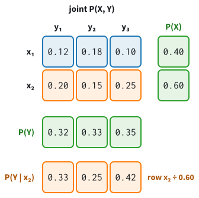
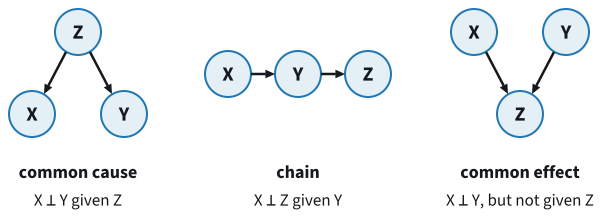
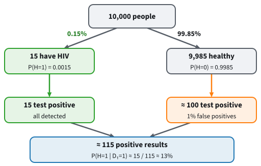

```{.python .input}
%load_ext d2lbook.tab
tab.interact_select('mxnet', 'pytorch', 'tensorflow', 'jax')
```

# Probability and Statistics
:label:`sec_prob`

Machine learning is all about reasoning under uncertainty: predicting how likely a patient is to suffer a heart attack, judging whether a sensor reading is anomalous, or telling whether an accuracy difference from $0.90$ ($230/256$ test images) to $0.87$ on the next minibatch reflects a real change or random sampling fluctuation.

Probability theory's cleanest thought experiment is still the coin toss: if a coin lands on heads $56$ times in $100$ tosses, should we suspect that it is biased? Even a fair coin rarely lands on heads exactly $50$ times, so we must ask whether a deviation of $6$ heads is larger than chance routinely produces. *Probability* reasons forward from a known model (a fair coin) to the likelihood of outcomes, while *statistics* reasons backward from observed data ($56$ heads in $100$ tosses) to infer properties of the underlying process.

In this section, we simulate coin tosses to watch sampling fluctuations unfold, introduce sample spaces, events, random variables, joint distributions, and independence, and derive the *standard error* $\sigma/\sqrt{n}$ via expectation and variance to settle the coin question. We then develop conditional probability and Bayes' theorem on a two-step medical diagnostic test.

```{.python .input #probability-probability-and-statistics}
%%tab mxnet
import math
import numpy as np
from mxnet import autograd, gluon, init, np as mnp, npx
from mxnet.gluon import nn
from d2l import mxnet as d2l
npx.set_np()
```

```{.python .input #probability-probability-and-statistics}
%%tab pytorch
import math
import numpy as np
import torch
from torch import nn
from torch.nn import functional as F
from d2l import torch as d2l
```

```{.python .input #probability-probability-and-statistics}
%%tab tensorflow
import math
import numpy as np
import tensorflow as tf
from d2l import tensorflow as d2l
```

```{.python .input #probability-probability-and-statistics}
%%tab jax
import math
import numpy as np
import jax
from jax import numpy as jnp
from flax import nnx
import optax
from d2l import jax as d2l
```

```{.python .input #probability-probability-and-statistics-1}
%%tab mxnet, jax
import random
```

```{.python .input #probability-probability-and-statistics-1}
%%tab pytorch
import random
from torch.distributions.multinomial import Multinomial
```

```{.python .input #probability-probability-and-statistics-1}
%%tab tensorflow
import random
from tensorflow_probability import distributions as tfd
```

## Sampling

### Simulated Coin Tosses

For a *fair* coin, symmetry between heads and tails implies $P(\textrm{heads}) = 0.5$. Drawing realizations from a random process is called *sampling*: below, we simulate $100$ tosses first by testing whether uniform draws from $[0, 1)$ exceed $0.5$, and then using our framework's *multinomial* sampler with $n = 100$ and probabilities $(0.5, 0.5)$:

```{.python .input #probability-a-simple-example-tossing-coins-1}
num_tosses = 100
heads = sum([random.random() > 0.5 for _ in range(num_tosses)])
tails = num_tosses - heads
print("heads, tails: ", [heads, tails])
```

:begin_tab:`jax`
In JAX, we split an explicit PRNG key seeded from `random` so each run produces fresh counts.
:end_tab:

```{.python .input #probability-a-simple-example-tossing-coins-2}
%%tab mxnet
fair_probs = [0.5, 0.5]
mnp.random.multinomial(100, fair_probs)
```

```{.python .input #probability-a-simple-example-tossing-coins-2}
%%tab pytorch
fair_probs = torch.tensor([0.5, 0.5])
Multinomial(100, fair_probs).sample()
```

```{.python .input #probability-a-simple-example-tossing-coins-2}
%%tab tensorflow
fair_probs = tf.constant([0.5, 0.5])
tfd.Multinomial(100, probs=fair_probs).sample()
```

```{.python .input #probability-a-simple-example-tossing-coins-2}
%%tab jax
key = jax.random.key(random.getrandbits(32))  # A new seed on each run
key, subkey = jax.random.split(key)
fair_probs = jnp.array([0.5, 0.5])
jax.random.multinomial(subkey, 100, fair_probs)
```

### Frequencies and Probabilities

Dividing the observed counts by $n$ gives the empirical *frequency* $\hat{p}$, an *estimator* of the true probability $p = P(\textrm{heads}) = 0.5$. Repeating the 100-toss experiment five times simultaneously produces a $5 \times 2$ matrix of empirical frequencies that fluctuate noticeably around $0.5$:

```{.python .input #probability-a-simple-example-tossing-coins-3}
%%tab mxnet
mnp.random.multinomial(100, fair_probs, size=5) / 100
```

```{.python .input #probability-a-simple-example-tossing-coins-3}
%%tab pytorch
Multinomial(100, fair_probs).sample((5,)) / 100
```

```{.python .input #probability-a-simple-example-tossing-coins-3}
%%tab tensorflow
tfd.Multinomial(100, probs=fair_probs).sample(5) / 100
```

```{.python .input #probability-a-simple-example-tossing-coins-3}
%%tab jax
key, subkey = jax.random.split(key)
jax.random.multinomial(subkey, 100, fair_probs, shape=(5,)) / 100
```

Increasing the sample size a hundredfold to $n = 10{,}000$ tosses shrinks the typical sampling error by $\sqrt{100} = 10$, pulling the empirical head and tail frequencies much closer to $(0.5, 0.5)$:

```{.python .input #probability-a-simple-example-tossing-coins-4}
%%tab mxnet
mnp.random.multinomial(10000, fair_probs) / 10000
```

```{.python .input #probability-a-simple-example-tossing-coins-4}
%%tab pytorch
Multinomial(10000, fair_probs).sample() / 10000
```

```{.python .input #probability-a-simple-example-tossing-coins-4}
%%tab tensorflow
tfd.Multinomial(10000, probs=fair_probs).sample() / 10000
```

```{.python .input #probability-a-simple-example-tossing-coins-4}
%%tab jax
key, subkey = jax.random.split(key)
jax.random.multinomial(subkey, 10000, fair_probs) / 10000
```

Tracking the running frequency after every toss from $1$ to $10{,}000$ via `cumsum` illustrates the *law of large numbers* (:numref:`sec_mdl-statistics`), which guarantees that $\hat{p} \to p$ as $n \to \infty$:

```{.python .input #probability-a-simple-example-tossing-coins-5}
%%tab mxnet
n = 10000
tosses = (mnp.random.uniform(size=n) < 0.5).astype(mnp.float32)  # 1 is heads
estimates = tosses.cumsum() / mnp.arange(1, n + 1)
d2l.plot(mnp.arange(1, n + 1), [estimates, mnp.full(n, 0.5)], 'tosses',
         'frequency of heads', legend=['running frequency', 'P(heads)'],
         xscale='log', figsize=(4.5, 3))
```

```{.python .input #probability-a-simple-example-tossing-coins-5}
%%tab pytorch
n = 10000
tosses = (torch.rand(n) < 0.5).to(torch.float32)  # 1 is heads, 0 is tails
estimates = tosses.cumsum(dim=0) / torch.arange(1, n + 1)
d2l.plot(torch.arange(1, n + 1), [estimates, torch.full((n,), 0.5)],
         'tosses', 'frequency of heads',
         legend=['running frequency', 'P(heads)'], xscale='log',
         figsize=(4.5, 3))
```

```{.python .input #probability-a-simple-example-tossing-coins-5}
%%tab tensorflow
n = 10000
tosses = tf.cast(tf.random.uniform((n,)) < 0.5, tf.float32)  # 1 is heads
estimates = tf.cumsum(tosses) / tf.range(1, n + 1, dtype=tf.float32)
d2l.plot(tf.range(1, n + 1), [estimates, tf.fill((n,), 0.5)], 'tosses',
         'frequency of heads', legend=['running frequency', 'P(heads)'],
         xscale='log', figsize=(4.5, 3))
```

```{.python .input #probability-a-simple-example-tossing-coins-5}
%%tab jax
n = 10000
key, subkey = jax.random.split(key)
tosses = jax.random.uniform(subkey, (n,)) < 0.5  # True is heads
estimates = tosses.cumsum() / jnp.arange(1, n + 1)
d2l.plot(jnp.arange(1, n + 1), [estimates, jnp.full(n, 0.5)], 'tosses',
         'frequency of heads', legend=['running frequency', 'P(heads)'],
         xscale='log', figsize=(4.5, 3))
```

To know *how fast* $\hat{p}$ settles, and whether $56/100$ is suspicious, we now formalize random variables and their spread.

## Events and Random Variables

### Sample Spaces and Events

The set of all possible outcomes of a random experiment is its *sample space* $\mathcal{S}$ (for one die roll, $\mathcal{S} = \{1, 2, 3, 4, 5, 6\}$). An *event* is any subset $\mathcal{A} \subseteq \mathcal{S}$ (such as "rolling an even number," $\mathcal{A} = \{2, 4, 6\}$, or "at least $5$," $\mathcal{B} = \{5, 6\}$). A *probability* function $P$ assigns a real number to every event $\mathcal{A} \subseteq \mathcal{S}$ subject to Kolmogorov's three axioms :cite:`Kolmogorov.1933`:

* **Nonnegativity:** $P(\mathcal{A}) \geq 0$;
* **Normalization:** $P(\mathcal{S}) = 1$;
* **Countable additivity:** for mutually exclusive events $\mathcal{A}_1, \mathcal{A}_2, \ldots$ ($\mathcal{A}_i \cap \mathcal{A}_j = \emptyset$ for $i \neq j$), $P(\bigcup_i \mathcal{A}_i) = \sum_i P(\mathcal{A}_i)$.

From these axioms follow the complement rule $P(\mathcal{A}') = 1 - P(\mathcal{A})$, $P(\emptyset) = 0$, and the inclusion--exclusion formula (:numref:`fig_prob_venn`):

$$P(\mathcal{A} \cup \mathcal{B}) = P(\mathcal{A}) + P(\mathcal{B}) - P(\mathcal{A} \cap \mathcal{B}).$$


:label:`fig_prob_venn`

### Random Variables and Distributions

A *random variable* $X$ maps outcomes in $\mathcal{S}$ to numerical values (for example, the number of heads in $100$ coin tosses maps $2^{100}$ sequences to $\{0, \ldots, 100\}$). A *discrete* random variable assigns probability mass $P(X = v)$ to each value $v$ (its *distribution* $P(X)$). A *continuous* random variable (such as a person's exact height) is described instead by a *probability density* $p(x)$ (:numref:`fig_prob_density`), where the probability of landing in $[a, b]$ is the area under the density curve, $P(a \leq X \leq b) = \int_a^b p(x)\,dx$ (:numref:`sec_mdl-random_variables`).


:label:`fig_prob_density`

### Joint, Marginal, and Independent Distributions

The *joint distribution* $P(X = x, Y = y)$ of two random variables gives the probability that $X = x$ and $Y = y$ occur together. For example, for rain ($X$) and carrying an umbrella ($Y$) on a random day:

| $P(X, Y)$ | umbrella | no umbrella |
|:--|--:|--:|
| rain | 0.25 | 0.05 |
| no rain | 0.10 | 0.60 |

Summing out one variable recovers the *marginal distribution* of the other (*marginalization*, :numref:`fig_prob_joint`):

$$P(X = x) = \sum_y P(X = x, Y = y),$$

so $P(\textrm{rain}) = 0.25 + 0.05 = 0.30$ and $P(\textrm{umbrella}) = 0.25 + 0.10 = 0.35$.


:label:`fig_prob_joint`

Two random variables $X$ and $Y$ are *independent* ($X \perp Y$) if their joint distribution factorizes into the product of their marginals:

$$P(X, Y) = P(X) P(Y).$$

Successive coin tosses are independent, whereas rain and umbrellas are not ($0.25 \neq 0.30 \cdot 0.35 = 0.105$).

## Expectation and Variance

### Expectation

The *expectation* (or *mean*) of a discrete random variable $X$ is its probability-weighted average:

$$\mathbb{E}[X] = \sum_x x \, P(X = x),$$

and for any function $f$, $\mathbb{E}[f(X)] = \sum_x f(x)\,P(X = x)$. For an investment returning $0\times$ with probability $0.5$, $2\times$ with probability $0.4$, and $10\times$ with probability $0.1$, $\mathbb{E}[X] = 0.5(0) + 0.4(2) + 0.1(10) = 1.8$. For a coin-toss indicator $X = \mathbf{1}(\textrm{heads}) \in \{0, 1\}$, $\mathbb{E}[X] = 1\cdot p + 0\cdot(1-p) = p$.

Expectation is always *linear*: $\mathbb{E}[aX + bY] = a\,\mathbb{E}[X] + b\,\mathbb{E}[Y]$ holds whether or not $X$ and $Y$ are independent. Consequently, the sample frequency $\hat{p} = \frac{1}{n}\sum_{i=1}^n X_i$ satisfies $\mathbb{E}[\hat{p}] = \frac{1}{n}\sum_{i=1}^n \mathbb{E}[X_i] = p$, making $\hat{p}$ an *unbiased* estimator of $p$.

### Variance and Sums of Independent Variables

To measure spread around $\mu = \mathbb{E}[X]$, the *variance* averages the squared deviations, and the *standard deviation* $\sigma = \sqrt{\textrm{Var}(X)}$ restores the original units:

$$\textrm{Var}(X) = \mathbb{E}\left[(X - \mu)^2\right] = \mathbb{E}[X^2] - \mu^2, \qquad \textrm{Var}(aX + b) = a^2\,\textrm{Var}(X).$$

For our investment, $\mathbb{E}[X^2] = 0.5(0) + 0.4(4) + 0.1(100) = 11.6$, so $\textrm{Var}(X) = 11.6 - 1.8^2 = 8.36$ ($\sigma \approx 2.9$). For a single coin-toss indicator $X \in \{0, 1\}$, $X^2 = X$, so $\textrm{Var}(X) = p - p^2 = p(1 - p)$, which reaches its maximum $1/4$ at $p = 0.5$. When estimating variance from $n$ observations around their sample mean as in :numref:`sec_pandas`, dividing by $n - 1$ (*Bessel's correction*) compensates for the slight downward bias of dividing by $n$.

For a sum of two random variables, expanding $\mathbb{E}[(X - \mu_X + Y - \mu_Y)^2]$ gives

$$
\begin{aligned}
\textrm{Var}(X + Y) &= \textrm{Var}(X) + \textrm{Var}(Y) + 2\,\textrm{Cov}(X, Y), \\
\textrm{Cov}(X, Y) &= \mathbb{E}\left[(X - \mu_X)(Y - \mu_Y)\right],
\end{aligned}
$$

where the *covariance* $\textrm{Cov}(X, Y)$ and dimensionless *correlation* $\rho = \textrm{Cov}(X, Y)/(\sigma_X\sigma_Y) \in [-1, 1]$ measure linear co-movement (:numref:`fig_prob_covariance`). More generally, for a random vector $\mathbf{x} \in \mathbb{R}^d$ with mean $\boldsymbol{\mu} = \mathbb{E}[\mathbf{x}]$, collecting all pairwise covariances $\Sigma_{ij} = \textrm{Cov}(x_i, x_j)$ forms the symmetric $d \times d$ *covariance matrix* $\boldsymbol{\Sigma} = \mathbb{E}[(\mathbf{x}-\boldsymbol{\mu})(\mathbf{x}-\boldsymbol{\mu})^\top]$, and any linear combination $\mathbf{v}^\top\mathbf{x}$ has variance $\textrm{Var}(\mathbf{v}^\top\mathbf{x}) = \mathbf{v}^\top\boldsymbol{\Sigma}\mathbf{v}$.


:label:`fig_prob_covariance`

When $X$ and $Y$ are *independent*, their expectation factorizes so $\textrm{Cov}(X, Y) = \mathbb{E}[X - \mu_X]\mathbb{E}[Y - \mu_Y] = 0$, and **variances of independent variables add**:

$$\textrm{Var}(X + Y) = \textrm{Var}(X) + \textrm{Var}(Y).$$

Zero covariance does not, however, imply independence: if $X$ takes $-1, 0, +1$ with equal probability and $Y = X^2$, then $Y$ is completely determined by $X$, yet by symmetry $\mathbb{E}[X] = 0$ and $\mathbb{E}[XY] = \mathbb{E}[X^3] = 0$, giving $\textrm{Cov}(X, Y) = 0$.

## Estimation Error

### The Standard Error of a Frequency

Because $n$ independent coin tosses each have variance $p(1 - p)$, their sum has variance $np(1 - p)$, and dividing by $n$ scales the variance by $1/n^2$:

$$\textrm{Var}(\hat{p}) = \frac{p(1-p)}{n}.$$
:eqlabel:`eq_prob_var_phat`

Taking the square root gives the *standard error* of $\hat{p}$: $\sqrt{p(1-p)/n}$, which for a fair coin ($p = 0.5$) is $0.5/\sqrt{n}$ ($0.05$ at $n = 100$; $0.005$ at $n = 10{,}000$). Because of the $1/\sqrt{n}$ rate, halving the error requires $4\times$ the data. More generally, the average of any $n$ independent draws with variance $\sigma^2$ has standard error $\sigma/\sqrt{n}$. Simulating $1000$ repetitions at each $n \in \{10, 100, 1000, 10000\}$ confirms the $0.5/\sqrt{n}$ line of slope $-1/2$:

```{.python .input #probability-a-simple-example-tossing-coins-6}
%%tab mxnet
ns = [10, 100, 1000, 10000]
stds = [float((mnp.random.uniform(size=(1000, n)) < 0.5)
              .astype(mnp.float32).mean(axis=1).std()) for n in ns]
d2l.plot(ns, [stds, [0.5 / n ** 0.5 for n in ns]], 'tosses n',
         'std of frequency', legend=['simulation', r'$0.5/\sqrt{n}$'],
         xscale='log', yscale='log', fmts=('o', '-'))
```

```{.python .input #probability-a-simple-example-tossing-coins-6}
%%tab pytorch
ns = [10, 100, 1000, 10000]
stds = [float((torch.rand(1000, n) < 0.5).to(torch.float32)
              .mean(dim=1).std()) for n in ns]
d2l.plot(ns, [stds, [0.5 / n ** 0.5 for n in ns]], 'tosses n',
         'std of frequency', legend=['simulation', r'$0.5/\sqrt{n}$'],
         xscale='log', yscale='log', fmts=('o', '-'))
```

```{.python .input #probability-a-simple-example-tossing-coins-6}
%%tab tensorflow
ns = [10, 100, 1000, 10000]
stds = [float(tf.math.reduce_std(tf.reduce_mean(
    tf.cast(tf.random.uniform((1000, n)) < 0.5, tf.float32), axis=1)))
    for n in ns]
d2l.plot(ns, [stds, [0.5 / n ** 0.5 for n in ns]], 'tosses n',
         'std of frequency', legend=['simulation', r'$0.5/\sqrt{n}$'],
         xscale='log', yscale='log', fmts=('o', '-'))
```

```{.python .input #probability-a-simple-example-tossing-coins-6}
%%tab jax
ns = [10, 100, 1000, 10000]
key, *subkeys = jax.random.split(key, len(ns) + 1)
stds = [float((jax.random.uniform(k, (1000, n)) < 0.5).mean(axis=1).std())
        for k, n in zip(subkeys, ns)]
d2l.plot(ns, [stds, [0.5 / n ** 0.5 for n in ns]], 'tosses n',
         'std of frequency', legend=['simulation', r'$0.5/\sqrt{n}$'],
         xscale='log', yscale='log', fmts=('o', '-'))
```

### Testing for Bias and Uncertainty

We can now answer our coin question. In $100$ tosses, $\hat{p} = 0.56$ is $0.06 / 0.05 = 1.2$ standard errors from $0.5$; in $10{,}000$ tosses, the same frequency $\hat{p} = 0.56$ ($5{,}600$ heads) is $0.06 / 0.005 = 12$ standard errors away. Simulating $1000$ fair-coin experiments shows how often a fair coin strays at least that far (estimating the *p-value*):

```{.python .input #probability-is-the-coin-biased}
%%tab mxnet
def fraction_as_far(heads, n, num_experiments=1000):
    """Fraction of fair-coin experiments at least as far from n/2 as heads."""
    tosses = mnp.random.uniform(size=(num_experiments, n)) < 0.5
    counts = tosses.astype(mnp.float32).sum(axis=1)
    return (mnp.abs(counts - n / 2) >= abs(heads - n / 2)).mean()

fraction_as_far(56, 100), fraction_as_far(5600, 10000)
```

```{.python .input #probability-is-the-coin-biased}
%%tab pytorch
def fraction_as_far(heads, n, num_experiments=1000):
    """Fraction of fair-coin experiments at least as far from n/2 as heads."""
    counts = (torch.rand(num_experiments, n) < 0.5).sum(dim=1)
    far = (counts - n / 2).abs() >= abs(heads - n / 2)
    return far.to(torch.float32).mean()

fraction_as_far(56, 100), fraction_as_far(5600, 10000)
```

```{.python .input #probability-is-the-coin-biased}
%%tab tensorflow
def fraction_as_far(heads, n, num_experiments=1000):
    """Fraction of fair-coin experiments at least as far from n/2 as heads."""
    tosses = tf.random.uniform((num_experiments, n)) < 0.5
    counts = tf.reduce_sum(tf.cast(tosses, tf.float32), axis=1)
    far = tf.abs(counts - n / 2) >= abs(heads - n / 2)
    return tf.reduce_mean(tf.cast(far, tf.float64))  # no float32 print noise

float(fraction_as_far(56, 100)), float(fraction_as_far(5600, 10000))
```

```{.python .input #probability-is-the-coin-biased}
%%tab jax
def fraction_as_far(key, heads, n, num_experiments=1000):
    """Fraction of fair-coin experiments at least as far from n/2 as heads."""
    counts = (jax.random.uniform(key, (num_experiments, n)) < 0.5).sum(axis=1)
    far = jnp.abs(counts - n / 2) >= abs(heads - n / 2)
    return far.sum().item() / num_experiments

key, k1, k2 = jax.random.split(key, 3)
fraction_as_far(k1, 56, 100), fraction_as_far(k2, 5600, 10000)
```

Roughly a quarter of fair 100-toss runs deviate by $6$ or more heads, so $56/100$ is no evidence of bias, whereas zero out of $1000$ fair 10,000-toss runs come anywhere near $5{,}600$. Two general theorems quantify these tail probabilities: *Chebyshev's inequality* (:numref:`sec_mdl-random_variables`) guarantees $P(|X - \mu| \geq k\sigma) \leq 1/k^2$ for any distribution with finite variance, while the *central limit theorem* (:numref:`sec_mdl-distributions`) shows that averages of independent draws approach a Gaussian bell curve, landing within $2$ standard errors about $95\%$ of the time. The same arithmetic governs model evaluation: a classifier with true accuracy $0.9$ has standard error $\sqrt{0.9 \cdot 0.1 / 256} \approx 0.019$ on a single $256$-image minibatch (so $\pm 2\%$ swings are ordinary noise), versus $0.003$ across a $10{,}000$-image test set.

Notice finally that collecting more data shrinks *epistemic uncertainty* (uncertainty about the model parameter $p$, decaying as $1/\sqrt{n}$), but never reduces *aleatoric uncertainty* (the intrinsic 50/50 randomness of the next coin toss itself, or an inherently ambiguous image) :cite:`Der-Kiureghian.Ditlevsen.2009`.

## Conditional Probability

### Conditioning, Bayes' Theorem, and Conditional Independence

Restricting attention to outcomes where $X = x$ ($P(X = x) > 0$) and renormalizing defines the *conditional probability* of $Y = y$ given $X = x$:

$$P(Y = y \mid X = x) = \frac{P(X = x, Y = y)}{P(X = x)} \quad \Longrightarrow \quad P(X, Y) = P(Y \mid X) P(X).$$

In our weather table, conditioning on rain rescales the rain row $(0.25, 0.05)$ by $0.30$ to give $P(\textrm{umbrella} \mid \textrm{rain}) = 0.25/0.30 \approx 0.83$ (versus $0.35$ unconditionally). Writing the joint probability in both orders, $P(X, Y) = P(Y \mid X)P(X) = P(X \mid Y)P(Y)$, and dividing by $P(Y) = \sum_x P(Y \mid X = x)P(X = x)$ yields *Bayes' theorem* :cite:`Bayes.1763`:

$$P(X \mid Y) = \frac{P(Y \mid X) P(X)}{P(Y)}.$$

For a hypothesis $H$ and observed data $D$, Bayes' theorem updates the *prior* $P(H)$ via the *likelihood* $P(D \mid H)$ and evidence $P(D)$ to produce the *posterior* $P(H \mid D) \propto P(D \mid H)P(H)$.

Two variables $X$ and $Y$ are *conditionally independent* given $Z$ ($X \perp Y \mid Z$) if $P(X, Y \mid Z) = P(X \mid Z)P(Y \mid Z)$. Conditioning can either remove or introduce dependence (:numref:`fig_prob_explaining_away`): observing a *common cause* $Z$ (such as a child's age) removes the correlation between shoe size and reading level, and observing the present state $Y$ in a *Markov chain* $X \to Y \to Z$ renders past $X$ and future $Z$ independent; conversely, conditioning on a *common effect* $Z$ (*explaining away*) couples two independent causes, as when learning that a hospitalized patient has a broken bone lowers the probability they were admitted for lung cancer.


:label:`fig_prob_explaining_away`

### Example: Diagnostic Testing
:label:`subsec_probability_hiv_app`

Suppose a patient takes an HIV screening test $D_1 \in \{0, 1\}$ with true HIV status $H \in \{0, 1\}$. The test has $100\%$ sensitivity and a $1\%$ false-positive rate:

| $P(D_1 \mid H)$ | $H=1$ (HIV) | $H=0$ (healthy) |
|:--|--:|--:|
| test positive, $D_1 = 1$ | 1.00 | 0.01 |
| test negative, $D_1 = 0$ | 0.00 | 0.99 |

If the population prevalence is $P(H = 1) = 0.0015$ ($P(H = 0) = 0.9985$) and the patient tests positive ($D_1 = 1$), marginalizing gives $P(D_1 = 1) = 0.01(0.9985) + 1(0.0015) = 0.011485$, and Bayes' theorem gives

$$P(H = 1 \mid D_1 = 1) = \frac{P(D_1=1 \mid H=1) P(H=1)}{P(D_1=1)} = \frac{0.0015}{0.011485} = 0.1306.$$

Out of $10{,}000$ people (:numref:`fig_prob_natural_freq`), all $15$ infected people test positive, but so do $1\%$ of the $9{,}985$ healthy people ($\approx 100$ false alarms), leaving only $15 / 115 \approx 13\%$ of positive tests truly infected.


:label:`fig_prob_natural_freq`

Now suppose a follow-up test $D_2$ (with $P(D_2 = 1 \mid H = 1) = 0.98$ and false-positive rate $P(D_2 = 1 \mid H = 0) = 0.03$) also comes back positive. Assuming $D_1$ and $D_2$ are conditionally independent given $H$, the joint false-positive rate drops to $0.01 \cdot 0.03 = 0.0003$ while sensitivity is $1 \cdot 0.98 = 0.98$. Marginalizing gives $P(D_1 = 1, D_2 = 1) = 0.0003(0.9985) + 0.98(0.0015) = 0.00176955$, and Bayes' theorem raises the posterior probability of infection (:numref:`fig_prob_update`) to

$$P(H = 1 \mid D_1 = 1, D_2 = 1) = \frac{0.98 \cdot 0.0015}{0.00176955} = 0.8307.$$

Simulating two million virtual patients yields an empirical fraction around $0.82\text{--}0.83$, within two $\pm 0.006$ standard errors ($\sqrt{0.83 \cdot 0.17 / 3500}$) of the exact value $0.8307$ across the $\approx 3{,}500$ double-positive patients:


:label:`fig_prob_update`

```{.python .input #probability-worked-example-hiv-testing-1}
%%tab mxnet
n = 2000000
H = mnp.random.uniform(size=n) < 0.0015
D1 = mnp.random.uniform(size=n) < mnp.where(H, 1.00, 0.01)
D2 = mnp.random.uniform(size=n) < mnp.where(H, 0.98, 0.03)
H[D1 & D2].astype(mnp.float32).mean()  # Exact value: 0.8307
```

```{.python .input #probability-worked-example-hiv-testing-1}
%%tab pytorch
n = 2000000
H = torch.rand(n) < 0.0015
D1 = torch.rand(n) < torch.where(H, 1.00, 0.01)
D2 = torch.rand(n) < torch.where(H, 0.98, 0.03)
H[D1 & D2].to(torch.float32).mean()  # Exact value: 0.8307
```

```{.python .input #probability-worked-example-hiv-testing-1}
%%tab tensorflow
n = 2000000
H = tf.random.uniform((n,)) < 0.0015
D1 = tf.random.uniform((n,)) < tf.where(H, 1.00, 0.01)
D2 = tf.random.uniform((n,)) < tf.where(H, 0.98, 0.03)
fraction = tf.reduce_mean(tf.cast(H[D1 & D2], tf.float32))
round(float(fraction), 4)  # Exact value: 0.8307
```

```{.python .input #probability-worked-example-hiv-testing-1}
%%tab jax
n = 2000000
key, k1, k2, k3 = jax.random.split(key, 4)
H = jax.random.uniform(k1, (n,)) < 0.0015
D1 = jax.random.uniform(k2, (n,)) < jnp.where(H, 1.00, 0.01)
D2 = jax.random.uniform(k3, (n,)) < jnp.where(H, 0.98, 0.03)
H[D1 & D2].mean()  # Exact value: 0.8307
```

## Summary

Probability reasons forward from a model to the likelihood of outcomes, whereas statistics reasons backward from observed data to infer properties of the underlying process. Built on Kolmogorov's three axioms, joint distributions $P(X, Y)$ marginalize by summing out variables and factorize as $P(X)P(Y)$ when variables are independent. Expectation $\mathbb{E}[X]$ is always linear, while variance $\textrm{Var}(X) = \mathbb{E}[(X-\mu)^2]$ adds across independent variables, giving the average of $n$ independent draws standard error $\sigma/\sqrt{n}$: measuring deviations in standard errors shows why $56/100$ heads ($1.2$ standard errors) is routine chance whereas $5{,}600/10{,}000$ ($12$ standard errors) is decisive, and why collecting more data shrinks *epistemic* uncertainty as $1/\sqrt{n}$ while leaving *aleatoric* uncertainty unchanged. Finally, Bayes' theorem $P(H \mid D) = P(D \mid H)P(H)/P(D)$ updates prior beliefs in light of evidence, explaining why a single positive test for a rare condition ($0.15\%$ prevalence, $1\%$ false-positive rate) yields only a $13.1\%$ posterior until a second conditionally independent test raises it to $83.1\%$.

## Exercises

1. **Portfolio return and risk.** Assume that you manage a portfolio of
   $n$ stocks whose returns $\mathbf{s} \in \mathbb{R}^n$ are random with
   mean $\boldsymbol{\mu} = \mathbb{E}[\mathbf{s}]$ and covariance matrix
   $\boldsymbol{\Sigma}$. You invest a fraction $\alpha_i \geq 0$ of your
   capital in stock $i$, with $\sum_i \alpha_i = 1$.
    1. Compute the expected return and the variance of the return of the
       portfolio $\boldsymbol{\alpha}$.
    1. Assume that every stock has variance $\sigma^2$ and that every pair
       of distinct stocks has correlation $\rho \geq 0$. Compute the
       variance of the equally weighted portfolio $\alpha_i = 1/n$ and its
       limit as $n \to \infty$. Compare the case $\rho = 0$
       with :eqref:`eq_prob_var_phat`.
    1. (Optional.) Formulate an optimization problem that maximizes the
       expected return while constraining the variance to an upper bound.
       This is the
       [Markowitz portfolio](https://en.wikipedia.org/wiki/Markowitz_model)
       problem :cite:`Markowitz.1952`. Methods for constrained problems of
       this kind are developed
       in :numref:`sec_mdl-constrained-optimization-duality`.

1. [code] **Chebyshev for the coin-toss estimator.**
   :eqref:`eq_prob_var_phat` gives the variance of the frequency $\hat{p}$
   of heads after $n$ tosses.
    1. For a fair coin and $n = 100$, use Chebyshev's inequality to bound
       $P(|\hat{p} - p| \geq 0.1)$.
    1. Estimate the same probability by simulating 10,000 repetitions of
       100 tosses, compare it with the bound, and account for the gap.
    1. Determine how many tosses Chebyshev's inequality requires to
       guarantee $P(|\hat{p} - p| \geq 0.01) \leq 0.05$ for a fair coin,
       and compare with the $n$ at which the standard error
       $\sqrt{p(1-p)/n}$ itself equals $0.01$.

1. **Comparing two classifiers.** ● Two classifiers are evaluated on the same
   test set of $n = 10{,}000$ images. Classifier A labels 9,050 images
   correctly and classifier B labels 9,000 correctly. Treat the test images
   as independent draws.
    1. Compute the standard error of each accuracy.
    1. Assume that the two accuracies are independent and compute the
       standard error of their difference. Is the difference of $0.005$
       large compared with the noise?
    1. The two accuracies are measured on the same images, so they are not
       independent. Suppose that the classifiers disagree on 300 images,
       A being correct on 175 of them and B on 125. For image $i$, let
       $Z_i = 1$ if only A is correct, $Z_i = -1$ if only B is correct, and
       $Z_i = 0$ otherwise, so that the difference in accuracy is the average
       of the $Z_i$. Compute the standard error of this average and compare
       it with your answer to the previous part.
    1. Use $\textrm{Var}(X - Y) = \textrm{Var}(X) + \textrm{Var}(Y) - 2\,\textrm{Cov}(X, Y)$
       to explain the difference. What sign does the covariance between the
       two classifiers' correctness on an image have, and why?

1. **Factorizing a chain.** Let $X$, $Y$, and $Z$ be random variables such
   that $Z$ is conditionally independent of $X$ given $Y$, as in the chain
   of :numref:`fig_prob_explaining_away`.
    1. Write the joint probability $P(X, Y, Z)$ as a product of factors that
       each involve at most two of the variables.
    1. Generalize to a sequence $X_1, \ldots, X_T$ in which each $X_t$
       depends on the earlier variables only through $X_{t-1}$. How many
       numbers specify the joint distribution if every $X_t$ takes $k$
       values, compared with an arbitrary joint distribution of $T$ such
       variables?

1. **Conditioning on a common effect.** Toss two independent fair coins, and
   let $X, Y \in \{0, 1\}$ indicate heads on each. Let $Z = \max(X, Y)$
   indicate that at least one coin came up heads. Compute $P(X = 1)$,
   $P(X = 1 \mid Z = 1)$, and $P(X = 1 \mid Z = 1, Y = 1)$. Use these values
   to decide whether $X$ and $Y$ are conditionally independent given
   $Z = 1$, and relate the change from the second value to the third
   to :numref:`fig_prob_explaining_away`.

1. **A second, correlated test.** ● Revisit
   :numref:`subsec_probability_hiv_app` with two new tests whose outcomes
   are conditionally independent for patients with HIV but not for
   healthy patients. Either test on its own has a false positive rate of
   10% and a false negative rate of 1%:

   $$P(D_i = 1 \mid H = 0) = 0.1, \quad P(D_i = 0 \mid H = 1) = 0.01 \quad \textrm{for } i = 1, 2.$$

   For $H = 1$, the joint distribution factorizes as
   $P(D_1, D_2 \mid H = 1) = P(D_1 \mid H = 1)\, P(D_2 \mid H = 1)$. For
   $H = 0$, the outcomes are coupled through
   $P(D_1 = D_2 = 1 \mid H = 0) = 0.02$. The baseline probability is
   $P(H = 1) = 0.0015$ as before.
    1. Work out the joint probability table for $D_1$ and $D_2$ given
       $H = 0$.
    1. Derive the probability that the patient has HIV after the first
       test returns positive, before the second test is run.
    1. Derive the probability that the patient has HIV after both tests
       return positive.
    1. Repeat the previous calculation for tests that are conditionally
       independent given $H = 0$ as well, and explain why the two
       posteriors differ.

1. **A defense lawyer's statistics.** A suspect had a documented history of
   abusing his now-murdered wife. His lawyer argues that, statistically,
   only one in a thousand wife-abusers goes on to murder his wife, so the
   history of abuse is weak evidence and the jury should acquit. Write
   $M$ for "the suspect murdered his wife," $K$ for "his wife was killed,"
   and $B$ for "he had a history of abusing her."
    1. Express the lawyer's one-in-a-thousand figure and the posterior
       probability of guilt in these terms, and identify which probability
       the lawyer has confused with which.
    1. Assume that, over the time span the lawyer's statistic refers to, an
       abused wife is murdered by someone other than her husband with
       probability $10^{-5}$. Compute the posterior probability of guilt and
       compare it with the lawyer's figure.

    *Adapted from MIT 18.05,
    [problem set 7](https://ocw.mit.edu/courses/18-05-introduction-to-probability-and-statistics-spring-2022/mit18_05_s22_pset07_sol.pdf),
    Problem 4.*

:begin_tab:`mxnet`
[Discussions](https://d2l.discourse.group/t/36)
:end_tab:

:begin_tab:`pytorch`
[Discussions](https://d2l.discourse.group/t/37)
:end_tab:

:begin_tab:`tensorflow`
[Discussions](https://d2l.discourse.group/t/198)
:end_tab:

:begin_tab:`jax`
[Discussions](https://d2l.discourse.group/t/17971)
:end_tab:

<!-- slides -->

::: {.slide}
::: {.cover}
[Dive into Deep Learning · §1.6]{.kicker}

Probability and Statistics: Reasoning Under Uncertainty in Machine Learning<br>**aleatoric vs. epistemic uncertainty · distributions & conditioning · Bayes' theorem · expectation & covariance · $\sigma/\sqrt{n}$ error bars**
:::
:::

::: {.slide title="Why Probability and Statistics Are the Language of Machine Learning"}
[Motivation]{.kicker}

::: {.cols .vc}
::: {.col}
- **Calibrated predictions & losses:** Softmax outputs $P(Y \mid \mathbf{x})$ quantify predictive risk; cross-entropy and MSE arise directly from maximum likelihood $P(\mathcal{D} \mid \mathbf{w})$.
- **Monte Carlo training & evaluation:** Minibatch SGD estimates $\nabla \mathbb{E}[\ell]$ from $B = 256$ examples, while standard errors $\sigma/\sqrt{n}$ separate true gains from test-set noise.
- **Forward vs. inverse duality:** Probability predicts data from known $\boldsymbol{\theta}$; statistics infers $\hat{\boldsymbol{\theta}}$ and error bars from data $\mathcal{D}$.
:::

::: {.col .fig .big}
@fig:probability-forward-inverse
:::
:::
:::

::: {.slide title="Two Sources of Uncertainty: Aleatoric vs. Epistemic"}
[Taxonomy of Uncertainty]{.kicker}

::: {.cols .vc}
::: {.col}
- **Data (aleatoric) uncertainty (*irreducible*):** Intrinsic randomness or ambiguity in the observation itself.
  - Even when we know a coin is fair ($p = 0.5$), the next toss is still 50/50.
  - A blurry $28 \times 28$ Fashion-MNIST image that humans split 60/40 between *pullover* and *coat* stays ambiguous no matter how many training images we collect.
- **Model (epistemic) uncertainty (*reducible*):** Ignorance about true parameters ($p$ or weights $\mathbf{w}$) due to finite sample size $n$.
  - Shrinks at rate **$1/\sqrt{n}$** as we collect more data.
:::

::: {.col .fig .big}
@fig:probability-uncertainty
:::
:::
:::

::: {.slide title="Sampling and Empirical Frequencies"}
[From Models to Data]{.kicker}

Drawing realizations from a distribution $P$ is called **sampling**. For $n$ independent tosses of a fair coin with $P = (0.5, 0.5)$, the count vector follows a **multinomial distribution**:

::: {.cols .vc}
::: {.col}
- Dividing observed counts by $n$ gives the empirical **frequency** $\hat{P}_n = \textrm{counts}/n$, an estimator of the true probability $P = (0.5, 0.5)$.
- In a single $100$-toss trial, counts routinely deviate from $(50, 50)$ by several heads:

@probability-a-simple-example-tossing-coins-2
:::

::: {.col}
- Across five independent $100$-toss experiments, $\hat{p}_n$ fluctuates noticeably around $0.50$ (whereas at $n = 10{,}000$, fluctuations tighten tenfold to $\approx \pm 0.005$):

@probability-a-simple-example-tossing-coins-3
:::
:::
:::

::: {.slide title="The Law of Large Numbers: Convergence of Running Frequencies"}
[Asymptotic Consistency]{.kicker}

::: {.cols .vc}
::: {.col}
- Tracking the running frequency $\hat{p}_n = \frac{1}{n}\sum_{i=1}^n X_i$ after every toss $n = 1, 2, \ldots, 10{,}000$ via `cumsum` illustrates the **Law of Large Numbers (LLN)**:
  $$\hat{p}_n = \frac{1}{n}\sum_{i=1}^n X_i \xrightarrow{n \to \infty} p = 0.5$$
- Early swings at $n < 100$ are wide, but as $n \to 10{,}000$, the empirical curve locks onto $P(\textrm{heads}) = 0.5$.

::: {.d2l-note}
**The missing piece:** The LLN guarantees *eventual* convergence as $n \to \infty$, but does not tell us **how fast** estimation error shrinks at finite $n$.
:::
:::

::: {.col .fig .big}
@!probability-a-simple-example-tossing-coins-5
:::
:::
:::

::: {.slide title="How Fast Do Empirical Estimates Converge? The 1/√n Envelope"}
[Rate of Convergence]{.kicker}

::: {.cols .vc}
::: {.col}
- Simulating $1{,}000$ experiments at each sample size $n \in \{10, 100, 1{,}000, 10{,}000\}$ reveals a straight line of **slope $-1/2$** on a log–log plot:
  $$\textrm{std}(\hat{p}_n) = \frac{0.5}{\sqrt{n}}$$
- **The quadratic cost of precision:**
  - Shrinking error by **$2\times$** requires **$4\times$** more evaluation examples.
  - Shrinking error by **$10\times$** requires **$100\times$** more examples ($n = 100 \to \pm 5\%$; $n = 10{,}000 \to \pm 0.5\%$).
- To derive this $1/\sqrt{n}$ law from first principles, we formalize events, random variables, expectation, and variance.
:::

::: {.col .fig .big}
@!probability-a-simple-example-tossing-coins-6
:::
:::
:::

::: {.slide title="Sample Spaces, Events, and Kolmogorov's Axioms"}
[Foundations of Probability]{.kicker}

::: {.cols .vc}
::: {.col}
- A random experiment has a **sample space** $\mathcal{S}$ of all possible outcomes; an **event** is any subset $\mathcal{A} \subseteq \mathcal{S}$.
- **Kolmogorov's three axioms** (1933):
  1. **Nonnegativity:** $P(\mathcal{A}) \ge 0$ for every $\mathcal{A} \subseteq \mathcal{S}$.
  2. **Normalization:** $P(\mathcal{S}) = 1$ (and $P(\emptyset) = 0$).
  3. **Additivity:** For mutually exclusive events ($\mathcal{A}_i \cap \mathcal{A}_j = \emptyset$), $P(\bigcup_i \mathcal{A}_i) = \sum_i P(\mathcal{A}_i)$.
- **Complement ($P(\mathcal{A}^\complement) = 1 - P(\mathcal{A})$) & inclusion–exclusion:**
  $$P(\mathcal{A} \cup \mathcal{B}) = P(\mathcal{A}) + P(\mathcal{B}) - P(\mathcal{A} \cap \mathcal{B})$$
:::

::: {.col .fig}
@fig:probability-venn

*Die roll ($\mathcal{S} = \{1,\ldots,6\}$):* For $\mathcal{A} = \{2, 4, 6\}$ (even) and $\mathcal{B} = \{5, 6\}$ ($\ge 5$), $\mathcal{A} \cap \mathcal{B} = \{6\}$, so $P(\mathcal{A} \cup \mathcal{B}) = \frac{3}{6} + \frac{2}{6} - \frac{1}{6} = \frac{2}{3}$.
:::
:::
:::

::: {.slide title="Discrete vs. Continuous Random Variables"}
[Random Variables & Distributions]{.kicker}

::: {.cols .vc}
::: {.col}
- A **random variable** $X: \mathcal{S} \to \mathbb{R}$ maps outcomes to numbers (e.g., mapping $2^{100}$ coin sequences to $\{0, \ldots, 100\}$ heads).
- **Discrete (probability mass function):** Assigns mass $P(X = v) \ge 0$ to individual values with $\sum_v P(X = v) = 1$ (e.g., softmax over classes or vocabulary tokens).
- **Continuous (probability density function):** Described by a density $p(x) \ge 0$ where probability is **area under the curve**:
  $$P(a \le X \le b) = \int_a^b p(x)\,dx, \quad \int_{-\infty}^{\infty} p(x)\,dx = 1$$
  Note: $p(x)$ can exceed $1$, while $P(X = x) = 0$ at any single point.
:::

::: {.col .fig .big}
@fig:probability-density
:::
:::
:::

::: {.slide title="Joint, Marginal, and Conditional Probability"}
[Sum Rule & Product Rule]{.kicker}

::: {.cols .vc}
::: {.col}
- **Joint distribution $P(X = x, Y = y)$:** Probability that $X = x$ and $Y = y$ occur together (a 2D table whose entries sum to $1$).
- **Sum rule (marginalization):** Sum out nuisance or latent variables along an axis (`sum(axis=1)`):
  $$P(X = x) = \sum_y P(X = x, Y = y)$$
- **Conditioning & product (chain) rule:** Restrict to row $X = x$ and renormalize by $P(X = x)$:
  $$P(Y \mid X) = \frac{P(X, Y)}{P(X)} \iff P(X, Y) = P(Y \mid X)\,P(X)$$
  Iterating the product rule factorizes autoregressive language models: $P(x_1, \ldots, x_T) = \prod_{t=1}^T P(x_t \mid x_{<t})$.
:::

::: {.col .fig}
@fig:probability-joint-grid
:::
:::
:::

::: {.slide title="Bayes' Theorem: Reversing Conditioning"}
[Inverse Probability]{.kicker}

::: {.cols .vc}
::: {.col}
- Writing the joint distribution in both orders, $P(H, D) = P(D \mid H)P(H) = P(H \mid D)P(D)$, and dividing by $P(D)$ yields **Bayes' theorem**:
  $$P(H \mid D) = \frac{P(D \mid H)\,P(H)}{P(D)} = \frac{\textrm{likelihood} \times \textrm{prior}}{\textrm{evidence}}$$
  where $P(D) = \sum_h P(D \mid H = h)\,P(H = h)$ normalizes the posterior across all hypotheses.
- **Forward model $\to$ inverse inference:** Generative models specify how hidden causes or labels $H$ produce observed features or test results $D$ ($P(D \mid H)$); Bayes' theorem inverts this to infer $P(H \mid D)$.
:::

::: {.col .fig}
@fig:probability-bayes-update
:::
:::
:::

::: {.slide title="Dependence, Independence, and 'Explaining Away'"}
[Graphical Structure & Conditioning]{.kicker}

::: {.cols .vc}
::: {.col}
- **Marginal independence ($X \perp Y$):** $P(X, Y) = P(X)P(Y)$.
- **Conditional independence ($X \perp Y \mid Z$):** $P(X, Y \mid Z) = P(X \mid Z)P(Y \mid Z)$. Conditioning can *destroy* or *create* dependence:
  1. **Common cause ($X \leftarrow Z \to Y$):** Dependent marginally, but independent once common cause $Z$ is observed.
  2. **Markov chain ($X \to Y \to Z$):** Past $X \perp$ future $Z$ given present $Y$.
  3. **Common effect ($X \to Z \leftarrow Y$, *explaining away*):** Independent causes (Rain $\perp$ Sprinkler) become **negatively dependent** once common effect $Z = 1$ (wet grass) is observed.
:::

::: {.col .fig}
@fig:probability-explaining-away
:::
:::
:::

::: {.slide title="Expectation: Center of Mass and Unbiased Estimators"}
[First Moment]{.kicker}

::: {.cols .vc}
::: {.col}
- The **expectation** (mean $\mu = \mathbb{E}[X]$) is the probability-weighted center of mass:
  $$\mathbb{E}[X] = \sum_x x\,P(X = x), \qquad \mathbb{E}[f(X)] = \sum_x f(x)\,P(X = x)$$
- *Examples:* Investment return $0.5(0) + 0.4(2) + 0.1(10) = 1.8$; Bernoulli indicator $X \in \{0, 1\}$ has $\mathbb{E}[X] = p$.
- **Linearity of expectation (always holds, even if $X, Y$ are dependent):**
  $$\mathbb{E}[aX + bY] = a\,\mathbb{E}[X] + b\,\mathbb{E}[Y]$$
  Thus $\mathbb{E}[\hat{p}_n] = \frac{1}{n}\sum_{i=1}^n \mathbb{E}[X_i] = p$: sample frequencies and minibatch SGD gradients are **unbiased** estimators.
:::

::: {.col .fig}
@fig:probability-expectation
:::
:::
:::

::: {.slide title="Variance and Standard Deviation: Measuring Spread"}
[Second Central Moment]{.kicker}

::: {.cols .vc}
::: {.col}
- **Variance** measures expected squared deviation around $\mu = \mathbb{E}[X]$; **standard deviation** $\sigma = \sqrt{\mathrm{Var}(X)}$ restores the original units of $X$:
  $$\mathrm{Var}(X) = \mathbb{E}\!\left[(X - \mu)^2\right] = \mathbb{E}[X^2] - (\mathbb{E}[X])^2$$
- **Shift invariance & quadratic scaling:** $\mathrm{Var}(aX + b) = a^2\,\mathrm{Var}(X)$.
- *Investment return:* $\mathbb{E}[X^2] = 0.5(0) + 0.4(4) + 0.1(100) = 11.6$, so $\mathrm{Var}(X) = 11.6 - 1.8^2 = 8.36$ ($\sigma \approx 2.9$).
- *Bernoulli indicator $X \in \{0, 1\}$:* Since $X^2 = X$, $\mathrm{Var}(X) = p - p^2 = p(1 - p) \le \frac{1}{4}$ (maximized at $p = 0.5$).
:::

::: {.col .fig}
@fig:probability-spread
:::
:::
:::

::: {.slide title="Covariance, Correlation, and the Variance of an Average"}
[Co-Movement & 1/√n Scaling]{.kicker}

::: {.cols .vc}
::: {.col}
- **Covariance & correlation** ($\rho = \frac{\mathrm{Cov}(X, Y)}{\sigma_X \sigma_Y} \in [-1, 1]$) quantify linear co-movement:
  $$\mathrm{Cov}(X, Y) = \mathbb{E}\!\left[(X - \mu_X)(Y - \mu_Y)\right]$$
- **Variance of a sum:** Expanding $\mathbb{E}[(X - \mu_X + Y - \mu_Y)^2]$ gives
  $$\mathrm{Var}(X + Y) = \mathrm{Var}(X) + \mathrm{Var}(Y) + 2\,\mathrm{Cov}(X, Y)$$
- **Why averaging divides variance by $n$:** For $n$ independent draws ($\mathrm{Cov} = 0$), variances add ($\mathrm{Var}(\sum_{i=1}^n X_i) = n\sigma^2$), and dividing by $n$ scales variance by $1/n^2$:
  $$\mathrm{Var}(\bar{X}_n) = \frac{\sigma^2}{n} \implies \mathrm{SE}(\bar{X}_n) = \frac{\sigma}{\sqrt{n}}$$
:::

::: {.col .fig}
@fig:probability-covariance
:::
:::
:::

::: {.slide title="Chebyshev's Inequality, the Central Limit Theorem, and Bias Testing"}
[Statistical Significance]{.kicker}

::: {.cols .vc}
::: {.col}
- For a fair coin ($p = 0.5$), $\mathrm{SE}(\hat{p}_n) = \sqrt{p(1-p)/n} = 0.5/\sqrt{n}$. Comparing $\hat{p} = 0.56$ at two sample sizes:
  - **$56/100$ tosses ($\mathrm{SE} = 0.05$):** Deviation $0.06$ is **$1.2\,\mathrm{SE}$** ($p\text{-value} \approx 0.27$, routine chance fluctuation).
  - **$5{,}600/10{,}000$ tosses ($\mathrm{SE} = 0.005$):** Deviation $0.06$ is **$12\,\mathrm{SE}$** ($p\text{-value} \approx 0$, decisive evidence of bias).
- **Chebyshev's inequality (any distribution):** $P(|X - \mu| \ge k\sigma) \le 1/k^2$ (at $k=2$, tail $\le 25\%$).
- **Central Limit Theorem (Gaussian tails for averages):** $\bar{X}_n$ falls within $\pm 1\sigma / \pm 2\sigma / \pm 3\sigma$ with probability **$68\% / 95\% / 99.7\%$** ($95\%$ CI: $\hat{p} \pm 1.96\,\mathrm{SE}$).
:::

::: {.col}
@probability-is-the-coin-biased
:::
:::
:::

::: {.slide title="Evaluating Classifiers: Minibatch Noise vs. Paired Comparisons"}
[ML Evaluation & Error Bars]{.kicker}

::: {.cols .vc}
::: {.col}
Each test prediction is Bernoulli with $\mathrm{SE}(\hat{p}_n) = \sqrt{p(1-p)/n}$:

- **Minibatch ($n = 256$) vs. test set ($n = 10{,}000$) at $p = 0.90$:** Minibatch $\mathrm{SE} \approx \mathbf{1.9\%}$ (a $3\%$ dip is normal noise), whereas test-set $\mathrm{SE} = \mathbf{0.30\%}$.
- **Why paired evaluation on the *same* test set wins:** On $10{,}000$ shared images, $9{,}700$ agreements cancel ($\mathrm{Cov} > 0$), cutting $\mathrm{SE}(\hat{p}_A - \hat{p}_B)$ from $0.42\%$ to **$\mathbf{0.17\%}$** ($+0.5\%$ gain $= 2.9\,\mathrm{SE}$).
:::

::: {.col .fig}
@fig:probability-paired-comparison
:::
:::
:::

::: {.slide title="Worked Example: Base-Rate Neglect in Medical & Anomaly Screening"}
[Bayes' Theorem in Practice]{.kicker}

::: {.cols .vc}
::: {.col}
- A diagnostic test $D_1 \in \{0, 1\}$ for HIV status $H \in \{0, 1\}$ has **$100\%$ sensitivity** ($P(D_1{=}1 \mid H{=}1) = 1.00$) and **$99\%$ specificity** ($P(D_1{=}1 \mid H{=}0) = 0.01$), with prevalence $P(H{=}1) = 0.0015$.
- By the sum rule, $P(D_1{=}1) = 1.00(0.0015) + 0.01(0.9985)$ $= 0.011485$. Bayes' theorem gives:
  $$P(H{=}1 \mid D_1{=}1) = \frac{0.0015}{0.011485} = \mathbf{0.1306} \;(13.1\%)$$
- **Why so low?** Out of $10{,}000$ people, all $15$ infected cases test positive, but $1\%$ of $9{,}985$ healthy people creates **$\approx 100$ false alarms** ($15 / 115 \approx 13.1\%$).
:::

::: {.col .fig}
@fig:probability-natural-frequencies
:::
:::
:::

::: {.slide title="Sequential Bayesian Updating and Correlated Evidence"}
[Two-Stage Screening & Monte Carlo]{.kicker}

::: {.cols .vc}
::: {.col}
- **Follow-up test $D_2$** (sensitivity $0.98$, FPR $0.03$): Under conditional independence $D_1 \perp D_2 \mid H$, joint false positives drop to $0.01 \times 0.03 = 0.0003$:
  $$P(H{=}1 \mid D_1{=}1, D_2{=}1) = \frac{0.00147}{0.00147 + 0.00030} = \mathbf{0.8307}$$
- **Correlated errors:** If shared biochemistry couples false positives ($P(D_1{=}1, D_2{=}1 \mid H{=}0) > 0.0003$), false alarms multiply and the posterior drops (e.g., to $32.9\%$ if joint FPR rises tenfold to $0.003$).
:::

::: {.col .fig}
@fig:probability-bayes-update

@probability-worked-example-hiv-testing-1
:::
:::
:::

::: {.slide title="Concept Check: Standard Errors & Bayesian Updating"}
[Check Your Understanding]{.kicker}

Test your intuition on three practical machine learning design problems:

1. **Sizing a test set:** Your classifier has accuracy $p \approx 0.90$. How many test examples $n$ are required to achieve a standard error of $\mathrm{SE}(\hat{p}_n) = 0.005$ ($0.5\%$)? How many for $\mathrm{SE} = 0.0025$?
2. **Explaining away:** Two independent fair coins $X, Y \in \{0, 1\}$ are tossed, and we observe $Z = \max(X, Y) = 1$ (at least one heads). What is $P(X = 1 \mid Z = 1)$, and how does it change if we then observe $Y = 1$?
3. **Shifting the prior:** If the first HIV test ($100\%$ sensitivity, $1\%$ FPR) is used in a high-risk clinic where prevalence is $P(H = 1) = 0.01$ ($1\%$) instead of $0.15\%$, what is $P(H = 1 \mid D_1 = 1)$?

::: {.d2l-note .fragment .fade-up}
**Answers:**

1. $\sqrt{0.9 \times 0.1 / n} = 0.005 \implies n = 0.09 / 0.000025 = \mathbf{3{,}600}$ images. Halving $\mathrm{SE}$ to $0.0025$ requires $4\times$ more data: **$\mathbf{14{,}400}$** images.
2. $P(X = 1 \mid Z = 1) = \mathbf{2/3}$ (among $\{(1,0), (0,1), (1,1)\}$). Observing $Y = 1$ *explains away* $Z = 1$, dropping $P(X = 1 \mid Z = 1, Y = 1)$ back to **$\mathbf{1/2}$**.
3. $P(H = 1 \mid D_1 = 1) = \frac{1.00 \times 0.01}{1.00(0.01) + 0.01(0.99)} = \frac{0.01}{0.0199} \approx \mathbf{50.3\%}$ (true positives and false positives are now $1{:}1$).
:::
:::

::: {.slide title="Summary: Probabilistic Tools and Their Deep Learning Roles"}
[Key Takeaways]{.kicker}

| Concept / Rule | Mathematical Form | Scaling / Behavior | Primary Deep Learning Role |
| :--- | :--- | :--- | :--- |
| **Marginalization (Sum Rule)** | $P(X) = \sum_y P(X, Y)$ | Collapses one axis (`sum(axis=...)`) | Averaging over latent variables & ensembles |
| **Chain Rule (Product Rule)** | $P(X, Y) = P(Y \mid X)\,P(X)$ | Exact factorization of any joint $P(\mathbf{x})$ | Autoregressive LLMs $\prod_t P(x_t \mid x_{<t})$ |
| **Bayes' Theorem** | $P(H \mid D) = \frac{P(D \mid H)P(H)}{P(D)}$ | Posterior $\propto$ likelihood $\times$ prior | MAP estimation, anomaly & medical screening |
| **Linearity of Expectation** | $\mathbb{E}[aX + bY] = a\mathbb{E}[X] + b\mathbb{E}[Y]$ | Holds even when $X, Y$ are dependent | Unbiased minibatch SGD gradient estimates |
| **Standard Error of a Mean** | $\mathrm{SE}(\bar{X}_n) = \sigma / \sqrt{n}$ | $4\times$ data $\to \frac{1}{2}$ error; $100\times$ data $\to \frac{1}{10}$ error | Test-set sizing & paired model comparisons |
| **Aleatoric vs. Epistemic** | Data noise vs. parameter ignorance | Aleatoric: irreducible; Epistemic: $\propto 1/\sqrt{n}$ | Softmax calibration vs. active data collection |
:::
