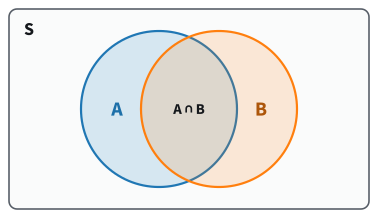
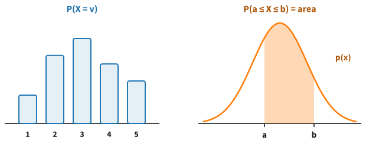
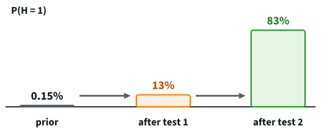

```{.python .input}
%load_ext d2lbook.tab
tab.interact_select('mxnet', 'pytorch', 'tensorflow', 'jax')
```

# Probability and Statistics
:label:`sec_prob`

One way or another, machine learning is all about reasoning under uncertainty. In
supervised learning, we predict an unknown target from known features, and we
often want not just a single guess but a measure of how confident we should be—for
example, how likely a patient is to suffer a heart attack within the next year. In
unsupervised learning, judging whether a measurement is anomalous requires knowing
how likely it is under a population model. And even after a model is trained, our
evaluation of its performance depends on the particular sample of data we happen
to test it on: a classifier that correctly labels 230 images in a minibatch of 256
achieves an accuracy of $0.90$, yet on the very next minibatch the exact same
model might score $0.87$. Before we conclude that one architecture beats another,
or that a tweak to our training loop actually helped, we need a principled way to
tell how much such measurements fluctuate by chance alone.

Questions like these are centuries older than machine learning. Probability theory
was born in the seventeenth century out of games of chance, and its cleanest
thought experiment is still the humble coin toss. Suppose a coin is tossed 100
times and lands on heads 56 times. Should we suspect that the coin is biased? The
raw count cannot answer that by itself: even a perfectly fair coin rarely yields
exactly 50 heads in 100 tosses, so some departure from 50 is completely normal.
The real question is whether a deviation of 6 heads is larger than random chance
routinely produces.

*Probability* and *statistics* tackle the two complementary directions of this
problem. *Probability* reasons forward: given a mathematical model of a random
process (such as a fair coin), how likely is each possible outcome? *Statistics*
reasons backward: starting from observed data (such as 56 heads in 100 tosses),
what can we infer about the underlying process that generated it? Whenever we
analyze a dataset—hunting for patterns that generalize to a broader population
rather than chasing sampling noise—we are combining both ways of thinking.

Simple as the coin question sounds, answering it rigorously takes us through most
of the foundational ideas we need. We begin by simulating coin tosses to watch
sampling noise unfold in real time. Next, we introduce the formal language of
sample spaces, events, random variables, joint distributions, and independence. We
then define expectation and variance to quantify how rapidly sample averages
settle down, which resolves the coin question—and tells us how noisy a minibatch
accuracy is. Finally, we turn to conditional probability and Bayes' theorem to
reason about what observing one variable reveals about another, culminating in a
classic medical diagnostic example.

```{.python .input #probability-probability-and-statistics}
%%tab mxnet
import math
import numpy as np
from mxnet import autograd, gluon, init, np as mnp, npx
from mxnet.gluon import nn
from d2l import mxnet as d2l
npx.set_np()
```

```{.python .input #probability-probability-and-statistics}
%%tab pytorch
import math
import numpy as np
import torch
from torch import nn
from torch.nn import functional as F
from d2l import torch as d2l
```

```{.python .input #probability-probability-and-statistics}
%%tab tensorflow
import math
import numpy as np
import tensorflow as tf
from d2l import tensorflow as d2l
```

```{.python .input #probability-probability-and-statistics}
%%tab jax
import math
import numpy as np
import jax
from jax import numpy as jnp
from flax import nnx
import optax
from d2l import jax as d2l
```

```{.python .input #probability-probability-and-statistics-1}
%%tab mxnet, jax
import random
```

```{.python .input #probability-probability-and-statistics-1}
%%tab pytorch
import random
from torch.distributions.multinomial import Multinomial
```

```{.python .input #probability-probability-and-statistics-1}
%%tab tensorflow
import random
from tensorflow_probability import distributions as tfd
```

## Sampling

### Simulated Coin Tosses

If a coin is *fair*, then heads and tails are equally likely. By symmetry, for
every sequence of $n$ tosses with $n_{\textrm{h}}$ heads and
$n_{\textrm{t}} = n - n_{\textrm{h}}$ tails, there is an equally likely sequence
with the roles reversed—which is only possible if each toss has probability $1/2$
of coming up heads, written $P(\textrm{heads}) = 0.5$. Formally, a *probability*
assigns a number between $0$ and $1$ to an outcome (or set of outcomes): $1$
denotes absolute certainty (imagine a trick coin with heads on both faces) and $0$
denotes impossibility (tails on both faces). Crucially, $P(\textrm{heads}) = 0.5$
is a *theoretical* property of the coin and the tossing mechanism itself, not of
any particular sequence of realized tosses.

Formally, drawing realizations from a random process is called *sampling*. To see
what a fair coin produces in practice, we can simulate tosses using a random
number generator. Python's `random.random` draws numbers uniformly from the
interval $[0, 1)$, meaning the probability of landing in any subinterval
$[a, b] \subset [0, 1)$ is simply its length $b - a$. Testing whether a uniform
draw exceeds $0.5$ therefore produces `True` (heads) and `False` (tails) with
probability $0.5$ each.

```{.python .input #probability-a-simple-example-tossing-coins-1}
num_tosses = 100
heads = sum([random.random() > 0.5 for _ in range(num_tosses)])
tails = num_tosses - heads
print("heads, tails: ", [heads, tails])
```

Each time we execute this cell, we obtain fresh counts, and rarely do they split
at exactly 50 and 50. More generally, deep learning frameworks provide built-in
samplers for any random variable with finitely many outcomes (such as a coin toss
or the roll of a die) via the *multinomial* distribution, which describes the
counts of each category across $n$ independent draws. Passing $n = 100$ and the
probability vector $(0.5, 0.5)$ returns a two-element vector giving the number of
heads and tails observed.

:begin_tab:`jax`
Recall from :numref:`sec_ndarray` that JAX random samplers require an explicit
PRNG key, and we split off a fresh subkey for every draw. Seeding the initial key
from Python's `random` module ensures that each run of this notebook produces new
counts.
:end_tab:

```{.python .input #probability-a-simple-example-tossing-coins-2}
%%tab mxnet
fair_probs = [0.5, 0.5]
mnp.random.multinomial(100, fair_probs)
```

```{.python .input #probability-a-simple-example-tossing-coins-2}
%%tab pytorch
fair_probs = torch.tensor([0.5, 0.5])
Multinomial(100, fair_probs).sample()
```

```{.python .input #probability-a-simple-example-tossing-coins-2}
%%tab tensorflow
fair_probs = tf.constant([0.5, 0.5])
tfd.Multinomial(100, probs=fair_probs).sample()
```

```{.python .input #probability-a-simple-example-tossing-coins-2}
%%tab jax
key = jax.random.key(random.getrandbits(32))  # A new seed on each run
key, subkey = jax.random.split(key)
fair_probs = jnp.array([0.5, 0.5])
jax.random.multinomial(subkey, 100, fair_probs)
```

### Frequencies and Probabilities

Dividing the observed counts by the total number of tosses yields the empirical
*frequency* of each outcome. We distinguish the true underlying probability
$p = P(\textrm{heads})$ from the observed frequency $\hat{p}$ in $n$ tosses;
throughout statistics and machine learning, a hat denotes an empirical quantity
computed from data. To see how much $\hat{p}$ fluctuates from one experiment to
the next, let us repeat the 100-toss experiment five times.

```{.python .input #probability-a-simple-example-tossing-coins-3}
%%tab mxnet
mnp.random.multinomial(100, fair_probs, size=5) / 100
```

```{.python .input #probability-a-simple-example-tossing-coins-3}
%%tab pytorch
Multinomial(100, fair_probs).sample((5,)) / 100
```

```{.python .input #probability-a-simple-example-tossing-coins-3}
%%tab tensorflow
tfd.Multinomial(100, probs=fair_probs).sample(5) / 100
```

```{.python .input #probability-a-simple-example-tossing-coins-3}
%%tab jax
key, subkey = jax.random.split(key)
jax.random.multinomial(subkey, 100, fair_probs, shape=(5,)) / 100
```

Notice the crucial distinction: the empirical frequencies bounce around on every
repetition, whereas the true probability remains fixed at $0.5$. A function of
observed data designed to approximate an unknown parameter is called an
*estimator*, and the sample frequency $\hat{p}$ is the natural estimator of $p$.

If we had not coded this simulation ourselves and saw only a single 100-toss run,
we would have no easy way to tell whether a departure from $0.5$ reflected a
slightly biased coin or ordinary small-sample noise. Increasing the sample size
dramatically sharpens the picture: after $10{,}000$ tosses, the observed
frequencies typically hug $0.5$ much more closely.

```{.python .input #probability-a-simple-example-tossing-coins-4}
%%tab mxnet
mnp.random.multinomial(10000, fair_probs) / 10000
```

```{.python .input #probability-a-simple-example-tossing-coins-4}
%%tab pytorch
Multinomial(10000, fair_probs).sample() / 10000
```

```{.python .input #probability-a-simple-example-tossing-coins-4}
%%tab tensorflow
tfd.Multinomial(10000, probs=fair_probs).sample() / 10000
```

```{.python .input #probability-a-simple-example-tossing-coins-4}
%%tab jax
key, subkey = jax.random.split(key)
jax.random.multinomial(subkey, 10000, fair_probs) / 10000
```

To build intuition for how an estimate evolves as evidence accumulates, let us
track the running frequency of heads after every single toss from $1$ to
$10{,}000$ using the cumulative sum `cumsum`, and compare it with the horizontal
line at $P(\textrm{heads}) = 0.5$.

```{.python .input #probability-a-simple-example-tossing-coins-5}
%%tab mxnet
n = 10000
tosses = (mnp.random.uniform(size=n) < 0.5).astype(mnp.float32)  # 1 is heads
estimates = tosses.cumsum() / mnp.arange(1, n + 1)
d2l.plot(mnp.arange(1, n + 1), [estimates, mnp.full(n, 0.5)], 'tosses',
         'frequency of heads', legend=['running frequency', 'P(heads)'],
         xscale='log', figsize=(4.5, 3))
```

```{.python .input #probability-a-simple-example-tossing-coins-5}
%%tab pytorch
n = 10000
tosses = (torch.rand(n) < 0.5).to(torch.float32)  # 1 is heads, 0 is tails
estimates = tosses.cumsum(dim=0) / torch.arange(1, n + 1)
d2l.plot(torch.arange(1, n + 1), [estimates, torch.full((n,), 0.5)],
         'tosses', 'frequency of heads',
         legend=['running frequency', 'P(heads)'], xscale='log',
         figsize=(4.5, 3))
```

```{.python .input #probability-a-simple-example-tossing-coins-5}
%%tab tensorflow
n = 10000
tosses = tf.cast(tf.random.uniform((n,)) < 0.5, tf.float32)  # 1 is heads
estimates = tf.cumsum(tosses) / tf.range(1, n + 1, dtype=tf.float32)
d2l.plot(tf.range(1, n + 1), [estimates, tf.fill((n,), 0.5)], 'tosses',
         'frequency of heads', legend=['running frequency', 'P(heads)'],
         xscale='log', figsize=(4.5, 3))
```

```{.python .input #probability-a-simple-example-tossing-coins-5}
%%tab jax
n = 10000
key, subkey = jax.random.split(key)
tosses = jax.random.uniform(subkey, (n,)) < 0.5  # True is heads
estimates = tosses.cumsum() / jnp.arange(1, n + 1)
d2l.plot(jnp.arange(1, n + 1), [estimates, jnp.full(n, 0.5)], 'tosses',
         'frequency of heads', legend=['running frequency', 'P(heads)'],
         xscale='log', figsize=(4.5, 3))
```

At first, the running frequency swings wildly; as tosses accumulate, those swings
damp out, and after a few thousand tosses the curve settles tightly around the
true probability $0.5$. The mathematical theorem guaranteeing that sample
frequencies converge to the true underlying probabilities as $n \to \infty$ is
the *law of large numbers* (stated precisely and proved in
:numref:`sec_mdl-statistics`; in statistical terminology, this makes $\hat{p}$ a
*consistent* estimator of $p$). However, the law of large numbers alone does not
tell us *how fast* convergence happens—which is exactly what we need to judge
whether 56 heads in 100 tosses is suspicious. To answer that question, we first
need a precise vocabulary for random outcomes and a way to measure how widely
sample averages fluctuate.

## Events and Random Variables

### Sample Spaces and Events

We have already come quite far informally: posing a probabilistic model,
simulating synthetic data, evaluating an estimator, and watching convergence in
action. To go further, we need a bit of formal machinery.

The set of all distinct possible outcomes of a random experiment is called its
*sample space* (or *outcome space*), denoted $\mathcal{S}$. For a single coin
toss, $\mathcal{S} = \{\textrm{heads}, \textrm{tails}\}$; for a single die roll,
$\mathcal{S} = \{1, 2, 3, 4, 5, 6\}$; and for two coin tosses, $\mathcal{S}$
consists of the four ordered pairs
$\{(\textrm{heads}, \textrm{heads}), (\textrm{heads}, \textrm{tails}), (\textrm{tails}, \textrm{heads}), (\textrm{tails}, \textrm{tails})\}$.
An *event* is any subset $\mathcal{A} \subseteq \mathcal{S}$, and we say that
$\mathcal{A}$ *occurs* whenever the realized outcome belongs to $\mathcal{A}$. For
a single die roll, "rolling an even number" is the event
$\mathcal{A} = \{2, 4, 6\}$ and "rolling at least $5$" is the event
$\mathcal{B} = \{5, 6\}$. A roll of $6$ causes both $\mathcal{A}$ and
$\mathcal{B}$ to occur, whereas a roll of $5$ triggers $\mathcal{B}$ alone.

A *probability* function $P$ maps every event $\mathcal{A} \subseteq \mathcal{S}$
to a real number subject to three axioms formulated by :citet:`Kolmogorov.1933`:

* **Nonnegativity:** $P(\mathcal{A}) \geq 0$ for every event $\mathcal{A}$;
* **Normalization:** $P(\mathcal{S}) = 1$;
* **Countable additivity:** for any countable collection of *mutually exclusive*
  events $\mathcal{A}_1, \mathcal{A}_2, \ldots$ (meaning
  $\mathcal{A}_i \cap \mathcal{A}_j = \emptyset$ whenever $i \neq j$), the
  probability that at least one of them occurs equals the sum of their individual
  probabilities, $P\bigl(\bigcup_{i} \mathcal{A}_i\bigr) = \sum_{i} P(\mathcal{A}_i)$.

Remarkably, every rule of probability theory follows from these three compact
axioms. For instance, any event $\mathcal{A}$ and its *complement* $\mathcal{A}'$
(all outcomes in $\mathcal{S}$ not in $\mathcal{A}$) are mutually exclusive and
partition $\mathcal{S}$, so $P(\mathcal{A}) + P(\mathcal{A}') = P(\mathcal{S}) = 1$,
giving $P(\mathcal{A}') = 1 - P(\mathcal{A})$. Setting $\mathcal{A} = \mathcal{S}$
immediately proves that the impossible event has zero probability:
$P(\emptyset) = 0$. Similarly, when two events $\mathcal{A}$ and $\mathcal{B}$
overlap, simply adding $P(\mathcal{A}) + P(\mathcal{B})$ double-counts the
intersection $\mathcal{A} \cap \mathcal{B}$ (:numref:`fig_prob_venn`). Splitting
$\mathcal{A} \cup \mathcal{B}$ into the mutually exclusive pieces $\mathcal{A}$
and $\mathcal{B} \setminus \mathcal{A}$ (whose probability is
$P(\mathcal{B}) - P(\mathcal{A} \cap \mathcal{B})$) yields the
*inclusion--exclusion* formula:

$$P(\mathcal{A} \cup \mathcal{B}) = P(\mathcal{A}) + P(\mathcal{B}) - P(\mathcal{A} \cap \mathcal{B}).$$

For a fair die, the probability of rolling an even number or at least $5$ is
therefore $3/6 + 2/6 - 1/6 = 2/3$—matching the fact that the union
$\{2, 4, 5, 6\}$ contains four of the six equally likely faces.


:label:`fig_prob_venn`

### Random Variables

In practice, we usually care about a numerical quantity derived from an outcome
rather than the raw outcome itself: the total number of heads in 100 coin tosses,
the sum of two dice, or whether a classifier predicts the right label on a test
image. Formally, a *random variable* is a mapping from the sample space
$\mathcal{S}$ to a set of values. Random variables can be vastly coarser than the
underlying sample space: the sample space of 100 coin tosses contains $2^{100}$
distinct sequences (a 31-digit number!), yet the count of heads takes only 101
possible values.

Every value $v$ that a random variable $X$ can take corresponds to an event—the
subset of outcomes in $\mathcal{S}$ for which $X = v$—so its probability
$P(X = v)$ is well defined. Ranges of values likewise define events; for example,
$P(1 \leq X \leq 3)$ is the probability that $X$ lands between $1$ and $3$. The
assignment of probabilities $P(X = v)$ across all possible values $v$ is called
the *distribution* (or *probability mass function*) of $X$, which we denote by
$P(X)$ as convenient shorthand.

### Discrete and Continuous Variables

The random variables we have encountered so far are *discrete*: they take finitely
or countably many distinct values, each carrying its own probability mass. Many
real-world quantities, however, are *continuous*—such as the height or weight of a
person drawn at random from a population. If we measure with arbitrary precision,
no two people on Earth have the exact same height (indeed, your own height
differs slightly between waking up and going to sleep!). Consequently, the
probability that someone is *literally* $1.80139278\ldots$ meters tall is zero,
even though that height is possible. Instead, we ask whether a continuous variable
falls inside an interval, such as between $1.79$ and $1.81$ meters.

Continuous random variables are described not by point probabilities but by a
*probability density* function $p(x)$ (unrelated to the coin-toss probability $p$),
where the probability of landing in an interval $[a, b]$ is the area under the
density curve over that interval (:numref:`fig_prob_density`):

$$P(a \leq X \leq b) = \int_a^b p(x) \, dx.$$

Thus an exact height of $1.80$ meters has probability zero but nonzero density. We
explore densities and continuous distributions systematically in
:numref:`sec_mdl-random_variables`. For the remainder of this section we stick to
discrete variables; every sum over values of a discrete variable simply becomes an
integral when passing to a continuous density.


:label:`fig_prob_density`

### Joint and Marginal Distributions

To analyze 100 coin tosses—or virtually any machine learning problem, where we
reason simultaneously about the pixels of an image and its class label, or a
patient's symptoms and underlying diagnosis—we must consider multiple random
variables defined on the same sample space. Whenever we draw an individual from
the population (a photograph, a patient, a day of the year), we observe a joint
realization of all these variables at once.

The *joint distribution* of two random variables $X$ and $Y$ specifies the
probability of every pair of values $(x, y)$, written $P(X = x, Y = y)$, where
the comma stands for "and" (the intersection of the two events). For example,
pick a day at random, and let $X$ record whether it rains and $Y$ whether we
carry an umbrella. Their joint distribution is a two-way table with one cell per
combination:

| $P(X, Y)$ | umbrella | no umbrella |
|:--|:--:|:--:|
| rain | 0.25 | 0.05 |
| no rain | 0.10 | 0.60 |

Because every day falls into one and only one cell, the four probabilities sum to
$1$. :numref:`fig_prob_joint` illustrates an abstract joint table for a binary
variable $X$ and a three-valued variable $Y$.

The joint distribution captures everything there is to know probabilistically
about $X$ and $Y$. In particular, we can recover the distribution of either
variable on its own—its *marginal distribution*—by summing out the other variable.
Because the event $X = x$ must occur alongside exactly one value of $Y$, the
additivity axiom gives

$$P(X = x) = \sum_y P(X = x, Y = y).$$

Summing across each row yields the marginal distribution of $X$, and summing down
each column yields that of $Y$. In our weather table, it rains on
$P(\textrm{rain}) = 0.25 + 0.05 = 0.30$ of days, and we carry an umbrella on
$P(\textrm{umbrella}) = 0.25 + 0.10 = 0.35$ of days; in :numref:`fig_prob_joint`,
$P(X = x_2) = 0.20 + 0.15 + 0.25 = 0.60$. Summing out a variable like this is
called *marginalization* (so named because the sums were historically written in
the margins of the table). As before, we use $P(X, Y)$ as shorthand for the entire
joint distribution, so an equation such as $P(X, Y) = P(X) P(Y)$ asserts that the
equality holds for every pair of values $(x, y)$.


:label:`fig_prob_joint`

### Independence

Two random variables $X$ and $Y$ are *independent*, denoted $X \perp Y$, if their
joint distribution factorizes into the product of their marginals:

$$P(X, Y) = P(X) P(Y).$$

Two separate tosses of a coin are independent: knowing how the first toss landed
tells us nothing about the second. Rain and umbrellas, on the other hand, are
clearly not independent: $P(\textrm{rain}, \textrm{umbrella}) = 0.25$, whereas the
product of the marginals is only $0.30 \cdot 0.35 = 0.105$. Independence plays a
dual role in machine learning. On the one hand, independence across successive
data samples is what makes empirical averages converge reliably (as we are about
to prove for the coin). On the other hand, *dependence* between features and
targets is the very thing we want models to discover: we can predict a disease
from symptoms only because diseases and symptoms are *not* independent.

## Expectation and Variance

### Expectation

A full probability distribution lists the probability of every possible outcome,
but making decisions often calls for concise numerical summaries. Foremost among
these is the value we expect *on average*. Suppose you are evaluating a risky
investment that loses everything ($0\times$ return) with probability $0.5$,
doubles your money ($2\times$) with probability $0.4$, and grows tenfold
($10\times$) with probability $0.1$. Weighting each payoff by its probability
gives an expected return of $0.5 \cdot 0 + 0.4 \cdot 2 + 0.1 \cdot 10 = 1.8\times$.
More generally, the *expectation* (or *mean*) of a discrete random variable $X$ is
the probability-weighted average of its values:

$$\mathbb{E}[X] = \sum_x x \, P(X = x).$$

Geometrically, if we place a point mass of weight $P(X = x)$ at each position $x$
along a number line, $\mathbb{E}[X]$ is the center of mass—the fulcrum where the
line balances. Likewise, the expectation of any function $f(X)$ is
$\mathbb{E}[f(X)] = \sum_x f(x) \, P(X = x)$ (for instance, in behavioral
economics, $f$ might map monetary returns to subjective utility).

For a single coin toss, let $X = \mathbf{1}(\textrm{heads})$ be the *indicator*
random variable that equals $1$ if the toss lands on heads and $0$ otherwise. Its
expectation is simply $\mathbb{E}[X] = 1 \cdot p + 0 \cdot (1 - p) = p$: the
expectation of an indicator variable always equals the probability of its event.

The single most useful algebraic property of expectation is *linearity*: for any
random variables $X$ and $Y$ and any constants $a$ and $b$,
$\mathbb{E}[aX + bY] = a\,\mathbb{E}[X] + b\,\mathbb{E}[Y]$. This follows directly
by writing $\mathbb{E}[aX + bY]$ as a sum over the joint distribution and
separating the two terms (see :numref:`sec_mdl-random_variables` for the details),
and crucially, linearity holds *whether or not $X$ and $Y$ are independent*. If
$X_i$ is the indicator of heads on toss $i$, linearity immediately tells us that
the sample frequency $\hat{p} = \frac{1}{n}\sum_{i=1}^n X_i$ satisfies

$$\mathbb{E}[\hat{p}] = \mathbb{E}\left[\frac{1}{n} \sum_{i=1}^n X_i\right] = \frac{1}{n} \sum_{i=1}^n \mathbb{E}[X_i] = p.$$

On average across repeated experiments, $\hat{p}$ hits the true probability $p$
right on target; an estimator with this property is called *unbiased*. While
reassuring, unbiasedness alone does not tell us how far any *individual* 100-toss
estimate is likely to wander from $p$. For that, we need a measure of spread.

### Variance

Our investment above boasts an impressive expected return of $1.8\times$, yet half
the time it wipes out your entire stake—a stark reminder that the mean tells us
nothing about risk or spread. To measure how widely a random variable fluctuates
around its mean $\mu = \mathbb{E}[X]$, we cannot simply average the signed
deviations $X - \mu$, because by linearity
$\mathbb{E}[X - \mu] = \mathbb{E}[X] - \mu = 0$: positive and negative deviations
cancel out completely. Squaring the deviations before averaging avoids
cancellation and defines the *variance*:

$$\textrm{Var}(X) = \mathbb{E}\left[(X - \mu)^2\right] = \mathbb{E}[X^2] - \mu^2.$$

The second identity follows by expanding $(X - \mu)^2 = X^2 - 2\mu X + \mu^2$ and
applying linearity of expectation term by term.

Because variance is expressed in squared units, we often take its square root to
obtain the *standard deviation* $\sigma = \sqrt{\textrm{Var}(X)}$, which shares
the original units of $X$ and captures the typical distance between $X$ and its
mean. For our investment example,
$\mathbb{E}[X^2] = 0.5 \cdot 0^2 + 0.4 \cdot 2^2 + 0.1 \cdot 10^2 = 11.6$, so
$\textrm{Var}(X) = 11.6 - 1.8^2 = 8.36$ and $\sigma \approx 2.9$—larger than the
expected return itself, confirming that this is indeed a very risky bet.

When we do not know the underlying distribution and observe only $n$ data points
(as with the table columns in :numref:`sec_pandas`), we estimate the variance from
the squared deviations around the *sample* average. Because data points lie
slightly closer to their own sample average than to the unknown population mean
$\mu$, dividing the sum of squared deviations by $n$ slightly underestimates the
true variance on average. Dividing by $n - 1$ instead (Bessel's correction, which
`pandas` applies by default) yields an unbiased estimate of the variance.

For the coin-toss indicator $X \in \{0, 1\}$, we have $X^2 = X$, so its variance
simplifies cleanly to

$$\textrm{Var}(X) = p - p^2 = p(1 - p).$$

Notice how intuitive this formula is: the variance reaches its maximum of $1/4$
when $p = 0.5$ (a fair coin, where the outcome is maximally unpredictable) and
vanishes at $p = 0$ or $p = 1$ (a trick coin that always lands the same way).
Finally, adding a constant shift $b$ to a random variable leaves its deviations
from the mean unchanged, while multiplying it by $a$ scales the deviations by $a$
and their squares by $a^2$, giving $\textrm{Var}(aX + b) = a^2\,\textrm{Var}(X)$.

### Sums of Independent Variables

Since the frequency of heads is an average of $n$ coin tosses, we need a rule for
the variance of a sum. Writing $\mu_X = \mathbb{E}[X]$ and $\mu_Y = \mathbb{E}[Y]$
and expanding the square in $\textrm{Var}(X + Y)$ gives

$$\textrm{Var}(X + Y) = \mathbb{E}\left[(X - \mu_X + Y - \mu_Y)^2\right] = \textrm{Var}(X) + \textrm{Var}(Y) + 2\, \textrm{Cov}(X, Y),$$

where the cross term

$$\textrm{Cov}(X, Y) = \mathbb{E}\left[(X - \mu_X)(Y - \mu_Y)\right]$$

is the *covariance* of $X$ and $Y$. Covariance is positive when $X$ and $Y$ tend
to rise and fall together relative to their means, and negative when one tends to
be high while the other is low (:numref:`fig_prob_covariance`).


:label:`fig_prob_covariance`

Because the raw covariance inherits the units of $X$ and $Y$, we often normalize
it by both standard deviations to obtain the dimensionless *correlation*
$\rho = \textrm{Cov}(X, Y) / (\sigma_X \sigma_Y)$, which always lies in
$[-1, 1]$.

Crucially, whenever $X$ and $Y$ are independent, their covariance is zero. Because
their joint distribution factorizes, expectations of products factorize as well,
$\mathbb{E}[f(X)g(Y)] = \mathbb{E}[f(X)]\,\mathbb{E}[g(Y)]$, so
$\textrm{Cov}(X, Y) = \mathbb{E}[X - \mu_X]\,\mathbb{E}[Y - \mu_Y] = 0 \cdot 0 = 0$.
Therefore, for independent $X$ and $Y$,

$$\textrm{Var}(X + Y) = \textrm{Var}(X) + \textrm{Var}(Y).$$

This is the pivotal step for our coin problem: *variances* of independent random
variables add directly, whereas *standard deviations* do not. Summing $n$
independent random variables each with variance $\sigma^2$ produces a total
variance of $n\sigma^2$, so the standard deviation grows only as $\sqrt{n}\,\sigma$
rather than $n\sigma$—because positive and negative fluctuations across
independent draws partially cancel one another out.

Beware that the converse is false: zero covariance does *not* guarantee
independence. If $X$ is uniform on $\{-1, 0, 1\}$ and $Y = X^2$, then
$\mathbb{E}[X] = 0$ and $\mathbb{E}[XY] = \mathbb{E}[X^3] = 0$, giving
$\textrm{Cov}(X, Y) = 0$ even though $Y$ is completely determined by $X$.
Covariance measures only *linear* co-movement.

One final definition will serve us well in later chapters. For a random vector
$\mathbf{x}$ with mean vector $\boldsymbol{\mu} = \mathbb{E}[\mathbf{x}]$, we
collect all coordinate variances and pairwise covariances into the *covariance
matrix*

$$\boldsymbol{\Sigma} = \mathbb{E}\left[(\mathbf{x} - \boldsymbol{\mu})(\mathbf{x} - \boldsymbol{\mu})^\top\right],$$

whose diagonal entries hold the variances $\textrm{Var}(x_i)$ and whose
off-diagonal entries $\Sigma_{ij}$ hold $\textrm{Cov}(x_i, x_j)$. Notice how
convenient this matrix is: for any vector $\mathbf{v}$, a quick check shows that
$\mathbf{v}^\top \boldsymbol{\Sigma} \mathbf{v} = \textrm{Var}(\mathbf{v}^\top \mathbf{x})$,
allowing us to compute the variance of any linear combination of the coordinates
with a single matrix multiplication.

## Estimation Error

### The Standard Error of a Frequency

We now have every piece needed to quantify how tightly the sample frequency
$\hat{p} = \frac{1}{n}\sum_{i=1}^n X_i$ clusters around $p$. Because the $n$ coin
tosses are independent, each with variance $p(1 - p)$, the variance of their sum
is $n p(1 - p)$. Dividing the sum by $n$ scales its variance by $1/n^2$, yielding

$$\textrm{Var}(\hat{p}) = \frac{p(1-p)}{n}.$$
:eqlabel:`eq_prob_var_phat`

The standard deviation of an estimator is called its *standard error*. For the
frequency of heads, the standard error is $\sqrt{p(1 - p)/n}$. For a fair coin
($p = 0.5$), this simplifies to $0.5/\sqrt{n}$: $0.05$ after $100$ tosses, and
$0.005$ after $10{,}000$ tosses. Notice how slowly this $1/\sqrt{n}$ rate shrinks!
Cutting the estimation error in half requires *four times* as many tosses, and
reducing it tenfold demands *a hundred times* as many. (In practice, going from
$10$ to $1{,}000$ samples gives an easy tenfold gain, whereas collecting the next
$1{,}000$ samples shrinks the error by only a factor of $\sqrt{2} \approx 1.41$—a
pattern of diminishing returns that shows up everywhere in machine learning.) When
$p$ is unknown, we plug in our estimate $\hat{p}$ to obtain the data-driven
standard error $\sqrt{\hat{p}(1 - \hat{p})/n}$.

Let us check this formula empirically by simulation. For each sample size
$n \in \{10, 100, 1000, 10000\}$, we run $1000$ independent repetitions of $n$
fair-coin tosses and compute the standard deviation of the resulting $1000$
empirical frequencies.

```{.python .input #probability-a-simple-example-tossing-coins-6}
%%tab mxnet
ns = [10, 100, 1000, 10000]
stds = [float((mnp.random.uniform(size=(1000, n)) < 0.5)
              .astype(mnp.float32).mean(axis=1).std()) for n in ns]
d2l.plot(ns, [stds, [0.5 / n ** 0.5 for n in ns]], 'tosses n',
         'std of frequency', legend=['simulation', r'$0.5/\sqrt{n}$'],
         xscale='log', yscale='log', fmts=('o', '-'))
```

```{.python .input #probability-a-simple-example-tossing-coins-6}
%%tab pytorch
ns = [10, 100, 1000, 10000]
stds = [float((torch.rand(1000, n) < 0.5).to(torch.float32)
              .mean(dim=1).std()) for n in ns]
d2l.plot(ns, [stds, [0.5 / n ** 0.5 for n in ns]], 'tosses n',
         'std of frequency', legend=['simulation', r'$0.5/\sqrt{n}$'],
         xscale='log', yscale='log', fmts=('o', '-'))
```

```{.python .input #probability-a-simple-example-tossing-coins-6}
%%tab tensorflow
ns = [10, 100, 1000, 10000]
stds = [float(tf.math.reduce_std(tf.reduce_mean(
    tf.cast(tf.random.uniform((1000, n)) < 0.5, tf.float32), axis=1)))
    for n in ns]
d2l.plot(ns, [stds, [0.5 / n ** 0.5 for n in ns]], 'tosses n',
         'std of frequency', legend=['simulation', r'$0.5/\sqrt{n}$'],
         xscale='log', yscale='log', fmts=('o', '-'))
```

```{.python .input #probability-a-simple-example-tossing-coins-6}
%%tab jax
ns = [10, 100, 1000, 10000]
key, *subkeys = jax.random.split(key, len(ns) + 1)
stds = [float((jax.random.uniform(k, (1000, n)) < 0.5).mean(axis=1).std())
        for k, n in zip(subkeys, ns)]
d2l.plot(ns, [stds, [0.5 / n ** 0.5 for n in ns]], 'tosses n',
         'std of frequency', legend=['simulation', r'$0.5/\sqrt{n}$'],
         xscale='log', yscale='log', fmts=('o', '-'))
```

On log--log axes, the simulated standard deviations fall squarely along the
theoretical curve $0.5 / \sqrt{n}$, a straight line of slope $-1/2$. Notice that
our derivation depended on nothing specific to coins other than the variance of a
single draw and independence across draws. Consequently, the average of *any* $n$
independent draws from a distribution with variance $\sigma^2$ has variance
$\sigma^2 / n$ and standard error $\sigma / \sqrt{n}$. This universal $1/\sqrt{n}$
law governs almost every average we encounter in machine learning—from test-set
accuracy to minibatch gradient estimates.

### Testing for Bias

At long last, we can settle our opening question about $56$ heads in $100$ tosses.
The observed frequency $\hat{p} = 0.56$ differs from $0.5$ by $0.06$, which is
$0.06 / 0.05 = 1.2$ standard errors. A fluctuation of roughly one standard error
is completely ordinary for a fair coin. To see just how routine it is, let us
simulate $1000$ fair-coin experiments and measure the fraction of runs that stray
at least as far from $n/2$ as our observed count—both for $56$ heads in $100$
tosses and for the exact same frequency ($5{,}600$ heads) in $10{,}000$ tosses.

```{.python .input #probability-is-the-coin-biased}
%%tab mxnet
def fraction_as_far(heads, n, num_experiments=1000):
    """Fraction of fair-coin experiments at least as far from n/2 as heads."""
    tosses = mnp.random.uniform(size=(num_experiments, n)) < 0.5
    counts = tosses.astype(mnp.float32).sum(axis=1)
    return (mnp.abs(counts - n / 2) >= abs(heads - n / 2)).mean()

fraction_as_far(56, 100), fraction_as_far(5600, 10000)
```

```{.python .input #probability-is-the-coin-biased}
%%tab pytorch
def fraction_as_far(heads, n, num_experiments=1000):
    """Fraction of fair-coin experiments at least as far from n/2 as heads."""
    counts = (torch.rand(num_experiments, n) < 0.5).sum(dim=1)
    far = (counts - n / 2).abs() >= abs(heads - n / 2)
    return far.to(torch.float32).mean()

fraction_as_far(56, 100), fraction_as_far(5600, 10000)
```

```{.python .input #probability-is-the-coin-biased}
%%tab tensorflow
def fraction_as_far(heads, n, num_experiments=1000):
    """Fraction of fair-coin experiments at least as far from n/2 as heads."""
    tosses = tf.random.uniform((num_experiments, n)) < 0.5
    counts = tf.reduce_sum(tf.cast(tosses, tf.float32), axis=1)
    far = tf.abs(counts - n / 2) >= abs(heads - n / 2)
    return tf.reduce_mean(tf.cast(far, tf.float64))  # no float32 print noise

float(fraction_as_far(56, 100)), float(fraction_as_far(5600, 10000))
```

```{.python .input #probability-is-the-coin-biased}
%%tab jax
def fraction_as_far(key, heads, n, num_experiments=1000):
    """Fraction of fair-coin experiments at least as far from n/2 as heads."""
    counts = (jax.random.uniform(key, (num_experiments, n)) < 0.5).sum(axis=1)
    far = jnp.abs(counts - n / 2) >= abs(heads - n / 2)
    return far.sum().item() / num_experiments

key, k1, k2 = jax.random.split(key, 3)
fraction_as_far(k1, 56, 100), fraction_as_far(k2, 5600, 10000)
```

Roughly one quarter of all 100-toss experiments with a fair coin wander at least
as far from $50$ as $56$ does. This fraction estimates what statisticians call a
*p-value*: the probability, assuming the coin is fair, of observing a result at
least as extreme as the one we saw. An outcome that occurs roughly one time in
four by pure chance gives no compelling evidence that the coin is biased. (By the
same token, it does not *prove* the coin is fair either—$56$ heads is equally
consistent with a coin having $p = 0.55$, though it decisively rules out $p = 0.3$,
which lies more than five standard errors away.)

Now compare that with $5{,}600$ heads in $10{,}000$ tosses. The raw frequency is
still $0.56$, yet it now sits $0.06 / 0.005 = 12$ standard errors away from $0.5$,
and not a single one of our $1000$ fair-coin simulations comes anywhere near it.
What separates sampling noise from genuine evidence is not the raw difference
$|\hat{p} - 0.5|$, but that difference measured in *standard errors*.

How many standard errors make a deviation suspicious? For *any* distribution with
finite variance, *Chebyshev's inequality* (proved in
:numref:`sec_mdl-random_variables`) guarantees that a random variable falls $k$ or
more standard deviations from its mean with probability at most $1/k^2$. For
$k = 12$, that universal bound is already below $1\%$, though for $k = 2$ it gives
only a loose $25\%$. Sample averages, however, behave much more nicely: by the
*central limit theorem* (:numref:`sec_mdl-distributions`), the average of many
independent draws closely follows a normal distribution
(:numref:`subsec_normal_distribution_and_squared_loss`), which lands within two
standard deviations of its mean roughly $95\%$ of the time. This yields a handy
rule of thumb: a discrepancy smaller than two standard errors is unremarkable,
whereas one of three or more standard errors is very hard to dismiss as chance.

The exact same arithmetic illuminates our opening classifier example. Suppose a
model classifies each test image correctly with probability $0.9$, independently
across images. On a single minibatch of $256$ images, its accuracy has standard
error $\sqrt{0.9 \cdot 0.1 / 256} \approx 0.019$, so swings of two or three
percentage points from one minibatch to the next are completely expected even when
the model has not changed at all. On a test set of $10{,}000$ images, the standard
error shrinks to $0.003$; the difference between two independently measured
accuracies then has standard error $\sqrt{2} \cdot 0.003 \approx 0.004$ (since
variances add), making a one-percentage-point gain exceed two standard errors and
far less likely to be noise. We revisit this comparison more carefully in the
exercises.

### Aleatoric and Epistemic Uncertainty

Notice an important asymmetry in our coin experiment. The standard error measures
our uncertainty about the unknown parameter $p$, and it steadily shrinks toward
zero as we collect more tosses. Yet our uncertainty about the *next* toss never
vanishes: even if someone handed us a certificate proving $p = 0.5$ to infinite
precision, the next toss would still be an unpredictable 50/50 gamble.

In uncertainty quantification and machine learning, these two sources of
uncertainty are given distinct names :cite:`Der-Kiureghian.Ditlevsen.2009`:

* **Epistemic uncertainty** refers to uncertainty about the model or its
  parameters (such as the true bias $p$ of a coin). We can reduce epistemic
  uncertainty by gathering more data—albeit at the slow $1/\sqrt{n}$ rate.
* **Aleatoric uncertainty** refers to intrinsic randomness in the outcome itself
  that cannot be eliminated by observing more data from the same features. Even a
  classifier trained on billions of images will remain uncertain about a blurry
  photograph that genuinely looks halfway between a shirt and a coat.

(As a side note, philosophers sometimes point out that this terminology is a
slight abuse of language—*epistemic* literally means "concerning knowledge," so
strictly speaking all uncertainty reflects incomplete knowledge—yet the
distinction between reducible model uncertainty and irreducible outcome noise is
indispensable in practice.)

## Conditional Probability

So far we have focused on independent repetitions of a single experiment. In real
machine learning problems, however, we care deeply about how learning the value of
one variable updates our beliefs about another: if a patient arrives at a clinic
with shortness of breath and a loss of smell, we naturally assign a much higher
probability to COVID-19 than if those symptoms were absent. We now make this
reasoning precise and put it to work on a classic medical testing scenario.

### Conditional Distributions

Returning to a joint distribution table such as :numref:`fig_prob_joint`, suppose we
observe that $X = x_2$. Once we know $X = x_2$, every other row of the table is
ruled out; we restrict attention to the $X = x_2$ row and renormalize its entries
so that they sum to $1$. This defines the *conditional probability* of $Y = y$
given $X = x$:

$$P(Y = y \mid X = x) = \frac{P(X = x, Y = y)}{P(X = x)},$$

valid whenever $P(X = x) > 0$. In our weather table, conditioning on a rainy day
rescales the rain row $(0.25, 0.05)$ by its sum $0.30$ to yield $(0.83, 0.17)$: we
carry an umbrella with probability $0.83$ when it rains, compared with $0.35$ on
an arbitrary day. Likewise, in :numref:`fig_prob_joint`, rescaling the second row
$(0.20, 0.15, 0.25)$ by $0.60$ gives $(0.33, 0.25, 0.42)$.

For any fixed event $X = x$, the conditional probabilities $P(Y \mid X = x)$ form
a perfectly valid probability distribution over $Y$ and obey all three Kolmogorov
axioms. Expressed in terms of conditional probabilities, independence $X \perp Y$
simply means that conditioning on $Y$ leaves our beliefs about $X$ unchanged:
$P(X \mid Y = y) = P(X)$ whenever $P(Y = y) > 0$.

Multiplying both sides of the definition by $P(X = x)$ yields the
*multiplication rule* (or *product rule*):

$$P(X, Y) = P(Y \mid X) P(X).$$

In words, the probability that both events happen equals the probability of the
first times the probability of the second given that the first occurred.

### Bayes' Theorem

In science and medicine, one conditional probability is often far easier to
measure than its reverse. A clinical trial can readily measure how often a
diagnostic test comes back positive among patients known to have a disease,
$P(\textrm{positive} \mid \textrm{disease})$. Yet a physician staring at a
positive lab report needs the reverse probability:
$P(\textrm{disease} \mid \textrm{positive})$.

The multiplication rule bridges the two immediately. Expanding the joint
distribution in both orders gives
$P(X, Y) = P(Y \mid X) P(X) = P(X \mid Y) P(Y)$; dividing through by $P(Y)$ yields
*Bayes' theorem* :cite:`Bayes.1763`:

$$P(X \mid Y) = \frac{P(Y \mid X) P(X)}{P(Y)}.$$

Though it takes a single line of algebra to derive, Bayes' theorem is one of the
most consequential equations in all of statistics because it lets us invert the
direction of conditioning. Better yet, we do not even need a separate measurement
of the denominator $P(Y)$: marginalizing the multiplication rule over $X$ gives
$P(Y) = \sum_x P(Y \mid X = x) P(X = x)$, so $P(Y \mid X)$ and $P(X)$ completely
determine $P(X \mid Y)$.

In Bayesian inference, $X$ stands for a hypothesis $H$ about the world and $Y$
stands for the observed data $D$. We begin with a *prior* distribution $P(H)$
encoding how plausible each hypothesis seems before seeing the data, multiply by
the *likelihood* $P(D \mid H)$ measuring how well each hypothesis explains the
data, and normalize by the evidence $P(D)$ to obtain the *posterior* distribution
$P(H \mid D)$. Because $P(D)$ does not depend on $H$, Bayes' theorem is often
summarized cleanly as

$$P(H \mid D) \propto P(D \mid H) P(H),$$

or informally: *posterior is proportional to likelihood times prior*. While
*frequentist* statistics interprets probabilities strictly as long-run frequencies
of repeatable experiments (such as coin tosses), *Bayesian* statistics uses the
exact same probability calculus more broadly to represent and update degrees of
belief—even for non-repeatable events like whether a bridge will withstand an
earthquake. Before putting Bayes' theorem to work on a diagnostic test, we need
one more concept.

### Conditional Independence

Because conditional probabilities are ordinary probability distributions, the
concept of independence carries over directly. Two random variables $X$ and $Y$
are *conditionally independent* given a third variable $Z$, written
$X \perp Y \mid Z$, if $P(X, Y \mid Z) = P(X \mid Z) P(Y \mid Z)$.

Remarkably, conditioning on a third variable can either *destroy* an existing
dependence or *create* a new one (:numref:`fig_prob_explaining_away`):

* **Common cause and chains (conditioning removes dependence).** Among elementary
  school children, shoe size and reading level are strongly correlated—not because
  big feet help you read, but because both grow with a common cause, age. Once we
  condition on age, the correlation disappears. A Markov chain behaves similarly:
  if $X$ influences $Z$ solely through an intermediate variable $Y$ (say,
  yesterday's weather affecting tomorrow's only through today's), then once we
  observe $Y$, learning $X$ tells us nothing further about $Z$.
* **Common effect (conditioning creates dependence).** Conversely, broken bones
  and lung cancer may be essentially independent in the general population, yet
  among hospital inpatients they become negatively correlated. Knowing that a
  hospitalized patient has a broken leg *explains away* why they are in the
  hospital, lowering the probability that they were admitted for lung cancer.
  Conditioning on a common effect couples its otherwise independent causes.


:label:`fig_prob_explaining_away`

### Example: Diagnostic Testing
:label:`subsec_probability_hiv_app`

Let us put these tools to the test on a classic example that reveals just how
counterintuitive probability can be. Suppose a doctor administers an HIV screening
test to a patient. The test is impressively accurate: it *never* misses an actual
infection (zero false negatives), and it triggers a *false positive* on only $1\%$
of healthy patients. Let $H \in \{0, 1\}$ denote the patient's true HIV status
($1$ for infected, $0$ for healthy) and $D_1 \in \{0, 1\}$ denote the test result
($1$ for positive, $0$ for negative). The test's error rates are summarized by the
conditional distribution:

| $P(D_1 \mid H)$ | $H=1$ (HIV) | $H=0$ (healthy) |
|:--|:--:|:--:|
| test positive, $D_1 = 1$ | 1.00 | 0.01 |
| test negative, $D_1 = 0$ | 0.00 | 0.99 |

Notice that each column is a conditional distribution given a fixed value of $H$,
so the columns sum to $1$ while the rows need not.

Now suppose the test comes back positive ($D_1 = 1$). How worried should the
patient be—that is, what is $P(H = 1 \mid D_1 = 1)$? Intuitively, the answer must
depend on how prevalent HIV is in the population, because prevalence determines
how many healthy people are being tested and hence how many false alarms compete
with true detections. Suppose the baseline prevalence is $0.15\%$, so
$P(H = 1) = 0.0015$ and $P(H = 0) = 0.9985$. Marginalizing over $H$ gives the
overall probability of testing positive:

$$
\begin{aligned}
P(D_1 = 1)
&= P(D_1=1 \mid H=0) P(H=0) + P(D_1=1 \mid H=1) P(H=1) \\
&= 0.01 \cdot 0.9985 + 1 \cdot 0.0015 = 0.011485.
\end{aligned}
$$

Applying Bayes' theorem then yields

$$P(H = 1 \mid D_1 = 1) = \frac{P(D_1=1 \mid H=1) P(H=1)}{P(D_1=1)} = \frac{0.0015}{0.011485} = 0.1306.$$

Surprisingly, despite a positive result from a test that catches $100\%$ of cases
and is $99\%$ accurate on healthy people, the patient's probability of actually
having HIV is only $13.06\%$! :numref:`fig_prob_natural_freq` makes the reason
crystal clear using raw counts. Out of $10{,}000$ people, roughly $15$ are
infected and all $15$ test positive—but $1\%$ of the $9{,}985$ healthy people
(about $100$ individuals) *also* test positive. When a condition is rare, even a
small false-positive rate produces far more false alarms than true detections.


:label:`fig_prob_natural_freq`

Faced with such unsettling news, a patient would naturally ask for a follow-up
test. Suppose the clinic runs a second, different test that is actually *less*
accurate than the first:

| $P(D_2 \mid H)$ | $H=1$ (HIV) | $H=0$ (healthy) |
|:--|:--:|:--:|
| test positive, $D_2 = 1$ | 0.98 | 0.03 |
| test negative, $D_2 = 0$ | 0.02 | 0.97 |

Unfortunately, the second test comes back positive too ($D_2 = 1$). To combine
both results, we assume that the two tests are *conditionally independent* given
the patient's true status $H$ (the common-cause pattern of
:numref:`fig_prob_explaining_away`): once we know whether the patient is infected,
errors on the first test carry no information about errors on the second. Under
conditional independence, the joint likelihoods factorize cleanly:

$$
\begin{aligned}
P(D_1 = 1, D_2 = 1 \mid H = 0)
&= P(D_1 = 1 \mid H = 0) P(D_2 = 1 \mid H = 0) = 0.01 \cdot 0.03 = 0.0003, \\
P(D_1 = 1, D_2 = 1 \mid H = 1)
&= P(D_1 = 1 \mid H = 1) P(D_2 = 1 \mid H = 1) = 1 \cdot 0.98 = 0.98.
\end{aligned}
$$

Marginalizing over $H$ gives the probability that a random person tests positive
on both assays:

$$
\begin{aligned}
P(D_1 = 1, D_2 = 1)
&= P(D_1 = 1, D_2 = 1 \mid H = 0)P(H=0) + P(D_1 = 1, D_2 = 1 \mid H = 1)P(H=1)\\
&= 0.0003 \cdot 0.9985 + 0.98 \cdot 0.0015 = 0.00176955.
\end{aligned}
$$

Invoking Bayes' theorem one more time gives the updated posterior probability:

$$
P(H = 1 \mid D_1 = 1, D_2 = 1)
= \frac{P(D_1 = 1, D_2 = 1 \mid H=1) P(H=1)}{P(D_1 = 1, D_2 = 1)}
= \frac{0.00147}{0.00176955} = 0.8307.
$$

The second positive result drives the probability of infection from $13\%$ all the
way up to $83\%$ (:numref:`fig_prob_update`). Even though the second test is
markedly less accurate than the first, it dramatically sharpens our inference
because its false positives are conditionally independent of the first test's
false positives. (At the opposite extreme, repeating a deterministic test would
simply reproduce the exact same result and add zero new information; when two
tests are correlated, we must model their joint distribution directly, as explored
in the exercises.) Notice, too, that this two-test diagnosis is a simple machine
learning classifier hiding in plain sight: as we gather more conditionally
independent features (test outcomes), our ability to predict the hidden label $H$
improves rapidly.


:label:`fig_prob_update`

Just like probabilities, expectations can be conditioned on an observed event.
The *conditional expectation* (or *conditional mean*)
$\mathbb{E}[Y \mid X = x] = \sum_y y \, P(Y = y \mid X = x)$ averages $Y$ using
the conditional distribution given $X = x$. Since $H$ is an indicator variable in
our HIV example, $\mathbb{E}[H \mid D_1 = 1] = P(H = 1 \mid D_1 = 1) \approx 0.13$
and $\mathbb{E}[H \mid D_1 = 1, D_2 = 1] \approx 0.83$.

Because we have a complete generative model of how statuses and test outcomes
arise, we can verify our analytical calculation directly by Monte Carlo
simulation. Below, we simulate two million virtual patients, administer both tests
to each of them, and compute the empirical fraction of infected patients among
those who test positive twice. Using `where` selects each patient's test-positive
probability according to their true status $H$, and boolean indexing with
`D1 & D2` (:numref:`sec_ndarray`) filters down to the double-positive group.

```{.python .input #probability-worked-example-hiv-testing-1}
%%tab mxnet
n = 2000000
H = mnp.random.uniform(size=n) < 0.0015
D1 = mnp.random.uniform(size=n) < mnp.where(H, 1.00, 0.01)
D2 = mnp.random.uniform(size=n) < mnp.where(H, 0.98, 0.03)
H[D1 & D2].astype(mnp.float32).mean()  # Exact value: 0.8307
```

```{.python .input #probability-worked-example-hiv-testing-1}
%%tab pytorch
n = 2000000
H = torch.rand(n) < 0.0015
D1 = torch.rand(n) < torch.where(H, 1.00, 0.01)
D2 = torch.rand(n) < torch.where(H, 0.98, 0.03)
H[D1 & D2].to(torch.float32).mean()  # Exact value: 0.8307
```

```{.python .input #probability-worked-example-hiv-testing-1}
%%tab tensorflow
n = 2000000
H = tf.random.uniform((n,)) < 0.0015
D1 = tf.random.uniform((n,)) < tf.where(H, 1.00, 0.01)
D2 = tf.random.uniform((n,)) < tf.where(H, 0.98, 0.03)
fraction = tf.reduce_mean(tf.cast(H[D1 & D2], tf.float32))
round(float(fraction), 4)  # Exact value: 0.8307
```

```{.python .input #probability-worked-example-hiv-testing-1}
%%tab jax
n = 2000000
key, k1, k2, k3 = jax.random.split(key, 4)
H = jax.random.uniform(k1, (n,)) < 0.0015
D1 = jax.random.uniform(k2, (n,)) < jnp.where(H, 1.00, 0.01)
D2 = jax.random.uniform(k3, (n,)) < jnp.where(H, 0.98, 0.03)
H[D1 & D2].mean()  # Exact value: 0.8307
```

The simulated posterior lands within roughly one percentage point of the exact
answer $0.8307$. Why is the match not tighter given two million patients? Because
only the rare patients who test positive on *both* assays enter the denominator:
out of $2{,}000{,}000$ simulated individuals, only about
$2{,}000{,}000 \cdot 0.00177 \approx 3{,}500$ test positive twice. The simulated
posterior is therefore a sample frequency over roughly $3{,}500$ patients, whose
standard error is $\sqrt{0.83 \cdot 0.17 / 3500} \approx 0.006$—making a
discrepancy of around $0.01$ completely expected. Gaining a single extra digit of
precision would require simulating $100\times$ as many patients!

Throughout this section, the underlying probabilities were handed to us up front:
a fair coin with $p = 0.5$, or diagnostic assays with known false-positive rates.
In real machine learning problems, nobody gives us those distributions—we must
estimate them from finite training data using parameterized models.
:numref:`chap_regression` begins with the simplest such model: linear regression.

## Summary

* *Probability* reasons forward from a generative model to the likelihood of data;
  *statistics* reasons backward from observed data to infer properties of the
  underlying process.
* Every rule of probability follows from Kolmogorov's three axioms. Joint
  distributions $P(X, Y)$ capture the full relationship between variables;
  summing out a variable (*marginalization*) recovers individual distributions,
  and variables are *independent* when $P(X, Y) = P(X) P(Y)$.
* *Expectation* $\mathbb{E}[X]$ summarizes a distribution's center (and is always
  linear), while *variance* $\textrm{Var}(X)$ and *standard deviation* $\sigma$
  measure its spread. Because variances of independent variables add, the average
  of $n$ independent draws has standard error $\sigma / \sqrt{n}$.
* Measuring deviations in units of standard errors separates signal from sampling
  noise: $56$ heads in $100$ tosses ($1.2$ standard errors) is routine for a fair
  coin, whereas $5{,}600$ heads in $10{,}000$ tosses ($12$ standard errors) is
  overwhelming evidence of bias. Collecting more data reduces *epistemic*
  uncertainty at rate $1/\sqrt{n}$, but cannot remove irreducible *aleatoric*
  uncertainty.
* *Conditioning* restricts the sample space to outcomes consistent with observed
  evidence and renormalizes, and *Bayes' theorem*
  ($P(H \mid D) \propto P(D \mid H) P(H)$) reverses the direction of conditioning:
  for a rare disease, a single positive result from a $99\%$-specific test yields
  only a $13\%$ posterior probability of infection, whereas a second,
  conditionally independent positive test raises it to $83\%$.

## Exercises

1. **Union and intersection bounds.** Given two events with probabilities
   $P(\mathcal{A})$ and $P(\mathcal{B})$, derive the tightest upper and
   lower bounds on $P(\mathcal{A} \cup \mathcal{B})$ and
   $P(\mathcal{A} \cap \mathcal{B})$, and describe the configurations in
   :numref:`fig_prob_venn` for which each bound is attained.
1. **Portfolio return and risk.** Assume that you manage a portfolio of
   $n$ stocks whose returns $\mathbf{s} \in \mathbb{R}^n$ are random with
   mean $\boldsymbol{\mu} = \mathbb{E}[\mathbf{s}]$ and covariance matrix
   $\boldsymbol{\Sigma}$. You invest a fraction $\alpha_i \geq 0$ of your
   capital in stock $i$, with $\sum_i \alpha_i = 1$.
    1. Compute the expected return and the variance of the return of the
       portfolio $\boldsymbol{\alpha}$.
    1. Assume that every stock has variance $\sigma^2$ and that every pair
       of distinct stocks has correlation $\rho \geq 0$. Compute the
       variance of the equally weighted portfolio $\alpha_i = 1/n$ and its
       limit as $n \to \infty$. Compare the case $\rho = 0$
       with :eqref:`eq_prob_var_phat`.
    1. (Optional.) Formulate an optimization problem that maximizes the
       expected return while constraining the variance to an upper bound.
       This is the
       [Markowitz portfolio](https://en.wikipedia.org/wiki/Markowitz_model)
       problem :cite:`Mangram.2013`. Methods for constrained problems of
       this kind are developed
       in :numref:`sec_mdl-constrained-optimization-duality`.
1. [code] **Chebyshev for the coin-toss estimator.**
   :eqref:`eq_prob_var_phat` gives the variance of the frequency $\hat{p}$
   of heads after $n$ tosses.
    1. For a fair coin and $n = 100$, use Chebyshev's inequality to bound
       $P(|\hat{p} - p| \geq 0.1)$.
    1. Estimate the same probability by simulating 10,000 repetitions of
       100 tosses, compare it with the bound, and account for the gap.
    1. Determine how many tosses Chebyshev's inequality requires to
       guarantee $P(|\hat{p} - p| \geq 0.01) \leq 0.05$ for a fair coin,
       and compare with the $n$ at which the standard error
       $\sqrt{p(1-p)/n}$ itself equals $0.01$.
1. **Comparing two classifiers.** ● Two classifiers are evaluated on the same
   test set of $n = 10{,}000$ images. Classifier A labels 9,050 images
   correctly and classifier B labels 9,000 correctly. Treat the test images
   as independent draws.
    1. Compute the standard error of each accuracy.
    1. Assume that the two accuracies are independent and compute the
       standard error of their difference. Is the difference of $0.005$
       large compared with the noise?
    1. The two accuracies are measured on the same images, so they are not
       independent. Suppose that the classifiers disagree on 300 images,
       A being correct on 175 of them and B on 125. For image $i$, let
       $Z_i = 1$ if only A is correct, $Z_i = -1$ if only B is correct, and
       $Z_i = 0$ otherwise, so that the difference in accuracy is the average
       of the $Z_i$. Compute the standard error of this average and compare
       it with your answer to the previous part.
    1. Use $\textrm{Var}(X - Y) = \textrm{Var}(X) + \textrm{Var}(Y) - 2\,\textrm{Cov}(X, Y)$
       to explain the difference. What sign does the covariance between the
       two classifiers' correctness on an image have, and why?
1. **Two kinds of uncertainty.** Give two examples of prediction tasks other
   than coin tossing. Choose the first so that more data can reduce the
   uncertainty about the outcome to any level, and the second so that it
   cannot. For each, state which part of the uncertainty is aleatoric and which
   is epistemic, and explain what sets the floor in the second example.
1. **Factorizing a chain.** Let $X$, $Y$, and $Z$ be random variables such
   that $Z$ is conditionally independent of $X$ given $Y$, as in the chain
   of :numref:`fig_prob_explaining_away`.
    1. Write the joint probability $P(X, Y, Z)$ as a product of factors that
       each involve at most two of the variables.
    1. Generalize to a sequence $X_1, \ldots, X_T$ in which each $X_t$
       depends on the earlier variables only through $X_{t-1}$. How many
       numbers specify the joint distribution if every $X_t$ takes $k$
       values, compared with an arbitrary joint distribution of $T$ such
       variables?
1. **Conditioning on a common effect.** Toss two independent fair coins, and
   let $X, Y \in \{0, 1\}$ indicate heads on each. Let $Z = \max(X, Y)$
   indicate that at least one coin came up heads. Compute $P(X = 1)$,
   $P(X = 1 \mid Z = 1)$, and $P(X = 1 \mid Z = 1, Y = 1)$. Use these values
   to decide whether $X$ and $Y$ are conditionally independent given
   $Z = 1$, and relate the change from the second value to the third
   to :numref:`fig_prob_explaining_away`.
1. **A second, correlated test.** ● Revisit
   :numref:`subsec_probability_hiv_app` with two new tests whose outcomes
   are conditionally independent for patients with HIV but not for
   healthy patients. Either test on its own has a false positive rate of
   10% and a false negative rate of 1%:

   $$P(D_i = 1 \mid H = 0) = 0.1, \quad P(D_i = 0 \mid H = 1) = 0.01 \quad \textrm{for } i = 1, 2.$$

   For $H = 1$, the joint distribution factorizes as
   $P(D_1, D_2 \mid H = 1) = P(D_1 \mid H = 1)\, P(D_2 \mid H = 1)$. For
   $H = 0$, the outcomes are coupled through
   $P(D_1 = D_2 = 1 \mid H = 0) = 0.02$. The baseline probability is
   $P(H = 1) = 0.0015$ as before.
    1. Work out the joint probability table for $D_1$ and $D_2$ given
       $H = 0$.
    1. Derive the probability that the patient has HIV after the first
       test returns positive, before the second test is run.
    1. Derive the probability that the patient has HIV after both tests
       return positive.
    1. Repeat the previous calculation for tests that are conditionally
       independent given $H = 0$ as well, and explain why the two
       posteriors differ.
1. **A defense lawyer's statistics.** A suspect had a documented history of
   abusing his now-murdered wife. His lawyer argues that, statistically,
   only one in a thousand wife-abusers goes on to murder his wife, so the
   history of abuse is weak evidence and the jury should acquit. Write
   $M$ for "the suspect murdered his wife," $K$ for "his wife was killed,"
   and $B$ for "he had a history of abusing her."
    1. Express the lawyer's one-in-a-thousand figure and the posterior
       probability of guilt in these terms, and identify which probability
       the lawyer has confused with which.
    1. Assume that, over the time span the lawyer's statistic refers to, an
       abused wife is murdered by someone other than her husband with
       probability $10^{-5}$. Compute the posterior probability of guilt and
       compare it with the lawyer's figure.

    *Adapted from MIT 18.05,
    [problem set 7](https://ocw.mit.edu/courses/18-05-introduction-to-probability-and-statistics-spring-2022/mit18_05_s22_pset07_sol.pdf),
    Problem 4.*

:begin_tab:`mxnet`
[Discussions](https://d2l.discourse.group/t/36)
:end_tab:

:begin_tab:`pytorch`
[Discussions](https://d2l.discourse.group/t/37)
:end_tab:

:begin_tab:`tensorflow`
[Discussions](https://d2l.discourse.group/t/198)
:end_tab:

:begin_tab:`jax`
[Discussions](https://d2l.discourse.group/t/17971)
:end_tab:

<!-- slides -->

::: {.slide}
::: {.cover}
[Dive into Deep Learning · §2.6]{.kicker}

Evidence and error bars for measured numbers<br>
**sampling · random variables · expectation · the standard error · Bayes' theorem**
:::
:::

::: {.slide title="Every Number Computed From Data Fluctuates"}
[The problem]{.kicker}

- A coin lands heads **56** times in 100 tosses. Is it biased?
- A classifier labels **230 of 256** images correctly (0.90). The next
  minibatch gives 0.87. Did anything change?
- Even a fair coin rarely gives exactly 50 heads.

::: {.d2l-note}
**Probability:** model → data (how likely is 56 for a fair coin?).
**Statistics:** data → model (what do 56 heads say about the coin?).
:::
:::

::: {.slide title="By the End of This Deck You Can"}
[Goals]{.kicker}

- read marginals off a joint table and test two variables for independence;
- compute expectations, variances, and the variance of a sum;
- attach a standard error $\sigma/\sqrt{n}$ to an average, and decide
  whether 56 heads in 100 tosses is evidence of bias;
- reverse a conditional with Bayes' theorem: why a positive HIV test
  means only 13%.

**Running examples:** a coin tossed $n$ times, a classifier's accuracy on
a minibatch of 256 images, and a two-test HIV diagnosis.
:::

::: {.slide title="Probability Turns Measurements Into Evidence"}
[Where this fits]{.kicker}

::: {.cols .vc}
::: {.col}
| section | tool |
|---|---|
| Data Manipulation | tensors |
| Data Preprocessing | pandas |
| Linear Algebra | matrix products, norms, eigenvalues |
| Calculus | derivatives, gradients, chain rule |
| Automatic Differentiation | autograd |
| **Probability and Statistics** | **standard error, Bayes' theorem** |
| Documentation | `help`, small tests |
:::

::: {.col .narrow}
- **Uses:** tensors and random sampling from the earlier decks.
- **Skips:** densities in depth, named distributions, maximum likelihood,
  and the proofs, all in the mathematics appendix.
:::
:::
:::

::: {.slide title="Frequencies Fluctuate Around the Probability"}
[Sampling]{.kicker}

Frequencies of heads and tails in 100 tosses of a fair coin:

@probability-a-simple-example-tossing-coins-3

In 10,000 tosses:

@!probability-a-simple-example-tossing-coins-4

- The **probability** $p = 0.5$ belongs to the coin. The **frequency**
  $\hat{p}$ is an estimate: it changes with every repetition.
:::

::: {.slide title="The Running Frequency Settles Toward 0.5"}
[Sampling]{.kicker}

::: {.cols .vc}
::: {.col}
- Heads so far divided by tosses so far, after each toss.
- **Law of large numbers:** $\hat{p} \to p$ as $n \to \infty$.

::: {.d2l-note}
It does not say **how fast**. How far from $0.5$ may 100 tosses land?
:::
:::

::: {.col .fig .big}
@!probability-a-simple-example-tossing-coins-5
:::
:::
:::

::: {.slide title="Three Axioms Generate Every Rule"}
[The rules]{.kicker}

::: {.cols .vc}
::: {.col}
An **event** is a subset of the sample space $\mathcal{S}$.

- $P(\mathcal{A}) \ge 0$, and $P(\mathcal{S}) = 1$;
- mutually exclusive events **add**.

Consequences: $P(\mathcal{A}') = 1 - P(\mathcal{A})$ and
$P(\mathcal{A}\cup\mathcal{B}) = P(\mathcal{A}) + P(\mathcal{B}) - P(\mathcal{A}\cap\mathcal{B})$.

Die, "even or at least 5":
$$\frac{3}{6} + \frac{2}{6} - \frac{1}{6} = \frac{2}{3}.$$
:::

::: {.col .fig}
@fig:probability-venn
:::
:::
:::

::: {.slide title="A Random Variable Maps Outcomes to Values"}
[The rules]{.kicker}

::: {.cols .vc}
::: {.col}
- Heads in 100 tosses: $2^{100}$ outcomes, only **101** values.
- **Distribution** $P(X)$: the probability of each value.
- A height has a **density**: $P(a \le X \le b) = \int_a^b p(x)\,dx$;
  each exact value has probability zero.
:::
::: {.col .fig .big}
@fig:probability-density
:::
:::
:::

::: {.slide title="A Joint Table Holds Everything About Two Variables"}
[The rules]{.kicker}

::: {.cols .vc}
::: {.col}
Rain and umbrella on a random day:

| $P(X, Y)$ | umbrella | no umbrella |
|:--|:--:|:--:|
| rain | 0.25 | 0.05 |
| no rain | 0.10 | 0.60 |

- **Marginal:** sum a row or a column.
  $P(\textrm{rain}) = 0.30$, $P(\textrm{umbrella}) = 0.35$.
- **Independent** means $P(X, Y) = P(X)\,P(Y)$. Here
  $0.25 \neq 0.30 \cdot 0.35$: not independent.
- Two coin tosses are independent; the coin question needs this.
:::

::: {.col .fig}
@fig:probability-joint-grid
:::
:::
:::

::: {.slide title="Expectation Is the Probability-Weighted Average"}
[Expectation and variance]{.kicker}

::: {.cols .vc}
::: {.col}
$$\mathbb{E}[X] = \sum_x x\,P(X{=}x)$$

- Investment: $0.5 \cdot 0 + 0.4 \cdot 2 + 0.1 \cdot 10 = 1.8$.
- Indicator of heads: $\mathbb{E}[X] = p$.
- **Linear**, always: $\mathbb{E}[aX + bY] = a\mathbb{E}[X] + b\mathbb{E}[Y]$, so
  $\mathbb{E}[\hat{p}] = p$: the frequency is **unbiased**.
:::

::: {.col .fig}
@fig:probability-expectation
:::
:::
:::

::: {.slide title="Variance Measures the Spread Around the Mean"}
[Expectation and variance]{.kicker}

::: {.cols .vc}
::: {.col}
$$\textrm{Var}(X) = \mathbb{E}\big[(X - \mu)^2\big] = \mathbb{E}[X^2] - \mu^2$$

- Investment: $11.6 - 1.8^2 = 8.36$, so $\sigma \approx 2.9$.
- Indicator of heads: $p - p^2 = p(1-p)$, at most $\tfrac14$.
- $\textrm{Var}(aX + b) = a^2\,\textrm{Var}(X)$.
:::

::: {.col .fig}
@fig:probability-spread
:::
:::
:::

::: {.slide title="Variances of Independent Variables Add"}
[Expectation and variance · derivation]{.kicker}

**Step 1.** Expand the square:
$\textrm{Var}(X+Y) = \textrm{Var}(X) + \textrm{Var}(Y) + 2\,\textrm{Cov}(X,Y)$,
with $\textrm{Cov}(X,Y) = \mathbb{E}[(X-\mu_X)(Y-\mu_Y)]$.

**Step 2.** Independent: $\textrm{Cov}(X,Y) = \mathbb{E}[X-\mu_X]\,\mathbb{E}[Y-\mu_Y] = 0$.

::: {.d2l-note .rule}
$\textrm{Var}(X+Y) = \textrm{Var}(X) + \textrm{Var}(Y)$: the sum of $n$
independent draws has standard deviation $\sqrt{n}\,\sigma$, not $n\sigma$.
:::
:::

::: {.slide title="The Standard Error of a Frequency Is 0.5/√n"}
[Estimation error]{.kicker}

::: {.cols .vc}
::: {.col}
$$\textrm{Var}(\hat{p}) = \frac{1}{n^2} \cdot n\,p(1-p) = \frac{p(1-p)}{n}$$

- Fair coin: $0.05$ at $n = 100$, $0.005$ at $n = 10{,}000$.
- 1000 repeats per $n$ land on the line: **slope $-\tfrac12$**.
- Half the error costs **4×** the data.
:::

::: {.col .fig .big}
@!probability-a-simple-example-tossing-coins-6
:::
:::
:::

::: {.slide title="56 of 100 Is No Evidence of Bias; 5,600 of 10,000 Is"}
[Estimation error]{.kicker}

- $56/100$: deviation $0.06 = 1.2$ standard errors.
- $5600/10000$: deviation $0.06 = 12$ standard errors.

Fraction of 1000 fair-coin experiments at least this far from $n/2$, an
estimate of the **p-value**:

@!probability-is-the-coin-biased

::: {.d2l-note .rule}
Chebyshev, any distribution: $P(|X - \mu| \ge k\sigma) \le 1/k^2$.
Averages do better: within 2 standard errors about 95% of the time.
Under 2 is unremarkable; 3 or more is hard to blame on chance.
:::
:::

::: {.slide title="A Minibatch of 256 Images Measures Accuracy to About ±2 Points"}
[Estimation error]{.kicker}

Correct label with probability $0.9$, independently per image:

- minibatch of 256: $\sqrt{0.9 \cdot 0.1 / 256} \approx 0.019$;
- test set of 10,000: $\sqrt{0.9 \cdot 0.1 / 10{,}000} = 0.003$;
- the difference of two such accuracies: $\sqrt{2} \cdot 0.003 \approx 0.004$,
  since variances add, so one point is more than two standard errors.

::: {.d2l-note}
In general: an average of $n$ independent draws has standard error
$\sigma/\sqrt{n}$.
:::
:::

::: {.slide title="More Data Removes Only Epistemic Uncertainty"}
[Estimation error]{.kicker}

::: {.cols .vc}
::: {.col}
- **Epistemic:** uncertainty about the model, such as $p$. It shrinks
  like $1/\sqrt{n}$.
- **Aleatoric:** randomness of the outcome. Knowing $p = 0.5$ exactly,
  the next toss is still 50/50; an ambiguous image stays ambiguous.
:::

::: {.col .fig .big}
@fig:probability-uncertainty
:::
:::
:::

::: {.slide title="Check: How Large a Test Set?"}
[Check]{.kicker}

A classifier has accuracy about $0.9$. How many test images make the
standard error of its measured accuracy $0.005$?

::: {.fragment .fade-up}
::: {.d2l-note}
**Answer.** $\sqrt{0.9 \cdot 0.1 / n} = 0.005$ gives
$n = 0.09 / 0.000025 = 3{,}600$. Halving the error to $0.0025$ takes four
times as many: 14,400.
:::
:::
:::

::: {.slide title="Conditioning Keeps One Row and Renormalizes It"}
[Conditional probability]{.kicker}

::: {.cols .vc}
::: {.col}
$$P(Y \mid X{=}x) = \frac{P(X{=}x,\, Y)}{P(X{=}x)}$$

- Rain row $(0.25, 0.05)$ becomes $(0.83, 0.17)$:
  $P(\textrm{umbrella} \mid \textrm{rain}) = 0.83$ against $0.35$ on an
  arbitrary day.
- In the figure, $P(Y{=}y_3 \mid X{=}x_2) = 0.25 / 0.60 \approx 0.42$.
- Multiplication rule: $P(X, Y) = P(Y \mid X)\,P(X)$.
:::

::: {.col .fig}
@fig:probability-joint-grid
:::
:::
:::

::: {.slide title="Bayes' Theorem Reverses the Conditional"}
[Conditional probability · derivation]{.kicker}

**Step 1.** Write the joint both ways: $P(X, Y) = P(Y \mid X)\,P(X) = P(X \mid Y)\,P(Y)$.

**Step 2.** Divide by $P(Y)$:
$$P(X \mid Y) = \frac{P(Y \mid X)\,P(X)}{P(Y)}, \qquad P(Y) = \sum_x P(Y \mid X{=}x)\,P(X{=}x).$$

**Step 3.** Hypothesis $H$, observed data $D$:

::: {.d2l-note .rule}
posterior $\propto$ likelihood $\times$ prior:
$\;P(H \mid D) \propto P(D \mid H)\,P(H)$.
:::
:::

::: {.slide title="Conditioning Can Remove or Create Dependence"}
[Conditional probability]{.kicker}

**Conditionally independent given $Z$:**
$P(X, Y \mid Z) = P(X \mid Z)\,P(Y \mid Z)$.

::: {.cols .vc}
::: {.col}
- **Common cause:** shoe size and reading level are related through age,
  and unrelated at a fixed age.
- **Common effect:** broken bones and lung cancer become related among
  hospital patients (*explaining away*).
:::
::: {.col .fig .big}
@fig:probability-explaining-away
:::
:::
:::

::: {.slide title="Check: Condition on a Column"}
[Check]{.kicker}

In the joint table, $P(X{=}x_1, Y{=}y_1) = 0.12$ and $P(Y{=}y_1) = 0.32$.
What is $P(X{=}x_1 \mid Y{=}y_1)$? Are $X$ and $Y$ independent?

::: {.fragment .fade-up}
::: {.d2l-note}
**Answer.** $0.12 / 0.32 = 0.375$, while $P(X{=}x_1) = 0.40$. Learning
$Y = y_1$ changes the distribution of $X$, so $X$ and $Y$ are **not**
independent.
:::
:::
:::

::: {.slide title="A Test That Never Misses Gives Only 13%"}
[Bayes in action]{.kicker}

::: {.cols .vc}
::: {.col}
$$
\begin{aligned}
P(D{=}1 \mid H{=}1) &= 1.00 \\
P(D{=}1 \mid H{=}0) &= 0.01 \\
\text{prior } P(H{=}1) &= 0.0015
\end{aligned}
$$

$$P(H{=}1 \mid D{=}1) = \frac{0.0015}{0.011485} = 0.13$$

Rare disease: false positives outnumber true ones.
:::

::: {.col .fig .big}
@fig:probability-natural-frequencies
:::
:::
:::

::: {.slide title="A Second Positive Test Raises 13% to 83%"}
[Bayes in action]{.kicker}

::: {.cols .vc}
::: {.col}
Second test: positive with probability $0.98$ if $H{=}1$, $0.03$ if $H{=}0$.
Given $H$ the tests are independent, so likelihoods multiply:
$1 \cdot 0.98$ if $H{=}1$, $0.01 \cdot 0.03$ if $H{=}0$.

$$\frac{0.98 \cdot 0.0015}{0.98 \cdot 0.0015 + 0.01 \cdot 0.03 \cdot 0.9985} = 0.83$$
:::

::: {.col .fig}
@fig:probability-bayes-update
:::
:::
:::

::: {.slide title="Simulating Two Million Patients Confirms 0.83 to About One Point"}
[Bayes in action]{.kicker}

Draw each patient's status, then both test results:

@probability-worked-example-hiv-testing-1

::: {.d2l-note}
Only about 3,500 patients test positive twice, so the simulated fraction
is a frequency with standard error $\sqrt{0.83 \cdot 0.17 / 3500} \approx
0.006$. A deviation of one point from $0.83$ is what we should expect.
:::
:::

::: {.slide title="Check: A Less Rare Disease"}
[Check]{.kicker}

Same first test, but 1% of the population is infected. What is
$P(H{=}1 \mid D_1{=}1)$?

::: {.fragment .fade-up}
::: {.d2l-note}
**Answer.**
$$\frac{1 \cdot 0.01}{1 \cdot 0.01 + 0.01 \cdot 0.99} = \frac{0.01}{0.0199} \approx 0.50.$$
The prior matters as much as the test: one positive is now a coin flip.
:::
:::
:::

::: {.slide title="Recap"}
[Wrap-up]{.kicker}

- **Rules:** marginalize by summing; independent means the joint is a
  product.
- **Summaries:** $\mathbb{E}[X]$ and $\textrm{Var}(X)$; variances of independent
  variables add.
- **Standard error** $\sigma/\sqrt{n}$: a frequency of $0.56$ lies $1.2$
  standard errors from $0.5$ after 100 tosses (no evidence of bias), and
  $12$ after 10,000.
- **Conditioning:** keep a row and renormalize. **Bayes:** two positive HIV
  tests take 0.15% to 13% to 83%.

**Next:** looking up what a framework function does, and then the first
model fitted to data.
:::
