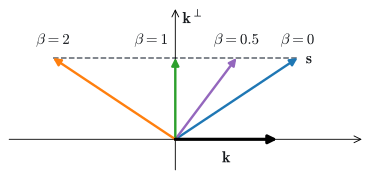

# The Delta Rule
:label:`sec_deltanet`

The matrix memories of :numref:`sec_matrix-state` add each new pair to what
they already hold, which works as long as each name is bound once. Text
often binds a name again. A program sets `rate = 0.05` and later
`rate = 0.07`, and from then on only the new value is correct. A story moves
its hero from Paris to Rome; a dialogue corrects an earlier date. A memory
that stores a pair by adding $\mathbf{v}_t\mathbf{k}_t^\top$ cannot follow
such a change: a key written twice returns the sum of its two values, and
the more often a key is rewritten, the less the latest value stands out.
How can a memory replace what it has stored under a key?

The fix is to read before writing. Before storing a value under a key, the
memory computes what it currently returns for that key and stores only the
difference between the new value and that prediction. This *delta rule* is
one step of gradient descent on the error of recalling the new value. It
turns the memory into a small linear model, fitted to the pairs of a
sequence while the sequence is read, one gradient step per token. We derive
the rule and measure what it repairs. Correction also destroys, and we
measure that too. We then give the rule a decay, compute it in chunks like
the layers of the previous section, and train a layer on a task in which
keys are written twice. At the end we look at all the memories of this
chapter as answers to one regression problem that differ in how they solve
it.

```{.python .input #deltanet-the-delta-rule}
%%tab pytorch
import math
import numpy as np
import torch
from torch import nn
from torch.nn import functional as F
from d2l import torch as d2l
```

```{.python .input #deltanet-the-delta-rule}
%%tab jax
import math
import numpy as np
import jax
from jax import numpy as jnp
from flax import nnx
import optax
from d2l import jax as d2l
```

## Additive Writes

### A Key Written Twice

Before changing the write, we measure how badly addition does when a key is
rewritten. Start with a single key $\mathbf{k}$ of unit length. Write the
value 1 under it, then the value 2: the memory is $\mathbf{S} = 1 \cdot
\mathbf{k}^\top + 2 \cdot \mathbf{k}^\top$, and reading it returns
$\mathbf{S}\mathbf{k} = 3$. In general, if a key is written $R$ times with
values $\mathbf{v}^{(1)}, \ldots, \mathbf{v}^{(R)}$, the additive memory
returns

$$
\mathbf{S}\mathbf{k} = \mathbf{v}^{(1)} + \mathbf{v}^{(2)} + \cdots +
\mathbf{v}^{(R)},
$$
:eqlabel:`eq_dn-superposition`

plus the interference from other keys,
$\sum_i (\mathbf{k}_i^\top\mathbf{k})\, \mathbf{v}_i$ over the pairs stored
under other keys $\mathbf{k}_i$ (:numref:`sec_matrix-state`). The latest
value carries the same weight as every stale one. A decay helps, but only
by age. It shrinks an older value more than a newer one, so the latest
value stands out. It also shrinks every other pair of the same age, whether
or not its key was rewritten, and a fact written once and never touched
again fades as fast as a stale value (Exercise :exref:`ex_dn-decay`).

To measure the effect apart from interference, we run an *overwrite test*:
we store values under 8 orthonormal keys in a memory of width 64, so that
keys do not overlap at all. Each key is written $R$ times, each time with a
value drawn from a codebook of 32 random unit vectors, and we count how
often the nearest codebook entry to the read is the latest value. The
function takes the write rule as an argument, so that the exercises can
try other rules on the same test.

```{.python .input #deltanet-a-key-written-twice-1}
%%tab pytorch, jax
def overwrite_recall(write, num_writes, d=64, num_keys=8, num_values=32,
                     trials=200, seed=0):
    """Recall of the latest value after every key is written num_writes
    times."""
    rng = np.random.default_rng(seed)
    codebook = rng.standard_normal((num_values, d))
    codebook /= np.linalg.norm(codebook, axis=1, keepdims=True)
    recall = 0
    for _ in range(trials):
        keys = np.linalg.qr(rng.standard_normal((d, num_keys)))[0].T  # Rows
        S = np.zeros((d, d))
        for _ in range(num_writes):
            ids = rng.integers(0, num_values, num_keys)
            for k, v in zip(keys, codebook[ids]):
                S = write(S, k, v)
        reads = keys @ S.T  # Row j is S k_j
        recall += ((reads @ codebook.T).argmax(1) == ids).mean() / trials
    return recall

additive = lambda S, k, v: S + np.outer(v, k)
writes = [1, 2, 4, 8]
print('additive:', ' '.join(f'{overwrite_recall(additive, R):.2f}'
                            for R in writes))
```

After one write per key, every value is read back. After two writes, the
latest value wins only about half of the time, which is what a sum of two
equally weighted values allows. After eight, it wins about one time in
five, more often than one in eight because a codebook of 32 values
repeats: the latest value was sometimes also among the earlier ones
(Exercise :exref:`ex_dn-order`). The memory has room for all eight keys,
and it still fails, because it cannot replace a value.

## Writes as Gradient Steps

### The Delta Rule

We want a write that makes the memory return $\mathbf{v}_t$ for
$\mathbf{k}_t$ and changes as little else as possible. One way to get it is
to measure how badly the memory recalls the new pair, with the squared
error

$$
\ell_t(\mathbf{S}) = \tfrac{1}{2}\, \|\mathbf{S}\mathbf{k}_t -
\mathbf{v}_t\|^2,
$$
:eqlabel:`eq_dn-recall-loss`

and to take one step of gradient descent on it. The gradient is
$\nabla \ell_t(\mathbf{S}) = (\mathbf{S}\mathbf{k}_t -
\mathbf{v}_t)\mathbf{k}_t^\top$, the outer product of the *prediction
error*, what the memory answers minus what it should answer, with the key.
A step of size $\beta_t$ from $\mathbf{S}_{t-1}$ gives

$$
\mathbf{S}_t = \mathbf{S}_{t-1} - \beta_t (\mathbf{S}_{t-1}\mathbf{k}_t -
\mathbf{v}_t)\mathbf{k}_t^\top.
$$
:eqlabel:`eq_dn-delta`

This is the *delta rule*, named for the difference it writes, and it is old:
:citet:`Widrow.Hoff.1960` trained an adaptive linear element, ADALINE, with
it, and :citet:`Schlag.Irie.Schmidhuber.2021` proposed it as the write of a
linear attention layer. Read it as two steps. First, read the memory at the
key, $\hat{\mathbf{v}}_t = \mathbf{S}_{t-1}\mathbf{k}_t$. Then add the
correction $\beta_t(\mathbf{v}_t - \hat{\mathbf{v}}_t)\mathbf{k}_t^\top$.
If the memory already returns $\mathbf{v}_t$, nothing is written. Note that
no backpropagation is involved: the step is part of the forward pass, taken
while the model reads, during training and during use alike.

For a key of unit length and $\beta_t = 1$, reading right after the write
returns $\mathbf{S}_t\mathbf{k}_t = \hat{\mathbf{v}}_t + (\mathbf{v}_t -
\hat{\mathbf{v}}_t) = \mathbf{v}_t$: the old value is replaced. For
$\beta_t$ between 0 and 1, the value stored under $\mathbf{k}_t$ moves to
$(1 - \beta_t)\hat{\mathbf{v}}_t + \beta_t \mathbf{v}_t$, a blend like the
update gate of a GRU, so $\beta_t$ is a *write strength*. The network
computes it from each token, which makes it a gate, like the decay of the
previous section.

The additive write of :numref:`sec_matrix-state` is also a gradient step,
on a different objective. Its update $\mathbf{v}_t\mathbf{k}_t^\top$ is a
step that increases $\mathbf{v}_t^\top \mathbf{S}\mathbf{k}_t$, along its
gradient. That objective rewards the memory for aligning its read with the
value and never penalizes it for overshooting. Aligning gives
superposition; minimizing the error gives correction.

### The Transition

Expanding :eqref:`eq_dn-delta` separates what happens to the old memory
from what is written:

$$
\mathbf{S}_t = \mathbf{S}_{t-1}(\mathbf{I} - \beta_t \mathbf{k}_t
\mathbf{k}_t^\top) + \beta_t \mathbf{v}_t \mathbf{k}_t^\top.
$$
:eqlabel:`eq_dn-transition`

The write is the additive write, scaled by $\beta_t$. The difference is the
transition. In :numref:`sec_matrix-state` the old memory was multiplied by
a number $a_t$; here it is multiplied by the matrix $\mathbf{I} - \beta_t
\mathbf{k}_t\mathbf{k}_t^\top$, which depends on the current key. For a unit
key, this matrix leaves every direction orthogonal to $\mathbf{k}_t$
unchanged, eigenvalue 1, so what is stored under other keys is untouched.
It scales the direction $\mathbf{k}_t$ by $1 - \beta_t$
(:numref:`fig_dn-geometry`). At $\beta_t = 1$ it removes the $\mathbf{k}_t$
component of every row of the memory, which deletes the old value and makes
room for the new one; for $\beta_t \in (0, 1)$ it shrinks that component;
at $\beta_t = 2$ it reverses it, a reflection. The decay of the previous
section forgets in every direction at once. The delta rule forgets in one
direction, the one it is about to write.


:label:`fig_dn-geometry`

The eigenvalue $1 - \beta_t$ tells us two things. First, for $0 \le
\beta_t \le 2$ and unit keys, no direction is ever amplified: whatever the
memory holds can only shrink or keep its size before the new write is
added. The writes still add, so the memory can grow, but each step adds at
most the size of its own write, $\beta_t\|\mathbf{v}_t\|$, and never
multiplies what is already there. Without unit keys the eigenvalue is $1 -
\beta_t\|\mathbf{k}_t\|^2$, which falls below $-1$ for a long key, and
repeated writes with such keys can make the memory grow geometrically.
This is why delta-rule layers scale their keys to unit length.

Second, for $\beta_t$ above 1 the eigenvalue is negative, which no decay in
$(0, 1)$ can produce. A negative eigenvalue flips the sign of a stored
component, and a second flip restores it, so the memory can count modulo
two. Fix the key to one unit vector, write the same nonzero value
$\mathbf{v}$ at every token, and set $\beta_t = 2$ on the tokens to be
counted and $\beta_t = 0$ elsewhere. Each counted token maps the read
$\mathbf{r}$ to $2\mathbf{v} - \mathbf{r}$, so the read is $2\mathbf{v}$
after an odd number of them and $\mathbf{0}$ after an even number: the
parity of a sequence of any length, exactly. Counting modulo two sounds
like a party trick, but it marks a real limit of the other memories:
:citet:`Grazzi.Siems.Franke.ea.2025` show that in finite precision,
linear recurrences whose transitions have only eigenvalues between zero and
one cannot compute parity at arbitrary lengths. This includes the decays of
the previous sections and the delta rule with $\beta_t \le 1$, and allowing
$\beta_t$ up to 2 removes the limitation for parity.

### The Cost of Correction

On the overwrite test the transition does no harm, and we need not run
anything to see it. The keys are orthonormal, so at $\beta_t = 1$ each
write deletes the stale value under its own key and leaves the other seven
keys alone: the delta rule recalls the latest value every time, however
often a key is rewritten. Keys in a trained model are not so obliging. A
memory of width $d_k$ holds at most $d_k$ orthogonal keys, so beyond that
number overlaps cannot be avoided, and random keys overlap from the first
pair on. The transition removes the $\mathbf{k}_t$ component of every row
of the memory, and an old key $\mathbf{k}_i$ that overlaps $\mathbf{k}_t$
is read partly along that direction. What happens to its pair?

Suppose an earlier pair sits in the memory as the term
$\mathbf{v}_i\mathbf{k}_i^\top$. The part of the read at $\mathbf{k}_t$
that comes from this pair is
$(\mathbf{k}_t^\top\mathbf{k}_i)\,\mathbf{v}_i$, and the write subtracts it
along $\mathbf{k}_t$. Reading $\mathbf{k}_i$ afterwards returns
$\mathbf{v}_i$ scaled by $1 - (\mathbf{k}_t^\top\mathbf{k}_i)^2$, plus a
little of $\mathbf{v}_t$. For random unit keys in $\mathbb{R}^{d_k}$ the
squared overlap is $1/d_k$ on average, as in the capacity law of
:numref:`sec_matrix-state`, so each later write takes about a fraction
$1/d_k$ of an old pair's signal, and $m$ later writes leave roughly
$(1 - 1/d_k)^m \approx e^{-m/d_k}$ of it. In width 64, the first of 128
pairs keeps about $e^{-2}$, a seventh of its signal, while the last pairs
keep nearly all of theirs. The delta rule makes room for a new pair by
taking a little from every old pair whose key leans toward it. Addition
never removes signal; it only piles up interference. Which hurts recall
more?

We compare four memories in width 64. The additive memory sums the
pairs. The delta rule writes them in order, once with $\beta = 1$ and once
with $\beta = 0.5$. The fourth is a yardstick rather than a write rule: the
*least-squares* memory, the matrix that minimizes the summed squared read
error over all written pairs at once, which `np.linalg.lstsq` computes. We
return to it at the end of the section. Each memory is a function from the
written keys and values to the matrix $\mathbf{S}$. Values come from a
codebook of 256 random unit vectors, and for every memory we measure the
squared read error and the recall of the latest value under each key,
averaged over 20 trials. There are three kinds of keys: the overwrite test
with 8 orthonormal keys written 4 times each; $n$ random unit keys written
once, for $n$ from 32 to 256; and 64 keys that share one direction with
weight $\rho = 0.5$, the correlated keys of :numref:`sec_matrix-state`.

```{.python .input #deltanet-what-correction-costs-1}
%%tab pytorch, jax
def delta_rule(beta):
    """The memory after writing the pairs in order with the delta rule."""
    def fit(K, V):
        S = np.zeros((V.shape[1], K.shape[1]))
        for k, v in zip(K, V):
            S = S + beta * np.outer(v - S @ k, k)
        return S
    return fit

def correction_cost(memories, num_keys, writes=1, orthonormal=False, rho=0,
                    d=64, num_values=256, trials=20, seed=0):
    """Squared read error and recall of the latest value when each of
    num_keys keys is written `writes` times, for each memory."""
    rng = np.random.default_rng(seed)
    unit = lambda X: X / np.linalg.norm(X, axis=-1, keepdims=True)
    codebook = unit(rng.standard_normal((num_values, d)))
    error, recall = dict.fromkeys(memories, 0), dict.fromkeys(memories, 0)
    for _ in range(trials):
        if orthonormal:
            keys = np.linalg.qr(rng.standard_normal((d, num_keys)))[0].T
        else:  # Random unit keys that share one direction with weight rho
            keys = unit(np.sqrt(1 - rho**2) * unit(rng.standard_normal(
                (num_keys, d))) + rho * unit(rng.standard_normal(d)))
        ids = rng.integers(0, num_values, (writes, num_keys))  # Row = round
        K, V = np.tile(keys, (writes, 1)), codebook[ids.ravel()]
        for name, fit in memories.items():
            reads = keys @ fit(K, V).T  # Row j is S k_j
            error[name] += ((reads - codebook[ids[-1]]) ** 2).sum(1).mean()
            recall[name] += ((reads @ codebook.T).argmax(1) == ids[-1]).mean()
    return ({name: e / trials for name, e in error.items()},
            {name: r / trials for name, r in recall.items()})
```

Before running the cell, we can fill in some entries ourselves. In the
first row the delta rule at $\beta = 1$ must recall every latest value. The
additive memory returns the sum of a key's four values, and least squares,
asked to map one key to four different values, can do no better than their
mean.
The mean points in the same direction as the sum, so these two must recall
equally often, whatever their errors. On random keys written once, the
additive error should follow the capacity law, $(n-1)/d_k$.

```{.python .input #deltanet-what-correction-costs-2}
%%tab pytorch, jax
memories = {'additive': lambda K, V: V.T @ K,  # Sum of the v k^T
            'delta, β = 1': delta_rule(1), 'delta, β = 0.5': delta_rule(0.5),
            'least squares': lambda K, V: np.linalg.lstsq(K, V)[0].T}
cases = {'8 orthonormal keys, 4 writes': dict(num_keys=8, writes=4,
                                              orthonormal=True),
         **{f'{n} keys': dict(num_keys=n) for n in (32, 64, 128, 256)},
         '64 keys, ρ = 0.5': dict(num_keys=64, rho=0.5)}
results = {case: correction_cost(memories, **args)
           for case, args in cases.items()}
for i, measure in enumerate(['squared read error', 'recall']):
    print(f'{measure:28s}', ''.join(f'{name:>15s}' for name in memories))
    for case, result in results.items():
        print(f'{case:28s}', ''.join(f'{result[i][name]:15.2f}'
                                     for name in memories))
```

The predicted entries are there: in the first row the delta rule recalls
every latest value, addition and least squares both 0.28, and the additive
errors on random keys lie close to $(n-1)/64$. The surprise comes in the
rows below. With random keys written once, the delta rule at $\beta = 1$ has
the smaller squared error at every $n$, 1.06 against 1.99 at $n = 128$, and
yet from $n = 64$ on it recalls fewer pairs: 0.89 against 1.00 at $n = 64$,
0.53 against 0.96 at $n = 128$. How can the memory with the smaller error
recall less? Consider a memory that returns zero for every key. The values
are unit vectors, so its squared error is 1, lower than that of either
memory at $n = 128$, and it recalls nothing; addition has twice that error
and recalls 96% of the pairs.
When a read is mostly interference, shrinking it toward zero lowers the
squared error, and the delta rule shrinks the reads of old pairs, removing
signal along with interference. Recall needs the signal to stand out above
the interference, and addition, which never removes signal, keeps more of
it. The delta rule wins on squared error, the quantity each of its steps
reduces for one pair, and loses on the measure we care about. Even on its
own measure the full step is too greedy: from $n = 64$ on, the gentler
write, $\beta = 0.5$, does better on both counts, with an error of 0.67 and
a recall of 0.82 at $n = 128$.

With correlated keys the order reverses: the delta rule recalls 0.77 of 64
pairs at $\beta = 1$ and 0.89 at $\beta = 0.5$, addition 0.54. The shared
direction is part of every key, so addition piles every value onto it,
while the delta rule reads what is already stored along that direction
before it writes, and replaces it. Least squares, the yardstick, recalls at
least as many pairs as every one-pass rule in the table wherever each key
is written once, nearly all of 128 pairs in width 64. It fails on
rebinding, because the best fit of all pairs is their mean and not the
latest value (Exercise :exref:`ex_dn-rls` asks how to repair it).

So correction is right where a key is rebound or where keys share a
component. It costs old pairs where keys merely overlap at random, and that
cost shows once a memory holds about as many pairs as its width. It is
also one gradient step per pair, not a fit, and the last column shows how
far that can be from the best fit. This is why a delta-rule layer computes
its write strength from each token rather than fixing it: a token that
rebinds a name wants $\beta_t$ near one, and a token that adds one more fact
to a full memory wants a gentle write.

## Gated DeltaNet

### Decay and Correction

The delta rule edits only the direction it writes. Components of the memory
along keys that the sequence never revisits are never cleared, and at the
start of a new topic everything stored earlier stays. Decay and correction
do different jobs, and Gated DeltaNet :cite:`Yang.Kautz.Hatamizadeh.2024`
combines them: the memory decays by an input-dependent $a_t$ and then takes
a delta-rule step,

$$
\mathbf{S}_t = a_t\, \mathbf{S}_{t-1}(\mathbf{I} - \beta_t
\mathbf{k}_t\mathbf{k}_t^\top) + \beta_t \mathbf{v}_t \mathbf{k}_t^\top.
$$
:eqlabel:`eq_dn-gated`

Replacing $\mathbf{I} - \beta_t\mathbf{k}_t\mathbf{k}_t^\top$ by
$\mathbf{I}$ gives the decayed memory of :numref:`sec_matrix-state`, with
each value scaled by $\beta_t$; with $a_t = 1$ the update is the delta
rule. The model can clear its memory by setting $a_t$ near zero and rebind
one key by setting $\beta_t$ near one.

### Chunked Computation

Until :citet:`Yang.Wang.Zhang.ea.2024` found a way to compute it in
chunks, the delta rule ran one token at a time, which made it slow to train
at scale. This subsection gives their algorithm. It is the hardest stretch
of the section, and a reader who takes it on trust can still follow the
rest.

The delta rule is a linear recurrence in $\mathbf{S}$, but its transition
is a $d_k \times d_k$ matrix rather than a number, so the dual form of
:numref:`sec_matrix-state` does not apply directly. A scan over the tokens
would have to multiply dense $d_k \times d_k$ transitions, at a cost of
about $d_k^3$ operations each, where one step of the recurrence costs about
$d_v d_k$. Chunks still work, with one additional step. Write the update
as $\mathbf{S}_t = a_t\mathbf{S}_{t-1} + \mathbf{u}_t
\mathbf{k}_t^\top$, where $\mathbf{u}_t = \beta_t(\mathbf{v}_t -
a_t\mathbf{S}_{t-1}\mathbf{k}_t)$ is the corrected value that is actually
written. If we knew the $\mathbf{u}_t$, the memory would be the decayed
additive memory of the previous section with values $\mathbf{u}_t$, and the
chunked algorithm there would compute its outputs. The $\mathbf{u}_t$ depend
on each other, but only through the overlaps of the keys. Consider a chunk
of $m$ steps that starts with memory $\mathbf{S}_0$. Unrolling the update
from the start of the chunk gives the read that the correction needs,
$a_t\mathbf{S}_{t-1}\mathbf{k}_t = \gamma_t\mathbf{S}_0\mathbf{k}_t +
\sum_{s<t} L_{ts}\,(\mathbf{k}_s^\top\mathbf{k}_t)\,\mathbf{u}_s$, where
$L_{ts}$ is the product of the decays from step $s+1$ to $t$, as in the
dual form of :numref:`sec_matrix-state`, and $\gamma_t$ is the product of
the decays since the chunk started. Substituting it into the definition of
$\mathbf{u}_t$ gives

$$
\mathbf{u}_t + \beta_t \sum_{s < t} L_{ts}\, (\mathbf{k}_s^\top
\mathbf{k}_t)\, \mathbf{u}_s = \beta_t\big(\mathbf{v}_t - \gamma_t
\mathbf{S}_0\mathbf{k}_t\big).
$$

Stacked as rows, these are $m$ linear equations for the $\mathbf{u}_t$
with a lower triangular matrix: each $\mathbf{u}_t$ depends only on earlier
ones. Solving them by forward
substitution still takes $m$ dependent steps, but each step computes one
vector from the vectors before it, and every chunk and every head takes its
steps at the same time, in one batched solve. The recurrence would instead
update the whole $d_v \times d_k$ memory, $T$ times in a row.

Because the right side is linear in $\mathbf{S}_0$, we solve once for the
part that depends on the values and once for the part that depends on the
incoming memory, before that memory is known. Implementations call this
organization the *WY representation*, after a classical way of writing
products of Householder reflections. The name can be forgotten; the
triangular system is the idea.

We split the computation into two functions. The first solves, for every
chunk at once, the triangular systems for the two parts of the corrected
values: $\mathbf{W}$, which depends on the values, and $\mathbf{Z}$, which
multiplies the incoming memory, so that $\mathbf{U} = \mathbf{W} -
\mathbf{Z}\mathbf{S}_0^\top$. It uses the mask `decay_mask` of
:numref:`sec_matrix-state`, whose entries are the products $L_{ts}$.

```{.python .input #deltanet-chunked-computation-1}
%%tab pytorch
def delta_rule_writes(K, V, beta, log_a):  #@save
    """W and Z with corrected values U = W - Z S_0^T, for every chunk.

    K: (..., m, d_k); V: (..., m, d_v); beta, log_a: (..., m)
    """
    L = d2l.decay_mask(log_a)  # Products of decays within the chunk
    gamma = torch.exp(log_a.cumsum(-1)).unsqueeze(-1)  # Decay since start
    beta = beta.unsqueeze(-1)
    M = torch.eye(K.shape[-2], device=K.device) + (
        beta * L.tril(-1) * (K @ K.mT))  # Lower triangular
    W = torch.linalg.solve_triangular(M, beta * V, upper=False)
    Z = torch.linalg.solve_triangular(M, beta * gamma * K, upper=False)
    return W, Z
```

```{.python .input #deltanet-chunked-computation-1}
%%tab jax
def delta_rule_writes(K, V, beta, log_a):  #@save
    """W and Z with corrected values U = W - Z S_0^T, for every chunk.

    K: (..., m, d_k); V: (..., m, d_v); beta, log_a: (..., m)
    """
    L = d2l.decay_mask(log_a)  # Products of decays within the chunk
    gamma = jnp.exp(log_a.cumsum(-1))[..., None]  # Decay since start
    beta = beta[..., None]
    M = jnp.eye(K.shape[-2]) + (
        beta * jnp.tril(L, -1) * (K @ K.mT))  # Lower triangular
    W = jax.scipy.linalg.solve_triangular(M, beta * V, lower=True)
    Z = jax.scipy.linalg.solve_triangular(M, beta * gamma * K, lower=True)
    return W, Z
```

The second passes the memory from chunk to chunk. Within a chunk the
update is the decayed additive one with values $\mathbf{u}_t$, so
the memory at the chunk's end is the decayed incoming memory plus every
corrected write, decayed to the end:

$$
\mathbf{S}_m = \gamma_m \mathbf{S}_0 + \mathbf{U}^\top \mathbf{D}
\mathbf{K},
$$

where $\gamma_m$ is the decay of the whole chunk and $\mathbf{D}$ is the
diagonal matrix of the decays from each step to the chunk's end.
Substituting $\mathbf{U} = \mathbf{W} - \mathbf{Z}\mathbf{S}_0^\top$
separates what the chunk does to the incoming memory from what it writes:

$$
\mathbf{S}_m = \mathbf{S}_0 \mathbf{A} + \mathbf{W}^\top \mathbf{D}
\mathbf{K}, \qquad \mathbf{A} = \gamma_m \mathbf{I} - \mathbf{Z}^\top
\mathbf{D} \mathbf{K}.
$$

The $d_k \times d_k$ matrix $\mathbf{A}$ is the decay of the chunk minus
what its corrections remove from the incoming memory, and $\mathbf{W}^\top
\mathbf{D}\mathbf{K}$ is what the chunk would write into an empty memory.
Each chunk is thus an affine map of the memory. Affine maps compose like
the steps of the linear recurrences of :numref:`sec_linear-recurrence`,
with matrix products in place of elementwise ones, so a scan over the
chunks gives the memory at the end of every chunk (`W_end` in the code).
This scan multiplies dense matrices, which we declined to do over tokens.
Over chunks it is affordable: there are only $T/m$ products of cost $d_k^3$,
while the rest of a chunk's work, the products with its $m$ keys, queries,
and values, costs about $m d_k^2$ for $d_v = d_k$. With chunks about as long
as the key width, the scan costs no more than the rest. From the memories at
the chunk boundaries, the corrected values and the outputs of all chunks
follow at once, as in the chunked computation of :numref:`sec_matrix-state`
with the values $\mathbf{U}$ in place of $\mathbf{V}$.

```{.python .input #deltanet-chunked-computation-2}
%%tab pytorch
def chunked_delta_rule(Q, K, V, beta, log_a, chunk_size):  #@save
    """Outputs y_t = S_t q_t of the gated delta rule, computed in chunks.

    Q, K: (batch_size, T, d_k); V: (batch_size, T, d_v);
    beta, log_a: (batch_size, T)
    """
    B, T, m = Q.shape[0], Q.shape[1], chunk_size
    Q, K, V = (X.reshape(B, T // m, m, -1) for X in (Q, K, V))
    beta, log_a = beta.reshape(B, T // m, m), log_a.reshape(B, T // m, m)
    W, Z = delta_rule_writes(K, V, beta, log_a)
    L, cum = d2l.decay_mask(log_a), log_a.cumsum(-1)
    # Each chunk maps the memory S at its start to S A + W^T D K at its end
    to_end = torch.exp(cum[..., -1:] - cum).unsqueeze(-1)
    I = torch.eye(K.shape[-1], device=K.device)
    A = torch.exp(cum[..., -1, None, None]) * I - (Z * to_end).mT @ K
    def combine(earlier, later):  # A scan over chunks, with matrix products
        (A1, W1), (A2, W2) = earlier, later
        return A1 @ A2, W1 @ A2 + W2
    W_end = d2l.associative_scan(combine, (A, (W * to_end).mT @ K))[1]
    S = torch.cat([torch.zeros_like(W_end[:, :1]), W_end[:, :-1]], 1)
    U = W - Z @ S.mT  # Corrected values, with the memory at each start
    Y = torch.exp(cum).unsqueeze(-1) * (Q @ S.mT) + (L * (Q @ K.mT)) @ U
    return Y.reshape(B, T, -1)
```

```{.python .input #deltanet-chunked-computation-2}
%%tab jax
def chunked_delta_rule(Q, K, V, beta, log_a, chunk_size):  #@save
    """Outputs y_t = S_t q_t of the gated delta rule, computed in chunks.

    Q, K: (batch_size, T, d_k); V: (batch_size, T, d_v);
    beta, log_a: (batch_size, T)
    """
    B, T, m = Q.shape[0], Q.shape[1], chunk_size
    Q, K, V = (X.reshape(B, T // m, m, -1) for X in (Q, K, V))
    beta, log_a = beta.reshape(B, T // m, m), log_a.reshape(B, T // m, m)
    W, Z = delta_rule_writes(K, V, beta, log_a)
    L, cum = d2l.decay_mask(log_a), log_a.cumsum(-1)
    # Each chunk maps the memory S at its start to S A + W^T D K at its end
    to_end = jnp.exp(cum[..., -1:] - cum)[..., None]
    I = jnp.eye(K.shape[-1])
    A = jnp.exp(cum[..., -1, None, None]) * I - (Z * to_end).mT @ K
    def combine(earlier, later):  # A scan over chunks, with matrix products
        (A1, W1), (A2, W2) = earlier, later
        return A1 @ A2, W1 @ A2 + W2
    W_end = jax.lax.associative_scan(combine, (A, (W * to_end).mT @ K),
                                     axis=1)[1]
    S = jnp.concatenate([jnp.zeros_like(W_end[:, :1]), W_end[:, :-1]], 1)
    U = W - Z @ S.mT  # Corrected values, with the memory at each start
    Y = jnp.exp(cum)[..., None] * (Q @ S.mT) + (L * (Q @ K.mT)) @ U
    return Y.reshape(B, T, -1)
```


We check the chunked computation against the recurrence
:eqref:`eq_dn-gated` applied one step at a time, with unit keys and random
write strengths and decays.

```{.python .input #deltanet-chunked-computation-4}
%%tab pytorch
def delta_rule_recurrent(Q, K, V, beta, a):
    """The same outputs, one step at a time."""
    S, outputs = Q.new_zeros(V.shape[-1], K.shape[-1]), []
    for q, k, v, b, a_t in zip(Q, K, V, beta, a):
        S = a_t * S
        S = S + b * torch.outer(v - S @ k, k)
        outputs.append(S @ q)
    return torch.stack(outputs)
```

```{.python .input #deltanet-chunked-computation-4}
%%tab jax
def delta_rule_recurrent(Q, K, V, beta, a):
    """The same outputs, one step at a time."""
    def step(S, inputs):
        q, k, v, b, a_t = inputs
        S = a_t * S
        S = S + b * jnp.outer(v - S @ k, k)
        return S, S @ q
    S = jnp.zeros((V.shape[-1], K.shape[-1]))
    return jax.lax.scan(step, S, (Q, K, V, beta, a))[1]
```

```{.python .input #deltanet-chunked-computation-3}
%%tab pytorch
gen = torch.Generator().manual_seed(0)  # Local: later training stays unseeded
T, d_k, d_v = 256, 32, 32
Q, V = torch.randn(T, d_k, generator=gen), torch.randn(T, d_v, generator=gen)
K = F.normalize(torch.randn(T, d_k, generator=gen), dim=-1)
beta = torch.rand(T, generator=gen)
a = 0.8 + 0.19 * torch.rand(T, generator=gen)
Y = delta_rule_recurrent(Q, K, V, beta, a)
for m in [16, 64]:
    Y_chunked = chunked_delta_rule(Q[None], K[None], V[None], beta[None],
                                   torch.log(a)[None], m)[0]
    print(f'chunk size {m}: relative deviation '
          f'{(Y_chunked - Y).abs().max() / Y.abs().max():.1e}')
```

```{.python .input #deltanet-chunked-computation-3}
%%tab jax
T, d_k, d_v = 256, 32, 32
keys = jax.random.split(jax.random.key(0), 5)
Q = jax.random.normal(keys[0], (T, d_k))
V = jax.random.normal(keys[1], (T, d_v))
K = jax.random.normal(keys[2], (T, d_k))
K = K / jnp.linalg.norm(K, axis=-1, keepdims=True)
beta = jax.random.uniform(keys[3], (T,))
a = 0.8 + 0.19 * jax.random.uniform(keys[4], (T,))
with jax.default_matmul_precision('highest'):  # Full float32, not TF32
    Y = delta_rule_recurrent(Q, K, V, beta, a)
    for m in [16, 64]:
        Y_chunked = chunked_delta_rule(Q[None], K[None], V[None], beta[None],
                                       jnp.log(a)[None], m)[0]
        print(f'chunk size {m}: relative deviation '
              f'{jnp.abs(Y_chunked - Y).max() / jnp.abs(Y).max():.1e}')
```

At both chunk sizes the chunked outputs match the loop to a few parts in
ten million. The triangular solves and the scan over chunks are therefore
no approximation: they compute the memory of the loop, only grouped
differently.

### The Layer

A Gated DeltaNet layer is the gated linear attention layer of
:numref:`sec_matrix-state` with a different write, and everything else is
inherited. It adds one projection, which computes a write strength $\beta_t =
\sigma(\mathbf{w}^\top \mathbf{x}_t + b)$ for every head, and replaces the
method `memory` by the chunked delta rule. The decay stays as it was, one
number per head computed from the input, as in
:citet:`Yang.Kautz.Hatamizadeh.2024`. So do the short convolution, the unit
queries and keys that the transition needs, and the output norm and gate; by
default the biases of the decay start the heads with memories of 4 to 256
steps. The two layers therefore differ in the write rule alone, and the
experiment below can attribute any difference to the write. One property is
lost on the way. The sigmoid keeps $\beta_t$ in $(0, 1)$, as in the original
layer, so this layer cannot use the negative eigenvalues of the parity
construction; Exercise :exref:`ex_dn-parity` doubles the range and asks what
that changes.

```{.python .input #deltanet-the-layer}
%%tab pytorch
class GatedDeltaNet(d2l.GatedLinearAttention):  #@save
    """Gated linear attention whose memory is written by the delta rule."""
    def __init__(self, num_hiddens, num_heads, chunk_size=32, conv_width=4,
                 timescales=(4, 256)):
        super().__init__(num_hiddens, num_heads, chunk_size, conv_width,
                         timescales)
        self.W_beta = nn.Linear(num_hiddens, num_heads)  # Write strength
        d2l.init_lecun(self.W_beta)

    def memory(self, X, Q, K, V, log_a):
        beta = d2l.heads_to_batch(torch.sigmoid(self.W_beta(X)),
                                  self.num_heads).squeeze(-1)
        return chunked_delta_rule(Q, K, V, beta, log_a, self.chunk_size)
```

```{.python .input #deltanet-the-layer}
%%tab jax
class GatedDeltaNet(d2l.GatedLinearAttention):  #@save
    """Gated linear attention whose memory is written by the delta rule."""
    def __init__(self, num_hiddens, num_heads, chunk_size=32, conv_width=4,
                 timescales=(4, 256), *, rngs):
        super().__init__(num_hiddens, num_heads, chunk_size, conv_width,
                         timescales, rngs=rngs)
        self.W_beta = nnx.Linear(num_hiddens, num_heads, rngs=rngs)

    def memory(self, X, Q, K, V, log_a):
        beta = d2l.heads_to_batch(jax.nn.sigmoid(self.W_beta(X)),
                                  self.num_heads)[..., 0]
        return chunked_delta_rule(Q, K, V, beta, log_a, self.chunk_size)
```

### Rebinding

The overwrite test set every write by hand and gave the additive memory no
decay. A trained layer is in a better position. Its decay is learned, and a
decay can tell an old value from a new one by age: the older value has been
shrunk more often. So we ask the question that opened the section again,
this time of trained networks. Does a layer that only adds still fail to
rebind, and does the delta rule repair it?

We use the associative recall task of :numref:`sec_matrix-state`. A
sequence holds 16 pairs, each a key token followed by a value token, with
keys drawn from 128 and values from 16; then every key appears once more as
a query, and the model must output its value. Here 8 of the 16 keys are
written a second time with a new value, soon after the first, usually with
one or two other writes in between, as a program corrects `rate` a few
lines after setting it. Every query asks for the latest value. The short
distance is deliberate. Two values a few tokens apart differ little in age,
so a decay favours the newer one only slightly unless it is strong, and a
decay that strong would also fade the pairs written once before their
queries arrive.

Both models are one block of width 64 with 4 heads of size 16 and chunks of
16. Their decays start with memories of 256 to 2,048 steps, as in the
recall experiment of :numref:`sec_matrix-state`, so that every pair
survives until its query; whatever preference for newer values the
additive layer shows, it has to learn. We use a single block because with
two, the first layer could read the old value and the second could write a
correction, a delta rule assembled from two additive layers. Each layer is
trained twice with `d2l.train_recall`, and we count recall separately on
the keys written twice and on those written once.

What should we expect? An additive memory without decay returns the sum of
the two values, and the overwrite test found that such a sum names the
latest value only about half of the time. A learned decay may do better,
and the run will show by how much. The delta rule, with a write strength
near one, replaces the old value and should recall rewritten keys about as
well as the others.

```{.python .input #deltanet-rebinding-1}
%%tab pytorch
def rebinding_model(layer, num_hiddens=64, num_heads=4,
                    vocab_size=16 + 128 + 1):
    """One block of `layer`; tokens: 16 values, 128 keys, the filler."""
    return d2l.SeqLM(vocab_size, num_hiddens, [layer(
        num_hiddens, num_heads, chunk_size=16, timescales=(256, 2048))])
```

```{.python .input #deltanet-rebinding-1}
%%tab jax
def rebinding_model(layer, num_hiddens=64, num_heads=4,
                    vocab_size=16 + 128 + 1):
    """One block of `layer`; tokens: 16 values, 128 keys, the filler."""
    rngs = nnx.Rngs(d2l.get_key())  # A new initialization each call
    return d2l.SeqLM(vocab_size, num_hiddens, [layer(
        num_hiddens, num_heads, chunk_size=16, timescales=(256, 2048),
        rngs=rngs)], rngs=rngs)
```

```{.python .input #deltanet-rebinding-2}
%%tab pytorch, jax
def recall_by_kind(model, X, Y, rebound):
    """Recall on the queries for keys written twice and for keys written
    once; a label of -1 matches no prediction."""
    accuracy = lambda mask: float(d2l.query_accuracy(
        model, X, np.where(mask, Y, -1))) / mask.mean()
    return accuracy(rebound), accuracy(~rebound)

task = dict(num_keys=128, num_values=16, num_rebound=8, gap=2)
test = d2l.associative_recall(np.random.default_rng(1), 2048, 16,
                              num_steps=64, **task)
print(f'{"":24s}{"parameters":>12s}{"written twice":>16s}'
      f'{"written once":>16s}')
for name, layer in (('gated linear attention', d2l.GatedLinearAttention),
                    ('Gated DeltaNet', d2l.GatedDeltaNet)):
    models = [rebinding_model(layer) for _ in range(2)]  # Two runs
    for model in models:
        d2l.train_recall(model, pairs=(16,), **task)
    twice, once = zip(*[recall_by_kind(model, *test) for model in models])
    print(f'{name:24s}{d2l.num_params(models[0]):12,d}'
          f'{twice[0]:11.3f} {twice[1]:.3f}{once[0]:11.3f} {once[1]:.3f}')
```

In every run, Gated DeltaNet recalls at least 95% of the rewritten keys,
within about two points of its recall on keys written once. Gated linear
attention recalls between about 83% and 92% of the rewritten keys over
repeated executions of this cell, against 93% to 98% of the keys written
once. From one execution to the next, two runs of the same layer have
differed by anything from a fraction of a point to about five points. On
the rewritten keys the two layers differ by more than that in every
execution, and on the keys written once by much less. The two models
differ by 260 parameters, the write-strength projection, a third of a
percent of either. The delta rule rebinds, as predicted.

The additive layer, though, does far better than the half that a plain sum
allows: it gets about nine in ten rewritten keys right. Presumably its
learned decay weights the newer value a little more, even a write or two
apart. Exercise :exref:`ex_dn-rebinding` switches the decay off to test
this, moves the rewrite further away, and adds a second block. The delta
rule needs no such help, since it reads the old value and replaces it.

## Memory as Regression

Every matrix memory of this chapter, and softmax attention as well, answers
a query with a function fitted to the pairs $(\mathbf{k}_s, \mathbf{v}_s)$
it has read. Asking which function, and how it is fitted, puts the models
side by side. Collect the keys and values of the first $t$ steps as the rows
of $\mathbf{K}_t$ and $\mathbf{V}_t$. The linear map that reproduces the
stored pairs best, in the sense of least squares, minimizes $\sum_{s \le t}
\|\mathbf{S}\mathbf{k}_s - \mathbf{v}_s\|^2$. When the keys span
$\mathbb{R}^{d_k}$, so that $\mathbf{K}_t^\top\mathbf{K}_t$ is invertible,
the minimizer is

$$
\mathbf{S}_t^\star = \mathbf{V}_t^\top \mathbf{K}_t\,
(\mathbf{K}_t^\top \mathbf{K}_t)^{-1}.
$$
:eqlabel:`eq_dn-least-squares`

When they do not, for instance when there are fewer keys than dimensions,
the inverse becomes a pseudoinverse, and the formula gives the fit of
smallest norm; this is what `np.linalg.lstsq` returned in the experiment on
the cost of correction.

The first factor, $\mathbf{V}_t^\top\mathbf{K}_t = \sum_s
\mathbf{v}_s\mathbf{k}_s^\top$, is the additive memory of
:numref:`sec_matrix-state`. The second factor undoes the overlaps of the
keys. For orthonormal keys it changes nothing, and the additive memory is
already the best fit. For overlapping keys it removes the interference
between them, the terms $(\mathbf{k}_i^\top\mathbf{k}_j)\,\mathbf{v}_i$
that an additive memory adds to every read. Linear attention is therefore
least squares without the correction for overlapping keys. The delta rule
takes gradient steps on the same objective, one pair at a time, so it moves
toward the least-squares fit without reaching it. Each step serves the pair
at hand at some cost to the pairs before it, so later pairs are fitted
better than earlier ones, and a key that is written again is fitted again.
The last column of the experiment on the cost of correction measured the
shortfall.

With a decay, linear attention weights the pairs so that recent ones count
more. In Gated DeltaNet the decay shrinks the fitted memory toward zero
before each gradient step, which is the weight decay of
:numref:`sec_weight_decay` applied to the memory. Softmax attention fits
nothing in advance. It keeps every pair and, at query time, returns a
weighted average of the values with weights given by a kernel of the query
and the keys, the Nadaraya–Watson estimator of
:numref:`sec_attention-pooling`. This is a nonparametric regression, which
is why its memory grows with the context. :numref:`tab_dn-regression`
collects the view; :citet:`Wang.Shi.Fox.2025` develop it in detail.

:Memories as regressions on the pairs read so far.
:label:`tab_dn-regression`

| Memory | What it fits | How | State |
| :-- | :-- | :-- | :-- |
| Softmax attention | kernel-weighted average of all values | at query time | all pairs |
| Linear attention | $\mathbf{V}^\top\mathbf{K}$, least squares without the key correction | one addition per pair | $d_v \times d_k$ |
| Gated linear attention | the same, weighted toward recent pairs | one addition per pair | $d_v \times d_k$ |
| Delta rule | least squares, approximately | one gradient step per pair | $d_v \times d_k$ |
| Gated DeltaNet | least squares with weight decay, approximately | one gradient step per pair | $d_v \times d_k$ |

The view suggests how to design new memories: choose the weights of the
pairs, the class of functions the memory fits, and the method that fits it.
As an example of a different method, consider replacing the gradient step by
the *implicit* step that minimizes $\tfrac{1}{2}\|\mathbf{S} -
\mathbf{S}_{t-1}\|^2 + \tfrac{\beta_t}{2}\|\mathbf{S}\mathbf{k}_t -
\mathbf{v}_t\|^2$ exactly: the new memory should recall the new pair well
and stay close to the old memory. Its solution is the delta rule with the
step $\beta_t / (1 + \beta_t\|\mathbf{k}_t\|^2)$ in place of $\beta_t$
(Exercise :exref:`ex_dn-implicit`), so the eigenvalue along $\mathbf{k}_t$
becomes $1 / (1 + \beta_t\|\mathbf{k}_t\|^2)$, which lies in $(0, 1)$ for
every positive $\beta_t$ and every key. The implicit step cannot overshoot,
whatever the network sets the write strength to; this is the idea behind
Longhorn :cite:`Liu.Wang.Wu.ea.2024`. Stability comes with a limit, though:
by the result of :citet:`Grazzi.Siems.Franke.ea.2025`, eigenvalues in $(0,
1)$ cannot count modulo two, so the implicit step gives up the parity
construction that $\beta_t = 2$ allows.

In all of these models, learning happens at two levels. While the model
reads a sequence, its memory is fitted to that sequence's pairs, at training
time and when the model is used, and it starts empty for every new sequence.
The network's weights, which compute the keys, values, queries, and gates
from the input, are trained by backpropagation through these fitting steps,
over many sequences, and stay fixed when the model is used. The weights
learn which pairs are worth storing; the memory stores the pairs of the
sequence at hand.

Whatever its write rule, the memory has $d_v \times d_k$ numbers, and a
fixed set of numbers can hold only so many facts. The next section asks how
few attention layers a model needs to lift that limit.

## Summary

An additive matrix memory cannot rebind a key: a key written several times
returns the sum of its values, and after two writes the latest value is
recalled only about half of the time. The delta rule reads the memory
before it writes and stores only the difference between the new value and
the current read. This is one gradient step on the squared error of
recalling the new pair, and its transition $\mathbf{I} -
\beta_t\mathbf{k}_t\mathbf{k}_t^\top$ changes the memory only along the
key being written. Correction has a cost: each write also shrinks the old
pairs whose keys overlap the new one, so once a memory holds about as many
random keys as its width, the delta rule recalls fewer of them than
addition, while it wins where keys are rebound or correlated. Gated
DeltaNet adds a decay and is computed in chunks, with one triangular solve
per chunk and a scan over chunks. Trained on a recall task with rewritten
keys, it recalls them better than the same layer with additive writes, in
every run. Viewed as regressions, linear attention keeps the cross-moment
of keys and values, the delta rule moves toward the least-squares fit one
gradient step per pair, and softmax attention keeps all pairs and smooths
among them at query time.

## Exercises

1. **Order does not matter.** Show that the additive memory after a
   sequence of writes does not depend on the order of the writes. Conclude
   that no read rule, however clever, can recover the latest of $R$ values
   written under one key from an additive memory alone, and compute the
   recall that the best rule achieves when the $R$ values are distinct.
   How does the measured recall after eight writes change when the codebook
   grows from 32 to 1,024 values, and why?
   :exlabel:`ex_dn-order`

1. [code] **Decay instead of correction.** Give the additive write of
   `overwrite_recall` a constant decay, $\mathbf{S} \leftarrow a\mathbf{S} +
   \mathbf{v}\mathbf{k}^\top$.
    1. For $R = 2, 4, 8$, find the largest decay $a$ at which the latest
       value is recalled at least 95% of the time. Why does the answer
       depend on how many writes separate two writes of the same key, and
       why does a smaller decay never hurt in this test?
    1. Now replace the orthonormal keys by 16 random unit keys in width 64.
       Rewrite 8 of them $R$ times as before, write the other 8 once at the
       start, and measure the recall of both kinds of key at the end. Which
       write rule serves both kinds of key?
   :exlabel:`ex_dn-decay`

1. **Step size and key length.** Let the keys of the delta rule have any
   length.
    1. The eigenvalue of $\mathbf{I} - \beta\mathbf{k}\mathbf{k}^\top$
       along $\mathbf{k}$ is $1 - \beta\|\mathbf{k}\|^2$. Find the range of
       $\beta$ for which no direction is amplified, and relate it to the
       step size limit $\eta < 2/L$ of gradient descent on a quadratic with
       curvature $L$.
    1. Show that dividing the step by $\|\mathbf{k}\|^2$, the
       *normalized* least mean squares rule, makes the update independent
       of the scale of the key. Why do delta-rule layers normalize the keys
       instead?

1. **The implicit step.** Show that the minimizer of
   $\tfrac{1}{2}\|\mathbf{S} - \mathbf{S}_{t-1}\|^2 +
   \tfrac{\beta}{2}\|\mathbf{S}\mathbf{k} - \mathbf{v}\|^2$ is
   $\mathbf{S}_{t-1} - \frac{\beta}{1 + \beta\|\mathbf{k}\|^2}
   (\mathbf{S}_{t-1}\mathbf{k} - \mathbf{v})\mathbf{k}^\top$. (Hint: set
   the gradient to zero and multiply the result by $\mathbf{k}$ to find
   $\mathbf{S}\mathbf{k}$ first.) Give the eigenvalues of its transition,
   and show that the step recalls the new pair exactly only in the limit
   $\beta \to \infty$.
   :exlabel:`ex_dn-implicit`

1. [code] **Several passes.** The delta rule writes each pair once and
   falls short of the least-squares fit :eqref:`eq_dn-least-squares`.
    1. Store 32 pairs with random unit keys in width 64 and apply the delta
       rule with $\beta = 1$ for several passes over the same pairs. How
       many passes bring the squared read error close to that of least
       squares, and why does a single pass not suffice? (Repeated passes of
       this kind are the Kaczmarz method for linear systems.)
    1. Repeat with 128 pairs, more than the width. Do the passes still
       approach least squares? Explain what you see, and try a step that
       shrinks with the pass, $\beta = 1/p$ in pass $p$.

1. [code] **Recursive least squares.** A regularized least-squares fit,
   which approaches :eqref:`eq_dn-least-squares` as $\lambda \to 0$, can be
   updated one pair at a time if the memory also keeps $\mathbf{P}_t =
   (\mathbf{K}_t^\top \mathbf{K}_t + \lambda\mathbf{I})^{-1}$.
    1. Use the Sherman–Morrison formula to derive the updates of
       $\mathbf{P}_t$ and $\mathbf{S}_t$ after one new pair, and show that
       the update of $\mathbf{S}_t$ is a delta rule that writes along
       $\mathbf{P}_t\mathbf{k}_t$ instead of $\mathbf{k}_t$. How many
       numbers does the state now hold, against $d_v d_k$ for the delta
       rule?
    1. Implement it and compare it with the delta rule on the overwrite
       test. Why does recursive least squares, the best fit of all pairs,
       recall the latest value poorly? What would fix it?
   :exlabel:`ex_dn-rls`

1. [code] **Parity.** ● The write strength of `GatedDeltaNet` is a sigmoid,
   so the eigenvalue $1 - \beta_t$ of its transition along the key lies in
   $(0, 1)$. With $2\sigma(\cdot)$ in place of $\sigma(\cdot)$ it lies in
   $(-1, 1)$.
    1. Even then, a trained layer can only approach $\beta_t = 2$. In the
       parity construction of the text, write $\beta = 2 - \epsilon$ on every
       counted token, and show that after $n$ counted tokens the read is
       $\big(1 - (\epsilon - 1)^n\big)\mathbf{v}$. How fast does the
       difference between the reads after an odd and after an even count
       shrink? For $\epsilon = 0.01$, after how many counted tokens is it
       below 1% of $\|\mathbf{v}\|$, and what does that mean for a readout
       with finite precision?
    1. Train a one-layer `SeqLM` with a `GatedDeltaNet` mixer to output the
       running parity of random bit strings of length 64. Then replace the
       sigmoid of the write strength by $2\sigma$ and train again. Compare
       the accuracies, and test both models on strings of length 256.
   :exlabel:`ex_dn-parity`

1. **Gradients through the memory.** The network's weights are trained by
   backpropagation through the writes. Consider a single delta-rule step
   with $\beta = 1$ from $\mathbf{S}_0 = \mathbf{0}$ followed by a read,
   $\mathbf{o} = \mathbf{S}_1\mathbf{q}$, and a loss
   $\tfrac{1}{2}\|\mathbf{o} - \mathbf{y}\|^2$.
    1. Compute the gradients of the loss with respect to $\mathbf{q}$,
       $\mathbf{k}$, and $\mathbf{v}$.
    1. Repeat for two writes with keys $\mathbf{k}_1$, $\mathbf{k}_2$
       followed by a read with $\mathbf{q} = \mathbf{k}_1$. How does the
       gradient with respect to $\mathbf{k}_1$ depend on the overlap
       $\mathbf{k}_1^\top\mathbf{k}_2$? What does it encourage the network
       to do with the keys of different facts?

1. [code] **Other routes to rebinding.** The rebinding experiment fixed
   three choices so that only the write rule could correct a value. Relax
   them one at a time and explain each result.
    1. Switch off the decay of gated linear attention by overriding its
       method `decays` (it returns $\log a_t$) to return zeros of the same
       shape, so that every $a_t = 1$, and train again. How does its recall
       change on rewritten keys and on keys written once?
    1. Restore the decay and let each rewrite come at any later position
       (`gap=None` in `task`). Does the gap between the two layers shrink?
       Explain with the ages of the two values.
    1. Train both layers with two blocks instead of one. How can two
       additive layers together correct a value?
   :exlabel:`ex_dn-rebinding`

[Discussions](https://d2l.discourse.group/t/36784)

<!-- slides -->

::: {.slide}
::: {.cover}
[Dive into Deep Learning · §12.7]{.kicker}

The delta rule<br>
**read before writing · the transition · what correction costs · Gated DeltaNet · chunks with a triangular solve · memory as regression**
:::
:::

::: {.slide title="After Two Writes, the Latest Value Wins Half the Time"}
[The problem]{.kicker}

`rate = 0.05`, later `rate = 0.07`. An additive memory, written 1 then 2
under one key, returns 3.

8 orthonormal keys (no interference), each written $R = 1, 2, 4, 8$ times;
how often is the read nearest to the **latest** value?

@!deltanet-a-key-written-twice-1

::: {.d2l-note}
The memory has room for every key; it cannot **replace** a value.
:::
:::

::: {.slide title="By the End of This Deck You Can"}
- derive the delta rule as one gradient step on the recall error;
- read its transition $\mathbf{I} - \beta\mathbf{k}\mathbf{k}^\top$ geometrically;
- predict where correction helps and where it costs old pairs;
- build Gated DeltaNet and compute it in chunks;
- place every memory of the chapter in one regression table.

**Running examples:** the overwrite test above; a table of four memories
in width 64; a trained layer on 16 pairs, 8 of them rewritten.
:::

::: {.slide title="This Deck Changes the Write, Not the Size of the Memory"}
gates → linear recurrence and scan → state space models → selective SSMs →
matrix memory → **delta rule** → hybrids

- Before: a $d_v \times d_k$ memory, written by adding $\mathbf{v}_t\mathbf{k}_t^\top$ and read as $\mathbf{S}\mathbf{q}$.
- Here: a better write rule for the same memory.
- Skipped: GPU kernels, generalized delta rules, memories that are networks.
:::

::: {.slide title="Write the Error, Not the Value"}
Recall loss for the new pair and one gradient step of size $\beta_t$:

$$\ell_t(\mathbf{S}) = \tfrac12\|\mathbf{S}\mathbf{k}_t - \mathbf{v}_t\|^2,\qquad
\mathbf{S}_t = \mathbf{S}_{t-1} - \beta_t(\mathbf{S}_{t-1}\mathbf{k}_t - \mathbf{v}_t)\mathbf{k}_t^\top$$

1. Read $\hat{\mathbf{v}}_t = \mathbf{S}_{t-1}\mathbf{k}_t$.
2. Write $\beta_t(\mathbf{v}_t - \hat{\mathbf{v}}_t)\mathbf{k}_t^\top$.

Unit key, $\beta_t = 1$: the read returns $\mathbf{v}_t$. $0 < \beta_t < 1$:
a blend, like a GRU's update gate.

::: {.d2l-note}
If the memory already returns $\mathbf{v}_t$, nothing is written.
:::
:::

::: {.slide title="Addition Is a Gradient Step That Never Penalizes Overshoot"}
```{.python #deltanet-exercises}
additive = lambda S, k, v: S + np.outer(v, k)
delta = lambda S, k, v, b: S + b * np.outer(v - S @ k, k)
```

- Additive: a step up the gradient of $\mathbf{v}^\top\mathbf{S}\mathbf{k}$, reward for alignment.
- Delta: a step down the gradient of $\tfrac12\|\mathbf{S}\mathbf{k} - \mathbf{v}\|^2$, penalty for error.

::: {.d2l-note}
Aligning gives superposition; minimizing the error gives correction.
:::
:::

::: {.slide title="The Transition Shrinks Only the Direction Being Written"}
::: {.cols .vc}
::: {.col}
$$\mathbf{S}_t = \mathbf{S}_{t-1}(\mathbf{I} - \beta_t\mathbf{k}_t\mathbf{k}_t^\top) + \beta_t\mathbf{v}_t\mathbf{k}_t^\top$$

- Eigenvalue 1 orthogonal to $\mathbf{k}_t$, $1 - \beta_t$ along it.
- $\beta = 1$: delete, then write. $0 < \beta < 1$: blend.
- A decay forgets every direction; the delta rule forgets one.
:::

::: {.col .fig .big}

:::
:::
:::

::: {.slide title="The Transition Never Amplifies; the Writes Still Add"}
Unit keys, $0 \le \beta_t \le 2$: every eigenvalue lies in $[-1, 1]$.

- What is stored can only shrink or keep its size.
- Each step adds at most $\beta_t\|\mathbf{v}_t\|$: growth is additive, never geometric.
- Without unit keys the eigenvalue $1 - \beta_t\|\mathbf{k}_t\|^2$ falls below $-1$
  for a long key; repeated writes can then grow geometrically. Hence unit keys.
:::

::: {.slide title="Check: Write Strength Two"}
$\beta = 2$, a fixed unit key $\mathbf{k}$, the same value $\mathbf{v}$
written at every counted token, $\beta = 0$ elsewhere.

1. What does one counted token do to the read $\mathbf{r} = \mathbf{S}\mathbf{k}$?
2. What does the memory compute?

::: {.fragment .fade-up}
1. $\mathbf{r} \mapsto 2\mathbf{v} - \mathbf{r}$: eigenvalue $-1$, a reflection.
2. The read alternates $2\mathbf{v}, \mathbf{0}, 2\mathbf{v}, \ldots$: the
   **parity** of the count, at any length. Eigenvalues in $[0, 1]$ cannot do
   this in finite precision.
:::
:::

::: {.slide title="Each Write Takes a Little from Every Overlapping Pair"}
An old pair $\mathbf{v}_i\mathbf{k}_i^\top$, then a write with unit key
$\mathbf{k}_t$, $\beta = 1$. Reading $\mathbf{k}_i$ afterwards:

$$\big(1 - (\mathbf{k}_t^\top\mathbf{k}_i)^2\big)\,\mathbf{v}_i + \text{a little of } \mathbf{v}_t$$

- Random unit keys in $\mathbb{R}^{d_k}$: $(\mathbf{k}_t^\top\mathbf{k}_i)^2 \approx 1/d_k$.
- After $m$ later writes: about $e^{-m/d_k}$ of the signal is left.
- First of 128 pairs in width 64: about $e^{-2}$, a seventh.

::: {.d2l-note}
Addition never removes signal; it only piles up interference.
:::
:::

::: {.slide title="Check: Predict the Overwrite Row"}
8 orthonormal keys, each written 4 times. Recall of the latest value for

1. the delta rule with $\beta = 1$;
2. the additive memory;
3. least squares, the best fit of all written pairs?

::: {.fragment .fade-up}
1. 1.00: each write replaces the value, others untouched.
2. 0.28: the sum of four values.
3. 0.28 as well: the best fit is their **mean**, which points the same way as the sum.
:::
:::

::: {.slide title="Correction Rebinds, but Costs Old Pairs Whose Keys Overlap"}
Recall of the latest value, width 64, codebook of 256, 20 trials:

| keys | additive | delta, $\beta{=}1$ | delta, $\beta{=}0.5$ | least squares |
|---|:-:|:-:|:-:|:-:|
| 8 orthonormal, 4 writes | 0.28 | **1.00** | **1.00** | 0.28 |
| 64 random, once | **1.00** | 0.89 | 0.99 | **1.00** |
| 128 random, once | 0.96 | 0.53 | 0.82 | **1.00** |
| 256 random, once | 0.73 | 0.26 | 0.45 | **0.86** |
| 64 correlated, $\rho = 0.5$ | 0.54 | 0.77 | 0.89 | **1.00** |

::: {.d2l-note}
At 128 keys the delta rule has the smaller squared error (1.06 against
1.99) and the lower recall: shrinking old reads removes signal too.
:::
:::

::: {.slide title="Gated DeltaNet: Decay Clears, the Delta Rule Corrects"}
$$\mathbf{S}_t = a_t\,\mathbf{S}_{t-1}(\mathbf{I} - \beta_t\mathbf{k}_t\mathbf{k}_t^\top) + \beta_t\mathbf{v}_t\mathbf{k}_t^\top$$

- $a_t$ near 0: a new topic, clear everything.
- $\beta_t$ near 1: rebind one key.
- In code: the gated linear attention layer, the same decay per head, plus
  one projection for $\beta_t = \sigma(\cdot) \in (0, 1)$ and a different
  `memory` method.
:::

::: {.slide title="Chunks Need One Triangular Solve"}
Corrected value $\mathbf{u}_t = \beta_t(\mathbf{v}_t - a_t\mathbf{S}_{t-1}\mathbf{k}_t)$,
so $\mathbf{S}_t = a_t\mathbf{S}_{t-1} + \mathbf{u}_t\mathbf{k}_t^\top$.
In a chunk starting at $\mathbf{S}_0$:

$$\mathbf{u}_t + \beta_t\sum_{s<t} L_{ts}(\mathbf{k}_s^\top\mathbf{k}_t)\,\mathbf{u}_s = \beta_t(\mathbf{v}_t - \gamma_t\mathbf{S}_0\mathbf{k}_t)$$

- $L_{ts}$: decays from $s{+}1$ to $t$; $\gamma_t$: decays since the chunk began.
- Lower triangular in the $\mathbf{u}_t$; linear in $\mathbf{S}_0$:
  $\mathbf{U} = \mathbf{W} - \mathbf{Z}\mathbf{S}_0^\top$, $\mathbf{W}$ from the values, $\mathbf{Z}$ multiplying the incoming memory.

::: {.d2l-note}
Solve for every chunk at once, before its incoming memory is known.
:::
:::

::: {.slide title="Each Chunk Is an Affine Map of the Memory"}
$$\mathbf{S}_m = \mathbf{S}_0\,(\gamma_m\mathbf{I} - \mathbf{Z}^\top\mathbf{D}\mathbf{K}) + \mathbf{W}^\top\mathbf{D}\mathbf{K}$$

$\mathbf{D}$: decays from each step to the chunk's end.

- A scan over $T/m$ chunks composes these maps: $d_k^3$ per product,
  against about $m d_k^2$ for the rest of a chunk.
- Check against the step-by-step loop:

@!deltanet-chunked-computation-3

::: {.d2l-note}
Chunks of about $d_k$ tokens: the scan costs no more than the rest.
:::
:::

::: {.slide title="Trained on Rewritten Keys, Only the Delta Rule Keeps Up"}
16 pairs, 8 keys rewritten soon after, usually one or two writes in
between; one block, width 64; the layers differ in the write rule alone.
Two runs each:

@!deltanet-rebinding-2

- Gated DeltaNet: 95% or more of rewritten keys in every run.
- Gated linear attention: about 83% to 92% over executions, 93% to 98% on keys written once.
- Two runs of one layer: at most about five points apart; on rewritten keys the layers differ by more, every time.

::: {.d2l-note}
Close together, correction rebinds; the additive layer's nine in ten
presumably come from its learned decay.
:::
:::

::: {.slide title="Every Memory Fits a Regression"}
Least squares on the pairs so far:
$\mathbf{S}^\star = \mathbf{V}^\top\mathbf{K}(\mathbf{K}^\top\mathbf{K})^{-1}$
(pseudoinverse if the keys do not span).

| memory | fits | how |
|---|---|---|
| softmax attention | kernel average of all values | at query time |
| linear attention | $\mathbf{V}^\top\mathbf{K}$, no key correction | add per pair |
| gated linear attention | the same, recent pairs weigh more | add per pair |
| delta rule | least squares, approximately | gradient step per pair |
| Gated DeltaNet | the same, with weight decay | gradient step per pair |

::: {.d2l-note}
The weights learn which pairs are worth storing; the memory stores the
pairs of the sequence at hand.
:::
:::

::: {.slide title="The Implicit Step Cannot Overshoot"}
$$\min_{\mathbf{S}}\ \tfrac12\|\mathbf{S} - \mathbf{S}_{t-1}\|^2 + \tfrac{\beta}{2}\|\mathbf{S}\mathbf{k} - \mathbf{v}\|^2$$

Solution: the delta rule with step $\beta/(1 + \beta\|\mathbf{k}\|^2)$.

Eigenvalue along $\mathbf{k}$: $1/(1 + \beta\|\mathbf{k}\|^2) \in (0, 1)$
for every $\beta > 0$ and every key.

::: {.d2l-note}
No overshoot, whatever $\beta$; and, with eigenvalues in $(0, 1)$, no parity.
:::

[The idea behind Longhorn (Liu et al., 2024)]{.small}
:::

::: {.slide title="Check: Move the Rewrite Further Away"}
Same task, but each rewrite comes many writes after the first.

What should happen to gated linear attention on rewritten keys, and why?

::: {.fragment .fade-up}
Its learned decay can now tell the two values apart by **age**: the old
one has been shrunk many more times. The gap to the delta rule should
shrink. Close together, age helps only a little; correction does not depend
on age at all.
:::
:::

::: {.slide title="Recap"}
- Additive memory, $R$ writes per key: latest value recalled 1.00, 0.51,
  0.27, 0.21 for $R = 1, 2, 4, 8$.
- Delta rule: one gradient step on $\tfrac12\|\mathbf{S}\mathbf{k} - \mathbf{v}\|^2$;
  transition $\mathbf{I} - \beta\mathbf{k}\mathbf{k}^\top$.
- It rebinds (1.00) and wins on correlated keys (0.77 against 0.54), but
  at 128 random keys in width 64 recalls 0.53 against addition's 0.96.
- Gated DeltaNet adds a decay, is computed in chunks, and recalls rewritten
  keys better than additive writes in every run.

**Next:** however it writes, a $d_v \times d_k$ memory holds a fixed number
of facts. How few attention layers does a model need to lift that limit?
:::
