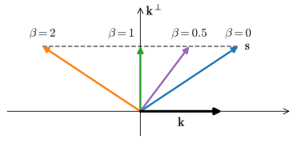

# The Delta Rule
:label:`sec_deltanet`

A program sets `rate = 0.05` and later `rate = 0.07`; a story moves its
hero from Paris to Rome; a dialogue corrects an earlier date. In each case
the text binds a name to a new value, and from then on only the new value
is correct. The matrix memories of :numref:`sec_matrix-state` cannot do
this. They store a pair by adding $\mathbf{v}_t\mathbf{k}_t^\top$, so a key
written twice returns the sum of its two values, and the more often a key
is rewritten, the less the latest value stands out.

The fix is to read before writing. Before storing a value under a key, the
memory computes what it currently returns for that key and stores only the
difference between the new value and that prediction. This *delta rule* is
one step of gradient descent on the error of recalling the new value, and
it turns the memory into a model that the network trains on the sequence it
reads, one step per token. We derive the rule, give it a decay as well
(Gated DeltaNet), train it in chunks like the layers of the previous section,
and then look at all the memories of this chapter as solutions of one
regression problem that differ in how they solve it. However the memory
writes, its size stays fixed; the last section of the chapter asks what
that means for recall.

```{.python .input #deltanet-the-delta-rule}
%%tab pytorch
%matplotlib inline
from d2l import torch as d2l
import numpy as np
import torch
from torch import nn
```

```{.python .input #deltanet-the-delta-rule}
%%tab jax
%matplotlib inline
from d2l import jax as d2l
from flax import nnx
import jax
from jax import numpy as jnp
import numpy as np
```

## Additive Writes

### A Key Written Twice

Start with a single key $\mathbf{k}$ of unit length. Write the value 1 under
it, then the value 2: the memory is $\mathbf{S} = 1 \cdot \mathbf{k}^\top +
2 \cdot \mathbf{k}^\top$, and reading it returns $\mathbf{S}\mathbf{k} = 3$.
In general, if a key is written $R$ times with values $\mathbf{v}^{(1)},
\ldots, \mathbf{v}^{(R)}$, the additive memory returns

$$
\mathbf{S}\mathbf{k} = \mathbf{v}^{(1)} + \mathbf{v}^{(2)} + \cdots +
\mathbf{v}^{(R)},
$$
:eqlabel:`eq_dn-superposition`

plus the interference from other keys,
$\sum_i (\mathbf{k}_i^\top\mathbf{k})\, \mathbf{v}_i$ over the pairs stored
under other keys $\mathbf{k}_i$ (:numref:`sec_matrix-state`). The latest value carries the same weight as every stale one. A decay does not
help much: it shrinks the stale values, but it shrinks the values of every
other key by the same factor, whether or not they were rewritten.

To measure the effect apart from interference, we store values under 8
orthonormal keys in a memory of width 64, so that keys do not overlap at
all. Each key is written $R$ times, each time with a value drawn from a
codebook of 32 random unit vectors, and we count how often the nearest
codebook entry to the read is the latest value. The function takes the write
rule as an argument, so that we can compare rules.

```{.python .input #deltanet-a-key-written-twice-1}
%%tab pytorch, jax
def overwrite_recall(write, num_writes, d=64, num_keys=8, num_values=32,
                     trials=200, seed=0):
    """Recall of the latest value after every key is written num_writes times."""
    rng = np.random.default_rng(seed)
    codebook = rng.standard_normal((num_values, d))
    codebook /= np.linalg.norm(codebook, axis=1, keepdims=True)
    recall = 0
    for _ in range(trials):
        keys = np.linalg.qr(rng.standard_normal((d, num_keys)))[0].T  # Rows
        S = np.zeros((d, d))
        for _ in range(num_writes):
            ids = rng.integers(0, num_values, num_keys)
            for k, v in zip(keys, codebook[ids]):
                S = write(S, k, v)
        reads = keys @ S.T  # Row j is S k_j
        recall += ((reads @ codebook.T).argmax(1) == ids).mean() / trials
    return recall

additive = lambda S, k, v: S + np.outer(v, k)
writes = [1, 2, 4, 8]
print('additive:', ' '.join(f'{overwrite_recall(additive, R):.2f}'
                            for R in writes))
```

After one write per key, every value is read back. After two writes, the
latest value wins only about half of the time, which is what a sum of two
equally weighted values allows; after eight, it wins about one time in
five. The memory has room for all eight keys, and it still fails, because
it cannot replace a value.

## Writes as Gradient Steps

### The Delta Rule

We want a write that makes the memory return $\mathbf{v}_t$ for
$\mathbf{k}_t$ and changes as little else as possible. One way to get it is
to measure how badly the memory recalls the new pair, with the squared
error

$$
\ell_t(\mathbf{S}) = \tfrac{1}{2}\, \|\mathbf{S}\mathbf{k}_t -
\mathbf{v}_t\|^2,
$$
:eqlabel:`eq_dn-recall-loss`

and to take one step of gradient descent on it. The gradient is
$\nabla \ell_t(\mathbf{S}) = (\mathbf{S}\mathbf{k}_t -
\mathbf{v}_t)\mathbf{k}_t^\top$, the outer product of the *prediction
error*, what the memory answers minus what it should answer, with the key.
A step of size $\beta_t$ from $\mathbf{S}_{t-1}$ gives

$$
\mathbf{S}_t = \mathbf{S}_{t-1} - \beta_t (\mathbf{S}_{t-1}\mathbf{k}_t -
\mathbf{v}_t)\mathbf{k}_t^\top.
$$
:eqlabel:`eq_dn-delta`

This is the *delta rule*, named for the difference it writes, and it is old:
:citet:`Widrow.Hoff.1960` trained adaptive linear filters with it, and
:citet:`Schlag.Irie.Schmidhuber.2021` proposed it as the write of a linear
attention layer. Read it as two steps. First, read the memory at the key,
$\hat{\mathbf{v}}_t = \mathbf{S}_{t-1}\mathbf{k}_t$. Then add the
correction $\beta_t(\mathbf{v}_t - \hat{\mathbf{v}}_t)\mathbf{k}_t^\top$.
If the memory already returns $\mathbf{v}_t$, nothing is written.

For a key of unit length and $\beta_t = 1$, reading right after the write
returns $\mathbf{S}_t\mathbf{k}_t = \hat{\mathbf{v}}_t + (\mathbf{v}_t -
\hat{\mathbf{v}}_t) = \mathbf{v}_t$: the old value is replaced. For a
direction $\mathbf{u}$ orthogonal to $\mathbf{k}_t$, $\mathbf{S}_t
\mathbf{u} = \mathbf{S}_{t-1}\mathbf{u}$: what is stored under other keys is
untouched. For $\beta_t$ between 0 and 1, the value stored under
$\mathbf{k}_t$ moves to $(1 - \beta_t)\hat{\mathbf{v}}_t + \beta_t
\mathbf{v}_t$, a blend like the update gate of a GRU, so $\beta_t$ is a
*write strength*. The network computes it from the input with a sigmoid, and
like the decay it is a gate.

The additive write of :numref:`sec_matrix-state` is also a gradient step,
on a different objective. Its update $\mathbf{v}_t\mathbf{k}_t^\top$ is
the gradient of $\mathbf{v}_t^\top \mathbf{S}\mathbf{k}_t$, which rewards
the memory for aligning its read with the value but never penalizes it for
overshooting. Aligning gives superposition; minimizing the error gives
correction. We repeat the measurement with the delta rule at $\beta = 1$.

```{.python .input #deltanet-the-delta-rule-1}
%%tab pytorch, jax
delta = lambda S, k, v: S + np.outer(v - S @ k, k)
print('delta:   ', ' '.join(f'{overwrite_recall(delta, R):.2f}'
                            for R in writes))
```

The delta rule recalls the latest value every time, however often the key
was rewritten.

### The Transition

Expanding :eqref:`eq_dn-delta` separates what happens to the old memory
from what is written:

$$
\mathbf{S}_t = \mathbf{S}_{t-1}(\mathbf{I} - \beta_t \mathbf{k}_t
\mathbf{k}_t^\top) + \beta_t \mathbf{v}_t \mathbf{k}_t^\top.
$$
:eqlabel:`eq_dn-transition`

The write is the additive write, scaled by $\beta_t$. The difference is the
transition. In :numref:`sec_matrix-state` the old memory was multiplied by
a number $a_t$; here it is multiplied by the matrix $\mathbf{I} - \beta_t
\mathbf{k}_t\mathbf{k}_t^\top$, which depends on the current key. For a unit
key, this matrix leaves every direction orthogonal to $\mathbf{k}_t$
unchanged, eigenvalue 1, and scales the direction $\mathbf{k}_t$ by $1 -
\beta_t$ (:numref:`fig_dn-geometry`). At $\beta_t = 1$ it removes the
$\mathbf{k}_t$ component of every row of the memory, which deletes the old
value and makes room for the new one; for $\beta_t \in (0, 1)$ it shrinks
that component; at $\beta_t = 2$ it reverses it, a reflection. The decay of
the previous section forgets in every direction at once. The delta rule
forgets in one direction, the one it is about to write.


:label:`fig_dn-geometry`

The eigenvalue $1 - \beta_t$ gives two guarantees. For $0 \le \beta_t \le
2$ and unit keys, no direction is ever amplified, so the memory cannot
grow without bound, which is why delta-rule layers scale their keys to unit
length. And for $\beta_t$ above 1 the eigenvalue is negative, which no
decay in $(0, 1)$ can produce. A transition with a negative eigenvalue can
flip the sign of a stored component and flip it back, and so track whether
it has seen an even or an odd number of some token: $\beta_t = 2$ on that
token and $\beta_t = 0$ elsewhere computes the parity of a sequence of any
length exactly. :citet:`Grazzi.Siems.Franke.ea.2025` show that linear
recurrences whose transitions have only eigenvalues between zero and one
cannot compute parity at arbitrary lengths. This includes the decays of the
previous sections and the delta rule with $\beta_t \le 1$, and allowing
$\beta_t$ up to 2 removes the limitation in practice.

## Gated DeltaNet

### Decay and Correction

The delta rule edits only the direction it writes. Components of the
memory along keys that the sequence never revisits are never cleared, and at the
start of a new topic everything stored earlier stays. Decay and correction
do different jobs, and Gated DeltaNet :cite:`Yang.Kautz.Hatamizadeh.2024`
combines them: the memory decays by an input-dependent $a_t$ and then takes
a delta-rule step,

$$
\mathbf{S}_t = a_t\, \mathbf{S}_{t-1}(\mathbf{I} - \beta_t
\mathbf{k}_t\mathbf{k}_t^\top) + \beta_t \mathbf{v}_t \mathbf{k}_t^\top.
$$
:eqlabel:`eq_dn-gated`

Replacing $\mathbf{I} - \beta_t\mathbf{k}_t\mathbf{k}_t^\top$ by
$\mathbf{I}$ gives the decayed memory of :numref:`sec_matrix-state`; with
$a_t = 1$ the update is the delta rule. The model
can clear its memory by setting $a_t$ near zero and rebind one key by
setting $\beta_t$ near one.

### Chunked Computation

The delta rule is a linear recurrence in $\mathbf{S}$, but its transition
is a $d_k \times d_k$ matrix rather than a number, so the dual form of
:numref:`sec_matrix-state` does not apply directly, and a scan would compose
dense matrices. Chunks still work, with one additional step. Write the
update as $\mathbf{S}_t = a_t\mathbf{S}_{t-1} + \mathbf{u}_t
\mathbf{k}_t^\top$, where $\mathbf{u}_t = \beta_t(\mathbf{v}_t -
a_t\mathbf{S}_{t-1}\mathbf{k}_t)$ is the corrected value that is actually
written. If we knew the $\mathbf{u}_t$, the memory would be the decayed
additive memory of the previous section with values $\mathbf{u}_t$, and the
chunked algorithm there would compute its outputs. The $\mathbf{u}_t$ depend
on each other, but only through the overlaps of the keys. Within a chunk
that starts with memory $\mathbf{S}_0$, unrolling $\mathbf{S}_{t-1}$ gives

$$\mathbf{u}_t + \beta_t \sum_{s < t} L_{ts}\, (\mathbf{k}_s^\top
\mathbf{k}_t)\, \mathbf{u}_s = \beta_t\big(\mathbf{v}_t - \gamma_t
\mathbf{S}_0\mathbf{k}_t\big),$$

where $L_{ts}$ is the product of the decays from step $s+1$ to $t$, as in
the dual form of :numref:`sec_matrix-state`, and $\gamma_t$ is the product of the decays
since the chunk started. Stacked as rows, these are $m$ linear equations
for the $\mathbf{u}_t$ with a lower triangular matrix: each $\mathbf{u}_t$
depends only on earlier ones. One triangular solve per chunk replaces
$m$ sequential steps, and because the right side is linear in
$\mathbf{S}_0$, we solve once for the part that depends on the values and
once for the part that depends on the incoming memory, before the state is
known. The *WY representation*, a classical way of writing products of
Householder-like matrices, organizes the same computation;
:citet:`Yang.Wang.Zhang.ea.2024` adapted it to the delta rule.

We split the computation into two functions. The first solves, for every
chunk at once, the triangular systems for the two parts of the corrected
values: $\mathbf{W}$, which depends on the values, and $\mathbf{Z}$, which
multiplies the incoming memory, so that $\mathbf{U} = \mathbf{W} -
\mathbf{Z}\mathbf{S}_0^\top$. It uses the mask `decay_mask` of
:numref:`sec_matrix-state`, whose entries are the products $L_{ts}$.

```{.python .input #deltanet-chunked-computation-1}
%%tab pytorch
def delta_rule_writes(K, V, beta, log_a):  #@save
    """W and Z with corrected values U = W - Z S_0^T, for every chunk.

    K: (..., m, d_k); V: (..., m, d_v); beta, log_a: (..., m)
    """
    L = d2l.decay_mask(log_a)  # Products of decays within the chunk
    gamma = torch.exp(log_a.cumsum(-1)).unsqueeze(-1)  # Decay since start
    beta = beta.unsqueeze(-1)
    M = torch.eye(K.shape[-2], device=K.device) + (
        beta * L.tril(-1) * (K @ K.mT))  # Lower triangular
    W = torch.linalg.solve_triangular(M, beta * V, upper=False)
    Z = torch.linalg.solve_triangular(M, beta * gamma * K, upper=False)
    return W, Z
```

```{.python .input #deltanet-chunked-computation-1}
%%tab jax
def delta_rule_writes(K, V, beta, log_a):  #@save
    """W and Z with corrected values U = W - Z S_0^T, for every chunk.

    K: (..., m, d_k); V: (..., m, d_v); beta, log_a: (..., m)
    """
    L = d2l.decay_mask(log_a)  # Products of decays within the chunk
    gamma = jnp.exp(log_a.cumsum(-1))[..., None]  # Decay since start
    beta = beta[..., None]
    M = jnp.eye(K.shape[-2]) + (
        beta * jnp.tril(L, -1) * (K @ K.mT))  # Lower triangular
    W = jax.scipy.linalg.solve_triangular(M, beta * V, lower=True)
    Z = jax.scipy.linalg.solve_triangular(M, beta * gamma * K, lower=True)
    return W, Z
```

The second passes the memory from chunk to chunk. In each chunk it forms the
corrected values from the incoming memory, computes the outputs, which read
the incoming memory and the chunk's own writes, and computes the memory at
the chunk's end, exactly as the chunked computation of
:numref:`sec_matrix-state` does with the values $\mathbf{U}$ in place of
$\mathbf{V}$.

```{.python .input #deltanet-chunked-computation-2}
%%tab pytorch
def chunked_delta_rule(Q, K, V, beta, log_a, chunk_size):  #@save
    """Outputs y_t = S_t q_t of the gated delta rule, computed in chunks.

    Q, K: (batch_size, T, d_k); V: (batch_size, T, d_v);
    beta, log_a: (batch_size, T)
    """
    B, T, m = Q.shape[0], Q.shape[1], chunk_size
    Q, K, V = (X.reshape(B, T // m, m, -1) for X in (Q, K, V))
    beta, log_a = beta.reshape(B, T // m, m), log_a.reshape(B, T // m, m)
    W, Z = delta_rule_writes(K, V, beta, log_a)
    L, cum = d2l.decay_mask(log_a), log_a.cumsum(-1)
    S, outputs = Q.new_zeros(B, V.shape[-1], K.shape[-1]), []
    for c in range(T // m):
        U = W[:, c] - Z[:, c] @ S.mT  # Corrected values
        read_past = torch.exp(cum[:, c]).unsqueeze(-1) * (Q[:, c] @ S.mT)
        outputs.append(read_past + (L[:, c] * (Q[:, c] @ K[:, c].mT)) @ U)
        to_end = torch.exp(cum[:, c, -1:] - cum[:, c]).unsqueeze(-1)
        S = (torch.exp(cum[:, c, -1, None, None]) * S
             + (U * to_end).mT @ K[:, c])
    return torch.stack(outputs, 1).reshape(B, T, -1)
```

```{.python .input #deltanet-chunked-computation-2}
%%tab jax
def chunked_delta_rule(Q, K, V, beta, log_a, chunk_size):  #@save
    """Outputs y_t = S_t q_t of the gated delta rule, computed in chunks.

    Q, K: (batch_size, T, d_k); V: (batch_size, T, d_v);
    beta, log_a: (batch_size, T)
    """
    B, T, m = Q.shape[0], Q.shape[1], chunk_size
    Q, K, V = (X.reshape(B, T // m, m, -1) for X in (Q, K, V))
    beta, log_a = beta.reshape(B, T // m, m), log_a.reshape(B, T // m, m)
    W, Z = delta_rule_writes(K, V, beta, log_a)
    L, cum = d2l.decay_mask(log_a), log_a.cumsum(-1)
    def chunk(S, c):  # c: one chunk of every sequence
        Q_c, K_c, W_c, Z_c, L_c, cum_c = c
        U = W_c - Z_c @ S.mT  # Corrected values
        read_past = jnp.exp(cum_c)[..., None] * (Q_c @ S.mT)
        O = read_past + (L_c * (Q_c @ K_c.mT)) @ U
        to_end = jnp.exp(cum_c[:, -1:] - cum_c)[..., None]
        S = (jnp.exp(cum_c[:, -1, None, None]) * S
             + (U * to_end).mT @ K_c)
        return S, O
    S = jnp.zeros((B, V.shape[-1], K.shape[-1]))
    chunks = tuple(X.swapaxes(0, 1) for X in (Q, K, W, Z, L, cum))
    return jax.lax.scan(chunk, S, chunks)[1].swapaxes(0, 1).reshape(B, T, -1)
```


We check the chunked computation against the recurrence
:eqref:`eq_dn-gated` applied one step at a time, with unit keys and random
write strengths and decays.

```{.python .input #deltanet-chunked-computation-3}
%%tab pytorch
def delta_rule_recurrent(Q, K, V, beta, a):
    """The same outputs, one step at a time."""
    S, outputs = Q.new_zeros(V.shape[-1], K.shape[-1]), []
    for q, k, v, b, a_t in zip(Q, K, V, beta, a):
        S = a_t * S
        S = S + b * torch.outer(v - S @ k, k)
        outputs.append(S @ q)
    return torch.stack(outputs)

torch.manual_seed(0)
T, d_k, d_v = 256, 32, 32
Q, V = torch.randn(T, d_k), torch.randn(T, d_v)
K = nn.functional.normalize(torch.randn(T, d_k), dim=-1)
beta, a = torch.rand(T), 0.8 + 0.19 * torch.rand(T)
Y = delta_rule_recurrent(Q, K, V, beta, a)
for m in [16, 64]:
    Y_chunked = chunked_delta_rule(Q[None], K[None], V[None], beta[None],
                                   torch.log(a)[None], m)[0]
    print(f'chunk size {m}: relative deviation '
          f'{(Y_chunked - Y).abs().max() / Y.abs().max():.1e}')
```

```{.python .input #deltanet-chunked-computation-3}
%%tab jax
def delta_rule_recurrent(Q, K, V, beta, a):
    """The same outputs, one step at a time."""
    def step(S, inputs):
        q, k, v, b, a_t = inputs
        S = a_t * S
        S = S + b * jnp.outer(v - S @ k, k)
        return S, S @ q
    S = jnp.zeros((V.shape[-1], K.shape[-1]))
    return jax.lax.scan(step, S, (Q, K, V, beta, a))[1]

T, d_k, d_v = 256, 32, 32
keys = jax.random.split(jax.random.key(0), 5)
Q, V = jax.random.normal(keys[0], (T, d_k)), jax.random.normal(keys[1], (T, d_v))
K = jax.random.normal(keys[2], (T, d_k))
K = K / jnp.linalg.norm(K, axis=-1, keepdims=True)
beta = jax.random.uniform(keys[3], (T,))
a = 0.8 + 0.19 * jax.random.uniform(keys[4], (T,))
with jax.default_matmul_precision('highest'):  # Full float32, not TF32
    Y = delta_rule_recurrent(Q, K, V, beta, a)
    for m in [16, 64]:
        Y_chunked = chunked_delta_rule(Q[None], K[None], V[None], beta[None],
                                       jnp.log(a)[None], m)[0]
        print(f'chunk size {m}: relative deviation '
              f'{jnp.abs(Y_chunked - Y).max() / jnp.abs(Y).max():.1e}')
```

The chunked outputs agree with the recurrence to rounding error.

### The Layer

A Gated DeltaNet layer is the gated linear attention layer of
:numref:`sec_matrix-state` with a different memory. It adds one projection,
which computes a write strength $\beta_t = \sigma(\mathbf{w}^\top
\mathbf{x}_t + b)$ for every head, and replaces the method `memory` by the
chunked delta rule. Queries, keys, values, decays, output normalization, and
the initialization of the decays stay as they were, so that comparing the
two layers compares their write rules.

```{.python .input #deltanet-the-layer}
%%tab pytorch
class GatedDeltaNet(d2l.GatedLinearAttention):  #@save
    """Gated linear attention whose memory is written by the delta rule."""
    def __init__(self, num_hiddens, num_heads, chunk_size=64):
        super().__init__(num_hiddens, num_heads, chunk_size)
        self.W_beta = nn.Linear(num_hiddens, num_heads)  # Write strength

    def memory(self, X, Q, K, V, log_a):
        beta = self.split_heads(torch.sigmoid(self.W_beta(X))).squeeze(-1)
        return chunked_delta_rule(Q, K, V, beta, log_a, self.chunk_size)
```

```{.python .input #deltanet-the-layer}
%%tab jax
class GatedDeltaNet(d2l.GatedLinearAttention):  #@save
    """Gated linear attention whose memory is written by the delta rule."""
    def __init__(self, num_hiddens, num_heads, chunk_size=64, *, rngs):
        super().__init__(num_hiddens, num_heads, chunk_size, rngs=rngs)
        self.W_beta = nnx.Linear(num_hiddens, num_heads, rngs=rngs)

    def memory(self, X, Q, K, V, log_a):
        beta = self.split_heads(jax.nn.sigmoid(self.W_beta(X)))[..., 0]
        return chunked_delta_rule(Q, K, V, beta, log_a, self.chunk_size)
```

We train it as the mixer of `d2l.SeqLM` with the recipe of the chapter:
character-level Penn Treebank, two blocks of width 128 with four heads, and
`d2l.fit_lm`. The gated linear attention layer reached a perplexity of
about 3.25 with the same recipe.

```{.python .input #deltanet-language-modeling-1}
%%tab pytorch, jax
data = d2l.PennTreebank(batch_size=64, num_steps=128)
```

```{.python .input #deltanet-language-modeling-2}
%%tab pytorch
torch.manual_seed(0)
model = d2l.SeqLM(len(data.vocab), 128,
                  [GatedDeltaNet(128, num_heads=4) for _ in range(2)])
print(f'Gated DeltaNet perplexity: {d2l.fit_lm(model, data):.2f}')
```

```{.python .input #deltanet-language-modeling-2}
%%tab jax
rngs = nnx.Rngs(0)
model = d2l.SeqLM(len(data.vocab), 128, [GatedDeltaNet(
    128, num_heads=4, rngs=rngs) for _ in range(2)], rngs=rngs)
print(f'Gated DeltaNet perplexity: {d2l.fit_lm(model, data):.2f}')
```

Gated DeltaNet reaches a perplexity of about 3.2, the same as gated linear
attention to two digits. On this task the write rule
matters little: most predictions depend on the last few characters, and
few keys need to be rebound within a window of 128 characters. The
difference shows where a task requires it, in the overwrite measurement
above and in the recall experiments of the next section.

## Memory as Regression

Every memory in this chapter answers a query with a function fitted to the
pairs $(\mathbf{k}_s, \mathbf{v}_s)$ it has read. Asking which function, and
how it is fitted, puts the models side by side. Collect the keys and values
of the first $t$ steps as the rows of $\mathbf{K}_t$ and $\mathbf{V}_t$. The
linear map that reproduces the stored pairs best, in the sense of
least squares, minimizes $\sum_{s \le t} \|\mathbf{S}\mathbf{k}_s -
\mathbf{v}_s\|^2$. When $\mathbf{K}_t^\top\mathbf{K}_t$ is invertible, the
minimizer is

$$
\mathbf{S}_t^\star = \mathbf{V}_t^\top \mathbf{K}_t\,
(\mathbf{K}_t^\top \mathbf{K}_t)^{-1}.
$$
:eqlabel:`eq_dn-least-squares`

The first factor, $\mathbf{V}_t^\top\mathbf{K}_t = \sum_s
\mathbf{v}_s\mathbf{k}_s^\top$, is the additive memory of
:numref:`sec_matrix-state`. The second factor undoes the overlaps of the
keys. For orthonormal keys it is the identity on the directions they span,
and the additive memory is already the best fit there; for overlapping
keys, it removes the interference
between them, the terms $(\mathbf{k}_i^\top\mathbf{k}_j)\,\mathbf{v}_i$ that
an additive memory adds to every read. Linear attention is therefore least squares
without the correction for overlapping keys. The delta rule is a gradient
step on the same objective, one pair at a time, and a key that is written
again is fitted again. With a decay, linear attention weights the pairs so
that recent ones count more, while in Gated DeltaNet the decay shrinks the
fitted memory toward zero before each gradient step, a weight decay.
Softmax attention fits nothing in advance. It keeps every pair and, at query
time, returns a weighted average of the values with weights given by a
kernel of the query and the keys, the Nadaraya–Watson estimator of
:numref:`sec_attention-pooling`. This is a nonparametric regression, which
is why its memory grows with the context. :numref:`tab_dn-regression`
collects the view; :citet:`Wang.Shi.Fox.2025` develop it in detail.

:Memories as regressions on the pairs read so far.
:label:`tab_dn-regression`

| Memory | What it fits | How | State |
| :-- | :-- | :-- | :-- |
| Softmax attention | kernel-weighted average of all values | at query time | all pairs |
| Linear attention | $\mathbf{V}^\top\mathbf{K}$, least squares without the key correction | one addition per pair | $d_v \times d_k$ |
| Gated linear attention | the same, weighted toward recent pairs | one addition per pair | $d_v \times d_k$ |
| Delta rule | least squares | one gradient step per pair | $d_v \times d_k$ |
| Gated DeltaNet | least squares with weight decay | one gradient step per pair | $d_v \times d_k$ |

The view suggests how to design new memories: choose the weights of the
pairs, the class of functions the memory fits, and the method that fits it.
As an example of a different method, consider replacing the gradient step by
the *implicit* step that minimizes $\tfrac{1}{2}\|\mathbf{S} -
\mathbf{S}_{t-1}\|^2 + \tfrac{\beta_t}{2}\|\mathbf{S}\mathbf{k}_t -
\mathbf{v}_t\|^2$ exactly: the new memory should recall the new pair well
and stay close to the old memory. Its solution is the delta rule with the
step $\beta_t / (1 + \beta_t\|\mathbf{k}_t\|^2)$ in place of $\beta_t$, as an
exercise shows, so the eigenvalue along $\mathbf{k}_t$ becomes $1 / (1 +
\beta_t\|\mathbf{k}_t\|^2)$, which lies in $(0, 1)$ for every positive
$\beta_t$ and every key. The implicit step cannot overshoot, whatever the
network sets the write strength to; this is the update of Longhorn
:cite:`Liu.Wang.Wu.ea.2024`. Other designs replace the matrix by a small
neural network that is trained by gradient steps as the sequence is read
:cite:`Sun.Li.Dalal.ea.2024,Behrouz.Zhong.Mirrokni.2025`.

In all of these models, learning happens at two levels. While the model
reads a sequence, its memory is fitted to that sequence's pairs, at training
time and when the model is used, and it starts empty for every new sequence.
The network's weights, which compute the keys, values, queries, and gates
from the input, are trained by backpropagation through these fitting steps,
over many sequences, and stay fixed when the model is used. The weights
learn which pairs are worth storing; the memory stores the pairs of the
sequence at hand.

Whatever its write rule, the memory has $d_v \times d_k$ numbers, and a
fixed set of numbers can hold only so many facts. The last section of the
chapter measures this limit on a recall task and shows how a few attention
layers remove it.

## Summary

An additive matrix memory cannot rebind a key: a key written several times
returns the sum of its values, and recall of the latest value falls to about
one half after two writes. The delta rule reads the memory before it writes
and stores only the difference between the new value and the current
prediction. This is one gradient step on the squared error of recalling the
new pair, and in transition form it multiplies the memory by
$\mathbf{I} - \beta_t\mathbf{k}_t\mathbf{k}_t^\top$, which removes or shrinks
only the direction being written. Gated DeltaNet adds a decay, so that the
memory can both clear itself and correct a single binding. The chunked
algorithm of the previous section extends to the delta rule with one
triangular solve per chunk. Viewed as regressions, linear attention keeps
the cross-moment of keys and values, the delta rule fits least squares by
gradient steps, and softmax attention keeps all pairs and smooths among them
at query time.

## Exercises

1. **Order does not matter.** Show that the additive memory after a
   sequence of writes does not depend on the order of the writes. Conclude
   that no read rule, however clever, can recover the latest of $R$ values
   written under one key from an additive memory alone, and compute the
   recall that the best rule achieves when the $R$ values are distinct.
   Compare with the measured recall.

1. [code] **Decay instead of correction.** Give the additive write of
   `overwrite_recall` a constant decay, $\mathbf{S} \leftarrow a\mathbf{S} +
   \mathbf{v}\mathbf{k}^\top$.
    1. For $R = 2, 4, 8$, find the decay $a$ that maximizes the recall of
       the latest value. Explain the optimum: what does a decay close to
       zero cost?
    1. Now store, in addition, 8 keys that are written once at the
       start and never rewritten, and measure their recall at the end
       along with that of the rewritten keys. Which write rule serves both
       kinds of key?

1. **Step size and key length.** Let the keys of the delta rule have any
   length.
    1. Show that the eigenvalue of $\mathbf{I} - \beta\mathbf{k}
       \mathbf{k}^\top$ along $\mathbf{k}$ is $1 - \beta\|\mathbf{k}\|^2$,
       and find the range of $\beta$ for which no direction is amplified.
       Relate the result to the step size limit $\eta < 2/L$ of gradient
       descent on a quadratic with curvature $L$.
    1. Show that dividing the step by $\|\mathbf{k}\|^2$, the
       *normalized* least mean squares rule, makes the update independent
       of the scale of the key. Why do delta-rule layers normalize the keys
       instead?

1. **The implicit step.** Show that the minimizer of
   $\tfrac{1}{2}\|\mathbf{S} - \mathbf{S}_{t-1}\|^2 +
   \tfrac{\beta}{2}\|\mathbf{S}\mathbf{k} - \mathbf{v}\|^2$ is
   $\mathbf{S}_{t-1} - \frac{\beta}{1 + \beta\|\mathbf{k}\|^2}
   (\mathbf{S}_{t-1}\mathbf{k} - \mathbf{v})\mathbf{k}^\top$. (Hint: set
   the gradient to zero and multiply the result by $\mathbf{k}$ to find
   $\mathbf{S}\mathbf{k}$ first.) Give the eigenvalues of its transition,
   and show that the step recalls the new pair exactly only in the limit
   $\beta \to \infty$.

1. [code] **Correlated keys.** Use the correlated keys of the experiment in
   :numref:`sec_matrix-state`, with $\rho = 0.5$ and $d_k = 64$, and store
   $n$ pairs once each.
    1. Compare the squared read error of the additive memory, of the delta
       rule with $\beta = 1$ applied once to each pair, and of the least
       squares solution :eqref:`eq_dn-least-squares`, for $n$ from 8 to 64.
    1. Apply the delta rule for several passes over the same pairs. How
       many passes bring it close to least squares, and why does a single
       pass not suffice?

1. [code] **Recursive least squares.** The least squares solution
   :eqref:`eq_dn-least-squares` can be updated one pair at a time if the
   memory also keeps $\mathbf{P}_t = (\mathbf{K}_t^\top \mathbf{K}_t +
   \lambda\mathbf{I})^{-1}$.
    1. Use the Sherman–Morrison formula to derive the updates of
       $\mathbf{P}_t$ and $\mathbf{S}_t$ after one new pair, and show that
       the update of $\mathbf{S}_t$ is a delta rule whose key is
       $\mathbf{P}_t\mathbf{k}_t$ instead of $\mathbf{k}_t$.
    1. Implement it and compare it with the delta rule on the overwrite
       experiment. Why does recursive least squares, the best fit of all
       pairs, recall the latest value poorly? What would fix it?
    1. How large is its state compared with that of the delta rule?

1. [code] **Parity.** ● The write strength of `GatedDeltaNet` is a sigmoid,
   so its eigenvalues $1 - \beta_t$ lie in $(0, 1)$.
    1. Build a one-head memory with keys fixed to a unit vector and write
       strengths set by hand from the input bits, and show that it computes
       the parity of bit strings of any length exactly. Which values of
       $\beta_t$ does it need?
    1. Train a one-layer `SeqLM` with a `GatedDeltaNet` mixer to output the
       running parity of random bit strings of length 64. Then replace the
       sigmoid of the write strength by $2\sigma$ and train again. Compare
       the accuracies, and test both models on strings of length 256.

1. **Gradients through the memory.** The network's weights are trained by
   backpropagation through the writes. Consider a single delta-rule step
   with $\beta = 1$ from $\mathbf{S}_0 = \mathbf{0}$ followed by a read,
   $\mathbf{o} = \mathbf{S}_1\mathbf{q}$, and a loss
   $\tfrac{1}{2}\|\mathbf{o} - \mathbf{y}\|^2$.
    1. Compute the gradients of the loss with respect to $\mathbf{q}$,
       $\mathbf{k}$, and $\mathbf{v}$.
    1. Repeat for two writes with keys $\mathbf{k}_1$, $\mathbf{k}_2$
       followed by a read with $\mathbf{q} = \mathbf{k}_1$. How does the
       gradient with respect to $\mathbf{k}_1$ depend on the overlap
       $\mathbf{k}_1^\top\mathbf{k}_2$? What does it encourage the network
       to do with the keys of different facts?

[Discussions](https://d2l.discourse.group/)

<!-- slides -->

::: {.slide}
::: {.cover}
[Dive into Deep Learning · §12.5]{.kicker}

The delta rule<br>
**writes as gradient steps · one direction at a time · Gated DeltaNet · chunks with a triangular solve · memory as regression**
:::
:::

::: {.slide title="After Two Writes, the Latest Value Wins Half the Time"}
[The problem]{.kicker}

Write 1 under a key, then 2: an additive memory returns 3.

8 orthonormal keys (no interference), each written $R$ times; how often is
the read nearest to the **latest** value?

@!deltanet-a-key-written-twice-1

::: {.d2l-note}
The memory has room for every key; it cannot **replace** a value.
:::
:::

::: {.slide title="By the End of This Deck You Can"}
- derive the delta rule as one gradient step on the recall error;
- read its transition $\mathbf{I} - \beta\mathbf{k}\mathbf{k}^\top$ geometrically;
- combine decay and correction (Gated DeltaNet) and train it in chunks;
- place every memory of the chapter in one regression table.

**Running example:** the overwrite test above; the Penn Treebank
results (gated linear attention 3.25).
:::

::: {.slide title="Write the Error, Not the Value"}
Recall loss for the new pair and one gradient step of size $\beta_t$:

$$\ell_t(\mathbf{S}) = \tfrac12\|\mathbf{S}\mathbf{k}_t - \mathbf{v}_t\|^2,\qquad
\mathbf{S}_t = \mathbf{S}_{t-1} - \beta_t(\mathbf{S}_{t-1}\mathbf{k}_t - \mathbf{v}_t)\mathbf{k}_t^\top$$

1. Read $\hat{\mathbf{v}}_t = \mathbf{S}_{t-1}\mathbf{k}_t$.
2. Write $\beta_t(\mathbf{v}_t - \hat{\mathbf{v}}_t)\mathbf{k}_t^\top$.

Unit key, $\beta = 1$: the read returns $\mathbf{v}_t$; directions
orthogonal to $\mathbf{k}_t$ are untouched.
:::

::: {.slide title="The Delta Rule Rebinds Every Key"}
```python
additive = lambda S, k, v: S + np.outer(v, k)
delta = lambda S, k, v: S + np.outer(v - S @ k, k)
```

@!deltanet-the-delta-rule-1

Additive writes ascend $\mathbf{v}^\top\mathbf{S}\mathbf{k}$ and never
penalize overshoot; the delta rule minimizes the error.
:::

::: {.slide title="The Transition Shrinks Only the Direction Being Written"}
::: {.cols .vc}
::: {.col}
$$\mathbf{S}_t = \mathbf{S}_{t-1}(\mathbf{I} - \beta_t\mathbf{k}_t\mathbf{k}_t^\top) + \beta_t\mathbf{v}_t\mathbf{k}_t^\top$$

- Eigenvalue 1 orthogonal to $\mathbf{k}_t$, $1 - \beta_t$ along it.
- $\beta = 1$: delete, then write. $0 < \beta < 1$: blend.
- A decay forgets every direction; the delta rule forgets one.
:::

::: {.col .fig .big}

:::
:::
:::

::: {.slide title="Check: Write Strength Two"}
$\beta = 2$ and a unit key $\mathbf{k}$.

1. What happens to the component of the memory along $\mathbf{k}$?
2. What can a model with such steps compute that no decay in $(0, 1)$ can?

::: {.fragment .fade-up}
1. It is reversed: eigenvalue $-1$, a reflection.
2. Flip a sign at every 1 and keep it at every 0: the **parity** of a bit
   string of any length.
:::
:::

::: {.slide title="Gated DeltaNet: Decay Clears, the Delta Rule Corrects"}
$$\mathbf{S}_t = a_t\,\mathbf{S}_{t-1}(\mathbf{I} - \beta_t\mathbf{k}_t\mathbf{k}_t^\top) + \beta_t\mathbf{v}_t\mathbf{k}_t^\top$$

- $a_t$ near 0: a new topic, clear everything.
- $\beta_t$ near 1: rebind one key.
- In code: gated linear attention with one more projection, for $\beta_t$,
  and a different `memory` method.
:::

::: {.slide title="Chunks Need One Triangular Solve"}
Write $\mathbf{S}_t = a_t\mathbf{S}_{t-1} + \mathbf{u}_t\mathbf{k}_t^\top$ with the
corrected value $\mathbf{u}_t = \beta_t(\mathbf{v}_t - a_t\mathbf{S}_{t-1}\mathbf{k}_t)$:

$$\mathbf{u}_t + \beta_t\sum_{s<t} L_{ts}(\mathbf{k}_s^\top\mathbf{k}_t)\,\mathbf{u}_s = \beta_t(\mathbf{v}_t - \gamma_t\mathbf{S}_0\mathbf{k}_t)$$

Lower triangular in the $\mathbf{u}_t$: solve once per chunk, then use the
chunked algorithm of linear attention with $\mathbf{U}$ for $\mathbf{V}$.

@!deltanet-chunked-computation-3
:::

::: {.slide title="On Text, the Write Rule Matters Little"}
@!deltanet-language-modeling-2

- Gated linear attention: about 3.25 with the same recipe.
- Few keys need rebinding within 128 characters; the overwrite test and the
  recall tasks of the next deck show the difference.
:::

::: {.slide title="Every Memory Fits a Regression"}
Least squares on the pairs so far:
$\mathbf{S}^\star = \mathbf{V}^\top\mathbf{K}(\mathbf{K}^\top\mathbf{K})^{-1}$.

| memory | fits | how |
|---|---|---|
| softmax attention | kernel average of all values | at query time |
| linear attention | $\mathbf{V}^\top\mathbf{K}$, no key correction | add per pair |
| gated linear attention | the same, recent pairs weigh more | add per pair |
| delta rule | least squares | gradient step per pair |
| Gated DeltaNet | least squares with weight decay | gradient step per pair |
:::

::: {.slide title="The Implicit Step Cannot Overshoot"}
$$\min_{\mathbf{S}}\ \tfrac12\|\mathbf{S} - \mathbf{S}_{t-1}\|^2 + \tfrac{\beta}{2}\|\mathbf{S}\mathbf{k} - \mathbf{v}\|^2$$

Solution: the delta rule with step $\beta/(1 + \beta\|\mathbf{k}\|^2)$.

Eigenvalue along $\mathbf{k}$: $1/(1 + \beta\|\mathbf{k}\|^2) \in (0, 1)$
for every $\beta > 0$ (Longhorn).
:::

::: {.slide title="Recap"}
- Additive memory after $R$ writes to a key: recall of the latest value
  1.00, 0.51, 0.27, 0.21 for $R = 1, 2, 4, 8$; delta rule: 1.00.
- Delta rule = one gradient step on $\tfrac12\|\mathbf{S}\mathbf{k} - \mathbf{v}\|^2$;
  transition $\mathbf{I} - \beta\mathbf{k}\mathbf{k}^\top$.
- Gated DeltaNet adds a decay; chunks add one triangular solve.

**Next:** however it writes, a $d_v \times d_k$ memory holds a fixed number
of facts. What does that cost in recall, and how do a few attention layers
repair it?
:::
