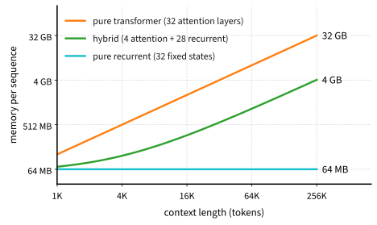

# Hybrid Architectures
:label:`sec_hybrids`

Every model in this chapter has improved *how* a fixed-size state is updated—from gates to selective dynamics to error-correcting delta rules—yet none of them can store more information than the state's size allows. When a user pastes a table of 64 product codes and prices into a prompt and asks for 20 of them, a Transformer looks back across its full KV cache and retrieves the exact tokens, whereas a purely recurrent model has only what it compressed into its fixed state before knowing which items would be queried. In-context retrieval—in few-shot prompting, retrieval-augmented generation, and code editing—is where fixed-state sequence models hit a hard ceiling.

The remedy adopted by modern frontier recurrent architectures is pragmatic: interleave a small fraction of full attention layers among the recurrent blocks. Below we establish two fundamental limits on fixed-state recall—an information-theoretic bit-counting bound and Welch's geometric lower bound on key overlap—compare pure `GatedDeltaNet`, pure attention, and a `GA` hybrid on multi-query associative recall and byte-level WikiText-103, ablate the short depthwise convolution that pairs adjacent key and value tokens, quantify inference KV-cache savings at 256K context length, and summarize all sequence memories covered in this chapter.

```{.python .input #hybrids-hybrid-architectures}
%%tab pytorch
import math
import numpy as np
import torch
from torch import nn
from torch.nn import functional as F
from d2l import torch as d2l
```

```{.python .input #hybrids-hybrid-architectures}
%%tab jax
import math
import numpy as np
import jax
from jax import numpy as jnp
from flax import nnx
import optax
from d2l import jax as d2l
```

## Limits of a Fixed-Size State

### Counting Bits

By the pigeonhole principle, a state of $M$ numbers stored at $b$ bits each has at most $2^{Mb}$ distinct configurations. To distinguish and reproduce all $V^k$ possible sequences of $k$ tokens drawn from a vocabulary of size $V$, the state must satisfy :cite:`Jelassi.Brandfonbrener.Kakade.ea.2024`:

$$M b \ge k \log_2 V.$$
:eqlabel:`eq_hy-counting`

Thus the maximum number of tokens a fixed state can recall grows linearly with state size $M$ and is completely independent of context length $T$, whereas a Transformer's KV cache grows linearly with $T$ and never saturates.

In practice, linear matrix memories hit a geometric limit long before saturating their raw bit count. In our associative recall benchmark below, a sequence stores up to 64 pairs with keys drawn from 128 symbols and values from 4 symbols (at most $128 \times 2 = 256$ bits of table information, or $64 \times 2 = 128$ bits for the 64 values), while two `GatedDeltaNet` layers with 8 heads of $4 \times 4$ float32 states hold $256 \times 32 = 8{,}192$ bits—more than $30\times$ the required bits. Why does a matrix memory lose pairs well below its raw bit count?

### Overlapping Keys

Whether a matrix head $\mathbf{S} \in \mathbb{R}^{d_v \times d_k}$ is updated additively (:numref:`sec_matrix-state`) or via the delta rule toward the least-squares fit (:numref:`sec_deltanet`), exact linear readout $\mathbf{S}\mathbf{k}_j = \mathbf{v}_j$ for arbitrary values requires the stored keys to be linearly independent—and $\mathbb{R}^{d_k}$ holds at most $d_k$ linearly independent vectors. Once the number of stored keys $m$ exceeds the head dimension $d_k$, the keys *must* overlap no matter how training chooses them.

**Proposition (Welch's Bound).** Let $\mathbf{k}_1, \ldots, \mathbf{k}_m$ be unit vectors in $\mathbb{R}^{d_k}$ with $m > d_k$. Then the average squared inner product over all distinct pairs $i \neq j$ is at least :cite:`Welch.1974`:

$$\frac{m - d_k}{d_k\,(m - 1)}.$$
:eqlabel:`eq_hy-welch`

**Proof.** Let $\mathbf{G} = \sum_{i=1}^m \mathbf{k}_i \mathbf{k}_i^\top \in \mathbb{R}^{d_k \times d_k}$. Its trace is $\sum_{i=1}^m \|\mathbf{k}_i\|^2 = m$, so its $d_k$ eigenvalues sum to $m$. By Cauchy–Schwarz, the sum of its squared eigenvalues—which equals $\|\mathbf{G}\|_F^2 = \sum_{i,j} (\mathbf{k}_i^\top \mathbf{k}_j)^2$—is at least $m^2 / d_k$. Subtracting the $m$ diagonal terms $(\mathbf{k}_i^\top \mathbf{k}_i)^2 = 1$ leaves at least $m^2 / d_k - m = m(m - d_k)/d_k$ across the $m(m - 1)$ off-diagonal pairs. $\blacksquare$

In a head of dimension $d_k = 4$, $m = 64$ unit keys must have mean squared overlap at least $60 / (4 \times 63) \approx 0.24$—almost indistinguishable from random unit vectors ($1/d_k = 0.25$). Widening the head to $d_k = 16$ lowers the Welch floor to $48 / (16 \times 63) \approx 0.05$.

This predicts two clear experimental signatures on multi-query associative recall:

1. A pure `GatedDeltaNet` stack will degrade as the number of stored pairs $n$ grows past its state capacity, while quadrupling its per-layer state entries (from $8 \times 4^2 = 128$ to $2 \times 16^2 = 512$ at fixed width $d = 32$) will shift the degradation to roughly $4\times$ higher pair loads.
2. Replacing just one of the two recurrent blocks with full causal attention (`GA`) will eliminate the capacity drop entirely, because the attention layer retains every token in its cache.

## Recall with One Attention Layer

### Four Models

We test four two-block `d2l.SeqLM` models ($d = 32$) on multi-query associative recall (`num_keys=128`, `num_values=4`, loads $n \in \{4, 8, 16, 32, 64\}$):

- **`Gated DeltaNet` (`GG`):** 8 heads of size 4 ($128$ state entries/layer);
- **`Gated DeltaNet, 4x state` (`GG, num_heads=2`):** 2 heads of size 16 ($512$ state entries/layer, same parameter count);
- **`attention` (`AA`):** 2-head causal attention (`d2l.AttentionMixer`) with the same width-4 depthwise causal convolution on $(\mathbf{Q}, \mathbf{K}, \mathbf{V})$ and no positional encoding (`rope=False`);
- **`hybrid` (`GA`):** `GatedDeltaNet` in block 1 followed by `AttentionMixer` in block 2.

```{.python .input #hybrids-four-models-2}
%%tab pytorch
def recall_model(layout, num_heads=8, conv_width=4, num_hiddens=32):
    """SeqLM whose mixers are given by letters: G(ated DeltaNet) with
    num_heads heads, A(ttention) with two; tokens: 4 values, 128 keys, and
    the filler."""
    make = {'G': lambda: d2l.GatedDeltaNet(
                num_hiddens, num_heads, conv_width=conv_width,
                timescales=(256, 2048)),
            'A': lambda: d2l.AttentionMixer(num_hiddens, num_heads=2,
                                            conv_width=4, rope=False)}
    return d2l.SeqLM(4 + 128 + 1, num_hiddens, [make[c]() for c in layout])
```

```{.python .input #hybrids-four-models-2}
%%tab jax
def recall_model(layout, num_heads=8, conv_width=4, num_hiddens=32):
    """SeqLM whose mixers are given by letters: G(ated DeltaNet) with
    num_heads heads, A(ttention) with two; tokens: 4 values, 128 keys, and
    the filler."""
    rngs = nnx.Rngs(d2l.get_key())  # A new initialization each call
    make = {'G': lambda: d2l.GatedDeltaNet(
                num_hiddens, num_heads, conv_width=conv_width,
                timescales=(256, 2048), rngs=rngs),
            'A': lambda: d2l.AttentionMixer(num_hiddens, num_heads=2,
                                            conv_width=4, rope=False,
                                            rngs=rngs)}
    return d2l.SeqLM(4 + 128 + 1, num_hiddens, [make[c]() for c in layout],
                     rngs=rngs)
```

### The Recall Sweep

We train two seeds of each architecture for 2,000 updates with `d2l.train_recall` and evaluate accuracy across pair loads.

```{.python .input #hybrids-the-recall-sweep-2}
%%tab pytorch, jax
arms = {'Gated DeltaNet': dict(layout='GG'), 'attention': dict(layout='AA'),
        'hybrid': dict(layout='GA'),
        'Gated DeltaNet, 4x state': dict(layout='GG', num_heads=2)}
recall = {}
for name, arm in arms.items():
    models = [recall_model(**arm) for _ in range(2)]
    recall[name] = [d2l.train_recall(model, num_keys=128) for model in models]
    print(f'{name:25s} {d2l.num_params(models[0]):,} parameters')
```

```{.python .input #hybrids-the-recall-sweep-3}
%%tab pytorch, jax
pairs = list(recall['hybrid'][0])
runs = {name: np.array([[run[n] for n in pairs] for run in two])
        for name, two in recall.items()}  # Two rows, one per run
d2l.plot(pairs, [r.mean(0) for r in runs.values()], 'pairs in the sequence',
         'recall, mean of two runs', legend=list(runs), xscale='log',
         ylim=(0, 1.05), fmts=('-o', '-s', '--x', '-^'), figsize=(4.5, 3),
         legend_loc='lower left')
d2l.plt.xticks(pairs, pairs)  # Ticks at the numbers of pairs
print(f'{"pairs":25s}', ''.join(f'{n:>11d}' for n in pairs))
for name, r in runs.items():
    print(f'{name:25s}', ''.join(f'{a:6.2f}/{b:.2f}' for a, b in r.T))
```

Both predictions hold:

1. **State capacity scaling in `GatedDeltaNet`:** With 128 state entries/layer (`GG`), recall drops from $1.00$ at 4 pairs to $\sim 0.65$ at 32 pairs and $\sim 0.48$ at 64 pairs. Quadrupling the state to 512 entries/layer (`Gated DeltaNet, 4x state`) sustains $0.93$–$0.97$ recall all the way to 64 pairs.
2. **One attention layer restores exact recall:** Both `attention` (`AA`) and the `hybrid` (`GA`) achieve $1.00$ recall across every load up to 64 pairs in every run—mirroring the large-scale findings of :citet:`Waleffe.Byeon.Riach.ea.2024`.

### The Short Convolution

Why did we include a width-4 depthwise causal convolution in front of our recurrent and attention mixers? In associative recall, each value arrives at token $t$ immediately *after* its key at token $t - 1$. Without local token mixing (`conv_width=1`), a single matrix-state layer at step $t$ sees only the value token and cannot bind it to the preceding key token. Let us ablate the convolution by setting `conv_width=1` in `GG`:

```{.python .input #hybrids-the-recall-sweep-4}
%%tab pytorch, jax
no_conv = [d2l.train_recall(recall_model('GG', conv_width=1), num_keys=128)
           for _ in range(2)]  # Width 1: only scales and shifts each channel
print(f'{"pairs":25s}', ''.join(f'{n:>11d}' for n in pairs))
for name, (a, b) in [('Gated DeltaNet', recall['Gated DeltaNet']),
                     ('without the convolution', no_conv)]:
    print(f'{name:25s}', ''.join(f'{a[n]:6.2f}/{b[n]:.2f}' for n in pairs))
```

Removing the width-4 causal convolution degrades recall at every single load (by $6$ to $38$ percentage points, dropping even 4-pair recall below $0.95$).

## Language Modeling at Equal Size

How do pure `GatedDeltaNet` (`GGGG`), a 3-to-1 hybrid (`GGGA`), and pure causal `attention` (`AAAA`) compare on our byte-level WikiText-103 benchmark (`d2l.SeqLM`, 4 blocks at width $d = 256$, 128-byte windows, 1,000 steps)?

```{.python .input #hybrids-language-modeling-3}
%%tab pytorch, jax
data = d2l.WikiText103(batch_size=64, num_steps=128)
```

```{.python .input #hybrids-language-modeling-4}
%%tab pytorch
torch.set_float32_matmul_precision('high')  # fp32 matmuls may use tf32
text_mixers = {'G': lambda d: d2l.GatedDeltaNet(d, num_heads=4),
               'A': lambda d: d2l.AttentionMixer(d, num_heads=8)}

def text_model(layout, d):  # 256 byte values; one block per letter
    return d2l.SeqLM(256, d, [text_mixers[c](d) for c in layout]).to(
        d2l.try_gpu())
```

```{.python .input #hybrids-language-modeling-4}
%%tab jax
text_mixers = {
    'G': lambda d, rngs: d2l.GatedDeltaNet(d, num_heads=4, rngs=rngs),
    'A': lambda d, rngs: d2l.AttentionMixer(d, num_heads=8, rngs=rngs)}

def text_model(layout, d):  # 256 byte values; one block per letter
    rngs = nnx.Rngs(d2l.get_key())
    return d2l.SeqLM(256, d, [text_mixers[c](d, rngs) for c in layout],
                     rngs=rngs)
```

```{.python .input #hybrids-language-modeling-5}
%%tab pytorch, jax
arms = {'Gated DeltaNet': ('GGGG', 256), 'hybrid': ('GGGA', 256),
        'attention': ('AAAA', 256)}  # Width 256, four blocks each
trained = d2l.text_table(text_model, arms, data)
```

On short 128-byte windows, `Gated DeltaNet` (`1.326`) and the `GGGA` hybrid (`1.335`) both outperform pure `attention` (`1.383`) by $0.05$–$0.06$ nats/byte: average next-byte loss on short contexts is dominated by local syntax, while the hybrid's single attention layer stands ready for exact long-range lookup when repeated spans occur (see Exercise 5).

## Inference Memory

During autoregressive generation, per-sequence memory determines both maximum serving batch size and memory-bandwidth-bound decoding speed:

- **Grouped-query attention layer** ($n_\textrm{kv} = 8$ key–value heads of dimension $d_\textrm{head} = 128$ in 16-bit floats): stores $2 \times n_\textrm{kv} \times d_\textrm{head} \times 2 = 4\textrm{ KB}$ *per token*—reaching $512\textrm{ MB}$ per layer at $T = 128\textrm{K}$ tokens.
- **Recurrent / matrix-state layer** (e.g., Mamba-2 at width $4{,}096$ with $8{,}192$ channels and state dimension $128$ in 16-bit floats): stores a fixed $8{,}192 \times 128 \times 2 = 2\textrm{ MB}$ *regardless of context length* (overtaken by the attention layer's KV cache after just $512$ tokens).

In a hybrid architecture, only the attention layers accumulate a growing KV cache (:numref:`fig_hy-cache`). A 32-layer model with 4 attention layers (1 in 8, as in Jamba :cite:`Lieber.Lenz.Bata.ea.2024`) cuts the 256K-token cache from $32\textrm{ GB}$ to $4\textrm{ GB}$, while 3-to-1 Gated DeltaNet hybrids such as Qwen3-Next :cite:`Qwen.Team.2025` and Kimi Linear :cite:`Kimi.Team.2025b` reduce the KV cache by $4\times$.


:label:`fig_hy-cache`

## The Chapter's Memories Compared
:label:`subsec_hy-memories`

:numref:`tab_hy-memories` compares every sequence mixer built in this chapter alongside causal attention and the hybrid (with $d$ denoting model width, $N$ state dimension, $H = 2d$ expanded channels in Mamba, $h$ number of heads, and $T$ sequence length).

:The memories of this chapter. Text: validation loss in nats per byte on byte-level WikiText-103, windows of 128 bytes, two runs per model; parameters in parentheses.
:label:`tab_hy-memories`

| Memory | State per layer at generation | Training | Synthetic task | Text |
| :-- | :-- | :-- | :-- | :-- |
| LSTM, GRU | $2d$, $d$ | one step after another | gates that start near one keep a symbol for 200 steps; started at one half, they lose it by 50 | 1.29 to 1.30 (4.3 M, 3.8 M) |
| minGRU | $d$ | scan | at chance after 100 steps; with the timescales of S4D, recalls after 1,000 | 1.34 to 1.35 (2.8 M) |
| S4D | $dN$ | convolution or scan | recalls after 1,000 steps; at most one in five on selective copying | not trained |
| Mamba | $HN$ | scan | 0.99 to 1.00 on selective copying | 1.30 (4.0 M) |
| gated linear attention | $d^2/h$ | chunks | about half of 64 pairs with 128 entries, more with 512 | not trained |
| Gated DeltaNet | $d^2/h$ | chunks with a triangular solve | 0.95 or more of rewritten keys, against about 0.83 to 0.92 for gated linear attention | 1.32 to 1.33 (3.6 M) |
| attention | $2dT$ | fused attention over all positions | every pair at every load | 1.37 to 1.39 (3.3 M) |
| hybrid | recurrent states plus $2dT$ per attention layer | both | every pair, with attention in one of two blocks | 1.33 to 1.34 (3.5 M) |

Reading across the columns summarizes the design trade-offs:

- For **low-power streaming or continuous sensor/audio processing** where exact lookup of arbitrary past tokens is not required, classical gated recurrences or selective SSMs provide compact $O(1)$-state processing.
- For **long-context foundation models**, interleaving chunk-parallel delta-rule matrix recurrences (`GatedDeltaNet`) or selective SSMs (`Mamba-2`) with a small ratio of full attention layers ($1{:}3$ to $1{:}7$) combines parallel linear-time training, $4\times$–$8\times$ smaller inference KV caches, and exact content-addressable recall.

## Summary

A fixed-size state of $M$ numbers at $b$ bits each can distinguish at most $2^{Mb}$ histories ($Mb \ge k \log_2 V$ to recall $k$ tokens from vocabulary $V$). In matrix-state layers, capacity is constrained even earlier by geometry: by Welch's bound, $m > d_k$ unit keys in $\mathbb{R}^{d_k}$ must have average squared overlap at least $(m - d_k)/(d_k(m - 1))$, causing cross-key interference under both additive and delta-rule updates. On multi-query associative recall, a pure `GatedDeltaNet` model degrades once pair count outgrows its state entries, whereas quadrupling state entries scales capacity proportionally and replacing a single recurrent block with full attention (`GA`) restores $100\%$ recall across all loads. A width-4 causal convolution in front of the mixer is essential so adjacent key and value tokens can bind within a single layer. During generation, only the attention layers of a hybrid require a growing KV cache, cutting inference cache memory in proportion to the fraction of attention layers.

## Exercises

1. **The counting bound.** A model reads a string of $k$ tokens from a
   vocabulary of $V$ and must then reproduce it.
    1. Prove :eqref:`eq_hy-counting` for a model whose state between reading
       and writing has $M$ numbers of $b$ bits and whose output is a
       deterministic function of that state.
    1. Suppose instead that the model may output a wrong string with
       probability at most $\epsilon$ when the string is drawn uniformly.
       Show that $Mb \ge k \log_2 V + \log_2(1 - \epsilon)$. (Hint: count
       the strings that each state can decode correctly.)
    1. How many tokens of a vocabulary of 50,000 can a model with 48 layers
       of Mamba-2 state, 2 MB each in 16-bit numbers, copy at most? Why does
       no model of this size come close in practice?

1. **Memory for many users.** A GPU with 80 GB serves a model of 32
   layers, with the cache sizes of :numref:`fig_hy-cache`, after 16 GB of
   the GPU's memory are taken by the weights.
    1. How many sequences of 128K tokens can the GPU serve at once with the
       transformer, the hybrid with 4 attention layers, and the recurrent
       model?
    1. Grouped-query attention with fewer key–value heads, and 8-bit
       numbers for the cache, each halve the cache. Apply both to the
       transformer and to the hybrid, and repeat the count. Which of the two
       changes could also shrink the hybrid's recurrent states, and what
       share of the hybrid's memory do those states take after both
       changes?

1. **Overlap and training.**
    1. How much better than random keys can training make the keys of a
       head? Divide the bound :eqref:`eq_hy-welch` by $1/d_k$, the mean
       squared overlap of random unit keys, and evaluate the ratio for 64
       keys in dimensions 4, 8, 16, and 32. In which of these heads can
       trained keys be clearly better than random ones?
    1. [code] Train the small Gated DeltaNet model of the sweep with 4,000
       and 8,000 updates (`num_updates` of `d2l.train_recall`). Does its
       recall of 32 and 64 pairs approach the hybrid's? What does the
       answer say about whether the small model lacks training or
       capacity?
    1. [code] Draw the keys from 64 and from 512 possible ones (`num_keys`,
       with the vocabulary of `recall_model` changed to match). A sequence
       still stores at most 64 pairs. Why can the number of possible keys
       change recall at all?

1. [code] **Where and how much attention?**
    1. Train the hybrid `AG`, with attention in the first block, and
       compare its recall with that of `GA`. Does the position of the
       attention layer matter? Consider which layer can bring each key
       together with the value that follows it.
    1. Train four-block models `GGGG`, `GGGA`, and `GAGA` of the same
       width. Do two more recurrent layers move the recall curve as far as
       four times the state per layer did, and does one attention layer
       among four still recall every pair?

1. [code] **Recall in text.** In the validation windows of byte-level
   WikiText-103, mark the positions whose byte completes a string of at
   least eight bytes that already occurred earlier in the same window.
    1. Compare the loss of the trained Gated DeltaNet, hybrid, and
       attention models (`trained`) at the marked positions and at all
       other positions. Does attention's advantage on recall show up where
       text repeats itself?
    1. Repeat with windows of 512 bytes (`num_steps=512`, with fewer
       windows per step). How does the share of marked positions change,
       and with it the difference between the models?

[Discussions](https://d2l.discourse.group/t/36785)

<!-- slides -->

::: {.slide}
::: {.cover}
[Dive into Deep Learning · §12.8]{.kicker}

Hybrid Architectures: Combining Recurrence with Global Attention<br>**information & Welch capacity bounds · Gated DeltaNet + attention hybrids · local convolution binding · KV-cache scaling**
:::
:::

::: {.slide title="Why Every Fixed-Size State Hits an In-Context Ceiling"}
[Motivation]{.kicker}

Suppose a user pastes a table of $64$ product codes and prices into a prompt and asks for $20$ of them at the end:

- **The structural limit of fixed-size states:** A recurrent layer must compress all $64$ pairs into its fixed state *as it reads the table*, before knowing which items will be queried. Once the number of pairs exceeds the state's capacity, early or overlapping entries are lost.
- **How full attention escapes the limit:** A Transformer keeps every token's key and value in its KV cache and looks back directly at query time—at the cost of memory and compute that grow linearly with context length $T$.

::: {.d2l-note .rule}
**The hybrid principle:** Interleave a small fraction of full attention layers ($1$ in $4$ to $1$ in $8$) among fast recurrent matrix-state layers to gain exact content-addressable lookup at a fraction of the KV-cache cost.
:::
:::

::: {.slide title="Limit 1: The Information-Theoretic Bit-Counting Bound"}
[Pigeonhole Capacity Limit]{.kicker}

By the pigeonhole principle, a recurrent state of $M$ floating-point numbers stored at $b$ bits each has at most $2^{Mb}$ distinct states. To distinguish and reproduce all $V^k$ possible sequences of $k$ tokens from a vocabulary of size $V$, the state must satisfy (Jelassi et al., 2024):

$$M b \ge k \log_2 V \quad\Longrightarrow\quad k_{\max} \le \frac{M b}{\log_2 V}$$

| Quantity in Our 2-Layer Recall Model | Calculation | Total Bits |
| :--- | :--- | :---: |
| **Raw `float32` state bits (`GG`, $8$ heads of $4 \times 4$)** | $2\text{ layers} \times 8\text{ heads} \times 16\text{ floats} \times 32\text{ bits}$ | **$8{,}192\text{ bits}$** |
| **Lookup table for all $128$ possible keys ($4$ values)** | $128\text{ keys} \times \log_2 4\text{ bits/value}$ | **$256\text{ bits}$** |
| **Values of the $64$ presented pairs alone** | $64\text{ pairs} \times \log_2 4\text{ bits/value}$ | **$128\text{ bits}$** |

::: {.d2l-note .warn}
Our small model has **$>30\times$ the raw bits** required to store $64$ pairs, yet still loses half of them! Matrix memories hit a *linear-algebraic* limit long before saturating their raw bit count.
:::
:::

::: {.slide title="Limit 2: Linear Independence and Welch's Overlap Bound"}
[Geometric Capacity Limit]{.kicker}

Whether a head matrix $\mathbf{S} \in \mathbb{R}^{d_v \times d_k}$ is written additively (§12.6) or via the delta rule toward least squares (§12.7), exact linear readout $\mathbf{S}\mathbf{k}_j = \mathbf{v}_j$ for arbitrary values requires the keys $\mathbf{k}_1, \ldots, \mathbf{k}_m \in \mathbb{R}^{d_k}$ to be linearly independent—which is impossible once $m > d_k$!

**Proposition (Welch's Bound, Welch, 1974).** For any $m > d_k$ unit vectors $\mathbf{k}_1, \ldots, \mathbf{k}_m \in \mathbb{R}^{d_k}$, the mean squared pairwise overlap over all $m(m-1)$ distinct pairs $i \neq j$ satisfies:

$$\operatorname{mean}_{i \neq j}\,(\mathbf{k}_i^\top \mathbf{k}_j)^2 \ge \frac{m - d_k}{d_k\,(m - 1)}$$

- **Proof in two lines:** The Gram matrix $\mathbf{G} = \sum_{i=1}^m \mathbf{k}_i \mathbf{k}_i^\top \in \mathbb{R}^{d_k \times d_k}$ has trace $m$ and at most $d_k$ nonzero eigenvalues, so by Cauchy–Schwarz $\|\mathbf{G}\|_F^2 = \sum_{i,j} (\mathbf{k}_i^\top \mathbf{k}_j)^2 \ge m^2 / d_k$. Subtracting the $m$ unit diagonal entries $(\mathbf{k}_i^\top \mathbf{k}_i)^2 = 1$ yields $\sum_{i \neq j} (\mathbf{k}_i^\top \mathbf{k}_j)^2 \ge m(m - d_k)/d_k$. $\blacksquare$
:::

::: {.slide title="What Welch's Bound Predicts for Trained Key Embeddings"}
[Theory to Experiment]{.kicker}

How much better than random unit vectors ($\mathbb{E}[(\mathbf{k}_i^\top \mathbf{k}_j)^2] = 1/d_k$) can gradient descent possibly pack $m = 64$ keys into a head of dimension $d_k$?

| Head Key Dimension $d_k$ (for $m = 64$ keys) | Welch Minimum Overlap $\frac{m - d_k}{d_k(m - 1)}$ | Random Unit-Key Overlap $\frac{1}{d_k}$ | Ratio (Welch / Random) |
| :---: | :---: | :---: | :---: |
| **$d_k = 4$** ($8$ heads at width $32$) | **$0.2381$** | $0.2500$ | **$95.2\%$** (almost no room to improve!) |
| **$d_k = 16$** ($2$ heads at width $32$) | **$0.0476$** | $0.0625$ | **$76.2\%$** ($5\times$ lower overlap floor) |

- **Prediction 1:** Widening heads from $d_k = 4$ ($128$ state entries/layer) to $d_k = 16$ ($512$ state entries/layer) at fixed model width $d = 32$ will shift the recall degradation curve to roughly $4\times$ higher pair loads.
- **Prediction 2:** Replacing just one recurrent block with full causal attention (`GA`) will achieve $100\%$ recall across all pair loads.
:::

::: {.slide title="Four 2-Block Architectures on Associative Recall"}
[Controlled Experimental Design]{.kicker}

We test four 2-block `SeqLM` architectures at width $d = 32$ ($35\text{K}$–$38\text{K}$ parameters) on multi-query associative recall (`num_keys=128`, `num_values=4`, pair loads $n \in \{4, 8, 16, 32, 64\}$):

| Configuration Name | Block 1 & Block 2 Mixers | Head Count & Size | State per Layer at Generation |
| :--- | :---: | :---: | :--- |
| **`Gated DeltaNet`** | `G G` | $8$ heads of $4 \times 4$ | $128$ floats |
| **`Gated DeltaNet, 4x state`** | `G G` | $2$ heads of $16 \times 16$ | $512$ floats ($4\times$ state, same params) |
| **`attention`** | `A A` | $2$ heads of $16$ (`rope=False`) | $2dT$ KV cache (all tokens) |
| **`hybrid`** | `G A` | Block 1: `G` ($8 \times 4^2$), Block 2: `A` | $128$ floats in Block 1 + KV cache in Block 2 |

::: {.d2l-note}
All four models include the same width-$4$ depthwise causal convolution on $(\mathbf{Q}, \mathbf{K}, \mathbf{V})$ so local token preprocessing is held constant.
:::
:::

::: {.slide title="Multi-Query Associative Recall: 4 to 64 Key–Value Pairs"}
[Recall Sweep Results]{.kicker}

Mean recall across two training runs ($2{,}000$ AdamW updates cycling across pair loads $n \in \{4, 8, 16, 32, 64\}$; chance $= 0.25$):

@!hybrids-the-recall-sweep-3
:::

::: {.slide title="1 Attention Layer Lifts the Ceiling; 4x State Shifts It"}
[Interpreting the Recall Sweep]{.kicker}

Both theoretical predictions are borne out quantitatively:

- **Fixed-state capacity scaling (`GG` vs. `GG, 4x state`):** With $128$ state entries/layer, `Gated DeltaNet` drops from $1.00$ at $4$ pairs to $\sim 0.65$ at $32$ pairs and $\sim 0.48$ at $64$ pairs. Quadrupling state entries to $512$/layer (`num_heads=2`) sustains **$0.93$–$0.97$ recall at $64$ pairs**—matching the $128$-entry model's accuracy at $8$ pairs (at least a $4\times$ capacity gain at equal parameter count!).
- **Single attention layer (`GA` hybrid):** Replacing only the second mixer with causal attention eliminates the capacity drop completely, achieving **$1.00$ recall at every load from $4$ to $64$ pairs on every run**.
:::

::: {.slide title="Why the Width-4 Causal Convolution Is Essential"}
[Local Token Binding Ablation]{.kicker}

What happens if we remove the width-$4$ depthwise causal convolution in front of `GatedDeltaNet` by setting `conv_width=1`?

@!hybrids-the-recall-sweep-4

- **Why `conv_width=1` fails even at $4$ pairs:** In our sequence format, key token $k_i$ arrives at step $t - 1$ and its value token $v_i$ arrives at step $t$. Without local receptive-field mixing (`conv_width=1`), step $t$'s linear projections $(\mathbf{k}_t, \mathbf{v}_t)$ see only the value token $v_i$ and cannot bind it to the preceding key token $k_i$ inside a single layer!
- **Width-4 causal convolution bridges adjacent tokens:** Mixing $4$ consecutive steps into $(\mathbf{Q}, \mathbf{K}, \mathbf{V})$ lets step $t$ extract $\mathbf{k}_t$ from position $t-1$ and $\mathbf{v}_t$ from position $t$ in a single outer-product write.
:::

::: {.slide title="WikiText-103 Bytes: GGGG vs. GGGA Hybrid vs. AAAA"}
[Language Modeling Benchmark]{.kicker}

Comparing 4-block width-256 `Gated DeltaNet` (`GGGG`), a 3-to-1 `hybrid` (`GGGA`, attention in block 4), and pure causal `attention` (`AAAA`) on 128-byte WikiText-103 windows:

@!hybrids-language-modeling-5
:::

::: {.slide title="Pitfall: Short-Window Loss Masks Retrieval Deficits"}
[Benchmarking Insight]{.kicker}

Compare the associative recall and 128-byte WikiText-103 benchmarks side by side:

| 4-Block / 2-Block Architecture | 64-Pair Associative Recall | WikiText-103 Validation Loss (nats/byte) | Loss Drop from Bytes `16-63` to `64-127` |
| :--- | :---: | :---: | :---: |
| **Pure `Gated DeltaNet` (`GG` / `GGGG`)** | $0.48$–$0.50$ (saturates) | **$1.326$–$1.327$** (lowest!) | $0.004$ |
| **Hybrid (`GA` / `GGGA`)** | **$1.00$** (exact recall) | **$1.335$** (within $0.009$) | $0.004$ |
| **Pure `attention` (`AA` / `AAAA`)** | **$1.00$** (exact recall) | $1.375$–$1.385$ (trails by $0.05$) | $0.003$ |

::: {.d2l-note .warn}
**Evaluation lesson:** Average perplexity on short 128-byte windows is dominated by local subword syntax (where recurrent inductive bias excels) and barely tests long-range retrieval. Always pair average validation loss with targeted retrieval stress tests!
:::
:::

::: {.slide title="Inference Memory Scaling: GQA Cache vs. Fixed State"}
[Serving & Generation Footprint]{.kicker}

During autoregressive decoding at scale ($16$-bit `float16` / `bfloat16`), per-sequence memory determines maximum batch size and memory-bandwidth latency:

| Layer Type (Width $d = 4{,}096$, $16$-bit Floats) | Per-Layer Memory Formula | At $T = 512$ | At $T = 128\text{K}$ | At $T = 256\text{K}$ |
| :--- | :--- | :---: | :---: | :---: |
| **Grouped-Query Attention ($8$ KV heads $\times 128$)** | $2 \times 8 \times 128 \times 2\text{ B} \times T = 4\text{ KB} \times T$ | $2\text{ MB}$ | **$512\text{ MB}$** | **$1{,}024\text{ MB}$** |
| **Mamba-2 / Gated DeltaNet ($8{,}192 \times 128$ state)** | $8{,}192 \times 128 \times 2\text{ B} = \mathbf{2\text{ MB}}$ | $2\text{ MB}$ | **$2\text{ MB}$** | **$2\text{ MB}$** |

- **Crossover at 512 tokens:** By $T = 128\text{K}$ tokens, a single GQA layer's KV cache is **$256\times$ larger** than a recurrent matrix state ($512\text{ MB}$ vs. $2\text{ MB}$).
:::

::: {.slide title="KV Cache Savings in Frontier Hybrid Architectures"}
[32-Layer Memory Scaling]{.kicker}

{.nostretch width=82%}

- **32-layer Transformer at $256\text{K}$ tokens:** $32 \times 1\text{ GB} = \mathbf{32\text{ GB}}$ of KV cache *per sequence*.
- **1-in-8 Hybrid (Jamba, $4$ attention + $28$ Mamba layers):** $4 \times 1\text{ GB} + 28 \times 2\text{ MB} \approx \mathbf{4.06\text{ GB}}$ (**$8\times$ reduction**).
- **1-in-4 Hybrid (Qwen3-Next & Kimi Linear, 3:1 Gated DeltaNet + Attention):** Cuts KV cache by **$4\times$** while retaining full in-context retrieval.
:::

::: {.slide title="Master Comparison of Chapter 12 Sequence Mixers"}
[Architectural Synthesis]{.kicker}

| Sequence Mixer | Generation State / Layer | Parallel Training Method | Key Synthetic Benchmark Result | WikiText-103 ($d=256$) |
| :--- | :---: | :--- | :--- | :---: |
| **LSTM / GRU (§12.1)** | $2d$ / $d$ | Sequential ($T$ steps) | $1.00$ at $T=200$ recall with $+5$ keep-gate bias | **$1.29$–$1.30$** ($4.3\text{M}$ / $3.8\text{M}$) |
| **minGRU (§12.3)** | $d$ | Associative scan | $1.00$ at $T=1000$ recall with S4D timescales | $1.34$–$1.35$ ($2.8\text{M}$) |
| **S4D (§12.4)** | $dN$ | FFT conv or scan | $1.00$ at $T=1000$ fixed delay; $\le 0.20$ selective copy | — |
| **Mamba (§12.5)** | $HN$ ($H=2d$) | Scan + adjoint scan | **$0.99$–$1.00$** on $1{,}024$-step selective copying | **$1.30$** ($4.0\text{M}$) |
| **Gated Linear Attn (§12.6)** | $d^2 / h$ | Chunked GEMM + scan | Recall scales $\propto d^2/h$; superposes rebound keys | — |
| **Gated DeltaNet (§12.7)** | $d^2 / h$ | Chunked solve + scan | **$0.96+$** on short-gap rebound keys; saturates at $n \gg d_k$ | $1.32$–$1.33$ ($3.6\text{M}$) |
| **Causal Attention** | $2dT$ | Flash / fused GEMMs | **$1.00$** at all pair loads; $O(T^2)$ compute & $O(T)$ cache | $1.37$–$1.39$ ($3.3\text{M}$) |
| **Hybrid (`GA` / `GGGA`, §12.8)** | Fixed states + sparse $2dT$ | Chunked + attention | **$1.00$** at all pair loads with $4\times$–$8\times$ smaller cache | $1.33$–$1.34$ ($3.5\text{M}$) |
:::

::: {.slide title="When to Choose Which Sequence Architecture"}
[Design Guidelines]{.kicker}

::: {.cols}
::: {.col}
- **Continuous streaming & edge inference (audio, robotics, sensor streams):**
  - Sequence length $T$ is unbounded and exact verbatim lookup of arbitrary tokens thousands of steps back is unnecessary.
  - **Choice:** Selective SSM (`Mamba`) or gated RNN (`GRU`/`LSTM`) for strictly constant $O(1)$ memory and latency per step.
:::

::: {.col}
- **Long-context foundation models (RAG, few-shot prompting, code editing):**
  - Must combine fast local/syntactic processing over $128\text{K}$–$1\text{M}$ tokens with exact needle-in-a-haystack key–value retrieval.
  - **Choice:** **3:1 or 7:1 Hybrid** interleaving chunked delta-rule matrix layers (`GatedDeltaNet` / `Mamba-2`) with sparse full attention layers, preceded by width-4 causal convolutions.
:::
:::
:::

::: {.slide title="Concept Check: Welch's Bound and Hybrid Memory"}
[Check Your Understanding]{.kicker}

Work out these three capstone calculations:

1. According to Welch's bound, what is the minimum possible average squared inner product among $m = 33$ unit keys in a head of dimension $d_k = 8$ versus random unit keys?
2. An $80\text{ GB}$ GPU holds $16\text{ GB}$ of model weights, leaving $64\text{ GB}$ for inference caches. At $T = 128\text{K}$ tokens ($512\text{ MB}$ per GQA layer, $2\text{ MB}$ per recurrent layer), how many concurrent $128\text{K}$-token sequences can a 32-layer Transformer serve versus a 32-layer hybrid with $4$ attention layers?
3. Why does a 1-layer matrix memory with `conv_width=1` fail when keys and values arrive on consecutive tokens $(t-1, t)$?

::: {.d2l-note .fragment .fade-up}
**Answers:**

1. Welch floor: $\frac{33 - 8}{8 \times (33 - 1)} = \frac{25}{256} \approx \mathbf{0.0977}$ (compared to $1/8 = \mathbf{0.1250}$ for random unit keys).
2. **32-layer Transformer:** $32 \times 0.5\text{ GB} = 16\text{ GB/seq} \implies 64 / 16 = \mathbf{4\text{ sequences}}$. **32-layer Hybrid ($4$ attention + $28$ recurrent):** $4 \times 512\text{ MB} + 28 \times 2\text{ MB} \approx 2.10\text{ GB/seq} \implies \lfloor 64 / 2.10 \rfloor = \mathbf{30\text{ sequences}}$ ($7.5\times$ higher serving concurrency!).
3. With `conv_width=1`, $\mathbf{k}_t$ and $\mathbf{v}_t$ at step $t$ are functions of $x_t$ (the value token) alone, so $\mathbf{v}_t \mathbf{k}_t^\top$ never sees the key token $x_{t-1}$; a width-4 causal convolution mixes $(x_{t-1}, x_t)$ into the same step.
:::
:::

::: {.slide title="Summary: Hybrid Architectures and Fixed-State Limits"}
[Key Takeaways]{.kicker}

| Principle / Component | Mathematical / Architectural Result | Practical Implication |
| :--- | :--- | :--- |
| **Bit-Counting Bound** | $M b \ge k \log_2 V \implies k_{\max} = O(M)$ | Fixed-state recall capacity is independent of context length $T$ |
| **Welch's Overlap Bound** | $\operatorname{mean}_{i \neq j}(\mathbf{k}_i^\top \mathbf{k}_j)^2 \ge \frac{m - d_k}{d_k(m - 1)}$ for $m > d_k$ | Linear matrix readout degrades once stored keys outnumber head width $d_k$ |
| **State Width Scaling** | $h$ heads of $d_h \times d_h$ hold $d \cdot d_h$ entries | Quadrupling head dimension $d_h$ at fixed width $d$ quadruples pair recall capacity |
| **Short Causal Convolution** | Width-4 depthwise causal `Conv1d` before QKV | Essential for binding adjacent key and value tokens into a single matrix write |
| **Recurrent–Attention Hybrid** | 3:1 or 7:1 `GatedDeltaNet` / `Mamba-2` + GQA | Restores $100\%$ associative recall while cutting $128\text{K}$–$256\text{K}$ KV caches by $4\times$–$8\times$ |
:::

