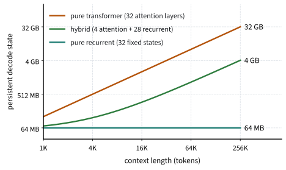

# Hybrid Architectures
:label:`sec_hybrids`

A user pastes a table of 64 product codes and prices into a prompt and asks
for the prices of 20 of them. A programmer asks for a 2,000-token function to
be copied with one line changed. A transformer answers such requests by
looking back: every earlier token is still in its cache, and attention finds
the ones that match. A model with a fixed-size state has only what it chose
to store when the tokens went by, before it knew which of them would be
asked for. Every model in this chapter improved how such a state is written,
from gates to selective dynamics to the delta rule, but none of them can
make it hold more than its size allows. Retrieval from the context is a
large part of how language models are used, in few-shot prompts, in answers
grounded in retrieved documents, and in editing code, so this limit
matters.

This section measures the limit and shows the remedy that most recent large
recurrent models adopt. We first count how much a fixed state can hold. We
then train four small models on a recall task with a growing number of
pairs: two built from the recurrent layers of the previous sections, one
built from attention, and a *hybrid* in which one of its two layers is
attention. We ask whether this one layer is enough to recall as well as a
transformer, and what the hybrid saves in memory, by counting that memory
for models of realistic size.

```{.python .input #hybrids-hybrid-architectures}
%%tab pytorch
%matplotlib inline
from d2l import torch as d2l
import numpy as np
import torch
from torch import nn
from torch.nn import functional as F
```

```{.python .input #hybrids-hybrid-architectures}
%%tab jax
%matplotlib inline
from d2l import jax as d2l
from flax import nnx
import jax
from jax import numpy as jnp
import numpy as np
import optax
import random
```

## Limits of a Fixed-Size State

### Counting Bits

A state of $N$ numbers stored with $b$ bits each can be in at most
$2^{Nb}$ different configurations. Suppose a model reads $k$ tokens, each
drawn from a vocabulary of $V$ tokens, and must later reproduce all of them.
The $V^k$ possible inputs must then lead to $V^k$ different states, since two
inputs that lead to the same state receive the same answer. This requires

$$N b \ge k \log_2 V.$$
:eqlabel:`eq_hy-counting`

The state must hold $\log_2 V$ bits per token to be recalled, and the number
of tokens it can recall grows in proportion to its size and not at all with
the length of the context. A transformer's cache grows by one key and one
value per token, so it never runs out. :citet:`Jelassi.Brandfonbrener.Kakade.ea.2024`
turn this argument into a lower bound on the state size needed to copy, and
show that small transformers learn to copy strings far longer than
recurrent models of the same size can.

The bound counts bits that a perfect encoding would use, and it is far from
tight for the models below. Their two recurrent layers hold 128 numbers
each, eight heads with a state of $4 \times 4$, so 256 numbers of 32 bits in
all, many times the 128 bits that 64 values of 2 bits take. A matrix memory
cannot pack bits like that: it writes by adding outer products and reads
with a linear map, and the pairs it holds interfere.
:numref:`sec_matrix-state` showed that after $n$ writes with random unit
keys of dimension $d_k$, the expected squared read error is $(n-1)/d_k$. A
trained model chooses its keys and values, however, and it can do much
better than random ones.

### Slots and Overlapping Keys

How much better? Suppose that a value needs one number, as a value from a
small set does. A head with a $d_v \times d_k$ state can then give each key
a slot of its own: the key's value goes into one row of the state, along a
key direction orthogonal to those of the other keys assigned to that row.
Reading with the key returns its value and nothing else. A row has room for
$d_k$ orthogonal directions, so a state of $N$ numbers has $N$ slots, and a
model whose task draws keys from at most $N$ possible ones can store any
pairs without interference. With more possible keys than slots, some row
must host more keys than it has dimensions, and these keys overlap,
whatever training does. The next proposition says by how much.

**Proposition.** Let $\mathbf{k}_1, \ldots, \mathbf{k}_m$ be unit vectors
in $\mathbb{R}^d$, with $m > d$. Then the mean of $(\mathbf{k}_i^\top
\mathbf{k}_j)^2$ over all pairs $i \neq j$ is at least

$$\frac{m - d}{d\,(m - 1)}.$$
:eqlabel:`eq_hy-welch`

**Proof.** Let $\mathbf{G} = \sum_{i=1}^m \mathbf{k}_i \mathbf{k}_i^\top$.
Its trace is $\sum_i \|\mathbf{k}_i\|^2 = m$, so its $d$ eigenvalues sum to
$m$, and by the Cauchy–Schwarz inequality their squares sum to at least
$m^2/d$. The sum of the squared eigenvalues of the symmetric matrix
$\mathbf{G}$ is $\|\mathbf{G}\|_F^2 = \sum_{i,j} (\mathbf{k}_i^\top
\mathbf{k}_j)^2$, and the $m$ terms with $i = j$ equal one. The other $m(m -
1)$ terms therefore sum to at least $m^2/d - m$. $\blacksquare$

This is a bound of :citet:`Welch.1974`. For $m \gg d$ it approaches $1/d$,
the mean squared overlap of random unit keys in the proof of
:eqref:`eq_ms-capacity-law`. When a row hosts $m > d$ possible keys, a read
of one of them picks up the values of the other stored keys of that row,
as in :eqref:`eq_ms-retrieval-error`, with weights whose mean square is at
least the bound. The more pairs a sequence stores, the more stored keys
share a row, and the larger the interference.

The task below draws its keys from 512 possible ones, and the recurrent
models have 256 numbers of state, so on average two possible keys share each
slot. With a few pairs, the stored keys rarely meet in a row; with 64,
many of them do. We therefore expect the recurrent models to recall nearly
every pair when there are few, and to lose more and more of them as the
number of pairs grows, since no training removes the overlap. Attention has
no such limit, because its cache holds every pair it has read.

### Associative Recall

To measure recall we use *multi-query associative recall*
:cite:`Arora.Eyuboglu.Timalsina.ea.2024`. A sequence begins with $n$ pairs,
each a key token followed by a value token, for distinct keys drawn from
512 and values drawn from 4. Filler tokens follow, and the sequence ends
with every key once more, in random order, as a query. At each query, the
model must output the value that followed that key. Sequences have 256
tokens, so they hold up to 64 pairs with their queries.
:citet:`Arora.Eyuboglu.Timalsina.ea.2024` found that this kind of recall
accounts for most of the gap in perplexity on natural text between attention
and the gated convolution models they studied. The 512 keys exceed the 256
slots of the recurrent models; the 4 values let one number hold a value.

```{.python .input #hybrids-associative-recall-1}
%%tab pytorch, jax
def recall_batch(rng, batch_size, num_pairs, num_keys=512, num_values=4,
                 num_steps=256):
    """Pairs as a key token followed by a value token, then every key again
    as a query, in random order. Token ids: values, then keys, then filler."""
    keys = np.argsort(rng.random((batch_size, num_keys)), 1)[:, :num_pairs]
    values = rng.integers(0, num_values, (batch_size, num_pairs))
    order = np.argsort(rng.random((batch_size, num_pairs)), 1)
    X = np.full((batch_size, num_steps), num_values + num_keys)  # Filler
    X[:, 0:2 * num_pairs:2] = num_values + keys
    X[:, 1:2 * num_pairs:2] = values
    X[:, -num_pairs:] = num_values + np.take_along_axis(keys, order, 1)
    return X, np.take_along_axis(values, order, 1)  # Answers to the queries

num_keys, num_values = 512, 4
vocab_size = num_values + num_keys + 1  # And the filler
X, Y = recall_batch(np.random.default_rng(), 1, 4)
print('tokens:', X[0, :8], '...', X[0, -4:], ' answers:', Y[0])
```

## Recall with One Attention Layer

### Four Models

All four models are instances of `d2l.SeqLM` with two blocks of width 32;
only the mixers differ. Two use the recurrent layers of the previous
sections, gated linear attention (:numref:`sec_matrix-state`) and Gated
DeltaNet (:numref:`sec_deltanet`), with eight heads, so that keys and values
have 4 dimensions. The third uses causal softmax attention in both blocks,
and the fourth, the hybrid, replaces the second of its two Gated DeltaNet
layers by attention. The attention mixer is the multi-head attention of
:numref:`chap_attention`, computed with the fused attention function of each
framework, behind the same short convolution as the recurrent layers, so
that the mixers differ only in their memory. The convolution also gives
attention all the order it needs here: it brings each key into the
position of the value that follows it, and a query then finds that
position by content. Without it, two layers of attention with rotary
position embeddings (:numref:`subsec_pos-rope`) must form an *induction
head*, the first copying each key into the position after it and the
second looking the query up there. They learn this too, but only after a
plateau of a few thousand training steps whose length varies from run to
run, and some runs are still on it at the end of training. Attention gets
two heads of dimension 16: its cache grows with the context and has no
slots to count, so the size of its heads does not change the comparison.

```{.python .input #hybrids-four-models-1}
%%tab pytorch
class CausalAttention(nn.Module):
    """Causal multi-head softmax attention after a short convolution, with
    the interface of a mixer."""
    def __init__(self, num_hiddens, num_heads, conv_width=4):
        super().__init__()
        d = num_hiddens
        self.num_heads = num_heads
        self.W_qkv = nn.Linear(d, 3 * d, bias=False)
        self.conv = nn.Conv1d(3 * d, 3 * d, conv_width, groups=3 * d,
                              padding=conv_width - 1)  # One filter per channel
        self.W_o = nn.Linear(d, d, bias=False)
        d2l.init_lecun(self)

    def forward(self, X):  # X: (batch_size, num_steps, num_hiddens)
        B, T, d = X.shape
        QKV = self.conv(self.W_qkv(X).mT)[..., :T].mT  # Causal: drop the tail
        Q, K, V = (Z.reshape(B, T, self.num_heads, -1).transpose(1, 2)
                   for Z in QKV.chunk(3, -1))
        Y = F.scaled_dot_product_attention(Q, K, V, is_causal=True)
        return self.W_o(Y.transpose(1, 2).reshape(B, T, d))
```

```{.python .input #hybrids-four-models-1}
%%tab jax
class CausalAttention(nnx.Module):
    """Causal multi-head softmax attention after a short convolution, with
    the interface of a mixer."""
    def __init__(self, num_hiddens, num_heads, conv_width=4, *, rngs):
        d = num_hiddens
        self.num_heads = num_heads
        self.W_qkv = nnx.Linear(d, 3 * d, use_bias=False, rngs=rngs)
        self.conv = nnx.Conv(3 * d, 3 * d, (conv_width,),
                             feature_group_count=3 * d,  # One filter each
                             padding=[(conv_width - 1, 0)], rngs=rngs)  # Causal
        self.W_o = nnx.Linear(d, d, use_bias=False, rngs=rngs)

    def __call__(self, X):  # X: (batch_size, num_steps, num_hiddens)
        B, T, d = X.shape
        Q, K, V = (Z.reshape(B, T, self.num_heads, -1)
                   for Z in jnp.split(self.conv(self.W_qkv(X)), 3, -1))
        Y = jax.nn.dot_product_attention(Q, K, V, is_causal=True)
        return self.W_o(Y.reshape(B, T, d))
```

A string describes the mixers of a model, one letter per block. The pairs
must survive up to 256 steps, so the decay gates of the recurrent layers
start with memories of 64 to 1,024 steps rather than the 4 to 256 steps of
:numref:`sec_matrix-state`. As the long-range recall experiment of
:numref:`sec_ssm` showed, memories that start short are slow to learn to
last: with the shorter start, the recurrent models below learn the task
more slowly, gated linear attention markedly so.

```{.python .input #hybrids-four-models-2}
%%tab pytorch
def recall_model(layout, vocab_size, num_hiddens=32):
    """SeqLM whose mixers are given by letters: L(inear attention),
    G(ated DeltaNet), A(ttention)."""
    make = {'L': lambda: d2l.GatedLinearAttention(num_hiddens, num_heads=8),
            'G': lambda: d2l.GatedDeltaNet(num_hiddens, num_heads=8),
            'A': lambda: CausalAttention(num_hiddens, num_heads=2)}
    model = d2l.SeqLM(vocab_size, num_hiddens, [make[c]() for c in layout])
    for mixer in model.mixers:
        if hasattr(mixer, 'init_decays'):  # Memories of 64 to 1,024 steps
            mixer.init_decays(64, 1024)
    return model
```

```{.python .input #hybrids-four-models-2}
%%tab jax
def recall_model(layout, vocab_size, num_hiddens=32):
    """SeqLM whose mixers are given by letters: L(inear attention),
    G(ated DeltaNet), A(ttention)."""
    rngs = nnx.Rngs(random.getrandbits(32))  # A new initialization each call
    make = {'L': lambda: d2l.GatedLinearAttention(num_hiddens, num_heads=8,
                                                  rngs=rngs),
            'G': lambda: d2l.GatedDeltaNet(num_hiddens, num_heads=8, rngs=rngs),
            'A': lambda: CausalAttention(num_hiddens, num_heads=2, rngs=rngs)}
    model = d2l.SeqLM(vocab_size, num_hiddens, [make[c]() for c in layout],
                      rngs=rngs)
    for mixer in model.mixers:
        if hasattr(mixer, 'init_decays'):  # Memories of 64 to 1,024 steps
            mixer.init_decays(64, 1024)
    return model
```

### The Recall Sweep

Each model is trained once on fresh batches whose number of pairs cycles
through 4, 8, 16, 32, and 64, with the loss computed at the query
positions only, and is then tested separately at each number of pairs.
Training uses AdamW for 8,000 steps of 256 sequences, with gradients
clipped to norm 1 and the learning rate of :numref:`sec_batch_norm`
(`d2l.cosine_warmup`): a linear warmup over 400 steps to 0.006, then a
half-cosine down to zero.

```{.python .input #hybrids-the-recall-sweep-1}
%%tab pytorch
def train_recall(model, pairs=(4, 8, 16, 32, 64), num_steps=8000,
                 batch_size=256, lr=6e-3, warmup=400):
    """Train on recall batches with a cycling number of pairs; return the
    test accuracy for each number of pairs."""
    device, rng = d2l.try_gpu(), np.random.default_rng()
    batch = lambda size, n: (torch.tensor(A, device=device)
                             for A in recall_batch(rng, size, n))
    model.to(device)
    optimizer = torch.optim.AdamW(model.parameters(), lr=lr, weight_decay=0.01)
    scheduler = torch.optim.lr_scheduler.LambdaLR(
        optimizer, lambda t: d2l.cosine_warmup(t, num_steps, warmup))
    for step in range(num_steps):
        n = pairs[step % len(pairs)]
        X, Y = batch(batch_size, n)
        loss = F.cross_entropy(model(X)[:, -n:].flatten(0, 1), Y.flatten())
        optimizer.zero_grad()
        loss.backward()
        nn.utils.clip_grad_norm_(model.parameters(), 1.0)
        optimizer.step()
        scheduler.step()
    accuracy = {}
    for n in pairs:
        X, Y = batch(512, n)
        with torch.inference_mode():
            accuracy[n] = (model(X)[:, -n:].argmax(-1) == Y).float().mean().item()
    return accuracy
```

```{.python .input #hybrids-the-recall-sweep-1}
%%tab jax
@nnx.jit
def mqar_step(model, optimizer, X, Y):
    def loss_fn(model):
        logits = model(X)[:, -Y.shape[1]:]  # Predictions at the queries
        return optax.softmax_cross_entropy_with_integer_labels(logits, Y).mean()
    loss, grads = nnx.value_and_grad(loss_fn)(model)
    optimizer.update(model, grads)
    return loss

@nnx.jit
def mqar_predict(model, X):
    return model(X).argmax(-1)

def train_recall(model, pairs=(4, 8, 16, 32, 64), num_steps=8000,
                 batch_size=256, lr=6e-3, warmup=400):
    """Train on recall batches with a cycling number of pairs; return the
    test accuracy for each number of pairs."""
    rng = np.random.default_rng()
    schedule = lambda t: lr * d2l.cosine_warmup(t, num_steps, warmup)
    optimizer = nnx.Optimizer(model, optax.chain(
        optax.clip_by_global_norm(1.0),
        optax.adamw(schedule, weight_decay=0.01)), wrt=nnx.Param)
    step = nnx.cached_partial(mqar_step, model, optimizer)  # Compile once
    predict = nnx.cached_partial(mqar_predict, model)
    for i in range(num_steps):
        n = pairs[i % len(pairs)]
        step(*recall_batch(rng, batch_size, n))
    accuracy = {}
    for n in pairs:
        X, Y = recall_batch(rng, 512, n)
        accuracy[n] = float((predict(X)[:, -n:] == Y).mean())
    return accuracy
```

```{.python .input #hybrids-the-recall-sweep-2}
%%tab pytorch, jax
layouts = {'gated linear attention': 'LL', 'Gated DeltaNet': 'GG',
           'attention': 'AA', 'hybrid': 'GA'}
accuracy = {name: train_recall(recall_model(layout, vocab_size))
            for name, layout in layouts.items()}
```

```{.python .input #hybrids-the-recall-sweep-3}
%%tab pytorch, jax
pairs = list(next(iter(accuracy.values())))
print(f'{"pairs":24s}', ' '.join(f'{n:4d}' for n in pairs))
for name, acc in accuracy.items():
    print(f'{name:24s}', ' '.join(f'{acc[n]:.2f}' for n in pairs))
d2l.plot(pairs, [list(acc.values()) for acc in accuracy.values()],
         'pairs in the sequence', 'recall accuracy', legend=list(accuracy),
         xscale='log', ylim=(0, 1.05), figsize=(4.5, 3))
d2l.plt.legend(list(accuracy), loc='lower left', ncol=2)  # Below the curves
```

With 4 pairs, attention, the hybrid, and Gated DeltaNet recall nearly every
value. Beyond that Gated DeltaNet loses pairs, and the more pairs a sequence
holds, the more it loses: it recalls about four fifths of 32 pairs and
about three fifths of 64. Gated linear attention recalls fewer at every load, and
its curve varies more from run to run, because it stays near chance for a
varying number of steps before it learns the task. Attention recalls every
pair at every load, and so does the hybrid, although one of its two layers
is recurrent. Its attention layer looks up the pairs that the recurrent
state cannot hold.

The recurrent curves are not converged. Trained three times as long, Gated
DeltaNet recalls about 95% of 32 pairs and about 80% of 64, and gated
linear attention still recalls fewer. With keys drawn from 128 possible
ones, fewer than the slots, the same long training brings Gated DeltaNet to
about 90% of 64 pairs; the gap to the task with 512 keys is the part of the
curve that the slots explain. The delta rule pays off as the regression
view of :numref:`sec_deltanet` suggests. An additive memory returns, with
every value it reads, the values of all stored keys that overlap the query,
while the corrected writes fit the stored pairs and remove much of that
interference. Keys that share a slot overlap, so the correction matters
most when the slots fill up.

The parts around the memory matter as much as the write rule. The value
follows its key one token later, and the short convolution is what brings
the two together for a single write. Without it, gated linear attention
recalls barely more than chance even with 4 pairs, which fit easily into
its state, and Gated DeltaNet learns more slowly and recalls fewer pairs at
every load. Without unit keys, Gated DeltaNet does not learn the task at
all. Without the output gate, Gated DeltaNet recalls several points less at
16 pairs and more; for gated linear attention the change stays within its
spread from run to run. The SiLU after the convolution is the exception:
it makes no difference on text, and on this task it costs Gated DeltaNet a
few points at the highest loads.

### Language Modeling

Does the difference show on ordinary text? We train two more models on the
character-level Penn Treebank with the recipe of :numref:`sec_lstm`: the
transformer `d2l.TinyLM` of :numref:`sec_adam`, two blocks of width 128 with
learned position embeddings, and a hybrid `d2l.SeqLM` of the same width
whose first block is Gated DeltaNet and second block attention, as in the
recall experiment. With this
recipe, Gated DeltaNet alone reached a perplexity of about 3.1.

```{.python .input #hybrids-language-modeling-1}
%%tab pytorch, jax
data = d2l.PennTreebank(batch_size=64, num_steps=128)
```

```{.python .input #hybrids-language-modeling-2}
%%tab pytorch
models = {'attention (TinyLM)': d2l.TinyLM(len(data.vocab), d_model=128,
                                           num_heads=4, num_blks=2, max_len=128),
          'hybrid': d2l.SeqLM(len(data.vocab), 128, [
              d2l.GatedDeltaNet(128, 4), CausalAttention(128, 4)])}
for name, model in models.items():
    print(f'{name:20s} perplexity {d2l.fit_lm(model, data):.2f}')
```

```{.python .input #hybrids-language-modeling-2}
%%tab jax
rngs = nnx.Rngs(random.getrandbits(32))
models = {'attention (TinyLM)': d2l.TinyLM(len(data.vocab), d_model=128,
                                           num_heads=4, num_blks=2, max_len=128,
                                           rngs=rngs),
          'hybrid': d2l.SeqLM(len(data.vocab), 128, [
              d2l.GatedDeltaNet(128, 4, rngs=rngs),
              CausalAttention(128, 4, rngs=rngs)], rngs=rngs)}
for name, model in models.items():
    print(f'{name:20s} perplexity {d2l.fit_lm(model, data):.2f}')
```

The hybrid reaches a perplexity of about 3.15, close to Gated DeltaNet
alone, and the transformer about 3.3. Language modeling at this scale barely
registers the difference in recall, because predicting the next character
of ordinary text rarely requires looking up a pair stored long before. A
comparison by perplexity alone can therefore miss what a model cannot
recall.

## Inference Memory

During generation a model keeps, for every sequence it is serving, what it
needs to compute the next token. For an attention layer this is the
key–value cache of :numref:`sec_kv-cache`: one key and one value per past
token for each of the $n_\textrm{kv}$ key–value heads of dimension
$d_\textrm{head}$, that is,

$$2 \cdot n_\textrm{kv} \cdot d_\textrm{head} \cdot (\textrm{bytes per number})$$

bytes per token and layer. With grouped-query attention, 8 key–value heads
of dimension 128 in 16-bit numbers, that is 4 KB per token. A recurrent
layer keeps its state, whose size does not depend on the length: a Mamba-2
layer in a model of width 4,096 has 8,192 channels with 128 states each,
about one million numbers, or 2 MB. The attention layer's cache overtakes
this state after about 500 tokens, and at 128,000 tokens it holds 512 MB,
256 times as much.

Only the attention layers of a hybrid have caches that grow, so its memory
per sequence is the transformer's times the fraction of layers that are
attention, plus a constant. :numref:`fig_hy-cache` shows the effect for a
model of 32 layers. Jamba :cite:`Lieber.Lenz.Bata.ea.2024`, with 4 attention
layers among 32, reports a cache of 4 GB at a context of 256,000 tokens,
against 32 GB for a transformer of similar size. Memory per sequence decides
how many sequences a GPU can serve at once, and because generating a token
reads the whole cache from memory (:numref:`sec_kv-cache`), it also sets
how fast each token is generated.


:label:`fig_hy-cache`

The chapter asked how to build a memory of fixed size that trains in
parallel, forgets the right things, stores many associations, and can
overwrite them. Its answers, gated linear recurrences computed by scans,
selective state space models, matrix memories trained in chunks, and the
delta rule, make the fixed state as useful as possible. The answer of
practice adds a small memory that grows: a few attention layers, which
retrieve exactly what the fixed state cannot hold. How few, where to place
them, and whether some of them can attend to a window of recent tokens
instead of the whole context are questions that current models answer
differently; :numref:`sec_ssm-further-reading` lists some of their choices.

## Summary

A state of fixed size holds a fixed number of bits, so a recurrent model can
recall only as many items from its context as its state can store, while an
attention layer keeps every token and can always look back. A matrix memory,
which writes by adding outer products and reads linearly, holds at best about
one value per number of its state: every key needs a slot of its own. When
the task can ask about more keys than the state has slots, keys that share a
slot overlap, by at least Welch's bound, and recall falls as the number of
stored pairs grows. On multi-query associative recall, Gated DeltaNet
recalls nearly every pair when there are few and about three fifths of 64,
and gated linear attention, whose writes only add, recalls fewer; both
curves still rise with longer training. Without the short convolution,
which brings each key together with its value, both recall far less.
Attention recalls every pair, and so does a hybrid whose second layer is
attention.
Language-modeling perplexity barely shows the difference. During generation
only the attention layers keep a cache that grows with the context, so a
hybrid needs the transformer's cache times its fraction of attention layers,
an eighth for a model with one attention layer in eight. Most recent large
models with recurrent layers are hybrids for this reason.

## Exercises

1. **The counting bound.** A model reads a string of $k$ tokens from a
   vocabulary of $V$ and must then reproduce it.
    1. Prove :eqref:`eq_hy-counting` for a model whose state between reading
       and writing has $N$ numbers of $b$ bits and whose output is a
       deterministic function of that state.
    1. Suppose instead that the model may output a wrong string with
       probability $\epsilon$ when the string is drawn uniformly. Show that
       $Nb \ge (1 - \epsilon)\, k \log_2 V - 1$. (Hint: count the strings
       that each state can decode correctly.)
    1. How many tokens of a vocabulary of 50,000 can a model with 48 layers
       of Mamba-2 state, 2 MB each in 16-bit numbers, copy at most? Why does
       no model of this size come close in practice?

1. **Memory for many users.** A GPU with 80 GB serves a model of 32
   layers, with the cache sizes of :numref:`fig_hy-cache`, after 16 GB of
   the GPU's memory are taken by the weights.
    1. How many sequences of 128,000 tokens can the GPU serve at once with
       the transformer, the hybrid with 4 attention layers, and the
       recurrent model?
    1. Grouped-query attention with fewer key–value heads, and 8-bit
       numbers for the cache, each halve the cache. Apply both to the
       transformer and to the hybrid, and repeat the count. Which change
       matters more for the hybrid?

1. [code] **Keys and slots.** The recurrent models of the recall sweep
   have 256 slots and the task draws keys from 512.
    1. Train Gated DeltaNet for 8,000 and for 24,000 steps, once with keys
       drawn from 512 and once from 128, fewer than the slots. Where do the
       four curves differ? Which differences come from training time and
       which from the number of slots?
    1. Keep 512 keys and double the width to 64, with eight heads. How many
       slots does the model have now, and how does its recall curve move?
    1. Compute the bound :eqref:`eq_hy-welch` for a row of dimension 4 that
       hosts 8 possible keys, and estimate how often two stored keys share a
       row in a sequence of 64 pairs.

1. [code] **Where and how much attention?**
    1. Train the hybrid `AG`, with attention in the first block, and
       compare its recall with that of `GA`. Does the position of the
       attention layer matter? Consider which layer can bring each key
       together with the value that follows it.
    1. Train four-block models `GGGG`, `GGGA`, and `GAGA` of the same
       width. Do two more recurrent layers add as many slots as the
       section's count predicts, and does one attention layer among four
       still recall every pair?

1. [code] **A window instead.** Replace the attention mixer by attention
   that sees only the last $w$ tokens, by masking the scores of earlier
   tokens.
    1. Train the hybrid with $w = 32$ and $w = 128$ and compare recall at
       every number of pairs. Which queries can a window of 32 answer, and
       which must the recurrent layers answer?
    1. How large is the cache of this layer during generation? What does
       the comparison suggest about combining windows with recurrence?

1. [code] **Recall in text.** In the Penn Treebank validation text, mark
   the positions whose character completes a string of at least eight
   characters that already occurred earlier in the same window. Compare
   the loss of Gated DeltaNet, the hybrid, and `d2l.TinyLM` at the marked
   positions and at all other positions. Does the hybrid's advantage on
   recall show up where text repeats itself?

[Discussions](https://d2l.discourse.group/)

<!-- slides -->

::: {.slide}
::: {.cover}
[Dive into Deep Learning · §12.6]{.kicker}

Hybrid architectures<br>
**a fixed state holds fixed bits · slots and overlapping keys · associative recall · one attention layer · memory per sequence**
:::
:::

::: {.slide title="A Fixed State Stores What It Chose Before the Question"}
[The problem]{.kicker}

A prompt lists 64 product codes and prices, then asks for 20 of them.

- A transformer looks back: every token is still in its cache.
- A recurrent model has only what it wrote into its state as the tokens
  went by, before it knew which would be asked for.

::: {.d2l-note}
Better writes (gates, selectivity, the delta rule) do not make a state
hold more than its size allows.
:::
:::

::: {.slide title="By the End of This Deck You Can"}
- bound the recall of a fixed state by counting bits;
- measure recall of four models as the number of stored pairs grows;
- compute the memory per sequence of attention, recurrent, and hybrid
  models.

**Running example:** a Mamba-2 layer's state of about 2 MB against a
grouped-query attention cache of 4 KB per token.
:::

::: {.slide title="Recalling k Tokens Needs k log₂ V Bits"}
$V^k$ possible inputs must reach $V^k$ different states:

$$N b \ge k \log_2 V$$

$N$ numbers of $b$ bits; $k$ tokens from a vocabulary of $V$.

- Recall grows with the state, not with the context.
- A KV cache grows by one key and one value per token: it never runs out.
:::

::: {.slide title="A Matrix Memory Holds About One Value per Number"}
- Our recurrent models: 2 layers × 8 heads × 4 × 4 = 256 numbers of
  32 bits; 64 values of 2 bits take only 128 bits.
- But the memory adds outer products and reads linearly.
- Best case, one *slot* per number: a value goes into one row, along a
  key direction orthogonal to the other keys of that row.
- At most $N$ possible keys: every pair stored without interference.
- More possible keys than slots: keys that share a row must overlap.
:::

::: {.slide title="Keys That Share a Row Must Overlap"}
For unit vectors $\mathbf{k}_1, \ldots, \mathbf{k}_m \in \mathbb{R}^d$,
$m > d$ (Welch):

$$\operatorname{mean}_{i \neq j} (\mathbf{k}_i^\top \mathbf{k}_j)^2 \ge
\frac{m - d}{d\,(m - 1)}$$

- Proof: $\mathbf{G} = \sum_i \mathbf{k}_i\mathbf{k}_i^\top$ has trace
  $m$ and rank $\le d$, so $\|\mathbf{G}\|_F^2 \ge m^2/d$.
- $m \gg d$: about $1/d$, as for random keys. Training cannot avoid it.
- Task: 512 possible keys, 256 slots. More stored pairs, more stored keys
  sharing a row, more interference.
:::

::: {.slide title="Multi-Query Associative Recall"}
$n$ pairs, each a key token (one of 512) followed by a value token (one of
4); fillers up to 256 tokens; then every key again, in random order. Answer
each query with the value that followed its key.

@!hybrids-associative-recall-1

Chance: 1/4. Up to 64 pairs per sequence.
:::

::: {.slide title="Four Models Differ Only in Their Mixers"}
`d2l.SeqLM`, two blocks of width 32:

| model | mixers |
|---|---|
| gated linear attention | L L (8 heads of 4) |
| Gated DeltaNet | G G (8 heads of 4) |
| attention | A A (2 heads of 16) |
| **hybrid** | G **A** |

- Every mixer starts with the same short convolution: it moves each key
  into its value's position, and attention finds it there by content.
- Without it, attention must form an induction head over two layers,
  after a plateau of varying length.
- Decay gates start with memories of 64 to 1,024 steps.
- Trained once with 4 to 64 pairs, 8,000 steps of 256 sequences; tested
  at each number of pairs.
:::

::: {.slide title="One Attention Layer Restores Recall"}
@!hybrids-the-recall-sweep-3
:::

::: {.slide title="Recall Falls with the Number of Pairs, Except with Attention"}
- Gated DeltaNet: nearly all of 4 pairs, about four fifths of 32, about
  three fifths of 64.
- Gated linear attention: fewer at every load; a plateau of varying length
  near chance makes it vary from run to run.
- Attention and the hybrid: every pair at every load.
- Three times longer: Gated DeltaNet about 95% of 32 and 80% of 64;
  with 128 possible keys (fewer than the 256 slots), about 90% of 64.
- Corrected writes fit the stored pairs and remove much of the
  interference of overlapping keys.
:::

::: {.slide title="The Parts Around the Memory Matter"}
| without | gated linear attention | Gated DeltaNet |
|---|---|---|
| short convolution | near chance | fewer pairs at every load |
| unit queries and keys | no consistent change | does not learn |
| output gate | within the spread | several points less |
| SiLU | no consistent change | a few points more at 32–64 pairs |

The value follows its key one token later: the convolution brings the two
together for one write. On text, the convolution, SiLU, and output gate
together are worth about 0.1 in perplexity.
:::

::: {.slide title="Check: Bits Against Pairs"}
The two recurrent layers hold 256 numbers of 32 bits.

1. By the counting bound, how many 2-bit values could they hold?
2. Why do they already lose pairs at 32?

::: {.fragment .fade-up}
1. $256 \cdot 32 / 2 = 4{,}096$ values.
2. A linear read gives about one slot per number: 256 slots for 512
   possible keys, 64 rows of dimension 4. Among 32 stored keys, some share
   a row, and keys that share a row overlap.
:::
:::

::: {.slide title="Perplexity Barely Shows the Gap"}
@!hybrids-language-modeling-2

- Gated DeltaNet alone: about 3.1.
- The next character rarely depends on a pair stored long before.

::: {.d2l-note .warn}
Benchmark what you need: perplexity alone can miss what a model cannot
recall.
:::
:::

::: {.slide title="Attention Stores 4 KB per Token, Mamba-2 About 2 MB in All"}
Per layer, per sequence, 16-bit numbers:

| layer | memory |
|---|---|
| GQA, 8 KV heads × 128 | $2 \cdot 8 \cdot 128 \cdot 2$ B = 4 KB per token |
| Mamba-2, width 4,096 | $8192 \cdot 128 \cdot 2$ B ≈ 2 MB, any length |

Crossover near 500 tokens; at 128 K tokens, 512 MB against 2 MB.
:::

::: {.slide title="Only the Attention Layers of a Hybrid Keep a Cache"}
{width=85%}

Jamba, 4 attention layers of 32: 4 GB at 256 K tokens, against 32 GB.
:::

::: {.slide title="Check: Memory of a Hybrid"}
32 layers, 4 of them attention, 128 K tokens, numbers as above.

1. Memory per sequence of the hybrid?
2. Of the transformer?

::: {.fragment .fade-up}
1. $4 \cdot 512$ MB $+ 28 \cdot 2$ MB $\approx 2.1$ GB.
2. $32 \cdot 512$ MB $= 16$ GB: eight times as much.
:::
:::

::: {.slide title="Recap: One Template, Six Memories"}
| | state per layer | update | recall | PTB |
|---|---|---|---|---|
| LSTM, GRU | vector | nonlinear, sequential | short | 3.0 |
| minGRU | vector | $\mathbf{a}_t\odot\mathbf{h} + \mathbf{b}_t$, scan | | 3.2 |
| S4D | $d \times N$ | fixed decays, FFT | by distance | 3.35 |
| Mamba | $H \times N$ | selective decays, scan | selective | 2.95 |
| gated linear attention | $d_v \times d_k$ | $\mathbf{S}\,\textrm{diag}(\boldsymbol{\alpha}_t) + \mathbf{v}\mathbf{k}^\top$, chunks | interference | 3.1 |
| Gated DeltaNet | $d_v \times d_k$ | delta rule, chunks | rebinds | 3.1 |
| + one attention layer | + KV cache | | exact | |

**Open:** how few attention layers, where, and whether windows suffice.
:::
