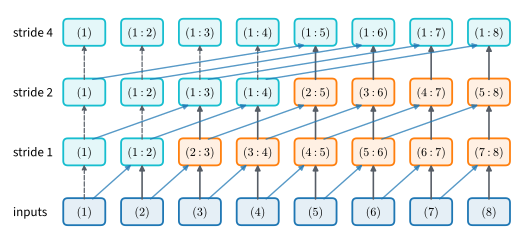

# Linear Recurrences and Parallel Scans
:label:`sec_linear-recurrence`

The gated networks of :numref:`sec_lstm` can keep information for hundreds
of steps, but they still read a sequence one token after another, and each
update needs the result of the one before. That order is natural when a
model generates text, but during training the whole sequence is known in
advance. Take a sequence of 4,096 tokens. A gated network performs 4,096
updates in a row. A GPU can carry out tens of thousands of multiply-adds at
the same time, but it cannot start step 2,000 until step 1,999 has
finished, so most of it waits. A transformer layer has
no such chain: it processes all 4,096 positions in a few large matrix
products. This difference in training speed, more than any difference in
what the two kinds of model can represent, was a main reason why
transformers replaced recurrent networks for large-scale language modeling.
Can a recurrent network be trained on all positions at once?

The chain has a single cause. The gates of :numref:`sec_lstm` read the
previous state, and the state passes through a nonlinearity, so step $t$
cannot be computed until step $t-1$ is known. If the gates read only the
current input, the update becomes linear in the state. Linear updates can be
grouped like the terms of a sum, and the states at all 4,096 positions can
then be computed in $\log_2 4096 = 12$ rounds of batched arithmetic. When
the model generates text, it still updates its state once per token, in
constant memory, like any recurrent network.

<!-- WRITER: split of the old ssm.md. The third paragraph of the old opening (continuous time,
stability, "The next section makes their dynamics depend on the input") moved out with the second half;
end the opening on this section's question and one sentence of route (worklist Part 4 B.1). -->

```{.python .input #linear-recurrence-linear-recurrences-and-parallel-scans}
%%tab pytorch
import math
import numpy as np
import torch
from torch import nn
from torch.nn import functional as F
from d2l import torch as d2l
```

```{.python .input #linear-recurrence-linear-recurrences-and-parallel-scans}
%%tab jax
import math
import numpy as np
import jax
from jax import numpy as jnp
from flax import nnx
import optax
from d2l import jax as d2l
```

## Linear Recurrences
:label:`subsec_linear-recurrences`

### A Single Decaying Number

To see what a linear update gives us, we start with the smallest one.
Consider a state $h_t$, a single number, that keeps a fraction $a$ of its
value at every step and adds the new input $x_t$:

$$h_t = a\, h_{t-1} + x_t, \qquad h_0 = 0.$$
:eqlabel:`eq_lr-scalar`

This is the gated memory of :numref:`sec_lstm` with both gates held fixed.
With $a = 0.9$ and a single input $x_1 = 1$ followed by zeros, the state
reads $1, 0.9, 0.81, 0.729, \ldots$: an input from $k$ steps ago survives
with weight $a^k$. Substituting the recurrence into itself shows that this
holds for any input sequence,

$$h_t = \sum_{s=1}^{t} a^{t-s} x_s.$$
:eqlabel:`eq_lr-unrolled`

The state is a weighted sum of all past inputs, with weights that shrink
geometrically with age. Two consequences follow. First, the sum does not
mention $h_{t-1}$: every $h_t$ is determined by the inputs alone, so in
principle all of them can be computed at once. Second, $a$ sets the length
of the memory, and it sets the length of learning too. The weight of an
input halves every $\ln 2 / \ln(1/a)$ steps, about 7 steps for $a = 0.9$
and 693 for $a = 0.999$, and the gradient of $h_t$ with respect to $x_s$ is
the same weight $a^{t-s}$. The decay that forgets an input also weakens the
signal that would teach the model to use it. This is the vanishing
gradient of :numref:`sec_lstm`, a product of $t-s$ Jacobians, except that
the product is now a power of one number that we can read off directly.

### Input-Dependent Decay

A memory of one number is too small for language. With a state
$\mathbf{h}_t \in \mathbb{R}^d$ we can give each coordinate its own decay,
collected in a vector $\mathbf{a} \in (0, 1)^d$ that multiplies the state
elementwise ($\odot$):

$$\mathbf{h}_t = \mathbf{a} \odot \mathbf{h}_{t-1} + \mathbf{b}_t.$$

Nothing new happens here. The coordinates do not interact, so this is $d$
copies of :eqref:`eq_lr-scalar` side by side, each with its own half-life. We
have also renamed the input term $\mathbf{b}_t$, because it will soon be a
learned function of the input.

A fixed decay forgets at the same rate whatever the input says. The gates of
:numref:`sec_lstm` exist to make the rate a decision: keep the state through
a run of uninformative tokens, and overwrite it when something important
arrives. We can keep that ability, and keep the update linear in the state,
by letting the decay depend on the current input:

$$
\mathbf{h}_t = \mathbf{a}_t \odot \mathbf{h}_{t-1} + \mathbf{b}_t,
\qquad \mathbf{a}_t = \mathbf{a}(\mathbf{x}_t), \quad
\mathbf{b}_t = \mathbf{b}(\mathbf{x}_t).
$$
:eqlabel:`eq_affine_recurrence`

Unrolling as before, the power $a^{t-s}$ becomes the product of the decays
met along the way:

$$
\mathbf{h}_t = \sum_{s=1}^{t} \Big( \prod_{r=s+1}^{t} \mathbf{a}_r \Big)
\odot \mathbf{b}_s.
$$
:eqlabel:`eq_lr-unrolled-gated`

An input survives for as long as the inputs after it choose to keep it.
Because every $\mathbf{a}_r$ lies in $(0, 1)$, the products can shrink but
never grow: no past input is ever amplified, however long the sequence. Because
$\mathbf{a}_t$ and $\mathbf{b}_t$ depend only on $\mathbf{x}_t$, they can be
computed for all positions in one batched matrix product before the
recurrence starts. What remains is the recurrence itself, an update that is
*affine* in $\mathbf{h}_{t-1}$: an elementwise multiplication followed by an
addition.

### The Minimal GRU
:label:`subsec_mingru`

The GRU of :numref:`sec_gru` almost has this form. Its update gate
$\mathbf{z}_t$, reset gate $\mathbf{r}_t$, and candidate state
$\tilde{\mathbf{h}}_t$ are

$$
\begin{aligned}
\mathbf{z}_t &= \sigma(\mathbf{W}_{\textrm{xz}} \mathbf{x}_t + \mathbf{W}_{\textrm{hz}} \mathbf{h}_{t-1} + \mathbf{b}_\textrm{z}),\\
\mathbf{r}_t &= \sigma(\mathbf{W}_{\textrm{xr}} \mathbf{x}_t + \mathbf{W}_{\textrm{hr}} \mathbf{h}_{t-1} + \mathbf{b}_\textrm{r}),\\
\tilde{\mathbf{h}}_t &= \tanh\big(\mathbf{W}_{\textrm{xh}} \mathbf{x}_t + \mathbf{W}_{\textrm{hh}} (\mathbf{r}_t \odot \mathbf{h}_{t-1}) + \mathbf{b}_\textrm{h}\big),
\end{aligned}
$$

and the new state is a blend of the old state and the candidate,

$$
\mathbf{h}_t = \mathbf{z}_t \odot \mathbf{h}_{t-1} + (1 - \mathbf{z}_t)
\odot \tilde{\mathbf{h}}_t.
$$

The blend is already affine in $\mathbf{h}_{t-1}$, with decay
$\mathbf{z}_t$. What stands in the way are the three places where
$\mathbf{h}_{t-1}$ enters a gate or the candidate.
:citet:`Feng.Tung.Ahmed.ea.2024` removed them: the update gate and the
candidate read only the input, and the reset gate, which no longer has a
previous state to filter, disappears. The result is the *minimal GRU*, or
*minGRU* (we keep a $\tanh$ on the candidate, which
:citet:`Feng.Tung.Ahmed.ea.2024` drop; an exercise compares the two):

$$
\mathbf{z}_t = \sigma(\mathbf{W}_\textrm{z} \mathbf{x}_t + \mathbf{b}_\textrm{z}), \qquad
\tilde{\mathbf{h}}_t = \tanh(\mathbf{W}_\textrm{h} \mathbf{x}_t + \mathbf{b}_\textrm{h}), \qquad
\mathbf{h}_t = \mathbf{z}_t \odot \mathbf{h}_{t-1} + (1 - \mathbf{z}_t) \odot \tilde{\mathbf{h}}_t.
$$
:eqlabel:`eq_mingru`

This is :eqref:`eq_affine_recurrence` with decay $\mathbf{a}_t =
\mathbf{z}_t$ and write $\mathbf{b}_t = (1 - \mathbf{z}_t) \odot
\tilde{\mathbf{h}}_t$. The update gate is now the decay of a linear
recurrence: a gate value of 0.9 keeps 90% of the state and admits 10% of
the candidate. The layer is also smaller. With input and hidden width $d$,
a GRU layer has $6d^2$ weights, three input matrices and three state
matrices, and the minGRU has $2d^2$.

The minGRU gives something up. A GRU can decide to keep its state because of
what the state contains; the minGRU decides only from the current token, and
between tokens its state can only be scaled and added to. Stacking layers
gives some of this back: the outputs of one layer, passed through a
nonlinearity, are the inputs of the next, and nonlinearities between layers
do not block parallel evaluation.

## Parallel Scans
:label:`subsec_parallel-scans`

### Composing Affine Steps

Computing $\mathbf{h}_1, \ldots, \mathbf{h}_T$ from the coefficients
$(\mathbf{a}_t, \mathbf{b}_t)$ is a relative of a familiar problem: compute
all running totals $s_t = x_1 + \cdots + x_t$ of a sequence, its *prefix
sums*. Prefix sums look sequential, yet they can be computed in parallel,
because addition is associative: the total $(x_1 + x_2) + (x_3 + x_4)$ can be
split into two halves that are computed independently and combined at the
end. Any associative operation allows the same trick, and composing the
steps of an affine recurrence is one.

Represent step $t$ by its coefficient pair $(\mathbf{a}_t, \mathbf{b}_t)$,
which stands for the map $\mathbf{h} \mapsto \mathbf{a}_t \odot \mathbf{h} +
\mathbf{b}_t$. Applying step 1 and then step 2 gives
$\mathbf{a}_2 \odot (\mathbf{a}_1 \odot \mathbf{h} + \mathbf{b}_1) +
\mathbf{b}_2$, which is again a map of the same form. We write the
composition as

$$
(\mathbf{a}_1, \mathbf{b}_1) \bullet (\mathbf{a}_2, \mathbf{b}_2) =
(\mathbf{a}_1 \odot \mathbf{a}_2,\ \mathbf{a}_2 \odot \mathbf{b}_1 +
\mathbf{b}_2).
$$
:eqlabel:`eq_scan_combine`

Read from left to right, $\bullet$ means "this step, then that one". It is
associative because composing functions is associative, and the composite of
any run of steps is again a single pair. This matters as much as
associativity: a block of a thousand steps costs no more to store or to
combine than a single step. As an example, two steps with $a_1 = a_2 = 0.5$,
$b_1 = 1$, and $b_2 = 2$ combine into $(0.25,\ 0.5 \cdot 1 + 2) = (0.25,
2.5)$. Running them one after the other from $h_0 = 0$ gives $h_1 = 1$ and
$h_2 = 0.5 \cdot 1 + 2 = 2.5$, as the composite says.

Composing the first $t$ pairs gives the map that carries $\mathbf{h}_0$ to
$\mathbf{h}_t$. With $\mathbf{h}_0 = \mathbf{0}$ the state $\mathbf{h}_t$ is
the $\mathbf{b}$-component of that composite, so all states together are the
prefix "sums" of the pairs under $\bullet$. Computing all prefixes of a
sequence under an associative operation is called a *scan*.

### The Doubling Schedule

:numref:`fig_scan_tree` shows a parallel schedule for eight steps. In the
first round, every position combines with its predecessor, so it holds the
composite of two steps. In the second round, every position combines with
the position two back and then holds four steps; in the third, with the
position four back, and then holds eight. After $\lceil \log_2 T \rceil$
rounds every position holds its full prefix. Each round is one elementwise
multiply-add over the whole sequence, the kind of work a GPU does well.


:label:`fig_scan_tree`

This schedule, due to :citet:`Hillis.Steele.1986`, performs about
$T \log_2 T$ combines, a factor $\log_2 T$ more than the $T - 1$ steps of a
loop, in exchange for $\log_2 T$ rounds instead of $T - 1$. A schedule of
:citet:`Blelloch.1990` needs only about $2T$ combines in about $2 \log_2 T$
rounds. The difference in total work matters once a sequence is long enough
to keep the whole GPU busy.

### Implementation

`linear_scan` implements the doubling schedule. The writes $\mathbf{b}_t$
have shape (batch size, number of steps, ...), with time along the second
axis. The decays are broadcast to the same shape, so decays that are the
same at every step can be passed once, without the batch and time axes. An
optional initial state is folded into the first step, since
$\mathbf{h}_1 = \mathbf{a}_1 \odot \mathbf{h}_0 + \mathbf{b}_1$.

:begin_tab:`pytorch`
PyTorch has no scan primitive in its stable interface, so we write one,
`associative_scan`, with the interface of JAX's: it takes the combine as a
function and a tuple of tensors with time along the second axis. Each round
of the doubling schedule combines the sequence with a copy of itself
shifted by the stride, a few tensor operations per round. `linear_scan`
passes it the combine :eqref:`eq_scan_combine`; the delta rule of
:numref:`sec_deltanet` will pass it another.
:end_tab:

:begin_tab:`jax`
JAX provides scans as a primitive, `jax.lax.associative_scan`, which takes
the combine :eqref:`eq_scan_combine` as a function and uses a schedule with
linear total work.
:end_tab:

```{.python .input #ssm-implementation-1}
%%tab pytorch
def associative_scan(combine, elems):  #@save
    """All prefixes of elems under an associative combine; time is axis 1."""
    s = 1
    # Autograd keeps the tensors of every round for the backward pass
    while s < elems[0].shape[1]:  # Combine every position with the one s back
        earlier = tuple(x[:, :-s] for x in elems)
        later = tuple(x[:, s:] for x in elems)
        elems = tuple(torch.cat([x[:, :s], y], 1)
                      for x, y in zip(elems, combine(earlier, later)))
        s *= 2
    return elems

def linear_scan(a, b, h0=None):  #@save
    """All states of h_t = a_t * h_{t-1} + b_t; time is the second axis."""
    a = a.expand_as(b)  # Decays may omit axes on which they do not vary
    if h0 is not None:  # Fold the initial state into the first step
        b = torch.cat([a[:, :1] * h0.unsqueeze(1) + b[:, :1], b[:, 1:]], 1)
    def combine(earlier, later):
        (a1, b1), (a2, b2) = earlier, later
        return a1 * a2, a2 * b1 + b2
    return associative_scan(combine, (a, b))[1]
```

```{.python .input #ssm-implementation-1}
%%tab jax
def linear_scan(a, b, h0=None):  #@save
    """All states of h_t = a_t * h_{t-1} + b_t; time is the second axis."""
    a = jnp.broadcast_to(a, b.shape)  # Decays may omit axes; broadcast them
    if h0 is not None:  # Fold the initial state into the first step
        b = b.at[:, 0].add(a[:, 0] * h0)
    def combine(earlier, later):
        (a1, b1), (a2, b2) = earlier, later
        return a1 * a2, a2 * b1 + b2
    # Autograd keeps the intermediate results of the scan for the backward pass
    return jax.lax.associative_scan(combine, (a, b), axis=1)[1]
```

We check the scan against a loop that applies the recurrence one step at a
time, on random decays in $(0, 1)$ and a length that is not a power of two.

```{.python .input #ssm-implementation-2}
%%tab pytorch
def sequential_scan(a, b):
    h, states = torch.zeros_like(b[:, 0]), []
    for a_t, b_t in zip(a.unbind(1), b.unbind(1)):
        h = a_t * h + b_t
        states.append(h)
    return torch.stack(states, 1)

a, b = torch.rand(4, 100, 8), torch.randn(4, 100, 8)
print(f'max deviation: '
      f'{(linear_scan(a, b) - sequential_scan(a, b)).abs().max():.1e}')
```

```{.python .input #ssm-implementation-2}
%%tab jax
def sequential_scan(a, b):
    def step(h, ab):
        h = ab[0] * h + ab[1]
        return h, h
    # lax.scan steps through the leading axis, so time goes first
    ab = (jnp.swapaxes(a, 0, 1), jnp.swapaxes(b, 0, 1))
    return jnp.swapaxes(jax.lax.scan(step, jnp.zeros_like(b[:, 0]), ab)[1], 0, 1)

key_a, key_b = jax.random.split(d2l.get_key())
a = jax.random.uniform(key_a, (4, 100, 8))
b = jax.random.normal(key_b, (4, 100, 8))
print(f'max deviation: '
      f'{jnp.abs(linear_scan(a, b) - sequential_scan(a, b)).max():.1e}')
```

The two agree to the rounding error of 32-bit floating point. The scan
groups the multiplications and additions differently from the loop, so the
results differ in the last digits; they are the same computation.

<!-- WRITER: the scan-against-loop timing cell (ssm-implementation-3) is retired (SSM-10); the
cost subsection "Cost against Attention" below replaces it. The paragraph above ("How much faster
is the scan? ...", which also introduces d2l.Benchmark) and the reading below ("The loop's time grows
...") go or move there; keep "The scan changes how we train, not how we generate: at inference the
model still applies eq_affine_recurrence once per token, in constant memory." (SSM-23: reflow). New
fact for this subsection: autograd through the scan keeps the tensors of every round for the backward
pass (a comment in both tabs now says so); 12.5 needs that fact. -->

How much faster is the scan? We time both on a GPU for sequences of 256 to
16,384 steps, with a batch of 32 sequences of 128 coordinates each.
`d2l.Benchmark`, which :numref:`sec_perf_model` introduces, calls a function
a few times after a warm-up call and reports the average time, waiting for
the GPU to finish before it stops the clock.

The loop's time grows in proportion to the length: each step is a separate
small computation that must finish before the next one starts. The scan is
faster at every length, by a factor between a few and about a hundred,
depending on the length. Its time does not follow the length: while its rounds of
arithmetic are too small to keep the GPU busy, more positions cost little
extra time, and once the GPU is full, the total amount of work sets the
time. Where this happens depends on how the scan is compiled. The scan
changes how we train,
not how we generate: at inference the model still applies
:eqref:`eq_affine_recurrence` once per token, in constant memory.

### A Linear Recurrent Language Model

The minGRU :eqref:`eq_mingru` is a few lines around `linear_scan`. It maps
a minibatch of sequences to the states at every step, so it can serve as
the sequence mixer of `d2l.SeqLM`, the residual language model of
:numref:`sec_lstm`: an embedding, a stack of blocks that each apply a mixer
and a position-wise MLP, and a prediction head.

```{.python .input #ssm-a-linear-recurrent-language-model-1}
%%tab pytorch
class MinGRU(nn.Module):  #@save
    """The minimal GRU: its gate and candidate read only the input."""
    def __init__(self, num_inputs, num_hiddens):
        super().__init__()
        self.W_z = nn.Linear(num_inputs, num_hiddens)  # Update gate (decay)
        self.W_h = nn.Linear(num_inputs, num_hiddens)  # Candidate state
        d2l.init_lecun(self)

    def coefficients(self, X):
        """Decays a_t and writes b_t of the linear recurrence."""
        Z = torch.sigmoid(self.W_z(X))
        return Z, (1 - Z) * torch.tanh(self.W_h(X))

    def forward(self, X):  # X: (batch_size, num_steps, num_inputs)
        return linear_scan(*self.coefficients(X))
```

```{.python .input #ssm-a-linear-recurrent-language-model-1}
%%tab jax
class MinGRU(nnx.Module):  #@save
    """The minimal GRU: its gate and candidate read only the input."""
    def __init__(self, num_inputs, num_hiddens, *, rngs):
        self.W_z = nnx.Linear(num_inputs, num_hiddens, rngs=rngs)  # Decay
        self.W_h = nnx.Linear(num_inputs, num_hiddens, rngs=rngs)

    def coefficients(self, X):
        """Decays a_t and writes b_t of the linear recurrence."""
        Z = jax.nn.sigmoid(self.W_z(X))
        return Z, (1 - Z) * jnp.tanh(self.W_h(X))

    def __call__(self, X):  # X: (batch_size, num_steps, num_inputs)
        return linear_scan(*self.coefficients(X))
```

<!-- WRITER: the Penn Treebank paragraph below is false. New setup: the text benchmark of
:numref:`sec_lstm` (byte-level WikiText-103, windows of 128 bytes, 64 per step, 1,000 steps of
d2l.LMOptimizer through d2l.train_text; validation loss in nats per byte, by position bands 0-15,
16-63, 64-127; ms per training step). Three arms in d2l.SeqLM with four blocks, each trained twice:
the GRU of 12.1 at width 256, the minGRU at the same width (fewer parameters: 2d^2 against 6d^2 per
mixer, read the totals from the table), and the minGRU at width 302, where its model has the GRU
model's parameter count. The only change between GRU and minGRU is that the gates and the candidate
read only the input. -->

We train it with the recipe of :numref:`sec_lstm`: character-level Penn
Treebank in windows of 128 characters, two blocks of width 128, and 3,000
steps of AdamW, all wrapped in `d2l.fit_lm`, which returns the validation
perplexity. With the same recipe, the GRU reached a perplexity of about 3.0
and the plain recurrent network about 3.1.

```{.python .input #linear-recurrence-a-linear-recurrent-language-model-1}
%%tab pytorch
torch.set_float32_matmul_precision('high')  # fp32 matmuls may use tf32

def text_model(mixer, d):  # 256 byte values; four blocks of width d
    return d2l.SeqLM(256, d, [mixer(d) for _ in range(4)]).to(d2l.try_gpu())

gru = lambda d: d2l.Recurrent(d2l.init_lecun(nn.GRU(d, d, batch_first=True)))
min_gru = lambda d: MinGRU(d, d)
arms = {'GRU': (gru, 256), 'minGRU': (min_gru, 256),
        'minGRU, d=302': (min_gru, 302)}  # As many parameters as the GRU
```

```{.python .input #linear-recurrence-a-linear-recurrent-language-model-1}
%%tab jax
def text_model(mixer, d):  # 256 byte values; four blocks of width d
    rngs = nnx.Rngs(d2l.get_key())
    return d2l.SeqLM(256, d, [mixer(d, rngs) for _ in range(4)], rngs=rngs)

lecun = nnx.initializers.lecun_normal()  # For the recurrent matrices
gru = lambda d, rngs: nnx.RNN(
    nnx.GRUCell(d, d, recurrent_kernel_init=lecun, rngs=rngs), unroll=8)
min_gru = lambda d, rngs: MinGRU(d, d, rngs=rngs)
arms = {'GRU': (gru, 256), 'minGRU': (min_gru, 256),
        'minGRU, d=302': (min_gru, 302)}  # As many parameters as the GRU
```

```{.python .input #linear-recurrence-a-linear-recurrent-language-model-2}
%%tab pytorch, jax
data = d2l.WikiText103(batch_size=64, num_steps=128)
trained = d2l.text_table(text_model, arms, data)
model = trained['minGRU'][0]  # The model we look inside below
```

<!-- WRITER: the reading below is false (PTB numbers). Measured in development, three executions
of the cell in PyTorch and two in JAX, each training every arm twice; both tabs agree, and two runs
of one cell differ by at most 0.004 nats per byte:
  GRU, width 256: 3.82 M parameters, validation 1.296 to 1.300 nats per byte; bands 0-15 1.488 to
  1.492, 16-63 1.269 to 1.274, 64-127 1.267 to 1.271.
  minGRU, width 256: 2.76 M parameters, 1.345 to 1.349; bands 1.519 to 1.522, 1.320 to 1.325,
  1.319 to 1.325.
  minGRU, width 302: 3.82 M parameters (the GRU model's count), 1.326 to 1.332; bands 1.506 to
  1.511, 1.301 to 1.307, 1.300 to 1.306.
Firm lessons (every difference below is more than five times the largest two-run range):
(1) At the GRU model's parameter count the minGRU ends about 0.03 nats per byte behind the GRU
(0.026 to 0.036 over all runs). Taking the state out of the gates costs something on text; the
design's guess "little or nothing" is not what the run shows.
(2) At the same width the minGRU is about 0.05 behind, exactly as far as the plain RNN of
:numref:`sec_lstm` (1.346 to 1.349 there), and it has exactly the plain RNN's parameter count
(2,764,544: both mixers hold 2d^2 + 2d numbers). So, at equal size, the minGRU's input-only gates
buy none of the gain that state-reading gates give (0.05); widening it to the GRU's count recovers
about a third of that gain.
(3) The gap is smallest in the first 16 bytes (0.014 to 0.023 at equal parameters) and larger after
byte 64 (0.029 to 0.039): what the minGRU gives up shows mostly where longer context matters.
(4) ms per training step at 128 bytes: the minGRU step is cheaper than the GRU step in both tabs
(PyTorch, uncompiled: GRU 32 to 35, minGRU 26 to 30; JAX: GRU 16, minGRU 9 to 10). Any reading of
the speed beyond "cheaper" belongs in tab notes; the length dependence is the cost subsection's.
"With a third of the GRU's weights per layer" stays true per mixer (2d^2 against 6d^2), but the
model totals are 2.76 M against 3.82 M (the MLPs, embedding and head are shared). -->

The minGRU reaches a perplexity of about 3.2, a little behind the GRU's 3.0,
with a third of the GRU's weights per layer. On this task, taking
the state out of the gates costs a few percent.

Because the minGRU's decay is its update gate, we can look inside the
trained model. Two questions are easy to answer. First, does the model use
its memory at all? We compare its perplexity with that of the same model
whose layers reset their state to zero before every step, so that
$\mathbf{h}_t = (1 - \mathbf{z}_t) \odot \tilde{\mathbf{h}}_t$ and each
prediction sees only the current character, as transformed by the layers.
Second, how often does a gate hold the state rather than overwrite it?

```{.python .input #ssm-a-linear-recurrent-language-model-4}
%%tab pytorch
class StateReset(nn.Module):
    """A minGRU layer whose state is reset to zero before every step."""
    def __init__(self, layer):
        super().__init__()
        self.layer = layer

    def forward(self, X):
        return self.layer.coefficients(X)[1]

layers = model.mixers
loss = np.mean(d2l.loss_by_position(model, data))
model.mixers = nn.ModuleList([StateReset(layer) for layer in layers])
reset = np.mean(d2l.loss_by_position(model, data))
model.mixers = layers
print(f'validation loss: {loss:.3f} nats per byte, '
      f'with the state reset at every step: {reset:.3f}')
```

```{.python .input #ssm-a-linear-recurrent-language-model-4}
%%tab jax
class StateReset(nnx.Module):
    """A minGRU layer whose state is reset to zero before every step."""
    def __init__(self, layer):
        self.layer = layer

    def __call__(self, X):
        return self.layer.coefficients(X)[1]

layers = model.mixers
loss = np.mean(d2l.loss_by_position(model, data))
model.mixers = nnx.List([StateReset(layer) for layer in layers])
reset = np.mean(d2l.loss_by_position(model, data))
model.mixers = layers
print(f'validation loss: {loss:.3f} nats per byte, '
      f'with the state reset at every step: {reset:.3f}')
```

<!-- WRITER: the reading below is false (PTB perplexities). Repose it as SSM-11 asks ("How much of
the model's skill is memory? Without it the model predicts from one byte."); the reset loss is an
upper bound, since the model was never trained that way. Measured (both tabs, all executions):
validation loss 1.346 to 1.347 nats per byte with its memory, 2.481 to 2.485 with the state reset
at every step (perplexity 3.8 against 12; or 1.94 against 3.58 bits per byte). "Character" becomes
"byte" in the paragraph that poses the question. -->

Resetting the state raises the perplexity from about 3.2 to more than 10, so
the model relies heavily on what it remembers: the next character is hard
to predict from the current one alone.

To read the gates, we need the input of the first layer: the token
embeddings, normalized as the first block normalizes them. We give
`SeqLM` a method for it, since the next section reads it again.

```{.python .input #ssm-a-linear-recurrent-language-model-5}
%%tab pytorch, jax
@d2l.add_to_class(d2l.SeqLM)  #@save
def first_mixer_input(self, X):
    """What the first mixer reads: the normalized token embeddings."""
    return self.norms[0](self.embedding(X))
```

```{.python .input #ssm-a-linear-recurrent-language-model-6}
%%tab pytorch
X, _ = next(iter(data.val_dataloader()))
X = X.to(next(model.parameters()).device)
with torch.inference_mode():  # Gates of the first layer on validation text
    Z = layers[0].coefficients(model.first_mixer_input(X))[0]
print('gate above  half-life in steps  share of gates')
for g in (0.5, 0.9, 0.99):
    print(f'{g:10}  {math.log(2) / -math.log(g):17.0f}  '
          f'{(Z > g).float().mean():14.1%}')
```

```{.python .input #ssm-a-linear-recurrent-language-model-6}
%%tab jax
X, _ = next(iter(data.val_dataloader()))  # Gates of the first layer
Z = layers[0].coefficients(model.first_mixer_input(jnp.asarray(X)))[0]
print('gate above  half-life in steps  share of gates')
for g in (0.5, 0.9, 0.99):
    print(f'{g:10}  {math.log(2) / -math.log(g):17.0f}  '
          f'{(Z > g).mean():14.1%}')
```

<!-- WRITER: the reading below quotes the old PTB gate fractions; the cell now prints three
thresholds (0.5, 0.9, 0.99: half-lives of 1, 7 and 69 steps) for the first layer on one validation
batch of 64 x 128 bytes. Measured (both tabs, all executions): above 0.5: 51.7 to 53.2%; above 0.9:
17.1 to 18%; above 0.99: 0.0 to 0.1%. So about half the gates keep more than half the state, one in
six keeps it with a half-life of 7 steps or more, and almost none holds it for 69 steps: after
training, the first layer still forgets within tens of bytes. That is the lead-in to the closing
question (how fast should a linear state forget, and how should it start: 12.4). "character"
becomes "byte". -->

About half of the gate values in the first layer exceed 0.5, and about a
quarter exceed 0.9, which keeps the state with a half-life of 7 steps or
more. Each gate value is computed from
the current character, so how long an input survives depends on the
characters that follow it, as :eqref:`eq_lr-unrolled-gated` describes;
an exercise asks how much the gates of a unit vary from character to
character.

<!-- WRITER: closing paragraph (worklist Part 4 B.7): the bridge "The rest of the section derives
the decay from a continuous-time model ..." goes; the minGRU's gates start at one half, a half-life
of one step; how fast should a linear state forget, and how should it start? That is 12.4. The
closing comes after the cost subsection, at the end of the section. "at a small cost in perplexity"
is false now: read the E5 table. -->

The minGRU shows that a gated recurrence can be linear in its state, and
therefore trained with a scan, at a small cost in perplexity. It leaves two
questions open. Its gates start near $\sigma(0) = 1/2$, a half-life of one
step, so an input 20 steps back initially reaches the state, and sends its
gradient back, with weight $2^{-20}$, about one in a million; nothing in the
model offers longer memories from the start. And its memory holds only one
number per hidden unit. The rest of the section derives the decay from a
continuous-time model, which gives stable decays with a spread of timescales
from the first step of training, and a larger state at little extra cost.

## Cost against Attention
:label:`subsec_linear-recurrence-cost`

<!-- WRITER: new subsection (worklist Part 4 B.6). The table (rows: gated RNN as a loop, linear
recurrence by scan, SSM by FFT (one row, forward pointer to :numref:`sec_ssm`), attention; columns:
training work per layer, sequential depth, memory carried at generation; T, d, N restated), the
prediction from the table before the cell, then the measurement and its reading. The setup of the
cell: one layer of width 256, forward and backward pass, 65,536 tokens per call (128 sequences of
512 down to 4 of 16,384), everything in float16 (bfloat16 was the plan, but PyTorch's cuDNN GRU
cannot pack bfloat16 weights into one buffer: it warns and repacks them at every call); the GRU through cuDNN (PyTorch) or a loop of
lax.scan (JAX), the minGRU through linear_scan, causal attention with 4 heads of width 64 through a
fused kernel. Numbers and the reading: code report (E6). d2l.Benchmark is introduced here now (the
sentence that introduced it went with the retired timing cell). -->

:begin_tab:`pytorch`
`nn.GRU` runs cuDNN's recurrent kernel, which still takes one step after
another. The minGRU is compiled with `torch.compile`, as
:numref:`sec_gpt` compiles the GPT: uncompiled, every round of the
doubling scan launches several kernels that each read and write the whole
sequence.
:end_tab:

:begin_tab:`jax`
The GRU is `nnx.RNN` with eight steps per loop iteration, as in
:numref:`sec_lstm`. Attention calls `jax.nn.dot_product_attention` with
`implementation='cudnn'`, cuDNN's fused kernel, which never stores the
$T \times T$ attention scores; the default implementation forms them, a
matrix of 4 GiB at $T = 16{,}384$ in 16-bit floats.
:end_tab:

```{.python .input #linear-recurrence-cost-against-attention-1}
%%tab pytorch
d, tokens = 256, 65536  # Width; tokens per call, in sequences of length T
device, half = d2l.try_gpu(), torch.float16  # 16-bit floats throughout
timed = {'GRU': d2l.Recurrent(nn.GRU(d, d, batch_first=True)),
         'minGRU': torch.compile(MinGRU(d, d)),
         'attention': d2l.CausalAttention(d, num_heads=4)}
for layer in timed.values():
    layer.to(device, half)

def time_call(layer, T):
    """Milliseconds for a forward and backward pass over tokens / T
    sequences of length T."""
    X = torch.randn(tokens // T, T, d, device=device, dtype=half,
                    requires_grad=True)
    return 1000 * d2l.Benchmark(lambda: layer(X).float().sum().backward(),
                                warmup=1, repeats=3).time
```

```{.python .input #linear-recurrence-cost-against-attention-1}
%%tab jax
class FusedAttention(d2l.CausalAttention):
    """Causal attention through cuDNN's fused kernel."""
    @staticmethod
    def attend(q, k, v):
        return jax.nn.dot_product_attention(q, k, v, is_causal=True,
                                            implementation='cudnn')

d, tokens = 256, 65536  # Width; tokens per call, in sequences of length T
half, rngs = jnp.float16, nnx.Rngs(d2l.get_key())  # 16-bit floats
timed = {'GRU': nnx.RNN(nnx.GRUCell(d, d, recurrent_kernel_init=lecun,
                                    param_dtype=half, rngs=rngs), unroll=8),
         'minGRU': MinGRU(d, d, rngs=rngs),
         'attention': FusedAttention(d, num_heads=4, rngs=rngs)}
for layer in timed.values():  # Every weight in 16 bits
    params = nnx.state(layer, nnx.Param)
    nnx.update(layer, jax.tree.map(lambda p: p.astype(half), params))

@nnx.jit
def forward_backward(layer, X):
    loss = lambda layer, X: layer(X).astype(jnp.float32).sum()
    return nnx.grad(loss, argnums=(0, 1))(layer, X)

def time_call(layer, T):
    """Milliseconds for a forward and backward pass over tokens / T
    sequences of length T."""
    X = jax.random.normal(d2l.get_key(), (tokens // T, T, d), half)
    return 1000 * d2l.Benchmark(lambda: forward_backward(layer, X),
                                warmup=1, repeats=3).time
```

```{.python .input #linear-recurrence-cost-against-attention-2}
%%tab pytorch, jax
lengths = [512, 1024, 2048, 4096, 8192, 16384]
times = {name: [time_call(layer, T) for T in lengths]
         for name, layer in timed.items()}
print('T        ', *(f'{T:>7d}' for T in lengths))
for name, ms in times.items():
    print(f'{name:9s}', *(f'{t:7.1f}' for t in ms))
d2l.plot(lengths, list(times.values()), 'sequence length',
         'milliseconds per call', legend=list(times), xscale='log',
         yscale='log', figsize=(4.5, 3))
```

<!-- WRITER: reading of the cost table and plot, then the section's closing (see the marker above
the old closing paragraph). Measured (ms per call, forward and backward, 65,536 tokens, float16;
PyTorch three executions (one in bfloat16, the same within 5%), JAX two):
                  T = 512        T = 4,096       T = 16,384
  PyTorch GRU     19.9 to 20.4   105 to 113      405 to 424
  PyTorch minGRU  3.9 to 4.1     4.9 to 5.0      5.5 to 5.7
  PyTorch attn    2.0 to 2.1     4.7 to 5.0      13.9 to 14.6
  JAX GRU         11.3 to 11.6   57.4 to 57.8    201 to 206
  JAX minGRU      1.1            1.2             1.2 to 1.3
  JAX attn        2.5 to 2.6     5.9             17.2
What holds in both tabs (the shared prose may say this):
(1) The GRU is the slowest layer at every length, by 4.5 to 10 times at 512 and 12 to 170 times at
16,384, and its time grows almost in proportion to T (about 20x for 32x the length): at a fixed
number of tokens, a longer sequence means more steps in a row, each on fewer sequences.
(2) The scan's time hardly moves with T (within a factor 1.5 from 512 to 16,384).
(3) Attention's time is nearly flat up to about 2,048 (the projections dominate) and from about
4,096 on grows by about 1.7 times with each doubling of T (5.0, 8.4, 14.6 and 5.9, 9.8, 17.2): its
quadratic term takes over at a few thousand tokens on this GPU. That is the answer to chapter 11's second question.
(4) At 16,384 the order is scan < attention < GRU in both tabs.
What differs (acceptance test "same ordering at both ends" NOT met at T = 512): at 512 the PyTorch
scan (3.9 to 4.1) is slower than attention (2.0 to 2.1); in JAX the scan (1.1) is faster (2.5).
Root cause, not a fault: the PyTorch tab runs the doubling schedule of fig_scan_tree, whose
ceil(log2 T) rounds each read and write the whole sequence (compiled, about 0.35 ms per round at
this size, 9 rounds at 512, 14 at 16,384: the scan alone takes 3.4 ms at 512 and 4.9 at 16,384);
JAX's lax.associative_scan does about 2T combines in all. So in PyTorch the scan and attention cross
near 4,096 tokens, while in JAX the scan is below attention at every length. In the shared prose
say it by schedule, not by framework: "how early the scan overtakes attention depends on how much
work the scan does: a doubling scan pays log2 T passes over the sequence, a work-efficient one about
two", and let each tab note say which schedule it runs (the PyTorch implementation paragraph and the
JAX one already name them). Quote only rough factors; the timings vary by about 5% between runs. -->

## Summary

A recurrence whose update is linear in its state, $\mathbf{h}_t =
\mathbf{a}_t \odot \mathbf{h}_{t-1} + \mathbf{b}_t$, keeps a weighted sum of
its past inputs, with weights that are products of decays. Because affine
steps compose into affine steps, a parallel scan computes all states in
about $\log_2 T$ rounds of batched arithmetic. The minGRU obtains such a
recurrence from the GRU by letting its gate and candidate read only the
input; it comes within a few percent of the GRU's perplexity, and resetting
its state shows that it relies on its memory.

<!-- WRITER: first half of the old Summary; rewrite from the new text and cost experiments (worklist Part 4 B.8). -->

## Exercises

1. **Closure under composition.** A parallel scan needs more than
   associativity: the composite of any run of steps must be described by as
   many numbers as a single step, so that every combine costs the same.
    1. Generalize :eqref:`eq_scan_combine` to the recurrence
       $\mathbf{h}_t = \mathbf{A}_t \mathbf{h}_{t-1} + \mathbf{b}_t$ with
       dense matrices $\mathbf{A}_t \in \mathbb{R}^{d \times d}$, keeping
       the factors of each product in the right order. Count the
       multiply-adds of one combine and of one sequential step. Compare the
       total work of the doubling scan, about $T \log_2 T$ combines, with
       that of the loop at $T = 4096$ and $d = 64$. What does the
       comparison suggest about dense transition matrices?
    1. For the scalar step $h \mapsto \tanh(w_t h + c_t)$, show that the
       composite of two steps with $w_1, w_2 \neq 0$ is not of the form
       $h \mapsto \tanh(w h + c)$ for any $w$ and $c$. What would a scan
       have to store to represent the composite of $k$ steps?

1. [code] **Candidate nonlinearity.** `MinGRU` keeps a $\tanh$ on the
   candidate $\tilde{\mathbf{h}}_t$, whereas
   :citet:`Feng.Tung.Ahmed.ea.2024` use a linear candidate.
    1. Starting from $\mathbf{h}_0 = \mathbf{0}$, write each coordinate of
       $\mathbf{h}_t$ as a weighted sum of the candidates
       $\tilde{\mathbf{h}}_1, \ldots, \tilde{\mathbf{h}}_t$. Show that the
       weights are nonnegative and sum to at most one, and derive a bound on
       $|\mathbf{h}_t|$ that holds at every length, with and without the
       $\tanh$.
    1. Remove the $\tanh$, retrain with `d2l.train_text`, and compare the
       validation loss with that of `MinGRU`. Relate what you observe to your
       bound.

1. [code] **A minimal LSTM.** Apply the same two cuts to the LSTM of
   :numref:`sec_lstm`: compute its input, forget, and output gates and its
   input node from $\mathbf{x}_t$ alone, and keep its cell update
   $\mathbf{c}_t = \mathbf{f}_t \odot \mathbf{c}_{t-1} + \mathbf{i}_t \odot
   \tilde{\mathbf{c}}_t$.
    1. Show that only the cell needs a scan. Implement the layer as a mixer,
       train it with `d2l.train_text`, and compare its validation loss with
       that of `MinGRU`.
    1. Unlike the minGRU, this layer does not tie its input gate to its
       forget gate. Show that if $|\tilde{\mathbf{c}}_t| < 1$ and every
       forget gate stays below $f_\textrm{max} < 1$, the cell stays below
       $1 / (1 - f_\textrm{max})$ in magnitude, and give gate values under
       which it approaches this bound. What bound holds if the gates are
       replaced by $\mathbf{f}_t / (\mathbf{f}_t + \mathbf{i}_t)$ and
       $\mathbf{i}_t / (\mathbf{f}_t + \mathbf{i}_t)$, as
       :citet:`Feng.Tung.Ahmed.ea.2024` propose?

1. [code] **State passing.** `linear_scan` accepts an initial state, so a
   long sequence can be processed in pieces.
    1. Split a sequence of length $T$ into chunks of length $\tau$, run the
       scan on each chunk starting from the final state of the previous
       one, and check that the concatenated states match a single call on
       the whole sequence.
    1. Now stop gradients through the carried state at every chunk
       boundary. The states do not change. Which contributions to the
       gradient of the loss at step $t$ disappear, and which dependencies
       can the trained model still use when it generates text? Compare with
       truncated backpropagation through time (:numref:`sec_bptt`).

1. [code] **How gates vary.** Measure how much the gates of each unit vary
   across the characters of a validation window in the trained language
   model. Do some units hold their state on some characters and overwrite it
   on others?

1. [code] **Work-efficient scans.** ● A recursive schedule does less work
   than the doubling schedule: combine adjacent pairs, which halves the
   sequence; scan the half-length sequence recursively, which yields every
   second prefix; then obtain each remaining prefix with one more combine.
    1. For $T = 2^k$, count the combines and the rounds of combines of each
       schedule, and compare both with the $T - 1$ steps of the loop at
       $T = 16384$.
    1. Implement the recursive schedule with slicing, check it against
       `sequential_scan`, and time it against `linear_scan` at the lengths
       used above. Does the ratio of times follow the ratio of combines?
       Explain why it might not at short lengths.

<!-- WRITER: exercises 2 and 3: fit_lm is gone; d2l.train_text of 12.1 returns the validation
losses by position (their mean is the validation loss in nats per byte); "characters" become bytes
in exercise 5. -->

[Discussions](https://d2l.discourse.group/)

<!-- slides -->

::: {.slide}
::: {.cover}
[Dive into Deep Learning · §12.3]{.kicker}

Linear recurrences and parallel scans<br>
**affine steps compose · parallel scans · the minGRU**
:::
:::

::: {.slide title="A GRU Waits 4,095 Times on a 4,096-Token Sequence"}
[The problem]{.kicker}

- A GPU does tens of thousands of multiply-adds at once.
- A gated network cannot start step 2,000 before step 1,999 is done.
- A transformer layer processes all 4,096 positions in a few matrix products.

::: {.d2l-note}
The chain has one cause: the gates read $\mathbf{h}_{t-1}$ through a
nonlinearity. Make the update **linear in the state**, and
$\log_2 4096 = 12$ rounds suffice.
:::
:::

::: {.slide title="By the End of This Deck You Can"}
- unroll a linear recurrence into a weighted sum of inputs;
- compose affine steps and run a scan in $\log_2 T$ rounds;
- turn a GRU into a minGRU whose gates read only the input.

<!-- DECK: the running example is now the GRU against the minGRU on WikiText bytes (E5). -->
**Running example:** the Penn Treebank results (GRU 3.0, RNN 3.1).
:::

::: {.slide title="A Linear Recurrence Is a Weighted Sum of Its Inputs"}
$$h_t = a\,h_{t-1} + x_t \quad\Longrightarrow\quad h_t = \sum_{s \le t} a^{t-s} x_s$$

- $a = 0.9$, one input $x_1 = 1$: the state reads $1, 0.9, 0.81, \ldots$
- No $h_{t-1}$ on the right: every state follows from the inputs alone.
- The gradient $\partial h_t / \partial x_s = a^{t-s}$: forgetting and
  vanishing gradients are the same number.
:::

::: {.slide title="Input-Chosen Decays Keep the Update Affine"}
$$\mathbf{h}_t = \mathbf{a}_t \odot \mathbf{h}_{t-1} + \mathbf{b}_t,
\qquad \mathbf{a}_t = \mathbf{a}(\mathbf{x}_t),\ \mathbf{b}_t = \mathbf{b}(\mathbf{x}_t)$$

$$\mathbf{h}_t = \sum_{s \le t} \Big(\prod_{r=s+1}^{t} \mathbf{a}_r\Big) \odot \mathbf{b}_s$$

- An input survives as long as the inputs after it choose to keep it.
- All $\mathbf{a}_t, \mathbf{b}_t$ come from one batched matrix product
  before the recurrence starts.
:::

::: {.slide title="The minGRU Is a GRU Whose Gates Read Only the Input"}
$$\mathbf{z}_t = \sigma(\mathbf{W}_\textrm{z}\mathbf{x}_t + \mathbf{b}_\textrm{z}),\quad
\tilde{\mathbf{h}}_t = \tanh(\mathbf{W}_\textrm{h}\mathbf{x}_t + \mathbf{b}_\textrm{h}),\quad
\mathbf{h}_t = \mathbf{z}_t \odot \mathbf{h}_{t-1} + (1 - \mathbf{z}_t) \odot \tilde{\mathbf{h}}_t$$

- Decay $\mathbf{a}_t = \mathbf{z}_t$, write $\mathbf{b}_t = (1 - \mathbf{z}_t)\odot\tilde{\mathbf{h}}_t$.
- No reset gate; $2d^2$ weights instead of the GRU's $6d^2$.
- Gives up: deciding to keep the state *because of what it contains*.
:::

::: {.slide title="Affine Steps Compose Into Affine Steps"}
A step is the pair $(\mathbf{a}, \mathbf{b})$: the map
$\mathbf{h} \mapsto \mathbf{a} \odot \mathbf{h} + \mathbf{b}$.

$$(\mathbf{a}_1, \mathbf{b}_1) \bullet (\mathbf{a}_2, \mathbf{b}_2) =
(\mathbf{a}_1 \odot \mathbf{a}_2,\ \mathbf{a}_2 \odot \mathbf{b}_1 + \mathbf{b}_2)$$

Example: $(0.5, 1) \bullet (0.5, 2) = (0.25,\ 2.5)$; stepping from
$h_0 = 0$ gives $h_1 = 1$, $h_2 = 2.5$.

::: {.d2l-note}
Associative, and a block of a thousand steps is still **one pair**.
:::
:::

::: {.slide title="A Scan Combines With a Doubling Stride"}
{width=60%}

```{.python #ssm-exercises}
s = 1
while s < T:  # Combine each position with the one s steps back
    a, b = (cat(a[:s], a[:-s] * a[s:]),
            cat(b[:s], a[s:] * b[:-s] + b[s:]))
    s *= 2
```
$\lceil\log_2 T\rceil$ rounds, about $T\log_2 T$ combines.
:::

<!-- DECK: the scan-against-loop timing cell is retired; this slide now shows the cost cell
(GRU, minGRU, attention against length). Replace it with the cost table and the timing plot, with
titles and text from the new subsection (worklist Part 4 Deck). -->

::: {.slide title="The Scan Beats the Loop at Every Length"}
@!linear-recurrence-cost-against-attention-2

Batch of 32 sequences of 128 coordinates. More positions cost little until
the GPU is busy; then the total work sets the time.
:::

::: {.slide title="Check: Rounds and Work"}
$T = 4096$.

1. How many rounds does the doubling scan need?
2. About how many combines, against the loop's steps?

::: {.fragment .fade-up}
1. $\log_2 4096 = 12$ rounds.
2. About $4096 \cdot 12 \approx 49{,}000$ combines against 4,095 steps:
   12 times the work, in 340 times fewer rounds.
:::
:::

<!-- DECK: the PTB numbers on this slide are false; the cells now print nats per byte on WikiText
bytes and three gate thresholds (code report E5). -->

::: {.slide title="The minGRU Uses Its Memory Selectively"}
Penn Treebank: minGRU about 3.2, GRU 3.0.

@!ssm-a-linear-recurrent-language-model-4
@!ssm-a-linear-recurrent-language-model-6

- Reset the state at every step: perplexity jumps to more than 10.
- About a quarter of the gates exceed 0.9 (half-life of 7 steps or more);
  each is chosen by the current character.
:::
