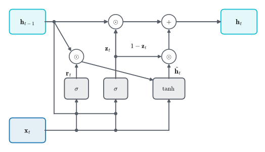

# Gated Recurrent Networks
:label:`sec_lstm`

The recurrent network of :numref:`sec_rnn-scratch` generates text with real
words and punctuation, but its grammar holds over a few words at most.
Consider a model that reads "the keys to the cabinet in the hall" and must
predict what comes next. To choose "are" rather than "is", it must remember
that the subject, "keys", is plural, and by the time the verb arrives, that
word lies 30 characters back. A plain recurrent network rewrites its whole
state at every step, so the word reaches the verb only through 30 rewrites
by the same recurrent matrix, and so does the gradient that would teach the
network to keep it. Text, speech, and music are full of dependencies far
longer than 30 steps. How can a network keep what it has read for hundreds
of steps?

The remedy that made recurrent networks practical is to let the network
decide, for each unit and at each step, how much of its state to keep. It
dates from the late 1990s, and gated networks carried speech recognition and
machine translation through the 2010s, until transformers took their place.
A unit that keeps its state unchanged passes the stored information, and the
gradient, through the step without loss. The decision is made by a *gate*, a
vector of numbers between 0 and 1 that the network computes from its input
and its state. We build the two gated networks in wide use, the long
short-term memory (LSTM) and the gated recurrent unit (GRU). We then test
them twice: on a task that needs a long memory and nothing else, and on the
byte-level text on which :numref:`chap_transformers` trained its GPT, in a
model where they meet attention on equal terms. Gates fix the memory, but
they read the previous state, so training must still process a sequence one
step at a time; :numref:`sec_linear-recurrence` removes that restriction.

Throughout the chapter we write the equations for a single sequence, with
column vectors; the code processes a minibatch of sequences at once.

```{.python .input #lstm-gated-recurrent-networks}
%%tab pytorch
import math
import numpy as np
import torch
from torch import nn
from torch.nn import functional as F
from d2l import torch as d2l
```

```{.python .input #lstm-gated-recurrent-networks}
%%tab jax
import math
import numpy as np
import jax
from jax import numpy as jnp
from flax import nnx
import optax
from d2l import jax as d2l
```

## Gates

### Vanishing Gradients

The Basics traced the forgetting of a plain recurrent network to its
gradient (:numref:`subsec_vanishing-exploding`); we restate the result in
the form needed here. The network updates its hidden state
$\mathbf{h}_t \in \mathbb{R}^d$ from the previous state and the input
$\mathbf{x}_t$,

$$\mathbf{h}_t = \tanh(\mathbf{W}_\textrm{hh} \mathbf{h}_{t-1} +
\mathbf{W}_\textrm{xh} \mathbf{x}_t + \mathbf{b}_\textrm{h}).$$

A small change of the state at step $t-k$ reaches step $t$ multiplied by
one Jacobian per step, $\mathbf{J}_s = \textrm{diag}(1 - \mathbf{h}_s^2)\,
\mathbf{W}_\textrm{hh}$, the derivative of the $\tanh$ times the recurrent
matrix:

$$
\frac{\partial \mathbf{h}_t}{\partial \mathbf{h}_{t-k}} = \mathbf{J}_t
\mathbf{J}_{t-1} \cdots \mathbf{J}_{t-k+1}.
$$
:eqlabel:`eq_lstm-jacobian-product`

Backpropagation sends the gradient of a loss at step $t$ back to step $t-k$
through the transpose of the same product. In the language model of the
Basics this gradient fell below 1% of its size within about eight steps.

Let us start with a single hidden unit, where the mechanism shows with
nothing in the way. Each factor is then a number $w (1 - h_s^2)$, at most
$|w|$ in magnitude. If $|w| < 1$, the product shrinks at least as fast as
$|w|^k$: with $w = 0.9$, a change 30 steps back reaches the present at no
more than 4% of its size, and a change 100 steps back at no more than
0.003%.

For a matrix, the largest singular value of $\mathbf{W}_\textrm{hh}$ takes
the place of $|w|$. If it is below one, every factor shrinks every vector,
and the product must vanish. A largest singular value above one, however,
guarantees nothing either way. Over many steps the powers of a matrix grow
or shrink like $\rho^k$, where $\rho$, the *spectral radius*, is the
largest magnitude of its eigenvalues; it is never larger than the largest
singular value and can be much smaller. Suppose that $\rho$ is near one and
the state is small, so that the $\tanh$ is nearly linear. A signal along
the eigenvectors of the largest eigenvalues is then neither shrunk nor
inflated from step to step, and a plain network can carry it a long way.
Our experiment will meet this borderline case. Away from it the gradient
grows or vanishes, and the two failures are not equally bad: gradient
clipping limits gradients that grow; nothing recovers a gradient that has
vanished.

### An Additive Memory

The simplest state whose Jacobian is exactly one is a running sum,
$c_t = c_{t-1} + x_t$. Its derivative $\partial c_t / \partial c_{t-k}$ is
1 for every $k$: an input written at step 1 is still in the sum at step
1,000, and the gradient reaches it undiminished. But a running sum cannot
forget. Every input stays in it forever, so after many steps it holds a
mixture of everything the network has read, and its size grows with the
length of the sequence.

### Gates as Learned Decay

A useful memory keeps some things and drops others. We let the network
choose, at every step, a fraction $f_t \in (0, 1)$ of the old state to keep
and a fraction $i_t \in (0, 1)$ of new content $\tilde{c}_t$ to write:

$$c_t = f_t\, c_{t-1} + i_t\, \tilde{c}_t.$$
:eqlabel:`eq_lstm-gated-sum`

Along this path the derivative over $k$ steps is the product of the kept
fractions, $\partial c_t / \partial c_{t-k} = f_t f_{t-1} \cdots
f_{t-k+1}$. If the network keeps a constant fraction $f$, a stored value
decays like $f^k$ and halves every $\ln 2 / \ln(1/f)$ steps, its
*half-life*: about 7 steps for $f = 0.9$, 69 for $f = 0.99$, and 693 for
$f = 0.999$. A network that sets $f_t$ to one holds a value, and its
gradient, for as long as it likes; setting $f_t$ to zero erases it.

In a layer of $d$ units the memory becomes a vector $\mathbf{c}_t$, one
$c$ per unit. The layer also has an output $\mathbf{h}_t$, a second
vector, which is what the rest of the network reads.

The fractions are computed by *gates*. A gate is a layer with a sigmoid
output, one value in $(0, 1)$ per unit, that reads the current input and
the output of the previous step. For the fraction kept,

$$
\mathbf{f}_t = \sigma(\mathbf{W}_\textrm{xf} \mathbf{x}_t +
\mathbf{W}_\textrm{hf} \mathbf{h}_{t-1} + \mathbf{b}_\textrm{f}).
$$
:eqlabel:`eq_gate`

A gate multiplies a signal elementwise. A value near 1 lets the signal pass,
a value near 0 blocks it. Because the gate reads $\mathbf{x}_t$ and
$\mathbf{h}_{t-1}$, the decision depends on what the network is reading
and what it has stored; because $\sigma$ is smooth, the decision is learned
by gradient descent like every other weight.

Compare this with the plain network. There, the whole state is multiplied
by the matrix $\mathbf{W}_\textrm{hh}$, the same at every step, and pushed
through a $\tanh$. In the gated memory, each unit is multiplied by its own
number, chosen anew at every step, and nothing else happens to it. A
product of numbers below one cannot grow, so the gradient along the memory
path cannot explode, and a gate held near one keeps it from vanishing.

Only the gradient is tamed this way, not the stored value. While $f_t$
stays near one, every write adds to the memory, up to one unit per step,
much as the running sum grew. The LSTM will therefore squash its memory
with a $\tanh$ before the rest of the network reads it. One more detail
matters in practice: with small weights, a gate starts near $\sigma(0) =
1/2$, a half-life of one step. A gated network can learn long memories, but
it does not start with them.

## Long Short-Term Memory

### The Memory Cell

The *long short-term memory* (LSTM) of :citet:`Hochreiter.Schmidhuber.1997`,
with the forget gate added by :citet:`Gers.Schmidhuber.Cummins.2000`, builds
a recurrent layer around the gated sum :eqref:`eq_lstm-gated-sum`. Where
the plain network kept one vector, the LSTM keeps two, and the reason is
protection. The *memory cell* $\mathbf{c}_t \in \mathbb{R}^d$ is touched by
nothing but the gated sum: no matrix multiplies it and no nonlinearity
squashes it on its way from one step to the next. The output
$\mathbf{h}_t$ is a gated, squashed view of the cell, and it is all that
the rest of the network sees, so what the layer stores and what it shows
can differ. The name draws a different line, between weights and
activations. The weights of a network change slowly and store what holds
for all sequences, while its activations are overwritten at every step;
the cell is an activation designed to persist, a short-term memory made
long.

Three gates of the form :eqref:`eq_gate` control the cell: the *input gate*
$\mathbf{i}_t$, the *forget gate* $\mathbf{f}_t$, and the *output gate*
$\mathbf{o}_t$,

$$
\begin{aligned}
\mathbf{i}_t &= \sigma(\mathbf{W}_\textrm{xi} \mathbf{x}_t + \mathbf{W}_\textrm{hi} \mathbf{h}_{t-1} + \mathbf{b}_\textrm{i}),\\
\mathbf{f}_t &= \sigma(\mathbf{W}_\textrm{xf} \mathbf{x}_t + \mathbf{W}_\textrm{hf} \mathbf{h}_{t-1} + \mathbf{b}_\textrm{f}),\\
\mathbf{o}_t &= \sigma(\mathbf{W}_\textrm{xo} \mathbf{x}_t + \mathbf{W}_\textrm{ho} \mathbf{h}_{t-1} + \mathbf{b}_\textrm{o}).
\end{aligned}
$$
:eqlabel:`lstm_gates`

A fourth layer of the same form, with a $\tanh$ in place of the sigmoid so
that content can be negative, proposes what to write, the *input node*
$\tilde{\mathbf{c}}_t = \tanh(\mathbf{W}_\textrm{xc} \mathbf{x}_t +
\mathbf{W}_\textrm{hc} \mathbf{h}_{t-1} + \mathbf{b}_\textrm{c})$. The cell
is the gated sum :eqref:`eq_lstm-gated-sum`, one copy per unit, and the
output gate decides how much of the cell the rest of the network sees:

$$
\mathbf{c}_t = \mathbf{f}_t \odot \mathbf{c}_{t-1} + \mathbf{i}_t \odot
\tilde{\mathbf{c}}_t, \qquad \mathbf{h}_t = \mathbf{o}_t \odot
\tanh(\mathbf{c}_t).
$$
:eqlabel:`lstm_update`

Here $\odot$ is the elementwise product. The next layer, the output layer,
and the gates of the next step read $\mathbf{h}_t$, never $\mathbf{c}_t$
directly.

One step with numbers shows the two vectors parting company. Take a unit
whose cell holds $c_{t-1} = 0.8$, with a forget gate of $0.95$, an input
gate of $0.1$, an input node of $-0.5$, and an output gate of $0.2$. The
cell becomes $0.95 \cdot 0.8 + 0.1 \cdot (-0.5) = 0.71$, nearly what it
was, while the output is $0.2 \tanh(0.71) = 0.12$. The value is stored but
barely shown. In this way a unit can hold a value, such as the number of a
subject, and reveal it only when the verb arrives. :numref:`fig_lstm_cell`
shows the data flow.


:label:`fig_lstm_cell`

Follow the cell along the top of the figure. Between $\mathbf{c}_{t-1}$
and $\mathbf{c}_t$ there is one elementwise product and one sum, no matrix
and no saturating nonlinearity, so with the gates held fixed the Jacobian
$\partial \mathbf{c}_t / \partial \mathbf{c}_{t-1}$ is the diagonal matrix
$\textrm{diag}(\mathbf{f}_t)$. A reader may object that the gates are not
fixed: they read $\mathbf{h}_{t-1}$, which depends on $\mathbf{c}_{t-1}$, so
the full derivative contains further terms that pass through the gates and
the recurrent matrices, with the products of
:eqref:`eq_lstm-jacobian-product`. That is correct. The cell does not
guarantee that every gradient survives; it provides one path along which
gradients can survive, and training decides whether the gates keep it
open.

### Implementation

We write the layer out step by step. The four layers that compute
$\mathbf{i}_t$, $\mathbf{f}_t$, $\tilde{\mathbf{c}}_t$, and $\mathbf{o}_t$
read the same inputs, so we stack their weights and compute all four with
one matrix product per input, then split the result. In the code each row
of a minibatch is one sequence, so the weights multiply from the right and
hold the transposes of the matrices in the equations.

```{.python .input #lstm-implementation-1}
%%tab pytorch
class LSTMScratch(nn.Module):
    """An LSTM layer computed one time step at a time."""
    def __init__(self, num_inputs, num_hiddens):
        super().__init__()
        self.num_hiddens = num_hiddens
        # Weights of i, f, c_tilde, and o, stacked along the last axis, with
        # variance 1 / fan-in
        self.W_x = nn.Parameter(torch.randn(num_inputs, 4 * num_hiddens)
                                / math.sqrt(num_inputs))
        self.W_h = nn.Parameter(torch.randn(num_hiddens, 4 * num_hiddens)
                                / math.sqrt(num_hiddens))
        self.b = nn.Parameter(torch.zeros(4 * num_hiddens))

    def forward(self, X):  # X: (batch_size, num_steps, num_inputs)
        h = c = torch.zeros(X.shape[0], self.num_hiddens, device=X.device)
        outputs = []
        for x in X.unbind(1):  # One time step at a time
            i, f, c_tilde, o = (x @ self.W_x + h @ self.W_h + self.b).chunk(4, -1)
            c = torch.sigmoid(f) * c + torch.sigmoid(i) * torch.tanh(c_tilde)
            h = torch.sigmoid(o) * torch.tanh(c)
            outputs.append(h)
        return torch.stack(outputs, 1)  # (batch_size, num_steps, num_hiddens)
```

```{.python .input #lstm-implementation-1}
%%tab jax
class LSTMScratch(nnx.Module):
    """An LSTM layer computed one time step at a time."""
    def __init__(self, num_inputs, num_hiddens, *, rngs):
        self.num_hiddens = num_hiddens
        # Weights of i, f, c_tilde, and o, stacked along the last axis, with
        # variance 1 / fan-in
        self.W_x = nnx.Param(rngs.params.normal((num_inputs, 4 * num_hiddens))
                             / math.sqrt(num_inputs))
        self.W_h = nnx.Param(rngs.params.normal((num_hiddens, 4 * num_hiddens))
                             / math.sqrt(num_hiddens))
        self.b = nnx.Param(jnp.zeros(4 * num_hiddens))

    def __call__(self, X):  # X: (batch_size, num_steps, num_inputs)
        def step(state, x):
            h, c = state
            i, f, c_tilde, o = jnp.split(
                x @ self.W_x[...] + h @ self.W_h[...] + self.b[...], 4, -1)
            c = jax.nn.sigmoid(f) * c + jax.nn.sigmoid(i) * jnp.tanh(c_tilde)
            h = jax.nn.sigmoid(o) * jnp.tanh(c)
            return (h, c), h
        h = c = jnp.zeros((X.shape[0], self.num_hiddens))
        # lax.scan steps through the leading axis, so time goes first
        _, outputs = jax.lax.scan(step, (h, c), jnp.swapaxes(X, 0, 1))
        return jnp.swapaxes(outputs, 0, 1)  # (batch_size, num_steps, ...)
```

Deep learning frameworks provide the LSTM as a library layer that runs the
same recurrence in a fused, compiled loop. To check that it computes
:eqref:`lstm_gates` and :eqref:`lstm_update` and nothing else, we copy its
weights into our layer and compare the outputs on random inputs.

```{.python .input #lstm-implementation-2}
%%tab pytorch
lstm = nn.LSTM(16, 32, batch_first=True)  # Stacks its weights as i, f, c~, o
cell = LSTMScratch(16, 32)
with torch.no_grad():
    cell.W_x.copy_(lstm.weight_ih_l0.T)
    cell.W_h.copy_(lstm.weight_hh_l0.T)
    cell.b.copy_(lstm.bias_ih_l0 + lstm.bias_hh_l0)
X = torch.randn(4, 9, 16)  # (batch_size, num_steps, num_inputs)
print(f'max difference: {(cell(X) - lstm(X)[0]).abs().max():.1e}')
```

```{.python .input #lstm-implementation-2}
%%tab jax
lstm_cell = nnx.LSTMCell(16, 32, rngs=nnx.Rngs(0))  # A layer per gate
lstm = nnx.RNN(lstm_cell)
cell = LSTMScratch(16, 32, rngs=nnx.Rngs(1))
gates = [(lstm_cell.ii, lstm_cell.hi), (lstm_cell.if_, lstm_cell.hf),
         (lstm_cell.ig, lstm_cell.hg), (lstm_cell.io, lstm_cell.ho)]
cell.W_x[...] = jnp.concatenate([x.kernel[...] for x, _ in gates], 1)
cell.W_h[...] = jnp.concatenate([h.kernel[...] for _, h in gates], 1)
cell.b[...] = jnp.concatenate([h.bias[...] for _, h in gates])
X = jax.random.normal(jax.random.key(0), (4, 9, 16))
print(f'max difference: {jnp.abs(cell(X) - lstm(X)).max():.1e}')
```

The largest difference is no more than the rounding error of 32-bit
arithmetic: our loop and the library layer compute the same function. From
now on we use the library layer, which is much faster.

## Gated Recurrent Units
:label:`sec_gru`

The LSTM keeps two vectors per step, the cell and the output, and computes
three gates and an input node. Is all of that necessary? The *gated
recurrent unit* (GRU) of :citet:`Cho.Van-Merrienboer.Bahdanau.ea.2014`
keeps one vector and computes two gates and a candidate, and it trains
about as well as the LSTM on many tasks :cite:`Chung.Gulcehre.Cho.ea.2014`.

The GRU has two gates of the form :eqref:`eq_gate`, a *reset gate*
$\mathbf{r}_t$ and an *update gate* $\mathbf{z}_t$:

$$
\mathbf{r}_t = \sigma(\mathbf{W}_\textrm{xr} \mathbf{x}_t +
\mathbf{W}_\textrm{hr} \mathbf{h}_{t-1} + \mathbf{b}_\textrm{r}), \qquad
\mathbf{z}_t = \sigma(\mathbf{W}_\textrm{xz} \mathbf{x}_t +
\mathbf{W}_\textrm{hz} \mathbf{h}_{t-1} + \mathbf{b}_\textrm{z}).
$$
:eqlabel:`gru_gates`

The reset gate acts inside a plain recurrent update that proposes a
*candidate state*,

$$
\tilde{\mathbf{h}}_t = \tanh\big(\mathbf{W}_\textrm{xh} \mathbf{x}_t +
\mathbf{W}_\textrm{hh} (\mathbf{r}_t \odot \mathbf{h}_{t-1}) +
\mathbf{b}_\textrm{h}\big).
$$
:eqlabel:`gru_tilde_H`

With $\mathbf{r}_t$ near one the candidate is the plain recurrent update;
with $\mathbf{r}_t$ near zero it ignores the state and reads only the
current input, as if the sequence started anew. The update gate then
blends the old state with the candidate:

$$
\mathbf{h}_t = \mathbf{z}_t \odot \mathbf{h}_{t-1} + (1 - \mathbf{z}_t)
\odot \tilde{\mathbf{h}}_t.
$$
:eqlabel:`gru_H`

This is the gated sum :eqref:`eq_lstm-gated-sum` with the input gate tied
to the forget gate, $i_t = 1 - f_t$: whatever fraction of the old state is
dropped is filled with new content. Where $\mathbf{z}_t$ is near one, the
state is copied and the step is skipped; where it is near zero, the state
is overwritten. Each coordinate of $\mathbf{h}_t$ is a weighted average of
two numbers in $[-1, 1]$, so the state stays bounded without a second
$\tanh$, and one vector serves as both memory and output.
:numref:`fig_gru_cell` shows the cell. With input and hidden width $d$, a
GRU layer has $3 \cdot 2d^2$ weights against the LSTM's $4 \cdot 2d^2$.


:label:`fig_gru_cell`

Writing the GRU from scratch would repeat `LSTMScratch` with two gates and
a candidate in place of three gates and an input node; an exercise asks for
it. The library GRU layers that we train below compute a slightly different
candidate, with the reset gate applied after the product with
$\mathbf{W}_\textrm{hh}$ rather than before it; another exercise shows when
the two agree and why the libraries prefer their form.

## Training Gated Networks
:label:`sec_gated-training`

### Delayed Recall
:label:`subsec_delayed-recall`

The equations promise a memory that can last hundreds of steps. Does
training find it? We test each network directly with a *delayed recall*
task. A sequence starts with one of eight symbols, followed by $T - 1$
filler tokens drawn at random from eight other symbols, and at the end the
network must name the first symbol. It can do so only by carrying the
symbol through $T - 1$ updates, each of which reads a token that does not
matter. Chance accuracy is 1/8.

```{.python .input #lstm-delayed-recall-1}
%%tab pytorch, jax
def delayed_recall(rng, batch_size, num_steps, num_symbols=8,  #@save
                   blank_fillers=False):
    """A symbol, then num_steps - 1 fillers; the target is the symbol."""
    Y = rng.integers(0, num_symbols, (batch_size, 1))  # One query, at the end
    X = rng.integers(num_symbols, 2 * num_symbols, (batch_size, num_steps))
    if blank_fillers:  # The same filler token at every step
        X[:] = num_symbols
    X[:, :1] = Y
    return X, Y

X, Y = delayed_recall(np.random.default_rng(0), 2, 6)
print(X, Y)
```

In the example, the first sequence starts with symbol 6 and the second
with 5, and these are the targets. The model embeds the tokens in 32
dimensions, runs one recurrent layer with 64 hidden units, and applies a
classifier to the layer's output at every position. The answer is read at
the last position; the tasks of later sections read it at several. All
layers of this chapter start with LeCun normal weights, of variance
$1/n_\textrm{in}$ for $n_\textrm{in}$ inputs, and zero biases
(:numref:`sec_numerical_stability`), so that every projection passes on the
scale of its input. For the recurrent matrix this choice will matter.

:begin_tab:`pytorch`
PyTorch's layers draw their weights from uniform distributions by default;
`init_lecun` applies the rule above to linear, convolutional, and recurrent
layers alike. The recurrent layers also return their final state, and the
wrapper `Recurrent` keeps only the outputs, the interface that all sequence
layers of this chapter share.
:end_tab:

:begin_tab:`jax`
Flax's linear layers and the input matrices of its recurrent cells already
follow this rule. Its recurrent matrices start as random orthogonal
matrices, so we pass `recurrent_kernel_init` to draw them LeCun normal as
well. `nnx.RNN` turns a cell into a layer that returns the outputs at all
steps, the interface that all sequence layers of this chapter share.
:end_tab:

```{.python .input #lstm-delayed-recall-6}
%%tab pytorch
def init_lecun(module):  #@save
    """LeCun normal weights and zero biases for all linear, convolutional,
    and recurrent layers."""
    for layer in module.modules():
        if isinstance(layer, (nn.Linear, nn.Conv1d)):
            fan_in = layer.weight[0].numel()  # Inputs of one output unit
            nn.init.normal_(layer.weight, std=fan_in ** -0.5)
            if layer.bias is not None:
                nn.init.zeros_(layer.bias)
        elif isinstance(layer, nn.RNNBase):  # Input and recurrent matrices
            for name, param in layer.named_parameters():
                if name.startswith('weight'):
                    nn.init.normal_(param, std=param.shape[1] ** -0.5)
                else:
                    nn.init.zeros_(param)
    return module

class Recurrent(nn.Module):  #@save
    """A batch-first recurrent layer that returns only its outputs."""
    def __init__(self, rnn):
        super().__init__()
        self.rnn = rnn

    def forward(self, X):
        return self.rnn(X)[0]
```

We train six networks with this model, in three pairs. The first pair are
plain recurrent networks, which have no gates. One has the LeCun normal
recurrent matrix. The other, a control, draws its recurrent matrix
uniformly from $[-1/8, 1/8]$, the default scale of some libraries, which
gives its entries a third of the LeCun variance. The second pair are the
LSTM and the GRU as they come from this initialization: with zero biases,
every gate starts near one half. The third pair are the same LSTM and GRU
with gates that start out keeping their state, which we call *keep gates*:
the bias of the LSTM's forget gate is set to 5 and that of its input gate
to $-5$, and the bias of the GRU's update gate to 5. Since $\sigma(5) =
0.993$, these gates start with a half-life of about 100 steps instead of
one.

Why close the LSTM's input gate? It does not shield the symbol from the
fillers: the gate starts at the same value for every token, so at first
each filler is written as faintly as the symbol. What the closed gate
controls is the size of the cell. With its forget gate near one, an LSTM
whose input gate stood at one half would add half of every filler's content
to the cell, step after step, and the cell could grow to as much as
$0.5 / (1 - \sigma(5)) \approx 75$ in magnitude (an exercise proves the
bound). At that size the $\tanh$ of the output saturates; the output
barely responds to a faint trace and passes little gradient back. With the
input gate at $\sigma(-5)$ the same bound is $\sigma(-5) / (1 - \sigma(5))
= 1$, since $1 - \sigma(5) = \sigma(-5)$, and the cell stays within
$[-1, 1]$, where the $\tanh$ is far from saturated.

What is written at the first step is still there 200 steps later, at about
a quarter of its size ($\sigma(5)^{200} \approx 0.26$), next to the faint
writes of the fillers, and training must teach the network to tell the two
apart. No row of the table opens the input gate, so this is the reason for
our choice, not a measured cause. The GRU needs no such step, since its
tied gate writes only $1 - \sigma(5) = 0.007$ of the candidate by itself.

Starting the forget gates near one is an old idea in practice. A
forget-gate bias of 1, a gate of 0.73, is a common choice, recommended by
:citet:`Jozefowicz.Zaremba.Sutskever.2015`, and the *chrono
initialization* :cite:`Tallec.Ollivier.2018` spreads the forget-gate
biases so that the half-lives of the units cover the delays a task needs.
Our bias of 5 is the blunt version, suited to a task whose only job is to
keep one symbol. Whichever you use, a gated network should start with its
forget gates biased toward keeping; the table below shows what happens
otherwise. `RecallModel` assembles the model, and `init_keep_gate` sets
the biases of the keep gates.

```{.python .input #lstm-delayed-recall-2}
%%tab pytorch
class RecallModel(nn.Module):  #@save
    """Embedding, a sequence layer, and a classifier at every position."""
    def __init__(self, layer, num_hiddens, vocab_size=16, num_inputs=32,
                 num_outputs=8):
        super().__init__()
        self.embedding = nn.Embedding(vocab_size, num_inputs)
        nn.init.normal_(self.embedding.weight, std=num_inputs ** -0.5)
        self.layer = layer
        self.head = init_lecun(nn.Linear(num_hiddens, num_outputs))

    def forward(self, X):  # Logits, (batch_size, num_steps, num_outputs)
        return self.head(self.layer(self.embedding(X)))

def init_keep_gate(rnn, bias=5.0):
    """Start an LSTM's forget gate, or a GRU's update gate, near one."""
    h = rnn.hidden_size
    with torch.no_grad():
        rnn.bias_ih_l0.zero_()  # Independent of the earlier initialization
        rnn.bias_hh_l0.zero_()
        rnn.bias_ih_l0[h:2 * h] = bias  # LSTM: i, f, c~, o; GRU: r, z, n
        if isinstance(rnn, nn.LSTM):
            rnn.bias_ih_l0[:h] = -bias  # Input gate near zero
    return rnn
```

```{.python .input #lstm-delayed-recall-2}
%%tab jax
class RecallModel(nnx.Module):  #@save
    """Embedding, a sequence layer, and a classifier at every position."""
    def __init__(self, layer, num_hiddens, vocab_size=16, num_inputs=32,
                 num_outputs=8, *, rngs):
        # d2l.Embed computes its gradient by a matrix product: no atomic adds
        # that wait on one another when a few filler tokens fill every row
        self.embedding = d2l.Embed(vocab_size, num_inputs, rngs=rngs,
            embedding_init=nnx.initializers.normal(num_inputs ** -0.5))
        self.layer = layer
        self.head = nnx.Linear(num_hiddens, num_outputs, rngs=rngs)

    def __call__(self, X):  # Logits, (batch_size, num_steps, num_outputs)
        return self.head(self.layer(self.embedding(X)))

def init_keep_gate(cell, bias=5.0):
    """Start an LSTM's forget gate, or a GRU's update gate, near one."""
    if isinstance(cell, nnx.LSTMCell):
        cell.hf.bias[...] = jnp.full_like(cell.hf.bias[...], bias)
        cell.hi.bias[...] = jnp.full_like(cell.hi.bias[...], -bias)  # Input
    else:  # GRUCell: input biases ordered r, z, n
        h = cell.dense_i.bias.shape[0] // 3
        cell.dense_i.bias[...] = cell.dense_i.bias[...].at[h:2 * h].set(bias)
    return cell
```

Before we train anything, let us predict what the gated networks will do.
A gate at one half passes half of the gradient back along the cell at each
step, so over $k$ steps the direct path from the answer to the symbol
carries $2^{-k}$ of it: about one part in a million at 20 steps and
$10^{-15}$ at 50. The gradient of each shared weight sums the
contributions of all steps, and 32-bit arithmetic resolves only about one
part in ten million of such a sum, so next to the contributions of the
recent steps a share of $10^{-15}$ disappears in rounding. One part in a
million survives. We therefore expect the LSTM and the GRU as they come to
lose the symbol by 50 steps, perhaps to keep it at 20, and the keep-gate
pair to recall it at every delay.

The synthetic tasks of this chapter are all trained the same way, so we
save the loop once. `train_queries` draws a fresh batch from the
function `batch` at every step, computes the cross-entropy at the query
positions only, the last `Y.shape[1]` positions of the sequence, and takes
an optimizer step with the gradient clipped to norm 1. `query_accuracy`
returns the fraction of queries answered correctly. For delayed recall,
`train_delayed_recall` trains a model with Adam on 1,500 batches of 128
sequences and tests it on 2,048 new sequences.

:begin_tab:`jax`
The clipping is part of the optimizer, an `optax.chain` that clips the
gradient before the update, so `train_queries` only takes the steps.
:end_tab:

```{.python .input #lstm-delayed-recall-4}
%%tab pytorch
def train_queries(model, batch, num_steps, optimizer,  #@save
                  scheduler=None):
    """Train on fresh batches; the queries are the last Y.shape[1] steps."""
    device = next(model.parameters()).device
    for step in range(num_steps):
        X, Y = (torch.as_tensor(A, device=device) for A in batch(step))
        logits = model(X)[:, -Y.shape[1]:]  # Predictions at the queries
        loss = F.cross_entropy(logits.flatten(0, 1), Y.flatten())
        optimizer.zero_grad()
        loss.backward()
        nn.utils.clip_grad_norm_(model.parameters(), 1.0)
        optimizer.step()
        if scheduler is not None:
            scheduler.step()

def query_accuracy(model, X, Y):  #@save
    """Fraction of queries answered correctly."""
    device = next(model.parameters()).device
    X, Y = (torch.as_tensor(A, device=device) for A in (X, Y))
    with torch.inference_mode():
        return (model(X)[:, -Y.shape[1]:].argmax(-1) == Y).float().mean()

def train_delayed_recall(model, num_steps, blank_fillers=False):  #@save
    """Train with Adam at rate 0.003 on 1,500 fresh batches of 128 sequences
    of delayed recall; return the accuracy on 2,048 new sequences."""
    task = lambda rng, n: delayed_recall(rng, n, num_steps,
                                         blank_fillers=blank_fillers)
    rng = np.random.default_rng(0)
    model.to(d2l.try_gpu())
    train_queries(model, lambda step: task(rng, 128), 1500,
                  torch.optim.Adam(model.parameters(), lr=3e-3))
    return float(query_accuracy(model, *task(np.random.default_rng(1), 2048)))
```

```{.python .input #lstm-delayed-recall-4}
%%tab jax
@nnx.jit  #@save
def query_step(model, optimizer, X, Y):
    """One optimizer step on the cross-entropy at the last Y.shape[1] steps."""
    def loss_fn(model):
        logits = model(X)[:, -Y.shape[1]:]  # Predictions at the queries
        return optax.softmax_cross_entropy_with_integer_labels(
            logits, Y).mean()
    loss, grads = nnx.value_and_grad(loss_fn)(model)
    optimizer.update(model, grads)
    return loss

def train_queries(model, batch, num_steps, optimizer):  #@save
    """Train on fresh batches; the queries are the last Y.shape[1] steps."""
    step = nnx.cached_partial(query_step, model, optimizer)  # Compile once
    for i in range(num_steps):
        step(*batch(i))

@nnx.jit  #@save
def query_accuracy(model, X, Y):
    """Fraction of queries answered correctly."""
    return (model(X)[:, -Y.shape[1]:].argmax(-1) == Y).mean()

def train_delayed_recall(model, num_steps, blank_fillers=False):  #@save
    """Train with Adam at rate 0.003 on 1,500 fresh batches of 128 sequences
    of delayed recall; return the accuracy on 2,048 new sequences."""
    task = lambda rng, n: delayed_recall(rng, n, num_steps,
                                         blank_fillers=blank_fillers)
    rng = np.random.default_rng(0)
    optimizer = nnx.Optimizer(model, optax.chain(
        optax.clip_by_global_norm(1.0), optax.adam(3e-3)), wrt=nnx.Param)
    train_queries(model, lambda step: task(rng, 128), 1500, optimizer)
    return float(query_accuracy(model, *task(np.random.default_rng(1), 2048)))
```

The plain networks are harder to predict, since nothing in them is meant
to hold a value. What we can compute is how their recurrent matrices act
on a small state, where the $\tanh$ is nearly linear. The cell below draws
one $64 \times 64$ matrix of each kind.

```{.python .input #lstm-delayed-recall-8}
%%tab pytorch, jax
rng, n = np.random.default_rng(0), 64  # n hidden units
for name, W in (('LeCun normal', rng.normal(0, n ** -0.5, (n, n))),
                ('default scale', rng.uniform(-n ** -0.5, n ** -0.5, (n, n)))):
    print(f'{name:>13}: spectral radius {np.abs(np.linalg.eigvals(W)).max():.2f},'
          f' largest singular value {np.linalg.norm(W, 2):.2f}')
```

The LeCun normal matrix has spectral radius 1.02 and largest singular value
2.01; the matrix at the smaller scale has 0.62 and 1.10. For the long run
the spectral radius is the number that counts. A largest singular value of
2 does not make the first matrix explode; its spectral radius of 1.02 puts
it at the borderline case of :eqref:`eq_lstm-jacobian-product`, where a
small state along the leading eigenvectors is neither shrunk nor inflated.
The second matrix shrinks such a state by about 0.6 per step. We predict
that the control loses the symbol sooner than the LeCun network, and no
more than that, since training changes both matrices. The table trains
every network twice at each delay, from fresh random weights, and prints
both test accuracies.

```{.python .input #lstm-delayed-recall-5}
%%tab pytorch
def recurrent(layer, keep_gate=False):
    """A batch-first layer, 32 inputs to 64 hidden units, LeCun-initialized."""
    layer = init_lecun(layer(32, 64, batch_first=True))
    return init_keep_gate(layer) if keep_gate else layer

def rnn_default_scale():  # The recurrent matrix as nn.RNN draws it
    rnn = recurrent(nn.RNN)
    nn.init.uniform_(rnn.weight_hh_l0, -64 ** -0.5, 64 ** -0.5)
    return rnn

layers = {'RNN': lambda: recurrent(nn.RNN),
          'RNN, default scale': rnn_default_scale,
          'LSTM': lambda: recurrent(nn.LSTM), 'GRU': lambda: recurrent(nn.GRU),
          'LSTM, keep gate': lambda: recurrent(nn.LSTM, keep_gate=True),
          'GRU, keep gate': lambda: recurrent(nn.GRU, keep_gate=True)}
delays = [20, 50, 100, 200]
print(' ' * 18, ' '.join(f'{T:>9d}' for T in delays))
for name, layer in layers.items():
    runs = [[train_delayed_recall(RecallModel(Recurrent(layer()), 64), T)
             for _ in range(2)] for T in delays]
    print(f'{name:18s}', ' '.join(f'{a:.2f}/{b:.2f}' for a, b in runs))
```

```{.python .input #lstm-delayed-recall-5}
%%tab jax
lecun = {'recurrent_kernel_init': nnx.initializers.lecun_normal()}
default = {'recurrent_kernel_init': nnx.initializers.variance_scaling(
    1 / 3, 'fan_in', 'uniform')}  # PyTorch's: uniform on [-1/8, 1/8]
cells = {'RNN': lambda rngs: nnx.SimpleCell(32, 64, rngs=rngs, **lecun),
         'RNN, default scale':
             lambda rngs: nnx.SimpleCell(32, 64, rngs=rngs, **default),
         'LSTM': lambda rngs: nnx.LSTMCell(32, 64, rngs=rngs, **lecun),
         'GRU': lambda rngs: nnx.GRUCell(32, 64, rngs=rngs, **lecun),
         'LSTM, keep gate': lambda rngs: init_keep_gate(
             nnx.LSTMCell(32, 64, rngs=rngs, **lecun)),
         'GRU, keep gate': lambda rngs: init_keep_gate(
             nnx.GRUCell(32, 64, rngs=rngs, **lecun))}

def recall_model(cell):  # Fresh random weights for every model
    rngs = nnx.Rngs(d2l.get_key())
    return RecallModel(nnx.RNN(cell(rngs), unroll=8), 64, rngs=rngs)

delays = [20, 50, 100, 200]
print(' ' * 18, ' '.join(f'{T:>9d}' for T in delays))
for name, cell in cells.items():
    runs = [[train_delayed_recall(recall_model(cell), T) for _ in range(2)]
            for T in delays]
    print(f'{name:18s}', ' '.join(f'{a:.2f}/{b:.2f}' for a, b in runs))
```

The gated networks behave as predicted. As they come, with gates at one
half, the GRU recalls every symbol after 20 steps and the LSTM only part of
them, between a quarter and nine tenths; from 50 steps on both are at
chance, 0.12, in every run. One part in a million is a small gradient but
not a hopeless one; $10^{-15}$ is. With keep gates, the same two
architectures recall every symbol at every delay up to 200, in every run.
Only the initialization differs between these pairs of rows. Started with
gates at one half, training does not find, within our 1,500 updates, the
gates that would keep the symbol; started with gates near one, it does not
lose them.

Let us look more closely at the plain networks, because from 50 steps on
the LeCun one does better than both gated networks as they come. At 50
steps it recalls every symbol in at least one of its two runs, and at 100
and 200 steps some of its runs still recall well above chance. The control
shows where this memory comes from. With its recurrent matrix at the
smaller scale, the same network still recalls at 20 steps in some runs,
but from 50 steps on it nearly always loses the symbol. A plain network
can thus carry a symbol a long way when its matrix sits at the borderline,
with spectral radius near one. Nothing in it holds the symbol on purpose,
though, and its memory is unreliable: at the same delay one run may recall
every symbol and the next far fewer, and a longer delay is not even
reliably harder than a shorter one.

What, then, do the gates add? A plain network with a well-scaled matrix
can carry a symbol too. What the gates add, in this table, is
reliability: every keep-gate run recalled every symbol at every delay. Each
unit has its own decay, set by its own gate rather than by the eigenvalues
of one shared matrix, and an initialization can put that decay where the
task needs it. Gates make a long memory dependable and let us place it,
but whether training finds it depends on where the gates start.

### Gated Networks on Text
:label:`subsec_deep-rnn`

Delayed recall isolates one skill; text asks whether the skill matters.
:numref:`subsec_gpt-rnn-baseline` set a plain recurrent network with as
many parameters as the GPT beside it on the same bytes of WikiText-103. The
two were level over the first few bytes of each window, the GPT was 0.05 to
0.07 nats ahead by byte 16, and the recurrent network barely improved after
that; every recurrent run ended above every GPT run. Do gates close that
gap?

A fair answer changes one thing at a time, and that comparison changed
two: the recurrent model was a single wide layer, the GPT a stack of
blocks. We therefore stack recurrent layers the way
:numref:`sec_transformer-block` stacks attention layers. Each layer is
wrapped in a *residual connection*, which adds the layer's output to its
input, with a layer normalization in front, and is followed by a small
multilayer perceptron (MLP) that transforms each position separately. This
is not how the LSTM systems of the 2010s were built, which stacked recurrent
layers directly or with residual connections alone, but it lets every layer
of this chapter, and attention, sit in one model. The residual connections
give the gradient a direct path through the depth of the network, as the
gated cell gives it one through time.

We save this stack once, because every model in the chapter is an
instance of it. `SeqLM` embeds the tokens, applies one residual block per
*sequence mixer*, our name for the layer that passes information along the
sequence, and predicts the next token from each position. The mixers are
passed in as a list, so the same stack can hold an LSTM here, the layers of
the coming sections, or a mixture of them. Each mixer maps a minibatch of
sequences of shape (batch size, number of steps, $d$) to one of the same
shape. The token embeddings start with entries of standard deviation
$1/\sqrt{d}$, so that every embedded token has about unit length.

```{.python .input #lstm-deep-recurrent-networks-1}
%%tab pytorch
class SeqLM(nn.Module):  #@save
    """A language model of residual blocks: a sequence mixer, then an MLP."""
    def __init__(self, vocab_size, num_hiddens, mixers):
        super().__init__()
        d = num_hiddens
        self.embedding = nn.Embedding(vocab_size, d)
        nn.init.normal_(self.embedding.weight, std=d ** -0.5)  # Unit length
        self.mixers = nn.ModuleList(mixers)
        self.norms = nn.ModuleList([nn.LayerNorm(d) for _ in mixers])
        self.mlps = nn.ModuleList([nn.Sequential(
            nn.LayerNorm(d), nn.Linear(d, 4 * d), nn.GELU(),
            nn.Linear(4 * d, d)) for _ in mixers])
        self.norm = nn.LayerNorm(d)
        self.head = nn.Linear(d, vocab_size)
        for module in (self.mlps, self.head):  # Mixers initialize themselves
            init_lecun(module)

    def forward(self, X):
        H = self.embedding(X)  # (batch_size, num_steps, num_hiddens)
        for norm, mixer, mlp in zip(self.norms, self.mixers, self.mlps):
            H = H + mixer(norm(H))
            H = H + mlp(H)
        return self.head(self.norm(H))  # (batch_size, num_steps, vocab_size)
```

```{.python .input #lstm-deep-recurrent-networks-1}
%%tab jax
class SeqLM(nnx.Module):  #@save
    """A language model of residual blocks: a sequence mixer, then an MLP."""
    def __init__(self, vocab_size, num_hiddens, mixers, *, rngs):
        d = num_hiddens
        self.embedding = d2l.Embed(vocab_size, d, rngs=rngs,  # Unit length
            embedding_init=nnx.initializers.normal(d ** -0.5))
        self.mixers = nnx.List(mixers)
        norm = lambda: nnx.LayerNorm(d, epsilon=1e-5, rngs=rngs)
        self.norms = nnx.List([norm() for _ in mixers])
        self.mlps = nnx.List([nnx.Sequential(
            norm(), nnx.Linear(d, 4 * d, rngs=rngs),
            lambda x: nnx.gelu(x, approximate=False),  # Exact GELU
            nnx.Linear(4 * d, d, rngs=rngs)) for _ in mixers])
        self.norm = norm()
        self.head = nnx.Linear(d, vocab_size, rngs=rngs)

    def __call__(self, X):
        H = self.embedding(X)  # (batch_size, num_steps, num_hiddens)
        for norm, mixer, mlp in zip(self.norms, self.mixers, self.mlps):
            H = H + mixer(norm(H))
            H = H + mlp(H)
        return self.head(self.norm(H))  # (batch_size, num_steps, vocab_size)
```

The attention baseline is `SeqLM` with an attention mixer in every block,
so that only the mixer differs. `AttentionMixer` is the causal multi-head
attention of :numref:`sec_gpt`, in which every position attends to itself
and to the positions before it, with positions encoded by RoPE, which
rotates each query and key by an angle proportional to its position
(:numref:`sec_positional-information`). Its weights are drawn LeCun normal
like those of every other mixer. The option `conv_width`, which
:numref:`sec_hybrids` uses, first mixes each query, key, and value with
those of the previous few steps by a causal convolution per channel.

```{.python .input #lstm-gated-networks-on-text-1}
%%tab pytorch
class AttentionMixer(d2l.CausalAttention):  #@save
    """Causal multi-head attention, with rotary positions unless rope is
    False, as a sequence mixer; with conv_width, a causal convolution per
    channel first mixes each query, key, and value with those of the
    previous steps."""
    def __init__(self, num_hiddens, num_heads, conv_width=None, rope=True):
        super().__init__(num_hiddens, num_heads, rope=rope)
        d = 3 * num_hiddens  # Channels of q, k, and v; one filter each
        self.conv = None if conv_width is None else nn.Conv1d(
            d, d, conv_width, groups=d, padding=conv_width - 1)
        init_lecun(self)  # Like every mixer of the chapter

    def qkv(self, X, offset=0, tables=None):
        B, T, _ = X.shape
        QKV = self.W_qkv(X)
        if self.conv is not None:  # Causal: drop the last conv_width - 1 steps
            QKV = self.conv(QKV.mT)[..., :T].mT
        q, k, v = (u.reshape(B, T, self.num_heads, -1).transpose(1, 2)
                   for u in QKV.chunk(3, -1))
        if self.rope:
            q, k = (d2l.rope(u, offset, tables=tables) for u in (q, k))
        return q, k, v  # Each (batch_size, num_heads, num_steps, head width)
```

```{.python .input #lstm-gated-networks-on-text-1}
%%tab jax
class AttentionMixer(d2l.CausalAttention):  #@save
    """Causal multi-head attention, with rotary positions unless rope is
    False, as a sequence mixer; with conv_width, a causal convolution per
    channel first mixes each query, key, and value with those of the
    previous steps."""
    def __init__(self, num_hiddens, num_heads, conv_width=None, rope=True,
                 *, rngs):
        super().__init__(num_hiddens, num_heads, rope=rope, rngs=rngs)
        lecun = nnx.initializers.lecun_normal()
        for layer in (self.W_qkv, self.W_o):  # Like every mixer of the chapter
            layer.kernel[...] = lecun(rngs.params(), layer.kernel.shape)
        d = 3 * num_hiddens  # Channels of q, k, and v; one filter each
        self.conv = None if conv_width is None else nnx.Conv(
            d, d, (conv_width,), feature_group_count=d,
            padding=((conv_width - 1, 0),), rngs=rngs)

    def qkv(self, X, offset=0, tables=None):
        B, T, _ = X.shape
        QKV = self.W_qkv(X)
        if self.conv is not None:  # Causal: padded on the left only
            QKV = self.conv(QKV)
        q, k, v = (u.reshape(B, T, self.num_heads, -1).swapaxes(1, 2)
                   for u in jnp.split(QKV, 3, -1))
        if self.rope:
            q, k = (d2l.rope(u, offset, tables=tables) for u in (q, k))
        return q, k, v  # Each (batch_size, num_heads, num_steps, head width)
```

Three helpers run the comparison, and later sections call them too.
`loss_by_position` is the function of :numref:`subsec_gpt-rnn-baseline`,
saved to the library here: it averages the validation loss at each position
of the window separately. `train_text` trains a model with the recipe of
:numref:`sec_gpt`, AdamW with a learning rate that warms up over 100 steps
to $2 \times 10^{-3}$ and decays along a cosine over 1,000 steps. It
returns the loss at every position, whose mean is the validation loss, and
the milliseconds per training step. `text_table` trains two fresh models
of each kind and prints one row per kind.

```{.python .input #lstm-gated-networks-on-text-2}
%%tab pytorch
@torch.inference_mode()  #@save
def loss_by_position(model, data):
    """Mean validation loss in nats at each position of the window."""
    device = next(model.parameters()).device
    total, count = 0, 0
    for X, Y in data.val_dataloader():
        logits = model(X.to(device))  # (batch, T, V)
        total += F.cross_entropy(logits.transpose(1, 2), Y.to(device),
                                 reduction='none').sum(0)
        count += len(X)
    return (total / count).tolist()
```

```{.python .input #lstm-gated-networks-on-text-2}
%%tab jax
@nnx.jit  #@save
def position_loss_sum(model, X, Y):
    """Loss in nats at each position, summed over the batch."""
    return optax.softmax_cross_entropy_with_integer_labels(model(X), Y).sum(0)

def loss_by_position(model, data):  #@save
    """Mean validation loss in nats at each position of the window."""
    total, count = 0, 0
    for X, Y in data.val_dataloader():
        total += position_loss_sum(model, jnp.asarray(X), jnp.asarray(Y))
        count += len(X)
    return (total / count).tolist()
```

```{.python .input #lstm-gated-networks-on-text-3}
%%tab pytorch, jax
def train_text(model, data, lr=2e-3, num_steps=1000):  #@save
    """Train a language model with LMOptimizer; return its validation loss
    in nats at each position and its milliseconds per training step."""
    optimizer = d2l.LMOptimizer(model, lr=lr, num_steps=num_steps, warmup=100)
    # One untimed call of 50 steps warms up (JAX compiles), the rest is timed
    bench = d2l.Benchmark(lambda: d2l.train_steps(model, data, optimizer, 50),
                          warmup=1, repeats=num_steps // 50 - 1)
    return loss_by_position(model, data), 1000 * bench.time / 50

def text_table(make_model, arms, data, num_runs=2):  #@save
    """Train num_runs fresh models make_model(*args) for each arm (a name
    and its args); print the parameters, the validation loss of every run,
    its losses at early, middle, and late positions of the window, and the
    milliseconds per step. Return the trained models of each arm."""
    T = data.num_steps
    bands = [(0, T // 8), (T // 8, T // 2), (T // 2, T)]
    width = max(len(name) for name in arms)
    header = ['validation'] + [f'{a}-{b - 1}' for a, b in bands]
    print(' ' * (width + 12), *(f'{h:>11}' for h in header), '  ms/step')
    trained = {}
    for name, args in arms.items():
        models = [make_model(*args) for _ in range(num_runs)]
        runs = [train_text(model, data) for model in models]  # (losses, ms)
        columns = [[np.mean(loss) for loss, _ in runs]] + [
            [np.mean(loss[a:b]) for loss, _ in runs] for a, b in bands]
        print(f'{name:{width}s} {d2l.num_params(models[0]):11,d}',
              *('/'.join(f'{v:.3f}' for v in column) for column in columns),
              '/'.join(f'{ms:.0f}' for _, ms in runs))
        trained[name] = models
    return trained
```

The data and the budget are those of the GPT: byte-level WikiText-103
(`d2l.WikiText103` of :numref:`sec_test_models`), windows of 128 bytes, 64
windows per step. A thousand steps read about 8 million bytes, a small part
of the corpus, so a model rarely sees a passage twice and none can
overfit. Losses are in nats per byte; dividing by $\ln 2 \approx 0.69$
gives bits per byte.

```{.python .input #lstm-gated-networks-on-text-4}
%%tab pytorch, jax
data = d2l.WikiText103(batch_size=64, num_steps=128)
```

Every model has width 256 and four blocks, and only the mixers differ: a
plain RNN, an LSTM, a GRU, and attention with eight heads of width 32. The
gated mixers have more weights than the plain one, so a fifth model widens
the plain RNN to 302 units, which gives it as many parameters as the GRU
model. It tells us how much of any gain is due to size alone.

```{.python .input #lstm-gated-networks-on-text-5}
%%tab pytorch
torch.set_float32_matmul_precision('high')  # fp32 matmuls may use tf32

def text_model(mixer, d):  # 256 byte values; four blocks of width d
    return SeqLM(256, d, [mixer(d) for _ in range(4)]).to(d2l.try_gpu())

rnn = lambda d: Recurrent(init_lecun(nn.RNN(d, d, batch_first=True)))
lstm = lambda d: Recurrent(init_lecun(nn.LSTM(d, d, batch_first=True)))
gru = lambda d: Recurrent(init_lecun(nn.GRU(d, d, batch_first=True)))
attention = lambda d: AttentionMixer(d, num_heads=8)
arms = {'RNN': (rnn, 256), 'LSTM': (lstm, 256), 'GRU': (gru, 256),
        'attention': (attention, 256),
        'RNN, d=302': (rnn, 302)}  # As many parameters as the GRU
```

```{.python .input #lstm-gated-networks-on-text-5}
%%tab jax
def text_model(mixer, d):  # 256 byte values; four blocks of width d
    rngs = nnx.Rngs(d2l.get_key())
    return SeqLM(256, d, [mixer(d, rngs) for _ in range(4)], rngs=rngs)

rnn = lambda d, rngs: nnx.RNN(nnx.SimpleCell(d, d, rngs=rngs, **lecun),
                              unroll=8)
lstm = lambda d, rngs: nnx.RNN(nnx.LSTMCell(d, d, rngs=rngs, **lecun),
                               unroll=8)
gru = lambda d, rngs: nnx.RNN(nnx.GRUCell(d, d, rngs=rngs, **lecun),
                              unroll=8)
attention = lambda d, rngs: AttentionMixer(d, num_heads=8, rngs=rngs)
arms = {'RNN': (rnn, 256), 'LSTM': (lstm, 256), 'GRU': (gru, 256),
        'attention': (attention, 256),
        'RNN, d=302': (rnn, 302)}  # As many parameters as the GRU
```

:begin_tab:`jax`
`nnx.RNN` runs its cell in a `jax.lax.scan`, one loop iteration per time
step. With `unroll=8` each iteration computes eight steps, so XLA launches
fewer and larger kernels; the steps still run one after another.
:end_tab:

The table prints each model's parameters, the validation loss of both
runs, their losses over positions 0 to 15, 16 to 63, and 64 to 127 of the
window, and the time per training step.

```{.python .input #lstm-gated-networks-on-text-6}
%%tab pytorch, jax
trained = text_table(text_model, arms, data)
```

Let us read the table from the left. The gated models are larger: the
LSTM model has 57% more parameters than the plain one, 4.34 million against
2.76 million, and the GRU model about 3.8 million. Both end about 0.05 nats
per byte below the plain RNN, about ten times the largest difference
between two runs of any model. Size explains a part of this. The plain RNN
widened to the GRU's parameter count ends at 1.33, about 0.015 below the
narrow one and still about 0.03 above the GRU, several times the spread of
either model's runs. Most of the gain therefore comes from the gates. The
LSTM and the GRU end within 0.01 of each other, although the GRU has half a
million fewer parameters.

The columns by position say where the gain is made. Over the first 16
positions the gated models are about 0.02 ahead of the plain one, and from
byte 16 to the end of the window 0.05 to 0.06. After byte 16 no model
improves by more than 0.005: at this budget every model uses about 16 bytes
of context. On this text, then, the gates make better use of a short
context, and the long memory they offer does not come into play. Delayed
recall is where that memory shows.

The attention stack differs from the recurrent ones in its mixer alone,
and it is behind every one of them in every column of losses: by about
0.03 nats against the plain RNN and about 0.08 against the gated ones. It
is already about 0.04 behind the plain RNN over the first 16 bytes, where
there is little context to remember, so its deficit at this budget is not
a matter of memory. It also ends behind the GPT of :numref:`sec_gpt`, which
reached 1.34 to 1.35 nats per byte at the same width with the same recipe.
The two models differ in more than the mixer. The GPT has six blocks to our
four, and its MLP is a SwiGLU network, which :numref:`subsec_gpt-run-to-run`
found about 0.06 nats ahead of a GELU MLP; `SeqLM` gives every mixer the
plainer GELU MLP. The comparisons inside this chapter are fair among
themselves, but they do not line up digit for digit with the GPT.

They do answer the question that :numref:`subsec_gpt-rnn-baseline` asked:
is the transformer better at the same job, or only bigger and newer? There
a single wide recurrent network ended behind the GPT. Here four narrow
$\tanh$ layers in a residual stack end within 0.01 of it, at about 1.35,
and gates take them 0.05 further. The stack closed the gap before any gate
did. None of this ranks recurrent networks above transformers in general.
The models are small, the windows short, and the training brief. At this
scale text checks that a layer learns language and how well it uses a
short context; the memory is tested by the synthetic tasks of this
chapter.

The last column is the time per training step. The LSTM model's step
costs two to two and a half times the plain one's. Its recurrence computes
four layers per step where the plain one computes one, but the MLPs, the
embedding, and the output layer cost the same in both models.

:begin_tab:`pytorch`
cuDNN runs each recurrent layer in a few fused kernels, while the attention
model runs here without compilation, so its step is slower than that of
the plain RNN. The GRU step is slower than the LSTM step, although the GRU
computes three layers to the LSTM's four: the column times cuDNN's kernels,
not a count of operations.
:end_tab:

:begin_tab:`jax`
XLA compiles the attention model into a few large kernels, and its step is
the fastest in the table.
:end_tab:

Where does this leave gated networks today? For large language models
they gave way to transformers. They remain a sound choice wherever a model
must follow a stream with constant memory and little work per step: speech
and sensor models on small devices, forecasting from time series, and the
memory of reinforcement-learning agents. What holds them back in training
is the chain of steps. Every gate reads the output of the step before, so
each recurrent layer runs its 128 steps one after another, and no amount of
hardware shortens that chain.

## Summary

A plain recurrent network passes information, and its gradient, through a
product of Jacobians set by one recurrent matrix shared by all steps; it
carries a symbol far only when that matrix sits near the borderline of
spectral radius one, and then unreliably. Gated networks add a memory that
each unit updates as a gated sum: it keeps a fraction of its old value and
adds a fraction of new content, both computed by sigmoid gates from the
current input and the previous output, so that along this path the gradient
is the product of the kept fractions. The LSTM keeps a protected cell
behind input, forget, and output gates; the GRU blends its state with a
candidate through an update gate and filters the candidate with a reset
gate. Where the gates start decides what training finds: with gates that
start near one, both recall a symbol after 200 steps in every run, while
with gates at one half both lose it by 50 steps. On byte-level text, in a
residual stack where only the mixer differs, both end about 0.05 nats per
byte below the plain network, an advantage that a plain network of equal
size does not close. Every gate reads the previous output, however, so
training still takes $T$ dependent steps for a sequence of $T$ tokens, and
we are left to ask what remains of a gated network when its gates read only
the input.

## Exercises

1. **Holding a value.** Suppose that the character at step $s$ determines
   the prediction at a much later step $t$, and that one LSTM unit is to
   carry it from $s$ to $t$.
    1. State the value that each gate of that unit in :eqref:`lstm_gates`
       should take at step $s$, at the steps strictly between $s$ and $t$,
       and at step $t$. Then do the same for the update gate of a GRU unit
       in :eqref:`gru_H`.
    1. A sigmoid gate never reaches 1. Suppose that the forget gate's
       pre-activation stays at a constant $b$, so that its value is
       $\sigma(b)$ at every step. What fraction of the stored value survives
       $k$ steps along the direct path? How large must $b$ be for 90% of
       the value to survive 1,000 steps?
    1. Show that a forget-gate bias of $\log(T - 1)$ gives an initial
       forget gate of $1 - 1/T$ when the weights are zero, so that for large
       $T$ a stored value decays by a factor of about $e$ over $T$ steps.
       The *chrono initialization* of :citet:`Tallec.Ollivier.2018` draws
       the forget-gate bias of each unit as $\log u$, with $u$ uniform on
       $[1, T_\textrm{max} - 1]$, and sets $\mathbf{b}_\textrm{i} =
       -\mathbf{b}_\textrm{f}$. Show that with zero weights this makes
       $\mathbf{f}_t + \mathbf{i}_t = 1$, and compare the resulting cell
       update with :eqref:`gru_H`.

1. **Output squashing.** The input node $\tilde{\mathbf{c}}_t$ is already
   squashed by a $\tanh$, yet :eqref:`lstm_update` applies $\tanh$ to
   $\mathbf{c}_t$ again before the output gate.
    1. Starting from $\mathbf{c}_0 = \mathbf{0}$, show that every entry of
       $\mathbf{c}_t$ is smaller than $t$ in magnitude. Show further that if
       every forget-gate value is at most $f_\textrm{max} < 1$ and every
       input-gate value at most $i_\textrm{max}$, every entry stays below
       $i_\textrm{max} / (1 - f_\textrm{max})$ in magnitude, whatever $t$
       is.
    1. Suppose that the output were $\mathbf{h}_t = \mathbf{o}_t \odot
       \mathbf{c}_t$ instead. After many steps of accumulation, what happens
       to the gate pre-activations at the next step, and what does that do
       to the gradients that flow through the gates?

1. [code] **Forget-gate bias.** With small weights, every forget gate
   starts near $\sigma(0) = 1/2$. The common remedy, a forget-gate bias of
   1, is far milder than the bias of 5 of our keep gates: it starts the
   forget gate at 0.73, a half-life of about two steps.
    1. In PyTorch, the forget-gate bias of `nn.LSTM` is the sum of the
       second quarters of `bias_ih_l0` and `bias_hh_l0`, so set one to 1
       and the other to 0; in Flax it is the bias of the layer `hf` of
       `nnx.LSTMCell`. Initialize it to 1, repeat the delayed
       recall experiment of :numref:`subsec_delayed-recall` with delays
       of 10, 20, 50, and 100, and compare the longest delay at which the
       LSTM succeeds with and without the bias. Repeat both with a second
       random seed. Is a nudge from one step of half-life to two enough?
    1. Use the chrono initialization of the first exercise with
       $T_\textrm{max}$ equal to the delay. Does it extend the range
       further?

1. **Reset before or after.** The fused GRU layers of deep learning
   frameworks apply the reset gate after the recurrent matrix product. Apart
   from the placement of the bias terms, they compute the candidate
   $$\tilde{\mathbf{h}}_t = \tanh(\mathbf{W}_\textrm{xh} \mathbf{x}_t + \mathbf{r}_t \odot (\mathbf{W}_\textrm{hh} \mathbf{h}_{t-1}) + \mathbf{b}_\textrm{h})$$
   in place of :eqref:`gru_tilde_H`.
    1. Show that the two candidates agree for every $\mathbf{r}_t$ and
       $\mathbf{h}_{t-1}$ if and only if $\mathbf{W}_\textrm{hh}$ is
       diagonal. For a general $\mathbf{W}_\textrm{hh}$, which reset-gate
       values still make them agree?
    1. The input products $\mathbf{W}_{\textrm{x}\cdot} \mathbf{x}_t$ of all
       steps can be computed as one large product before the recurrence
       starts. Under each form of the candidate, how many matrix products
       involving the previous state must each step perform one after the
       other? Why do fused GRU kernels use the form above?

1. [code] **GRU from scratch.** Write a class `GRUScratch` by editing
   `LSTMScratch`: three heads following :eqref:`gru_gates` and
   :eqref:`gru_tilde_H`, the update :eqref:`gru_H`, and a state that
   consists of $\mathbf{h}_t$ alone.
    1. Copy the weights of the library GRU layer into your layer, as we did
       for the LSTM, and compare the outputs. They will not agree. Use the
       previous exercise to change one line of your layer so that they do.
       (In PyTorch, also keep the last third of `bias_hh_l0`, the recurrent
       bias of the candidate, as a separate vector inside the reset gate,
       or zero it before copying.)
    1. Remove the reset gate by fixing $\mathbf{r}_t = \mathbf{1}$, and in
       a second layer remove the update gate by fixing $\mathbf{z}_t =
       \mathbf{0}$. Before training, predict from :eqref:`gru_H` which
       removal hurts delayed recall more. Then run the experiment of
       :numref:`subsec_delayed-recall` and check your prediction.

1. [code] **The cell's other paths.** ● Consider an LSTM with one input and
   one hidden unit, so that every quantity in :eqref:`lstm_gates` and
   :eqref:`lstm_update` is a scalar, and write $w_\textrm{hf}$,
   $w_\textrm{hi}$, and $w_\textrm{hc}$ for the recurrent weights of the
   forget gate, the input gate, and the input node.
    1. The output gate $o_{t-1}$ depends on $h_{t-2}$ but not on $c_{t-1}$.
       Using $h_{t-1} = o_{t-1} \tanh(c_{t-1})$, derive the total derivative
       $\textrm{d}c_t / \textrm{d}c_{t-1}$. Write it as the direct-path value
       $f_t$ plus a correction, and factor the correction into a term from
       step $t$ and the derivative $\textrm{d}h_{t-1} / \textrm{d}c_{t-1}$.
    1. For which values of the gates, of $\tilde{c}_t$, and of $c_{t-1}$
       does the correction vanish? Which of these conditions can the network
       set through its gates while the cell is storing a value?
    1. Train an LSTM on delayed recall at a delay where it succeeds. For one
       test sequence, compute the norm of the gradient of the loss with
       respect to the cell $\mathbf{c}_{T-k}$ for every $k$, by automatic
       differentiation, and compare it with the gradient carried by the
       direct path alone, which multiplies the gradient at $\mathbf{c}_T$
       elementwise by the product of the forget-gate values over the last
       $k$ steps. Where do the two curves part, and which is larger?

1. [code] **No forget gate.** ● The original LSTM of
   :citet:`Hochreiter.Schmidhuber.1997` had no forget gate;
   :citet:`Gers.Schmidhuber.Cummins.2000` added it.
    1. Remove the forget gate from `LSTMScratch` by fixing $\mathbf{f}_t =
       \mathbf{1}$. Train language models with this layer and with the
       full layer as mixers of `SeqLM` on the bytes of
       :numref:`subsec_deep-rnn`, with `train_text` for 500 steps
       (`num_steps=500`; a layer written step by step is much slower than
       the library layer, so keep the runs short), and compare their
       validation losses.
    1. For both models, record the fraction of cell entries $c_{t,i}$ with
       $|\tanh(c_{t,i})| > 0.99$ at the last position of the validation
       windows. Use the result to explain the difference.
    1. Each training window starts from a zero state, so neither model runs
       more than 128 steps without a reset. Evaluate both models on 4,096
       consecutive validation bytes, once with the state carried across all
       of them and once with the state reset every 128 bytes. Does the
       carried state hurt the model without a forget gate? Why?

1. [code] **Bidirectional leak.** ● A recurrent layer can also read the
   sequence backward. A *bidirectional* network
   :cite:`Schuster.Paliwal.1997` runs a second layer from the last step to
   the first and concatenates the outputs of the two, so that the
   representation of each position depends on the whole sequence. This
   helps whenever the whole input is given, as in tagging the words of a
   sentence or encoding a sentence for translation. A language model is
   another matter.
    1. Build a bidirectional mixer by running a second LSTM over the
       reversed sequence, reversing its outputs, concatenating them with
       those of a forward LSTM, and projecting the result back to width
       $d$. Train `SeqLM` with such mixers in place of the LSTMs of
       :numref:`subsec_deep-rnn`, with `train_text`, and compare its
       validation loss with that of the forward model. Explain the number:
       which input does the backward layer read at position $t$? What
       could the model do at generation time, when the following bytes do
       not exist yet?
    1. A leak-free bidirectional predictor of the byte $x_t$ combines the
       forward state after step $t-1$ with the backward state after step
       $t+1$, so it models the probability of $x_t$ given all other bytes
       of the window. Show with a sequence of two binary tokens that the
       product of these conditionals over $t$ need not sum to one over all
       sequences. What does this imply for using the product to score
       whole sequences, or to report a perplexity?

:begin_tab:`pytorch`
[Discussions](https://d2l.discourse.group/t/1057)
:end_tab:

:begin_tab:`jax`
[Discussions](https://d2l.discourse.group/t/18016)
:end_tab:

<!-- slides -->

::: {.slide}
::: {.cover}
[Dive into Deep Learning · §12.1]{.kicker}

Gated recurrent networks<br>
**a gate is a learned decay · LSTM · GRU · where gates start · one stack for every model**
:::
:::

::: {.slide title="If Each Step Scales a Signal by 0.9, 4% Survives 30 Steps"}
[The problem]{.kicker}

"The **keys** to the cabinet in the hall **are**": the verb needs a word
30 characters back.

$$\mathbf{h}_t = \tanh(\mathbf{W}_\textrm{hh}\mathbf{h}_{t-1} + \mathbf{W}_\textrm{xh}\mathbf{x}_t + \mathbf{b})$$

One unit with recurrent weight $w = 0.9$: each step multiplies a change
by $w(1 - h^2)$, at most 0.9.

| steps back $k$ | 10 | 30 | 100 |
|---|---|---|---|
| $0.9^k$ | 0.35 | 0.04 | 0.00003 |

::: {.d2l-note}
Information **and the gradient** that would teach the network to keep it
pass through the same product, once per step.
:::
:::

::: {.slide title="By the End of This Deck You Can"}
- compute the **half-life** of a gate from its value;
- write the **LSTM** and **GRU** updates and say which path keeps gradients;
- predict which networks recall a symbol after 200 steps, and why the
  **starting value** of a gate decides;
- read a language-model comparison in which **only the mixer** differs.

**Running example:** byte-level WikiText-103, windows of 128 bytes,
validation loss in nats per byte, as for the GPT.

**Idea:** multiply the memory by a learned number in $(0, 1)$, chosen per
unit and per step, instead of by a fixed matrix.
:::

::: {.slide title="The Chapter Changes One Part of a Recurrence at a Time"}
$$\textrm{state}_t = \textrm{transition}_t(\textrm{state}_{t-1}) + \textrm{write}_t$$

| | state | transition | trains |
|---|---|---|---|
| **gates** (here) | vector | nonlinear, reads $\mathbf{h}_{t-1}$ | step by step |
| encoder–decoder | one vector between two networks | gated | step by step |
| linear recurrence | vector | decay from the input | parallel scan |
| state space model | $N$ numbers per channel | decay from a rate and a step | scan or convolution |
| selective SSM | $N$ numbers per channel | step from the input | scan |
| matrix state | key × value matrix | scalar decay | chunks |
| delta rule | key × value matrix | decay and correct | chunks |
| hybrid | + a few attention caches | | |

Skipped here: bidirectional layers (an exercise) and training speed (the
next decks).
:::

::: {.slide title="Over k Steps, k Jacobians Multiply"}
$$\frac{\partial \mathbf{h}_t}{\partial \mathbf{h}_{t-k}} = \mathbf{J}_t \cdots \mathbf{J}_{t-k+1},
\qquad \mathbf{J}_s = \textrm{diag}(1 - \mathbf{h}_s^2)\,\mathbf{W}_\textrm{hh}$$

- One unit: each factor is $w(1 - h_s^2)$, at most $|w|$.
- Largest singular value of $\mathbf{W}_\textrm{hh}$ below 1: the product
  must shrink. Above 1: no guarantee either way.
- Over many steps, powers of $\mathbf{W}_\textrm{hh}$ go like $\rho^k$,
  $\rho$ = spectral radius (largest $|\lambda|$).
- $\rho$ near 1, small state: the borderline, where a signal can travel
  far.

::: {.d2l-note .warn}
Clipping limits gradients that grow. Nothing recovers one that vanished.
:::
:::

::: {.slide title="A Gate Is a Learned Decay"}
A running sum $c_t = c_{t-1} + x_t$ passes every gradient, but never forgets.
Let the network choose what to keep and what to write:

$$c_t = f_t\, c_{t-1} + i_t\, \tilde{c}_t, \qquad f_t, i_t = \sigma(\cdot) \in (0, 1)$$

| kept fraction $f$ | 0.5 | 0.9 | 0.99 | 0.999 |
|---|---|---|---|---|
| half-life $\ln 2 / \ln(1/f)$ | 1 | 7 | 69 | 693 |

::: {.d2l-note}
Along this path $\partial c_t / \partial c_{t-k} = f_t \cdots f_{t-k+1}$:
it never grows, and a gate near one keeps it from vanishing.
:::
:::

::: {.slide title="The LSTM Stores in a Cell and Shows a Squashed View"}
::: {.cols .vc}
::: {.col}
$$\mathbf{c}_t = \mathbf{f}_t \odot \mathbf{c}_{t-1} + \mathbf{i}_t \odot \tilde{\mathbf{c}}_t$$
$$\mathbf{h}_t = \mathbf{o}_t \odot \tanh(\mathbf{c}_t)$$

Input, forget, and output gates $\mathbf{i}, \mathbf{f}, \mathbf{o}$ and
the input node $\tilde{\mathbf{c}}$ all read $\mathbf{x}_t$ and
$\mathbf{h}_{t-1}$.

With the gates fixed,
$\partial \mathbf{c}_t / \partial \mathbf{c}_{t-1} = \textrm{diag}(\mathbf{f}_t)$.

While $\mathbf{f}_t \approx 1$ the stored value can grow, so the output
sees it through a $\tanh$.
:::

::: {.col .fig .big}

:::
:::
:::

::: {.slide title="One Step: Stored 0.71, Shown 0.12"}
One unit, with $c_{t-1} = 0.8$:

| forget $f$ | input $i$ | input node $\tilde c$ | output $o$ |
|---|---|---|---|
| 0.95 | 0.1 | $-0.5$ | 0.2 |

$$c_t = 0.95 \cdot 0.8 + 0.1 \cdot (-0.5) = 0.71, \qquad h_t = 0.2 \tanh(0.71) = 0.12$$

::: {.d2l-note}
Stored but barely shown: the cell can hold that the subject is plural, and
the output gate reveals it when the verb arrives.
:::
:::

::: {.slide title="One Product per Input Computes All Four Gates"}
```{.python #lstm-exercises}
for x in X.unbind(1):  # One time step at a time
    i, f, c_tilde, o = (x @ W_x + h @ W_h + b).chunk(4, -1)
    c = sigmoid(f) * c + sigmoid(i) * tanh(c_tilde)
    h = sigmoid(o) * tanh(c)
```

Copying the weights of the library LSTM into this loop reproduces its
outputs:

@!lstm-implementation-2
:::

::: {.slide title="The GRU Ties Writing to Forgetting"}
::: {.cols .vc}
::: {.col}
$$\mathbf{h}_t = \mathbf{z}_t \odot \mathbf{h}_{t-1} + (1 - \mathbf{z}_t) \odot \tilde{\mathbf{h}}_t$$

- Update gate $\mathbf{z}_t$: keep the state, or replace it ($i = 1 - f$).
- Reset gate $\mathbf{r}_t$ inside the candidate $\tilde{\mathbf{h}}_t$.
- One vector is memory and output; $3 \cdot 2d^2$ weights against the
  LSTM's $4 \cdot 2d^2$ (width $d$).
:::

::: {.col .fig .big}

:::
:::
:::

::: {.slide title="Check: How Long Does a Gate Remember at Initialization?"}
With small weights a gate is $\sigma(b)$ for its bias $b$.

1. Half-life for $b = 0$?
2. For $b = 5$?

::: {.fragment .fade-up}
1. $\sigma(0) = 1/2$: **one step**.
2. $\sigma(5) = 0.993$: about **100 steps**.
:::
:::

::: {.slide title="Prediction: Gates at One Half Lose the Symbol by 50 Steps"}
[One symbol, then $T - 1$ random fillers; name the symbol. Chance 0.12.]{.kicker}

| network | prediction |
|---|---|
| LSTM, GRU, gates at $1/2$ | direct path passes $2^{-k}$: $10^{-6}$ at 20 survives; $10^{-15}$ at 50 is lost in 32-bit rounding |
| LSTM, GRU, **keep gate** | forget (update) bias $+5$, LSTM input bias $-5$: half-life 103, recall at every delay |
| plain RNN | depends on its recurrent matrix |

::: {.d2l-note}
Why close the input gate? It writes every token alike, fillers included,
but it bounds the cell: $|c| \le i/(1 - f) = \sigma(-5)/(1 - \sigma(5)) = 1$.
At $i = 1/2$ the bound is 75, and $\tanh(c)$ saturates.
:::
:::

::: {.slide title="Two Recurrent Matrices: Spectral Radius 1.02 Against 0.62"}
One $64 \times 64$ draw of each:

@!lstm-delayed-recall-8

- LeCun normal (variance $1/64$): the **borderline**; along its leading
  eigenvectors a small state is neither shrunk nor inflated. A singular
  value of 2 does not make it explode.
- Uniform on $[-1/8, 1/8]$, the control: shrinks by about 0.6 per step.
:::

::: {.slide title="Gates That Start Near One Recall Every Symbol After 200 Steps"}
Two runs per entry, delays 20 to 200:

@!lstm-delayed-recall-5

"Keep gate": forget (update) gate bias $+5$, input gate bias $-5$.
:::

::: {.slide title="A Plain Network's Memory Depends on Its Matrix, a Gate's on Its Bias"}
- Gates at $1/2$: GRU recalls at 20, both at chance from 50, in every run.
- Keep gates: 1.00 at every delay, every run. Same architecture.
- Plain RNN, LeCun scale (radius about 1): often carries the symbol 50
  steps or more, but runs disagree, and a longer delay is not reliably
  harder. At the smaller scale it is nearly always lost from 50.

::: {.d2l-note .rule}
Gates make a long memory dependable and let us place it. Whether training
finds it depends on where the gates start.
:::
:::

::: {.slide title="Every Model of the Chapter Is One Residual Stack"}
$$\mathbf{H} \leftarrow \mathbf{H} + \textrm{mixer}(\textrm{LN}(\mathbf{H})), \qquad
\mathbf{H} \leftarrow \mathbf{H} + \textrm{MLP}(\textrm{LN}(\mathbf{H}))$$

- **Mixer** = the layer that passes information along the sequence: RNN,
  LSTM, GRU, or causal attention with RoPE; later SSM and matrix-state layers.
- Width 256, four blocks, 256 byte values.
- Recipe of the GPT: AdamW, peak rate $2 \times 10^{-3}$, 1,000 steps of
  64 windows of 128 bytes.
:::

::: {.slide title="On WikiText Bytes, Gates End 0.05 Nats Below the Plain RNN"}
@!lstm-gated-networks-on-text-6

Columns: parameters, validation loss of two runs, loss at positions 0–15,
16–63, 64–127, milliseconds per step. "RNN, d=302" has the GRU's
parameter count.
:::

::: {.slide title="At Equal Size the GRU Still Leads the Plain RNN by 0.03 Nats"}
- Plain RNN at the GRU's size: 1.33, still 0.03 behind the GRU.
- LSTM and GRU within 0.01; the GRU has 0.5 M fewer parameters.
- Gain 0.02 at positions 0–15, 0.05–0.06 after; no model gains more than
  0.005 after byte 16.
- Attention, same width and depth: about 0.03 behind the plain RNN at this
  budget.

::: {.d2l-note}
At 128 bytes, text tests a short context; delayed recall tests memory.
:::
:::

::: {.slide title="Four Tanh Layers in a Residual Stack Reach the GPT"}
Is the transformer better at the same job, or only bigger and newer?

| model | validation, nats/byte |
|---|---|
| GPT: six blocks, SwiGLU MLP | 1.34–1.35 |
| one wide plain RNN, as many parameters as the GPT | 0.05–0.07 behind from byte 16 on |
| four plain RNN layers in this stack | about 1.35 |
| four LSTM or GRU layers in this stack | 1.29–1.30 |
| four attention layers in this stack (GELU MLP) | 1.37–1.38 |

- In this stack attention trails the plain RNN by about 0.04 already over
  bytes 0–15: not a matter of memory.
- The GPT differs in more than the mixer: six blocks, and a SwiGLU MLP
  about 0.06 ahead of GELU.

::: {.d2l-note}
The stack closed the gap before any gate did.
:::
:::

::: {.slide title="Check: What Survives 50 Steps?"}
A gate that keeps $f$ per step passes $f^{50}$ after 50 steps.

1. $f = 1/2$?
2. $f = 0.993$?

::: {.fragment .fade-up}
1. $2^{-50} \approx 10^{-15}$: nothing a gradient step can use.
2. $0.993^{50} \approx 0.70$: most of it.
:::
:::

::: {.slide title="Recap"}
| | memory path | delayed recall | WikiText, nats/byte |
|---|---|---|---|
| RNN, LeCun scale | matrix and $\tanh$ | often 50 steps or more, unreliable | 1.35 |
| RNN, smaller scale | matrix and $\tanh$ | nearly always lost from 50 | |
| LSTM, gates at $1/2$ | $\mathbf{f}_t \odot \mathbf{c}_{t-1}$ | partial at 20, lost from 50 | 1.29–1.30 |
| GRU, gates at $1/2$ | $\mathbf{z}_t \odot \mathbf{h}_{t-1}$ | recalls at 20, lost from 50 | 1.30 |
| LSTM, GRU, keep gate | same | every delay to 200 | |
| attention | | | 1.37–1.38 |

**Next:** every gate reads $\mathbf{h}_{t-1}$, so training takes $T$
dependent steps. What if the gates read only the input?
:::
