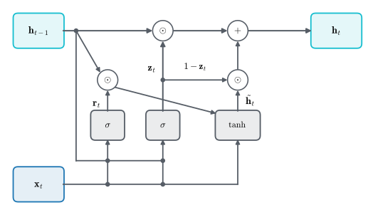
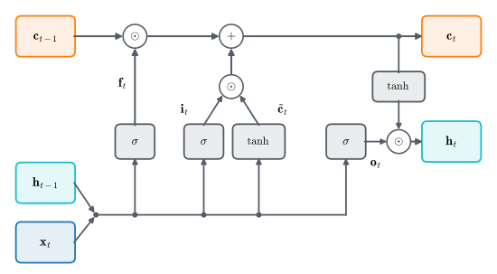

# Gated Recurrent Networks
:label:`sec_lstm`

To predict the next characters of "the keys to the cabinet in the hall",
a language model must remember that the subject, "keys", is plural, and by
the time the verb arrives, that word lies 30 characters back. The recurrent
networks of :numref:`sec_rnn-scratch` carry such information in a hidden
state that they rewrite at every step with a matrix product and a $\tanh$.
Information from 30 steps back reaches the present only through 30 of these
rewrites, and so does the gradient that would teach the network to keep it.
If each rewrite shrinks a signal by a factor of 0.9, 30 steps leave 4% of
it, and 100 steps leave 0.003%. Plain recurrent networks therefore learn
dependencies over a few dozen steps at best, while text, speech, and music
are full of longer ones.

The remedy that made recurrent networks practical, from the late 1990s
until transformers replaced them, is to let the network decide, for each
unit and at each step, how much of its state to keep. A unit that keeps its
state unchanged passes the stored information, and the gradient, through
the step without loss. The decision is made by a *gate*, a vector of
numbers between 0 and 1 that the network computes from its input and its
state. We build the two gated networks in wide use, the long short-term
memory (LSTM) and the gated recurrent unit (GRU), and test them on a task
that needs a long memory and on character-level language modeling. Gates
fix the memory, but they read the previous state, so training must still
process a sequence one step at a time. The next section removes that
restriction.

Throughout the chapter we write the equations for a single sequence, with
column vectors; the code processes a minibatch of sequences at once.

```{.python .input #lstm-gated-recurrent-networks}
%%tab pytorch
%matplotlib inline
from d2l import torch as d2l
import math
import numpy as np
import os
import torch
from torch import nn
from torch.nn import functional as F
```

```{.python .input #lstm-gated-recurrent-networks}
%%tab jax
%matplotlib inline
from d2l import jax as d2l
from flax import nnx
import jax
from jax import numpy as jnp
import math
import numpy as np
import optax
import os
import random
```

## Gates

### Vanishing Gradients

A plain recurrent network updates its hidden state $\mathbf{h}_t \in
\mathbb{R}^d$ from the previous state and the input $\mathbf{x}_t$,

$$\mathbf{h}_t = \tanh(\mathbf{W}_\textrm{hh} \mathbf{h}_{t-1} +
\mathbf{W}_\textrm{xh} \mathbf{x}_t + \mathbf{b}_\textrm{h}).$$

To see how far information travels, we ask how much a small change of the
state at step $t-k$ changes the state at step $t$. One step multiplies a
change by the Jacobian $\mathbf{J}_t = \textrm{diag}(1 - \mathbf{h}_t^2)\,
\mathbf{W}_\textrm{hh}$, the derivative of the $\tanh$ times the recurrent
matrix. Over $k$ steps the Jacobians multiply,

$$
\frac{\partial \mathbf{h}_t}{\partial \mathbf{h}_{t-k}} = \mathbf{J}_t
\mathbf{J}_{t-1} \cdots \mathbf{J}_{t-k+1},
$$
:eqlabel:`eq_lstm-jacobian-product`

and backpropagation sends the gradient of a loss at step $t$ back to step
$t-k$ through the transpose of the same product
(:numref:`subsec_bptt-gradient-pathologies`). With a single hidden unit the
product is a product of numbers $w (1 - h_s^2)$, each at most $|w|$ in
magnitude. If $|w| < 1$, the product shrinks at least as fast as $|w|^k$:
with $w = 0.9$, a change 30 steps back reaches the present at no more than
4% of its size. If $|w| > 1$, the product can grow until the $\tanh$ saturates, and
then the factor $1 - h_s^2$ drives it toward zero again. For matrices the
same holds with the largest singular value of $\mathbf{W}_\textrm{hh}$ in
place of $|w|$. To
carry information over hundreds of steps, a plain network would have to
keep every factor close to one at every step, by the choice of one matrix
shared by all steps. Gradient clipping limits gradients that grow; nothing
recovers a gradient that has vanished.

### An Additive Memory

The simplest state whose Jacobian is exactly one is a running sum,
$c_t = c_{t-1} + x_t$. Its derivative $\partial c_t / \partial c_{t-k}$ is
1 for every $k$: an input written at step 1 is still in the sum at step
1,000, and the gradient reaches it undiminished. But a running sum cannot
forget. Every input stays in it forever, so after many steps it holds a
mixture of everything the network has read, and its size grows with the
length of the sequence.

### Gates as Learned Decay

A useful memory keeps some things and drops others. We let the network
choose, at every step, a fraction $f_t \in (0, 1)$ of the old state to keep
and a fraction $i_t \in (0, 1)$ of new content $\tilde{c}_t$ to write:

$$c_t = f_t\, c_{t-1} + i_t\, \tilde{c}_t.$$
:eqlabel:`eq_lstm-gated-sum`

Along this path the derivative over $k$ steps is the product of the kept
fractions, $\partial c_t / \partial c_{t-k} = f_t f_{t-1} \cdots
f_{t-k+1}$. If the network keeps a constant fraction $f$, a stored value
decays like $f^k$ and halves every $\ln 2 / \ln(1/f)$ steps, its
*half-life*: about 7 steps for $f = 0.9$, 69 for $f = 0.99$, and 693 for
$f = 0.999$. A network that sets $f_t$ to one holds a value, and its
gradient, for as long as it likes; setting $f_t$ to zero erases it.

The fractions are computed by *gates*. A gate is a layer with a sigmoid
output, one value in $(0, 1)$ per unit, that reads the current input and
the previous output of the network. For the fraction kept, one per unit,

$$
\mathbf{f}_t = \sigma(\mathbf{W}_\textrm{xf} \mathbf{x}_t +
\mathbf{W}_\textrm{hf} \mathbf{h}_{t-1} + \mathbf{b}_\textrm{f}).
$$
:eqlabel:`eq_gate`

A gate multiplies a signal elementwise. A value near 1 lets the signal pass,
a value near 0 blocks it. Because the gate reads $\mathbf{x}_t$ and
$\mathbf{h}_{t-1}$, the decision depends on what the network is reading
and what it has stored; because $\sigma$ is smooth, the decision is learned
by gradient descent like every other weight.

Compare this with the plain network. There, the whole state is multiplied
by the matrix $\mathbf{W}_\textrm{hh}$, the same at every step, and pushed
through a $\tanh$. In the gated memory, each unit is multiplied by its own
number, chosen anew at every step, and nothing else happens to it. A
product of numbers below one cannot grow, so the memory path cannot
explode, and a gate held near one keeps it from vanishing. One detail
matters in practice: with small weights, a gate starts near $\sigma(0) =
1/2$, a half-life of one step. A gated network can learn long memories, but
it does not start with them.

## Long Short-Term Memory

### The Memory Cell

The *long short-term memory* (LSTM) of :citet:`Hochreiter.Schmidhuber.1997`,
with the forget gate added by :citet:`Gers.Schmidhuber.Cummins.2000`, builds
a recurrent layer around the gated sum :eqref:`eq_lstm-gated-sum`. Its name
contrasts two kinds of memory: the weights of a network change slowly and
store what holds for all sequences, while its activations are overwritten
at every step. The LSTM's *memory cell* $\mathbf{c}_t \in \mathbb{R}^d$ is
an activation designed to persist. Three gates of the form
:eqref:`eq_gate` control it: the *input gate* $\mathbf{i}_t$, the *forget
gate* $\mathbf{f}_t$, and the *output gate* $\mathbf{o}_t$,

$$
\begin{aligned}
\mathbf{i}_t &= \sigma(\mathbf{W}_\textrm{xi} \mathbf{x}_t + \mathbf{W}_\textrm{hi} \mathbf{h}_{t-1} + \mathbf{b}_\textrm{i}),\\
\mathbf{f}_t &= \sigma(\mathbf{W}_\textrm{xf} \mathbf{x}_t + \mathbf{W}_\textrm{hf} \mathbf{h}_{t-1} + \mathbf{b}_\textrm{f}),\\
\mathbf{o}_t &= \sigma(\mathbf{W}_\textrm{xo} \mathbf{x}_t + \mathbf{W}_\textrm{ho} \mathbf{h}_{t-1} + \mathbf{b}_\textrm{o}).
\end{aligned}
$$
:eqlabel:`lstm_gates`

A fourth layer of the same form, with a $\tanh$ in place of the sigmoid so
that content can be negative, proposes what to write, the *input node*
$\tilde{\mathbf{c}}_t = \tanh(\mathbf{W}_\textrm{xc} \mathbf{x}_t +
\mathbf{W}_\textrm{hc} \mathbf{h}_{t-1} + \mathbf{b}_\textrm{c})$. The cell
is the gated sum :eqref:`eq_lstm-gated-sum`, one copy per unit, and the
output gate decides how much of the cell the rest of the network sees:

$$
\mathbf{c}_t = \mathbf{f}_t \odot \mathbf{c}_{t-1} + \mathbf{i}_t \odot
\tilde{\mathbf{c}}_t, \qquad \mathbf{h}_t = \mathbf{o}_t \odot
\tanh(\mathbf{c}_t).
$$
:eqlabel:`lstm_update`

Here $\odot$ is the elementwise product. The cell is the network's memory,
and $\mathbf{h}_t$ is what it reports: the next layer, the output layer,
and the gates of the next step read $\mathbf{h}_t$, never $\mathbf{c}_t$
directly. The output gate lets a unit hold a value without showing it, for
instance a plural subject that matters only when a verb arrives, and
reveal it when it becomes relevant. :numref:`fig_lstm_cell` shows the data
flow.


:label:`fig_lstm_cell`

Follow the cell along the top of the figure. Between $\mathbf{c}_{t-1}$
and $\mathbf{c}_t$ there is one elementwise product and one sum, no matrix
and no saturating nonlinearity, so with the gates held fixed the Jacobian
$\partial \mathbf{c}_t / \partial \mathbf{c}_{t-1}$ is the diagonal matrix
$\textrm{diag}(\mathbf{f}_t)$. A reader may object that the gates are not
fixed: they read $\mathbf{h}_{t-1}$, which depends on $\mathbf{c}_{t-1}$, so
the full derivative contains further terms that pass through the gates and
the recurrent matrices, with the products of
:eqref:`eq_lstm-jacobian-product`. That is correct. The cell does not
guarantee that every gradient survives; it provides one path along which
gradients can survive, and training decides whether the gates keep it
open.

### Implementation

We write the layer out step by step. The four layers that compute
$\mathbf{i}_t$, $\mathbf{f}_t$, $\tilde{\mathbf{c}}_t$, and $\mathbf{o}_t$
read the same inputs, so we stack their weights and compute all four with
one matrix product per input, then split the result. In the code each row
of a minibatch is one sequence, so the weights multiply from the right and
hold the transposes of the matrices in the equations.

```{.python .input #lstm-implementation-1}
%%tab pytorch
class LSTMScratch(nn.Module):
    """An LSTM layer computed one time step at a time."""
    def __init__(self, num_inputs, num_hiddens):
        super().__init__()
        self.num_hiddens = num_hiddens
        scale = 1 / math.sqrt(num_hiddens)
        # Weights of i, f, c_tilde, and o, stacked along the last axis
        self.W_x = nn.Parameter(torch.randn(num_inputs, 4 * num_hiddens) * scale)
        self.W_h = nn.Parameter(torch.randn(num_hiddens, 4 * num_hiddens) * scale)
        self.b = nn.Parameter(torch.zeros(4 * num_hiddens))

    def forward(self, X):  # X: (batch_size, num_steps, num_inputs)
        h = c = torch.zeros(X.shape[0], self.num_hiddens, device=X.device)
        outputs = []
        for x in X.unbind(1):  # One time step at a time
            i, f, c_tilde, o = (x @ self.W_x + h @ self.W_h + self.b).chunk(4, -1)
            c = torch.sigmoid(f) * c + torch.sigmoid(i) * torch.tanh(c_tilde)
            h = torch.sigmoid(o) * torch.tanh(c)
            outputs.append(h)
        return torch.stack(outputs, 1)  # (batch_size, num_steps, num_hiddens)
```

```{.python .input #lstm-implementation-1}
%%tab jax
class LSTMScratch(nnx.Module):
    """An LSTM layer computed one time step at a time."""
    def __init__(self, num_inputs, num_hiddens, *, rngs):
        self.num_hiddens = num_hiddens
        scale = 1 / math.sqrt(num_hiddens)
        # Weights of i, f, c_tilde, and o, stacked along the last axis
        self.W_x = nnx.Param(
            rngs.params.normal((num_inputs, 4 * num_hiddens)) * scale)
        self.W_h = nnx.Param(
            rngs.params.normal((num_hiddens, 4 * num_hiddens)) * scale)
        self.b = nnx.Param(jnp.zeros(4 * num_hiddens))

    def __call__(self, X):  # X: (batch_size, num_steps, num_inputs)
        def step(state, x):
            h, c = state
            i, f, c_tilde, o = jnp.split(
                x @ self.W_x[...] + h @ self.W_h[...] + self.b[...], 4, -1)
            c = jax.nn.sigmoid(f) * c + jax.nn.sigmoid(i) * jnp.tanh(c_tilde)
            h = jax.nn.sigmoid(o) * jnp.tanh(c)
            return (h, c), h
        h = c = jnp.zeros((X.shape[0], self.num_hiddens))
        # lax.scan steps through the leading axis, so time goes first
        _, outputs = jax.lax.scan(step, (h, c), jnp.swapaxes(X, 0, 1))
        return jnp.swapaxes(outputs, 0, 1)  # (batch_size, num_steps, ...)
```

Deep learning frameworks provide the LSTM as a library layer that runs the
same recurrence in a fused, compiled loop. To check that it computes
:eqref:`lstm_gates` and :eqref:`lstm_update` and nothing else, we copy its
weights into our layer and compare the outputs on random inputs.

```{.python .input #lstm-implementation-2}
%%tab pytorch
lstm = nn.LSTM(16, 32, batch_first=True)  # Stacks its weights as i, f, c~, o
cell = LSTMScratch(16, 32)
with torch.no_grad():
    cell.W_x.copy_(lstm.weight_ih_l0.T)
    cell.W_h.copy_(lstm.weight_hh_l0.T)
    cell.b.copy_(lstm.bias_ih_l0 + lstm.bias_hh_l0)
X = torch.randn(4, 9, 16)  # (batch_size, num_steps, num_inputs)
print(f'max difference: {(cell(X) - lstm(X)[0]).abs().max():.1e}')
```

```{.python .input #lstm-implementation-2}
%%tab jax
lstm_cell = nnx.LSTMCell(16, 32, rngs=nnx.Rngs(0))  # A layer per gate
lstm = nnx.RNN(lstm_cell)
cell = LSTMScratch(16, 32, rngs=nnx.Rngs(1))
heads = [(lstm_cell.ii, lstm_cell.hi), (lstm_cell.if_, lstm_cell.hf),
         (lstm_cell.ig, lstm_cell.hg), (lstm_cell.io, lstm_cell.ho)]
cell.W_x[...] = jnp.concatenate([x.kernel[...] for x, _ in heads], 1)
cell.W_h[...] = jnp.concatenate([h.kernel[...] for _, h in heads], 1)
cell.b[...] = jnp.concatenate([h.bias[...] for _, h in heads])
X = jax.random.normal(jax.random.key(0), (4, 9, 16))
print(f'max difference: {jnp.abs(cell(X) - lstm(X)).max():.1e}')
```

The outputs agree to the rounding error of 32-bit arithmetic. From now on
we use the library layer, which is much faster. It is still a loop over
time steps, each waiting for the one before.

## Gated Recurrent Units
:label:`sec_gru`

The LSTM keeps two vectors per step, the cell and the output, and computes
four gated layers. The *gated recurrent unit* (GRU) of
:citet:`Cho.Van-Merrienboer.Bahdanau.ea.2014` keeps one vector and computes
three, and it trains about as well as the LSTM on many tasks
:cite:`Chung.Gulcehre.Cho.ea.2014`.

### Reset and Update Gates

The GRU has two gates of the form :eqref:`eq_gate`, a *reset gate*
$\mathbf{r}_t$ and an *update gate* $\mathbf{z}_t$:

$$
\mathbf{r}_t = \sigma(\mathbf{W}_\textrm{xr} \mathbf{x}_t +
\mathbf{W}_\textrm{hr} \mathbf{h}_{t-1} + \mathbf{b}_\textrm{r}), \qquad
\mathbf{z}_t = \sigma(\mathbf{W}_\textrm{xz} \mathbf{x}_t +
\mathbf{W}_\textrm{hz} \mathbf{h}_{t-1} + \mathbf{b}_\textrm{z}).
$$
:eqlabel:`gru_gates`

The reset gate acts inside a plain recurrent update that proposes a
*candidate state*,

$$
\tilde{\mathbf{h}}_t = \tanh\big(\mathbf{W}_\textrm{xh} \mathbf{x}_t +
\mathbf{W}_\textrm{hh} (\mathbf{r}_t \odot \mathbf{h}_{t-1}) +
\mathbf{b}_\textrm{h}\big).
$$
:eqlabel:`gru_tilde_H`

With $\mathbf{r}_t$ near one the candidate is the plain recurrent update;
with $\mathbf{r}_t$ near zero it ignores the state and reads only the
current input, as if the sequence started anew. The update gate then
blends the old state with the candidate:

$$
\mathbf{h}_t = \mathbf{z}_t \odot \mathbf{h}_{t-1} + (1 - \mathbf{z}_t)
\odot \tilde{\mathbf{h}}_t.
$$
:eqlabel:`gru_H`

This is the gated sum :eqref:`eq_lstm-gated-sum` with the input gate tied
to the forget gate, $i_t = 1 - f_t$: whatever fraction of the old state is
dropped is filled with new content. Where $\mathbf{z}_t$ is near one, the
state is copied and the step is skipped; where it is near zero, the state
is overwritten. Each coordinate of $\mathbf{h}_t$ is a weighted average of
two numbers in $[-1, 1]$, so the state stays bounded without a second
$\tanh$, and one vector serves as both memory and output.
:numref:`fig_gru_cell` shows the cell. With input and hidden width $d$, a
GRU layer has $3 \cdot 2d^2$ weights against the LSTM's $4 \cdot 2d^2$.


:label:`fig_gru_cell`

### Implementation

Writing the GRU from scratch would repeat `LSTMScratch` with three heads
in place of four, which is left to an exercise. The encoder–decoder models
of :numref:`sec_seq2seq` use a GRU in the interface of the recurrent
layers of :numref:`sec_rnn-concise`, which take inputs with time along the
first axis and return the outputs together with the final state. We save
such a layer around the library implementation.

```{.python .input #lstm-implementation-and-comparison-1}
%%tab pytorch
class GRU(d2l.RNN):  #@save
    """The multilayer GRU model implemented with high-level APIs."""
    def __init__(self, num_inputs, num_hiddens, num_layers=1, dropout=0):
        d2l.Module.__init__(self)
        self.save_hyperparameters()
        self.rnn = nn.GRU(num_inputs, num_hiddens, num_layers,
                          dropout=dropout)
```

```{.python .input #lstm-implementation-and-comparison-1}
%%tab jax
class GRU(d2l.RNN):  #@save
    """The multilayer GRU model implemented with high-level APIs."""
    def __init__(self, num_inputs, num_hiddens, num_layers=1, dropout=0,
                 rngs=None):
        rngs = nnx.Rngs(random.getrandbits(32)) if rngs is None else rngs
        self.num_inputs, self.num_hiddens = num_inputs, num_hiddens
        self.num_layers = num_layers
        self.rnns = nnx.List([
            nnx.RNN(nnx.GRUCell(num_inputs if i == 0 else num_hiddens,
                                num_hiddens, rngs=rngs),
                    time_major=True, return_carry=True, rngs=rngs)
            for i in range(num_layers)])
        self.dropouts = nnx.List([
            nnx.Dropout(dropout, rngs=rngs) for _ in range(num_layers - 1)])

    def __call__(self, X, state=None):
        outputs = X
        state = [None] * self.num_layers if state is None else state
        new_state = []
        for i, rnn in enumerate(self.rnns):
            carry, outputs = rnn(outputs, initial_carry=state[i])
            new_state.append(carry)
            if i < self.num_layers - 1:
                outputs = self.dropouts[i](outputs)
        return outputs, new_state
```

## Training Gated Networks

### Delayed Recall
:label:`subsec_delayed-recall`

How long can each network keep a token? We test it directly with a
*delayed recall* task. A sequence starts with one of eight symbols,
followed by $T - 1$ filler tokens drawn at random from eight other symbols,
and at the end the network must name the first symbol. It can do so only by
carrying the symbol through $T - 1$ updates, each of which reads a token
that does not matter. Chance accuracy is 1/8.

```{.python .input #lstm-delayed-recall-1}
%%tab pytorch, jax
def delayed_recall(rng, batch_size, num_steps, num_symbols=8,  #@save
                   blank_fillers=False):
    """A symbol, then num_steps - 1 fillers; the target is the symbol."""
    Y = rng.integers(0, num_symbols, batch_size)
    X = rng.integers(num_symbols, 2 * num_symbols, (batch_size, num_steps))
    if blank_fillers:  # The same filler token at every step
        X[:] = num_symbols
    X[:, 0] = Y
    return X, Y

X, Y = delayed_recall(np.random.default_rng(0), 2, 6)
print(X, Y)
```

The model embeds the tokens in 32 dimensions, runs one recurrent layer with
64 hidden units, and classifies the symbol from the layer's last output.

:begin_tab:`pytorch`
The library's recurrent layers return their outputs together with their
final state; a small wrapper keeps only the outputs, which is the
interface that all sequence layers of this chapter share.

The chapter's models initialize their own linear and convolutional layers
with `init_lecun`. It draws the weights from the LeCun normal distribution,
of variance $1/n_\textrm{in}$ (:numref:`sec_numerical_stability`), and sets
the biases to zero. A projection then passes on the variance of its
input, so signals keep their scale through the projections, gates, and
residual blocks of these models. The default of `nn.Linear` draws weights and biases
uniformly from $[-1/\sqrt{n_\textrm{in}}, 1/\sqrt{n_\textrm{in}}]$, a weight
variance of $1/(3 n_\textrm{in})$; with it, whether gated linear attention
learns the recall task of :numref:`sec_hybrids` depends on the random seed.
Biases with a purpose, such as the gate biases of later sections, are set
after `init_lecun`. It also covers the library's recurrent layers, whose
default draws all weights and biases from the same uniform distribution
with $n_\textrm{in}$ replaced by the hidden size: their input and recurrent
matrices get LeCun normal weights, and their biases start at zero.
:end_tab:

:begin_tab:`jax`
Flax's `nnx.RNN` turns a recurrent cell into a layer that returns the
outputs at all steps, which is the interface that all sequence layers of
this chapter share. Flax's linear layers and the input matrices of its
recurrent cells start with LeCun normal weights and zero biases, the
convention of all models in this chapter. Its recurrent matrices start as
random orthogonal matrices by default; we pass `recurrent_kernel_init` to
give them LeCun normal weights as well.
:end_tab:

```{.python .input #lstm-delayed-recall-2}
%%tab pytorch
def init_lecun(module):  #@save
    """LeCun normal weights and zero biases for all linear, convolutional,
    and recurrent layers."""
    for layer in module.modules():
        if isinstance(layer, (nn.Linear, nn.Conv1d)):
            fan_in = layer.weight[0].numel()  # Inputs of one output unit
            nn.init.normal_(layer.weight, std=fan_in ** -0.5)
            if layer.bias is not None:
                nn.init.zeros_(layer.bias)
        elif isinstance(layer, nn.RNNBase):  # Input and recurrent matrices
            for name, param in layer.named_parameters():
                if name.startswith('weight'):
                    nn.init.normal_(param, std=param.shape[1] ** -0.5)
                else:
                    nn.init.zeros_(param)
    return module

class Recurrent(nn.Module):  #@save
    """A batch-first recurrent layer that returns only its outputs."""
    def __init__(self, rnn):
        super().__init__()
        self.rnn = rnn

    def forward(self, X):
        return self.rnn(X)[0]

class RecallModel(nn.Module):  #@save
    """Embedding, a sequence layer, and a classifier of its last output."""
    def __init__(self, layer, num_hiddens, vocab_size=16, num_inputs=32,
                 num_outputs=8):
        super().__init__()
        self.embedding = nn.Embedding(vocab_size, num_inputs)
        nn.init.normal_(self.embedding.weight, std=num_inputs ** -0.5)
        self.layer = layer
        self.head = init_lecun(nn.Linear(num_hiddens, num_outputs))

    def forward(self, X):
        return self.head(self.layer(self.embedding(X))[:, -1])
```

```{.python .input #lstm-delayed-recall-2}
%%tab jax
class RecallModel(nnx.Module):  #@save
    """Embedding, a sequence layer, and a classifier of its last output."""
    def __init__(self, layer, num_hiddens, vocab_size=16, num_inputs=32,
                 num_outputs=8, *, rngs):
        self.embedding = nnx.Embed(vocab_size, num_inputs, rngs=rngs,
            embedding_init=nnx.initializers.normal(num_inputs ** -0.5))
        self.layer = layer
        self.head = nnx.Linear(num_hiddens, num_outputs, rngs=rngs)

    def __call__(self, X):
        # A one-hot product instead of a lookup: on GPUs, the gradient of a
        # lookup is slow when a few tokens make up most of the input
        E = jax.nn.one_hot(X, self.embedding.num_embeddings) @ \
            self.embedding.embedding[...]
        return self.head(self.layer(E)[:, -1])
```

Besides the three networks with their gates starting near one half, we train an
LSTM and a GRU whose gates start out keeping their state: the bias of the
LSTM's forget gate is set to 5 and that of its input gate to $-5$, and the
bias of the GRU's update gate to 5. Since $\sigma(5) = 0.993$, these gates
start with a half-life of about 100 steps instead of one.

```{.python .input #lstm-delayed-recall-3}
%%tab pytorch
def init_keep_gate(rnn, bias=5.0):
    """Start an LSTM's forget gate, or a GRU's update gate, near one."""
    h = rnn.hidden_size
    with torch.no_grad():
        rnn.bias_ih_l0.zero_()
        rnn.bias_hh_l0.zero_()
        rnn.bias_ih_l0[h:2 * h] = bias  # LSTM: i, f, c~, o; GRU: r, z, n
        if isinstance(rnn, nn.LSTM):
            rnn.bias_ih_l0[:h] = -bias  # Input gate near zero
    return rnn
```

```{.python .input #lstm-delayed-recall-3}
%%tab jax
def init_keep_gate(cell, bias=5.0):
    """Start an LSTM's forget gate, or a GRU's update gate, near one."""
    if isinstance(cell, nnx.LSTMCell):
        cell.hf.bias[...] = jnp.full_like(cell.hf.bias[...], bias)
        cell.hi.bias[...] = jnp.full_like(cell.hi.bias[...], -bias)  # Input
    else:  # GRUCell: input biases ordered r, z, n
        h = cell.dense_i.bias.shape[0] // 3
        cell.dense_i.bias[...] = cell.dense_i.bias[...].at[h:2 * h].set(bias)
    return cell
```

Each model is trained with Adam on fresh random batches for 1,500 steps
and tested on 2,048 new sequences.

```{.python .input #lstm-delayed-recall-4}
%%tab pytorch
def train_delayed_recall(model, num_steps, blank_fillers=False,  #@save
                         num_updates=1500, lr=3e-3):
    """Train on fresh batches of delayed recall; return the test accuracy."""
    device, rng = d2l.try_gpu(), np.random.default_rng(0)
    batch = lambda rng, n: (torch.tensor(A, device=device) for A in
                            delayed_recall(rng, n, num_steps,
                                           blank_fillers=blank_fillers))
    model.to(device)
    optimizer = torch.optim.Adam(model.parameters(), lr=lr)
    for _ in range(num_updates):
        X, Y = batch(rng, 128)
        loss = F.cross_entropy(model(X), Y)
        optimizer.zero_grad()
        loss.backward()
        nn.utils.clip_grad_norm_(model.parameters(), 1.0)
        optimizer.step()
    X, Y = batch(np.random.default_rng(1), 2048)
    with torch.inference_mode():
        return (model(X).argmax(-1) == Y).float().mean().item()
```

```{.python .input #lstm-delayed-recall-4}
%%tab jax
@nnx.jit  #@save
def recall_step(model, optimizer, X, Y):
    """One Adam step on the cross-entropy of the classifier's output."""
    def loss_fn(model):
        return optax.softmax_cross_entropy_with_integer_labels(
            model(X), Y).mean()
    loss, grads = nnx.value_and_grad(loss_fn)(model)
    optimizer.update(model, grads)
    return loss

@nnx.jit  #@save
def recall_predict(model, X):
    """The predicted class of every sequence."""
    return model(X).argmax(-1)

def train_delayed_recall(model, num_steps, blank_fillers=False,  #@save
                         num_updates=1500, lr=3e-3):
    """Train on fresh batches of delayed recall; return the test accuracy."""
    rng = np.random.default_rng(0)
    batch = lambda rng, n: delayed_recall(rng, n, num_steps,
                                          blank_fillers=blank_fillers)
    optimizer = nnx.Optimizer(model, optax.chain(
        optax.clip_by_global_norm(1.0), optax.adam(lr)), wrt=nnx.Param)
    step = nnx.cached_partial(recall_step, model, optimizer)  # Compile once
    for _ in range(num_updates):
        step(*batch(rng, 128))
    X, Y = batch(np.random.default_rng(1), 2048)
    return float((recall_predict(model, X) == Y).mean())
```

```{.python .input #lstm-delayed-recall-5}
%%tab pytorch
layers = {'RNN': lambda: init_lecun(nn.RNN(32, 64, batch_first=True)),
          'LSTM': lambda: init_lecun(nn.LSTM(32, 64, batch_first=True)),
          'GRU': lambda: init_lecun(nn.GRU(32, 64, batch_first=True)),
          'LSTM, keep gate': lambda: init_keep_gate(init_lecun(
              nn.LSTM(32, 64, batch_first=True))),
          'GRU, keep gate': lambda: init_keep_gate(init_lecun(
              nn.GRU(32, 64, batch_first=True)))}
lengths = [5, 10, 20, 50, 100, 200]
print(' ' * 16, ' '.join(f'{T:5d}' for T in lengths))
for name, layer in layers.items():
    accuracy = [train_delayed_recall(RecallModel(Recurrent(layer()), 64), T)
                for T in lengths]
    print(f'{name:16s}', ' '.join(f'{a:5.2f}' for a in accuracy))
```

```{.python .input #lstm-delayed-recall-5}
%%tab jax
lecun = {'recurrent_kernel_init': nnx.initializers.lecun_normal()}
cells = {'RNN': lambda rngs: nnx.SimpleCell(32, 64, rngs=rngs, **lecun),
         'LSTM': lambda rngs: nnx.LSTMCell(32, 64, rngs=rngs, **lecun),
         'GRU': lambda rngs: nnx.GRUCell(32, 64, rngs=rngs, **lecun),
         'LSTM, keep gate': lambda rngs: init_keep_gate(
             nnx.LSTMCell(32, 64, rngs=rngs, **lecun)),
         'GRU, keep gate': lambda rngs: init_keep_gate(
             nnx.GRUCell(32, 64, rngs=rngs, **lecun))}
lengths = [5, 10, 20, 50, 100, 200]
print(' ' * 16, ' '.join(f'{T:5d}' for T in lengths))
for name, cell in cells.items():
    accuracy = []
    for T in lengths:
        rngs = nnx.Rngs(random.getrandbits(32))
        model = RecallModel(nnx.RNN(cell(rngs)), 64, rngs=rngs)
        accuracy.append(train_delayed_recall(model, T))
    print(f'{name:16s}', ' '.join(f'{a:5.2f}' for a in accuracy))
```

With their gates starting near one half, the LSTM and the GRU recall the
symbol after 10 steps and are at chance after 50; in some runs the LSTM
fails already at 20. The plain RNN is erratic: from 50 steps on, it
recalls anywhere from none to nearly all of the symbols, and which it is
changes from run to run and from one delay to the next. The LSTM and the GRU whose keep gates start near one recall
it after 200 steps. The architecture is the same in both pairs of rows; only
the initialization differs. A gate that starts at one half halves the memory
at every step, so the gradient that would teach it to keep the symbol
shrinks like $2^{-k}$ over $k$ steps, and training never finds the setting
that would solve the task. A gate that starts near one passes the gradient
back through hundreds of steps. Gates make a long memory possible and
learnable, but whether training finds it depends on where the gates start.

### Deep Recurrent Networks
:label:`subsec_deep-rnn`

A single recurrent layer computes one nonlinear update per step. To
compute more complex functions of the past, we stack layers: the outputs
of one layer are the input sequence of the next. Stacked recurrent layers
are trained with the same techniques as stacked transformer blocks
(:numref:`sec_transformer-block`): each layer is wrapped in a *residual
connection*, which adds the layer's output to its input, with a layer
normalization in front, and is followed by a small multilayer perceptron
(MLP) that transforms each position separately. The residual connections
give the gradient a direct path through the depth of the network, as the
gated cell gives it one through time.

We save this stack once, because every model in the chapter is an
instance of it. `SeqLM` embeds the tokens, applies one residual block per
*sequence mixer*, our name for the layer that passes information along the
sequence, and predicts the next token from each position. The mixers are
passed in as a list, so the same stack can hold an LSTM here, the layers of
the coming sections, or a mixture of them. Each mixer maps a minibatch of
sequences of shape (batch size, number of steps, $d$) to one of the same
shape. The token embeddings start with entries of standard deviation
$1/\sqrt{d}$, so that every embedded token has about unit length.

```{.python .input #lstm-deep-recurrent-networks-1}
%%tab pytorch
class SeqLM(nn.Module):  #@save
    """A language model of residual blocks: a sequence mixer, then an MLP."""
    def __init__(self, vocab_size, num_hiddens, mixers):
        super().__init__()
        d = num_hiddens
        self.embedding = nn.Embedding(vocab_size, d)
        nn.init.normal_(self.embedding.weight, std=d ** -0.5)  # Unit length
        self.mixers = nn.ModuleList(mixers)
        self.norms = nn.ModuleList([nn.LayerNorm(d) for _ in mixers])
        self.mlps = nn.ModuleList([nn.Sequential(
            nn.LayerNorm(d), nn.Linear(d, 4 * d), nn.GELU(),
            nn.Linear(4 * d, d)) for _ in mixers])
        self.norm = nn.LayerNorm(d)
        self.head = nn.Linear(d, vocab_size)
        for module in (self.mlps, self.head):  # Mixers initialize themselves
            init_lecun(module)

    def forward(self, X):
        H = self.embedding(X)  # (batch_size, num_steps, num_hiddens)
        for norm, mixer, mlp in zip(self.norms, self.mixers, self.mlps):
            H = H + mixer(norm(H))
            H = H + mlp(H)
        return self.head(self.norm(H))  # (batch_size, num_steps, vocab_size)
```

```{.python .input #lstm-deep-recurrent-networks-1}
%%tab jax
class SeqLM(nnx.Module):  #@save
    """A language model of residual blocks: a sequence mixer, then an MLP."""
    def __init__(self, vocab_size, num_hiddens, mixers, *, rngs):
        d = num_hiddens
        self.embedding = nnx.Embed(vocab_size, d, rngs=rngs,  # Unit length
            embedding_init=nnx.initializers.normal(d ** -0.5))
        self.mixers = nnx.List(mixers)
        norm = lambda: nnx.LayerNorm(d, epsilon=1e-5, rngs=rngs)
        self.norms = nnx.List([norm() for _ in mixers])
        self.mlps = nnx.List([nnx.Sequential(
            norm(), nnx.Linear(d, 4 * d, rngs=rngs),
            lambda x: nnx.gelu(x, approximate=False),  # Exact GELU
            nnx.Linear(4 * d, d, rngs=rngs)) for _ in mixers])
        self.norm = norm()
        self.head = nnx.Linear(d, vocab_size, rngs=rngs)

    def __call__(self, X):
        # A one-hot product instead of a lookup, as in RecallModel
        H = jax.nn.one_hot(X, self.embedding.num_embeddings) @ \
            self.embedding.embedding[...]  # (batch_size, num_steps, d)
        for norm, mixer, mlp in zip(self.norms, self.mixers, self.mlps):
            H = H + mixer(norm(H))
            H = H + mlp(H)
        return self.head(self.norm(H))  # (batch_size, num_steps, vocab_size)
```

A recurrent layer can also read the sequence backward. A *bidirectional*
network :cite:`Schuster.Paliwal.1997` runs a second layer from the last
step to the first and concatenates the two outputs, so that the
representation of each position depends on the whole sequence. This helps
whenever the whole input is given, as in tagging the words of a sentence
or encoding a sentence for translation. It cannot be used for language
modeling: the backward layer reads the token that the model is asked to
predict, so the training loss falls without the model learning to predict
anything, and at generation time the future tokens do not exist.

### Character-Level Language Modeling

Every section of this chapter trains its models on the same language
modeling task, so that their perplexities can be compared. The text is the
*Penn Treebank* :cite:`Marcus.Santorini.Marcinkiewicz.1993`, about one
million words of *Wall Street Journal* articles, in the version commonly
used for language modeling: lowercased, with numbers replaced by `N`,
rare words by `<unk>`, and a standard split into training and validation
text. We model it character by character, with a vocabulary of about 50
characters, and cut the text into windows of 128 characters, which cover
about 25 words. The training text has 5 million characters. *The Time
Machine* of :numref:`sec_text-sequence`, with under 200,000, is too small
for the models of this chapter: they memorize it within a few thousand
training steps.

```{.python .input #lstm-character-level-language-modeling-1}
%%tab pytorch, jax
class PennTreebank(d2l.DataModule):  #@save
    """Character-level Penn Treebank, cut into windows of num_steps."""
    def __init__(self, batch_size, num_steps):
        super().__init__()
        self.save_hyperparameters()
        data_dir = d2l.download_extract('ptb')
        def read(split):
            with open(os.path.join(data_dir, f'ptb.{split}.txt')) as f:
                return f.read()
        train, val = read('train'), read('valid')
        self.vocab = d2l.Vocab(list(train))
        self.train, self.val = self.windows(train), self.windows(val)

    def windows(self, text):
        corpus = d2l.tensor(self.vocab[list(text)])
        n = (len(corpus) - 1) // self.num_steps * self.num_steps
        return (corpus[:n].reshape(-1, self.num_steps),  # Inputs
                corpus[1:n + 1].reshape(-1, self.num_steps))  # Next tokens

    def get_dataloader(self, train):
        return self.get_tensorloader(self.train if train else self.val, train)
```

```{.python .input #lstm-character-level-language-modeling-2}
%%tab pytorch, jax
data = PennTreebank(batch_size=64, num_steps=128)
print(f'{len(data.vocab)} characters, {len(data.train[0])} training and '
      f'{len(data.val[0])} validation windows')
```

We measure a model by its *perplexity* on the validation text, the
exponential of the average cross-entropy loss per character
(:numref:`sec_language-model`). A perplexity of 3 means that the model is,
on average, as uncertain about the next character as if it chose
uniformly among 3 candidates.

```{.python .input #lstm-character-level-language-modeling-3}
%%tab pytorch
def lm_perplexity(model, data):  #@save
    """Perplexity of a language model on the validation set of `data`."""
    device = next(model.parameters()).device
    total, count = 0, 0
    with torch.inference_mode():
        for X, Y in data.val_dataloader():
            logits = model(X.to(device))
            total += F.cross_entropy(logits.flatten(0, 1),
                                     Y.to(device).flatten(), reduction='sum')
            count += Y.numel()
    return math.exp(float(total) / count)
```

```{.python .input #lstm-character-level-language-modeling-3}
%%tab jax
@nnx.jit  #@save
def lm_loss_sum(model, X, Y):
    """Summed next-token cross-entropy of a batch."""
    return optax.softmax_cross_entropy_with_integer_labels(model(X), Y).sum()

def lm_perplexity(model, data):  #@save
    """Perplexity of a language model on the validation set of `data`."""
    loss_sum = nnx.cached_partial(lm_loss_sum, model)  # Compile once, reuse
    total, count = 0, 0
    for X, Y in data.val_dataloader():
        total += loss_sum(X, Y)
        count += Y.size
    return math.exp(float(total) / count)
```

All models are trained with the same recipe: AdamW
(:numref:`sec_adamw`) with learning rate 0.002 and weight decay 0.01, for
3,000 steps of 64 windows, using the training loop `d2l.train_lm` of
:numref:`sec_adam`, which draws minibatches and takes optimizer steps. The
3,000 steps cover the training text about five times.

```{.python .input #lstm-character-level-language-modeling-4}
%%tab pytorch
def fit_lm(model, data, num_steps=3000, lr=2e-3):  #@save
    """Train with AdamW for num_steps steps; return validation perplexity."""
    optimizer = torch.optim.AdamW(model.parameters(), lr=lr,
                                  weight_decay=0.01)
    d2l.train_lm(model, data, optimizer, num_steps)
    return lm_perplexity(model, data)
```

```{.python .input #lstm-character-level-language-modeling-4}
%%tab jax
def fit_lm(model, data, num_steps=3000, lr=2e-3):  #@save
    """Train with AdamW for num_steps steps; return validation perplexity."""
    optimizer = nnx.Optimizer(model, optax.adamw(lr, weight_decay=0.01),
                              wrt=nnx.Param)
    d2l.train_lm(model, data, optimizer, num_steps)
    return lm_perplexity(model, data)
```

We train three models of width $d = 128$ with two blocks each, whose
mixers are a plain recurrent layer, an LSTM, and a GRU.

```{.python .input #lstm-character-level-language-modeling-5}
%%tab pytorch
results = {}
for name, layer in {'RNN': nn.RNN, 'LSTM': nn.LSTM, 'GRU': nn.GRU}.items():
    mixers = [Recurrent(init_lecun(layer(128, 128, batch_first=True)))
              for _ in range(2)]
    model = SeqLM(len(data.vocab), 128, mixers)
    num_params = sum(p.numel() for p in model.parameters())
    results[name] = num_params, fit_lm(model, data)
```

```{.python .input #lstm-character-level-language-modeling-5}
%%tab jax
results = {}
cells = {'RNN': nnx.SimpleCell, 'LSTM': nnx.LSTMCell, 'GRU': nnx.GRUCell}
for name, cell in cells.items():
    rngs = nnx.Rngs(random.getrandbits(32))
    mixers = [nnx.RNN(cell(128, 128, rngs=rngs, **lecun)) for _ in range(2)]
    model = SeqLM(len(data.vocab), 128, mixers, rngs=rngs)
    num_params = sum(p.size for p in jax.tree.leaves(nnx.state(model, nnx.Param)))
    results[name] = num_params, fit_lm(model, data)
```

```{.python .input #lstm-character-level-language-modeling-6}
%%tab pytorch, jax
for name, (num_params, ppl) in results.items():
    print(f'{name:5s} {num_params:9,d} parameters   perplexity {ppl:.2f}')
```

All three models reach validation perplexities between about 2.95 and 3.15. The
gated networks are a few percent better than the plain one, and the LSTM
and the GRU cannot be told apart. Character-level language modeling at this
scale rewards long memory little: the next character of a word depends
mostly on the last few characters, which a plain recurrent network keeps
without difficulty. The delayed recall task isolates long memory, and on it
the models differ sharply. Later sections report both kinds of result, and
the language modeling task serves mainly to check that a new model learns
ordinary text as well as the old ones.

The gates solved the memory problem, but not the speed problem. Every gate
reads $\mathbf{h}_{t-1}$, so step $t$ cannot begin until step $t-1$ has
finished, and a sequence of $T$ tokens takes $T$ dependent steps to train,
however many processors are available. The next section asks what remains
of a gated network when the gates read only the input.

## Summary

A plain recurrent network passes information, and gradients, from step to
step through a product of Jacobians, which shrinks or grows geometrically
with the distance, so it learns dependencies over a few dozen steps at
best. Gated networks add a memory that each unit updates as a gated sum: it
keeps a fraction of its old value and adds a fraction of new content, both
fractions computed by sigmoid gates from the current input and the previous
output. Along this path the gradient is a product of the kept fractions,
which the network can hold near one. The LSTM keeps a separate cell
controlled by input, forget, and output gates; the GRU blends its old state
with a candidate through one update gate and filters the candidate with a
reset gate. Both remember over spans where a plain network fails, and both
still train one step at a time, because their gates read the previous
state.

## Exercises

1. **Holding a value.** Suppose that the character at step $s$ determines
   the prediction at a much later step $t$, and that one LSTM unit is to
   carry it from $s$ to $t$.
    1. State the value that each gate of that unit in :eqref:`lstm_gates`
       should take at step $s$, at the steps strictly between $s$ and $t$,
       and at step $t$. Then do the same for the update gate of a GRU unit
       in :eqref:`gru_H`.
    1. A sigmoid gate never reaches 1. Suppose that the forget gate's
       pre-activation stays at a constant $b$, so that its value is
       $\sigma(b)$ at every step. What fraction of the stored value survives
       $k$ steps along the direct path? How large must $b$ be for 90% of
       the value to survive 1,000 steps?
    1. Show that a forget-gate bias of $\log(T - 1)$ gives an initial
       forget gate of $1 - 1/T$ when the weights are zero, so that for large
       $T$ a stored value decays by a factor of about $e$ over $T$ steps.
       The *chrono initialization* of :citet:`Tallec.Ollivier.2018` draws
       the forget-gate bias of each unit as $\log u$, with $u$ uniform on
       $[1, T_\textrm{max} - 1]$, and sets $\mathbf{b}_\textrm{i} =
       -\mathbf{b}_\textrm{f}$. Show that with zero weights this makes
       $\mathbf{f}_t + \mathbf{i}_t = 1$, and compare the resulting cell
       update with :eqref:`gru_H`.

1. **Output squashing.** The input node $\tilde{\mathbf{c}}_t$ is already
   squashed by a $\tanh$, yet :eqref:`lstm_update` applies $\tanh$ to
   $\mathbf{c}_t$ again before the output gate.
    1. Starting from $\mathbf{c}_0 = \mathbf{0}$, show that every entry of
       $\mathbf{c}_t$ is smaller than $t$ in magnitude. Show further that if
       every forget-gate value is at most $f_\textrm{max} < 1$, every entry
       stays below $1 / (1 - f_\textrm{max})$ in magnitude, whatever $t$ is.
    1. Suppose that the output were $\mathbf{h}_t = \mathbf{o}_t \odot
       \mathbf{c}_t$ instead. After many steps of accumulation, what happens
       to the gate pre-activations at the next step, and what does that do
       to the gradients that flow through the gates?

1. [code] **Forget-gate bias.** With small weights, every forget gate
   starts near $\sigma(0) = 1/2$. :citet:`Jozefowicz.Zaremba.Sutskever.2015`
   found that a forget-gate bias of 1 let the LSTM nearly match the GRU on
   their benchmarks.
    1. In PyTorch, the forget-gate bias of `nn.LSTM` is the second quarter
       of `bias_ih_l0` (and of `bias_hh_l0`); in Flax it is the bias of the
       layer `hf` of `nnx.LSTMCell`. Initialize it to 1, repeat the delayed
       recall experiment of :numref:`subsec_delayed-recall`, and compare
       the longest delay at which the LSTM succeeds with and without the
       bias. Repeat both with a second random seed.
    1. Use the chrono initialization of the previous exercise with
       $T_\textrm{max}$ equal to the delay. Does it extend the range
       further?

1. **Reset before or after.** The fused GRU layers of deep learning
   frameworks apply the reset gate after the recurrent matrix product. Apart
   from the placement of the bias terms, they compute the candidate
   $$\tilde{\mathbf{h}}_t = \tanh(\mathbf{W}_\textrm{xh} \mathbf{x}_t + \mathbf{r}_t \odot (\mathbf{W}_\textrm{hh} \mathbf{h}_{t-1}) + \mathbf{b}_\textrm{h})$$
   in place of :eqref:`gru_tilde_H`.
    1. Show that the two candidates agree for every $\mathbf{r}_t$ and
       $\mathbf{h}_{t-1}$ if and only if $\mathbf{W}_\textrm{hh}$ is
       diagonal. For a general $\mathbf{W}_\textrm{hh}$, which reset-gate
       values still make them agree?
    1. The input products $\mathbf{W}_{\textrm{x}\cdot} \mathbf{x}_t$ of all
       steps can be computed as one large product before the recurrence
       starts. Under each form of the candidate, how many matrix products
       involving the previous state must each step perform one after the
       other? Why do fused GRU kernels use the form above?

1. [code] **GRU from scratch.** Write a class `GRUScratch` by editing
   `LSTMScratch`: three heads following :eqref:`gru_gates` and
   :eqref:`gru_tilde_H`, the update :eqref:`gru_H`, and a state that
   consists of $\mathbf{h}_t$ alone.
    1. Copy the weights of the library GRU layer into your layer, as we did
       for the LSTM, and compare the outputs. They will not agree. Use the
       previous exercise to change one line of your layer so that they do.
    1. Remove the reset gate by fixing $\mathbf{r}_t = \mathbf{1}$, and in
       a second layer remove the update gate by fixing $\mathbf{z}_t =
       \mathbf{0}$. Before training, predict from :eqref:`gru_H` which
       removal hurts delayed recall more. Then run the experiment of
       :numref:`subsec_delayed-recall` and check your prediction.

1. [code] **The cell's other paths.** ● Consider an LSTM with one input and
   one hidden unit, so that every quantity in :eqref:`lstm_gates` and
   :eqref:`lstm_update` is a scalar, and write $w_\textrm{hf}$,
   $w_\textrm{hi}$, and $w_\textrm{hc}$ for the recurrent weights of the
   forget gate, the input gate, and the input node.
    1. The output gate $o_{t-1}$ depends on $h_{t-2}$ but not on $c_{t-1}$.
       Using $h_{t-1} = o_{t-1} \tanh(c_{t-1})$, derive the total derivative
       $\textrm{d}c_t / \textrm{d}c_{t-1}$. Write it as the direct-path value
       $f_t$ plus a correction, and factor the correction into a term from
       step $t$ and the derivative $\textrm{d}h_{t-1} / \textrm{d}c_{t-1}$.
    1. For which values of the gates, of $\tilde{c}_t$, and of $c_{t-1}$
       does the correction vanish? Which of these conditions can the network
       set through its gates while the cell is storing a value?
    1. Train an LSTM on delayed recall at a delay where it succeeds. For one
       test sequence, compute the norm of the gradient of the loss with
       respect to the cell $\mathbf{c}_{T-k}$ for every $k$, by automatic
       differentiation, and compare it with the gradient carried by the
       direct path alone, which multiplies the gradient at $\mathbf{c}_T$
       elementwise by the product of the forget-gate values over the last
       $k$ steps. Where do the two curves part, and which is larger?

1. [code] **No forget gate.** ● The original LSTM of
   :citet:`Hochreiter.Schmidhuber.1997` had no forget gate;
   :citet:`Gers.Schmidhuber.Cummins.2000` added it.
    1. Remove the forget gate from `LSTMScratch` by fixing $\mathbf{f}_t =
       \mathbf{1}$. Train language models with this layer and with the
       full layer as mixers of `SeqLM`, with `fit_lm` but 500 steps (the
       scratch loop is slow), and compare their perplexities.
    1. For both models, record the fraction of cell entries $c_{t,i}$ with
       $|\tanh(c_{t,i})| > 0.99$ at the last position of the validation
       windows. Use the result to explain the difference.
    1. Each training window starts from a zero state, so neither model runs
       more than 128 steps without a reset. Evaluate both models on 4,096
       consecutive validation characters, once with the state carried
       across all of them and once with the state reset every 128
       characters. Does the carried state hurt the model without a forget
       gate? Why?

1. [code] **Bidirectional leak.** ● A bidirectional network trained to
   predict the next character reads its target, as the end of
   :numref:`subsec_deep-rnn` explains.
    1. Build a bidirectional mixer by running a second LSTM over the
       reversed sequence, reversing its outputs, concatenating them with
       those of a forward LSTM, and projecting the result back to width
       $d$. Train `SeqLM` with two such mixers using
       `fit_lm`, and compare its training and validation loss with those
       of the model with forward LSTMs.
    1. A leak-free bidirectional predictor of the character $x_t$ combines
       the forward state after step $t-1$ with the backward state after
       step $t+1$, so it models the probability of $x_t$ given all other
       characters of the window. Show with a sequence of two binary tokens
       that the product of these conditionals over $t$ need not sum to one
       over all sequences. What does this imply for using the product to
       score whole sequences, or to report a perplexity?

:begin_tab:`pytorch`
[Discussions](https://d2l.discourse.group/t/1057)
:end_tab:

:begin_tab:`jax`
[Discussions](https://d2l.discourse.group/t/18016)
:end_tab:

<!-- slides -->

::: {.slide}
::: {.cover}
[Dive into Deep Learning · §12.1]{.kicker}

Gated recurrent networks<br>
**a gate is a learned decay · LSTM · GRU · delayed recall · one language model for the chapter**
:::
:::

::: {.slide title="A Plain RNN Keeps 4% of a Signal After 30 Steps"}
[The problem]{.kicker}

"The **keys** to the cabinet in the hall **are**": the verb needs a word
30 characters back.

$$\mathbf{h}_t = \tanh(\mathbf{W}_\textrm{hh}\mathbf{h}_{t-1} + \mathbf{W}_\textrm{xh}\mathbf{x}_t + \mathbf{b})$$

| steps back | 10 | 30 | 100 |
|---|---|---|---|
| $0.9^k$ | 0.35 | 0.04 | 0.00003 |

::: {.d2l-note}
Information **and the gradient** that would teach the network to keep it
pass through the same product.
:::
:::

::: {.slide title="By the End of This Deck You Can"}
- compute the **half-life** of a gate from its value;
- write the **LSTM** and **GRU** updates and say which path keeps gradients;
- explain why gates must **start near one** to learn long memories;
- train the chapter's shared language model.

**Running example:** character-level Penn Treebank (5 M characters,
windows of 128); perplexity per character for every model of the chapter.

**Idea:** multiply the memory by a learned number in $(0, 1)$, chosen per
unit and per step, instead of by a fixed matrix.
:::

::: {.slide title="The Chapter Changes One Part of a Recurrence at a Time"}
$$\textrm{state}_t = \textrm{transition}_t(\textrm{state}_{t-1}) + \textrm{write}_t$$

| | state | transition | trains |
|---|---|---|---|
| **gates** (here) | vector | nonlinear, reads $\mathbf{h}_{t-1}$ | step by step |
| linear recurrences, SSMs | vector, $d \times N$ | decay from the input or fixed | scan, FFT |
| selective SSMs | $H \times N$ | decay from the input | scan |
| matrix state | $d_v \times d_k$ | scalar decay | chunks |
| delta rule | $d_v \times d_k$ | $\mathbf{I} - \beta\mathbf{k}\mathbf{k}^\top$ | chunks |
| hybrids | + a few KV caches | | |
:::

::: {.slide title="Over k Steps, Jacobians Multiply"}
$$\frac{\partial \mathbf{h}_t}{\partial \mathbf{h}_{t-k}} = \mathbf{J}_t \cdots \mathbf{J}_{t-k+1},
\qquad \mathbf{J}_s = \textrm{diag}(1 - \mathbf{h}_s^2)\,\mathbf{W}_\textrm{hh}$$

- One unit: each factor is $w(1 - h_s^2)$, at most $|w|$.
- $|w| < 1$: shrinks at least like $|w|^k$.
- $|w| > 1$: grows until $\tanh$ saturates, then shrinks.

::: {.d2l-note .warn}
Clipping limits gradients that grow. Nothing recovers one that vanished.
:::
:::

::: {.slide title="A Gate Is a Learned Decay"}
A running sum $c_t = c_{t-1} + x_t$ passes every gradient, but never forgets.
Let the network choose what to keep and what to write:

$$c_t = f_t\, c_{t-1} + i_t\, \tilde{c}_t, \qquad f_t, i_t = \sigma(\cdot) \in (0, 1)$$

| kept fraction $f$ | 0.5 | 0.9 | 0.99 | 0.999 |
|---|---|---|---|---|
| half-life $\ln 2 / \ln(1/f)$ | 1 | 7 | 69 | 693 |

::: {.d2l-note}
Along this path $\partial c_t / \partial c_{t-k} = f_t \cdots f_{t-k+1}$:
it never grows, and a gate near one keeps it from vanishing.
:::
:::

::: {.slide title="The LSTM Keeps a Gated Cell Next to Its Output"}
::: {.cols .vc}
::: {.col}
$$\mathbf{c}_t = \mathbf{f}_t \odot \mathbf{c}_{t-1} + \mathbf{i}_t \odot \tilde{\mathbf{c}}_t$$
$$\mathbf{h}_t = \mathbf{o}_t \odot \tanh(\mathbf{c}_t)$$

Input, forget, and output gates and the input node all read
$\mathbf{x}_t$ and $\mathbf{h}_{t-1}$.

With the gates fixed,
$\partial \mathbf{c}_t / \partial \mathbf{c}_{t-1} = \textrm{diag}(\mathbf{f}_t)$.
:::

::: {.col .fig .big}

:::
:::
:::

::: {.slide title="One Matrix Product Computes All Four Gates"}
```{.python #lstm-exercises}
for x in X.unbind(1):  # One time step at a time
    i, f, c_tilde, o = (x @ W_x + h @ W_h + b).chunk(4, -1)
    c = sigmoid(f) * c + sigmoid(i) * tanh(c_tilde)
    h = sigmoid(o) * tanh(c)
```

Copying the weights of `nn.LSTM` into this loop reproduces its outputs:

@!lstm-implementation-2

Still a loop: step $t$ waits for step $t - 1$.
:::

::: {.slide title="The GRU Ties Writing to Forgetting"}
::: {.cols .vc}
::: {.col}
$$\mathbf{h}_t = \mathbf{z}_t \odot \mathbf{h}_{t-1} + (1 - \mathbf{z}_t) \odot \tilde{\mathbf{h}}_t$$

- Update gate $\mathbf{z}_t$: keep the state, or replace it.
- Reset gate $\mathbf{r}_t$ inside the candidate $\tilde{\mathbf{h}}_t$.
- One vector is memory and output; $3 \cdot 2d^2$ weights against the
  LSTM's $4 \cdot 2d^2$.
:::

::: {.col .fig .big}

:::
:::
:::

::: {.slide title="Check: How Long Does a Gate Remember at Initialization?"}
With small weights a gate is $\sigma(b)$.

1. Half-life for $b = 0$?
2. For $b = 5$?

::: {.fragment .fade-up}
1. $\sigma(0) = 1/2$: **one step**.
2. $\sigma(5) = 0.993$: about **100 steps**.
:::
:::

::: {.slide title="Gates at One Half Lose a Symbol Within 50 Steps"}
Name the first of $T$ tokens; the rest are random fillers. Chance is 0.12.

@!lstm-delayed-recall-5

"Keep gate": forget (update) gate bias $+5$, input gate bias $-5$.
:::

::: {.slide title="The Initialization Decides, Not the Architecture"}
- Same LSTM, same GRU, same data: only the gate biases differ.
- A gate that starts at $1/2$ shrinks the gradient like $2^{-k}$, as fast
  as the plain network.
- A gate that starts near one passes it back through hundreds of steps.

::: {.d2l-note .rule}
Gates make a long memory possible and learnable. Whether training finds
it depends on where the gates start.
:::
:::

::: {.slide title="Every Model of the Chapter Is One Residual Stack"}
$$\mathbf{H} \leftarrow \mathbf{H} + \textrm{mixer}(\textrm{LN}(\mathbf{H})), \qquad
\mathbf{H} \leftarrow \mathbf{H} + \textrm{MLP}(\textrm{LN}(\mathbf{H}))$$

- `d2l.SeqLM(vocab, 128, mixers)`: embedding, two blocks, prediction head.
- The **mixer** passes information along the sequence: here an RNN, LSTM,
  or GRU; later an S4D, Mamba, or Gated DeltaNet layer.
- One recipe, `d2l.fit_lm`: AdamW, learning rate 0.002, 3,000 steps of 64
  windows of 128 characters.
:::

::: {.slide title="On Text, Gates Help by a Few Percent"}
@!lstm-character-level-language-modeling-6

- Perplexity 3: as uncertain as a choice among 3 characters.
- The next character depends mostly on the last few: little need for
  long memory.
- Delayed recall separates the models; text does not.
:::

::: {.slide title="Recap"}
| | memory path | delayed recall, gates at one half | PTB perplexity |
|---|---|---|---|
| RNN | matrix and $\tanh$ | erratic from 50 steps | about 3.1 |
| LSTM | $\mathbf{f}_t \odot \mathbf{c}_{t-1}$ | lost by 20–50 steps | about 2.95 |
| GRU | $\mathbf{z}_t \odot \mathbf{h}_{t-1}$ | lost by 50 steps | about 3.0 |
| LSTM, GRU, keep gate | same | held for 200 steps | |

**Next:** every gate reads $\mathbf{h}_{t-1}$, so training takes $T$
dependent steps. What if the gates read only the input?
:::
