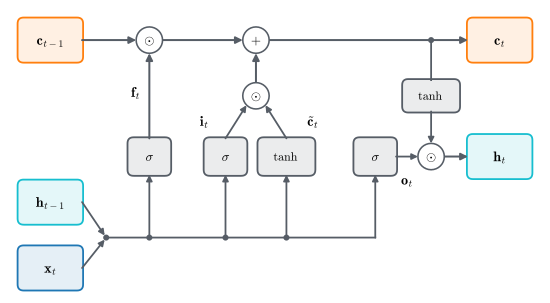

# Gated Recurrent Networks
:label:`sec_lstm`

The plain recurrent network of :numref:`sec_rnn-scratch` generates recognizable words and punctuation, yet its grammar unravels over more than a few words. Consider predicting the verb after *"the keys to the cabinet in the hall"*: choosing *"are"* rather than *"is"* requires remembering that *"keys"*—30 characters back—is plural. Because a plain RNN overwrites its entire state at every step through the same recurrent matrix and $\tanh$ nonlinearity, both the forward signal and the backward gradient decay rapidly over tens of steps. How can a recurrent network hold what it has read across hundreds of steps?

The solution introduced in the late 1990s is to let the network decide, unit by unit and step by step, what fraction of its state to keep via a *gate*—a vector of values in $(0, 1)$ computed from the current input and previous state. A unit whose gate stays near $1$ passes both its stored content and the backward gradient across the step essentially unchanged. Below we build the two classic gated architectures—the long short-term memory (LSTM) and the gated recurrent unit (GRU)—and evaluate them on synthetic delayed recall and on the byte-level WikiText-103 benchmark of :numref:`chap_transformers`. While gates solve long-range retention, their dependence on the previous state still forces sequential step-by-step training; :numref:`sec_linear-recurrence` removes that bottleneck.

Throughout this chapter we write equations for a single sequence using column vectors, while the code processes minibatches of sequences with row vectors.

```{.python .input #lstm-gated-recurrent-networks}
%%tab pytorch
import math
import numpy as np
import torch
from torch import nn
from torch.nn import functional as F
from d2l import torch as d2l
```

```{.python .input #lstm-gated-recurrent-networks}
%%tab jax
import math
import numpy as np
import jax
from jax import numpy as jnp
from flax import nnx
import optax
from d2l import jax as d2l
```

## Gates

### Vanishing Gradients

Recall from :numref:`subsec_bptt_analysis` how gradients propagate through a plain RNN with hidden state $\mathbf{h}_t \in \mathbb{R}^d$:

$$\mathbf{h}_t = \tanh(\mathbf{W}_\textrm{hh} \mathbf{h}_{t-1} +
\mathbf{W}_\textrm{xh} \mathbf{x}_t + \mathbf{b}_\textrm{h}).$$

A perturbation to $\mathbf{h}_{t-k}$ reaches $\mathbf{h}_t$ multiplied by a chain of $k$ step Jacobians $\mathbf{J}_s = \textrm{diag}(1 - \mathbf{h}_s^2)\,\mathbf{W}_\textrm{hh}$:

$$
\frac{\partial \mathbf{h}_t}{\partial \mathbf{h}_{t-k}} = \mathbf{J}_t
\mathbf{J}_{t-1} \cdots \mathbf{J}_{t-k+1}.
$$
:eqlabel:`eq_lstm-jacobian-product`

For a single scalar unit, each factor is $w(1 - h_s^2)$ of magnitude at most $|w|$. When $|w| < 1$, the product shrinks at least as fast as $|w|^k$ (at $w = 0.9$, to $\le 4\%$ over 30 steps and $\le 0.003\%$ over 100 steps).

For a matrix $\mathbf{W}_\textrm{hh}$, if its largest singular value is below $1$, every factor contracts every vector and the product must vanish. Over many steps, matrix powers scale as $\rho^k$, where the *spectral radius* $\rho$ (the largest eigenvalue magnitude) satisfies $\rho \le \|\mathbf{W}_\textrm{hh}\|_2$. If $\rho \approx 1$ and the state remains small so $\tanh$ is nearly linear, components along the leading eigenvectors can survive for many steps—a borderline regime we will observe in our experiments below. Away from $\rho \approx 1$, gradients either explode (which gradient clipping can cap) or vanish (which no post-hoc rescaling can recover).

### An Additive Memory

The simplest recurrence with unit Jacobian is a pure running sum, $c_t = c_{t-1} + x_t$, for which $\partial c_t / \partial c_{t-k} = 1$ at every lag $k$. However, an unweighted sum never forgets: every past input remains superposed with equal weight, and the state's variance grows with sequence length.

### Gates as Learned Decay

To retain relevant inputs while discarding irrelevant ones, we let the network choose at each step a retention fraction $f_t \in (0, 1)$ and an input fraction $i_t \in (0, 1)$ multiplying new candidate content $\tilde{c}_t$:

$$c_t = f_t\, c_{t-1} + i_t\, \tilde{c}_t.$$
:eqlabel:`eq_lstm-gated-sum`

Along the direct memory path, the $k$-step derivative is the product of the kept fractions, $\partial c_t / \partial c_{t-k} = \prod_{s=t-k+1}^t f_s$. At a constant keep fraction $f$, a stored value decays as $f^k$ with a *half-life* of $\ln 2 / \ln(1/f)$ steps: roughly 7 steps at $f = 0.9$, 69 at $f = 0.99$, and 693 at $f = 0.999$. Setting $f_t \to 1$ preserves a value and its gradient indefinitely; setting $f_t \to 0$ flushes the cell in a single step.

In a layer of width $d$, the memory becomes a vector $\mathbf{c}_t \in \mathbb{R}^d$ accompanied by an exposed hidden state $\mathbf{h}_t \in \mathbb{R}^d$. Each *gate* computes a vector in $(0, 1)^d$ via a sigmoid layer reading the current input $\mathbf{x}_t$ and previous output $\mathbf{h}_{t-1}$:

$$
\mathbf{f}_t = \sigma(\mathbf{W}_\textrm{xf} \mathbf{x}_t +
\mathbf{W}_\textrm{hf} \mathbf{h}_{t-1} + \mathbf{b}_\textrm{f}).
$$
:eqlabel:`eq_gate`

Unlike a plain RNN—which multiplies the entire state by a dense matrix $\mathbf{W}_\textrm{hh}$ and applies $\tanh$ at every step—the gated memory updates each coordinate by elementwise multiplication with its own learned factor $f_{t,j} \in (0, 1)$. Because $f_{t,j} \le 1$, gradients along the direct memory path cannot explode, and holding $f_{t,j}$ near $1$ prevents them from vanishing.

Two practical details remain. First, while $f_t \approx 1$, repeated writes can still cause the stored value $c_t$ to grow, so the LSTM applies a $\tanh$ when reading $\mathbf{c}_t$ out to $\mathbf{h}_t$. Second, under zero bias initialization, sigmoid gates start near $\sigma(0) = 1/2$—a half-life of a single step—so a gated network can represent long memories but does not start with them by default.

## Long Short-Term Memory

### The Memory Cell

The *long short-term memory* (LSTM) of :citet:`Hochreiter.Schmidhuber.1997`, augmented with the forget gate of :citet:`Gers.Schmidhuber.Cummins.2000`, builds a recurrent layer around :eqref:`eq_lstm-gated-sum`. It maintains two vectors of width $d$: an internal *memory cell* $\mathbf{c}_t$ evolved purely by elementwise gating and addition, and an exposed *hidden state* $\mathbf{h}_t$ that provides a gated, squashed view of $\mathbf{c}_t$ to subsequent layers and to the next step's gates.

Three sigmoid gates—the *input gate* $\mathbf{i}_t$, *forget gate* $\mathbf{f}_t$, and *output gate* $\mathbf{o}_t$—control access to the cell:

$$
\begin{aligned}
\mathbf{i}_t &= \sigma(\mathbf{W}_\textrm{xi} \mathbf{x}_t + \mathbf{W}_\textrm{hi} \mathbf{h}_{t-1} + \mathbf{b}_\textrm{i}),\\
\mathbf{f}_t &= \sigma(\mathbf{W}_\textrm{xf} \mathbf{x}_t + \mathbf{W}_\textrm{hf} \mathbf{h}_{t-1} + \mathbf{b}_\textrm{f}),\\
\mathbf{o}_t &= \sigma(\mathbf{W}_\textrm{xo} \mathbf{x}_t + \mathbf{W}_\textrm{ho} \mathbf{h}_{t-1} + \mathbf{b}_\textrm{o}).
\end{aligned}
$$
:eqlabel:`lstm_gates`

A fourth projection with $\tanh$ activation proposes the candidate *input node* $\tilde{\mathbf{c}}_t = \tanh(\mathbf{W}_\textrm{xc} \mathbf{x}_t + \mathbf{W}_\textrm{hc} \mathbf{h}_{t-1} + \mathbf{b}_\textrm{c})$. The cell and hidden state then update via elementwise multiplication ($\odot$):

$$
\mathbf{c}_t = \mathbf{f}_t \odot \mathbf{c}_{t-1} + \mathbf{i}_t \odot
\tilde{\mathbf{c}}_t, \qquad \mathbf{h}_t = \mathbf{o}_t \odot
\tanh(\mathbf{c}_t).
$$
:eqlabel:`lstm_update`

Separating $\mathbf{c}_t$ from $\mathbf{h}_t$ lets a unit hold information silently until it is needed: for instance, if $c_{t-1} = 0.8$ with $f_t = 0.95$, $i_t = 0.1$, $\tilde{c}_t = -0.5$, and $o_t = 0.2$, the cell stays at $c_t = 0.71$ while exposing only $h_t = 0.2\tanh(0.71) = 0.12$ (:numref:`fig_lstm_cell`).


:label:`fig_lstm_cell`

With the gates treated as fixed, the direct cell-to-cell Jacobian $\partial \mathbf{c}_t / \partial \mathbf{c}_{t-1}$ is simply $\textrm{diag}(\mathbf{f}_t)$ (the top rail in :numref:`fig_lstm_cell`). The full derivative also includes indirect terms through $\mathbf{h}_{t-1}$ and the gates, but the cell rail provides an unattenuated highway whenever $\mathbf{f}_t$ stays near $1$.

### Implementation

Because $\mathbf{i}_t$, $\mathbf{f}_t$, $\tilde{\mathbf{c}}_t$, and $\mathbf{o}_t$ all read $(\mathbf{x}_t, \mathbf{h}_{t-1})$, we stack their weights into two matrices $\mathbf{W}_\textrm{x} \in \mathbb{R}^{d_\textrm{in} \times 4d}$ and $\mathbf{W}_\textrm{h} \in \mathbb{R}^{d \times 4d}$, compute a single matrix multiplication per input, and split the result into four chunks.

```{.python .input #lstm-implementation-1}
%%tab pytorch
class LSTMScratch(nn.Module):
    """An LSTM layer computed one time step at a time."""
    def __init__(self, num_inputs, num_hiddens):
        super().__init__()
        self.num_hiddens = num_hiddens
        # Weights of i, f, c_tilde, and o, stacked along the last axis, with
        # variance 1 / fan-in
        self.W_x = nn.Parameter(torch.randn(num_inputs, 4 * num_hiddens)
                                / math.sqrt(num_inputs))
        self.W_h = nn.Parameter(torch.randn(num_hiddens, 4 * num_hiddens)
                                / math.sqrt(num_hiddens))
        self.b = nn.Parameter(torch.zeros(4 * num_hiddens))

    def forward(self, X):  # X: (batch_size, num_steps, num_inputs)
        h = c = torch.zeros(X.shape[0], self.num_hiddens, device=X.device)
        outputs = []
        for x in X.unbind(1):  # One time step at a time
            i, f, c_tilde, o = (x @ self.W_x + h @ self.W_h + self.b).chunk(4, -1)
            c = torch.sigmoid(f) * c + torch.sigmoid(i) * torch.tanh(c_tilde)
            h = torch.sigmoid(o) * torch.tanh(c)
            outputs.append(h)
        return torch.stack(outputs, 1)  # (batch_size, num_steps, num_hiddens)
```

```{.python .input #lstm-implementation-1}
%%tab jax
class LSTMScratch(nnx.Module):
    """An LSTM layer computed one time step at a time."""
    def __init__(self, num_inputs, num_hiddens, *, rngs):
        self.num_hiddens = num_hiddens
        # Weights of i, f, c_tilde, and o, stacked along the last axis, with
        # variance 1 / fan-in
        self.W_x = nnx.Param(rngs.params.normal((num_inputs, 4 * num_hiddens))
                             / math.sqrt(num_inputs))
        self.W_h = nnx.Param(rngs.params.normal((num_hiddens, 4 * num_hiddens))
                             / math.sqrt(num_hiddens))
        self.b = nnx.Param(jnp.zeros(4 * num_hiddens))

    def __call__(self, X):  # X: (batch_size, num_steps, num_inputs)
        def step(state, x):
            h, c = state
            i, f, c_tilde, o = jnp.split(
                x @ self.W_x[...] + h @ self.W_h[...] + self.b[...], 4, -1)
            c = jax.nn.sigmoid(f) * c + jax.nn.sigmoid(i) * jnp.tanh(c_tilde)
            h = jax.nn.sigmoid(o) * jnp.tanh(c)
            return (h, c), h
        h = c = jnp.zeros((X.shape[0], self.num_hiddens))
        # lax.scan steps through the leading axis, so time goes first
        _, outputs = jax.lax.scan(step, (h, c), jnp.swapaxes(X, 0, 1))
        return jnp.swapaxes(outputs, 0, 1)  # (batch_size, num_steps, ...)
```

To verify that `LSTMScratch` computes the exact same recurrence as the fused framework LSTM (`nn.LSTM` / `nnx.LSTMCell`), we copy the library weights into our class and compare outputs on a random batch.

```{.python .input #lstm-implementation-2}
%%tab pytorch
lstm = nn.LSTM(16, 32, batch_first=True)  # Stacks its weights as i, f, c~, o
cell = LSTMScratch(16, 32)
with torch.no_grad():
    cell.W_x.copy_(lstm.weight_ih_l0.T)
    cell.W_h.copy_(lstm.weight_hh_l0.T)
    cell.b.copy_(lstm.bias_ih_l0 + lstm.bias_hh_l0)
X = torch.randn(4, 9, 16)  # (batch_size, num_steps, num_inputs)
print(f'max difference: {(cell(X) - lstm(X)[0]).abs().max():.1e}')
```

```{.python .input #lstm-implementation-2}
%%tab jax
lstm_cell = nnx.LSTMCell(16, 32, rngs=nnx.Rngs(0))  # A layer per gate
lstm = nnx.RNN(lstm_cell)
cell = LSTMScratch(16, 32, rngs=nnx.Rngs(1))
gates = [(lstm_cell.ii, lstm_cell.hi), (lstm_cell.if_, lstm_cell.hf),
         (lstm_cell.ig, lstm_cell.hg), (lstm_cell.io, lstm_cell.ho)]
cell.W_x[...] = jnp.concatenate([x.kernel[...] for x, _ in gates], 1)
cell.W_h[...] = jnp.concatenate([h.kernel[...] for _, h in gates], 1)
cell.b[...] = jnp.concatenate([h.bias[...] for _, h in gates])
X = jax.random.normal(jax.random.key(0), (4, 9, 16))
print(f'max difference: {jnp.abs(cell(X) - lstm(X)).max():.1e}')
```

The outputs agree to float32 rounding error ($\sim 10^{-7}$), so we use the faster fused library layers from here on.

## Gated Recurrent Units
:label:`sec_gru`

Does a gated layer really need two state vectors and three gates? The *gated recurrent unit* (GRU) of :citet:`Cho.Van-Merrienboer.Bahdanau.ea.2014` merges the cell and hidden state into a single vector $\mathbf{h}_t$ controlled by just two gates—a *reset gate* $\mathbf{r}_t$ and an *update gate* $\mathbf{z}_t$—while matching the LSTM on many sequence tasks :cite:`Chung.Gulcehre.Cho.ea.2014`:

$$
\mathbf{r}_t = \sigma(\mathbf{W}_\textrm{xr} \mathbf{x}_t +
\mathbf{W}_\textrm{hr} \mathbf{h}_{t-1} + \mathbf{b}_\textrm{r}), \qquad
\mathbf{z}_t = \sigma(\mathbf{W}_\textrm{xz} \mathbf{x}_t +
\mathbf{W}_\textrm{hz} \mathbf{h}_{t-1} + \mathbf{b}_\textrm{z}).
$$
:eqlabel:`gru_gates`

The reset gate filters how much of $\mathbf{h}_{t-1}$ enters the proposed *candidate state*:

$$
\tilde{\mathbf{h}}_t = \tanh\big(\mathbf{W}_\textrm{xh} \mathbf{x}_t +
\mathbf{W}_\textrm{hh} (\mathbf{r}_t \odot \mathbf{h}_{t-1}) +
\mathbf{b}_\textrm{h}\big).
$$
:eqlabel:`gru_tilde_H`

The update gate $\mathbf{z}_t$ then interpolates convexly between the old state and the candidate:

$$
\mathbf{h}_t = \mathbf{z}_t \odot \mathbf{h}_{t-1} + (1 - \mathbf{z}_t)
\odot \tilde{\mathbf{h}}_t.
$$
:eqlabel:`gru_H`

Equation :eqref:`gru_H` is the gated sum :eqref:`eq_lstm-gated-sum` with coupled forget and input gates ($f_t = z_t, i_t = 1 - z_t$). Because each coordinate convexly blends two values in $[-1, 1]$, $\mathbf{h}_t$ stays bounded in $[-1, 1]$ without an extra output $\tanh$ (:numref:`fig_gru_cell`), and a GRU layer requires $6d^2$ recurrent/input weights compared to an LSTM's $8d^2$. (Fused library GRUs apply $\mathbf{r}_t$ *after* multiplying by $\mathbf{W}_\textrm{hh}$ so all recurrent matrix products can be batched into one call; see the exercises.)


:label:`fig_gru_cell`

## Training Gated Networks
:label:`sec_gated-training`

### Delayed Recall
:label:`subsec_delayed-recall`

The gated equations *allow* memories lasting hundreds of steps, but does gradient descent actually find them? We test retention directly on a synthetic *delayed recall* task: a sequence begins with one of 8 target symbols (0–7), followed by $T - 1$ random filler tokens drawn from 8 other symbols (8–15), and at step $T$ the model must classify the initial symbol (chance accuracy $1/8 = 0.125$).

```{.python .input #lstm-delayed-recall-1}
%%tab pytorch, jax
def delayed_recall(rng, batch_size, num_steps, num_symbols=8,  #@save
                   blank_fillers=False):
    """A symbol, then num_steps - 1 fillers; the target is the symbol."""
    Y = rng.integers(0, num_symbols, (batch_size, 1))  # One query, at the end
    X = rng.integers(num_symbols, 2 * num_symbols, (batch_size, num_steps))
    if blank_fillers:  # The same filler token at every step
        X[:] = num_symbols
    X[:, :1] = Y
    return X, Y

X, Y = delayed_recall(np.random.default_rng(0), 2, 6)
print(X, Y)
```

Our testbed model (`RecallModel`) embeds tokens into 32 dimensions, runs a single recurrent layer of width 64, and applies a linear classifier at the final step. Throughout this chapter, we initialize all linear, convolutional, and recurrent weight matrices with LeCun normal initialization (variance $1 / n_\textrm{in}$) and zero biases (:numref:`sec_numerical_stability`).

:begin_tab:`pytorch`
`init_lecun` applies LeCun normal weights and zero biases across linear, convolutional, and recurrent modules, and `Recurrent` wraps PyTorch recurrent modules to return only the output sequence tensor.
:end_tab:

:begin_tab:`jax`
Flax linear layers and recurrent input projections already default to LeCun normal, while recurrent kernels default to orthogonal matrices; we pass `recurrent_kernel_init` to use LeCun normal there as well.
:end_tab:

```{.python .input #lstm-delayed-recall-6}
%%tab pytorch
def init_lecun(module):  #@save
    """LeCun normal weights and zero biases for all linear, convolutional,
    and recurrent layers."""
    for layer in module.modules():
        if isinstance(layer, (nn.Linear, nn.Conv1d)):
            fan_in = layer.weight[0].numel()  # Inputs of one output unit
            nn.init.normal_(layer.weight, std=fan_in ** -0.5)
            if layer.bias is not None:
                nn.init.zeros_(layer.bias)
        elif isinstance(layer, nn.RNNBase):  # Input and recurrent matrices
            for name, param in layer.named_parameters():
                if name.startswith('weight'):
                    nn.init.normal_(param, std=param.shape[1] ** -0.5)
                else:
                    nn.init.zeros_(param)
    return module

class Recurrent(nn.Module):  #@save
    """A batch-first recurrent layer that returns only its outputs."""
    def __init__(self, rnn):
        super().__init__()
        self.rnn = rnn

    def forward(self, X):
        return self.rnn(X)[0]
```

We compare six recurrent configurations in three pairs:
1. **Plain RNNs:** one with LeCun normal recurrent weights ($\sigma = 1/\sqrt{64} = 1/8$) and a control with uniform weights on $[-1/8, 1/8]$ (variance $1/3$ of LeCun normal, matching PyTorch's default `nn.RNN` scale).
2. **Default LSTM and GRU:** zero gate biases, so all gates start near $\sigma(0) = 1/2$ (half-life 1 step).
3. **Keep-gate LSTM and GRU (`init_keep_gate`):** the LSTM forget-gate bias and GRU update-gate bias are initialized to $+5$ ($\sigma(5) = 0.993$, half-life $\approx 100$ steps), and the LSTM input-gate bias is set to $-5$ ($\sigma(-5) = 1 - \sigma(5) = 0.007$). Pairing $b_\textrm{i} = -b_\textrm{f}$ bounds the LSTM cell magnitude by $\sigma(-5)/(1 - \sigma(5)) = 1$ across long filler runs so the output $\tanh$ never saturates, matching the GRU's built-in $1 - \mathbf{z}_t$ coupling (see :citet:`Jozefowicz.Zaremba.Sutskever.2015` and the *chrono initialization* of :citet:`Tallec.Ollivier.2018`).

```{.python .input #lstm-delayed-recall-2}
%%tab pytorch
class RecallModel(nn.Module):  #@save
    """Embedding, a sequence layer, and a classifier at every position."""
    def __init__(self, layer, num_hiddens, vocab_size=16, num_inputs=32,
                 num_outputs=8):
        super().__init__()
        self.embedding = nn.Embedding(vocab_size, num_inputs)
        nn.init.normal_(self.embedding.weight, std=num_inputs ** -0.5)
        self.layer = layer
        self.head = init_lecun(nn.Linear(num_hiddens, num_outputs))

    def forward(self, X):  # Logits, (batch_size, num_steps, num_outputs)
        return self.head(self.layer(self.embedding(X)))

def init_keep_gate(rnn, bias=5.0):
    """Start an LSTM's forget gate, or a GRU's update gate, near one."""
    h = rnn.hidden_size
    with torch.no_grad():
        rnn.bias_ih_l0.zero_()  # Independent of the earlier initialization
        rnn.bias_hh_l0.zero_()
        rnn.bias_ih_l0[h:2 * h] = bias  # LSTM: i, f, c~, o; GRU: r, z, n
        if isinstance(rnn, nn.LSTM):
            rnn.bias_ih_l0[:h] = -bias  # Input gate near zero
    return rnn
```

```{.python .input #lstm-delayed-recall-2}
%%tab jax
class RecallModel(nnx.Module):  #@save
    """Embedding, a sequence layer, and a classifier at every position."""
    def __init__(self, layer, num_hiddens, vocab_size=16, num_inputs=32,
                 num_outputs=8, *, rngs):
        # d2l.Embed computes its gradient by a matrix product: no atomic adds
        # that wait on one another when a few filler tokens fill every row
        self.embedding = d2l.Embed(vocab_size, num_inputs, rngs=rngs,
            embedding_init=nnx.initializers.normal(num_inputs ** -0.5))
        self.layer = layer
        self.head = nnx.Linear(num_hiddens, num_outputs, rngs=rngs)

    def __call__(self, X):  # Logits, (batch_size, num_steps, num_outputs)
        return self.head(self.layer(self.embedding(X)))

def init_keep_gate(cell, bias=5.0):
    """Start an LSTM's forget gate, or a GRU's update gate, near one."""
    if isinstance(cell, nnx.LSTMCell):
        cell.hf.bias[...] = jnp.full_like(cell.hf.bias[...], bias)
        cell.hi.bias[...] = jnp.full_like(cell.hi.bias[...], -bias)  # Input
    else:  # GRUCell: input biases ordered r, z, n
        h = cell.dense_i.bias.shape[0] // 3
        cell.dense_i.bias[...] = cell.dense_i.bias[...].at[h:2 * h].set(bias)
    return cell
```

Notice what simple arithmetic predicts for the default zero-bias gated networks: when every gate starts at $1/2$, the direct gradient path from step $T$ back to step $1$ is attenuated by $2^{-(T-1)}$—roughly $10^{-6}$ at $T = 20$ (still resolvable in float32) but $10^{-15}$ at $T = 50$ (lost below float32's $\sim 10^{-7}$ relative precision when summed with recent steps' gradients). We therefore expect default LSTM/GRU to succeed at $T = 20$ and fail by $T = 50$, while the keep-gate variants should succeed across all delays up to $T = 200$.

We save the training helpers `train_queries`, `query_accuracy`, and `train_delayed_recall` for reuse across all synthetic recall tasks in this chapter.

```{.python .input #lstm-delayed-recall-4}
%%tab pytorch
def train_queries(model, batch, num_steps, optimizer,  #@save
                  scheduler=None):
    """Train on fresh batches; the queries are the last Y.shape[1] steps."""
    device = next(model.parameters()).device
    for step in range(num_steps):
        X, Y = (torch.as_tensor(A, device=device) for A in batch(step))
        logits = model(X)[:, -Y.shape[1]:]  # Predictions at the queries
        loss = F.cross_entropy(logits.flatten(0, 1), Y.flatten())
        optimizer.zero_grad()
        loss.backward()
        nn.utils.clip_grad_norm_(model.parameters(), 1.0)
        optimizer.step()
        if scheduler is not None:
            scheduler.step()

def query_accuracy(model, X, Y):  #@save
    """Fraction of queries answered correctly."""
    device = next(model.parameters()).device
    X, Y = (torch.as_tensor(A, device=device) for A in (X, Y))
    with torch.inference_mode():
        return (model(X)[:, -Y.shape[1]:].argmax(-1) == Y).float().mean()

def train_delayed_recall(model, num_steps, blank_fillers=False):  #@save
    """Train with Adam at rate 0.003 on 1,500 fresh batches of 128 sequences
    of delayed recall; return the accuracy on 2,048 new sequences."""
    task = lambda rng, n: delayed_recall(rng, n, num_steps,
                                         blank_fillers=blank_fillers)
    rng = np.random.default_rng(0)
    model.to(d2l.try_gpu())
    train_queries(model, lambda step: task(rng, 128), 1500,
                  torch.optim.Adam(model.parameters(), lr=3e-3))
    return float(query_accuracy(model, *task(np.random.default_rng(1), 2048)))
```

```{.python .input #lstm-delayed-recall-4}
%%tab jax
@nnx.jit  #@save
def query_step(model, optimizer, X, Y):
    """One optimizer step on the cross-entropy at the last Y.shape[1] steps."""
    def loss_fn(model):
        logits = model(X)[:, -Y.shape[1]:]  # Predictions at the queries
        return optax.softmax_cross_entropy_with_integer_labels(
            logits, Y).mean()
    loss, grads = nnx.value_and_grad(loss_fn)(model)
    optimizer.update(model, grads)
    return loss

def train_queries(model, batch, num_steps, optimizer):  #@save
    """Train on fresh batches; the queries are the last Y.shape[1] steps."""
    step = nnx.cached_partial(query_step, model, optimizer)  # Compile once
    for i in range(num_steps):
        step(*batch(i))

@nnx.jit  #@save
def query_accuracy(model, X, Y):
    """Fraction of queries answered correctly."""
    return (model(X)[:, -Y.shape[1]:].argmax(-1) == Y).mean()

def train_delayed_recall(model, num_steps, blank_fillers=False):  #@save
    """Train with Adam at rate 0.003 on 1,500 fresh batches of 128 sequences
    of delayed recall; return the accuracy on 2,048 new sequences."""
    task = lambda rng, n: delayed_recall(rng, n, num_steps,
                                         blank_fillers=blank_fillers)
    rng = np.random.default_rng(0)
    optimizer = nnx.Optimizer(model, optax.chain(
        optax.clip_by_global_norm(1.0), optax.adam(3e-3)), wrt=nnx.Param)
    train_queries(model, lambda step: task(rng, 128), 1500, optimizer)
    return float(query_accuracy(model, *task(np.random.default_rng(1), 2048)))
```

Before training, let us also check the spectral radius and largest singular value of the two $64 \times 64$ plain RNN initializations:

```{.python .input #lstm-delayed-recall-8}
%%tab pytorch, jax
rng, n = np.random.default_rng(0), 64  # n hidden units
for name, W in (('LeCun normal', rng.normal(0, n ** -0.5, (n, n))),
                ('default scale', rng.uniform(-n ** -0.5, n ** -0.5, (n, n)))):
    print(f'{name:>13}: spectral radius {np.abs(np.linalg.eigvals(W)).max():.2f},'
          f' largest singular value {np.linalg.norm(W, 2):.2f}')
```

The LeCun normal matrix has spectral radius $1.02$ (sitting right at the $\rho \approx 1$ borderline where leading eigenmodes neither vanish nor explode when states are small), whereas the uniform default-scale matrix has spectral radius $0.62$ (shrinking states by $\sim 0.6$ per step). Now we train two seeds of all six models across delays $T \in \{20, 50, 100, 200\}$.

```{.python .input #lstm-delayed-recall-5}
%%tab pytorch
def recurrent(layer, keep_gate=False):
    """A batch-first layer, 32 inputs to 64 hidden units, LeCun-initialized."""
    layer = init_lecun(layer(32, 64, batch_first=True))
    return init_keep_gate(layer) if keep_gate else layer

def rnn_default_scale():  # The recurrent matrix as nn.RNN draws it
    rnn = recurrent(nn.RNN)
    nn.init.uniform_(rnn.weight_hh_l0, -64 ** -0.5, 64 ** -0.5)
    return rnn

layers = {'RNN': lambda: recurrent(nn.RNN),
          'RNN, default scale': rnn_default_scale,
          'LSTM': lambda: recurrent(nn.LSTM), 'GRU': lambda: recurrent(nn.GRU),
          'LSTM, keep gate': lambda: recurrent(nn.LSTM, keep_gate=True),
          'GRU, keep gate': lambda: recurrent(nn.GRU, keep_gate=True)}
delays = [20, 50, 100, 200]
print(' ' * 18, ' '.join(f'{T:>9d}' for T in delays))
for name, layer in layers.items():
    runs = [[train_delayed_recall(RecallModel(Recurrent(layer()), 64), T)
             for _ in range(2)] for T in delays]
    print(f'{name:18s}', ' '.join(f'{a:.2f}/{b:.2f}' for a, b in runs))
```

```{.python .input #lstm-delayed-recall-5}
%%tab jax
lecun = {'recurrent_kernel_init': nnx.initializers.lecun_normal()}
default = {'recurrent_kernel_init': nnx.initializers.variance_scaling(
    1 / 3, 'fan_in', 'uniform')}  # Uniform on [-1/8, 1/8]
cells = {'RNN': lambda rngs: nnx.SimpleCell(32, 64, rngs=rngs, **lecun),
         'RNN, default scale':
             lambda rngs: nnx.SimpleCell(32, 64, rngs=rngs, **default),
         'LSTM': lambda rngs: nnx.LSTMCell(32, 64, rngs=rngs, **lecun),
         'GRU': lambda rngs: nnx.GRUCell(32, 64, rngs=rngs, **lecun),
         'LSTM, keep gate': lambda rngs: init_keep_gate(
             nnx.LSTMCell(32, 64, rngs=rngs, **lecun)),
         'GRU, keep gate': lambda rngs: init_keep_gate(
             nnx.GRUCell(32, 64, rngs=rngs, **lecun))}

def recall_model(cell):  # Fresh random weights for every model
    rngs = nnx.Rngs(d2l.get_key())
    return RecallModel(nnx.RNN(cell(rngs), unroll=8), 64, rngs=rngs)

delays = [20, 50, 100, 200]
print(' ' * 18, ' '.join(f'{T:>9d}' for T in delays))
for name, cell in cells.items():
    runs = [[train_delayed_recall(recall_model(cell), T) for _ in range(2)]
            for T in delays]
    print(f'{name:18s}', ' '.join(f'{a:.2f}/{b:.2f}' for a, b in runs))
```

The results confirm our analysis:
- **Default vs. keep-gate LSTM and GRU:** With zero gate biases, both gated networks succeed at $T = 20$ and collapse to chance ($0.12$) at $T \ge 50$. With `init_keep_gate`, both achieve $1.00$ accuracy across every run at every delay up to $T = 200$.
- **Borderline vs. contracting plain RNN:** Because the LeCun normal RNN starts with spectral radius $\rho \approx 1$, some seeds carry the symbol surprisingly far (even to $T = 100$ or $200$), though unreliably across seeds, whereas the $\rho \approx 0.62$ default-scale RNN fails consistently from $T = 50$ onward. Gates with well-initialized biases turn hit-or-miss spectral retention into dependable, per-unit memory control.

### Gated Networks on Text
:label:`subsec_deep-rnn`

In :numref:`subsec_gpt-rnn-baseline`, a single wide plain RNN fell behind a multi-block GPT after the first 16 bytes of context. To compare sequence mixers on equal footing—without confounding recurrence against residual depth and positionwise MLPs—we place every mixer in this chapter inside the same pre-norm residual backbone (`SeqLM`), matching :numref:`sec_transformer-block`: token embedding, a stack of blocks each applying `H = H + mixer(norm(H))` followed by a two-layer GELU MLP `H = H + mlp(H)`, and a final layer norm and linear output head.

```{.python .input #lstm-deep-recurrent-networks-1}
%%tab pytorch
class SeqLM(nn.Module):  #@save
    """A language model of residual blocks: a sequence mixer, then an MLP."""
    def __init__(self, vocab_size, num_hiddens, mixers):
        super().__init__()
        d = num_hiddens
        self.embedding = nn.Embedding(vocab_size, d)
        nn.init.normal_(self.embedding.weight, std=d ** -0.5)  # Unit length
        self.mixers = nn.ModuleList(mixers)
        self.norms = nn.ModuleList([nn.LayerNorm(d) for _ in mixers])
        self.mlps = nn.ModuleList([nn.Sequential(
            nn.LayerNorm(d), nn.Linear(d, 4 * d), nn.GELU(),
            nn.Linear(4 * d, d)) for _ in mixers])
        self.norm = nn.LayerNorm(d)
        self.head = nn.Linear(d, vocab_size)
        for module in (self.mlps, self.head):  # Mixers initialize themselves
            init_lecun(module)

    def forward(self, X):
        H = self.embedding(X)  # (batch_size, num_steps, num_hiddens)
        for norm, mixer, mlp in zip(self.norms, self.mixers, self.mlps):
            H = H + mixer(norm(H))
            H = H + mlp(H)
        return self.head(self.norm(H))  # (batch_size, num_steps, vocab_size)
```

```{.python .input #lstm-deep-recurrent-networks-1}
%%tab jax
class SeqLM(nnx.Module):  #@save
    """A language model of residual blocks: a sequence mixer, then an MLP."""
    def __init__(self, vocab_size, num_hiddens, mixers, *, rngs):
        d = num_hiddens
        self.embedding = d2l.Embed(vocab_size, d, rngs=rngs,  # Unit length
            embedding_init=nnx.initializers.normal(d ** -0.5))
        self.mixers = nnx.List(mixers)
        norm = lambda: nnx.LayerNorm(d, epsilon=1e-5, rngs=rngs)
        self.norms = nnx.List([norm() for _ in mixers])
        self.mlps = nnx.List([nnx.Sequential(
            norm(), nnx.Linear(d, 4 * d, rngs=rngs),
            lambda x: nnx.gelu(x, approximate=False),  # Exact GELU
            nnx.Linear(4 * d, d, rngs=rngs)) for _ in mixers])
        self.norm = norm()
        self.head = nnx.Linear(d, vocab_size, rngs=rngs)

    def __call__(self, X):
        H = self.embedding(X)  # (batch_size, num_steps, num_hiddens)
        for norm, mixer, mlp in zip(self.norms, self.mixers, self.mlps):
            H = H + mixer(norm(H))
            H = H + mlp(H)
        return self.head(self.norm(H))  # (batch_size, num_steps, vocab_size)
```

Our attention baseline within `SeqLM` is `AttentionMixer`, which wraps causal multi-head attention with RoPE (:numref:`sec_gpt`, :numref:`sec_positional-information`), LeCun normal initialization, and an optional depthwise causal convolution over $(\mathbf{Q}, \mathbf{K}, \mathbf{V})$ (used later in :numref:`sec_hybrids`).

```{.python .input #lstm-gated-networks-on-text-1}
%%tab pytorch
class AttentionMixer(d2l.CausalAttention):  #@save
    """Causal multi-head attention, with rotary positions unless rope is
    False, as a sequence mixer; with conv_width, a causal convolution per
    channel first mixes each query, key, and value with those of the
    previous steps."""
    def __init__(self, num_hiddens, num_heads, conv_width=None, rope=True):
        super().__init__(num_hiddens, num_heads, rope=rope)
        d = 3 * num_hiddens  # Channels of q, k, and v; one filter each
        self.conv = None if conv_width is None else nn.Conv1d(
            d, d, conv_width, groups=d, padding=conv_width - 1)
        init_lecun(self)  # Like every mixer of the chapter

    def qkv(self, X, offset=0, tables=None):
        B, T, _ = X.shape
        QKV = self.W_qkv(X)
        if self.conv is not None:  # Causal: drop the last conv_width - 1 steps
            QKV = self.conv(QKV.mT)[..., :T].mT
        q, k, v = (u.reshape(B, T, self.num_heads, -1).transpose(1, 2)
                   for u in QKV.chunk(3, -1))
        if self.rope:
            q, k = (d2l.rope(u, offset, tables=tables) for u in (q, k))
        return q, k, v  # Each (batch_size, num_heads, num_steps, head width)
```

```{.python .input #lstm-gated-networks-on-text-1}
%%tab jax
class AttentionMixer(d2l.CausalAttention):  #@save
    """Causal multi-head attention, with rotary positions unless rope is
    False, as a sequence mixer; with conv_width, a causal convolution per
    channel first mixes each query, key, and value with those of the
    previous steps."""
    def __init__(self, num_hiddens, num_heads, conv_width=None, rope=True,
                 *, rngs):
        super().__init__(num_hiddens, num_heads, rope=rope, rngs=rngs)
        lecun = nnx.initializers.lecun_normal()
        for layer in (self.W_qkv, self.W_o):  # Like every mixer of the chapter
            layer.kernel[...] = lecun(rngs.params(), layer.kernel.shape)
        d = 3 * num_hiddens  # Channels of q, k, and v; one filter each
        self.conv = None if conv_width is None else nnx.Conv(
            d, d, (conv_width,), feature_group_count=d,
            padding=((conv_width - 1, 0),), rngs=rngs)

    def qkv(self, X, offset=0, tables=None):
        B, T, _ = X.shape
        QKV = self.W_qkv(X)
        if self.conv is not None:  # Causal: padded on the left only
            QKV = self.conv(QKV)
        q, k, v = (u.reshape(B, T, self.num_heads, -1).swapaxes(1, 2)
                   for u in jnp.split(QKV, 3, -1))
        if self.rope:
            q, k = (d2l.rope(u, offset, tables=tables) for u in (q, k))
        return q, k, v  # Each (batch_size, num_heads, num_steps, head width)
```

We also save three evaluation helpers used across the chapter: `loss_by_position` computes the mean validation cross-entropy at each window position; `train_text` trains a model for 1,000 steps of AdamW (100-step warmup to $2 \times 10^{-3}$ followed by cosine decay); and `text_table` runs two seeds per configuration and reports parameter count, overall validation loss, position-band losses (`0-15`, `16-63`, `64-127`), and milliseconds per training step.

```{.python .input #lstm-gated-networks-on-text-2}
%%tab pytorch
@torch.inference_mode()  #@save
def loss_by_position(model, data):
    """Mean validation loss in nats at each position of the window."""
    device = next(model.parameters()).device
    total, count = 0, 0
    for X, Y in data.val_dataloader():
        logits = model(X.to(device))  # (batch, T, V)
        total += F.cross_entropy(logits.transpose(1, 2), Y.to(device),
                                 reduction='none').sum(0)
        count += len(X)
    return (total / count).tolist()
```

```{.python .input #lstm-gated-networks-on-text-2}
%%tab jax
@nnx.jit  #@save
def position_loss_sum(model, X, Y):
    """Loss in nats at each position, summed over the batch."""
    return optax.softmax_cross_entropy_with_integer_labels(model(X), Y).sum(0)

def loss_by_position(model, data):  #@save
    """Mean validation loss in nats at each position of the window."""
    total, count = 0, 0
    for X, Y in data.val_dataloader():
        total += position_loss_sum(model, jnp.asarray(X), jnp.asarray(Y))
        count += len(X)
    return (total / count).tolist()
```

```{.python .input #lstm-gated-networks-on-text-3}
%%tab pytorch, jax
def train_text(model, data, lr=2e-3, num_steps=1000):  #@save
    """Train a language model with LMOptimizer; return its validation loss
    in nats at each position and its milliseconds per training step."""
    optimizer = d2l.LMOptimizer(model, lr=lr, num_steps=num_steps, warmup=100)
    # One untimed call of 50 steps warms up (JAX compiles), the rest is timed
    bench = d2l.Benchmark(lambda: d2l.train_steps(model, data, optimizer, 50),
                          warmup=1, repeats=num_steps // 50 - 1)
    return loss_by_position(model, data), 1000 * bench.time / 50

def text_table(make_model, arms, data, num_runs=2):  #@save
    """Train num_runs fresh models make_model(*args) for each arm (a name
    and its args); print the parameters, the validation loss of every run,
    its losses at early, middle, and late positions of the window, and the
    milliseconds per step. Return the trained models of each arm."""
    T = data.num_steps
    bands = [(0, T // 8), (T // 8, T // 2), (T // 2, T)]
    width = max(len(name) for name in arms)
    header = ['validation'] + [f'{a}-{b - 1}' for a, b in bands]
    print(' ' * (width + 12), *(f'{h:>11}' for h in header), '  ms/step')
    trained = {}
    for name, args in arms.items():
        models = [make_model(*args) for _ in range(num_runs)]
        runs = [train_text(model, data) for model in models]  # (losses, ms)
        columns = [[np.mean(loss) for loss, _ in runs]] + [
            [np.mean(loss[a:b]) for loss, _ in runs] for a, b in bands]
        print(f'{name:{width}s} {d2l.num_params(models[0]):11,d}',
              *('/'.join(f'{v:.3f}' for v in column) for column in columns),
              '/'.join(f'{ms:.0f}' for _, ms in runs))
        trained[name] = models
    return trained
```

We train on byte-level WikiText-103 (`d2l.WikiText103`, windows of 128 bytes, batch size 64). Each model has 4 residual blocks at width $d = 256$—comparing a plain RNN, an LSTM, a GRU, and 8-head causal attention—plus a parameter-matched plain RNN widened to $d = 302$ ($3.81\textrm{M}$ parameters, matching the GRU stack).

```{.python .input #lstm-gated-networks-on-text-4}
%%tab pytorch, jax
data = d2l.WikiText103(batch_size=64, num_steps=128)
```

```{.python .input #lstm-gated-networks-on-text-5}
%%tab pytorch
torch.set_float32_matmul_precision('high')  # fp32 matmuls may use tf32

def text_model(mixer, d):  # 256 byte values; four blocks of width d
    return SeqLM(256, d, [mixer(d) for _ in range(4)]).to(d2l.try_gpu())

rnn = lambda d: Recurrent(init_lecun(nn.RNN(d, d, batch_first=True)))
lstm = lambda d: Recurrent(init_lecun(nn.LSTM(d, d, batch_first=True)))
gru = lambda d: Recurrent(init_lecun(nn.GRU(d, d, batch_first=True)))
attention = lambda d: AttentionMixer(d, num_heads=8)
arms = {'RNN': (rnn, 256), 'LSTM': (lstm, 256), 'GRU': (gru, 256),
        'attention': (attention, 256),
        'RNN, d=302': (rnn, 302)}  # As many parameters as the GRU
```

```{.python .input #lstm-gated-networks-on-text-5}
%%tab jax
def text_model(mixer, d):  # 256 byte values; four blocks of width d
    rngs = nnx.Rngs(d2l.get_key())
    return SeqLM(256, d, [mixer(d, rngs) for _ in range(4)], rngs=rngs)

rnn = lambda d, rngs: nnx.RNN(nnx.SimpleCell(d, d, rngs=rngs, **lecun),
                              unroll=8)
lstm = lambda d, rngs: nnx.RNN(nnx.LSTMCell(d, d, rngs=rngs, **lecun),
                               unroll=8)
gru = lambda d, rngs: nnx.RNN(nnx.GRUCell(d, d, rngs=rngs, **lecun),
                              unroll=8)
attention = lambda d, rngs: AttentionMixer(d, num_heads=8, rngs=rngs)
arms = {'RNN': (rnn, 256), 'LSTM': (lstm, 256), 'GRU': (gru, 256),
        'attention': (attention, 256),
        'RNN, d=302': (rnn, 302)}  # As many parameters as the GRU
```

```{.python .input #lstm-gated-networks-on-text-6}
%%tab pytorch, jax
trained = text_table(text_model, arms, data)
```

Three findings stand out from the table:
1. **Residual stacking + gating:** Simply placing 4 narrow $\tanh$ RNN layers inside a pre-norm residual + MLP backbone reaches $\sim 1.35$ nats/byte—already matching the 6-block SwiGLU GPT of :numref:`sec_gpt`. Replacing the plain RNN mixer with an LSTM or GRU lowers validation loss by a further $0.05$ nats/byte (to $\sim 1.30$), whereas widening the plain RNN to match the GRU's parameter count (`RNN, d=302`) closes less than a third of that gap ($1.334$).
2. **Short-context utilization:** Across all models in this 1,000-step, 128-byte regime, loss drops sharply from band `0-15` to `16-63` and changes by less than $0.005$ beyond byte 16. Here the gates earn their lead by managing short-range byte context more effectively rather than by carrying 100-step memories; the attention stack (`1.383`) trails the recurrent mixers already in the first 16 bytes at this small training budget.
3. **Sequential step latency:** Despite fused cuDNN/XLA loops, the LSTM and GRU take $2\times$–$2.5\times$ longer per training step than the plain RNN because each of the 128 time steps must wait for the previous step's hidden state $\mathbf{h}_{t-1}$. Breaking that sequential dependency is the goal of :numref:`sec_linear-recurrence`.

## Summary

In a plain recurrent network, signals and gradients pass through a product of step Jacobians governed by a single shared matrix $\mathbf{W}_\textrm{hh}$, surviving over long horizons only when its spectral radius sits near $1$. Gated recurrent networks introduce an elementwise additive memory path $c_t = f_t c_{t-1} + i_t \tilde{c}_t$ controlled by learned sigmoid gates. The LSTM separates an internal memory cell $\mathbf{c}_t$ (guarded by input, forget, and output gates) from the exposed state $\mathbf{h}_t$, while the GRU couples the forget and input gates ($1 - \mathbf{z}_t$) and filters the recurrent state via a reset gate $\mathbf{r}_t$ on a single state vector. On synthetic delayed recall, initializing forget/update gates near $1$ (`init_keep_gate`) is decisive, turning chance accuracy at $T \ge 50$ into $100\%$ recall at $T = 200$. On byte-level WikiText-103 inside a residual backbone (`SeqLM`), LSTM and GRU mixers outperform both equal-width and parameter-matched plain RNNs by $0.03$–$0.05$ nats/byte, but their dependence on $\mathbf{h}_{t-1}$ inside the gates still forces $T$ sequential steps during training.

## Exercises

1. **Holding a value.** Suppose that the character at step $s$ determines
   the prediction at a much later step $t$, and that one LSTM unit is to
   carry it from $s$ to $t$.
    1. State the value that each gate of that unit in :eqref:`lstm_gates`
       should take at step $s$, at the steps strictly between $s$ and $t$,
       and at step $t$. Then do the same for the update gate of a GRU unit
       in :eqref:`gru_H`.
    1. A sigmoid gate never reaches 1. Suppose that the forget gate's
       pre-activation stays at a constant $b$, so that its value is
       $\sigma(b)$ at every step. What fraction of the stored value survives
       $k$ steps along the direct path? How large must $b$ be for 90% of
       the value to survive 1,000 steps?
    1. Show that a forget-gate bias of $\log(T - 1)$ gives an initial
       forget gate of $1 - 1/T$ when the weights are zero, so that for large
       $T$ a stored value decays by a factor of about $e$ over $T$ steps.
       The *chrono initialization* of :citet:`Tallec.Ollivier.2018` draws
       the forget-gate bias of each unit as $\log u$, with $u$ uniform on
       $[1, T_\textrm{max} - 1]$, and sets $\mathbf{b}_\textrm{i} =
       -\mathbf{b}_\textrm{f}$. Show that with zero weights this makes
       $\mathbf{f}_t + \mathbf{i}_t = 1$, and compare the resulting cell
       update with :eqref:`gru_H`.

1. **Output squashing.** The input node $\tilde{\mathbf{c}}_t$ is already
   squashed by a $\tanh$, yet :eqref:`lstm_update` applies $\tanh$ to
   $\mathbf{c}_t$ again before the output gate.
    1. Starting from $\mathbf{c}_0 = \mathbf{0}$, show that every entry of
       $\mathbf{c}_t$ is smaller than $t$ in magnitude. Show further that if
       every forget-gate value is at most $f_\textrm{max} < 1$ and every
       input-gate value at most $i_\textrm{max}$, every entry stays below
       $i_\textrm{max} / (1 - f_\textrm{max})$ in magnitude, whatever $t$
       is.
    1. Suppose that the output were $\mathbf{h}_t = \mathbf{o}_t \odot
       \mathbf{c}_t$ instead. After many steps of accumulation, what happens
       to the gate pre-activations at the next step, and what does that do
       to the gradients that flow through the gates?

1. **Reset before or after.** The fused GRU layers of deep learning
   frameworks apply the reset gate after the recurrent matrix product. Apart
   from the placement of the bias terms, they compute the candidate
   $$\tilde{\mathbf{h}}_t = \tanh(\mathbf{W}_\textrm{xh} \mathbf{x}_t + \mathbf{r}_t \odot (\mathbf{W}_\textrm{hh} \mathbf{h}_{t-1}) + \mathbf{b}_\textrm{h})$$
   in place of :eqref:`gru_tilde_H`.
    1. Show that the two candidates agree for every $\mathbf{r}_t$ and
       $\mathbf{h}_{t-1}$ if and only if $\mathbf{W}_\textrm{hh}$ is
       diagonal. For a general $\mathbf{W}_\textrm{hh}$, which reset-gate
       values still make them agree?
    1. The input products $\mathbf{W}_{\textrm{x}\cdot} \mathbf{x}_t$ of all
       steps can be computed as one large product before the recurrence
       starts. Under each form of the candidate, how many matrix products
       involving the previous state must each step perform one after the
       other? Why do fused GRU kernels use the form above?

1. [code] **GRU from scratch.** Write a class `GRUScratch` by editing
   `LSTMScratch`: three heads following :eqref:`gru_gates` and
   :eqref:`gru_tilde_H`, the update :eqref:`gru_H`, and a state that
   consists of $\mathbf{h}_t$ alone.
    1. Copy the weights of the library GRU layer into your layer, as we did
       for the LSTM, and compare the outputs. They will not agree. Use the
       previous exercise to change one line of your layer so that they do.
       (In PyTorch, also keep the last third of `bias_hh_l0`, the recurrent
       bias of the candidate, as a separate vector inside the reset gate,
       or zero it before copying.)
    1. Remove the reset gate by fixing $\mathbf{r}_t = \mathbf{1}$, and in
       a second layer remove the update gate by fixing $\mathbf{z}_t =
       \mathbf{0}$. Before training, predict from :eqref:`gru_H` which
       removal hurts delayed recall more. Then run the experiment of
       :numref:`subsec_delayed-recall` and check your prediction.

1. [code] **The cell's other paths.** ● Consider an LSTM with one input and
   one hidden unit, so that every quantity in :eqref:`lstm_gates` and
   :eqref:`lstm_update` is a scalar, and write $w_\textrm{hf}$,
   $w_\textrm{hi}$, and $w_\textrm{hc}$ for the recurrent weights of the
   forget gate, the input gate, and the input node.
    1. The output gate $o_{t-1}$ depends on $h_{t-2}$ but not on $c_{t-1}$.
       Using $h_{t-1} = o_{t-1} \tanh(c_{t-1})$, derive the total derivative
       $\textrm{d}c_t / \textrm{d}c_{t-1}$. Write it as the direct-path value
       $f_t$ plus a correction, and factor the correction into a term from
       step $t$ and the derivative $\textrm{d}h_{t-1} / \textrm{d}c_{t-1}$.
    1. For which values of the gates, of $\tilde{c}_t$, and of $c_{t-1}$
       does the correction vanish? Which of these conditions can the network
       set through its gates while the cell is storing a value?
    1. Train an LSTM on delayed recall at a delay where it succeeds. For one
       test sequence, compute the norm of the gradient of the loss with
       respect to the cell $\mathbf{c}_{T-k}$ for every $k$, by automatic
       differentiation, and compare it with the gradient carried by the
       direct path alone, which multiplies the gradient at $\mathbf{c}_T$
       elementwise by the product of the forget-gate values over the last
       $k$ steps. Where do the two curves part, and which is larger?

1. [code] **Bidirectional leak.** ● A recurrent layer can also read the
   sequence backward. A *bidirectional* network
   :cite:`Schuster.Paliwal.1997` runs a second layer from the last step to
   the first and concatenates the outputs of the two, so that the
   representation of each position depends on the whole sequence. This
   helps whenever the whole input is given, as in tagging the words of a
   sentence or encoding a sentence for translation. A language model is
   another matter.
    1. Build a bidirectional mixer by running a second LSTM over the
       reversed sequence, reversing its outputs, concatenating them with
       those of a forward LSTM, and projecting the result back to width
       $d$. Train `SeqLM` with such mixers in place of the LSTMs of
       :numref:`subsec_deep-rnn`, with `train_text`, and compare its
       validation loss with that of the forward model. Explain the number:
       which input does the backward layer read at position $t$? What
       could the model do at generation time, when the following bytes do
       not exist yet?
    1. A leak-free bidirectional predictor of the byte $x_t$ combines the
       forward state after step $t-1$ with the backward state after step
       $t+1$, so it models the probability of $x_t$ given all other bytes
       of the window. Show with a sequence of two binary tokens that the
       product of these conditionals over $t$ need not sum to one over all
       sequences. What does this imply for using the product to score
       whole sequences, or to report a perplexity?

:begin_tab:`pytorch`
[Discussions](https://d2l.discourse.group/t/1057)
:end_tab:

:begin_tab:`jax`
[Discussions](https://d2l.discourse.group/t/18016)
:end_tab:

<!-- slides -->

::: {.slide}
::: {.cover}
[Dive into Deep Learning · §12.1]{.kicker}

Gated recurrent networks<br>
**a gate is a learned decay · LSTM · GRU · where gates start · one stack for every model**
:::
:::

::: {.slide title="If Each Step Scales a Signal by 0.9, 4% Survives 30 Steps"}
[The problem]{.kicker}

"The **keys** to the cabinet in the hall **are**": the verb needs a word
30 characters back.

$$\mathbf{h}_t = \tanh(\mathbf{W}_\textrm{hh}\mathbf{h}_{t-1} + \mathbf{W}_\textrm{xh}\mathbf{x}_t + \mathbf{b})$$

One unit with recurrent weight $w = 0.9$: each step multiplies a change
by $w(1 - h^2)$, at most 0.9.

| steps back $k$ | 10 | 30 | 100 |
|---|---|---|---|
| $0.9^k$ | 0.35 | 0.04 | 0.00003 |

::: {.d2l-note}
Information **and the gradient** that would teach the network to keep it
pass through the same product, once per step.
:::
:::

::: {.slide title="By the End of This Deck You Can"}
- compute the **half-life** of a gate from its value;
- write the **LSTM** and **GRU** updates and say which path keeps gradients;
- predict which networks recall a symbol after 200 steps, and why the
  **starting value** of a gate decides;
- read a language-model comparison in which **only the mixer** differs.

**Running example:** byte-level WikiText-103, windows of 128 bytes,
validation loss in nats per byte, as for the GPT.

**Idea:** multiply the memory by a learned number in $(0, 1)$, chosen per
unit and per step, instead of by a fixed matrix.
:::

::: {.slide title="The Chapter Changes One Part of a Recurrence at a Time"}
$$\textrm{state}_t = \textrm{transition}_t(\textrm{state}_{t-1}) + \textrm{write}_t$$

| | state | transition | trains |
|---|---|---|---|
| **gates** (here) | vector | nonlinear, reads $\mathbf{h}_{t-1}$ | step by step |
| encoder–decoder | one vector between two networks | gated | step by step |
| linear recurrence | vector | decay from the input | parallel scan |
| state space model | $N$ numbers per channel | decay from a rate and a step | scan or convolution |
| selective SSM | $N$ numbers per channel | step from the input | scan |
| matrix state | key × value matrix | scalar decay | chunks |
| delta rule | key × value matrix | decay and correct | chunks |
| hybrid | + a few attention caches | | |

Skipped here: bidirectional layers (an exercise) and training speed (the
next decks).
:::

::: {.slide title="Over k Steps, k Jacobians Multiply"}
$$\frac{\partial \mathbf{h}_t}{\partial \mathbf{h}_{t-k}} = \mathbf{J}_t \cdots \mathbf{J}_{t-k+1},
\qquad \mathbf{J}_s = \textrm{diag}(1 - \mathbf{h}_s^2)\,\mathbf{W}_\textrm{hh}$$

- One unit: each factor is $w(1 - h_s^2)$, at most $|w|$.
- Largest singular value of $\mathbf{W}_\textrm{hh}$ below 1: the product
  must shrink. Above 1: no guarantee either way.
- Over many steps, powers of $\mathbf{W}_\textrm{hh}$ go like $\rho^k$,
  $\rho$ = spectral radius (largest $|\lambda|$).
- $\rho$ near 1, small state: the borderline, where a signal can travel
  far.

::: {.d2l-note .warn}
Clipping limits gradients that grow. Nothing recovers one that vanished.
:::
:::

::: {.slide title="A Gate Is a Learned Decay"}
A running sum $c_t = c_{t-1} + x_t$ passes every gradient, but never forgets.
Let the network choose what to keep and what to write:

$$c_t = f_t\, c_{t-1} + i_t\, \tilde{c}_t, \qquad f_t, i_t = \sigma(\cdot) \in (0, 1)$$

| kept fraction $f$ | 0.5 | 0.9 | 0.99 | 0.999 |
|---|---|---|---|---|
| half-life $\ln 2 / \ln(1/f)$ | 1 | 7 | 69 | 693 |

::: {.d2l-note}
Along this path $\partial c_t / \partial c_{t-k} = f_t \cdots f_{t-k+1}$:
it never grows, and a gate near one keeps it from vanishing.
:::
:::

::: {.slide title="The LSTM Stores in a Cell and Shows a Squashed View"}
::: {.cols .vc}
::: {.col}
$$\mathbf{c}_t = \mathbf{f}_t \odot \mathbf{c}_{t-1} + \mathbf{i}_t \odot \tilde{\mathbf{c}}_t$$
$$\mathbf{h}_t = \mathbf{o}_t \odot \tanh(\mathbf{c}_t)$$

Input, forget, and output gates $\mathbf{i}, \mathbf{f}, \mathbf{o}$ and
the input node $\tilde{\mathbf{c}}$ all read $\mathbf{x}_t$ and
$\mathbf{h}_{t-1}$.

With the gates fixed,
$\partial \mathbf{c}_t / \partial \mathbf{c}_{t-1} = \textrm{diag}(\mathbf{f}_t)$.

While $\mathbf{f}_t \approx 1$ the stored value can grow, so the output
sees it through a $\tanh$.
:::

::: {.col .fig .big}

:::
:::
:::

::: {.slide title="One Step: Stored 0.71, Shown 0.12"}
One unit, with $c_{t-1} = 0.8$:

| forget $f$ | input $i$ | input node $\tilde c$ | output $o$ |
|---|---|---|---|
| 0.95 | 0.1 | $-0.5$ | 0.2 |

$$c_t = 0.95 \cdot 0.8 + 0.1 \cdot (-0.5) = 0.71, \qquad h_t = 0.2 \tanh(0.71) = 0.12$$

::: {.d2l-note}
Stored but barely shown: the cell can hold that the subject is plural, and
the output gate reveals it when the verb arrives.
:::
:::

::: {.slide title="One Product per Input Computes All Four Gates"}
```{.python #lstm-exercises}
for x in X.unbind(1):  # One time step at a time
    i, f, c_tilde, o = (x @ W_x + h @ W_h + b).chunk(4, -1)
    c = sigmoid(f) * c + sigmoid(i) * tanh(c_tilde)
    h = sigmoid(o) * tanh(c)
```

Copying the weights of the library LSTM into this loop reproduces its
outputs:

@!lstm-implementation-2
:::

::: {.slide title="The GRU Ties Writing to Forgetting"}
::: {.cols .vc}
::: {.col}
$$\mathbf{h}_t = \mathbf{z}_t \odot \mathbf{h}_{t-1} + (1 - \mathbf{z}_t) \odot \tilde{\mathbf{h}}_t$$

- Update gate $\mathbf{z}_t$: keep the state, or replace it ($i = 1 - f$).
- Reset gate $\mathbf{r}_t$ inside the candidate $\tilde{\mathbf{h}}_t$.
- One vector is memory and output; $3 \cdot 2d^2$ weights against the
  LSTM's $4 \cdot 2d^2$ (width $d$).
:::

::: {.col .fig .big}

:::
:::
:::

::: {.slide title="Check: How Long Does a Gate Remember at Initialization?"}
With small weights a gate is $\sigma(b)$ for its bias $b$.

1. Half-life for $b = 0$?
2. For $b = 5$?

::: {.fragment .fade-up}
1. $\sigma(0) = 1/2$: **one step**.
2. $\sigma(5) = 0.993$: about **100 steps**.
:::
:::

::: {.slide title="Prediction: Gates at One Half Lose the Symbol by 50 Steps"}
[One symbol, then $T - 1$ random fillers; name the symbol. Chance 0.12.]{.kicker}

| network | prediction |
|---|---|
| LSTM, GRU, gates at $1/2$ | direct path passes $2^{-k}$: $10^{-6}$ at 20 survives; $10^{-15}$ at 50 is lost in 32-bit rounding |
| LSTM, GRU, **keep gate** | forget (update) bias $+5$, LSTM input bias $-5$: half-life 103, recall at every delay |
| plain RNN | depends on its recurrent matrix |

::: {.d2l-note}
Why close the input gate? It writes every token alike, fillers included,
but it bounds the cell: $|c| \le i/(1 - f) = \sigma(-5)/(1 - \sigma(5)) = 1$.
At $i = 1/2$ the bound is 75, and $\tanh(c)$ saturates.
:::
:::

::: {.slide title="Two Recurrent Matrices: Spectral Radius 1.02 Against 0.62"}
One $64 \times 64$ draw of each:

@!lstm-delayed-recall-8

- LeCun normal (variance $1/64$): the **borderline**; along its leading
  eigenvectors a small state is neither shrunk nor inflated. A singular
  value of 2 does not make it explode.
- Uniform on $[-1/8, 1/8]$, the control: shrinks by about 0.6 per step.
:::

::: {.slide title="Gates That Start Near One Recall Every Symbol After 200 Steps"}
Two runs per entry, delays 20 to 200:

@!lstm-delayed-recall-5

"Keep gate": forget (update) gate bias $+5$, input gate bias $-5$.
:::

::: {.slide title="A Plain Network's Memory Depends on Its Matrix, a Gate's on Its Bias"}
- Gates at $1/2$: GRU recalls at 20, both at chance from 50, in every run.
- Keep gates: 1.00 at every delay, every run. Same architecture.
- Plain RNN, LeCun scale (radius about 1): often carries the symbol 50
  steps or more, but runs disagree, and a longer delay is not reliably
  harder. At the smaller scale it is usually lost from 50.

::: {.d2l-note .rule}
Gates make a long memory dependable and let us place it. Whether training
finds it depends on where the gates start.
:::
:::

::: {.slide title="Every Model of the Chapter Is One Residual Stack"}
$$\mathbf{H} \leftarrow \mathbf{H} + \textrm{mixer}(\textrm{LN}(\mathbf{H})), \qquad
\mathbf{H} \leftarrow \mathbf{H} + \textrm{MLP}(\textrm{LN}(\mathbf{H}))$$

- **Mixer** = the layer that passes information along the sequence: RNN,
  LSTM, GRU, or causal attention with RoPE; later SSM and matrix-state layers.
- Width 256, four blocks, 256 byte values.
- Recipe of the GPT: AdamW, peak rate $2 \times 10^{-3}$, 1,000 steps of
  64 windows of 128 bytes.
:::

::: {.slide title="On WikiText Bytes, Gates End 0.05 Nats Below the Plain RNN"}
@!lstm-gated-networks-on-text-6

Columns: parameters, validation loss of two runs, loss at positions 0–15,
16–63, 64–127, milliseconds per step. "RNN, d=302" has the GRU's
parameter count.
:::

::: {.slide title="At Equal Size the GRU Still Leads the Plain RNN by 0.03 Nats"}
- Plain RNN at the GRU's size: 1.33, still 0.03 behind the GRU.
- LSTM and GRU within 0.01; the GRU has 0.5 M fewer parameters.
- Gain 0.02 at positions 0–15, 0.05–0.06 after; no model gains more than
  0.005 after byte 16.
- Attention, same width and depth: about 0.03 behind the plain RNN at this
  budget.

::: {.d2l-note}
At 128 bytes, text tests a short context; delayed recall tests memory.
:::
:::

::: {.slide title="Four Tanh Layers in a Residual Stack Reach the GPT"}
Is the transformer better at the same job, or only bigger and newer?

| model | validation, nats/byte |
|---|---|
| GPT: six blocks, SwiGLU MLP | 1.34–1.35 |
| one wide plain RNN, as many parameters as the GPT | 0.05–0.07 behind from byte 16 on |
| four plain RNN layers in this stack | about 1.35 |
| four LSTM or GRU layers in this stack | 1.29–1.30 |
| four attention layers in this stack (GELU MLP) | 1.37–1.38 |

- In this stack attention trails the plain RNN by 0.04–0.05 already over
  bytes 0–15: not a matter of memory.
- The GPT differs in more than the mixer: six blocks, and a SwiGLU MLP
  about 0.06 ahead of GELU.

::: {.d2l-note}
The stack closed the gap before any gate did.
:::
:::

::: {.slide title="Check: What Survives 50 Steps?"}
A gate that keeps $f$ per step passes $f^{50}$ after 50 steps.

1. $f = 1/2$?
2. $f = 0.993$?

::: {.fragment .fade-up}
1. $2^{-50} \approx 10^{-15}$: nothing a gradient step can use.
2. $0.993^{50} \approx 0.70$: most of it.
:::
:::

::: {.slide title="Recap"}
| | memory path | delayed recall | WikiText, nats/byte |
|---|---|---|---|
| RNN, LeCun scale | matrix and $\tanh$ | often 50 steps or more, unreliable | 1.35 |
| RNN, smaller scale | matrix and $\tanh$ | usually lost from 50 | |
| LSTM, gates at $1/2$ | $\mathbf{f}_t \odot \mathbf{c}_{t-1}$ | a quarter to all at 20, lost from 50 | 1.29–1.30 |
| GRU, gates at $1/2$ | $\mathbf{z}_t \odot \mathbf{h}_{t-1}$ | recalls at 20, lost from 50 | 1.30 |
| LSTM, GRU, keep gate | same | every delay to 200 | |
| attention | | | 1.37–1.38 |

**Next:** every gate reads $\mathbf{h}_{t-1}$, so training takes $T$
dependent steps. What if the gates read only the input?
:::
