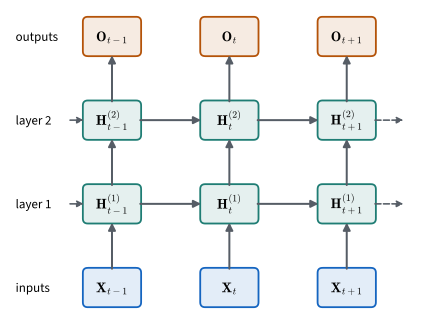
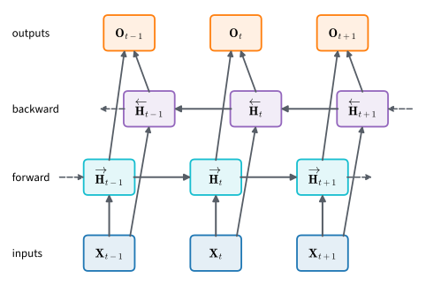

# Gated Recurrence
:label:`sec_lstm`

:numref:`subsec_bptt-gradient-pathologies` showed that the
gradient that travels $k$ steps back through a vanilla RNN is multiplied by
the $k$-th power of the recurrent Jacobian, so it shrinks or grows
geometrically. Gradient clipping limits growth but does not recover a
vanished signal. This motivates changing the recurrence through
*multiplicative gating*, a mechanism that lets the network learn what to
write into its memory, what to erase, and what to reveal. The analysis
behind it goes back to Hochreiter's 1991 diploma thesis and to
:citet:`bengio1994learning` (see also
:cite:`Hochreiter.Bengio.Frasconi.ea.2001`), and its most famous product is
the *long short-term memory* (LSTM) cell of
:citet:`Hochreiter.Schmidhuber.1997`, which powered speech recognition,
translation, and language modeling for most of the 2010s.

Gating also appears in newer architectures. The
transformer's gated feed-forward networks multiply one branch of
activations by another, a design whose value :numref:`sec_transformer-block`
measured directly, and modern linear recurrences use an input-dependent
forgetting coefficient around a linear state. We first develop the gate,
then implement the LSTM from scratch and with
framework layers. The gated recurrent unit (GRU) follows as a streamlined
descendant. We conclude with two structural axes, depth and
bidirectionality, and a survey of current uses of gating.

*Prerequisites: the RNN language-modeling pipeline of
:numref:`sec_rnn-scratch` (data, scaffold, and training recipe are reused
verbatim) and the gradient analysis of
:numref:`subsec_bptt-gradient-pathologies`.*

```{.python .input #lstm-gated-recurrent-networks}
%%tab pytorch
%matplotlib inline
from d2l import torch as d2l
import math
import torch
from torch import nn
```

```{.python .input #lstm-gated-recurrent-networks}
%%tab jax
%matplotlib inline
from d2l import jax as d2l
from flax import nnx
import jax
from jax import numpy as jnp
import math
```

## Controlling Memory Updates

Start from what the gradient analysis demands. As motivation, take the
simplest caricature: if the state-to-state Jacobian were one fixed
matrix, the contribution of a dependency $k$ steps back would scale
asymptotically as $\rho^k$, where $\rho$ is the spectral radius, and the
only value of $\rho$ that neither buries nor explodes distant information
is $1$. (The full story is subtler — a product of time-varying,
generally non-normal Jacobians can grow for many steps even with every
eigenvalue inside the unit circle, a phenomenon
:numref:`sec_mdl-nonnormal-transient` develops — but the caricature
points at the right target.) The simplest
recurrence with that property is an *accumulator*,

$$
\mathbf{S}_t = \mathbf{S}_{t-1} + (\textrm{new content}),
$$
:eqlabel:`eq_lstm-accumulator`

whose Jacobian $\partial \mathbf{S}_t / \partial \mathbf{S}_{t-1}$ is
exactly the identity: gradients pass backwards through it unattenuated, no
matter how many steps they travel. Additive updates, not repeated matrix
multiplication, are the memory-friendly primitive.

But a pure accumulator cannot discard obsolete information. Every update
remains in the sum, so irrelevant inputs interfere with relevant ones and
the state magnitude typically grows with sequence length. A
useful memory must make decisions. Should this input be written down?
Should this stored value be kept or cleared? Should the memory influence
the output right now, or stay silent? What turns these discrete-sounding
decisions into something a network can learn is the *gate*: a small
sigmoid-activated layer of the current input and the previous state,

$$
\mathbf{G}_t = \sigma(\mathbf{X}_t \mathbf{W}_{\textrm{xg}} + \mathbf{H}_{t-1} \mathbf{W}_{\textrm{hg}} + \mathbf{b}_\textrm{g}),
$$
:eqlabel:`eq_gate`

whose entries lie in $(0, 1)$ and multiply a signal *elementwise*. A gate
value near $1$ lets its coordinate pass; a value near $0$ blocks it; values
in between attenuate. Because the gate is computed from context, the
decision is different at every time step and for every unit, and because
$\sigma$ is smooth, the decision is differentiable and trainable by the
same backpropagation used for the other parameters. Every architecture in
this section
is a particular arrangement of a few such gates around an additive state.

The gate provides a direct response to the stability question in
:numref:`subsec_bptt-gradient-pathologies`. A vanilla RNN has one shared
matrix $\mathbf{W}_{\textrm{hh}}$ whose spectrum governs every perturbation
in every direction at every step. Preserving gradients requires training to
keep this global matrix near $\rho = 1$. In a gated cell, the state
coordinate $i$ is scaled by the gate value
$g_{t,i} \in (0, 1)$ at step $t$, so a perturbation from $k$ steps ago is
scaled by the product $\prod_{j} g_{j,i} \leq 1$: growth is impossible
along the memory path, while holding the gate near $1$ makes the product,
and hence the preserved memory, as close to lossless as the task requires.
In dynamical-systems terms, each unit gets its own learned, input-dependent
rate of decay in place of one hard-wired global one. Some units learn to
forget in three steps; others can learn to hold a value much longer when
the task rewards a long memory.

## Long Short-Term Memory

### The Memory Cell and Its Gates

The LSTM replaces the vanilla RNN's hidden node with a *memory cell*. The
name "long short-term memory" describes its role: a network's weights are
its long-term memory, changing slowly across training, while its
activations are short-term memory, overwritten at every step; the cell is
an intermediate store, an activation engineered to persist. Concretely,
the cell keeps an *internal state* $\mathbf{C}_t$, the additive accumulator
of the previous section, and controls it with three gates computed exactly
in the form of :eqref:`eq_gate`. With a minibatch of $n$ examples,
$d$-dimensional inputs $\mathbf{X}_t \in \mathbb{R}^{n \times d}$, and $h$
hidden units carrying the previous state
$\mathbf{H}_{t-1} \in \mathbb{R}^{n \times h}$, the *input gate*
$\mathbf{I}_t$, *forget gate* $\mathbf{F}_t$, and *output gate*
$\mathbf{O}_t$, each in $\mathbb{R}^{n \times h}$, are

$$
\begin{aligned}
\mathbf{I}_t &= \sigma(\mathbf{X}_t \mathbf{W}_{\textrm{xi}} + \mathbf{H}_{t-1} \mathbf{W}_{\textrm{hi}} + \mathbf{b}_\textrm{i}),\\
\mathbf{F}_t &= \sigma(\mathbf{X}_t \mathbf{W}_{\textrm{xf}} + \mathbf{H}_{t-1} \mathbf{W}_{\textrm{hf}} + \mathbf{b}_\textrm{f}),\\
\mathbf{O}_t &= \sigma(\mathbf{X}_t \mathbf{W}_{\textrm{xo}} + \mathbf{H}_{t-1} \mathbf{W}_{\textrm{ho}} + \mathbf{b}_\textrm{o}),
\end{aligned}
$$
:eqlabel:`lstm_gates`

where the $\mathbf{W}_{\textrm{x}\cdot} \in \mathbb{R}^{d \times h}$ and
$\mathbf{W}_{\textrm{h}\cdot} \in \mathbb{R}^{h \times h}$ are weights and
the $\mathbf{b}_\cdot \in \mathbb{R}^{1 \times h}$ are biases (broadcast
over the batch as in :numref:`subsec_broadcasting`). A fourth head, the
*input node*, proposes the content that might be written. It uses $\tanh$
rather than $\sigma$, since content should be able to be negative:

$$
\tilde{\mathbf{C}}_t = \tanh(\mathbf{X}_t \mathbf{W}_{\textrm{xc}} + \mathbf{H}_{t-1} \mathbf{W}_{\textrm{hc}} + \mathbf{b}_\textrm{c}).
$$
:eqlabel:`lstm_c_tilde`

The four heads are the same computation with different nonlinearities and
different jobs. What distinguishes the LSTM is how they combine. The forget
gate scales the old cell state, the input gate scales the proposed content,
and the two are *added*; the output gate then decides how much of the
(squashed) cell is exposed as the hidden state:

$$
\mathbf{C}_t = \mathbf{F}_t \odot \mathbf{C}_{t-1} + \mathbf{I}_t \odot \tilde{\mathbf{C}}_t,
\qquad
\mathbf{H}_t = \mathbf{O}_t \odot \tanh(\mathbf{C}_t),
$$
:eqlabel:`lstm_update`

where $\odot$ is the elementwise (Hadamard) product.
:numref:`fig_lstm_cell` traces the full data flow.


:label:`fig_lstm_cell`

Follow the top path of :numref:`fig_lstm_cell` from left to right. The cell
state is touched only by an elementwise product and an elementwise sum; no
matrix multiplication and no saturating nonlinearity stands between
$\mathbf{C}_{t-1}$ and $\mathbf{C}_t$. Along this *direct* path — gates
and candidate held fixed — the Jacobian is
$\partial \mathbf{C}_t / \partial \mathbf{C}_{t-1} =
\textrm{diag}(\mathbf{F}_t)$, so with the forget gate near $1$ and the
input gate near $0$ the cell holds its value, and the gradient holds with
it, across arbitrarily many steps. To be precise about what is and is not
guaranteed: $\mathbf{F}_t$, $\mathbf{I}_t$, and $\tilde{\mathbf{C}}_t$
all depend on $\mathbf{H}_{t-1}$, which depends on $\mathbf{C}_{t-1}$, so
the *total* derivative of $\mathbf{C}_t$ with respect to
$\mathbf{C}_{t-1}$ carries additional terms that flow through the gates
and reintroduce exactly the matrix products the direct path avoids
(:numref:`sec_mdl-nonnormal-transient` analyzes such Jacobian products).
The architecture supplies a well-conditioned additive route and lets
learning control it; it does not guarantee that every gradient is
preserved. This protected additive path is the
*constant error carousel* that gives the LSTM its resistance to vanishing
gradients: it is precisely the controlled accumulator we asked for. The
output gate adds a subtler ability: a cell can accumulate evidence silently
for many steps ($\mathbf{O}_t \approx 0$), invisible to the layers above,
and release it at the moment it becomes relevant. Only $\mathbf{H}_t$ is
passed to output layers and to the next stacked layer; the cell state stays
internal to the cell.

### Implementation from Scratch

We implement the cell using the template of
:numref:`sec_rnn-scratch`: the cell class holds parameters and steps the
recurrence, and `d2l.RNNLMScratch` wraps it with an embedding and an output
head to form a language model. As there, `num_inputs` is the width of the
vectors the cell consumes at each step, which will be the embedding
dimension. Each of the four heads needs the same triple of parameters, so
we build them with a small factory.

```{.python .input #lstm-implementation-from-scratch-1}
%%tab pytorch
class LSTMScratch(d2l.Module):  #@save
    """The long short-term memory (LSTM) cell implemented from scratch."""
    def __init__(self, num_inputs, num_hiddens, sigma=0.01):
        super().__init__()
        self.save_hyperparameters()

        init_weight = lambda *shape: nn.Parameter(d2l.randn(*shape) * sigma)
        triple = lambda: (init_weight(num_inputs, num_hiddens),
                          init_weight(num_hiddens, num_hiddens),
                          nn.Parameter(d2l.zeros(num_hiddens)))
        self.W_xi, self.W_hi, self.b_i = triple()  # Input gate
        self.W_xf, self.W_hf, self.b_f = triple()  # Forget gate
        self.W_xo, self.W_ho, self.b_o = triple()  # Output gate
        self.W_xc, self.W_hc, self.b_c = triple()  # Input node
```

```{.python .input #lstm-implementation-from-scratch-1}
%%tab jax
class LSTMScratch(nnx.Module):  #@save
    """The long short-term memory (LSTM) cell implemented from scratch."""
    def __init__(self, num_inputs, num_hiddens, sigma=0.01, rngs=None):
        rngs = nnx.Rngs(0) if rngs is None else rngs
        self.num_inputs, self.num_hiddens = num_inputs, num_hiddens
        self.sigma = sigma
        init_weight = lambda shape: nnx.Param(
            rngs.params.normal(shape) * sigma)
        triple = lambda: (
            init_weight((num_inputs, num_hiddens)),
            init_weight((num_hiddens, num_hiddens)),
            nnx.Param(jnp.zeros(num_hiddens)))
        self.W_xi, self.W_hi, self.b_i = triple()  # Input gate
        self.W_xf, self.W_hf, self.b_f = triple()  # Forget gate
        self.W_xo, self.W_ho, self.b_o = triple()  # Output gate
        self.W_xc, self.W_hc, self.b_c = triple()  # Input node
```

The forward computation walks the time axis just as the vanilla cell did,
except that each step evaluates :eqref:`lstm_gates`, :eqref:`lstm_c_tilde`,
and :eqref:`lstm_update`, and the carried state is now the pair
$(\mathbf{H}, \mathbf{C})$.

:begin_tab:`jax`
The explicit Python loop of the other tab is the readable teaching form,
but under JIT compilation it is unrolled into a graph that grows with the
sequence length, which for the LSTM's eight matrix products per step makes
compilation painfully slow. As promised in :numref:`sec_rnn-scratch`, we
switch to `jax.lax.scan`: it takes a step function, an initial carry, and
an array whose leading axis is scanned, and returns the final carry with
the stacked per-step outputs.
:end_tab:

```{.python .input #lstm-implementation-from-scratch-2}
%%tab pytorch
@d2l.add_to_class(LSTMScratch)  #@save
def forward(self, inputs, H_C=None):
    if H_C is None:
        # Initial state with shape: (batch_size, num_hiddens)
        H = d2l.zeros((inputs.shape[1], self.num_hiddens),
                      device=inputs.device)
        C = d2l.zeros((inputs.shape[1], self.num_hiddens),
                      device=inputs.device)
    else:
        H, C = H_C
    outputs = []
    for X in inputs:
        I = d2l.sigmoid(d2l.matmul(X, self.W_xi) +
                        d2l.matmul(H, self.W_hi) + self.b_i)
        F = d2l.sigmoid(d2l.matmul(X, self.W_xf) +
                        d2l.matmul(H, self.W_hf) + self.b_f)
        O = d2l.sigmoid(d2l.matmul(X, self.W_xo) +
                        d2l.matmul(H, self.W_ho) + self.b_o)
        C_tilde = d2l.tanh(d2l.matmul(X, self.W_xc) +
                           d2l.matmul(H, self.W_hc) + self.b_c)
        C = F * C + I * C_tilde
        H = O * d2l.tanh(C)
        outputs.append(H)
    return outputs, (H, C)
```

```{.python .input #lstm-implementation-from-scratch-2}
%%tab jax
@d2l.add_to_class(LSTMScratch)  #@save
def __call__(self, inputs, H_C=None):
    def scan_fn(H_C, X):
        H, C = H_C
        I = d2l.sigmoid(d2l.matmul(X, self.W_xi) +
                        d2l.matmul(H, self.W_hi) + self.b_i)
        F = d2l.sigmoid(d2l.matmul(X, self.W_xf) +
                        d2l.matmul(H, self.W_hf) + self.b_f)
        O = d2l.sigmoid(d2l.matmul(X, self.W_xo) +
                        d2l.matmul(H, self.W_ho) + self.b_o)
        C_tilde = d2l.tanh(d2l.matmul(X, self.W_xc) +
                           d2l.matmul(H, self.W_hc) + self.b_c)
        C = F * C + I * C_tilde
        H = O * d2l.tanh(C)
        return (H, C), H  # Return (carry, per-step output)

    if H_C is None:
        batch_size = inputs.shape[1]
        H_C = (jnp.zeros((batch_size, self.num_hiddens)),
               jnp.zeros((batch_size, self.num_hiddens)))
    H_C, outputs = jax.lax.scan(scan_fn, H_C, inputs)
    return outputs, H_C
```

A quick shape check confirms that the cell consumes a
(`num_steps`, `batch_size`, `num_inputs`) tensor and that both pieces of
state keep the (`batch_size`, `num_hiddens`) shape from step to step.

```{.python .input #lstm-implementation-from-scratch-3}
%%tab pytorch, jax
lstm = LSTMScratch(num_inputs=16, num_hiddens=32)
X = d2l.ones((9, 4, 16))  # (num_steps, batch_size, num_inputs)
outputs, (H, C) = lstm(X)
d2l.check_shape(outputs[-1], (4, 32))
d2l.check_shape(H, (4, 32))
d2l.check_shape(C, (4, 32))
```

### Training
:label:`subsec_lstm-training`

Does the gated cell actually beat the vanilla RNN? To make the comparison
mean something we reuse the recipe of :numref:`sec_rnn-scratch` unchanged:
*The Time Machine* under the 1,024-token BPE tokenizer, 50,000 training
windows of 32 tokens, embedding dimension 64, 128 hidden units, ten epochs
with gradients clipped to norm 1.

```{.python .input #lstm-training-1}
%%tab pytorch, jax
data = d2l.TimeMachine(batch_size=1024, num_steps=32,
                       num_train=50000, num_val=5000)
```

The language-model scaffold from :numref:`sec_rnn-scratch` accepts the new
cell without modification, because the cell keeps the same interface:
embeddings in, per-step hidden states out. Only the recurrence changed.

```{.python .input #lstm-training-2}
%%tab pytorch, jax
lstm = LSTMScratch(num_inputs=64, num_hiddens=128)
model = d2l.RNNLMScratch(lstm, vocab_size=len(data.vocab), lr=4)
```

```{.python .input #lstm-training-3}
%%tab pytorch, jax
trainer = d2l.Trainer(max_epochs=10, gradient_clip_val=1, num_gpus=1)
model.board.yscale = 'log'
trainer.fit(model, data)
```

We will train several models in this section, so we wrap the perplexity
readout in a helper and start a small scoreboard.

```{.python .input #lstm-training-4}
%%tab pytorch
def val_ppl(model):
    return float(model.board.data['val_ppl'][-1].y)

ppls = {'LSTM (scratch)': val_ppl(model)}
print(f"validation perplexity {ppls['LSTM (scratch)']:.1f}")
```

```{.python .input #lstm-training-4}
%%tab jax
def val_ppl(model):
    total_loss = num_tokens = 0
    for X_val, y_val in data.val_dataloader():
        losses = model.loss(model(X_val), y_val, averaged=False)
        total_loss += float(losses.sum())
        num_tokens += losses.size
    return math.exp(total_loss / num_tokens)

ppls = {'LSTM (scratch)': val_ppl(model)}
print(f"validation perplexity {ppls['LSTM (scratch)']:.1f}")
```

Under the identical recipe, the vanilla RNN of :numref:`sec_rnn-scratch`
reached a validation perplexity in the neighborhood of 90 to 110, and our
from-scratch LSTM lands in the same range. Two factors could limit this run.
First, ten epochs is a short budget for a cell whose
recurrent core has four heads and $4h(d + h + 1)$ weights instead of
$h(d + h + 1)$: the curves are still moving when the budget ends, so the
model is undertrained rather than out of capacity. Second, our naive
initialization starts every gate half-open: with weights near zero,
$\sigma(0) = 0.5$, so the untrained forget gate halves the cell state at
every step, and the carousel only starts carrying once training pushes the
forget-gate biases up. Practitioners initialize
$\mathbf{b}_\textrm{f}$ to 1 for this reason, and an exercise asks you to
test whether this remedy, or a longer budget, helps under this recipe.
Under this section's fixed budget, the
streamlined GRU below provides the
clearest comparison with the vanilla RNN.

### Concise Implementation
:label:`subsec_lstm-concise`

Every framework ships an LSTM layer that fuses the cell and the time loop
into one optimized call; as :numref:`sec_rnn-scratch` measured for the
vanilla cell, the fused kernel is what you use for any model you train at
length, and for the LSTM the gap is larger because each hand-rolled step
launches eight matrix products. The `LSTM` class below keeps the interface
of `LSTMScratch` and adds a `num_layers` argument, which stacks recurrent
layers on top of one another; we use it later in this section, and the
following sections of this chapter reuse it as their recurrent baseline.
As before, `num_inputs` is the width of the per-step input vectors.

```{.python .input #lstm-concise-implementation-1}
%%tab pytorch
class LSTM(d2l.RNN):  #@save
    """The multilayer LSTM model implemented with high-level APIs."""
    def __init__(self, num_inputs, num_hiddens, num_layers=1, dropout=0):
        d2l.Module.__init__(self)
        self.save_hyperparameters()
        self.rnn = nn.LSTM(num_inputs, num_hiddens, num_layers,
                           dropout=dropout)

    def forward(self, inputs, H_C=None):
        return self.rnn(inputs, H_C)
```

```{.python .input #lstm-concise-implementation-1}
%%tab jax
class LSTM(d2l.RNN):  #@save
    """The multilayer LSTM model implemented with high-level APIs."""
    def __init__(self, num_inputs, num_hiddens, num_layers=1, dropout=0,
                 rngs=None):
        rngs = nnx.Rngs(params=0, dropout=1, carry=2) if rngs is None \
            else rngs
        self.num_inputs, self.num_hiddens = num_inputs, num_hiddens
        self.num_layers = num_layers
        self.rnns = nnx.List([
            nnx.RNN(nnx.LSTMCell(num_inputs if i == 0 else num_hiddens,
                                 num_hiddens, rngs=rngs),
                    time_major=True, return_carry=True, rngs=rngs)
            for i in range(num_layers)])
        self.dropouts = nnx.List([
            nnx.Dropout(dropout, rngs=rngs) for _ in range(num_layers - 1)])

    def __call__(self, inputs, H_C=None):
        outputs = inputs
        H_C = [None] * self.num_layers if H_C is None else H_C
        new_H_C = []
        for i, rnn in enumerate(self.rnns):
            carry, outputs = rnn(outputs, initial_carry=H_C[i])
            new_H_C.append(carry)
            if i < self.num_layers - 1:
                outputs = self.dropouts[i](outputs)
        return outputs, new_H_C
```

The concise language model `d2l.RNNLM` wraps it exactly as its scratch
counterpart did, and training is the same call with the same
hyperparameters.

```{.python .input #lstm-concise-implementation-2}
%%tab pytorch, jax
lstm = LSTM(num_inputs=64, num_hiddens=128)
model = d2l.RNNLM(lstm, vocab_size=len(data.vocab), lr=4)
```

```{.python .input #lstm-concise-implementation-3}
%%tab pytorch, jax
trainer = d2l.Trainer(max_epochs=10, gradient_clip_val=1, num_gpus=1)
model.board.yscale = 'log'
trainer.fit(model, data)
```

The trained model reaches a somewhat better perplexity than our
from-scratch cell. The difference is not the arithmetic, which is
identical, but the starting point, and it is worth being precise about
what each framework actually does. PyTorch's `nn.LSTM` draws every
weight *and bias* uniformly at scale $1/\sqrt{h}$; Flax's `LSTMCell`
pairs fan-in-scaled input weights with orthogonal recurrent matrices and
zero biases. Both are better starting points than our teaching code's
small Gaussian, and they differ from each other — one reason the
two tabs' numbers do not match. Note what neither default includes: the
forget-gate bias of 1 described above remains yours to set.
At a fixed training budget, how you start matters.

Reading the perplexity off the scoreboard, we let the model continue
*the time traveller*. As :numref:`sec_rnn-scratch` explained, greedy
(argmax) decoding of a model this lightly trained soon drifts into a
repetition loop, so we sample at a low temperature: the continuation stays
close to the model's preferences yet keeps moving.

```{.python .input #lstm-concise-implementation-4}
%%tab pytorch
ppls['LSTM'] = val_ppl(model)
pred = model.predict('the time traveller', 30, data.tokenizer, d2l.try_gpu(),
                     temperature=0.5)
d2l.print_wrapped(f"perplexity {ppls['LSTM']:.1f}, {pred!r}")
```

```{.python .input #lstm-concise-implementation-4}
%%tab jax
ppls['LSTM'] = val_ppl(model)
pred = model.predict('the time traveller', 30, data.tokenizer,
                     temperature=0.5)
d2l.print_wrapped(f"perplexity {ppls['LSTM']:.1f}, {pred!r}")
```

## Gated Recurrent Units
:label:`sec_gru`

As LSTMs spread through the 2010s, researchers looked for cheaper cells
that kept the two essential ingredients, an additive state path and
multiplicative gates. The most widely used answer is the *gated recurrent
unit* (GRU) of :citet:`Cho.Van-Merrienboer.Bahdanau.ea.2014`: it drops the
separate cell state, letting the hidden state itself be the memory, and
merges four heads into three. Early comparisons found that this reduction
could match LSTM quality on several tasks
:cite:`Chung.Gulcehre.Cho.ea.2014`.

### Reset and Update Gates

The GRU computes two gates in the form of
:eqref:`eq_gate`, a *reset gate* $\mathbf{R}_t$ and an *update gate*
$\mathbf{Z}_t$:

$$
\mathbf{R}_t = \sigma(\mathbf{X}_t \mathbf{W}_{\textrm{xr}} + \mathbf{H}_{t-1} \mathbf{W}_{\textrm{hr}} + \mathbf{b}_\textrm{r}),
\qquad
\mathbf{Z}_t = \sigma(\mathbf{X}_t \mathbf{W}_{\textrm{xz}} + \mathbf{H}_{t-1} \mathbf{W}_{\textrm{hz}} + \mathbf{b}_\textrm{z}).
$$
:eqlabel:`gru_gates`

The reset gate acts *inside* the candidate state: it filters how much of
the previous state may enter the vanilla-RNN-style proposal,

$$
\tilde{\mathbf{H}}_t = \tanh(\mathbf{X}_t \mathbf{W}_{\textrm{xh}} + \left(\mathbf{R}_t \odot \mathbf{H}_{t-1}\right) \mathbf{W}_{\textrm{hh}} + \mathbf{b}_\textrm{h}),
$$
:eqlabel:`gru_tilde_H`

so $\mathbf{R}_t \approx 1$ recovers the vanilla recurrence while
$\mathbf{R}_t \approx 0$ makes the proposal a function of the current input
alone, as if the sequence restarted. The update gate then blends old state
and proposal as a convex combination,

$$
\mathbf{H}_t = \mathbf{Z}_t \odot \mathbf{H}_{t-1} + (1 - \mathbf{Z}_t) \odot \tilde{\mathbf{H}}_t.
$$
:eqlabel:`gru_H`

Here the additive memory path is plain to see: wherever
$\mathbf{Z}_t \approx 1$ the new state is a copy of the old one and the
step is effectively skipped, giving the same near-identity direct-path
Jacobian as the LSTM's carousel (with the same caveat: the gates
themselves depend on $\mathbf{H}_{t-1}$, so this is the protected route,
not the total derivative); wherever $\mathbf{Z}_t \approx 0$ the state is
overwritten by the proposal. Because :eqref:`gru_H` is a convex combination of two
bounded quantities, the state stays bounded by construction, and the GRU
needs neither a separate protected accumulator nor an output squashing: one
vector serves as memory and output at once. The division of labor is that
reset gates capture short-range decisions (what to drop from the proposal)
and update gates capture long-range ones (how long to hold state).
:numref:`fig_gru_cell` shows the flow.


:label:`fig_gru_cell`

### Implementation and Comparison

After the LSTM, a from-scratch GRU offers no new idea, only one fewer
head, so we skip straight to the framework layer (an exercise asks you to
write the scratch version by editing `LSTMScratch`). The class mirrors
`LSTM`, including the `num_layers` argument; the GRU is also the cell
that the next section (:numref:`sec_ssm`) strips down to its minimal
linear core.

```{.python .input #lstm-implementation-and-comparison-1}
%%tab pytorch
class GRU(d2l.RNN):  #@save
    """The multilayer GRU model implemented with high-level APIs."""
    def __init__(self, num_inputs, num_hiddens, num_layers=1, dropout=0):
        d2l.Module.__init__(self)
        self.save_hyperparameters()
        self.rnn = nn.GRU(num_inputs, num_hiddens, num_layers,
                          dropout=dropout)
```

```{.python .input #lstm-implementation-and-comparison-1}
%%tab jax
class GRU(d2l.RNN):  #@save
    """The multilayer GRU model implemented with high-level APIs."""
    def __init__(self, num_inputs, num_hiddens, num_layers=1, dropout=0,
                 rngs=None):
        rngs = nnx.Rngs(params=0, dropout=1, carry=2) if rngs is None \
            else rngs
        self.num_inputs, self.num_hiddens = num_inputs, num_hiddens
        self.num_layers = num_layers
        self.rnns = nnx.List([
            nnx.RNN(nnx.GRUCell(num_inputs if i == 0 else num_hiddens,
                                num_hiddens, rngs=rngs),
                    time_major=True, return_carry=True, rngs=rngs)
            for i in range(num_layers)])
        self.dropouts = nnx.List([
            nnx.Dropout(dropout, rngs=rngs) for _ in range(num_layers - 1)])

    def __call__(self, X, state=None):
        outputs = X
        state = [None] * self.num_layers if state is None else state
        new_state = []
        for i, rnn in enumerate(self.rnns):
            carry, outputs = rnn(outputs, initial_carry=state[i])
            new_state.append(carry)
            if i < self.num_layers - 1:
                outputs = self.dropouts[i](outputs)
        return outputs, new_state
```

One training run under the same recipe puts the GRU on our scoreboard.

```{.python .input #lstm-implementation-and-comparison-2}
%%tab pytorch, jax
gru = GRU(num_inputs=64, num_hiddens=128)
model = d2l.RNNLM(gru, vocab_size=len(data.vocab), lr=4)
```

```{.python .input #lstm-implementation-and-comparison-3}
%%tab pytorch, jax
trainer = d2l.Trainer(max_epochs=10, gradient_clip_val=1, num_gpus=1)
model.board.yscale = 'log'
trainer.fit(model, data)
```

```{.python .input #lstm-implementation-and-comparison-4}
%%tab pytorch, jax
ppls['GRU'] = val_ppl(model)
print(f"validation perplexity {ppls['GRU']:.1f}")
```

At the same width the GRU's recurrent core has $3h(d + h + 1)$ weights to
the LSTM's $4h(d + h + 1)$ and computes three matmul heads per step
instead of four, yet in our runs it posts the best perplexity of the
section, ahead of the vanilla RNN and the LSTM at this budget. This short
schedule measures convergence rather than ultimate capacity. The GRU has
fewer gates to coordinate, and its convex state blend remains well scaled
from the first epoch. This mirrors the
early empirical comparisons :cite:`Chung.Gulcehre.Cho.ea.2014`, which
found the GRU at least the LSTM's equal on small and mid-sized tasks; with
longer training and careful initialization the LSTM closes the gap (see
the exercises).

Equation :eqref:`gru_H` also points toward later linear recurrences. The
*only* nonlinearity standing between
$\mathbf{H}_{t-1}$ and $\mathbf{H}_t$ enters through
$\tilde{\mathbf{H}}_t$ and the gates. If one makes the gates functions of
the input alone and lets the candidate ignore the previous state, the
update becomes *linear* in $\mathbf{H}_{t-1}$, and a linear recurrence can
be trained in parallel across the whole sequence rather than step by step.
That observation is the seed of minimal gated cells such as minGRU
:cite:`Feng.Tung.Ahmed.ea.2024`, of linear recurrent units
:cite:`Orvieto.Smith.Gu.ea.2023`, and of the state space models that now
appear inside production language models, and :numref:`sec_ssm` works it
out in full. The GRU therefore connects the gated LSTM to the linear
recurrences that
follow.

## Depth and Direction

Gating changes what happens *inside* a cell; two further RNN-era design
axes change how cells are wired together. We compress both to the lessons
that outlived them.

### Deep Recurrent Networks
:label:`sec_deep_rnn`

A deep RNN stacks recurrent layers, each reading the hidden-state
sequence of the layer below as its input sequence: function composition
within a time step, on top of recurrence across steps. Gated cells handle
the time direction; the layer direction borrows the feedforward remedies
of residual connections (:numref:`sec_resnet`) and between-layer dropout.
For recurrent models, stacks beyond four to eight layers rarely paid
off. Since our `LSTM` class already accepts `num_layers`, a two-layer
model is a one-argument change, and it completes our scoreboard.

```{.python .input #lstm-deep-recurrent-networks-1}
%%tab pytorch, jax
lstm2 = LSTM(num_inputs=64, num_hiddens=128, num_layers=2)
model = d2l.RNNLM(lstm2, vocab_size=len(data.vocab), lr=4)
trainer = d2l.Trainer(max_epochs=10, gradient_clip_val=1, num_gpus=1)
model.board.yscale = 'log'
trainer.fit(model, data)
```

```{.python .input #lstm-deep-recurrent-networks-3}
%%tab pytorch, jax
ppls['LSTM (2 layers)'] = val_ppl(model)
print(f'{"model":>16} {"val ppl":>8}')
for name, p in ppls.items():
    print(f'{name:>16} {p:>8.1f}')
```

The results require a narrow interpretation. The GRU beats the vanilla
RNN of :numref:`sec_rnn-scratch` clearly at the same recipe; the
single-layer LSTM roughly matches the vanilla model within this short
budget, for the initialization and budget reasons discussed above; and the
second layer does not improve validation perplexity under this recipe.
It adds parameters and optimization work that this small corpus and short
training budget do not use effectively. This result does not imply that
depth is unhelpful on larger corpora or with longer training.

### Bidirectional Recurrent Networks
:label:`sec_bi_rnn`

Language modeling forces left-to-right reading, but a model that
*analyzes* a complete, given sequence has the future context in hand, and
that context is informative. Part-of-speech tagging is one such task. A
*bidirectional RNN*
:cite:`Schuster.Paliwal.1997` runs a second, independent recurrent layer
backward over the same input and concatenates the two states at each
step into
$\mathbf{H}_t = [\overrightarrow{\mathbf{H}}_t, \overleftarrow{\mathbf{H}}_t]
\in \mathbb{R}^{n \times 2h}$: every output conditions on the entire
sequence, at twice the compute. In frameworks this is a flag or a
wrapper, and the shape check shows exactly what changed, the per-step
output width doubling to $2h$.

```{.python .input #lstm-bidirectional-recurrent-networks}
%%tab pytorch
birnn = nn.LSTM(64, 128, bidirectional=True)
X = d2l.randn(32, 8, 64)  # (num_steps, batch_size, num_inputs)
outputs, (H, C) = birnn(X)
outputs.shape, H.shape
```

```{.python .input #lstm-bidirectional-recurrent-networks}
%%tab jax
birnn = nnx.Bidirectional(
    nnx.RNN(nnx.LSTMCell(64, 128, rngs=nnx.Rngs(0)),
            time_major=True, rngs=nnx.Rngs(0)),
    nnx.RNN(nnx.LSTMCell(64, 128, rngs=nnx.Rngs(1)), time_major=True,
            reverse=True, keep_order=True, rngs=nnx.Rngs(1)),
    time_major=True)
X = jax.random.normal(d2l.get_key(), (32, 8, 64))
outputs = birnn(X)
outputs.shape
```

One warning matters more than the mechanics: **a bidirectional network
cannot serve unchanged as a causal decoder**. Every $\mathbf{H}_t$
conditions on tokens after $t$, so the model cannot emit tokens
left-to-right autoregressively because future tokens are unavailable.
Training such a model to predict the next token also leaks the target:
the backward recurrence receives that token as part of its input. The
resulting low training loss therefore does not measure causal prediction,
and the model cannot be used unchanged for left-to-right generation.
The scope of the warning is the causal role, not generation wholesale:
bidirectional encoders live inside generative systems (the encoder half
of a translation model conditions a causal decoder), and
non-autoregressive decoders generate whole sequences by iterative
refinement rather than left to right. Use
bidirectional layers where the full input is given up front and
per-position representations are wanted: tagging, span labeling, and
encoding. Their most consequential success was ELMo
:cite:`Peters.Neumann.Iyyer.ea.2018`, deep bidirectional LSTMs trained to
produce contextual word embeddings (see also
:cite:`Graves.Schmidhuber.2005`); the bidirectional attention of BERT
:cite:`Devlin.Chang.Lee.ea.2018` then inherited that role and the entire
encode-both-directions idea, and we study BERT in the pretraining
chapters.

## Gates in Other Architectures

The cells above are, by the standards of this book's earlier chapters, old
technology. The gate is not. Its shape is a sigmoid (or other bounded)
branch elementwise-multiplying a signal branch, and once you know that
shape you will find it across modern deep learning, doing the same job of
content-dependent routing that it does inside the LSTM.

Highway networks :cite:`srivastava2015highway` applied the LSTM's gating
to *depth*: a transform gate blends each layer's output with its
unmodified input, letting very deep feedforward networks train years
before normalization made it routine, and prefiguring the residual
connections of :numref:`sec_resnet`. Transformer blocks carry gates in
their MLPs: the gated linear unit family is the standard MLP in most
contemporary open language models, its SwiGLU variant
:cite:`Shazeer.2020` computing
$\textrm{Swish}(\mathbf{x}\mathbf{W}_1) \odot \mathbf{x}\mathbf{W}_2$;
:numref:`sec_transformer-block` measured the effect of that gate in a
matched-parameter sweep. And the recurrence story of this chapter
continues the pattern most directly: the selective state space model
Mamba :cite:`Gu.Dao.2023` modulates a linear state with an
input-dependent step size $\Delta_t$ that plays precisely the role of a
forget gate, and Griffin :cite:`De.Smith.Fernando.ea.2024` builds
production-scale hybrids from gated linear recurrences.

The gate even circled back to the cell it came from. xLSTM
:cite:`Beck.Poppel.Spanring.ea.2024` revisits the LSTM with *exponential*
gating: its sLSTM cell replaces the sigmoid's $(0,1)$ range with $\exp$,
so a confident new write can overwhelm the accumulated state rather than
merely dilute it, and a running maximum carried in log space keeps the
unbounded gates numerically stable. The result revives the classic
recurrent, state-dependent cell at modern scale. Its sibling, the
matrix-memory mLSTM, gives up state-dependent gating to regain parallel
training, and appears where it belongs, in the family table of
:numref:`sec_matrix-state`. One idea, many guises:

| Where | The gate | What it controls |
| :-- | :-- | :-- |
| LSTM (1997) | forget gate $\mathbf{F}_t$ | decay of the cell state $\mathbf{C}_t$ |
| GRU (2014) | update gate $\mathbf{Z}_t$ | copy-vs-overwrite blend of $\mathbf{H}_t$ |
| Highway nets (2015) | transform gate | skip-vs-transform blend across depth |
| GLU, SwiGLU MLPs (:numref:`sec_transformer-block`) | activation branch | which channels pass through the MLP |
| Mamba (2023) | step size $\Delta_t$ | decay of a linear state, from input only |
| Griffin, mLSTM (2024) | recurrence gates | decay and write strength of linear cells |

The gates in the last three rows depend on the *input only*, not on the
state. Removing state-dependent gating makes the recurrence linear. The
result permits parallel training across the sequence while retaining
learned forgetting.
:numref:`sec_ssm` takes exactly that step, and the rest of the chapter
rides it: linear state space models, made selective in
:numref:`sec_mamba`, reconciled with attention in
:numref:`sec_matrix-state`, taught to edit their memory in
:numref:`sec_deltanet`, reread as learning at test time in
:numref:`sec_test-time-regression`, and finally hybridized with the
transformer in :numref:`sec_hybrids`. Input-dependent gating provides the
starting point for that comparison.

## Summary

Gating addresses vanishing gradients by maintaining an additive state path
whose direct-path Jacobian stays
near the identity and controlling reads, writes, and erasures with learned
sigmoid gates that multiply elementwise. The LSTM realizes this with a
protected cell state and three gates; its cell update
$\mathbf{C}_t = \mathbf{F}_t \odot \mathbf{C}_{t-1} + \mathbf{I}_t \odot
\tilde{\mathbf{C}}_t$ is the constant error carousel that lets both
information and gradients cross long horizons. The GRU reaches nearly the
same behavior with two gates and no separate cell, at three quarters of
the recurrent parameters. On an identical short training recipe the GRU
clearly outperforms the vanilla RNN from :numref:`sec_rnn-scratch`, while
the LSTM needs a longer budget or a friendlier initialization before its
extra machinery pays: architecture and optimization cannot be judged
separately. Depth and bidirectionality are orthogonal wiring choices:
stacked layers in the first case, a backward pass concatenated to the
forward one in the second. Bidirectionality yields encoders, which cannot
double unchanged as causal decoders. The gate itself outlived these
architectures: it routes channels in transformer MLPs
(:numref:`sec_transformer-block`), revives the LSTM in exponential form
(xLSTM), and, made input-dependent only, powers the linear recurrences
and state space models that the rest of this chapter builds.

**Experimental scope.** Under one fixed
small-corpus recipe, gate-equipped cells train reliably where the vanilla
RNN plateaus, and initialization can matter as much as architecture at a
ten-epoch budget. These are single seeded runs on one small corpus: they
do not rank LSTM against GRU in general, and they say nothing about
behavior at scale, where budgets, tuning, and data change the ordering.

## Exercises

1. **Holding a value.** Suppose that the token at step $t'$ determines the
   prediction at a much later step $t$, and that one memory cell is to carry
   it from $t'$ to $t$.
    1. State the value that each gate of that cell in :eqref:`lstm_gates`
       should take at step $t'$, at the steps strictly between $t'$ and $t$,
       and at step $t$. Then do the same for the update gate of a GRU unit
       in :eqref:`gru_H`.
    1. A sigmoid gate never reaches 1. Suppose that the forget gate's
       pre-activation stays at a constant $b$, so that its value is
       $\sigma(b)$ at every step. What fraction of the stored value survives
       $k$ steps along the direct path? How large must $b$ be for 90% of
       the value to survive 1,000 steps?
    1. Show that a forget-gate bias of $\log(T - 1)$ gives an initial forget
       gate of $1 - 1/T$ when the weights are zero, so that for large $T$ a
       stored value decays by a factor of about $e$ over $T$ steps. The
       *chrono initialization* of :citet:`Tallec.Ollivier.2018` draws the
       forget-gate bias of each unit as $\log u$, with $u$ uniform on
       $[1, T_\textrm{max} - 1]$, and sets $\mathbf{b}_\textrm{i} =
       -\mathbf{b}_\textrm{f}$. Show that with zero weights this makes
       $\mathbf{F}_t + \mathbf{I}_t = 1$, and compare the resulting cell
       update with :eqref:`gru_H`.
1. [code] **The carousel's other paths.** ● Consider an LSTM with one
   input and one hidden unit, so that every quantity in :eqref:`lstm_gates`,
   :eqref:`lstm_c_tilde`, and :eqref:`lstm_update` is a scalar. Write $C_t$,
   $H_t$, $F_t$, $I_t$, $O_t$, and $\tilde{C}_t$ for these scalars, and
   $w_\textrm{hf}$, $w_\textrm{hi}$, and $w_\textrm{hc}$ for the recurrent
   weights of the forget gate, the input gate, and the input node.
    1. The output gate $O_{t-1}$ depends on $H_{t-2}$ but not on $C_{t-1}$.
       Using $H_{t-1} = O_{t-1} \tanh(C_{t-1})$, derive the total derivative
       $\textrm{d}C_t / \textrm{d}C_{t-1}$. Write it as the direct-path value
       $F_t$ plus a correction, and factor the correction into a term from
       step $t$ and the derivative $\textrm{d}H_{t-1} / \textrm{d}C_{t-1}$.
    1. For which values of the gates, of $\tilde{C}_t$, and of $C_{t-1}$ does
       the correction vanish? Which of these conditions can the network
       set through its gates while the cell is storing a value?
    1. Now compare the two paths in a trained model. Train `LSTMScratch`
       with the recipe of :numref:`subsec_lstm-training`, and let it read
       1,024 consecutive validation tokens with the state carried across
       them. Compute the norm of the gradient of the loss at the last token
       with respect to $\mathbf{C}_{1024-k}$ for $k$ up to 256, and plot it
       against $k$ on a logarithmic scale. Compare it with the gradient
       carried by the direct path alone, which multiplies the gradient at
       $\mathbf{C}_{1024}$ elementwise by the product of the forget-gate
       values over the last $k$ steps. Where do the two curves part, and
       which is larger?
1. **Output squashing.** The input node $\tilde{\mathbf{C}}_t$ is already
   squashed by the $\tanh$ in :eqref:`lstm_c_tilde`, yet :eqref:`lstm_update`
   applies $\tanh$ to $\mathbf{C}_t$ again before the output gate.
    1. Starting from $\mathbf{C}_0 = \mathbf{0}$, show that every entry of
       $\mathbf{C}_t$ is smaller than $t$ in magnitude. Show further that if
       every forget-gate value is at most $f_\textrm{max} < 1$, every entry
       stays below $1 / (1 - f_\textrm{max})$ in magnitude, whatever $t$ is.
    1. Suppose that the hidden state were $\mathbf{H}_t = \mathbf{O}_t \odot
       \mathbf{C}_t$ instead. After many steps of accumulation, what happens
       to the gate pre-activations at the next step, and what does that do
       to the gradients that flow through the gates?
1. [code] **Forget-gate bias.** With weights near zero, the forget gate is
   close to $\sigma(\mathbf{b}_\textrm{f})$, so `LSTMScratch` starts with
   every forget gate near $0.5$. :citet:`Jozefowicz.Zaremba.Sutskever.2015`
   found that a forget-gate bias of 1 let the LSTM nearly match the GRU on
   their benchmarks.
    1. Initialize $\mathbf{b}_\textrm{f}$ to 1 in `LSTMScratch`, keep the
       other biases at zero, and train with the recipe of
       :numref:`subsec_lstm-training`. Compare the validation perplexity with
       that of the run with $\mathbf{b}_\textrm{f} = \mathbf{0}$, and repeat
       both runs with a second random seed. Does the difference exceed the
       spread between seeds?
    1. Train both initializations and `GRU` for 20 epochs instead of 10,
       and plot the validation perplexity of all three after every epoch.
       Which of the two remedies, the bias or the longer budget, closes more
       of the gap between the LSTM and the lowest validation perplexity that
       the GRU reaches at any epoch?
    1. Set the total forget-gate bias of the concise `LSTM` to 1 at
       initialization and retrain it. The fused layer keeps its gate
       parameters in its own layout and initializes them differently from
       `LSTMScratch` (:numref:`subsec_lstm-concise`), so locate the
       forget-gate bias first. Does the change help the concise model?
1. [code] **No forget gate.** ● The original LSTM of
   :citet:`Hochreiter.Schmidhuber.1997` had no forget gate;
   :citet:`Gers.Schmidhuber.Cummins.2000` added it.
    1. Remove the forget gate's parameters from `LSTMScratch` and use
       $\mathbf{F}_t = 1$ in :eqref:`lstm_update`. Train with the recipe of
       :numref:`subsec_lstm-training` and compare the validation perplexity
       with that of the gated cell.
    1. For both models, record the fraction of entries $c_{t,i}$ of
       $\mathbf{C}_t$ with $|\tanh(c_{t,i})| > 0.99$ after the last token of
       the validation windows. Use the result to explain the perplexity
       gap.
    1. Each training window starts from a zero state, so neither model runs
       more than 32 steps without a reset during training. Take 1,024
       consecutive tokens from the validation part of the corpus and
       evaluate each model on them twice: once with the state carried across
       all 1,024 tokens, and once with the state reset every 32 tokens.
       Report the largest $|c_{t,i}|$ at the end of the carried run and the
       average loss under both schemes. Does the carried state hurt the
       model without a forget gate, and why or why not?
1. [code] **Memory timescales.** In a gated cell each unit has its own
   learned rate of decay. Train `LSTMScratch` with the recipe of
   :numref:`subsec_lstm-training`, let it read 1,024 consecutive
   validation tokens with the state carried across them, and record
   $\mathbf{F}_t$ along the way.
    1. Average the forget-gate values of each unit $i$ to $\bar{f}_i$, and
       convert each average into a time constant
       $\tau_i = 1 / (1 - \bar{f}_i)$. Plot a histogram of the $\tau_i$. How
       many units have a time constant longer than the 32-token training
       window?
    1. Repeat the measurement for a model trained with
       $\mathbf{b}_\textrm{f}$ initialized to 1. Which parts of the timescale
       distribution move?
1. **Reset before or after.** The fused layers that `GRU` wraps apply the
   reset gate after the recurrent matrix product. Apart from the placement
   of the bias terms, they compute the candidate
   $$\tilde{\mathbf{H}}_t = \tanh(\mathbf{X}_t \mathbf{W}_{\textrm{xh}} + \mathbf{R}_t \odot (\mathbf{H}_{t-1} \mathbf{W}_{\textrm{hh}}) + \mathbf{b}_\textrm{h})$$
   in place of :eqref:`gru_tilde_H`.
    1. Show that the two candidates agree for every $\mathbf{R}_t$ and
       $\mathbf{H}_{t-1}$ if and only if $\mathbf{W}_{\textrm{hh}}$ is
       diagonal. For a general $\mathbf{W}_{\textrm{hh}}$, which reset-gate
       values still make them agree?
    1. The input products $\mathbf{X}_t \mathbf{W}_{\textrm{x}\cdot}$ of all
       steps can be computed as one large product before the recurrence
       starts. Under each form of the candidate, how many matrix products
       involving the previous state must each step perform one after the
       other? Why do fused GRU kernels use the form above?
1. [code] **GRU from scratch.** Write a class `GRUScratch` by editing
   `LSTMScratch`: three heads following :eqref:`gru_gates` and
   :eqref:`gru_tilde_H`, the update :eqref:`gru_H`, and a carried state that
   consists of $\mathbf{H}$ alone. Keep the attributes `num_inputs`,
   `num_hiddens`, and `sigma`, which `d2l.RNNLMScratch` reads.
    1. Check the output and state shapes as for `LSTMScratch`, train the
       model with the recipe of :numref:`subsec_lstm-training`, and compare
       its validation perplexity with those of `LSTMScratch` and of the
       concise `GRU`. Which of the two comparisons isolates the effect of
       the architecture?
    1. Remove the reset gate by fixing $\mathbf{R}_t = 1$, and in a second
       model remove the update gate by fixing $\mathbf{Z}_t = 0$; in each
       case delete the parameters of the removed gate. Before training,
       predict from :eqref:`gru_H` which removal hurts more. Then train both
       models, check your prediction, and explain the outcome.
1. [code] **Matched parameters.** :numref:`sec_gru` counts $3h(d + h + 1)$
   weights in the recurrent core of the GRU and $4h(d + h + 1)$ in that of
   the LSTM, where $d = 64$ is the embedding dimension.
    1. At $h = 128$, find the GRU width $h'$ whose recurrent core has about
       as many weights as that of the LSTM. Then count the parameters of the
       whole language model, including the embedding table and the output
       layer for the `len(data.vocab)` tokens, and find the GRU width that
       matches whole models instead. What fraction of the parameters of the
       LSTM language model sits in its recurrent core?
    1. Train the GRU at both widths with the recipe of
       :numref:`subsec_lstm-training` and compare with the LSTM. Does the
       GRU's advantage survive either matching?
1. [code] **Depth sweep.** ● Under the recipe of
   :numref:`subsec_lstm-training`, the two-layer `LSTM` of
   :numref:`sec_deep_rnn` does not improve on one layer.
    1. Train `LSTM` with `num_layers` from 1 to 4, and record the final
       training perplexity, the validation perplexity, and the time per
       epoch of each model.
    1. From the gap between training and validation perplexity, decide
       whether the deeper models fall behind because they overfit or because
       they are harder to optimize within ten epochs. Test the remedy that
       your diagnosis suggests, either the `dropout` argument of `LSTM` or a
       longer schedule. Do two layers then beat one?
1. [code] **Bidirectional leak.** ● Training a bidirectional network to
   predict the next token leaks the target into the input, as
   :numref:`sec_bi_rnn` explains.
    1. Build a language model on a bidirectional LSTM: wrap the
       bidirectional layer of :numref:`sec_bi_rnn` in a class with the
       interface of `LSTM` so that `d2l.RNNLM` accepts it, and make sure
       that its output layer reads $2h$ features. Train it with the recipe
       of :numref:`subsec_lstm-training` and compare its training and
       validation perplexity with those of `LSTM`.
    1. Compute the validation loss separately for each of the 32 positions
       of a window. At which positions is the loss far below that of `LSTM`,
       and at which is it not? Explain the pattern from the tokens that the
       backward recurrence has read at each position.
    1. A leak-free bidirectional predictor of the token $x_t$ combines the
       forward state after step $t-1$ with the backward state after step
       $t+1$, so it models the probability of $x_t$ given all other tokens
       of the window. Show with a sequence of two binary tokens that the
       product of these conditionals over $t$ need not sum to one over all
       sequences. What does this imply for using the product to score whole
       sequences, for instance to compare two candidate sentences or to
       report a perplexity?
1. **Highway gates.** A highway layer :cite:`srivastava2015highway` maps an
   input $\mathbf{x}$ to
   $$\mathbf{y} = \mathbf{g} \odot \phi(\mathbf{x} \mathbf{W} + \mathbf{b}) + (1 - \mathbf{g}) \odot \mathbf{x}, \qquad \mathbf{g} = \sigma(\mathbf{x} \mathbf{W}_\textrm{g} + \mathbf{b}_\textrm{g}),$$
   where $\phi$ is a nonlinearity and $\mathbf{g}$ is the *transform gate*.
    1. Stack such layers and read the layer index as time. Match the stack
       term by term with the GRU of :eqref:`gru_tilde_H` and :eqref:`gru_H`.
       Which ingredients of the GRU does the highway stack lack?
    1. Holding $\mathbf{g}$ fixed, compute the Jacobian
       $\partial \mathbf{y} / \partial \mathbf{x}$ and compare it with that
       of a residual block $\mathbf{y} = \mathbf{x} + f(\mathbf{x})$
       (:numref:`sec_resnet`). Which of the two layers is an accumulator in
       the sense of :eqref:`eq_lstm-accumulator`, and which weakness of the
       accumulator does it inherit as the depth grows?
    1. :citet:`srivastava2015highway` initialize $\mathbf{b}_\textrm{g}$ to
       a negative value. Which initialization of an LSTM gate does this
       correspond to, and why does it help a deep stack to train?
1. [extended] **Adding problem.** ● :citet:`Hochreiter.Schmidhuber.1997`
   tested long-range memory with the *adding problem*. A simplified version
   common in later work feeds two inputs per step: a value $u_t$ drawn
   uniformly from $[0, 1]$ and a marker $m_t \in \{0, 1\}$. Exactly two steps
   of a length-$T$ sequence are marked, one in each half, and the target at
   the end of the sequence is the sum of the two marked values. A model that
   always predicts 1 has a mean squared error of $1/6$.
    1. Write a `d2l.DataModule` that generates such sequences and a
       regression model that runs a recurrent layer over a sequence and
       applies a linear layer to its final hidden state. Train the concise
       `d2l.RNN`, `LSTM`, and `GRU`, and the scratch `LSTMScratch`, with Adam
       for $T \in \{50, 100, 200, 400\}$ under one fixed budget of epochs,
       and plot the validation mean squared error divided by $1/6$ against
       the epoch. Up to which $T$ does each model beat the constant
       prediction within the budget?
    1. Repeat the runs of `LSTMScratch` with the forget-gate bias
       initialized to 1 and with the chrono initialization of
       :citet:`Tallec.Ollivier.2018` at $T_\textrm{max} = T$, once with the
       default `sigma=0.01` and once with `sigma=0.1`. How does each
       initialization change the number of epochs that the LSTM spends near
       the constant prediction before its error drops? How does the weight
       scale change the effect of the chrono initialization, and why? What
       do these runs say about comparing the LSTM with the GRU at a fixed
       budget?

:begin_tab:`pytorch`
[Discussions](https://d2l.discourse.group/t/1057)
:end_tab:

:begin_tab:`jax`
[Discussions](https://d2l.discourse.group/t/18016)
:end_tab:

<!-- slides -->

::: {.slide title="Gated Recurrence"}
BPTT's verdict: the gradient $k$ steps back scales as $\rho^k$:
vanishing or exploding. Clipping fixes explosion; **vanishing needs
architecture**.

The fix that stuck: *multiplicative gating* (Hochreiter &
Schmidhuber, 1997).

- **LSTM**: a protected memory cell + three learned gates.
- **GRU**: the streamlined two-gate version.
- Depth and direction, compressed to their surviving lessons.
- The same gate primitive lives on in SwiGLU MLPs, Mamba, xLSTM —
  and in every linear recurrence of this chapter.
:::

::: {.slide title="Gates Learn Selective State Updates"}
The only recurrence whose Jacobian is exactly the identity is an
**accumulator**: $\mathbf{S}_t = \mathbf{S}_{t-1} + (\textrm{new})$.
But it never forgets. Memory needs *decisions*: write? clear? reveal?

Make the decision differentiable:

$$\mathbf{G}_t = \sigma(\mathbf{X}_t \mathbf{W}_{xg} + \mathbf{H}_{t-1} \mathbf{W}_{hg} + \mathbf{b}_g) \in (0,1)^h,$$

used as an **elementwise multiplier**: 1 = pass, 0 = block.

- Learned, context-dependent, per unit and per step.
- Along the gated path a perturbation scales by $\prod_j g_{j}\leq 1$:
  no explosion, and $g \approx 1$ preserves memory losslessly.
:::

::: {.slide title="The LSTM memory cell"}
{width=92%}
:::

::: {.slide title="LSTM equations"}
Three sigmoid gates plus a $\tanh$ input node, same algebra four
times:

$$\mathbf{I}_t, \mathbf{F}_t, \mathbf{O}_t = \sigma(\mathbf{X}_t \mathbf{W}_{x\cdot} + \mathbf{H}_{t-1} \mathbf{W}_{h\cdot} + \mathbf{b}),\quad \tilde{\mathbf{C}}_t = \tanh(\cdots).$$

The update that matters:

$$\mathbf{C}_t = \mathbf{F}_t \odot \mathbf{C}_{t-1} + \mathbf{I}_t \odot \tilde{\mathbf{C}}_t,\qquad \mathbf{H}_t = \mathbf{O}_t \odot \tanh(\mathbf{C}_t).$$

- Direct path (gates held fixed):
  $\partial \mathbf{C}_t/\partial \mathbf{C}_{t-1} = \textrm{diag}(\mathbf{F}_t)$:
  hold $\mathbf{F} \approx 1$, $\mathbf{I} \approx 0$ and the cell (and its
  gradient) survives: the **constant error carousel**.
- The *total* derivative adds gate paths through $\mathbf{H}_{t-1}$: an
  additive route is supplied, not a guarantee.
- $\mathbf{O}_t$ lets a cell accumulate silently, then reveal.
:::

::: {.slide title="From scratch: parameters"}
Four heads, one `triple()` factory each; `num_inputs` is the
embedding dimension:

@lstm-implementation-from-scratch-1
:::

::: {.slide title="Forward pass"}
Walk the sequence, carry $(\mathbf{H}, \mathbf{C})$:

@lstm-implementation-from-scratch-2

. . .

@lstm-implementation-from-scratch-3
:::

::: {.slide title="Training on The Time Machine"}
Same recipe as the vanilla RNN (50k windows of 32 BPE tokens,
batch 1024, emb 64, hidden 128, 10 epochs, clip 1), so the numbers
are directly comparable:

@lstm-training-1

. . .

@lstm-training-2

. . .

@lstm-training-3
:::

::: {.slide title="Reading the result"}
@lstm-training-4

. . .

Vanilla RNN under the identical recipe: val ppl ~90–110. The
scratch LSTM only *matches* it. Why:

- 10 epochs is short for $4h(d{+}h{+}1)$ recurrent weights
  (vs. $h(d{+}h{+}1)$); the curves are still moving.
- Naive init leaves every gate half-open: $\sigma(0)=0.5$ halves
  the cell each step until the biases move. Fix: $\mathbf{b}_f = 1$
  (exercise).
:::

::: {.slide title="Concise: the fused layer"}
Eight matmuls per step make the fused kernel matter even more than
for the vanilla RNN. Same interface, plus `num_layers`:

@lstm-concise-implementation-1
:::

::: {.slide title="Train and generate"}
@lstm-concise-implementation-2

@lstm-concise-implementation-3

. . .

@lstm-concise-implementation-4
:::

::: {.slide title="GRU: two gates, no cell"}
Cho et al. (2014): drop the separate cell state, merge to two gates.

$$\tilde{\mathbf{H}}_t = \tanh(\mathbf{X}_t \mathbf{W}_{xh} + (\mathbf{R}_t \odot \mathbf{H}_{t-1}) \mathbf{W}_{hh} + \mathbf{b}_h),$$
$$\mathbf{H}_t = \mathbf{Z}_t \odot \mathbf{H}_{t-1} + (1 - \mathbf{Z}_t) \odot \tilde{\mathbf{H}}_t.$$

{width=76%}
:::

::: {.slide title="GRU in code"}
@lstm-implementation-and-comparison-1

. . .

@lstm-implementation-and-comparison-2

@lstm-implementation-and-comparison-3

@lstm-implementation-and-comparison-4

Three quarters of the LSTM's recurrent parameters and the best
perplexity in this section's runs: fewer gates converge faster on a
short budget. Its 2020s legacy: strip the gates to input-only
functions and the recurrence turns **linear** → minGRU, LRU, SSMs.
:::

::: {.slide title="Depth and direction, briefly"}
Layer $l$ reads layer $l{-}1$ at the same step and itself at the
previous step; a one-argument change with `num_layers`:

{width=62%}

. . .

@lstm-deep-recurrent-networks-1

@lstm-deep-recurrent-networks-3

On this small corpus, the second layer does not improve the result.
Additional depth is useful only when the data and optimization support it.
:::

::: {.slide title="Bidirectional RNNs"}
Two chains, one forward and one backward, concatenated per step,
so every output conditions on the *whole* sequence:

{width=68%}

. . .

@lstm-bidirectional-recurrent-networks

**No use unchanged as a causal decoder**: at sampling time the future
does not exist; "next-token training" hands the model the answer. Use
for tagging/encoding (ELMo → BERT); fine *inside* generative systems as
the encoder.
:::

::: {.slide title="Gates everywhere"}
| Where | The gate | Controls |
| :-- | :-- | :-- |
| LSTM | forget $\mathbf{F}_t$ | cell-state decay |
| GRU | update $\mathbf{Z}_t$ | copy vs. overwrite |
| Highway nets | transform gate | depth routing |
| GLU/SwiGLU MLPs | $\sigma$/Swish branch | channel selection |
| Mamba | step size $\Delta_t$ | linear-state decay |
| Griffin / mLSTM | recurrence gates | linear-cell decay |

- SwiGLU's payoff: measured in the transformer chapter's
  matched-parameter sweep.
- xLSTM: **exponential** gates (log-space stabilized) revive the
  classic cell; its matrix sibling mLSTM joins the family table
  two sections ahead.
- Bottom rows: gates from the **input only** → linear recurrence →
  parallel training. The rest of the chapter rides that step.
:::

::: {.slide title="Recap"}
- Vanishing gradients are architectural; the cure is an **additive
  state path** plus learned multiplicative gates.
- LSTM: $\mathbf{C}_t = \mathbf{F}_t \odot \mathbf{C}_{t-1} + \mathbf{I}_t \odot \tilde{\mathbf{C}}_t$
  is the constant error carousel (the protected direct path).
- GRU: two gates, convex blend, cheaper, and the section's best
  perplexity: it beats the vanilla RNN clearly.
- The LSTM requires sufficient data, computation, and careful initialization;
  architecture and optimization must be evaluated together.
- Depth = stacked cells (rarely paid); bidirectional = encoder-only.
- The gate outlived the RNN: SwiGLU, Mamba's $\Delta_t$, xLSTM —
  input-only gates open the door to linear recurrence, next.
:::
