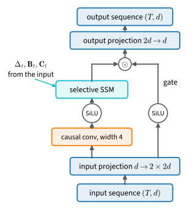

# Selective State Space Models
:label:`sec_mamba`

The S4D layer of :numref:`sec_ssm` treats every token at lag $k$ identically: an input from $k$ steps ago contributes to the present output with the fixed convolution weight $K_k$, whether that input was the key noun of a paragraph or a comma. Natural language requires *content-based selection*: most tokens can be discarded quickly, while a few critical tokens must be written strongly and held across hundreds of steps at positions that vary from sentence to sentence. Can a state space model decide, token by token, what to keep and for how long?

Two models from earlier sections each hold half of the answer:

- `MinGRU` (:numref:`sec_linear-recurrence`) computes its decay gate from the current input token, so it can keep one token and overwrite the next, but its gates start with a one-step half-life and each channel holds only a single scalar state.
- `S4D` (:numref:`sec_ssm`) starts with half-lives spanning $1$ to $\sim 700$ steps across $N$ states per channel, but its dynamics are time-invariant.

*Selective* state space models, introduced with the Mamba architecture by :citet:`Gu.Dao.2023`, unify the two: the step size $\Delta_t$ of the discretized SSM, along with the write vector $\mathbf{B}_t$ and read vector $\mathbf{C}_t$, becomes a function of the current input $\mathbf{x}_t$. Setting $\Delta_t \to 0$ freezes the state and ignores an uninformative filler token; setting $\Delta_t$ large writes a salient token and decays what the state held before. Because the dynamics now vary by step, the FFT convolution no longer applies, but the parallel associative scan of :numref:`sec_linear-recurrence` still trains the layer in $O(\log_2 T)$ rounds. Below we benchmark `S4D` and `MinGRU` on selective copying, show that a 1-state selective SSM is mathematically equivalent to a `MinGRU` gate, build `SelectiveSSM` and `Mamba` with a memory-efficient custom backward scan (`adjoint_scan`), inspect how a trained Mamba layer populates its state, and evaluate it on byte-level WikiText-103.

```{.python .input #mamba-selective-state-space-models}
%%tab pytorch
import math
import numpy as np
import torch
from torch import nn
from torch.nn import functional as F
from d2l import torch as d2l
```

```{.python .input #mamba-selective-state-space-models}
%%tab jax
import math
import numpy as np
import jax
from jax import numpy as jnp
from flax import nnx
import optax
from d2l import jax as d2l
```

## Selective Copying

The synthetic *selective copying* benchmark of :citet:`Gu.Dao.2023` isolates content-dependent retention (:numref:`fig_selective_copy`). In our setup, a sequence consists of $1{,}024$ filler tokens (`0`), into which $4$ marked symbols (drawn uniformly from tokens `2..9`) are inserted at *random* positions, followed by $4$ query tokens (`1`) at the end. At the $j$-th query token, the model must output the $j$-th marked symbol in order (chance accuracy $1/8 = 0.125$). Because the symbol positions vary randomly from sequence to sequence, any time-invariant filter that weights inputs solely by lag $T - s$ must fail.


:label:`fig_selective_copy`

```{.python .input #mamba-selective-copying-1}
%%tab pytorch
def copy_batch(batch_size, num_fillers=1024, num_marked=4, num_symbols=8,
               device=None):
    """Symbols at random positions among fillers, then query tokens."""
    X = torch.zeros(batch_size, num_fillers + num_marked, dtype=torch.long,
                    device=device)
    X[:, num_fillers:] = 1  # Query tokens
    Y = torch.randint(2, 2 + num_symbols, (batch_size, num_marked),
                      device=device)
    positions = torch.rand(batch_size, num_fillers, device=device).argsort(1)
    X.scatter_(1, positions[:, :num_marked].sort(1).values, Y)
    return X, Y

X, Y = copy_batch(2, num_fillers=12)
print(X, Y, sep='\n')
```

```{.python .input #mamba-selective-copying-1}
%%tab jax
def copy_batch(key, batch_size, num_fillers=1024, num_marked=4,
               num_symbols=8):
    """Symbols at random positions among fillers, then query tokens."""
    key_y, key_p = jax.random.split(key)
    Y = jax.random.randint(key_y, (batch_size, num_marked), 2, 2 + num_symbols)
    positions = jnp.argsort(
        jax.random.uniform(key_p, (batch_size, num_fillers)), 1)
    X = jnp.zeros((batch_size, num_fillers + num_marked), dtype=jnp.int32)
    X = X.at[:, num_fillers:].set(1)  # Query tokens
    rows = jnp.arange(batch_size)[:, None]
    X = X.at[rows, jnp.sort(positions[:, :num_marked], 1)].set(Y)
    return X, Y

X, Y = copy_batch(d2l.get_key(), 2, num_fillers=12)
print(X, Y, sep='\n')
```

To evaluate models on selective copying, `train_copy` trains a network for 1,500 steps of Adam (`lr=3e-3`, batch size 64) using `d2l.train_queries` and evaluates query accuracy across 1,024 fresh test sequences:

```{.python .input #mamba-selective-copying-2}
%%tab pytorch
torch.set_float32_matmul_precision('high')  # fp32 matmuls may use tf32

def train_copy(model):
    """Train for 1,500 steps on fresh batches of selective copying; return
    the test accuracy."""
    num_steps = 1500
    device = d2l.try_gpu()
    model.to(device)
    optimizer = torch.optim.Adam(model.parameters(), lr=3e-3)
    d2l.train_queries(model, lambda step: copy_batch(64, device=device),
                      num_steps, optimizer)
    X, Y = copy_batch(1024, device=device)
    return float(torch.stack([d2l.query_accuracy(model, X_i, Y_i)  # In parts
                              for X_i, Y_i in zip(X.split(128), Y.split(128))
                              ]).mean())
```

```{.python .input #mamba-selective-copying-2}
%%tab jax
def train_copy(model):
    """Train for 1,500 steps on fresh batches of selective copying; return
    the test accuracy."""
    num_steps = 1500
    optimizer = nnx.Optimizer(model, optax.chain(
        optax.clip_by_global_norm(1.0), optax.adam(3e-3)), wrt=nnx.Param)
    key = d2l.get_key()  # New data every run
    d2l.train_queries(model, lambda step: copy_batch(
        jax.random.fold_in(key, step), 64), num_steps, optimizer)
    X, Y = copy_batch(jax.random.fold_in(key, num_steps), 1024)
    return float(jnp.stack([d2l.query_accuracy(model, X[i:i + 128],  # In parts
                                               Y[i:i + 128])
                            for i in range(0, 1024, 128)]).mean())
```

The wrapper `copy_runs` trains `num_runs=2` independent seeds of an architecture, prints its parameter count and test accuracies, and returns the trained models:

```{.python .input #mamba-selective-copying-4}
%%tab pytorch, jax
def copy_runs(name, make_model, num_runs=2):
    """Train num_runs fresh models; print their accuracies; return them."""
    models = [make_model() for _ in range(num_runs)]
    accuracies = [train_copy(model) for model in models]
    print(f'{name:20s} {d2l.num_params(models[0]):6,} parameters, accuracy '
          + ', '.join(f'{acc:.2f}' for acc in accuracies))
    return models
```

We first benchmark two-block `d2l.SeqLM` models at width $d = 48$ using time-invariant `d2l.S4D` versus input-selective `d2l.MinGRU` as the sequence mixer:

```{.python .input #mamba-selective-copying-3}
%%tab pytorch
models = {}
for name, mixer in (('S4D', lambda: d2l.S4D(48)),
                    ('minGRU', lambda: d2l.MinGRU(48, 48))):
    models[name] = copy_runs(name, lambda: d2l.SeqLM(
        10, 48, [mixer() for _ in range(2)]))
```

```{.python .input #mamba-selective-copying-3}
%%tab jax
rngs = nnx.Rngs(d2l.get_key())
models = {}
for name, mixer in (('S4D', lambda: d2l.S4D(48, rngs=rngs)),
                    ('minGRU', lambda: d2l.MinGRU(48, 48, rngs=rngs))):
    models[name] = copy_runs(name, lambda: d2l.SeqLM(
        10, 48, [mixer() for _ in range(2)], rngs=rngs))
```

As predicted, time-invariant `S4D` stays near chance ($\le 0.20$), whereas input-selective `minGRU` reaches between about $0.75$ and $0.95$, depending on the run. Notice why `minGRU` succeeds here despite starting with one-step gate half-lives (which failed on 1,000-step fixed-delay recall in :numref:`sec_ssm`): in selective copying, marked symbols occasionally land close to the queries, providing short-horizon gradients that progressively teach the gates to hold symbols across longer filler spans (Exercise :exref:`ex_mamba-short-memories`).

## Selective Dynamics

### Input-Dependent Step Sizes
:label:`subsec_selective-dynamics`

We build the selective SSM in two steps. First, consider a single channel with a single state ($N = 1$) at rate $\lambda = -1$ under zero-order hold (:numref:`subsec_zoh`): $h_t = e^{-\Delta} h_{t-1} + (1 - e^{-\Delta}) x_t$. Instead of treating $\Delta$ as a fixed parameter, compute $\Delta_t = \textrm{softplus}(s_t) = \log(1 + e^{s_t}) > 0$ from a linear projection $s_t = \mathbf{w}^\top \mathbf{x}_t + b$ of the current token. Exponentiating $-\Delta_t$ yields an exact algebraic identity:

$$
e^{-\Delta_t} = e^{-\log(1 + e^{s_t})} = \frac{1}{1 + e^{s_t}} = \sigma(-s_t).
$$
:eqlabel:`eq_step-gate`

Setting $z_t = \sigma(-s_t)$ turns the ZOH update into $h_t = z_t h_{t-1} + (1 - z_t) x_t$, the exact convex blend of `MinGRU` (:numref:`subsec_mingru`, Theorem 1 of :citet:`Gu.Dao.2023`). When a filler token produces $s_t = -4.6$, $\Delta_t \approx 0.01$ and $z_t = 0.99$ (retaining $99\%$ of the state, half-life 69 steps); when a marked symbol produces $s_t = 2$, $\Delta_t \approx 2.1$ and $z_t \approx 0.12$ (overwriting the state with the new symbol). Parameterizing the gate through $\Delta_t = \textrm{softplus}(s_t)$ also makes S4D's multi-timescale initialization immediate: choosing the bias $b$ so $\textrm{softplus}(b) \in [0.001, 0.1]$ starts the gate at half-lives of $7$ to $693$ steps, and, crucially, a single channel step size $\Delta_{t,c}$ can drive $N$ states with distinct rates $\lambda_1, \ldots, \lambda_N$ simultaneously.

### Write and Read Vectors

Now give each of the layer's $H$ channels ($H = 2d$ in Mamba) an $N$-dimensional state vector $\mathbf{h}_t^{(c)} \in \mathbb{R}^N$ with rates $\boldsymbol{\lambda} = (\lambda_1, \ldots, \lambda_N)^\top$ initialized to $(-1, \ldots, -N)^\top$. From the current $H$-dimensional input $\mathbf{x}_t$, the layer computes per-channel step sizes $\boldsymbol{\Delta}_t \in \mathbb{R}_+^H$ together with a shared write direction $\mathbf{B}_t \in \mathbb{R}^N$ and read direction $\mathbf{C}_t \in \mathbb{R}^N$:

$$
\begin{aligned}
\boldsymbol{\Delta}_t &= \textrm{softplus}(\mathbf{W}_\Delta \mathbf{x}_t + \mathbf{b}_\Delta), \\
\mathbf{B}_t &= \mathbf{W}_B \mathbf{x}_t, \qquad
\mathbf{C}_t = \mathbf{W}_C \mathbf{x}_t.
\end{aligned}
$$

Each channel $c \in \{1, \ldots, H\}$ then updates its $N$ states and reads out its output via:

$$
\begin{aligned}
\mathbf{h}_t^{(c)} &= e^{\Delta_{t,c} \boldsymbol{\lambda}} \odot
\mathbf{h}_{t-1}^{(c)} + \Delta_{t,c}\, x_{t,c}\, \mathbf{B}_t, \\
y_{t,c} &= \mathbf{C}_t^\top \mathbf{h}_t^{(c)} + D_c\, x_{t,c}.
\end{aligned}
$$
:eqlabel:`eq_selective_ssm`


:label:`fig_selective_ssm`

:numref:`fig_selective_ssm` shows where the three projections act: $\boldsymbol{\Delta}_t$ scales the rows of the state, one channel each, while $\mathbf{B}_t$ and $\mathbf{C}_t$ act along its columns and are shared by all channels. Following :citet:`Gu.Dao.2023`, :eqref:`eq_selective_ssm` retains the exact ZOH decay $e^{\Delta_{t,c}\boldsymbol{\lambda}}$ while approximating the ZOH input weight $(e^{\Delta\lambda} - 1)/\lambda$ by the first-order Euler weight $\Delta_{t,c}$ (which agrees when $\Delta|\lambda| \ll 1$ and allows large steps $\Delta_{t,c}$ to write with weight exceeding $1/|\lambda|$; see Exercise :exref:`ex_mamba-approximate-write`). The shapes of all quantities in :eqref:`eq_selective_ssm` are summarized below:

| Quantity | Shape | Computed from |
|---|---|---|
| input $\mathbf{x}_t$ | $H$ | the layer's input at step $t$ |
| step sizes $\boldsymbol{\Delta}_t$ | $H$, one per channel | $\mathbf{x}_t$, through rank-$R$ factored $\mathbf{W}_\Delta \in \mathbb{R}^{H \times H}$ |
| write and read vectors $\mathbf{B}_t$, $\mathbf{C}_t$ | $N$ each, shared by all channels | $\mathbf{x}_t$, through $\mathbf{W}_B, \mathbf{W}_C \in \mathbb{R}^{N \times H}$ |
| rates $\boldsymbol{\lambda}$ | $N$ per channel | learned parameters initialized to $-1, \ldots, -N$ |
| state $\mathbf{h}_t^{(1)}, \ldots, \mathbf{h}_t^{(H)}$ | $H \times N$ | the recurrence :eqref:`eq_selective_ssm` |
| output $\mathbf{y}_t$ | $H$ | readout with $\mathbf{C}_t$ plus skip $D_c x_{t,c}$ |

## The Mamba Layer

### Projections, Convolution, and Gate

The `Mamba` block :cite:`Gu.Dao.2023` wraps the selective SSM inside channel-mixing projections, a width-4 depthwise causal convolution, and a SwiGLU-style multiplicative output gate (:numref:`fig_mamba_block`):

1. An input projection $\mathbf{W}_\textrm{in}$ expands the $d$-dimensional input into two branches of width $H = 2d$.
2. The first branch passes through a width-4 depthwise causal convolution and SiLU activation before entering the selective SSM—allowing $\boldsymbol{\Delta}_t, \mathbf{B}_t, \mathbf{C}_t$ to condition on a 4-token local window rather than a single isolated token.
3. The SSM output is multiplied elementwise by the SiLU of the second branch and projected back to width $d$ via $\mathbf{W}_\textrm{out}$.
4. To save parameters, $\mathbf{W}_\Delta \in \mathbb{R}^{H \times H}$ is factored through bottleneck rank $R = \lceil d / 16 \rceil$.


:label:`fig_mamba_block`

### Training with a Scan

Because :eqref:`eq_selective_ssm` is still an affine recurrence $\mathbf{h}_t = \mathbf{a}_t \odot \mathbf{h}_{t-1} + \mathbf{b}_t$ over the $H \times N$ state at each step, `d2l.linear_scan` evaluates all $T$ states in parallel. However, expanding the state to $H \times N$ numbers per token multiplies activation memory by $2N$: differentiating naively through $\lceil \log_2 T \rceil$ rounds of a doubling scan retains $\sim 2\lceil \log_2 T \rceil$ tensors of shape $(B, T, H, N)$ (already $\sim 2\textrm{ GB}$ per layer in our small copying model, and hundreds of gigabytes at LLM scale).

We can avoid storing the intermediate scan rounds by noting that the backpropagated state gradient $\mathbf{g}_t = \partial \ell / \partial \mathbf{h}_t$ satisfies the reverse-time affine recurrence:

$$\mathbf{g}_t = \frac{\partial \ell}{\partial \mathbf{h}_t}\Big|_\textrm{direct}
+ \mathbf{a}_{t+1} \odot \mathbf{g}_{t+1},$$

with parameter gradients $\partial \ell / \partial \mathbf{b}_t = \mathbf{g}_t$ and $\partial \ell / \partial \mathbf{a}_t = \mathbf{g}_t \odot \mathbf{h}_{t-1}$. Thus the backward pass is simply a second call to `linear_scan` run in reverse time, requiring only the forward decays $\mathbf{a}$ and states $\mathbf{h}$ (two tensors instead of $\sim 20$; Mamba's fused CUDA kernel goes one step further by keeping $\mathbf{h}$ in on-chip SRAM and recomputing it during the backward pass, as discussed in :numref:`sec_memory_precision`). Let us implement `adjoint_scan` with a custom backward pass and verify it against standard autograd.

```{.python .input #mamba-training-with-a-scan-1}
%%tab pytorch
class AdjointScan(torch.autograd.Function):  #@save
    """linear_scan whose backward pass is a second scan, run backward."""
    @staticmethod
    def forward(ctx, a, b):
        h = d2l.linear_scan(a, b)
        ctx.save_for_backward(a, h)
        return h

    @staticmethod
    def backward(ctx, grad_h):
        a, h = ctx.saved_tensors
        # g_t = grad_h_t + a_{t+1} g_{t+1}: a linear recurrence from the end
        a_next = torch.cat([a[:, 1:], torch.ones_like(a[:, :1])], 1)
        g = d2l.linear_scan(a_next.flip(1), grad_h.flip(1)).flip(1)
        h_prev = torch.cat([torch.zeros_like(h[:, :1]), h[:, :-1]], 1)
        return g * h_prev, g

def adjoint_scan(a, b):  #@save
    """All states of h_t = a_t * h_{t-1} + b_t, differentiated by a scan."""
    return AdjointScan.apply(a.expand_as(b), b)
```

```{.python .input #mamba-training-with-a-scan-1}
%%tab jax
@jax.custom_vjp  #@save
def _adjoint_scan(a, b):
    return d2l.linear_scan(a, b)

def _adjoint_scan_forward(a, b):  #@save
    """Forward pass: the states, and what the backward pass needs."""
    h = d2l.linear_scan(a, b)
    return h, (a, h)

def _adjoint_scan_backward(saved, grad_h):  #@save
    """Backward pass: gradients of a and b by a scan in reverse time."""
    a, h = saved
    # g_t = grad_h_t + a_{t+1} g_{t+1}: a linear recurrence from the end
    a_next = jnp.concatenate([a[:, 1:], jnp.ones_like(a[:, :1])], 1)
    g = d2l.linear_scan(a_next[:, ::-1], grad_h[:, ::-1])[:, ::-1]
    h_prev = jnp.concatenate([jnp.zeros_like(h[:, :1]), h[:, :-1]], 1)
    return g * h_prev, g

_adjoint_scan.defvjp(_adjoint_scan_forward, _adjoint_scan_backward)  #@save

def adjoint_scan(a, b):  #@save
    """All states of h_t = a_t * h_{t-1} + b_t, differentiated by a scan."""
    return _adjoint_scan(jnp.broadcast_to(a, b.shape), b)
```

We verify on random sequences of length $T = 100$ that differentiating `adjoint_scan` matches standard autograd through `d2l.linear_scan` to float32 precision:

```{.python .input #mamba-training-with-a-scan-2}
%%tab pytorch
a = torch.rand(2, 100, 8, requires_grad=True)
b = torch.randn(2, 100, 8, requires_grad=True)
w = torch.randn(2, 100, 8)  # A loss that weights every state
grads_scan = torch.autograd.grad((d2l.linear_scan(a, b) * w).sum(), (a, b))
grads_adjoint = torch.autograd.grad((adjoint_scan(a, b) * w).sum(), (a, b))
deviation = max(float((g1 - g2).abs().max())
                for g1, g2 in zip(grads_scan, grads_adjoint))
print(f'max deviation: {deviation:.1e}')
```

```{.python .input #mamba-training-with-a-scan-2}
%%tab jax
key_a, key_b, key_w = jax.random.split(d2l.get_key(), 3)
a = jax.random.uniform(key_a, (2, 100, 8))
b = jax.random.normal(key_b, (2, 100, 8))
w = jax.random.normal(key_w, (2, 100, 8))  # A loss that weights every state
grad = lambda scan: jax.grad(lambda a, b: (scan(a, b) * w).sum(), (0, 1))
deviation = max(float(jnp.abs(g1 - g2).max()) for g1, g2 in
                zip(grad(d2l.linear_scan)(a, b), grad(adjoint_scan)(a, b)))
print(f'max deviation: {deviation:.1e}')
```

The custom reverse-time scan gradient matches autograd to $\sim 10^{-6}$.

### Implementation

`SelectiveSSM` implements :eqref:`eq_selective_ssm`, initializing `dt_bias` so $\textrm{softplus}(\textrm{dt\_bias})$ is distributed log-uniformly on $[\textrm{dt\_min}, \textrm{dt\_max}] = [0.001, 0.1]$. Passing `selective=False` replaces $\boldsymbol{\Delta}_t, \mathbf{B}_t, \mathbf{C}_t$ with learned per-channel constants (an LTI control inside the exact same Mamba block).

```{.python .input #mamba-the-layer-1}
%%tab pytorch
class SelectiveSSM(nn.Module):  #@save
    """A diagonal SSM with N states for each of num_channels channels. Its
    step sizes and write and read vectors depend on the input, or, with
    selective=False, are learned constants of each channel."""
    def __init__(self, num_channels, dt_rank, num_states=16, dt_min=1e-3,
                 dt_max=1e-1, selective=True):
        super().__init__()
        H, N, R = num_channels, num_states, dt_rank
        self.selective = selective
        self.log_neg_rate = nn.Parameter(  # Rates -1, ..., -N in every channel
            torch.log(torch.arange(1., N + 1)).repeat(H, 1))
        dt = dt_min * (dt_max / dt_min) ** torch.rand(H)
        dt_bias = dt + torch.log(-torch.expm1(-dt))  # softplus(dt_bias) = dt
        if selective:
            self.W_dt = nn.Sequential(  # Step size per channel, rank R
                nn.Linear(H, R, bias=False), nn.Linear(R, H))
            self.W_B = nn.Linear(H, N, bias=False)  # Write vector
            self.W_C = nn.Linear(H, N, bias=False)  # Read vector
            d2l.init_lecun(self)
            with torch.no_grad():  # Small up-projection, step sizes dt
                nn.init.uniform_(self.W_dt[1].weight, -R ** -0.5, R ** -0.5)
                self.W_dt[1].bias.copy_(dt_bias)
        else:  # Fixed dynamics: S4D with a learned write vector
            self.dt_bias = nn.Parameter(dt_bias)
            self.B = nn.Parameter(torch.ones(H, N))
            self.C = nn.Parameter(torch.randn(H, N) / math.sqrt(N))
        self.D = nn.Parameter(torch.ones(H))
```

```{.python .input #mamba-the-layer-1}
%%tab jax
class SelectiveSSM(nnx.Module):  #@save
    """A diagonal SSM with N states for each of num_channels channels. Its
    step sizes and write and read vectors depend on the input, or, with
    selective=False, are learned constants of each channel."""
    def __init__(self, num_channels, dt_rank, num_states=16, dt_min=1e-3,
                 dt_max=1e-1, selective=True, *, rngs):
        H, N, R = num_channels, num_states, dt_rank
        self.selective = selective
        self.log_neg_rate = nnx.Param(  # Rates -1, ..., -N in every channel
            jnp.tile(jnp.log(jnp.arange(1., N + 1)), (H, 1)))
        def dt_bias(key, shape, dtype=jnp.float32):  # softplus(bias) = dt
            dt = dt_min * (dt_max / dt_min) ** jax.random.uniform(key, shape)
            return (dt + jnp.log(-jnp.expm1(-dt))).astype(dtype)
        if selective:
            def small(key, shape, dtype=jnp.float32):  # U(-R^-1/2, R^-1/2)
                return jax.random.uniform(key, shape, dtype, -R ** -0.5,
                                          R ** -0.5)
            self.W_dt = nnx.Sequential(  # Step size per channel, rank R
                nnx.Linear(H, R, use_bias=False, rngs=rngs),
                nnx.Linear(R, H, kernel_init=small, bias_init=dt_bias,
                           rngs=rngs))
            self.W_B = nnx.Linear(H, N, use_bias=False, rngs=rngs)  # Write
            self.W_C = nnx.Linear(H, N, use_bias=False, rngs=rngs)  # Read
        else:  # Fixed dynamics: S4D with a learned write vector
            self.dt_bias = nnx.Param(dt_bias(rngs.params(), (H,)))
            self.B = nnx.Param(jnp.ones((H, N)))
            self.C = nnx.Param(rngs.params.normal((H, N)) / math.sqrt(N))
        self.D = nnx.Param(jnp.ones(H))
```

We next add `log_coefficients` to compute the per-step log-decays $\Delta_{t,c}\boldsymbol{\lambda}$ and writes $\Delta_{t,c} u_{t,c}\mathbf{B}_t$ of shape `(batch_size, T, H, N)`, and the layer's forward pass to run `adjoint_scan` and contract the states with $\mathbf{C}_t$:

```{.python .input #mamba-the-layer-2}
%%tab pytorch
@d2l.add_to_class(SelectiveSSM)  #@save
def log_coefficients(self, U):
    """Log-decays and writes, each of shape (batch_size, T, H, N)."""
    if self.selective:  # Step sizes (batch_size, T, H), write vectors
        dt, B = F.softplus(self.W_dt(U)), self.W_B(U).unsqueeze(-2)
    else:  # One step size and one write vector per channel
        dt, B = F.softplus(self.dt_bias), self.B
    b = (dt * U).unsqueeze(-1) * B
    log_a = dt.unsqueeze(-1) * -torch.exp(self.log_neg_rate)
    return log_a.expand_as(b), b

@d2l.add_to_class(SelectiveSSM)  #@save
def forward(self, U):  # U: (batch_size, num_steps, num_channels)
    log_a, b = self.log_coefficients(U)
    H = adjoint_scan(torch.exp(log_a), b)  # States, (batch_size, T, H, N)
    C = self.W_C(U).unsqueeze(-2) if self.selective else self.C  # Read
    return torch.einsum('...n,...n->...', H, C) + self.D * U  # Sum over n
```

```{.python .input #mamba-the-layer-2}
%%tab jax
@d2l.add_to_class(SelectiveSSM)  #@save
def log_coefficients(self, U):
    """Log-decays and writes, each of shape (batch_size, T, H, N)."""
    if self.selective:  # Step sizes (batch_size, T, H), write vectors
        dt, B = jax.nn.softplus(self.W_dt(U)), self.W_B(U)[..., None, :]
    else:  # One step size and one write vector per channel
        dt, B = jax.nn.softplus(self.dt_bias[...]), self.B[...]
    b = (dt * U)[..., None] * B
    log_a = dt[..., None] * -jnp.exp(self.log_neg_rate[...])
    return jnp.broadcast_to(log_a, b.shape), b

@d2l.add_to_class(SelectiveSSM)  #@save
def __call__(self, U):  # U: (batch_size, num_steps, num_channels)
    log_a, b = self.log_coefficients(U)
    H = adjoint_scan(jnp.exp(log_a), b)  # States, (batch_size, T, H, N)
    C = self.W_C(U)[..., None, :] if self.selective else self.C[...]  # Read
    return jnp.einsum('...n,...n->...', H, C) + self.D[...] * U  # Sum over n
```

The `Mamba` module wraps `SelectiveSSM` in the two-branch architecture of :numref:`fig_mamba_block`, expanding width $d$ to $2H = 4d$ via `W_in`, applying the causal depthwise `conv` and SiLU on the SSM branch, gating with `silu(Z)`, and projecting back via `W_out`:

```{.python .input #mamba-the-layer-3}
%%tab pytorch
class Mamba(nn.Module):  #@save
    """The Mamba layer: a gated selective SSM between two projections."""
    def __init__(self, num_hiddens, num_states=16, expand=2, conv_width=4,
                 **ssm_args):
        super().__init__()
        H = expand * num_hiddens
        self.W_in = nn.Linear(num_hiddens, 2 * H, bias=False)
        self.conv = nn.Conv1d(H, H, conv_width, groups=H,  # One per channel
                              padding=conv_width - 1)
        self.W_out = nn.Linear(H, num_hiddens, bias=False)
        d2l.init_lecun(self)  # The SSM, built next, has its own init
        self.ssm = SelectiveSSM(H, math.ceil(num_hiddens / 16), num_states,
                                **ssm_args)

    def ssm_input(self, X):
        """The input of the SSM and the gate branch."""
        U, Z = self.W_in(X).chunk(2, -1)
        U = self.conv(U.transpose(1, 2))[..., :X.shape[1]]  # Keep it causal
        return F.silu(U.transpose(1, 2)), Z

    def forward(self, X):  # X: (batch_size, num_steps, num_hiddens)
        U, Z = self.ssm_input(X)
        return self.W_out(self.ssm(U) * F.silu(Z))
```

```{.python .input #mamba-the-layer-3}
%%tab jax
class Mamba(nnx.Module):  #@save
    """The Mamba layer: a gated selective SSM between two projections."""
    def __init__(self, num_hiddens, num_states=16, expand=2, conv_width=4,
                 *, rngs, **ssm_args):
        H = expand * num_hiddens
        self.W_in = nnx.Linear(num_hiddens, 2 * H, use_bias=False, rngs=rngs)
        self.conv = nnx.Conv(H, H, (conv_width,), feature_group_count=H,
                             padding=((conv_width - 1, 0),),  # Causal
                             rngs=rngs)
        self.ssm = SelectiveSSM(H, math.ceil(num_hiddens / 16), num_states,
                                rngs=rngs, **ssm_args)
        self.W_out = nnx.Linear(H, num_hiddens, use_bias=False, rngs=rngs)

    def ssm_input(self, X):
        """The input of the SSM and the gate branch."""
        U, Z = jnp.split(self.W_in(X), 2, -1)
        return jax.nn.silu(self.conv(U)), Z

    def __call__(self, X):  # X: (batch_size, num_steps, num_hiddens)
        U, Z = self.ssm_input(X)
        return self.W_out(self.ssm(U) * jax.nn.silu(Z))
```

## Trained Mamba Models

### Selective Copying with Mamba

We now train `Mamba` ($N = 4$ states per channel) alongside its non-selective ablation `Mamba, not selective` (`selective=False`, keeping the exact same projections, width-4 convolution, and SiLU gate) on selective copying:

```{.python .input #mamba-selective-copying-with-mamba}
%%tab pytorch
for name, selective in (('Mamba', True), ('Mamba, not selective', False)):
    # Compiled, since eagerly each round of the scan would be its own kernel
    models[name] = copy_runs(name, lambda: d2l.SeqLM(10, 48, [
        torch.compile(Mamba(48, num_states=4, selective=selective))
        for _ in range(2)]))
```

```{.python .input #mamba-selective-copying-with-mamba}
%%tab jax
for name, selective in (('Mamba', True), ('Mamba, not selective', False)):
    models[name] = copy_runs(name, lambda: d2l.SeqLM(10, 48, [
        Mamba(48, num_states=4, selective=selective, rngs=rngs)
        for _ in range(2)], rngs=rngs))
```

`Mamba` copies nearly every symbol: its accuracy is $95\%$ or more and usually close to $100\%$, ahead of `minGRU`. The non-selective control loses more than $30$ percentage points and scatters widely from run to run, which matches the ablation reported in :citet:`Gu.Dao.2023`. The projections, the convolution, and the gate are the same in both models, so the difference is due to selection alone. Exercise :exref:`ex_mamba-longer-sequences` tests zero-shot length extrapolation to $4{,}096$ fillers.

### Contributions to the State

To see *how* `Mamba` retains the four marked symbols while ignoring fillers, we decompose the final state at the first query token into the contribution of each earlier position $s \le T$. In the unrolled recurrence $\mathbf{h}_T = \sum_{s=1}^T (\prod_{r=s+1}^T \mathbf{a}_r) \odot \mathbf{b}_s$, the Euclidean norm of position $s$'s decayed term $\|\exp(\sum_{r=s+1}^T \log \mathbf{a}_r) \odot \mathbf{b}_s\|_2$ measures how much of position $s$'s write survives in the state at step $T$.

```{.python .input #mamba-where-the-state-comes-from-1}
%%tab pytorch
def state_contributions(log_a, b):
    """Size of each position's term in the final state of h = a h + b."""
    cum = log_a.cumsum(1)
    terms = torch.exp(cum[:, -1:] - cum) * b  # Decayed to the last step
    return torch.linalg.vector_norm(terms.flatten(2), dim=-1)  # (batch, T)
```

```{.python .input #mamba-where-the-state-comes-from-1}
%%tab jax
def state_contributions(log_a, b):
    """Size of each position's term in the final state of h = a h + b."""
    cum = log_a.cumsum(1)
    terms = jnp.exp(cum[:, -1:] - cum) * b  # Decayed to the last step
    return jnp.linalg.norm(terms.reshape(*terms.shape[:2], -1), axis=-1)
```

Adding `log_coefficients` to `d2l.S4D` exposes its per-step log-decays and writes in the same `(batch_size, T, d, N)` format as `SelectiveSSM`:

```{.python .input #mamba-contributions-to-the-state-1}
%%tab pytorch
@d2l.add_to_class(d2l.S4D)
def log_coefficients(self, X):
    """Log-decays and writes of the recurrence, each (batch_size, T, d, N)."""
    rate = -torch.exp(self.log_neg_rate)
    log_a = torch.exp(self.log_dt) * rate  # log a_bar = dt * lambda
    b_bar = torch.expm1(log_a) / rate
    return log_a.expand(*X.shape, -1), b_bar * X.unsqueeze(-1)
```

```{.python .input #mamba-contributions-to-the-state-1}
%%tab jax
@d2l.add_to_class(d2l.S4D)
def log_coefficients(self, X):
    """Log-decays and writes of the recurrence, each (batch_size, T, d, N)."""
    rate = -jnp.exp(self.log_neg_rate[...])
    log_a = jnp.exp(self.log_dt[...]) * rate  # log a_bar = dt * lambda
    b_bar = jnp.expm1(log_a) / rate
    return (jnp.broadcast_to(log_a, (*X.shape, log_a.shape[-1])),
            b_bar * X[..., None])
```

Which of the two layers should we look at? Nothing in the training tells a model where to do its selecting, so we probe both. `layer_contributions` runs the blocks below a given layer, extracts that layer's log-decays and writes on a test sequence `X` truncated at the first query token (`X[:, :-3]`), and evaluates `state_contributions`. We apply it to both layers of `S4D` and of both trained `Mamba` runs:

```{.python .input #mamba-contributions-to-the-state-2}
%%tab pytorch
def layer_contributions(model, X, layer):
    """Contributions to the state of a layer at the last step of X."""
    H = model.embedding(X)
    for i in range(layer):  # The blocks below it, as in the forward pass
        H = H + model.mixers[i](model.norms[i](H))
        H = H + model.mlps[i](H)
    mixer, X = model.mixers[layer], model.norms[layer](H)
    if isinstance(mixer, d2l.S4D):
        return state_contributions(*mixer.log_coefficients(X))
    U, _ = mixer.ssm_input(X)  # Mamba: what its selective SSM reads
    return state_contributions(*mixer.ssm.log_coefficients(U))

X, _ = copy_batch(1, device=d2l.try_gpu())
X = X[:, :-3]  # Up to the first query token
probed = {'S4D': models['S4D'][0], 'Mamba, run 1': models['Mamba'][0],
          'Mamba, run 2': models['Mamba'][1]}  # Both trained Mamba runs
with torch.inference_mode():  # Both layers of each model
    contributions = {(name, layer): layer_contributions(model, X, layer)[0]
                     for name, model in probed.items() for layer in (0, 1)}
```

```{.python .input #mamba-contributions-to-the-state-2}
%%tab jax
def layer_contributions(model, X, layer):
    """Contributions to the state of a layer at the last step of X."""
    H = model.embedding(X)
    for i in range(layer):  # The blocks below it, as in the forward pass
        H = H + model.mixers[i](model.norms[i](H))
        H = H + model.mlps[i](H)
    mixer, X = model.mixers[layer], model.norms[layer](H)
    if isinstance(mixer, d2l.S4D):
        return state_contributions(*mixer.log_coefficients(X))
    U, _ = mixer.ssm_input(X)  # Mamba: what its selective SSM reads
    return state_contributions(*mixer.ssm.log_coefficients(U))

X, _ = copy_batch(d2l.get_key(), 1)
X = X[:, :-3]  # Up to the first query token
probed = {'S4D': models['S4D'][0], 'Mamba, run 1': models['Mamba'][0],
          'Mamba, run 2': models['Mamba'][1]}  # Both trained Mamba runs
contributions = {(name, layer): layer_contributions(model, X, layer)[0]
                 for name, model in probed.items() for layer in (0, 1)}
```

Because the width-4 causal convolution spreads each marked symbol across up to 4 consecutive positions, `symbol_windows` collects the 4-position window starting at each symbol ($\le 1.6\%$ of the sequence). For each layer we print the share of the final state that originates in those windows. For each model we then plot the contribution of all $1{,}025$ positions in the layer with the larger share:

```{.python .input #mamba-where-the-state-comes-from-2}
%%tab pytorch
def symbol_windows(X, width=4):
    """Positions of each symbol and the width - 1 after it, without repeats."""
    starts = (X[0] > 1).nonzero().flatten()  # The four symbols
    offsets = torch.arange(width, device=X.device)
    windows = (starts[:, None] + offsets).flatten()
    windows = windows.unique()  # Windows of nearby symbols may overlap
    return windows[windows < X.shape[1]]  # A window may reach past the end

windows = symbol_windows(X)
print(f'symbol windows: {len(windows) / X.shape[1]:.1%} of the positions')
share = {key: float(c[windows].sum() / c.sum())
         for key, c in contributions.items()}
print('share of the state from them  layer 1  layer 2')
for name in probed:
    print(f'{name:28s}  {share[name, 0]:7.2f}  {share[name, 1]:7.2f}')
best = {name: max((0, 1), key=lambda layer: share[name, layer])
        for name in probed}  # The layer that selects more
curves = {f'{name}, layer {layer + 1}': contributions[name, layer]
          for name, layer in best.items()}
d2l.plot(torch.arange(X.shape[1]), [(c / c.max()).cpu() for c in
                                    curves.values()],
         'position', 'contribution to the state',
         legend=list(curves), yscale='log', figsize=(6, 3),
         legend_loc='outside')  # The curves fill the axes
```

```{.python .input #mamba-where-the-state-comes-from-2}
%%tab jax
def symbol_windows(X, width=4):
    """Positions of each symbol and the width - 1 after it, without repeats."""
    starts = jnp.nonzero(X[0] > 1)[0]  # The four symbols
    windows = (starts[:, None] + jnp.arange(width)).flatten()
    windows = jnp.unique(windows)  # Windows of nearby symbols may overlap
    return windows[windows < X.shape[1]]  # A window may reach past the end

windows = symbol_windows(X)
print(f'symbol windows: {len(windows) / X.shape[1]:.1%} of the positions')
share = {key: float(c[windows].sum() / c.sum())
         for key, c in contributions.items()}
print('share of the state from them  layer 1  layer 2')
for name in probed:
    print(f'{name:28s}  {share[name, 0]:7.2f}  {share[name, 1]:7.2f}')
best = {name: max((0, 1), key=lambda layer: share[name, layer])
        for name in probed}  # The layer that selects more
curves = {f'{name}, layer {layer + 1}': contributions[name, layer]
          for name, layer in best.items()}
d2l.plot(jnp.arange(X.shape[1]), [c / c.max() for c in curves.values()],
         'position', 'contribution to the state',
         legend=list(curves), yscale='log', figsize=(6, 3),
         legend_loc='outside')  # The curves fill the axes
```

The share depends on where the symbols happen to fall in one sequence. A local measure is the *spike ratio*: the maximum contribution inside a symbol's 4-step window, divided by the contribution of the filler token immediately preceding it. We compute its median over the symbols of 64 fresh test sequences, again in both layers:

```{.python .input #mamba-contributions-to-the-state-3}
%%tab pytorch
X_test = copy_batch(64, device=X.device)[0][:, :-3]  # 64 new sequences
rows, starts = (X_test[:, 1:] > 1).nonzero(as_tuple=True)  # The symbols,
starts = starts + 1                                       # not at position 0
window = (starts[:, None] + torch.arange(4, device=X.device)).clamp(
    max=X_test.shape[1] - 1)  # A window may reach past the end
def spike_ratio(c):  # Median over the symbols
    return float((c[rows[:, None], window].amax(1) / c[rows, starts - 1])
                 .median())

print(f'spike ratio, median over {len(rows)} symbols   layer 1   layer 2')
with torch.inference_mode():
    for name, model in probed.items():
        spikes = [spike_ratio(layer_contributions(model, X_test, layer))
                  for layer in (0, 1)]
        print(f'{name:36s} {spikes[0]:9,.1f} {spikes[1]:9,.1f}')
```

```{.python .input #mamba-contributions-to-the-state-3}
%%tab jax
X_test = copy_batch(d2l.get_key(), 64)[0][:, :-3]  # 64 new sequences
rows, starts = jnp.nonzero(X_test[:, 1:] > 1)  # The symbols,
starts = starts + 1                            # not at position 0
window = jnp.minimum(starts[:, None] + jnp.arange(4),
                     X_test.shape[1] - 1)  # A window may reach past the end
def spike_ratio(c):  # Median over the symbols
    return float(jnp.median(c[rows[:, None], window].max(1)
                            / c[rows, starts - 1]))

print(f'spike ratio, median over {len(rows)} symbols   layer 1   layer 2')
for name, model in probed.items():
    spikes = [spike_ratio(layer_contributions(model, X_test, layer))
              for layer in (0, 1)]
    print(f'{name:36s} {spikes[0]:9,.1f} {spikes[1]:9,.1f}')
```

The profile of `S4D` follows recency: it rises smoothly toward the end of the sequence, and the symbol windows supply only a few percent of the state, not much more than their share of the positions. A symbol does stand out from the filler before it, by a factor of a few tens at most, because a fixed filter can respond more strongly to one token than to another. It cannot hold that token for longer. In `Mamba`, a layer that selects lifts the symbols above the neighboring fillers by a factor of several hundred to tens of thousands, and the four windows supply a large part of its state, often most of it. Training does not decide in advance which layer this is. In some runs both layers select; in others only one does, it may be either, and the spike ratio of the other layer is then no larger than that of `S4D`. This is why the tables list both layers and the plot shows the more selective one.

How does a layer produce such a spike? The natural guess is that it takes a large step on every symbol, which writes the symbol and flushes the fillers before it. The step sizes of the trained models say otherwise. Averaged over the $H = 96$ channels, the step on a symbol is usually no larger than the step on a filler. Selection is the work of very few channels: each symbol is carried by two or three of them. On fillers these channels take steps $\Delta_{t,c}$ of about $10^{-5}$, so that they neither decay nor write, and their state is frozen. On the symbol the same channels take steps between about $0.1$ and $1.5$, and since the write $\Delta_{t,c}\, x_{t,c}\, \mathbf{B}_t$ is proportional to the step, the symbol enters the state at full strength. Such a step also decays what the channel held before, but only by a small factor, and erasing the preceding fillers adds little to the spike. Selection here is a strong write into a few frozen channels, not a flush of the state.

### Language Modeling
:label:`subsec_mamba-lm`

Finally, we compare `Mamba`, `minGRU`, and `attention` on our byte-level WikiText-103 benchmark (`d2l.SeqLM`, 4 blocks at width $d = 256$, 128-byte windows, 1,000 steps). We first load the 128-byte `WikiText103` stream:

```{.python .input #mamba-language-modeling-4}
%%tab pytorch, jax
data = d2l.WikiText103(batch_size=64, num_steps=128)
```

Next we define `text_model(mixer, d)` and configure the four experimental `arms`, including a parameter-matched `minGRU, d=309` ($3.99\textrm{M}$ parameters) that matches `Mamba`'s expanded-channel parameter count:

```{.python .input #mamba-language-modeling-3}
%%tab pytorch
def text_model(mixer, d):  # 256 byte values; four blocks of width d
    return d2l.SeqLM(256, d, [mixer(d) for _ in range(4)]).to(d2l.try_gpu())

mamba = lambda d: torch.compile(Mamba(d))  # Compiled, as in the copying
min_gru = lambda d: d2l.MinGRU(d, d)
attention = lambda d: d2l.AttentionMixer(d, num_heads=8)
arms = {'Mamba': (mamba, 256), 'minGRU': (min_gru, 256),
        'attention': (attention, 256),
        'minGRU, d=309': (min_gru, 309)}  # As many parameters as Mamba
```

```{.python .input #mamba-language-modeling-3}
%%tab jax
def text_model(mixer, d):  # 256 byte values; four blocks of width d
    rngs = nnx.Rngs(d2l.get_key())
    return d2l.SeqLM(256, d, [mixer(d, rngs) for _ in range(4)], rngs=rngs)

mamba = lambda d, rngs: Mamba(d, rngs=rngs)
min_gru = lambda d, rngs: d2l.MinGRU(d, d, rngs=rngs)
attention = lambda d, rngs: d2l.AttentionMixer(d, num_heads=8, rngs=rngs)
arms = {'Mamba': (mamba, 256), 'minGRU': (min_gru, 256),
        'attention': (attention, 256),
        'minGRU, d=309': (min_gru, 309)}  # As many parameters as Mamba
```

Calling `d2l.text_table` trains two seeds of each architecture for $1{,}000$ steps and tabulates validation loss across window position bands alongside step latency:

```{.python .input #mamba-language-modeling-2}
%%tab pytorch, jax
trained = d2l.text_table(text_model, arms, data)
```

`Mamba` reaches $1.30$ nats/byte—matching the full `LSTM` and `GRU` of :numref:`subsec_deep-rnn` while training via a parallel scan, and outperforming equal-width `minGRU` by $0.05$ nats/byte and parameter-matched `minGRU, d=309` by $0.03$ nats/byte. Because `Mamba` scans an $H \times N = 512 \times 16 = 8{,}192$-number state per token ($32\times$ larger than `minGRU`'s 256-number state), its un-fused training step takes $2\times$–$4\times$ longer than `minGRU`, though at inference time that $32d$-number state (plus $6d$ numbers for the width-4 convolution buffer) equals the KV cache of just 19 tokens of multi-head attention. Moreover, viewing Mamba's $H \times N$ state as an outer-product matrix memory $\mathbf{S}_t$ updated by $(\boldsymbol{\Delta}_t \odot \mathbf{x}_t)\mathbf{B}_t^\top$ and queried by $\mathbf{C}_t$ leads directly to the matrix-state recurrences and chunked matrix-multiply training of :numref:`sec_matrix-state`.

## Summary

Time-invariant state space models weight past inputs purely by lag and fail on content-selective tasks such as selective copying. Selective state space models compute per-channel step sizes $\boldsymbol{\Delta}_t = \textrm{softplus}(\mathbf{W}_\Delta \mathbf{x}_t + \mathbf{b}_\Delta)$ and shared write and read vectors $\mathbf{B}_t, \mathbf{C}_t$ from each input token. For a single state ($N = 1$), $e^{-\textrm{softplus}(s_t)} = \sigma(-s_t)$ recovers the `MinGRU` update gate; with $N$ states initialized at rates $-1, \ldots, -N$ and log-uniform $\Delta$ biases, `Mamba` combines content selection with multi-timescale memory. Differentiating the parallel scan via a reverse-time scan (`adjoint_scan`) avoids storing the $O(\log_2 T)$ intermediate doubling rounds. On selective copying, `Mamba` reaches $95\%$ accuracy or more (dropping by $>30$ points when selectivity is disabled), which it owes to a few channels that stay frozen on fillers and write each symbol with a large step, and on byte-level WikiText-103 it matches the full LSTM and GRU while outperforming a parameter-matched `MinGRU` by $0.03$ nats/byte.

## Exercises

1. **The approximate write.** Mamba keeps the decay $e^{\Delta\lambda}$ of
   the zero-order hold but writes with weight $\Delta$ instead of
   $(e^{\Delta\lambda} - 1)/\lambda$.
   :exlabel:`ex_mamba-approximate-write`
    1. For $\lambda = -1$, find the largest $\Delta$ for which the two
       weights differ by less than 10%.
    1. For one state with $\lambda = -1$, write vector 1, and the exact weight,
       show that a state that starts at zero stays within the interval spanned
       by zero and the inputs it has seen. Find a sequence of inputs in $[-1,
       1]$ for which the state with weight $\Delta$ leaves that interval. What
       keeps the values of a trained Mamba model in range?

1. **Memory of the scan.** For a Mamba layer with $H$ channels and $N$
   states, a minibatch of $B$ sequences of length $T$, and 32-bit numbers,
   count the bytes that backpropagation stores for the scan, (a) through the
   rounds of the doubling scan, (b) with the adjoint scan, and (c) with a
   kernel that stores only the inputs of the layer and recomputes the
   states. Evaluate the three for $H = 4096$, $N = 16$, $B = 8$, and $T =
   8192$, and compare with the memory of a GPU.

1. [code] **Longer sequences.** Evaluate the Mamba model trained with
   1,024 positions before the queries on sequences with 2,048 and 4,096
   (`num_fillers`), without retraining.
   :exlabel:`ex_mamba-longer-sequences`
    1. Does it still copy the symbols? Compare with the minGRU.
    1. For each channel of the more selective layer, compute the decay of
       its slowest state over 1,000 filler tokens. How many channels can
       carry a symbol across 4,096 fillers?

1. [code] **Which part must be selective?** ●
    1. Between the two Mamba models of this section lie two more:
       input-dependent step sizes with fixed write and read vectors
       $\mathbf{B}$ and $\mathbf{C}$, and fixed step sizes with
       input-dependent $\mathbf{B}_t$ and $\mathbf{C}_t$. Train both,
       twice each. Which of them solve the task? Relate the result to the
       spike ratios measured above.
    1. In the trained Mamba model, replace the step sizes of both layers
       at the four positions starting at each symbol (the windows measured
       above) by their median over the filler positions, so that no layer
       can write the symbols with a large step. How much does the accuracy
       drop? Repeat with the step sizes at all other positions replaced by
       their median over the windows, so that no layer can skip the
       fillers. Then intervene on one layer at a time. Does the result
       agree with the shares measured above?

1. [code] **Generation.** Add a method `step` to `SelectiveSSM` and to
   `Mamba` that processes one token, given the state of the SSM and the
   last three inputs of the convolution, and returns the output and the
   new state. Check that stepping through a sequence reproduces the
   outputs of the forward pass. How many numbers does the layer carry from
   token to token?

1. [code] **Short initial memories.** The minGRU learned to copy although
   its gates start with a memory of about one step. Test the explanation
   that the symbols closest to the queries teach the gates.
   :exlabel:`ex_mamba-short-memories`
    1. Record the minGRU's gates on filler tokens before and after
       training, and, for the trained model, its accuracy on each query
       separately, sorted by the distance between the symbol and its
       query. Which symbols does it copy best?
    1. Train the Mamba model with step sizes initialized between 0.5 and 1
       (`dt_min=0.5, dt_max=1.0`), so that every state starts with a memory
       of at most two steps. Does it learn to copy the symbols within the
       training budget? If so, plot the step sizes of the first layer on
       filler tokens before and after training.
    1. Repeat both with 4,096 positions before the queries, where a symbol
       near a query is rarer, and with the minGRU initialized as in the
       long-range recall experiment of :numref:`sec_ssm`.

[Discussions](https://d2l.discourse.group/t/36782)

<!-- slides -->

::: {.slide}
::: {.cover}
[Dive into Deep Learning · §12.5]{.kicker}

Selective State Space Models (Mamba)<br>**selective copying · input-dependent step sizes · softplus–sigmoid duality · reverse-scan adjoint VJP · state contributions**
:::
:::

::: {.slide title="Why Time-Invariant SSMs Fail at Content Selection"}
[Motivation]{.kicker}

::: {.cols .vc}
::: {.col}
- **The flaw of fixed lag kernels:** In §{sec_ssm}, `S4D` weights any token $k$ steps back by the fixed convolution coefficient $K_k$, whether that token was a key entity or an uninformative filler.
- **Natural language is content-selective:** A reader must write salient nouns strongly into memory and hold them across variable-length clauses while ignoring filler tokens in between.
- **Why no LTI convolution can solve selective copying:** When target symbols appear at random positions that change from sequence to sequence, no fixed lag weight $K_k$ can align with the targets.
:::

::: {.col .fig}
{.nostretch width=100%}
:::
:::
:::

::: {.slide title="Combining minGRU Selectivity with S4D Multi-Timescales"}
[Unifying Two Paradigms]{.kicker}

::: {.cols .vc}
::: {.col}
- **What `MinGRU` (§{sec_linear-recurrence}) Has:** Input-dependent gate $\mathbf{z}_t(\mathbf{x}_t)$, but only $N = 1$ scalar per channel starting at $\tau_{1/2} = 1$.
- **What `S4D` (§{sec_ssm}) Has:** $N = 16$ decay rates $-1, \ldots, -16$ per channel with log-uniform channel steps (half-lives $0.4$ to $693$ across channels), but fixed LTI step size $\Delta_c$.
- **What `Mamba` (§{sec_mamba}) Unifies:** Token-dependent $(\boldsymbol{\Delta}_t, \mathbf{B}_t, \mathbf{C}_t)$ over an $H \times N$ multi-timescale state trained via parallel + adjoint scans.
:::

::: {.col .fig .big}
@fig:ch12-mrnn-mamba-unification
:::
:::
:::

::: {.slide title="The Selective Copying Benchmark: Random Symbol Lags"}
[Synthetic Stress Test]{.kicker}

`copy_batch` tests content-based selection over a $1{,}028$-token horizon:

- **Sequence layout:** $1{,}024$ filler tokens (`0`) into which $4$ marked symbols (drawn uniformly from tokens `2..9`) are scattered at **random positions**, followed by $4$ query tokens (`1`) at steps $1{,}025 \ldots 1{,}028$.
- **Prediction target:** At the $j$-th query token, output the $j$-th marked symbol in order (chance accuracy $= 1/8 = 0.125$).

@!mamba-selective-copying-1
:::

::: {.slide title="Baseline Test: Time-Invariant S4D vs. Selective minGRU"}
[Baseline Results]{.kicker}

Training a 2-block `SeqLM` ($d = 48$) for $1{,}500$ Adam steps ($\text{lr} = 3 \times 10^{-3}$, batch size $64$, two runs each):

@!mamba-selective-copying-3

- **`S4D` stays near chance ($\le 0.20$):** Fixed lag weights cannot track symbols whose positions shift randomly between sequences.
- **Why `minGRU` succeeds ($\approx 0.75$–$0.95$) despite 1-step initial gates:** Unlike fixed $1{,}000$-step delayed recall (§{sec_ssm}), random placement occasionally puts marked symbols just a few steps before the queries—providing short-range gradients that progressively teach the gates to stay closed on filler tokens `0`.
:::

::: {.slide title="Exact Duality: Softplus Step Sizes Are Sigmoid Gates"}
[Theorem 1 (Gu & Dao, 2023)]{.kicker}

::: {.cols .vc}
::: {.col}
$$e^{-\Delta_t} = e^{-\log(1 + e^{s_t})} = \frac{1}{1 + e^{s_t}} = \sigma(-s_t) = z_t$$

- **Exact 1D Equivalence ($N = 1, \lambda = -1$):** Discretizing $h'(t) = -h(t) + x(t)$ with step $\Delta_t = \textrm{softplus}(s_t)$ yields $h_t = z_t h_{t-1} + (1 - z_t)x_t$ (`MinGRU`).
- **Clock Modulation:** Filler tokens ($s_t = -4.6 \implies \Delta_t \approx 0.01, z_t \approx 0.99$) freeze the state; marked symbols ($s_t = +2.0 \implies \Delta_t \approx 2.13, z_t \approx 0.12$) overwrite it.
:::

::: {.col .fig}
@fig:ch12-mrnn-softplus-sigmoid-duality
:::
:::
:::

::: {.slide title="Selective SSM Dynamics: Per-Token Δt, Bt, and Ct"}
[The Selective SSM Equations]{.kicker}

::: {.cols .vc}
::: {.col}
$$\mathbf{h}_t^{(c)} = e^{\Delta_{t,c}\boldsymbol{\lambda}} \odot \mathbf{h}_{t-1}^{(c)} + \Delta_{t,c}\, x_{t,c}\, \mathbf{B}_t, \quad y_{t,c} = \mathbf{C}_t^\top \mathbf{h}_t^{(c)} + D_c\, x_{t,c}$$

- **Input-Dependent Projections:** From $\mathbf{x}_t \in \mathbb{R}^H$, computes rank-$R$ step sizes $\boldsymbol{\Delta}_t \in \mathbb{R}_+^H$ plus shared $\mathbf{B}_t, \mathbf{C}_t \in \mathbb{R}^N$.
- **Euler Write Factor:** Keeps exact ZOH decay $e^{\Delta_{t,c}\boldsymbol{\lambda}}$ with first-order write $\Delta_{t,c} x_{t,c}\mathbf{B}_t$.
:::

::: {.col .fig}
@fig:ch12-mrnn-selective-ssm-dataflow
:::
:::
:::

::: {.slide title="Tensor Shapes and Low-Rank Step-Size Projection"}
[Parameterization Details]{.kicker}

Every tensor in `SelectiveSSM` has a clear structural role across the $H = 2d$ expanded channels and $N$ state dimensions:

| Quantity | Shape | How It Is Parameterized / Computed |
| :--- | :---: | :--- |
| **Channel input** $\mathbf{x}_t$ | $(H,)$ | Output of width-4 causal convolution + SiLU on expanded branch |
| **Step sizes** $\boldsymbol{\Delta}_t$ | $(H,)$ | $\textrm{softplus}(\mathbf{W}_\Delta \mathbf{x}_t + \mathbf{b}_\Delta)$ with rank-$R$ bottleneck $\mathbf{W}_\Delta \in \mathbb{R}^{H \times R} \times \mathbb{R}^{R \times H}$, $R = \lceil d/16 \rceil$ |
| **Initial bias** $\mathbf{b}_\Delta$ | $(H,)$ | Chosen so $\textrm{softplus}(\mathbf{b}_\Delta) \in [0.001, 0.1]$ log-uniformly (`dt + log(-expm1(-dt))`) |
| **Write & read** $\mathbf{B}_t, \mathbf{C}_t$ | $(N,)$ each | Linear projections $\mathbf{W}_B \mathbf{x}_t$ and $\mathbf{W}_C \mathbf{x}_t$ shared across all $H$ channels |
| **Decay rates** $\boldsymbol{\lambda}$ | $(H, N)$ | $-\exp(\text{log\_neg\_rate})$, initialized to $-1, -2, \ldots, -N$ in every channel |
| **Recurrent state** $\mathbf{h}_t$ | $(H, N)$ | Updated by elementwise decay $e^{\Delta_{t,c}\lambda_{c,n}}$ and rank-1 outer write $(\boldsymbol{\Delta}_t \odot \mathbf{x}_t)\mathbf{B}_t^\top$ |
:::

::: {.slide title="Anatomy of the Full Mamba Block"}
[Block Architecture]{.kicker}

::: {.cols .vc}
::: {.col}
1. **Input expansion ($\mathbf{W}_\textrm{in}$):** Projects width $d$ to two branches $(\mathbf{U}, \mathbf{Z})$ each of expanded width $H = 2d$.
2. **Short causal convolution:** A depthwise causal `Conv1d` of width $4$ followed by $\textrm{SiLU}$ mixes $4$ consecutive tokens before computing $\boldsymbol{\Delta}_t, \mathbf{B}_t, \mathbf{C}_t$ so selection can inspect local context.
3. **Selective SSM & SwiGLU-style gate:** Multiplies $\textrm{SSM}(\mathbf{U}) \odot \textrm{SiLU}(\mathbf{Z})$ and projects back to width $d$ via $\mathbf{W}_\textrm{out}$.
:::

::: {.col .fig}
{.nostretch width=76%}
:::
:::
:::

::: {.slide title="Pitfall: Activation Memory Explosion in 4D Scans"}
[Systems Bottleneck]{.kicker}

::: {.cols .vc}
::: {.col}
- **No FFT Shortcut:** Time-varying $\boldsymbol{\Delta}_t$ breaks LTI convolution, requiring a 4D parallel scan over $(B, T, H, N)$.
- **32× State Expansion ($H = 2d, N = 16$):** Naive autograd stores $\sim 20$ intermediate doubling-round tensors—consuming $\sim 2\text{ GB}$/layer in toy runs and $\sim 190\text{ GB}$/layer at LLM scale.
:::

::: {.col .fig .big}
@fig:ch12-mrnn-4d-scan-memory
:::
:::
:::

::: {.slide title="The Adjoint Scan: Differentiating via a Reverse Scan"}
[Memory-Efficient Backpropagation]{.kicker}

::: {.cols .vc}
::: {.col}
$$\mathbf{g}_t = \frac{\partial \ell}{\partial \mathbf{h}_t}\Big|_\textrm{direct} + \mathbf{a}_{t+1} \odot \mathbf{g}_{t+1}, \quad \frac{\partial \ell}{\partial \mathbf{b}_t} = \mathbf{g}_t, \quad \frac{\partial \ell}{\partial \mathbf{a}_t} = \mathbf{g}_t \odot \mathbf{h}_{t-1}$$

- **Reverse-Time Linear Recurrence:** Evaluates $\mathbf{g}_{T:1}$ via one reverse call to `linear_scan`.
- **10× Memory Reduction (`adjoint_scan`):** Saves only $2$ tensors $(\mathbf{a}, \mathbf{h})$ instead of $\sim 20$ intermediate scan rounds.
:::

::: {.col .fig}
@fig:ch12-mrnn-adjoint-reverse-scan
:::
:::
:::

::: {.slide title="Verifying Custom VJP Adjoint Scan Against Autograd"}
[Gradient Verification]{.kicker}

Comparing gradients $\partial \ell / \partial \mathbf{a}$ and $\partial \ell / \partial \mathbf{b}$ from `adjoint_scan` against standard autograd through `linear_scan` on a $T = 100$ batch:

@!mamba-training-with-a-scan-2

::: {.d2l-note}
The reverse-time adjoint scan produces the exact same gradients to `float32` precision ($\sim 10^{-6}$) at a fraction of the activation memory.
:::
:::

::: {.slide title="Selective Copying: Mamba vs. Non-Selective Ablation"}
[Controlled Ablation]{.kicker}

We train 2-block `Mamba` ($N = 4$) alongside `Mamba, not selective` (`selective=False`, keeping the exact same input/output projections, width-4 causal convolution, and SiLU output gate, but fixing $\boldsymbol{\Delta}, \mathbf{B}, \mathbf{C}$ as learned channel constants):

@!mamba-selective-copying-with-mamba

::: {.d2l-note .rule}
**Selectivity is the decisive mechanism:** `Mamba` reaches **$0.95$ accuracy or more**, usually close to $1.00$, whereas freezing $\boldsymbol{\Delta}, \mathbf{B}, \mathbf{C}$ inside the identical block drops accuracy by **$>30$ percentage points** (scattering wildly across seeds).
:::
:::

::: {.slide title="Decomposing the Final State by Token Position"}
[Mechanistic Interpretability]{.kicker}

::: {.cols .vc}
::: {.col}
$$\mathbf{h}_T = \sum_{s=1}^{T} \exp\!\Big(\sum_{r=s+1}^{T} \log \mathbf{a}_r\Big) \odot \mathbf{b}_s$$

- **Per-Position Surviving Norm:** `state_contributions` measures the Euclidean norm of position $s$'s decayed write inside $\mathbf{h}_T$.
- **Width-4 Conv Windows:** Each marked symbol spreads across $\{s, \ldots, s+3\}$ ($\le 1.6\%$ of the $1{,}025$ tokens).
:::

::: {.col .fig}
@fig:ch12-mrnn-state-contribution-formula
:::
:::
:::

::: {.slide title="Mamba Spikes at Marked Symbols; S4D Tracks Recency"}
[State Contribution Profile]{.kicker}

Share of the final state that originates in the symbol windows ($1.6\%$ of the positions), for each layer, and the contribution of all $1{,}025$ positions in the more selective layer of each model:

@!mamba-where-the-state-comes-from-2
:::

::: {.slide title="Quantifying Selection: The Symbol-to-Filler Spike Ratio"}
[Large Steps in a Few Channels]{.kicker}

The **spike ratio** is the peak contribution inside a symbol's 4-token window, divided by the contribution of the filler token immediately preceding it. Median over the symbols of $64$ test sequences, in both layers:

@!mamba-contributions-to-the-state-3

- **Orders-of-magnitude amplification:** In a layer that selects, `Mamba`'s symbols stand **hundreds to tens of thousands of times** above the adjacent fillers. `S4D` reaches a few tens at most: a fixed filter can respond more strongly to one token than to another, but cannot hold it longer. Both layers may select, or only one, and which one varies from run to run.
- **A few channels do the gating:** Each symbol is carried by **two or three of the $H = 96$ channels**. On fillers they take $\Delta_{t,c} \approx 10^{-5}$, which freezes their state and writes almost nothing; on the symbol they take $\Delta_{t,c} \approx 0.1$ to $1.5$, which **writes it strongly** ($\Delta_{t,c} x_{t,c}\mathbf{B}_t$). That step decays the earlier state by a small factor only: the spike is a strong write into frozen channels, not a flush.
:::

::: {.slide title="Mamba on Byte-Level WikiText-103 vs. minGRU & Attention"}
[Language Modeling Benchmark]{.kicker}

Comparing 4-block `Mamba`, `minGRU`, causal `attention` ($d = 256$), and a parameter-matched `minGRU, d=309` ($3.99\text{M}$ parameters) on 128-byte WikiText-103 windows:

@!mamba-language-modeling-2

::: {.d2l-note}
`Mamba` reaches **$1.30$ nats/byte**—matching the full sequential LSTM and GRU of §{sec_lstm} while training via a parallel scan, and beating parameter-matched `minGRU, d=309` by **$0.03$ nats/byte**.
:::
:::

::: {.slide title="Concept Check: Softplus Gates, State Size, and Adjoint"}
[Check Your Understanding]{.kicker}

Work out the following three questions:

1. In a 1-state selective SSM ($N = 1, \lambda = -1$), what step-size pre-activation $s_t$ produces a discrete retention factor $z_t = e^{-\textrm{softplus}(s_t)} = 0.999$ (half-life $\approx 693$ steps)?
2. For a `Mamba` layer at model width $d = 256$ ($H = 2d = 512$, $N = 16$, width-4 causal convolution), how many total numbers does the layer carry per sequence during autoregressive generation, and how many tokens of an attention KV cache ($2d$ numbers/token) does that equal?
3. Why does `adjoint_scan` reduce scan activation memory from $O(B T H N \log_2 T)$ to $O(B T H N)$?

::: {.d2l-note .fragment .fade-up}
**Answers:**

1. Since $e^{-\textrm{softplus}(s_t)} = \sigma(-s_t) = 0.999$, we need $-s_t = \log(0.999 / 0.001) = \log 999 \approx 6.91 \implies \mathbf{s_t \approx -6.91}$ ($\Delta_t \approx 0.001$).
2. The SSM state holds $H \times N = 512 \times 16 = 8{,}192 = 32d$ numbers ($16$ tokens of KV cache), plus the last $3$ convolution inputs of width $H = 2d$ ($3 \times 2d = 6d$ numbers, or $3$ tokens of KV cache): **$38d = 9{,}728$ numbers total, equal to just $19$ tokens of attention KV cache** at any sequence length.
3. Standard autograd saves the output of every doubling round ($\lceil \log_2 T \rceil$ rounds), whereas `adjoint_scan` saves only the final forward states $\mathbf{h}$ and decays $\mathbf{a}$ and computes $\mathbf{g}_t = \mathbf{g}_t^{\text{direct}} + \mathbf{a}_{t+1}\odot \mathbf{g}_{t+1}$ via one reverse scan.
:::
:::

::: {.slide title="Summary: Selective State Space Models (Mamba)"}
[Key Takeaways]{.kicker}

| Component / Model | Mathematical Mechanism | Key Capability & Empirical Result |
| :--- | :--- | :--- |
| **Softplus–Gate Identity** | $e^{-\textrm{softplus}(s_t)} = \sigma(-s_t)$ | Bridges continuous step size $\Delta_t$ and `MinGRU` update gate $z_t$ |
| **Selective SSM (`Mamba`)** | $\mathbf{h}_t^{(c)} = e^{\Delta_{t,c}\boldsymbol{\lambda}} \odot \mathbf{h}_{t-1}^{(c)} + \Delta_{t,c} x_{t,c}\mathbf{B}_t$ | Token-dependent $\boldsymbol{\Delta}_t, \mathbf{B}_t, \mathbf{C}_t$ + multi-timescale rates $\lambda_n = -n$ |
| **Adjoint Scan VJP** | $\mathbf{g}_t = \nabla_{\mathbf{h}_t}\ell + \mathbf{a}_{t+1} \odot \mathbf{g}_{t+1}$ | Differentiates scan via reverse-time scan; saves $2$ tensors instead of $\sim 20$ |
| **Selective Copying** | $4$ random-position symbols in $1{,}024$ fillers | `Mamba` scores **$0.95$ or more** (`S4D` $\le 0.20$; non-selective Mamba drops $>30$ pts) |
| **WikiText-103 Bytes** | 4-block `SeqLM` ($d = 256$, $128$ bytes) | `Mamba` reaches **$1.30$ nats/byte** (matches LSTM/GRU; beats `minGRU, d=309` by $0.03$) |
:::

