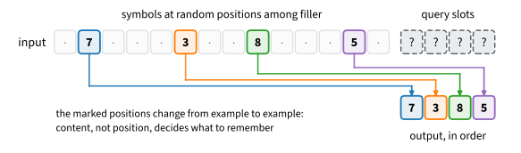

# Selective State Space Models
:label:`sec_mamba`

The S4D layer of :numref:`sec_ssm` treats every input alike: an input from
$k$ steps ago reaches the output through the fixed number $K_k$ of the
convolution kernel, whatever that input was. Whether the token ten steps
ago was the key fact of a paragraph or a comma, its weight in the present
is the same. Language is not like this. Most tokens can be forgotten
quickly, and a few, such as a name, a number, or the subject of a sentence,
must be kept for a long time, at positions that differ from one sentence to
the next. A memory that keeps everything for the same time fills up with
commas; a memory that forgets quickly loses the name. Can a state space
model decide, token by token, what to keep and for how long?

Two models we have built each have half of a solution. The minGRU of
:numref:`sec_linear-recurrence` chooses its decay from the current input, so
it can keep one token and overwrite the next, but its gates start with a
memory of about one step, and its state holds one number per channel. S4D
starts with memories of a step to a thousand steps and holds $N$ numbers per
channel, but its dynamics are the same for every input. *Selective* state
space models, introduced with the Mamba architecture by
:citet:`Gu.Dao.2023`, combine the two: the step size $\Delta$ of the
discretized SSM, and the vectors that write to and read from the state,
become functions of the current input. A small step size keeps the state and
ignores the token; a large one overwrites the state with it. In the
experiments of :citet:`Gu.Dao.2023`, with models of up to about three billion
parameters, Mamba language models matched or exceeded transformers of the
same size, and for a time selective state space models looked like a
replacement for attention.

The convolution of S4D no longer applies, because the dynamics change from
step to step, but the scan of :numref:`sec_linear-recurrence` does. We first
test the two older models on a task that requires choosing what to keep.
We then derive the selective model from the minGRU's gate in two steps,
build the Mamba layer, look inside a trained one to see where its state
comes from, and train it on text.

```{.python .input #mamba-selective-state-space-models}
%%tab pytorch
import math
import numpy as np
import torch
from torch import nn
from torch.nn import functional as F
from d2l import torch as d2l
```

```{.python .input #mamba-selective-state-space-models}
%%tab jax
import math
import numpy as np
import jax
from jax import numpy as jnp
from flax import nnx
import optax
from d2l import jax as d2l
```

## Selective Copying

The *selective copying* task of :citet:`Gu.Dao.2023` isolates the decision
of what to keep (:numref:`fig_selective_copy`). We use a smaller version;
theirs has longer sequences and more symbols to copy. A sequence has
1,024 positions of filler, four of which, at random, hold symbols drawn
from eight. Four query tokens follow, and at the $j$-th query the model must
output the $j$-th symbol. Chance accuracy is 1/8. A solution must store a
token because it is a symbol rather than filler, at whatever position it
occurs, and keep it for up to a thousand steps. Weights that depend only on
position cannot do this, since the same position holds filler in one
sequence and a symbol in the next.


:label:`fig_selective_copy`

Token 0 is the filler, token 1 the query, and tokens 2 to 9 the symbols. We
draw a fresh batch of sequences for every training step, so the model
cannot memorize the training data. In each row of the small batch printed
below, the answer consists of the tokens above 1, in order.

```{.python .input #mamba-selective-copying-1}
%%tab pytorch
def copy_batch(batch_size, num_fillers=1024, num_marked=4, num_symbols=8,
               device=None):
    """Symbols at random positions among fillers, then query tokens."""
    X = torch.zeros(batch_size, num_fillers + num_marked, dtype=torch.long,
                    device=device)
    X[:, num_fillers:] = 1  # Query tokens
    Y = torch.randint(2, 2 + num_symbols, (batch_size, num_marked),
                      device=device)
    positions = torch.rand(batch_size, num_fillers, device=device).argsort(1)
    X.scatter_(1, positions[:, :num_marked].sort(1).values, Y)
    return X, Y

X, Y = copy_batch(2, num_fillers=12)
print(X, Y, sep='\n')
```

```{.python .input #mamba-selective-copying-1}
%%tab jax
def copy_batch(key, batch_size, num_fillers=1024, num_marked=4,
               num_symbols=8):
    """Symbols at random positions among fillers, then query tokens."""
    key_y, key_p = jax.random.split(key)
    Y = jax.random.randint(key_y, (batch_size, num_marked), 2, 2 + num_symbols)
    positions = jnp.argsort(
        jax.random.uniform(key_p, (batch_size, num_fillers)), 1)
    X = jnp.zeros((batch_size, num_fillers + num_marked), dtype=jnp.int32)
    X = X.at[:, num_fillers:].set(1)  # Query tokens
    rows = jnp.arange(batch_size)[:, None]
    X = X.at[rows, jnp.sort(positions[:, :num_marked], 1)].set(Y)
    return X, Y

X, Y = copy_batch(d2l.get_key(), 2, num_fillers=12)
print(X, Y, sep='\n')
```

We train every model as `d2l.SeqLM`, the residual stack of
:numref:`sec_lstm`, with two blocks of width 48, and read its predictions at
the four query positions. Training uses the loop `d2l.train_queries` of
:numref:`subsec_delayed-recall`, with Adam at learning rate 0.003 and
gradient clipping, for 1,500 steps of 64 sequences; accuracy is measured on
1,024 new sequences.

```{.python .input #mamba-selective-copying-2}
%%tab pytorch
torch.set_float32_matmul_precision('high')  # fp32 matmuls may use tf32

def train_copy(model):
    """Train for 1,500 steps on fresh batches of selective copying; return
    the test accuracy."""
    num_steps = 1500
    device = d2l.try_gpu()
    model.to(device)
    optimizer = torch.optim.Adam(model.parameters(), lr=3e-3)
    d2l.train_queries(model, lambda step: copy_batch(64, device=device),
                      num_steps, optimizer)
    X, Y = copy_batch(1024, device=device)
    return float(torch.stack([d2l.query_accuracy(model, X_i, Y_i)  # In parts
                              for X_i, Y_i in zip(X.split(128), Y.split(128))
                              ]).mean())
```

```{.python .input #mamba-selective-copying-2}
%%tab jax
def train_copy(model):
    """Train for 1,500 steps on fresh batches of selective copying; return
    the test accuracy."""
    num_steps = 1500
    optimizer = nnx.Optimizer(model, optax.chain(
        optax.clip_by_global_norm(1.0), optax.adam(3e-3)), wrt=nnx.Param)
    key = d2l.get_key()  # New data every run
    d2l.train_queries(model, lambda step: copy_batch(
        jax.random.fold_in(key, step), 64), num_steps, optimizer)
    X, Y = copy_batch(jax.random.fold_in(key, num_steps), 1024)
    return float(jnp.stack([d2l.query_accuracy(model, X[i:i + 128],  # In parts
                                               Y[i:i + 128])
                            for i in range(0, 1024, 128)]).mean())
```

Each model is trained twice, from fresh weights and on fresh data. A
difference between two models then means something only if it is larger than
the difference between two runs of the same model. `copy_runs` trains the
runs, prints the parameter count and both accuracies, and keeps the trained
models.

```{.python .input #mamba-selective-copying-4}
%%tab pytorch, jax
def copy_runs(name, make_model, num_runs=2):
    """Train num_runs fresh models; print their accuracies; return them."""
    models = [make_model() for _ in range(num_runs)]
    accuracies = [train_copy(model) for model in models]
    print(f'{name:20s} {d2l.num_params(models[0]):6,} parameters, accuracy '
          + ', '.join(f'{acc:.2f}' for acc in accuracies))
    return models
```

We start with S4D and the minGRU, and the argument above predicts the first
result: S4D weights an input by its distance alone, so it should fail. The
minGRU is the interesting case. It can select, since every token sets its
own decay, but its gates start near one half, a memory of about one step,
and the symbols lie up to a thousand steps before the queries. Will it
learn to keep them?

```{.python .input #mamba-selective-copying-3}
%%tab pytorch
models = {}
for name, mixer in (('S4D', lambda: d2l.S4D(48)),
                    ('minGRU', lambda: d2l.MinGRU(48, 48))):
    models[name] = copy_runs(name, lambda: d2l.SeqLM(
        10, 48, [mixer() for _ in range(2)]))
```

```{.python .input #mamba-selective-copying-3}
%%tab jax
rngs = nnx.Rngs(d2l.get_key())
models = {}
for name, mixer in (('S4D', lambda: d2l.S4D(48, rngs=rngs)),
                    ('minGRU', lambda: d2l.MinGRU(48, 48, rngs=rngs))):
    models[name] = copy_runs(name, lambda: d2l.SeqLM(
        10, 48, [mixer() for _ in range(2)], rngs=rngs))
```

S4D answers at most one query in five, at or a little above the chance rate
of one in eight. The minGRU answers most of them, but how many depends on
the run: over the executions of this notebook so far, single runs have
scored from about three quarters of the queries to 97%. Its decay is chosen
by each input, so it can keep a symbol and let the fillers pass, and it
nearly solves the task. That it learns this at all is a small surprise. On
the long-range recall task of :numref:`sec_ssm`, one symbol followed by
1,000 identical fillers, the minGRU could not keep the symbol unless its
gates were initialized with long memories. A likely reason for the
difference is that in selective copying a symbol sometimes sits close to a
query, and the short-range gradients from such sequences can teach the
gates to keep symbols longer and longer. Exercise
:exref:`ex_mamba-short-memories` puts this explanation to a test.

## Selective Dynamics

### Input-Dependent Step Sizes
:label:`subsec_selective-dynamics`

The step from S4D to a selective model is the hardest of this chapter,
because several things change at once. We take it in two moves. The first
changes only where the step size comes from, and it turns out to produce an
object we already know. The second adds what that object lacks.

Recall the zero-order hold of :numref:`sec_ssm`. A state that obeys
$h'(t) = \lambda h(t) + x(t)$ with rate $\lambda < 0$, read at steps of
length $\Delta$, decays by $e^{\Delta\lambda}$ per step, and the input enters
with weight $(e^{\Delta\lambda} - 1)/\lambda$. A small step keeps the state
and admits little of the input; a large step forgets the state and admits
much. Let us start with the simplest case, one channel with one state and
$\lambda = -1$, where the update reads $h_t = e^{-\Delta} h_{t-1} + (1 -
e^{-\Delta}) x_t$; here $x_t$ is the input of this one channel. In S4D,
$\Delta$ was a learned constant of each channel. Suppose instead that we
compute it from the whole token $\mathbf{x}_t$, as $\Delta_t = \textrm{softplus}(s_t)$
with $s_t = \mathbf{w}^\top \mathbf{x}_t + b$, where $\textrm{softplus}(s) =
\log(1 + e^s)$ keeps the step positive. The decay is then a function we
have met many times:

$$
e^{-\Delta_t} = e^{-\log(1 + e^{s_t})} = \frac{1}{1 + e^{s_t}} = \sigma(-s_t).
$$
:eqlabel:`eq_step-gate`

With $z_t = \sigma(-s_t)$ the update becomes $h_t = z_t h_{t-1} + (1 - z_t)
x_t$. This is the update of the minGRU (:numref:`subsec_mingru`), which
blends its state with a candidate through a gate $\mathbf{z}_t =
\sigma(\mathbf{W}_\textrm{z} \mathbf{x}_t + \mathbf{b}_\textrm{z})$
computed from the input. Two details differ, and neither changes what the
update can do. The candidate is the channel's input itself, where the
minGRU applies a linear map first; in the Mamba layer below, a projection in
front of the state space model does that job. And the gate's pre-activation
has the opposite sign, which a learned $\mathbf{w}$ absorbs. A selective
state space model with one state is a minGRU written in other coordinates,
a fact :citet:`Gu.Dao.2023` state as the first theorem of their paper.

Two numbers show the range. A token with $s_t = -4.6$ sets $\Delta_t = 0.01$
and $z_t = 0.99$: the state keeps 99% of itself, a half-life of 69 steps,
and admits 1% of the token. A token with $s_t = 2$ sets $\Delta_t \approx
2.1$ and $z_t \approx 0.12$, and the state is mostly replaced. A filler can
choose the first, a symbol the second.

If the two are the same, what do we gain by writing the gate as a step size?
The first gain is a convenience. A step size is a time, so the timescales
of S4D are natural to set: with the bias $b$ chosen so that
$\textrm{softplus}(b)$ lies between 0.001 and 0.1, the gate starts between
0.905 and 0.999, with half-lives of 7 to 693 steps. A gate bias can hold
the same decays, as the long-range recall experiment of :numref:`sec_ssm`
showed, but there we had to compute it from them. The second gain is new.
One step size can drive several states with different rates at once, which
a single gate cannot. That is the second move.

### Write and Read Vectors

Let the input of the layer have $H$ channels, $\mathbf{x}_t \in
\mathbb{R}^H$; in the Mamba layer below, $H = 2d$ for a model of width
$d$. We give each channel $c$ not one state but $N$, a vector
$\mathbf{h}_t^{(c)} \in \mathbb{R}^N$ with rates $\lambda_1, \ldots,
\lambda_N$ initialized to $-1, \ldots, -N$ as in S4D. The token now chooses
three things: a step size for each channel, shared by the $N$ states of
that channel; a direction $\mathbf{B}_t \in \mathbb{R}^N$ along which to
write; and a direction $\mathbf{C}_t \in \mathbb{R}^N$ along which to read.
The two directions are shared by all channels:

$$
\boldsymbol{\Delta}_t = \textrm{softplus}(\mathbf{W}_\Delta \mathbf{x}_t +
\mathbf{b}_\Delta), \qquad \mathbf{B}_t = \mathbf{W}_B \mathbf{x}_t, \qquad
\mathbf{C}_t = \mathbf{W}_C \mathbf{x}_t.
$$

The state of each channel then follows the discretized SSM with these
values,

$$
\mathbf{h}_t^{(c)} = e^{\Delta_{t,c} \boldsymbol{\lambda}} \odot
\mathbf{h}_{t-1}^{(c)} + \Delta_{t,c}\, x_{t,c}\, \mathbf{B}_t, \qquad
y_{t,c} = \mathbf{C}_t^\top \mathbf{h}_t^{(c)} + D_c\, x_{t,c}.
$$
:eqlabel:`eq_selective_ssm`

Here $e^{\Delta_{t,c}\boldsymbol{\lambda}}$ is the vector of decays of the
$N$ states of channel $c$, and $D_c\, x_{t,c}$ passes the input through, as
in S4D. With $N = 1$, $B_t = C_t = 1$, and $D_c = 0$ we are back at the gate of
:eqref:`eq_step-gate`, except for the weight of the input, to which we
return below. The shapes are easy to lose track of, so we collect them.

| Quantity | Shape | Computed from |
|---|---|---|
| input $\mathbf{x}_t$ | $H$ | the layer's input at step $t$ |
| step sizes $\boldsymbol{\Delta}_t$ | $H$, one per channel | $\mathbf{x}_t$, through $\mathbf{W}_\Delta \in \mathbb{R}^{H \times H}$, factored (see below) |
| write and read vectors $\mathbf{B}_t$, $\mathbf{C}_t$ | $N$ each, shared by all channels | $\mathbf{x}_t$, through $\mathbf{W}_B, \mathbf{W}_C \in \mathbb{R}^{N \times H}$ |
| rates $\boldsymbol{\lambda}$ | $N$ per channel | learned constants |
| state $\mathbf{h}_t^{(1)}, \ldots, \mathbf{h}_t^{(H)}$ | $H \times N$ | the recurrence |
| output $\mathbf{y}_t$ | $H$ | the read with $\mathbf{C}_t$ |

Each of the three input-dependent quantities is a decision the layer makes
per token. The step size $\Delta_{t,c}$ decides how much channel $c$
forgets and how much of the token it writes: at a filler the layer can set
it near zero and skip the token, at a symbol it can set it large and store
it. The write vector $\mathbf{B}_t$ decides where in the $N$-dimensional
state the token goes, and the read vector $\mathbf{C}_t$ decides what the
output takes from it. Something else is new as well. In S4D each channel
ran its own recurrence and never saw the others. Here the step size of
every channel, and the write and read vectors of all of them, are computed
from all $H$ channels of the token, so what one channel keeps can depend on
what the others see.

The timescales have two sources. Within a channel the $N$ rates
span a factor of $N$: the state with $\lambda = -1$ is the slowest, and the
one with $\lambda = -N$ forgets $N$ times faster. Across channels the step
sizes start log-uniformly between 0.001 and 0.1, a factor of 100. Together,
as in S4D, the layer starts with time constants from under one step to
1,000 steps, and the slowest state of each channel carries its longest
memory.

One detail of :eqref:`eq_selective_ssm` departs from the zero-order hold.
The paper of :citet:`Gu.Dao.2023` states the exact hold, but its reference
implementation, and ours with it, keeps the exact decay $e^{\Delta\lambda}$
and writes with weight $\Delta$ instead of $(e^{\Delta\lambda} - 1)/\lambda$.
This saves a division per state and costs nothing where it matters: the two
weights agree when $\Delta|\lambda|$ is small, which is where a state
remembers anything. For a large step the exact weight levels off at
$1/|\lambda|$ while $\Delta$ keeps growing. A token stored with a large step
can then outweigh everything the state held, and the update is no longer a
blend of the old state and the new input.

## The Mamba Layer

### Projections, Convolution, and Gate

A selective SSM moves information along the sequence, but each of its
output channels is a weighted sum of that channel's own past inputs; the
other channels only help choose the weights. The Mamba layer
:cite:`Gu.Dao.2023` surrounds the SSM with parts that mix the channels and
add a nonlinearity (:numref:`fig_mamba_block`). An input projection widens
the $d$-dimensional input to $H = 2d$ channels and produces a second branch
of the same width. A short causal convolution, over the current token and
the three before it, and a SiLU prepare the input of the SSM. The output of
the SSM is multiplied by the SiLU of the second branch, and an output
projection returns to width $d$.

Why would a recurrent layer need a convolution in front of it and a gate
behind it? The SSM computes its step sizes and write vectors from a single
position. The convolution lets that position carry a summary of the last
few tokens, so the decision to keep or skip can depend on a short context,
whether a byte ends a word, say, rather than on one token alone. The gate acts on what the SSM returns. The SSM reports
what the past holds; the gate, computed from the current token alone,
decides for each channel how much of that report reaches the output. The
SwiGLU feed-forward network of :numref:`sec_transformer-block` multiplies
two branches in the same way, with the same SiLU.


:label:`fig_mamba_block`

The step sizes need $H$ numbers per token from an input of $H$ numbers, and
a full matrix $\mathbf{W}_\Delta$ would hold $H^2$ weights. The reference
implementation of :citet:`Gu.Dao.2023` factors it through $R = \lceil d/16
\rceil$ numbers, with a projection down to $R$ and one back up to $H$. With
$H = 2d$ this holds $2HR \approx H^2/16$ weights, and the step sizes of the
$H$ channels move together along $R$ directions. In the copying model below,
$d = 48$ gives $H = 96$ channels and $R = 3$. The rank is an economy of
parameters and can be forgotten. The bias $\mathbf{b}_\Delta$ cannot, since
it sets where the memories start. Unlike :citet:`Gu.Dao.2023`, who stack
Mamba layers directly, we keep the MLP of `d2l.SeqLM` between them, so that
every mixer of the chapter sits in the same stack.

### Training with a Scan

The selective SSM cannot be computed as a convolution: the weight of an
input from $k$ steps ago is now a product of $k$ different decays, which
depends on the tokens in between, so there is no single kernel. The update
:eqref:`eq_selective_ssm` is still affine in the state, $\mathbf{h}_t =
\mathbf{a}_t \odot \mathbf{h}_{t-1} + \mathbf{b}_t$, with decays
$\mathbf{a}_t$ and writes $\mathbf{b}_t$ that the layer computes for all
positions before the recurrence starts. So `d2l.linear_scan` computes all
states in parallel, as it did for the minGRU.

The scan has one cost that the minGRU hardly felt, its memory. The state at
each position now has $H \times N$ numbers. In the copying model, with $H =
96$ channels of $N = 4$ states, that is 384 numbers per position. A
minibatch of 64 sequences of 1,028 tokens holds 25 million of them, about
100 MB in 32-bit floats for one tensor of states. Automatic differentiation
through a scan keeps intermediate results for the backward pass. The
doubling schedule of :numref:`fig_scan_tree` runs $\lceil \log_2 1028 \rceil
= 11$ rounds and keeps both components of the pair in every round: about
twenty tensors of this size, some two gigabytes per layer. A work-efficient
schedule keeps fewer, but still several. Our small model can afford this; a
large one cannot. For a layer with $H = 4096$ channels of 16 states and a
minibatch of eight sequences of 8,192 tokens, a single tensor of states
takes 17 GB, and the doubling scan keeps more than twenty of them:
hundreds of gigabytes for one layer.

A property of linear recurrences avoids storing the rounds. Let
$\mathbf{g}_t$ be the derivative of the loss with respect to the state
$\mathbf{h}_t$. The state $\mathbf{h}_t$ affects the loss directly, through
the output at step $t$, and through the next state, $\mathbf{h}_{t+1} =
\mathbf{a}_{t+1} \odot \mathbf{h}_t + \mathbf{b}_{t+1}$, so

$$\mathbf{g}_t = \frac{\partial \ell}{\partial \mathbf{h}_t}\Big|_\textrm{direct}
+ \mathbf{a}_{t+1} \odot \mathbf{g}_{t+1}.$$

This is again a linear recurrence, run backward in time, and a second scan
computes it. The gradients of the decays and writes follow directly:
$\partial\ell/\partial\mathbf{b}_t = \mathbf{g}_t$ and
$\partial\ell/\partial\mathbf{a}_t = \mathbf{g}_t \odot \mathbf{h}_{t-1}$.
The backward pass then needs only the decays and the states, not the
intermediate rounds. Mamba's fused GPU kernel goes further: it never writes
the states to the GPU's main memory at all, but computes them in fast on-chip
memory, reads out $\mathbf{C}_t^\top \mathbf{h}_t$ there, and recomputes
the states during the backward pass. Trading recomputation for memory in
this way is a theme of :numref:`sec_memory_precision`.

In code, the backward pass is a second call of `linear_scan` on the
reversed sequence. We give the scan this gradient explicitly, as a custom
backward function, and check it against the gradient that automatic
differentiation computes through the rounds of the scan.

```{.python .input #mamba-training-with-a-scan-1}
%%tab pytorch
class AdjointScan(torch.autograd.Function):  #@save
    """linear_scan whose backward pass is a second scan, run backward."""
    @staticmethod
    def forward(ctx, a, b):
        h = d2l.linear_scan(a, b)
        ctx.save_for_backward(a, h)
        return h

    @staticmethod
    def backward(ctx, grad_h):
        a, h = ctx.saved_tensors
        # g_t = grad_h_t + a_{t+1} g_{t+1}: a linear recurrence from the end
        a_next = torch.cat([a[:, 1:], torch.ones_like(a[:, :1])], 1)
        g = d2l.linear_scan(a_next.flip(1), grad_h.flip(1)).flip(1)
        h_prev = torch.cat([torch.zeros_like(h[:, :1]), h[:, :-1]], 1)
        return g * h_prev, g

def adjoint_scan(a, b):  #@save
    """All states of h_t = a_t * h_{t-1} + b_t, differentiated by a scan."""
    return AdjointScan.apply(a.expand_as(b), b)
```

```{.python .input #mamba-training-with-a-scan-1}
%%tab jax
@jax.custom_vjp  #@save
def _adjoint_scan(a, b):
    return d2l.linear_scan(a, b)

def _adjoint_scan_forward(a, b):  #@save
    """Forward pass: the states, and what the backward pass needs."""
    h = d2l.linear_scan(a, b)
    return h, (a, h)

def _adjoint_scan_backward(saved, grad_h):  #@save
    """Backward pass: gradients of a and b by a scan in reverse time."""
    a, h = saved
    # g_t = grad_h_t + a_{t+1} g_{t+1}: a linear recurrence from the end
    a_next = jnp.concatenate([a[:, 1:], jnp.ones_like(a[:, :1])], 1)
    g = d2l.linear_scan(a_next[:, ::-1], grad_h[:, ::-1])[:, ::-1]
    h_prev = jnp.concatenate([jnp.zeros_like(h[:, :1]), h[:, :-1]], 1)
    return g * h_prev, g

_adjoint_scan.defvjp(_adjoint_scan_forward, _adjoint_scan_backward)  #@save

def adjoint_scan(a, b):  #@save
    """All states of h_t = a_t * h_{t-1} + b_t, differentiated by a scan."""
    return _adjoint_scan(jnp.broadcast_to(a, b.shape), b)
```

```{.python .input #mamba-training-with-a-scan-2}
%%tab pytorch
a = torch.rand(2, 100, 8, requires_grad=True)
b = torch.randn(2, 100, 8, requires_grad=True)
w = torch.randn(2, 100, 8)  # A loss that weights every state
grads_scan = torch.autograd.grad((d2l.linear_scan(a, b) * w).sum(), (a, b))
grads_adjoint = torch.autograd.grad((adjoint_scan(a, b) * w).sum(), (a, b))
deviation = max(float((g1 - g2).abs().max())
                for g1, g2 in zip(grads_scan, grads_adjoint))
print(f'max deviation: {deviation:.1e}')
```

```{.python .input #mamba-training-with-a-scan-2}
%%tab jax
key_a, key_b, key_w = jax.random.split(d2l.get_key(), 3)
a = jax.random.uniform(key_a, (2, 100, 8))
b = jax.random.normal(key_b, (2, 100, 8))
w = jax.random.normal(key_w, (2, 100, 8))  # A loss that weights every state
grad = lambda scan: jax.grad(lambda a, b: (scan(a, b) * w).sum(), (0, 1))
deviation = max(float(jnp.abs(g1 - g2).max()) for g1, g2 in
                zip(grad(d2l.linear_scan)(a, b), grad(adjoint_scan)(a, b)))
print(f'max deviation: {deviation:.1e}')
```

The hand-written backward pass matches automatic differentiation to within
a few millionths. It keeps two tensors of the size of the states, the
decays and the states themselves, where the doubling scan kept about twenty.

### Implementation

`SelectiveSSM` holds the rates of the states, the projections that compute
the step sizes and the write and read vectors from the input, and the skip
weights $D$. The step sizes are initialized as in S4D: the up-projection
starts with small weights, uniform in $\pm R^{-1/2}$, and with biases such
that the softplus of the bias alone gives step sizes log-uniformly
distributed between `dt_min` and `dt_max`. The weights are small so that,
at first, the bias rather than the token sets each channel's timescale;
training then learns how the step sizes depend on the input. With
`selective=False`, the step size and the write and read vectors become
learned constants of each channel, as in S4D but with a learned write
vector. The layer is then a state space model
with fixed dynamics, which the experiment below places inside the same
block as a control.

```{.python .input #mamba-the-layer-1}
%%tab pytorch
class SelectiveSSM(nn.Module):  #@save
    """A diagonal SSM with N states for each of num_channels channels. Its
    step sizes and write and read vectors depend on the input, or, with
    selective=False, are learned constants of each channel."""
    def __init__(self, num_channels, dt_rank, num_states=16, dt_min=1e-3,
                 dt_max=1e-1, selective=True):
        super().__init__()
        H, N, R = num_channels, num_states, dt_rank
        self.selective = selective
        self.log_neg_rate = nn.Parameter(  # Rates -1, ..., -N in every channel
            torch.log(torch.arange(1., N + 1)).repeat(H, 1))
        dt = dt_min * (dt_max / dt_min) ** torch.rand(H)
        dt_bias = dt + torch.log(-torch.expm1(-dt))  # softplus(dt_bias) = dt
        if selective:
            self.W_dt = nn.Sequential(  # Step size per channel, rank R
                nn.Linear(H, R, bias=False), nn.Linear(R, H))
            self.W_B = nn.Linear(H, N, bias=False)  # Write vector
            self.W_C = nn.Linear(H, N, bias=False)  # Read vector
            d2l.init_lecun(self)
            with torch.no_grad():  # Small up-projection, step sizes dt
                nn.init.uniform_(self.W_dt[1].weight, -R ** -0.5, R ** -0.5)
                self.W_dt[1].bias.copy_(dt_bias)
        else:  # Fixed dynamics: S4D with a learned write vector
            self.dt_bias = nn.Parameter(dt_bias)
            self.B = nn.Parameter(torch.ones(H, N))
            self.C = nn.Parameter(torch.randn(H, N) / math.sqrt(N))
        self.D = nn.Parameter(torch.ones(H))
```

```{.python .input #mamba-the-layer-1}
%%tab jax
class SelectiveSSM(nnx.Module):  #@save
    """A diagonal SSM with N states for each of num_channels channels. Its
    step sizes and write and read vectors depend on the input, or, with
    selective=False, are learned constants of each channel."""
    def __init__(self, num_channels, dt_rank, num_states=16, dt_min=1e-3,
                 dt_max=1e-1, selective=True, *, rngs):
        H, N, R = num_channels, num_states, dt_rank
        self.selective = selective
        self.log_neg_rate = nnx.Param(  # Rates -1, ..., -N in every channel
            jnp.tile(jnp.log(jnp.arange(1., N + 1)), (H, 1)))
        def dt_bias(key, shape, dtype=jnp.float32):  # softplus(bias) = dt
            dt = dt_min * (dt_max / dt_min) ** jax.random.uniform(key, shape)
            return (dt + jnp.log(-jnp.expm1(-dt))).astype(dtype)
        if selective:
            def small(key, shape, dtype=jnp.float32):  # U(-R^-1/2, R^-1/2)
                return jax.random.uniform(key, shape, dtype, -R ** -0.5,
                                          R ** -0.5)
            self.W_dt = nnx.Sequential(  # Step size per channel, rank R
                nnx.Linear(H, R, use_bias=False, rngs=rngs),
                nnx.Linear(R, H, kernel_init=small, bias_init=dt_bias,
                           rngs=rngs))
            self.W_B = nnx.Linear(H, N, use_bias=False, rngs=rngs)  # Write
            self.W_C = nnx.Linear(H, N, use_bias=False, rngs=rngs)  # Read
        else:  # Fixed dynamics: S4D with a learned write vector
            self.dt_bias = nnx.Param(dt_bias(rngs.params(), (H,)))
            self.B = nnx.Param(jnp.ones((H, N)))
            self.C = nnx.Param(rngs.params.normal((H, N)) / math.sqrt(N))
        self.D = nnx.Param(jnp.ones(H))
```

The method `log_coefficients` computes the step sizes from the input and
turns them into the decays $e^{\Delta_{t,c}\lambda_n}$, kept as logarithms
for the measurement of the trained state later in this section, and the
writes $\Delta_{t,c}\, x_{t,c}\, \mathbf{B}_t$ of :eqref:`eq_selective_ssm`
for every position, channel, and state. The
forward pass scans them and reads every channel's state with
$\mathbf{C}_t$.

```{.python .input #mamba-the-layer-2}
%%tab pytorch
@d2l.add_to_class(SelectiveSSM)  #@save
def log_coefficients(self, U):
    """Log-decays and writes, each of shape (batch_size, T, H, N)."""
    if self.selective:  # Step sizes (batch_size, T, H), write vectors
        dt, B = F.softplus(self.W_dt(U)), self.W_B(U).unsqueeze(-2)
    else:  # One step size and one write vector per channel
        dt, B = F.softplus(self.dt_bias), self.B
    b = (dt * U).unsqueeze(-1) * B
    log_a = dt.unsqueeze(-1) * -torch.exp(self.log_neg_rate)
    return log_a.expand_as(b), b

@d2l.add_to_class(SelectiveSSM)  #@save
def forward(self, U):  # U: (batch_size, num_steps, num_channels)
    log_a, b = self.log_coefficients(U)
    H = adjoint_scan(torch.exp(log_a), b)  # States, (batch_size, T, H, N)
    C = self.W_C(U).unsqueeze(-2) if self.selective else self.C  # Read
    return torch.einsum('...n,...n->...', H, C) + self.D * U  # Sum over n
```

```{.python .input #mamba-the-layer-2}
%%tab jax
@d2l.add_to_class(SelectiveSSM)  #@save
def log_coefficients(self, U):
    """Log-decays and writes, each of shape (batch_size, T, H, N)."""
    if self.selective:  # Step sizes (batch_size, T, H), write vectors
        dt, B = jax.nn.softplus(self.W_dt(U)), self.W_B(U)[..., None, :]
    else:  # One step size and one write vector per channel
        dt, B = jax.nn.softplus(self.dt_bias[...]), self.B[...]
    b = (dt * U)[..., None] * B
    log_a = dt[..., None] * -jnp.exp(self.log_neg_rate[...])
    return jnp.broadcast_to(log_a, b.shape), b

@d2l.add_to_class(SelectiveSSM)  #@save
def __call__(self, U):  # U: (batch_size, num_steps, num_channels)
    log_a, b = self.log_coefficients(U)
    H = adjoint_scan(jnp.exp(log_a), b)  # States, (batch_size, T, H, N)
    C = self.W_C(U)[..., None, :] if self.selective else self.C[...]  # Read
    return jnp.einsum('...n,...n->...', H, C) + self.D[...] * U  # Sum over n
```

The Mamba layer wraps the selective SSM as in :numref:`fig_mamba_block`;
like the reference implementation, its two projections have no biases. Its
interface is that of the other mixers of the chapter, so it can be used in
`d2l.SeqLM`.

```{.python .input #mamba-the-layer-3}
%%tab pytorch
class Mamba(nn.Module):  #@save
    """The Mamba layer: a gated selective SSM between two projections."""
    def __init__(self, num_hiddens, num_states=16, expand=2, conv_width=4,
                 **ssm_args):
        super().__init__()
        H = expand * num_hiddens
        self.W_in = nn.Linear(num_hiddens, 2 * H, bias=False)
        self.conv = nn.Conv1d(H, H, conv_width, groups=H,  # One per channel
                              padding=conv_width - 1)
        self.W_out = nn.Linear(H, num_hiddens, bias=False)
        d2l.init_lecun(self)  # The SSM, built next, has its own init
        self.ssm = SelectiveSSM(H, math.ceil(num_hiddens / 16), num_states,
                                **ssm_args)

    def ssm_input(self, X):
        """The input of the SSM and the gate branch."""
        U, Z = self.W_in(X).chunk(2, -1)
        U = self.conv(U.transpose(1, 2))[..., :X.shape[1]]  # Keep it causal
        return F.silu(U.transpose(1, 2)), Z

    def forward(self, X):  # X: (batch_size, num_steps, num_hiddens)
        U, Z = self.ssm_input(X)
        return self.W_out(self.ssm(U) * F.silu(Z))
```

```{.python .input #mamba-the-layer-3}
%%tab jax
class Mamba(nnx.Module):  #@save
    """The Mamba layer: a gated selective SSM between two projections."""
    def __init__(self, num_hiddens, num_states=16, expand=2, conv_width=4,
                 *, rngs, **ssm_args):
        H = expand * num_hiddens
        self.W_in = nnx.Linear(num_hiddens, 2 * H, use_bias=False, rngs=rngs)
        self.conv = nnx.Conv(H, H, (conv_width,), feature_group_count=H,
                             padding=((conv_width - 1, 0),),  # Causal
                             rngs=rngs)
        self.ssm = SelectiveSSM(H, math.ceil(num_hiddens / 16), num_states,
                                rngs=rngs, **ssm_args)
        self.W_out = nnx.Linear(H, num_hiddens, use_bias=False, rngs=rngs)

    def ssm_input(self, X):
        """The input of the SSM and the gate branch."""
        U, Z = jnp.split(self.W_in(X), 2, -1)
        return jax.nn.silu(self.conv(U)), Z

    def __call__(self, X):  # X: (batch_size, num_steps, num_hiddens)
        U, Z = self.ssm_input(X)
        return self.W_out(self.ssm(U) * jax.nn.silu(Z))
```

## Trained Mamba Models

### Selective Copying with Mamba

We train a Mamba model with four states per channel, with the setup of the
first experiment, and beside it the same model with `selective=False`.
Everything except the source of the dynamics is shared: the projections,
the convolution, the gate, the two blocks, and nearly the same number of
parameters. If selectivity is what the task needs, the second model should
fail as S4D did.

:begin_tab:`pytorch`
Each Mamba layer is compiled with `torch.compile`, which fuses the
operations of the doubling scan into fewer kernels. The cell that defines
`train_copy` lets 32-bit matrix products use TF32 for the rest of the
notebook, as :numref:`sec_gpt` does.
:end_tab:

```{.python .input #mamba-selective-copying-with-mamba}
%%tab pytorch
for name, selective in (('Mamba', True), ('Mamba, not selective', False)):
    # Compiled, since eagerly each round of the scan would be its own kernel
    models[name] = copy_runs(name, lambda: d2l.SeqLM(10, 48, [
        torch.compile(Mamba(48, num_states=4, selective=selective))
        for _ in range(2)]))
```

```{.python .input #mamba-selective-copying-with-mamba}
%%tab jax
for name, selective in (('Mamba', True), ('Mamba, not selective', False)):
    models[name] = copy_runs(name, lambda: d2l.SeqLM(10, 48, [
        Mamba(48, num_states=4, selective=selective, rngs=rngs)
        for _ in range(2)], rngs=rngs))
```

Mamba answers nearly every query, 98% or more in every run we have seen.
The same block with fixed dynamics is a different story. Its runs scatter
widely, from about a fifth of the queries to about two thirds over the
executions of this notebook, so two runs of it say little about the next.
They do agree on two things. They beat S4D in the runs shown, so the parts
around the SSM recover some of the answer; and every one of them is at
least 30 points below every Mamba run. Selectivity, not the block around
it, solves the task. :citet:`Gu.Dao.2023`
report the same comparison on their larger version of the task: the Mamba
block reaches about 56% around a state space layer with fixed dynamics and
99.8% around the selective one.

The minGRU, which is selective but starts with short memories and holds one
number per channel, answered most queries too, though every Mamba run is
ahead of every minGRU run. So for four symbols in a model this small,
selectivity does most of the work. The rest of the block, with its many
timescales, its larger state, its convolution and its gate, adds the
remaining points, and these runs cannot say which part does it. Exercise
:exref:`ex_mamba-longer-sequences` asks whether the balance changes when
the sequences grow. The text experiment below,
with a minGRU as large as the Mamba model, tests the rest of the layer on a
task that was not built to need selection.

### Contributions to the State

Accuracy shows that Mamba keeps the symbols; it does not show how. Because
the state is a sum of past writes, each decayed by the decays met since, we
can measure how much each input contributes to it. Unrolling the recurrence
as in :numref:`sec_linear-recurrence`, the state at step $T$ is $\sum_{s \le T}
(\prod_{r = s+1}^{T} \mathbf{a}_r) \odot \mathbf{b}_s$, and the size of
the term for position $s$ is its contribution. With the logarithms of the
decays, each product is the exponential of a difference of cumulative sums.

```{.python .input #mamba-where-the-state-comes-from-1}
%%tab pytorch
def state_contributions(log_a, b):
    """Size of each position's term in the final state of h = a h + b."""
    cum = log_a.cumsum(1)
    terms = torch.exp(cum[:, -1:] - cum) * b  # Decayed to the last step
    return torch.linalg.vector_norm(terms.flatten(2), dim=-1)  # (batch, T)
```

```{.python .input #mamba-where-the-state-comes-from-1}
%%tab jax
def state_contributions(log_a, b):
    """Size of each position's term in the final state of h = a h + b."""
    cum = log_a.cumsum(1)
    terms = jnp.exp(cum[:, -1:] - cum) * b  # Decayed to the last step
    return jnp.linalg.norm(terms.reshape(*terms.shape[:2], -1), axis=-1)
```

We apply it to the first layer of the trained S4D and Mamba models, on one
test sequence, for the state at the first query token. For Mamba,
`log_coefficients` returns the log-decays and writes at every position. We
give S4D the same method, with the decays of the zero-order hold, the same
at every step, so that the measurement treats the two layers alike.

```{.python .input #mamba-contributions-to-the-state-1}
%%tab pytorch
@d2l.add_to_class(d2l.S4D)
def log_coefficients(self, X):
    """Log-decays and writes of the recurrence, each (batch_size, T, d, N)."""
    rate = -torch.exp(self.log_neg_rate)
    log_a = torch.exp(self.log_dt) * rate  # log a_bar = dt * lambda
    b_bar = torch.expm1(log_a) / rate
    return log_a.expand(*X.shape, -1), b_bar * X.unsqueeze(-1)
```

```{.python .input #mamba-contributions-to-the-state-1}
%%tab jax
@d2l.add_to_class(d2l.S4D)
def log_coefficients(self, X):
    """Log-decays and writes of the recurrence, each (batch_size, T, d, N)."""
    rate = -jnp.exp(self.log_neg_rate[...])
    log_a = jnp.exp(self.log_dt[...]) * rate  # log a_bar = dt * lambda
    b_bar = jnp.expm1(log_a) / rate
    return (jnp.broadcast_to(log_a, (*X.shape, log_a.shape[-1])),
            b_bar * X[..., None])
```

```{.python .input #mamba-contributions-to-the-state-2}
%%tab pytorch
def first_layer_contributions(model, X):
    """Contributions to the first layer's state at the last step of X."""
    mixer, X = model.mixers[0], model.first_mixer_input(X)
    if isinstance(mixer, d2l.S4D):
        return state_contributions(*mixer.log_coefficients(X))
    U, _ = mixer.ssm_input(X)  # Mamba: what its selective SSM reads
    return state_contributions(*mixer.ssm.log_coefficients(U))

X, _ = copy_batch(1, device=d2l.try_gpu())
X = X[:, :-3]  # Up to the first query token
probed = {'S4D': models['S4D'][0], 'Mamba, run 1': models['Mamba'][0],
          'Mamba, run 2': models['Mamba'][1]}  # Both trained Mamba runs
with torch.inference_mode():
    contributions = {name: first_layer_contributions(model, X)[0]
                     for name, model in probed.items()}
```

```{.python .input #mamba-contributions-to-the-state-2}
%%tab jax
def first_layer_contributions(model, X):
    """Contributions to the first layer's state at the last step of X."""
    mixer, X = model.mixers[0], model.first_mixer_input(X)
    if isinstance(mixer, d2l.S4D):
        return state_contributions(*mixer.log_coefficients(X))
    U, _ = mixer.ssm_input(X)  # Mamba: what its selective SSM reads
    return state_contributions(*mixer.ssm.log_coefficients(U))

X, _ = copy_batch(d2l.get_key(), 1)
X = X[:, :-3]  # Up to the first query token
probed = {'S4D': models['S4D'][0], 'Mamba, run 1': models['Mamba'][0],
          'Mamba, run 2': models['Mamba'][1]}  # Both trained Mamba runs
contributions = {name: first_layer_contributions(model, X)[0]
                 for name, model in probed.items()}
```

We also compute the share of the state that comes from the four positions
starting at each symbol, which cover less than 2% of the sequence. Four
positions, not one, because the short convolution in front of the SSM
spreads a token over the next three positions, so the layer can write it at
any of them.

```{.python .input #mamba-where-the-state-comes-from-2}
%%tab pytorch
def symbol_windows(X, width=4):
    """Positions of each symbol and the width - 1 after it, without repeats."""
    starts = (X[0] > 1).nonzero().flatten()  # The four symbols
    offsets = torch.arange(width, device=X.device)
    windows = (starts[:, None] + offsets).flatten()
    windows = windows.unique()  # Windows of nearby symbols may overlap
    return windows[windows < X.shape[1]]  # A window may reach past the end

windows = symbol_windows(X)
print(f'symbol windows: {len(windows) / X.shape[1]:.1%} of the positions')
for name, c in contributions.items():
    print(f'{name:12s} share of the state from them: '
          f'{c[windows].sum() / c.sum():.2f}')
d2l.plot(torch.arange(X.shape[1]), [(c / c.max()).cpu() for c in
                                    contributions.values()],
         'position', 'contribution to the state',
         legend=list(contributions), yscale='log', figsize=(6, 3),
         legend_loc='outside')  # The curves fill the axes
```

```{.python .input #mamba-where-the-state-comes-from-2}
%%tab jax
def symbol_windows(X, width=4):
    """Positions of each symbol and the width - 1 after it, without repeats."""
    starts = jnp.nonzero(X[0] > 1)[0]  # The four symbols
    windows = (starts[:, None] + jnp.arange(width)).flatten()
    windows = jnp.unique(windows)  # Windows of nearby symbols may overlap
    return windows[windows < X.shape[1]]  # A window may reach past the end

windows = symbol_windows(X)
print(f'symbol windows: {len(windows) / X.shape[1]:.1%} of the positions')
for name, c in contributions.items():
    print(f'{name:12s} share of the state from them: '
          f'{c[windows].sum() / c.sum():.2f}')
d2l.plot(jnp.arange(X.shape[1]), [c / c.max() for c in
                                  contributions.values()],
         'position', 'contribution to the state',
         legend=list(contributions), yscale='log', figsize=(6, 3),
         legend_loc='outside')  # The curves fill the axes
```

For S4D, the contributions rise smoothly toward the query, and the most
recent inputs dominate, whatever they are. The size of a write depends on
the token, but its decay does not, so a symbol hundreds of steps back
contributes far less than the last few fillers. Unless a symbol happens to
sit among the last few positions, the windows at the symbols supply only a
few percent of the state, about their share of the positions.

For Mamba, the contributions spike at the four symbols, many times higher
than the fillers next to them, wherever the symbols sit: the selective SSM
writes the symbols and lets the fillers pass. The Mamba curves also jump at
the first position, where no symbol sits. There the convolution
sees zero padding instead of three earlier fillers, so to the layer the
first filler does not look like a filler.

One sequence may be a lucky draw, so let us count the spikes on 64 new
sequences. For every symbol that does not sit at the first position, the
*spike ratio* divides the largest contribution in the symbol's window by
the contribution of the filler just before the symbol. A layer that wrote
and decayed every token alike would give a ratio not far above one. We print the median over all
symbols, for S4D and for both Mamba runs.

```{.python .input #mamba-contributions-to-the-state-3}
%%tab pytorch
X_test = copy_batch(64, device=X.device)[0][:, :-3]  # 64 new sequences
rows, starts = (X_test[:, 1:] > 1).nonzero(as_tuple=True)  # The symbols,
starts = starts + 1                                       # not at position 0
window = (starts[:, None] + torch.arange(4, device=X.device)).clamp(
    max=X_test.shape[1] - 1)  # A window may reach past the end
print(f'spike ratio, median over {len(rows)} symbols')
with torch.inference_mode():
    for name, model in probed.items():
        c = first_layer_contributions(model, X_test)
        spike = c[rows[:, None], window].amax(1) / c[rows, starts - 1]
        print(f'{name:12s} {spike.median():8,.1f}')
```

```{.python .input #mamba-contributions-to-the-state-3}
%%tab jax
X_test = copy_batch(d2l.get_key(), 64)[0][:, :-3]  # 64 new sequences
rows, starts = jnp.nonzero(X_test[:, 1:] > 1)  # The symbols,
starts = starts + 1                            # not at position 0
window = jnp.minimum(starts[:, None] + jnp.arange(4),
                     X_test.shape[1] - 1)  # A window may reach past the end
print(f'spike ratio, median over {len(rows)} symbols')
for name, model in probed.items():
    c = first_layer_contributions(model, X_test)
    spike = c[rows[:, None], window].max(1) / c[rows, starts - 1]
    print(f'{name:12s} {float(jnp.median(spike)):8,.1f}')
```

For Mamba the median symbol stands hundreds to thousands of times above
the filler before it; for S4D, a few tens of times at most, in every
execution so far. S4D's ratio exceeds one because the size of a write
depends on the token, so a symbol can be written larger than a filler. A
selective layer has a second lever. The large step that writes a symbol
also decays, by $e^{\Delta_t \boldsymbol{\lambda}}$, everything written
before it, so the filler just before the symbol shrinks while the symbol
grows. Writing loudly is something S4D can learn; erasing on cue is not.

How much of the whole state the symbols supply is another matter, and the
task does not fix it. Runs that copy equally well can find different
solutions, some reserving most of the state for the symbols, others drawing
most of it from the fillers and the last few positions before the query, so
the printed share changes from run to run, sometimes widely.

The measure shows what the state is made of, not what the output reads
from it. A state that draws only a few percent of its size from the
symbols can still copy them, because the read vector $\mathbf{C}_t$ can
pick a small part out of a large state. The S4D of :numref:`sec_ssm` with
time constants of at most ten steps did the same when it recalled a symbol
100 steps back, from a weight far smaller than that of the last fillers.

### Language Modeling
:label:`subsec_mamba-lm`

Selective copying was built to need selection. Ordinary text is the test
that matters. We train the Mamba layer as the mixer of `d2l.SeqLM` on the
text benchmark of :numref:`subsec_deep-rnn`: byte-level WikiText-103 in
windows of 128 bytes, 64 windows per step, and 1,000 steps with the
optimizer and schedule of the GPT of :numref:`sec_gpt`. Every model has
width 256 and four blocks, so each Mamba layer runs $H = 512$ channels of
16 states, with step sizes of rank 16. Beside it we train the minGRU and
attention of the same width and depth. The Mamba model has more parameters
than either, so we also train a minGRU widened to $d = 309$, which has as
many as Mamba. If Mamba's lead came only from its extra parameters, this
widened minGRU should catch up.

```{.python .input #mamba-language-modeling-4}
%%tab pytorch, jax
data = d2l.WikiText103(batch_size=64, num_steps=128)
```

```{.python .input #mamba-language-modeling-3}
%%tab pytorch
def text_model(mixer, d):  # 256 byte values; four blocks of width d
    return d2l.SeqLM(256, d, [mixer(d) for _ in range(4)]).to(d2l.try_gpu())

mamba = lambda d: torch.compile(Mamba(d))  # Compiled, as in the copying
min_gru = lambda d: d2l.MinGRU(d, d)
attention = lambda d: d2l.AttentionMixer(d, num_heads=8)
arms = {'Mamba': (mamba, 256), 'minGRU': (min_gru, 256),
        'attention': (attention, 256),
        'minGRU, d=309': (min_gru, 309)}  # As many parameters as Mamba
```

```{.python .input #mamba-language-modeling-3}
%%tab jax
def text_model(mixer, d):  # 256 byte values; four blocks of width d
    rngs = nnx.Rngs(d2l.get_key())
    return d2l.SeqLM(256, d, [mixer(d, rngs) for _ in range(4)], rngs=rngs)

mamba = lambda d, rngs: Mamba(d, rngs=rngs)
min_gru = lambda d, rngs: d2l.MinGRU(d, d, rngs=rngs)
attention = lambda d, rngs: d2l.AttentionMixer(d, num_heads=8, rngs=rngs)
arms = {'Mamba': (mamba, 256), 'minGRU': (min_gru, 256),
        'attention': (attention, 256),
        'minGRU, d=309': (min_gru, 309)}  # As many parameters as Mamba
```

Each model is trained twice. The table gives the parameters, the
validation loss of both runs in nats per byte, the loss at early (0 to 15),
middle (16 to 63), and late (64 to 127) positions of the window, and the
milliseconds per training step.

```{.python .input #mamba-language-modeling-2}
%%tab pytorch, jax
trained = d2l.text_table(text_model, arms, data)
```

Mamba ends at about 1.30 nats per byte in both runs, about 0.05 below the
minGRU of the same width and about 0.08 below attention. Part of the first
gap is size: the expansion to $H = 2d$ channels of 16 states gives the
Mamba model 44% more parameters than the minGRU model and 21% more than the
attention model. The widened minGRU closes about two fifths of the gap and
still ends about 0.03 nats per byte behind, ten times more than two runs of
any model in the table differ. At equal size, then, the Mamba layer models
this text better than the minGRU.

The bands say what kind of lead this is. Every model in the table gains
little beyond byte 16, so at windows of 128 bytes this benchmark asks
little of a long memory; that is why this section needed the copying task
to show selection at work. And Mamba is ahead of the widened minGRU already
in the first 16 bytes, by about 0.02, against about 0.03 at the end of the
window. Most of its lead therefore arises within a few bytes of context,
where the short convolution and the larger state can help and long
timescales cannot. Which of these parts accounts for it, this experiment
does not separate. Mamba also ends within 0.01 of the LSTM and the GRU of
:numref:`subsec_deep-rnn`, with fewer parameters than the LSTM model, but
at windows of 128 bytes its parallel scan does not make it the faster one
to train.

Within this table, Mamba is the most expensive of the four models: its
training step takes two to four times as long as that of the
minGRU or of attention at the same width. The likely reason is the size of
the scan. The minGRU scans a state of $d = 256$ numbers per position, the
Mamba layer one of $HN = 8{,}192$, 32 times as many. At generation, the
same state is what a layer carries from one token to the next: $HN = 32d$
numbers, plus the last three inputs of the convolution, $3H = 6d$ more. A
key–value cache of a multi-head attention layer of width $d$ stores $2d$
numbers per token. The state of the SSM is therefore the size of a cache of
16 tokens, at any length of context; with the convolution's inputs, 19. At
a context of 8,192 tokens, the attention layer's cache is more than 400
times larger. :numref:`subsec_linear-recurrence-cost` compares these costs
with those of attention as the context grows.

Selective state space models did not, in the end, replace attention. Most
large models that use such layers interleave them with a few attention
layers. Mamba itself was followed by Mamba-2 :cite:`Dao.Gu.2024`, which
gives up the separate decays of states and channels so that almost all of
its training work becomes matrix products. That step starts from a second
look at the state of the layer. It is an $H \times N$ matrix to
which every token adds one outer product, its step-scaled input
$\boldsymbol{\Delta}_t \odot \mathbf{x}_t$ times the write vector
$\mathbf{B}_t$, and which $\mathbf{C}_t$ reads. How many such writes can a matrix hold, and can each
be read back? :numref:`sec_matrix-state` takes up these questions.

## Summary

A state space model with fixed dynamics weights its inputs by their
distance, so it cannot keep a token because of what the token is, and it
fails at selective copying. A selective state space model computes its step
sizes, and the vectors that write to and read from its state, from the
current input. With one state per channel, a step size passed through a
softplus is the update gate of the minGRU. Mamba adds $N$ states per
channel, a write and a read direction chosen by the token, and the spread of
timescales of S4D from the start. The update is still affine in the state,
so a scan trains it, and the gradient of the scan is a second scan, run
backward, which stores two tensors instead of every round. Within the same
block, fixed dynamics cost at least 30 points of accuracy on selective
copying; on byte-level text the Mamba model is about 0.03 nats per byte
ahead of a minGRU with as many parameters, at a few times the cost per
training step.

## Exercises

1. **The approximate write.** Mamba keeps the decay $e^{\Delta\lambda}$ of
   the zero-order hold but writes with weight $\Delta$ instead of
   $(e^{\Delta\lambda} - 1)/\lambda$.
    1. For $\lambda = -1$, find the largest $\Delta$ for which the two
       weights differ by less than 10%.
    1. For one state with $\lambda = -1$, write vector 1, and the exact
       weight, show that a state that starts at zero stays within the
       interval spanned by zero and the inputs it has seen. Find a sequence of inputs in $[-1, 1]$ for
       which the state with weight $\Delta$ leaves that interval. What
       keeps the values of a trained Mamba model in range?

1. **Memory of the scan.** For a Mamba layer with $H$ channels and $N$
   states, a minibatch of $B$ sequences of length $T$, and 32-bit numbers,
   count the bytes that backpropagation stores for the scan, (a) through the
   rounds of the doubling scan, (b) with the adjoint scan, and (c) with a
   kernel that stores only the inputs of the layer and recomputes the
   states. Evaluate the three for $H = 4096$, $N = 16$, $B = 8$, and $T =
   8192$, and compare with the memory of a GPU.

1. [code] **Causality.** The convolution of the Mamba layer must see only
   the current and earlier tokens; the code pads the sequence so that
   output $t$ depends on inputs $t-3, \ldots, t$.
    1. Change a token in the middle of a random input sequence and check
       that the outputs at earlier positions do not change.
    1. Shift the padding so that output $t$ also sees input $t+1$. What
       goes wrong? Train the text model briefly with this layer and compare
       its training loss with the validation loss of the causal model. Why
       would the copying task hardly show the fault?

1. [code] **Longer sequences.** Evaluate the Mamba model trained with
   1,024 positions before the queries on sequences with 2,048 and 4,096
   (`num_fillers`), without retraining.
   :exlabel:`ex_mamba-longer-sequences`
    1. Does it still copy the symbols? Compare with the minGRU.
    1. For each channel of the first layer, compute the decay of its slowest
       state over 1,000 filler tokens. How many channels can carry a symbol
       across 4,096 fillers?

1. **Weights that depend on position.** ● Consider any model whose state
   at step $T$ is $\sum_{s \le T} \mathbf{w}_{T-s} \odot f(x_s)$, with
   fixed weights $\mathbf{w}_k$ and a fixed function $f$ of a single
   token, and whose output is any function of this state. S4D is of this
   form. Show that for selective copying with two symbols among fillers,
   the state cannot depend on the order of the symbols unless the weights
   $\mathbf{w}_k$ differ for different distances $k$, and that the model
   must then distinguish, from the state alone, every pair of positions.
   Why does this make the task hard for S4D as the number of fillers
   grows, while a selective model can keep its state unchanged on fillers?

1. [code] **Which part must be selective?** ●
    1. Between the two Mamba models of this section lie two more:
       input-dependent step sizes with fixed write and read vectors
       $\mathbf{B}$ and $\mathbf{C}$, and fixed step sizes with
       input-dependent $\mathbf{B}_t$ and $\mathbf{C}_t$. Train both,
       twice each. Which of them solve the task? Relate the result to the
       contributions to the state measured above.
    1. In the trained Mamba model, set the step sizes of the first layer to
       their median over filler positions at the four positions starting
       at each symbol (the windows measured above), so that the layer cannot write the symbols with a large
       step. How much does the accuracy drop? Repeat with the step sizes
       set to their median over these positions everywhere else, so that
       the layer cannot skip the fillers.

1. [code] **Generation.** Add a method `step` to `SelectiveSSM` and to
   `Mamba` that processes one token, given the state of the SSM and the
   last three inputs of the convolution, and returns the output and the
   new state. Check that stepping through a sequence reproduces the
   outputs of the forward pass. How many numbers does the layer carry from
   token to token?

1. [code] **Short initial memories.** The minGRU learned to copy although
   its gates start with a memory of about one step. Test the explanation
   that the symbols closest to the queries teach the gates.
   :exlabel:`ex_mamba-short-memories`
    1. Record the minGRU's gates on filler tokens before and after
       training, and, for the trained model, its accuracy on each query
       separately, sorted by the distance between the symbol and its
       query. Which symbols does it copy best?
    1. Train the Mamba model with step sizes initialized between 0.5 and 1
       (`dt_min=0.5, dt_max=1.0`), so that every state starts with a memory
       of at most two steps. Does it learn to copy the symbols within the
       training budget? If so, plot the step sizes of the first layer on
       filler tokens before and after training.
    1. Repeat both with 4,096 positions before the queries, where a symbol
       near a query is rarer, and with the minGRU initialized as in the
       long-range recall experiment of :numref:`sec_ssm`.

1. **Cost at generation.** Consider a Mamba layer and a multi-head
   self-attention layer, both of width $d = 1024$, with $N = 16$ states
   and $H = 2d$ channels for Mamba, while generating one token after a
   context of $T$ tokens.
    1. Count the multiply-adds per generated token of each layer for $T =
       128$ and $T = 8{,}192$, including the projections.
    1. Count the numbers each layer must keep from token to token. At what
       context length does the cache of the attention layer exceed the
       state of the Mamba layer? Compare with the cache of an attention
       layer with grouped queries, eight query heads per key head.

[Discussions](https://d2l.discourse.group/t/36782)

<!-- slides -->

::: {.slide}
::: {.cover}
[Dive into Deep Learning · §12.5]{.kicker}

Selective state space models<br>
**selective copying · a step size as a gate · write and read vectors · the scan and its gradient · Mamba on text**
:::
:::

::: {.slide title="S4D Copies Barely More Symbols Than Chance"}
[The problem]{.kicker}

::: {.cols .vc}
::: {.col}
1,024 positions of filler, four of them symbols (of eight); at four
queries, repeat the symbols in order. Chance: 1/8.

- S4D: at most one in five. Its weights depend only on distance.
- One distance holds a symbol here, a filler there.
:::

::: {.col .fig}

:::
:::

::: {.d2l-note}
Keep a token **because of what it is**, for up to a thousand steps.
:::
:::

::: {.slide title="By the End of This Deck You Can"}
- show that a softplus step size is a GRU gate;
- write the selective SSM with the shape of every part;
- differentiate a scan with a second scan;
- read where a trained state comes from;
- weigh Mamba against the minGRU and attention.

**Running example:** selective copying; WikiText-103 bytes at width 256.
:::

::: {.slide title="This Deck Lets Each Token Choose the Step Size"}
[Scope and place]{.kicker}

gates → linear recurrence and scan → state space models →
**selective SSMs** → matrix memories → delta rule → hybrids

- Idea: the SSM's step size becomes a function of the token.
- Skipped: the fused GPU kernel; Mamba-2 (next deck).
:::

::: {.slide title="The minGRU and S4D Each Have Half a Solution"}
| | decay chosen by the token | long memories at the start | state per channel |
|---|---|---|---|
| minGRU | yes | no (gates at 1/2) | 1 number |
| S4D | no | yes | $N$ numbers |

::: {.d2l-note}
Mamba combines all three: the token chooses, the memories start
long, and each channel holds $N$ numbers.
:::
:::

::: {.slide title="S4D Fails; the minGRU Copies Most Symbols"}
Two blocks of width 48 in `d2l.SeqLM`, Adam, 1,500 steps of fresh
batches, two runs per model.

@!mamba-selective-copying-3

::: {.d2l-note}
Selectivity matters: the minGRU copies although its gates start with a
memory of one step.
:::
:::

::: {.slide title="A Step Size Through a Softplus Is a GRU Gate"}
One state, $\lambda = -1$, zero-order hold (input weight $1 - e^{-\Delta}$);
the token sets $s_t = \mathbf{w}^\top\mathbf{x}_t + b$:
$h_t = e^{-\Delta_t} h_{t-1} + (1 - e^{-\Delta_t})\, x_t$, with
$\Delta_t = \textrm{softplus}(s_t) = \log(1 + e^{s_t})$.

$$e^{-\textrm{softplus}(s)} = \frac{1}{1 + e^{s}} = \sigma(-s)$$

| $s_t$ | $\Delta_t$ | gate $z_t = \sigma(-s_t)$ | effect |
|---|---|---|---|
| $-4.6$ | 0.01 | 0.99 | keep: half-life 69 steps |
| $2$ | 2.1 | 0.12 | overwrite |

::: {.d2l-note}
With one state, the selective SSM is the minGRU's blend $h_t = z_t h_{t-1} + (1 - z_t) x_t$.
:::
:::

::: {.slide title="Mamba Gives Each Channel N States and a Write and Read Direction"}
$$\boldsymbol{\Delta}_t = \textrm{softplus}(\mathbf{W}_\Delta\mathbf{x}_t + \mathbf{b}_\Delta),\quad
\mathbf{B}_t = \mathbf{W}_B\mathbf{x}_t,\quad \mathbf{C}_t = \mathbf{W}_C\mathbf{x}_t$$

$$\mathbf{h}^{(c)}_t = e^{\Delta_{t,c}\boldsymbol{\lambda}} \odot \mathbf{h}^{(c)}_{t-1} + \Delta_{t,c}\, x_{t,c}\,\mathbf{B}_t,
\qquad y_{t,c} = \mathbf{C}_t^\top \mathbf{h}^{(c)}_t + D_c x_{t,c}$$

| $\mathbf{x}_t$, $\boldsymbol{\Delta}_t$ | $\mathbf{B}_t$, $\mathbf{C}_t$ | rates $\boldsymbol{\lambda}$ | state |
|---|---|---|---|
| $H$ channels | $N$, shared by channels | $-1, \ldots, -N$ per channel | $H \times N$ |

$D_c$: a learned skip weight per channel.

::: {.d2l-note}
With $N = 1$ and $\mathbf{B}_t = \mathbf{C}_t = 1$: the gate of the previous slide.
:::
:::

::: {.slide title="Check: How Long Can a Fresh Layer Remember?"}
$\Delta$ log-uniform in $[0.001, 0.1]$ across channels; rates $\lambda_n =
-1, \ldots, -16$. Time constant: $1/(\Delta|\lambda|)$ steps. What range
does a fresh layer cover?

::: {.fragment .fade-up}
$1/(0.1 \cdot 16) \approx 0.6$ to $1/0.001 = 1{,}000$ steps: a factor of
16 from the rates, 100 from the step sizes.
:::
:::

::: {.slide title="The Mamba Layer Wraps the SSM in a Convolution and a Gate"}
::: {.cols .vc}
::: {.col}
- Project $d$ to $H = 2d$ channels and a gate branch.
- Causal convolution over 4 tokens: keep or skip from a short context.
- SiLU gate from the current token: how much of the past reaches the output.
- Step sizes through rank $\lceil d/16 \rceil$; the bias sets where memories start.
:::

::: {.col .fig .big}
{width=72%}
:::
:::
:::

::: {.slide title="Selectivity Breaks the Convolution, Not the Scan"}
- Weight $k$ steps back: a product of $k$ **different** decays. No kernel.
- Still affine in $\mathbf{h}$: `linear_scan` applies.
- Copying model: $64 \times 1{,}028 \times 96 \times 4$ = 25 M numbers,
  100 MB per tensor of states.
- A large layer ($H = 4096$, $N = 16$, $8 \times 8{,}192$ tokens): 17 GB per tensor.

::: {.d2l-note .warn}
Autodiff through 11 doubling rounds keeps about 20 such tensors: 2 GB.
:::
:::

::: {.slide title="The Gradient of a Scan Is Another Scan"}
$$\mathbf{g}_t = \frac{\partial \ell}{\partial \mathbf{h}_t}\Big|_\textrm{direct} + \mathbf{a}_{t+1} \odot \mathbf{g}_{t+1},
\qquad \frac{\partial \ell}{\partial \mathbf{b}_t} = \mathbf{g}_t,\quad
\frac{\partial \ell}{\partial \mathbf{a}_t} = \mathbf{g}_t \odot \mathbf{h}_{t-1}$$

A linear recurrence run backward: store the decays and the states, two
tensors instead of about twenty.

@!mamba-training-with-a-scan-2

Mamba's fused kernel goes further: the states stay in on-chip memory and
are recomputed in the backward pass.
:::

::: {.slide title="Switching Selectivity Off Costs at Least 30 Points"}
Same block, same projections, convolution and gate; only
$\boldsymbol{\Delta}$, $\mathbf{B}$, $\mathbf{C}$ become constants.

@!mamba-selective-copying-with-mamba

::: {.d2l-note}
Every Mamba run beats every non-selective run by 30 points or more; the
non-selective runs scatter from about 0.2 to 0.7 across executions.
Selectivity, not the block, solves the task.
:::
:::

::: {.slide title="Mamba's State Spikes at the Symbols; S4D's Follows Distance"}
@!mamba-where-the-state-comes-from-2

- Size of each position's term in the first layer's state at the query.
- S4D: the most recent inputs dominate. Mamba: spikes at the four symbols.
- The symbols' share of the whole state varies from run to run.

::: {.d2l-note}
The measure shows what the state holds, not what $\mathbf{C}_t$ reads.
:::
:::

::: {.slide title="Mamba's Symbols Stand Hundreds of Times Above the Fillers"}
Spike ratio: the largest contribution in a symbol's window over that of
the filler just before it; median over the symbols of 64 new sequences.

@!mamba-contributions-to-the-state-3

- Mamba: hundreds to thousands. S4D: a few tens at most.
- S4D can only write a symbol larger than a filler.
- A large selective step also decays everything written before it.

::: {.d2l-note}
Writing loudly S4D can learn; erasing on cue it cannot.
:::
:::

::: {.slide title="Check: How Big Is the State of a Mamba Layer?"}
$d = 256$: $H = 512$ channels, $N = 16$ states. Attention caches $2d$
numbers per token. How many numbers does a Mamba layer carry, in cached
tokens?

::: {.fragment .fade-up}
$HN = 8{,}192 = 32d$: 16 tokens of cache; with the convolution's
$3H = 6d$, 19. At any context length.
:::
:::

::: {.slide title="At Equal Size, Mamba Still Leads the minGRU on Text"}
WikiText-103 bytes, windows of 128, 1,000 steps; nats per byte, two runs.

@!mamba-language-modeling-2

::: {.d2l-note}
minGRU at $d = 309$ (Mamba's count): still 0.03 behind, runs within
0.003. About 0.02 of that lead is there in bytes 0 to 15: a short-range
gain. Mamba's step costs 2 to 4 times as much.
:::
:::

::: {.slide title="Recap"}
- Fixed dynamics weigh by distance: S4D copies at most one in five.
- $e^{-\textrm{softplus}(s)} = \sigma(-s)$: a step size is a gate; Mamba
  adds $N$ states, $\mathbf{B}_t$, $\mathbf{C}_t$.
- Scan forward, scan backward: two stored tensors.
- Copying: Mamba 0.98 or more; not selective, at least 30 points lower.
- Text: 0.03 nats per byte ahead of an equal-size minGRU.

**Next:** the $H \times N$ state as a matrix written by outer products:
how many writes does it hold?
:::
