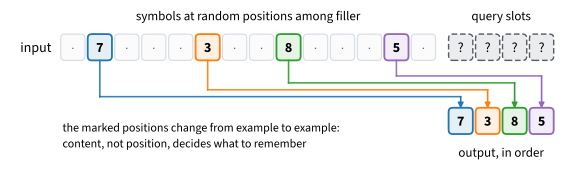
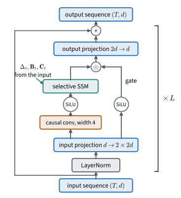

# Selective State Space Models
:label:`sec_mamba`

The S4D layer of :numref:`sec_ssm` weights its inputs by their distance
alone: an input from $k$ steps ago contributes to the output through the
fixed number $K_k$ of the convolution kernel. Whether the token ten steps
ago was the key fact of a paragraph or a comma, its influence on the present
is the same. Language is not like this. Most tokens can be forgotten
quickly, and a few, such as a name, a number, or the subject of a sentence,
must be kept for a long time, at positions that differ from one sentence to
the next. A memory that keeps everything for the same time fills up with
commas; a memory that forgets quickly loses the name.

Two models of the previous section each have half of a solution. The minGRU
chooses its decay from the current input, so it can keep one token and
overwrite the next, but its gates start with a memory of about one step,
and its state holds one number per channel. S4D starts with memories of a
step to a thousand steps and holds $N$ numbers per channel, but its dynamics
are the same for every input. *Selective* state space models, introduced
with the Mamba architecture by :citet:`Gu.Dao.2023`, combine the two: the
step size $\Delta$ of the discretized SSM, and the vectors that write to and
read from the state, become functions of the current input. A small step
size keeps the state and ignores the token; a large one overwrites the state
with it. The convolution of S4D no longer applies, because the dynamics
change from step to step, but the scan of :numref:`sec_ssm` does. We test
these models on a task that requires choosing what to keep, build the Mamba
layer, measure where its state comes from, and train it as a language model.
The state of a selective SSM turns out to be a matrix written one outer
product at a time, which the next section studies in its own right.

```{.python .input #mamba-selective-state-space-models}
%%tab pytorch
%matplotlib inline
from d2l import torch as d2l
import torch
from torch import nn
from torch.nn import functional as F
```

```{.python .input #mamba-selective-state-space-models}
%%tab jax
%matplotlib inline
from d2l import jax as d2l
from flax import nnx
import jax
from jax import numpy as jnp
import optax
```

## The Selectivity Problem

### Selective Copying

The *selective copying* task of :citet:`Gu.Dao.2023` isolates the decision
of what to keep (:numref:`fig_selective_copy`). A sequence consists of
1,024 filler tokens among which four symbols, drawn from eight, sit at
random positions. Four query tokens follow, and at each of them the model
must output the next symbol, in order. Chance accuracy is 1/8. A solution
must store a token because it is a symbol rather than filler, at whatever
position it occurs, and keep it for up to a thousand steps; weights that
depend only on position cannot do this, since the same position holds
filler in one sequence and a symbol in the next.


:label:`fig_selective_copy`

Token 0 is the filler, token 1 the query, and tokens 2 to 9 the symbols. We
draw a fresh batch of sequences for every training step, so the model
cannot memorize the training data.

```{.python .input #mamba-selective-copying-1}
%%tab pytorch
def copy_batch(batch_size, num_fillers=1024, num_marked=4, num_symbols=8,
               device=None):
    """Symbols at random positions among fillers, then query tokens."""
    X = torch.zeros(batch_size, num_fillers + num_marked, dtype=torch.long,
                    device=device)
    X[:, num_fillers:] = 1  # Query tokens
    Y = torch.randint(2, 2 + num_symbols, (batch_size, num_marked),
                      device=device)
    positions = torch.rand(batch_size, num_fillers, device=device).argsort(1)
    X.scatter_(1, positions[:, :num_marked].sort(1).values, Y)
    return X, Y

X, Y = copy_batch(2, num_fillers=12)
print(X, Y, sep='\n')
```

```{.python .input #mamba-selective-copying-1}
%%tab jax
def copy_batch(key, batch_size, num_fillers=1024, num_marked=4,
               num_symbols=8):
    """Symbols at random positions among fillers, then query tokens."""
    key_y, key_p = jax.random.split(key)
    Y = jax.random.randint(key_y, (batch_size, num_marked), 2, 2 + num_symbols)
    positions = jnp.argsort(jax.random.uniform(key_p, (batch_size, num_fillers)), 1)
    X = jnp.zeros((batch_size, num_fillers + num_marked), dtype=jnp.int32)
    X = X.at[:, num_fillers:].set(1)  # Query tokens
    rows = jnp.arange(batch_size)[:, None]
    X = X.at[rows, jnp.sort(positions[:, :num_marked], 1)].set(Y)
    return X, Y

X, Y = copy_batch(jax.random.key(0), 2, num_fillers=12)
print(X, Y, sep='\n')
```

We train every model as `d2l.SeqLM`, the residual stack of
:numref:`sec_lstm`, with two blocks of width 48, and read its predictions at
the four query positions. Training uses Adam with learning rate 0.003 and
gradient clipping for 2,500 steps of 64 sequences; accuracy is measured on
1,024 new sequences. We start with S4D and the minGRU.

```{.python .input #mamba-selective-copying-2}
%%tab pytorch
def train_copy(model, num_steps=2500, lr=3e-3):
    """Train on fresh batches of selective copying; return test accuracy."""
    device = d2l.try_gpu()
    model.to(device)
    optimizer = torch.optim.Adam(model.parameters(), lr=lr)
    for _ in range(num_steps):
        X, Y = copy_batch(64, device=device)
        logits = model(X)[:, -Y.shape[1]:]  # Predictions at the queries
        loss = F.cross_entropy(logits.flatten(0, 1), Y.flatten())
        optimizer.zero_grad()
        loss.backward()
        nn.utils.clip_grad_norm_(model.parameters(), 1.0)
        optimizer.step()
    X, Y = copy_batch(1024, device=device)
    with torch.inference_mode():
        Y_hat = torch.cat([model(X_i)[:, -Y.shape[1]:].argmax(-1)
                           for X_i in X.split(128)])
    return (Y_hat == Y).float().mean().item()
```

```{.python .input #mamba-selective-copying-2}
%%tab jax
@nnx.jit
def copy_step(model, optimizer, X, Y):
    def loss_fn(model):
        logits = model(X)[:, -Y.shape[1]:]  # Predictions at the queries
        return optax.softmax_cross_entropy_with_integer_labels(logits, Y).mean()
    loss, grads = nnx.value_and_grad(loss_fn)(model)
    optimizer.update(model, grads)
    return loss

@nnx.jit
def copy_predict(model, X):
    return model(X).argmax(-1)

def train_copy(model, num_steps=2500, lr=3e-3, seed=0):
    """Train on fresh batches of selective copying; return test accuracy."""
    optimizer = nnx.Optimizer(model, optax.chain(
        optax.clip_by_global_norm(1.0), optax.adam(lr)), wrt=nnx.Param)
    step = nnx.cached_partial(copy_step, model, optimizer)  # Compile once
    predict = nnx.cached_partial(copy_predict, model)
    key = jax.random.key(seed)
    for _ in range(num_steps):
        key, subkey = jax.random.split(key)
        step(*copy_batch(subkey, 64))
    X, Y = copy_batch(jax.random.key(seed + 1), 1024)
    Y_hat = jnp.concatenate([predict(X[i:i + 128])[:, -Y.shape[1]:]
                             for i in range(0, 1024, 128)])
    return float((Y_hat == Y).mean())
```

```{.python .input #mamba-selective-copying-3}
%%tab pytorch
torch.manual_seed(0)
models = {'S4D': d2l.SeqLM(10, 48, [d2l.S4D(48) for _ in range(2)]),
          'minGRU': d2l.SeqLM(10, 48, [d2l.MinGRU(48, 48) for _ in range(2)])}
for name, model in models.items():
    print(f'{name:8s} accuracy {train_copy(model):.2f}')
```

```{.python .input #mamba-selective-copying-3}
%%tab jax
rngs = nnx.Rngs(0)
models = {
    'S4D': d2l.SeqLM(10, 48, [d2l.S4D(48, rngs=rngs) for _ in range(2)],
                     rngs=rngs),
    'minGRU': d2l.SeqLM(10, 48, [d2l.MinGRU(48, 48, rngs=rngs)
                                 for _ in range(2)], rngs=rngs)}
for name, model in models.items():
    print(f'{name:8s} accuracy {train_copy(model):.2f}')
```

S4D answers fewer than one query in five correctly, a little above the
chance rate of one in eight: its weights depend on distance, and the same
distance holds a symbol in one sequence and a filler in the next. The minGRU
answers nine in ten or more. Its decay is chosen by each input, so it can
keep a symbol and let fillers pass, and it nearly solves the task. Its
gates, however, start near one half: on the delayed recall task of
:numref:`sec_ssm`, which needs no selection at all, the minGRU could not
keep a symbol across 1,000 fillers unless its gates were initialized with
long memories. Selective copying is easier in this respect, because a symbol
sometimes sits close to a query, and the short-range gradients from such
sequences teach the gates to keep symbols longer and longer.

## Selective Dynamics

### Input-Dependent Step Sizes
:label:`subsec_selective-dynamics`

Recall the zero-order hold of :numref:`sec_ssm`: a state that obeys
$h'(t) = \lambda h(t) + x(t)$ with rate $\lambda < 0$, read at steps of
length $\Delta$, decays by $e^{\Delta\lambda}$ per step, and the input enters
with weight $(e^{\Delta\lambda} - 1)/\lambda$, which is close to $\Delta$
when $\Delta|\lambda|$ is small. A small step keeps the state and admits
little of the input; a large step forgets the state and admits much. The
step size acts as a gate. In S4D it was a learned constant per channel; a
selective SSM computes it from the input.

Let the input of the layer have $H$ channels, $\mathbf{x}_t \in
\mathbb{R}^H$, and let each channel $c$ have a state $\mathbf{h}_t^{(c)} \in
\mathbb{R}^N$ with rates $\lambda_1, \ldots, \lambda_N$, initialized to
$-1, \ldots, -N$ as in S4D. The selective SSM computes three quantities from
the input at every step: a step size per channel, and a write vector and a
read vector shared by all channels,

$$\boldsymbol{\Delta}_t = \textrm{softplus}(\mathbf{W}_\Delta \mathbf{x}_t +
\mathbf{b}_\Delta), \qquad \mathbf{B}_t = \mathbf{W}_B \mathbf{x}_t, \qquad
\mathbf{C}_t = \mathbf{W}_C \mathbf{x}_t,$$

where softplus$(z) = \log(1 + e^z)$ keeps the step sizes positive. The state
of each channel then follows the discretized SSM with these step-dependent
values,

$$
\mathbf{h}_t^{(c)} = e^{\Delta_{t,c} \boldsymbol{\lambda}} \odot
\mathbf{h}_{t-1}^{(c)} + \Delta_{t,c}\, x_{t,c}\, \mathbf{B}_t, \qquad
y_{t,c} = \mathbf{C}_t^\top \mathbf{h}_t^{(c)} + D_c\, x_{t,c}.
$$
:eqlabel:`eq_selective_ssm`

Here $e^{\Delta_{t,c}\boldsymbol{\lambda}}$ is the vector of decays of the
$N$ states, and the input weight is the approximation $\Delta$ of the
zero-order hold, which Mamba uses. Compared with S4D, three things change,
and each is a decision the layer now makes per token. The step size
$\Delta_{t,c}$ decides how much channel $c$ forgets and how much of the
token it writes; at a filler token the layer can set it near zero and skip
the token, and at a symbol it can set it large and store it. The write
vector $\mathbf{B}_t$ decides where in the $N$-dimensional state the token
goes, and the read vector $\mathbf{C}_t$ decides what the output reads.
Compared with the minGRU, the decay is still chosen by the input, but each
channel has $N$ states with rates that span a range, and the step sizes are
initialized log-uniformly between 0.001 and 0.1, so that the layer starts
with memories from a few steps to a thousand.

### Training with a Scan

The selective SSM cannot be computed as a convolution: the weight of an
input from $k$ steps ago is now a product of $k$ different decays, which
depends on the tokens in between, so there is no single kernel. The update
:eqref:`eq_selective_ssm` is still affine in the state, with decays and
writes that the layer computes for all positions before the recurrence
starts, so `d2l.linear_scan` computes all states in parallel, exactly as for
the minGRU.

The scan has a cost that the minGRU did not have: memory. The state at each
position now has $H \times N$ numbers, 1,536 for 96 channels with 16 states
(the language model below has 16 states per channel),
and a minibatch of 64 sequences of 1,024 steps holds 100 million of them,
400 MB in 32-bit floats. Backpropagation through the doubling scan stores
every round, $\lceil \log_2 T \rceil = 10$ of them, which takes several
gigabytes per layer. A property of linear recurrences avoids this. Let
$\mathbf{g}_t$ be the derivative of the loss with respect to the state
$\mathbf{h}_t$. The state $\mathbf{h}_t$ affects the loss directly, through
the output at step $t$, and through the next state, $\mathbf{h}_{t+1} =
\mathbf{a}_{t+1} \odot \mathbf{h}_t + \mathbf{b}_{t+1}$, so

$$\mathbf{g}_t = \frac{\partial \ell}{\partial \mathbf{h}_t}\Big|_\textrm{direct}
+ \mathbf{a}_{t+1} \odot \mathbf{g}_{t+1}.$$

This is again a linear recurrence, run backward in time, and a second scan
computes it. The gradients of the decays and writes follow directly:
$\partial\ell/\partial\mathbf{b}_t = \mathbf{g}_t$ and
$\partial\ell/\partial\mathbf{a}_t = \mathbf{g}_t \odot \mathbf{h}_{t-1}$.
The backward pass then needs only the decays and the states, not the
intermediate rounds. Mamba's fused GPU kernel goes further: it never writes
the states to the GPU's main memory at all, but computes them in fast on-chip
memory, reads out $\mathbf{C}_t^\top \mathbf{h}_t$ there, and recomputes
the states during the backward pass.

In code, the backward pass is a second call of `linear_scan` on the
reversed sequence. We give the scan this gradient explicitly, as a custom
backward function, and check it against the gradient that automatic
differentiation computes through the rounds of the scan.

```{.python .input #mamba-training-with-a-scan-1}
%%tab pytorch
class AdjointScan(torch.autograd.Function):  #@save
    """linear_scan whose backward pass is a second scan, run backward."""
    @staticmethod
    def forward(ctx, a, b):
        h = d2l.linear_scan(a, b)
        ctx.save_for_backward(a, h)
        return h

    @staticmethod
    def backward(ctx, grad_h):
        a, h = ctx.saved_tensors
        # g_t = grad_h_t + a_{t+1} g_{t+1}: a linear recurrence from the end
        a_next = torch.cat([a[:, 1:], torch.ones_like(a[:, :1])], 1)
        g = d2l.linear_scan(a_next.flip(1), grad_h.flip(1)).flip(1)
        h_prev = torch.cat([torch.zeros_like(h[:, :1]), h[:, :-1]], 1)
        return g * h_prev, g

def adjoint_scan(a, b):  #@save
    """All states of h_t = a_t * h_{t-1} + b_t, differentiated by a scan."""
    return AdjointScan.apply(a.expand_as(b), b)
```

```{.python .input #mamba-training-with-a-scan-1}
%%tab jax
@jax.custom_vjp  #@save
def _adjoint_scan(a, b):
    return d2l.linear_scan(a, b)

def adjoint_scan_forward(a, b):  #@save
    """Forward pass: the states, and what the backward pass needs."""
    h = d2l.linear_scan(a, b)
    return h, (a, h)

def adjoint_scan_backward(saved, grad_h):  #@save
    """Backward pass: gradients of a and b by a scan in reverse time."""
    a, h = saved
    # g_t = grad_h_t + a_{t+1} g_{t+1}: a linear recurrence from the end
    a_next = jnp.concatenate([a[:, 1:], jnp.ones_like(a[:, :1])], 1)
    g = d2l.linear_scan(a_next[:, ::-1], grad_h[:, ::-1])[:, ::-1]
    h_prev = jnp.concatenate([jnp.zeros_like(h[:, :1]), h[:, :-1]], 1)
    return g * h_prev, g

_adjoint_scan.defvjp(adjoint_scan_forward, adjoint_scan_backward)  #@save

def adjoint_scan(a, b):  #@save
    """All states of h_t = a_t * h_{t-1} + b_t, differentiated by a scan."""
    return _adjoint_scan(jnp.broadcast_to(a, b.shape), b)
```

```{.python .input #mamba-training-with-a-scan-2}
%%tab pytorch
a = torch.rand(2, 100, 8, requires_grad=True)
b = torch.randn(2, 100, 8, requires_grad=True)
w = torch.randn(2, 100, 8)  # A loss that weights every state
grads_scan = torch.autograd.grad((d2l.linear_scan(a, b) * w).sum(), (a, b))
grads_adjoint = torch.autograd.grad((adjoint_scan(a, b) * w).sum(), (a, b))
print('max deviation:', max(float((g1 - g2).abs().max())
                            for g1, g2 in zip(grads_scan, grads_adjoint)))
```

```{.python .input #mamba-training-with-a-scan-2}
%%tab jax
key_a, key_b, key_w = jax.random.split(jax.random.key(0), 3)
a = jax.random.uniform(key_a, (2, 100, 8))
b = jax.random.normal(key_b, (2, 100, 8))
w = jax.random.normal(key_w, (2, 100, 8))  # A loss that weights every state
grad = lambda scan: jax.grad(lambda a, b: (scan(a, b) * w).sum(), (0, 1))
print('max deviation:', max(float(jnp.abs(g1 - g2).max()) for g1, g2 in
                            zip(grad(d2l.linear_scan)(a, b),
                                grad(adjoint_scan)(a, b))))
```

The two gradients agree to rounding error. The adjoint scan stores two
tensors of the size of the states instead of ten, and in PyTorch it lets the
models below train in a few gigabytes.

## The Mamba Layer

### The Layer

A selective SSM mixes information along the sequence, but each channel
separately and linearly. The Mamba layer :cite:`Gu.Dao.2023` surrounds it
with projections, a nonlinearity, and a gate, which mix the channels as the
MLP of a transformer block does (:numref:`fig_mamba_block`). An input projection widens the $d$-dimensional
input to $H = 2d$ channels and produces a second branch of the same width. A
short causal convolution over the last four tokens lets each channel combine
a token with its neighbors before the SSM sees it, followed by a SiLU
nonlinearity. The SSM output is multiplied by the SiLU of the second branch,
a gate, and an output projection returns to width $d$.


:label:`fig_mamba_block`

The selective SSM holds the rates of its states, three projections that
compute the step sizes and the write and read vectors from the input, and
the skip weights $D$. The step sizes are initialized as in S4D: the weights
that compute them start at zero, and the biases so that the softplus returns
step sizes log-uniformly distributed between `dt_min` and `dt_max`, whatever
the input. Training then learns how the step sizes depend on the input.

```{.python .input #mamba-the-layer-1}
%%tab pytorch
class SelectiveSSM(nn.Module):  #@save
    """A diagonal SSM whose step sizes and write and read vectors depend on
    the input: N states for each of num_channels channels."""
    def __init__(self, num_channels, num_states=16, dt_min=1e-3, dt_max=1e-1):
        super().__init__()
        H, N = num_channels, num_states
        self.log_neg_rate = nn.Parameter(  # Rates -1, ..., -N in every channel
            torch.log(torch.arange(1., N + 1)).repeat(H, 1))
        self.W_dt = nn.Linear(H, H)  # Step size per channel
        self.W_B = nn.Linear(H, N, bias=False)  # Write vector
        self.W_C = nn.Linear(H, N, bias=False)  # Read vector
        dt = dt_min * (dt_max / dt_min) ** torch.rand(H)
        with torch.no_grad():  # Start at softplus(bias) = dt for every input
            self.W_dt.weight.zero_()
            self.W_dt.bias.copy_(dt + torch.log(-torch.expm1(-dt)))
        self.D = nn.Parameter(torch.ones(H))
```

```{.python .input #mamba-the-layer-1}
%%tab jax
class SelectiveSSM(nnx.Module):  #@save
    """A diagonal SSM whose step sizes and write and read vectors depend on
    the input: N states for each of num_channels channels."""
    def __init__(self, num_channels, num_states=16, dt_min=1e-3, dt_max=1e-1,
                 *, rngs):
        H, N = num_channels, num_states
        self.log_neg_rate = nnx.Param(  # Rates -1, ..., -N in every channel
            jnp.tile(jnp.log(jnp.arange(1., N + 1)), (H, 1)))
        def dt_bias(key, shape, dtype=jnp.float32):  # softplus(bias) = dt
            dt = dt_min * (dt_max / dt_min) ** jax.random.uniform(key, shape)
            return (dt + jnp.log(-jnp.expm1(-dt))).astype(dtype)
        self.W_dt = nnx.Linear(H, H, kernel_init=nnx.initializers.zeros,
                               bias_init=dt_bias, rngs=rngs)  # Start at dt
        self.W_B = nnx.Linear(H, N, use_bias=False, rngs=rngs)  # Write vector
        self.W_C = nnx.Linear(H, N, use_bias=False, rngs=rngs)  # Read vector
        self.D = nnx.Param(jnp.ones(H))
```

The method `coefficients` computes the step sizes from the input and turns
them into the decays $e^{\Delta_{t,c}\lambda_n}$, kept as logarithms, and
the writes $\Delta_{t,c}\, x_{t,c}\, \mathbf{B}_t$ of
:eqref:`eq_selective_ssm` for every position, channel, and state. The
forward pass scans them and reads every channel's state with
$\mathbf{C}_t$.

```{.python .input #mamba-the-layer-2}
%%tab pytorch
@d2l.add_to_class(SelectiveSSM)  #@save
def coefficients(self, U):
    """Log-decays and writes, each of shape (batch_size, T, H, N)."""
    dt = F.softplus(self.W_dt(U))  # Step sizes, (batch_size, T, H)
    log_a = dt.unsqueeze(-1) * -torch.exp(self.log_neg_rate)
    return log_a, (dt * U).unsqueeze(-1) * self.W_B(U).unsqueeze(-2)

@d2l.add_to_class(SelectiveSSM)  #@save
def forward(self, U):  # U: (batch_size, num_steps, num_channels)
    log_a, b = self.coefficients(U)
    H = adjoint_scan(torch.exp(log_a), b)  # States, (batch_size, T, H, N)
    return (H * self.W_C(U).unsqueeze(-2)).sum(-1) + self.D * U
```

```{.python .input #mamba-the-layer-2}
%%tab jax
@d2l.add_to_class(SelectiveSSM)  #@save
def coefficients(self, U):
    """Log-decays and writes, each of shape (batch_size, T, H, N)."""
    dt = jax.nn.softplus(self.W_dt(U))  # Step sizes, (batch_size, T, H)
    log_a = dt[..., None] * -jnp.exp(self.log_neg_rate[...])
    return log_a, (dt * U)[..., None] * self.W_B(U)[..., None, :]

@d2l.add_to_class(SelectiveSSM)  #@save
def __call__(self, U):  # U: (batch_size, num_steps, num_channels)
    log_a, b = self.coefficients(U)
    H = adjoint_scan(jnp.exp(log_a), b)  # States, (batch_size, T, H, N)
    return (H * self.W_C(U)[..., None, :]).sum(-1) + self.D[...] * U
```

The Mamba layer wraps the selective SSM as described above. Its interface is
that of the other mixers of the chapter, so it can be used in `d2l.SeqLM`.

```{.python .input #mamba-the-layer-3}
%%tab pytorch
class Mamba(nn.Module):  #@save
    """The Mamba layer: a gated selective SSM between two projections."""
    def __init__(self, num_hiddens, num_states=16, expand=2, conv_width=4,
                 **ssm_args):
        super().__init__()
        H = expand * num_hiddens
        self.W_in = nn.Linear(num_hiddens, 2 * H)
        self.conv = nn.Conv1d(H, H, conv_width, groups=H,  # One per channel
                              padding=conv_width - 1)
        self.ssm = SelectiveSSM(H, num_states, **ssm_args)
        self.W_out = nn.Linear(H, num_hiddens)

    def ssm_input(self, X):
        """The input of the SSM and the gate branch."""
        U, Z = self.W_in(X).chunk(2, -1)
        U = self.conv(U.transpose(1, 2))[..., :X.shape[1]]  # Keep it causal
        return F.silu(U.transpose(1, 2)), Z

    def forward(self, X):  # X: (batch_size, num_steps, num_hiddens)
        U, Z = self.ssm_input(X)
        return self.W_out(self.ssm(U) * F.silu(Z))
```

```{.python .input #mamba-the-layer-3}
%%tab jax
class Mamba(nnx.Module):  #@save
    """The Mamba layer: a gated selective SSM between two projections."""
    def __init__(self, num_hiddens, num_states=16, expand=2, conv_width=4,
                 *, rngs, **ssm_args):
        H = expand * num_hiddens
        self.W_in = nnx.Linear(num_hiddens, 2 * H, rngs=rngs)
        self.conv = nnx.Conv(H, H, (conv_width,), feature_group_count=H,
                             padding=[(conv_width - 1, 0)], rngs=rngs)  # Causal
        self.ssm = SelectiveSSM(H, num_states, rngs=rngs, **ssm_args)
        self.W_out = nnx.Linear(H, num_hiddens, rngs=rngs)

    def ssm_input(self, X):
        """The input of the SSM and the gate branch."""
        U, Z = jnp.split(self.W_in(X), 2, -1)
        return jax.nn.silu(self.conv(U)), Z

    def __call__(self, X):  # X: (batch_size, num_steps, num_hiddens)
        U, Z = self.ssm_input(X)
        return self.W_out(self.ssm(U) * jax.nn.silu(Z))
```

### Selective Copying with Mamba

We train a Mamba model with four states per channel, with the setup above.

```{.python .input #mamba-selective-copying-with-mamba}
%%tab pytorch
torch.manual_seed(0)
models['Mamba'] = d2l.SeqLM(10, 48, [Mamba(48, num_states=4)
                                     for _ in range(2)])
print(f"Mamba    accuracy {train_copy(models['Mamba']):.2f}")
```

```{.python .input #mamba-selective-copying-with-mamba}
%%tab jax
rngs = nnx.Rngs(0)
models['Mamba'] = d2l.SeqLM(10, 48, [Mamba(48, num_states=4, rngs=rngs)
                                     for _ in range(2)], rngs=rngs)
print(f"Mamba    accuracy {train_copy(models['Mamba']):.2f}")
```

Mamba answers nearly every query correctly. It combines the two properties that
the models of :numref:`sec_ssm` had separately: decays chosen by the input,
as in the minGRU, and memories of many lengths from the start, as in S4D.
The minGRU, which has only the first, nearly solves the task; S4D, which
has only the second, does not come close.

### Contributions to the State

Accuracy shows that Mamba keeps the symbols; it does not show how. Because
the state is a sum of past writes, each decayed by the decays met since, we
can measure how much each input contributes to it. Unrolling the recurrence
as in :numref:`sec_ssm`, the state at step $T$ is $\sum_{s \le T}
(\prod_{r = s+1}^{T} \mathbf{a}_r) \odot \mathbf{b}_s$, and the size of
the term for position $s$ is its contribution. With the logarithms of the
decays, each product is the exponential of a difference of cumulative sums.

```{.python .input #mamba-where-the-state-comes-from-1}
%%tab pytorch
def state_contributions(log_a, b):
    """Size of each position's term in the final state of h = a h + b."""
    cum = log_a.cumsum(1)
    terms = torch.exp(cum[:, -1:] - cum) * b  # Decayed to the last step
    return torch.linalg.vector_norm(terms.flatten(2), dim=-1)  # (batch, T)
```

```{.python .input #mamba-where-the-state-comes-from-1}
%%tab jax
def state_contributions(log_a, b):
    """Size of each position's term in the final state of h = a h + b."""
    cum = log_a.cumsum(1)
    terms = jnp.exp(cum[:, -1:] - cum) * b  # Decayed to the last step
    return jnp.linalg.norm(terms.reshape(*terms.shape[:2], -1), axis=-1)
```

We apply it to the first layer of the trained S4D and Mamba models, on one
test sequence, for the state at the first query token. For S4D the decays
are the same at every step; for Mamba, `coefficients` returns them for
every position. We also compute the share of the state that comes from the
four positions starting at each symbol, which cover less than 2% of the
sequence: the short convolution in front of the SSM spreads a token over
the next three positions, so the layer can write it at any of them.

```{.python .input #mamba-where-the-state-comes-from-2}
%%tab pytorch
device = d2l.try_gpu()
X, _ = copy_batch(1, device=device)
X = X[:, :-3]  # Up to the first query token
positions = (X[0] > 1).nonzero().flatten()  # The four symbols
with torch.inference_mode():
    s4d, mamba = models['S4D'], models['Mamba']
    E = s4d.norms[0](s4d.embedding(X))
    a_bar, b_bar = s4d.mixers[0].discretize()
    c_s4d = state_contributions(torch.log(a_bar).expand(*E.shape, -1),
                                b_bar * E.unsqueeze(-1))[0]
    U, _ = mamba.mixers[0].ssm_input(mamba.norms[0](mamba.embedding(X)))
    c_mamba = state_contributions(*mamba.mixers[0].ssm.coefficients(U))[0]
windows = (positions[:, None] + torch.arange(4, device=device)).flatten()
windows = windows[windows < X.shape[1]]  # A window may reach past the end
for name, c in [('S4D', c_s4d), ('Mamba', c_mamba)]:
    print(f'{name:6s} share from the symbols: {c[windows].sum() / c.sum():.2f}')
d2l.plot(torch.arange(X.shape[1]),
         [(c / c.max()).cpu() for c in (c_s4d, c_mamba)],
         'position', 'contribution to the state', legend=['S4D', 'Mamba'],
         yscale='log', figsize=(6, 3))
```

```{.python .input #mamba-where-the-state-comes-from-2}
%%tab jax
X, _ = copy_batch(jax.random.key(2), 1)
X = X[:, :-3]  # Up to the first query token
positions = jnp.nonzero(X[0] > 1)[0]  # The four symbols
s4d, mamba = models['S4D'], models['Mamba']
E = s4d.norms[0](s4d.embedding(X))
a_bar, b_bar = s4d.mixers[0].discretize()
log_a = jnp.broadcast_to(jnp.log(a_bar), (*E.shape, a_bar.shape[-1]))
c_s4d = state_contributions(log_a, b_bar * E[..., None])[0]
U, _ = mamba.mixers[0].ssm_input(mamba.norms[0](mamba.embedding(X)))
c_mamba = state_contributions(*mamba.mixers[0].ssm.coefficients(U))[0]
windows = (positions[:, None] + jnp.arange(4)).flatten()
windows = windows[windows < X.shape[1]]  # A window may reach past the end
for name, c in [('S4D', c_s4d), ('Mamba', c_mamba)]:
    print(f'{name:6s} share from the symbols: {c[windows].sum() / c.sum():.2f}')
d2l.plot(jnp.arange(X.shape[1]), [c / c.max() for c in (c_s4d, c_mamba)],
         'position', 'contribution to the state', legend=['S4D', 'Mamba'],
         yscale='log', figsize=(6, 3))
```

For S4D, the contributions rise smoothly toward the query: the most recent
inputs dominate, whatever they are, and a symbol 800 steps back contributes
no more than the fillers next to it. For Mamba, the contributions spike at
the four symbols, some three to four orders of magnitude above the fillers
around them, wherever the symbols sit. Two thirds to four fifths of Mamba's state
comes from the windows of four positions that start at the symbols, which
cover less than 2% of the sequence; for S4D the same windows contribute at
most 2%. The selective SSM writes the symbols and lets the fillers pass.

### Language Modeling
:label:`subsec_mamba-lm`

We train the Mamba layer as the mixer of `d2l.SeqLM` on the
character-level Penn Treebank, with the recipe of the chapter: two blocks of
width 128, so that each layer has $H = 256$ channels with 16 states, and
3,000 steps of AdamW through `d2l.fit_lm`. With this recipe the minGRU
reached a perplexity of about 3.2 and S4D about 3.35.

```{.python .input #mamba-language-modeling-1}
%%tab pytorch, jax
data = d2l.PennTreebank(batch_size=64, num_steps=128)
```

```{.python .input #mamba-language-modeling-2}
%%tab pytorch
torch.manual_seed(0)
model = d2l.SeqLM(len(data.vocab), 128, [Mamba(128) for _ in range(2)])
print(f'Mamba perplexity: {d2l.fit_lm(model, data):.2f}')
```

```{.python .input #mamba-language-modeling-2}
%%tab jax
rngs = nnx.Rngs(0)
model = d2l.SeqLM(len(data.vocab), 128,
                  [Mamba(128, rngs=rngs) for _ in range(2)], rngs=rngs)
print(f'Mamba perplexity: {d2l.fit_lm(model, data):.2f}')
```

Mamba reaches a perplexity of about 2.95, level with the LSTM and the GRU
and well below the minGRU and S4D. It also has the most parameters, about
635,000 against 540,000 for the LSTM model, so this comparison does not show
that it uses them better. What it does show is that a model trained entirely
with scans, and generating with a state of fixed size, models text as well as
the gated networks that dominated before transformers.

The state of a selective SSM is an $H \times N$ matrix for every layer, and
each step adds to it the outer product of the step-scaled input with the
write vector $\mathbf{B}_t$; the read vector $\mathbf{C}_t$ multiplies it.
This is a memory of key–value pairs, with $\mathbf{B}_t$ as key and
$\mathbf{C}_t$ as query. The next section studies such memories directly:
how many pairs they hold, and how to train them with matrix products.

## Summary

A state space model with fixed dynamics weights its inputs by their
distance, so it cannot keep a token because of what the token is, and it
fails at selective copying. A selective state space model computes its step
sizes, and the vectors that write to and read from its state, from the
current input. A small step size skips a token and a large one stores it, so
the step size acts as the gate of a gated recurrent network, while the state
keeps $N$ numbers per channel and starts with the multi-timescale
initialization of S4D. Mamba solves selective copying over a thousand filler
tokens, which the minGRU nearly solves and S4D does not. In the trained
model, most of the state at the query comes from the few positions after
each symbol. The selective model can no longer be computed as a convolution,
but its update is still affine in the state, so a scan trains it, and the
gradient of the scan is a second scan, run backward. The Mamba layer wraps
the selective SSM in projections, a short convolution, and a gate, and it is
a strong language model at this scale.

## Exercises

1. **A step size is a gate.** Consider one channel with one state, rate
   $\lambda = -1$, and the exact zero-order hold of :numref:`sec_ssm`, so
   that $h_t = e^{-\Delta_t} h_{t-1} + (1 - e^{-\Delta_t}) x_t$.
    1. Show that with $\Delta_t = \textrm{softplus}(s_t)$ the update is
       $h_t = z_t h_{t-1} + (1 - z_t) x_t$ with $z_t = \sigma(-s_t)$, the
       blend of a GRU with update gate $z_t$.
    1. What does the approximation $\Delta_t$ of the input weight, which
       Mamba uses, change? For which $\Delta_t$ is it accurate?

1. **Memory of the scan.** For a Mamba layer with $H$ channels and $N$
   states, a minibatch of $B$ sequences of length $T$, and 32-bit numbers,
   count the bytes that backpropagation stores for the scan, (a) through the
   rounds of the doubling scan, (b) with the adjoint scan, and (c) with a
   kernel that stores only the inputs of the layer and recomputes the
   states. Evaluate the three for $H = 4096$, $N = 16$, $B = 8$, and $T =
   8192$, and compare with the memory of a GPU.

1. [code] **Causality.** The convolution of the Mamba layer must see only
   the current and earlier tokens; the code pads the sequence so that
   output $t$ depends on inputs $t-3, \ldots, t$.
    1. Change a token in the middle of a random input sequence and check
       that the outputs at earlier positions do not change.
    1. Shift the padding so that output $t$ also sees input $t+1$. What
       goes wrong, and how does the model's training loss on the copying
       task react?

1. [code] **Longer sequences.** Evaluate the Mamba model trained on 1,024
   fillers on sequences with 2,048 and 4,096 fillers, without retraining.
    1. Does it still copy the symbols? Compare with the minGRU.
    1. For each channel of the first layer, compute the decay of its slowest
       state over 1,000 filler tokens. How many channels can carry a symbol
       across 4,096 fillers?

1. **Weights that depend on position.** ● Consider any model whose state
   at step $T$ is $\sum_{s \le T} \mathbf{w}_{T-s} \odot f(x_s)$, with
   fixed weights $\mathbf{w}_k$ and a fixed function $f$ of a single
   token, and whose output is any function of this state. S4D is of this
   form. Show that for selective copying with two symbols among fillers,
   the state cannot depend on the order of the symbols unless the weights
   $\mathbf{w}_k$ differ for different distances $k$, and that the model
   must then distinguish, from the state alone, every pair of positions.
   Why does this make the task hard for S4D as the number of fillers
   grows, while a selective model can keep its state unchanged on fillers?

1. [code] **Which part must be selective?** ●
    1. Train three variants of the Mamba model on selective copying: with
       input-dependent step sizes but fixed write and read vectors
       $\mathbf{B}$ and $\mathbf{C}$, with fixed step sizes but
       input-dependent $\mathbf{B}_t$ and $\mathbf{C}_t$, and with
       neither. Which variants solve the task? Relate the result to the
       contributions to the state measured above.
    1. In the trained Mamba model, set the step sizes of the first layer to
       their median over filler positions at the four positions after each
       symbol, so that the layer cannot write the symbols with a large
       step. How much does the accuracy drop? Repeat with the step sizes
       set to their median over these positions everywhere else, so that
       the layer cannot skip the fillers.

1. [code] **Generation.** Add a method `step` to `SelectiveSSM` and to
   `Mamba` that processes one token, given the state of the SSM and the
   last three inputs of the convolution, and returns the output and the
   new state. Check that stepping through a sequence reproduces the
   outputs of the forward pass. How many numbers does the layer carry from
   token to token?

1. [code] **Short initial memories.** Train the Mamba model with step sizes
   initialized between 0.5 and 1 (`dt_min=0.5, dt_max=1.0`), so that every
   state starts with a memory of a few steps.
    1. Does it learn to copy the symbols within the training budget? If so,
       plot the step sizes of the first layer on filler tokens before and
       after training, and explain how the model could have learned long
       memories from gradients that, at the start, vanish over a thousand
       steps. (Hint: where do the symbols closest to the queries sit?)
    1. Repeat with 4,096 fillers, and with the minGRU initialized as in the
       long-range recall experiment of :numref:`sec_ssm`.

[Discussions](https://d2l.discourse.group/)

<!-- slides -->

::: {.slide}
::: {.cover}
[Dive into Deep Learning · §12.3]{.kicker}

Selective state space models<br>
**selective copying · input-chosen step sizes · the scan and its gradient · the Mamba layer · where the state comes from**
:::
:::

::: {.slide title="S4D Copies Barely More Symbols Than Chance"}
[The problem]{.kicker}

Four symbols, drawn from eight, at random positions among 1,024 filler
tokens; at four query tokens, repeat them in order. Chance: 1/8.

- S4D: under 0.2. Its weight for an input depends only on the distance.
- The same distance holds a symbol in one sequence and a filler in the next.

::: {.d2l-note}
Keep a token **because of what it is**, wherever it occurs, for up to a
thousand steps.
:::
:::

::: {.slide title="By the End of This Deck You Can"}
- write the selective SSM: step size, write and read vectors from the input;
- explain why the convolution is lost and the scan survives;
- compute the gradient of a scan with a second scan;
- read where a trained model's state comes from.

**Running example:** selective copying with 1,024 fillers; the Penn
Treebank results (LSTM 2.95, minGRU 3.2, S4D 3.35).
:::

::: {.slide title="Each Model So Far Has Half a Solution"}
{width=80%}

| | decay chosen by the input | memories of many lengths at the start |
|---|---|---|
| minGRU | yes | no (gates at 1/2) |
| S4D | no | yes |
:::

::: {.slide title="S4D Fails, the minGRU Nearly Succeeds"}
Two blocks of width 48 in `d2l.SeqLM`, Adam, 2,500 steps of fresh batches.

@!mamba-selective-copying-3
:::

::: {.slide title="A Selective SSM Computes Its Dynamics From the Input"}
$$\boldsymbol{\Delta}_t = \textrm{softplus}(\mathbf{W}_\Delta\mathbf{x}_t + \mathbf{b}_\Delta),\quad
\mathbf{B}_t = \mathbf{W}_B\mathbf{x}_t,\quad \mathbf{C}_t = \mathbf{W}_C\mathbf{x}_t$$

$$\mathbf{h}^{(c)}_t = e^{\Delta_{t,c}\boldsymbol{\lambda}} \odot \mathbf{h}^{(c)}_{t-1} + \Delta_{t,c}\, x_{t,c}\,\mathbf{B}_t,
\qquad y_{t,c} = \mathbf{C}_t^\top \mathbf{h}^{(c)}_t + D_c x_{t,c}$$

- Channel $c$ of $H$; $N$ states per channel with rates $\lambda_n = -(n+1)$.
- $\Delta_{t,c}$: how much channel $c$ forgets and writes at step $t$.
- $\mathbf{B}_t$, $\mathbf{C}_t$: where the token goes, what the output reads.
:::

::: {.slide title="A Small Step Skips a Token, a Large Step Stores It"}
| $\Delta_{t,c}$ | decay $e^{\Delta\lambda}$ | write $\approx\Delta$ | effect |
|---|---|---|---|
| near 0 | near 1 | near 0 | filler passes, state kept |
| large | near 0 | large | state replaced by the token |

- Initialization as in S4D: $\Delta$ log-uniform in $[0.001, 0.1]$, the
  weights $\mathbf{W}_\Delta$ start at zero.
- Training learns how $\Delta$ depends on the token.
:::

::: {.slide title="Selectivity Breaks the Convolution, Not the Scan"}
- Weight of an input $k$ steps back: a product of $k$ **different** decays.
  No single kernel.
- The update is still affine in $\mathbf{h}$: `linear_scan` applies unchanged.
- Cost: a state of $H \times N$ numbers **at every position**.

::: {.d2l-note .warn}
64 sequences of 1,024 steps, 96 channels, 16 states: 100 M numbers,
400 MB, for one tensor.
:::
:::

::: {.slide title="The Gradient of a Scan Is Another Scan"}
$$\mathbf{g}_t = \frac{\partial \ell}{\partial \mathbf{h}_t}\Big|_\textrm{direct} + \mathbf{a}_{t+1} \odot \mathbf{g}_{t+1},
\qquad \frac{\partial \ell}{\partial \mathbf{b}_t} = \mathbf{g}_t,\quad
\frac{\partial \ell}{\partial \mathbf{a}_t} = \mathbf{g}_t \odot \mathbf{h}_{t-1}$$

A linear recurrence run backward: store the decays and states, not ten
rounds.

@!mamba-training-with-a-scan-2

Mamba's fused kernel goes further: states stay in on-chip memory and are
recomputed in the backward pass.
:::

::: {.slide title="Check: Memory of the Scan"}
$B = 64$, $T = 1024$, $H = 96$, $N = 16$, 32-bit floats.

1. Bytes of one tensor of states?
2. Backpropagation through 10 rounds of $\mathbf{a}$ and $\mathbf{b}$, against the adjoint scan's two tensors?

::: {.fragment .fade-up}
1. $64 \cdot 1024 \cdot 96 \cdot 16 \cdot 4 \approx 400$ MB.
2. About 8 GB against 0.8 GB.
:::
:::

::: {.slide title="The Mamba Layer Wraps the SSM in Projections and a Gate"}
::: {.cols .vc}
::: {.col}
- Input projection to $H = 2d$ channels and a gate branch.
- Short causal convolution (4 tokens), SiLU, selective SSM.
- Multiply by SiLU of the gate, project back to $d$.
- Same interface as every mixer of `d2l.SeqLM`.
:::

::: {.col .fig .big}
{width=92%}
:::
:::
:::

::: {.slide title="Mamba Copies Nearly Every Symbol"}
@!mamba-selective-copying-with-mamba

Decays chosen by the input (like the minGRU) **and** memories of many
lengths from the start (like S4D).
:::

::: {.slide title="Mamba's State Comes From the Symbols"}
@!mamba-where-the-state-comes-from-2

Size of each position's term in the first layer's state at the query.
S4D: a smooth curve in distance. Mamba: spikes at the four symbols, wherever
they sit.
:::

::: {.slide title="On Text, Mamba Matches the Gated Networks"}
| model | PTB perplexity | parameters |
|---|---|---|
| LSTM | about 2.95 | 540 k |
| minGRU | about 3.2 | 344 k |
| S4D | about 3.35 | |
| **Mamba** | **about 2.95** | 635 k |

Trained entirely with scans; generates with a fixed-size state.
:::

::: {.slide title="Recap"}
- Fixed dynamics weigh inputs by distance: S4D fails selective copying.
- Selective SSM: $\Delta_t$, $\mathbf{B}_t$, $\mathbf{C}_t$ from the
  input; $\Delta$ is a gate; S4D's timescales at the start.
- The convolution is lost; the scan and its backward scan remain.

**Next:** the state $\mathbf{S}_t \in \mathbb{R}^{H \times N}$ gains the outer
product $(\boldsymbol{\Delta}_t \odot \mathbf{x}_t)\mathbf{B}_t^\top$ at
every step and is read by $\mathbf{C}_t$: a memory of key–value pairs.
:::
