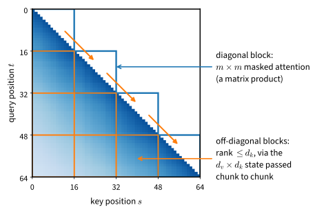

# Matrix-State Recurrences
:label:`sec_matrix-state`

The selective models of :numref:`sec_mamba` decide, token by token, what to
keep and for how long. Much of what a language model must remember comes in
pairs, a name together with what it stands for. A program defines `rate =
0.05` near its top and uses `rate` two hundred lines later. A story
introduces a character as "the engineer" and refers to "the engineer" again
three pages on. To predict such a token, a model must store a *pair* and
later retrieve the second half of the pair when the first half reappears.
This is *associative recall*, and transformers do it with attention: the
current token's query is compared with the keys of all earlier tokens, and
the values of the best matches are returned. Can a recurrent state of fixed
size store pairs too, and how many?

This section makes the state a matrix that stores key–value pairs. A pair
is written by adding the outer product of its value and its key; it is read
by multiplying the matrix by a query. This is linear attention, the
variant of attention in :numref:`sec_windowed-linear-attention` that drops the
softmax, and, up to its decay, it is also what the selective state space
model of :numref:`sec_mamba` computes, with different names for the same
vectors.
We ask how many pairs such a memory can hold, how a decay keeps it from
filling up, and how to train it fast: a decayed matrix recurrence can be
computed as masked attention, as a scan, or in chunks that combine the two.
The section ends with a limit that the next section removes: every write
adds, so a memory cannot change what it has stored.

```{.python .input #matrix-state-matrix-state-recurrences}
%%tab pytorch
import math
import numpy as np
import torch
from torch import nn
from torch.nn import functional as F
from d2l import torch as d2l
```

```{.python .input #matrix-state-matrix-state-recurrences}
%%tab jax
import math
import numpy as np
import jax
from jax import numpy as jnp
from flax import nnx
import optax
from d2l import jax as d2l
```

## An Associative Memory

### Writing and Reading Pairs

The simplest memory for pairs is a sum: it adds each new pair to what it
holds and reads a value back with its key. A small example shows how this
works and where it fails. Start with two keys in $\mathbb{R}^2$,
$\mathbf{k}_1 = (1, 0)^\top$ and $\mathbf{k}_2 = (0, 1)^\top$, with the values $v_1 = 3$ and $v_2 = 5$.
Store both in one row vector, the sum of each value times its key,
$\mathbf{S} = v_1 \mathbf{k}_1^\top + v_2 \mathbf{k}_2^\top = (3, 5)$.
Multiplying by a key reads its value back: $\mathbf{S}\mathbf{k}_1 = 3$ and
$\mathbf{S}\mathbf{k}_2 = 5$. Now store a third pair, $\mathbf{k}_3 =
(1, 1)^\top / \sqrt{2}$ with $v_3 = 7$. The memory becomes $(3 + 7/\sqrt 2,
5 + 7/\sqrt 2) \approx (7.95, 9.95)$, and reading $\mathbf{k}_1$ now returns
7.95 instead of 3. Two dimensions hold two pairs exactly; a third key must
overlap with the others, and its value leaks into theirs.

With values $\mathbf{v}_t \in \mathbb{R}^{d_v}$ and keys $\mathbf{k}_t \in
\mathbb{R}^{d_k}$, the memory is a matrix $\mathbf{S}_t \in \mathbb{R}^{d_v
\times d_k}$, the transpose of the layout in
:numref:`sec_windowed-linear-attention`. The key width $d_k$ is the $d$ of
:numref:`chap_attention`; the subscript keeps it apart from $d_v$, since both
widths appear in the shape of the memory. Each step writes one pair and the output
reads the memory with a query $\mathbf{q}_t \in \mathbb{R}^{d_k}$:

$$
\mathbf{S}_t = \mathbf{S}_{t-1} + \mathbf{v}_t \mathbf{k}_t^\top, \qquad
\mathbf{y}_t = \mathbf{S}_t \mathbf{q}_t.
$$
:eqlabel:`eq_ms-recurrence`

The outer product $\mathbf{v}_t \mathbf{k}_t^\top$ is a matrix of rank one
that maps the direction $\mathbf{k}_t$ to $\mathbf{v}_t$; the state is the
sum of these maps. The keys, values, and queries are linear projections of
the input, as in attention, so the network learns what to store under
which key and what to look up. A weight matrix that the network rewrites at
every step is called a *fast weight*; :citet:`Schlag.Irie.Schmidhuber.2021`
trace linear attention back to this older idea.

### Linear Attention

The recurrence :eqref:`eq_ms-recurrence` does not look like attention, yet
it computes a form of it. Unrolling it from $\mathbf{S}_0 = \mathbf{0}$
gives

$$\mathbf{y}_t = \Big(\sum_{s \le t} \mathbf{v}_s \mathbf{k}_s^\top\Big)
\mathbf{q}_t = \sum_{s \le t} (\mathbf{k}_s^\top \mathbf{q}_t)\,
\mathbf{v}_s.$$

The right side is causal attention with the score $\mathbf{k}_s^\top
\mathbf{q}_t$ and no softmax: every earlier value, weighted by how well its
key matches the query. This is the *linear attention* of
:eqref:`eq_linear-attn` in :numref:`sec_windowed-linear-attention`, with the
identity as the feature map and without the normalizer (the models of this
chapter normalize the output of the layer instead): because the score is a
product of features rather than an exponential, the sum folds into a
fixed-size matrix, and the cost per token does not grow with the length of
the context :cite:`Katharopoulos.Vyas.Pappas.ea.2020`.
The left side is the recurrence. The same computation is a transformer
layer read one way and a recurrent network read the other.

### Interference

How many pairs can $\mathbf{S}$ hold? Store $n$ pairs, $\mathbf{S} =
\sum_{i=1}^n \mathbf{v}_i \mathbf{k}_i^\top$, with keys of unit length, and
read key $j$:

$$
\mathbf{S}\mathbf{k}_j = \mathbf{v}_j + \sum_{i \neq j}
(\mathbf{k}_i^\top \mathbf{k}_j)\, \mathbf{v}_i.
$$
:eqlabel:`eq_ms-retrieval-error`

The read returns the stored value plus every other value, weighted by the
overlap of its key with the target key. Only mutually orthogonal keys are
read back without error, and $\mathbb{R}^{d_k}$ holds at most $d_k$ of
them. For more pairs, or for keys that are not orthogonal, interference is
unavoidable. How large it is depends on the keys; for random keys we can
compute it.

**Proposition.** Let the keys $\mathbf{k}_1, \ldots, \mathbf{k}_n$ be
independent and uniformly distributed on the unit sphere of
$\mathbb{R}^{d_k}$, and let the values be unit vectors chosen independently
of the keys. Then the expected squared read error at every stored key is

$$
\mathbb{E}\,\big\|\mathbf{S}\mathbf{k}_j - \mathbf{v}_j\big\|^2 =
\frac{n - 1}{d_k}.
$$
:eqlabel:`eq_ms-capacity-law`

**Proof.** The error is $\sum_{i \neq j} (\mathbf{k}_i^\top \mathbf{k}_j)\,
\mathbf{v}_i$. Its squared norm is a double sum over $i$ and $l$. For $i
\neq l$, the expected cross term vanishes: given $\mathbf{k}_j$, the
overlaps $\mathbf{k}_i^\top \mathbf{k}_j$ and $\mathbf{k}_l^\top
\mathbf{k}_j$ are independent with mean zero. What remains is $\sum_{i \neq
j} \mathbb{E}[(\mathbf{k}_i^\top \mathbf{k}_j)^2]$, using $\|\mathbf{v}_i\|
= 1$. A random unit vector has the same expected squared coordinate in every
direction, and these $d_k$ expectations sum to $\|\mathbf{k}_i\|^2 = 1$, so
each term is $1/d_k$. There are $n - 1$ terms. $\blacksquare$

The error grows in proportion to the number of stored pairs and falls in
proportion to the key dimension. Once $n$ approaches $d_k$, the
interference is as large as the signal, whose squared norm is one. Time
does not appear: a pair written long ago is read back as well as one
written a moment ago: memories are lost because other pairs interfere with
them, not because they are old.

We check the proposition by storing random pairs and reading them back.
The values come from a codebook of 256 random unit vectors, so we can also
ask whether the nearest codebook entry to the read is the stored one. A last
curve breaks the assumptions: every key shares a common direction, with
weight $\rho = 0.5$, so the keys are correlated. The computation needs only
NumPy.

```{.python .input #matrix-state-interference-1}
%%tab pytorch, jax
def matrix_memory(d_k, nums, rho=0, num_values=256, trials=20, seed=0):
    """Read error and recall of S = sum_i v_i k_i^T over random unit keys."""
    rng = np.random.default_rng(seed)
    unit = lambda X: X / np.linalg.norm(X, axis=-1, keepdims=True)
    codebook = unit(rng.standard_normal((num_values, d_k)))
    errors, recalls = [], []
    for n in nums:
        error = recall = 0
        for _ in range(trials):
            K = unit(rng.standard_normal((n, d_k)))  # Keys as rows
            shared = unit(rng.standard_normal(d_k))  # A common direction
            K = unit(np.sqrt(1 - rho**2) * K + rho * shared)
            ids = rng.integers(0, num_values, n)
            S = codebook[ids].T @ K  # Sum of v_i k_i^T
            reads = K @ S.T  # Row j is S k_j
            error += ((reads - codebook[ids]) ** 2).sum(1).mean() / trials
            recall += ((reads @ codebook.T).argmax(1) == ids).mean() / trials
        errors.append(error)
        recalls.append(recall)
    return errors, recalls
```

```{.python .input #matrix-state-interference-2}
%%tab pytorch, jax
nums = [8, 16, 32, 64, 128, 256, 512]
results = {f'dₖ = {d_k}': matrix_memory(d_k, nums) for d_k in (32, 64, 128)}
results['dₖ = 64, ρ = 0.5'] = matrix_memory(64, nums, rho=0.5)
predictions = [[(n - 1) / d_k for n in nums] for d_k in (32, 64, 128)]
d2l.plot(nums, [err for err, _ in results.values()] + predictions,
         'stored pairs n', 'squared read error',
         legend=list(results) + ['$(n-1)/d_k$'], xscale='log', yscale='log',
         fmts=('-o', '-o', '-o', '-s', 'k:', 'k:', 'k:'), figsize=(5, 3.5))
print('recall at n =    ', ' '.join(f'{n:4d}' for n in nums))
for name, (_, recalls) in results.items():
    print(f'{name:17s}', ' '.join(f'{r:4.2f}' for r in recalls))
```

The measured errors lie on the predicted lines $(n-1)/d_k$ at all three
widths. The recall shows what this means for retrieval: with $d_k = 64$,
every pair is recovered up to $n = 64$, 96% at $n = 128$, 72% at $n = 256$,
and 37% at $n = 512$, and doubling $d_k$ doubles the number of pairs held
at a given recall. Correlated keys do worse. With a shared component of
weight $\rho = 0.5$, the error is about four times larger already at $n =
8$, it grows faster than in proportion to $n$, and only half of 64 pairs
are recovered. What a matrix memory can hold depends on how different its
keys are, not only on how many there are.

## Decay

### Forgetting Old Pairs

Linear attention never forgets. After $n$ writes all $n$ pairs share the
memory, and by :eqref:`eq_ms-capacity-law` the read error grows with $n$,
however old most of the pairs are. A decay before each write shrinks the
old pairs,

$$
\mathbf{S}_t = a_t\, \mathbf{S}_{t-1} + \mathbf{v}_t \mathbf{k}_t^\top,
\qquad a_t \in (0, 1),
$$
:eqlabel:`eq_ms-decay`

so that a pair written $k$ steps ago has weight $a^k$ if the decay is
constant. The weights of all past pairs then sum to $1/(1 - a)$, and the
memory behaves as if it held about the last $1/(1-a)$ pairs: 10 for $a =
0.9$, 100 for $a = 0.99$. As in :numref:`sec_linear-recurrence`, a decay that depends on
the input lets the model choose: hold the memory through a paragraph and
clear it at a new document. Such a decay is the first of the two changes
that made linear attention competitive in practice
(:numref:`sec_windowed-linear-attention`); the second, keeping a few softmax
layers for recall, is the subject of :numref:`sec_hybrids`.

The decay can be shaped in several ways, each a one-line change of
:eqref:`eq_ms-decay`. RetNet :cite:`Sun.Dong.Huang.ea.2023` uses a fixed
scalar per head, so that different heads remember for different lengths.
Mamba-2 :cite:`Dao.Gu.2024` uses an input-dependent scalar per head, as
above. Gated linear attention :cite:`Yang.Wang.Shen.ea.2024` decays each key
coordinate at its own rate, $\mathbf{S}_t = \mathbf{S}_{t-1}
\textrm{diag}(\boldsymbol{\alpha}_t) + \mathbf{v}_t \mathbf{k}_t^\top$, so
that some directions of the key space are kept longer than others.

The selective state space model of :numref:`sec_mamba` is a matrix memory
of the same kind. Its state holds $N$ numbers for each of its $H$ channels,
an $H \times N$ matrix $\mathbf{S}_t$. Each step adds the outer product of the
channel inputs, scaled by the step sizes, $\boldsymbol{\Delta}_t \odot
\mathbf{x}_t$, with the vector $\mathbf{B}_t \in \mathbb{R}^N$, and the
output reads $\mathbf{S}_t \mathbf{C}_t$. In the terms of this section the
value is $\boldsymbol{\Delta}_t \odot \mathbf{x}_t$, the key is
$\mathbf{B}_t$, the query is $\mathbf{C}_t$, and $d_k = N$. Its decay is
elementwise, a different rate for every entry of $\mathbf{S}_t$. Mamba-2
replaced it by one scalar per head, which loses some flexibility and gains
the matrix products of the dual form below.

## The Dual Form

### Unrolling with Decay

Written as a recurrence, the decayed memory processes one token at a time.
Without decay, linear attention can also be computed as attention, over all
positions at once (:numref:`sec_windowed-linear-attention`); we ask whether this
survives the decay. With a scalar decay, unrolling :eqref:`eq_ms-decay`
from $\mathbf{S}_0 = \mathbf{0}$ gives each output as a weighted sum over the past, in which a
pair written at step $s$ is scaled by all decays met since:

$$\mathbf{y}_t = \sum_{s \le t} L_{ts}\, (\mathbf{k}_s^\top \mathbf{q}_t)\,
\mathbf{v}_s, \qquad L_{ts} = a_{s+1} a_{s+2} \cdots a_t.$$

Stack the queries, keys, values, and outputs of a sequence as the rows of
$\mathbf{Q}$, $\mathbf{K}$, $\mathbf{V}$, and $\mathbf{Y}$, and set $L_{ts}
= 0$ for $s > t$. Then all outputs together are

$$\mathbf{Y} = (\mathbf{L} \odot \mathbf{Q}\mathbf{K}^\top)\, \mathbf{V}.$$
:eqlabel:`eq_ms-semiseparable`

This is masked attention. With every $a_t = 1$, $\mathbf{L}$ is the causal
mask of a transformer, ones on and below the diagonal, and
:eqref:`eq_ms-semiseparable` is causal linear attention. With decays,
$\mathbf{L}$ is a *learned, decaying* mask: a decayed linear recurrence is
attention in which older tokens count less, by an amount the inputs choose.
:citet:`Dao.Gu.2024` call this correspondence *state space duality*. It
holds for linear attention, not for softmax attention, whose exponential
does not factor this way.

The two sides of the duality are two orders of computing the same
products. Forming $\mathbf{L} \odot \mathbf{Q}\mathbf{K}^\top$ first is
attention: all positions in parallel, at a cost and memory quadratic in
$T$. Summing from the left, one step at a time, is the recurrence: the
partial sums are the states $\mathbf{S}_t$, the cost is linear in $T$,
and the steps are sequential. We check that both give the same outputs,
starting with the recurrence.

```{.python .input #matrix-state-unrolling-with-decay-1}
%%tab pytorch
def linear_attention_recurrent(Q, K, V, a):
    """y_t = S_t q_t with S_t = a_t S_{t-1} + v_t k_t^T, step by step."""
    S, outputs = Q.new_zeros(V.shape[-1], K.shape[-1]), []
    for q, k, v, a_t in zip(Q, K, V, a):
        S = a_t * S + torch.outer(v, k)
        outputs.append(S @ q)
    return torch.stack(outputs)
```

```{.python .input #matrix-state-unrolling-with-decay-1}
%%tab jax
def linear_attention_recurrent(Q, K, V, a):
    """y_t = S_t q_t with S_t = a_t S_{t-1} + v_t k_t^T, step by step."""
    def step(S, inputs):
        q, k, v, a_t = inputs
        S = a_t * S + jnp.outer(v, k)
        return S, S @ q
    S0 = jnp.zeros((V.shape[-1], K.shape[-1]))
    return jax.lax.scan(step, S0, (Q, K, V, a))[1]
```

The dual form needs the mask $\mathbf{L}$. Its entries are products of
decays, which we compute from the logarithms of the decays: $\log L_{ts}$ is
the sum of $\log a_r$ over $s < r \le t$, a difference of two cumulative
sums. Above the diagonal these differences are positive and their
exponentials can overflow, so we set them to $-\infty$ before
exponentiating, which turns them into exact zeros. We save the mask,
because the chunked algorithms below and in the next section use it too.

```{.python .input #matrix-state-unrolling-with-decay-2}
%%tab pytorch
def decay_mask(log_a):  #@save
    """L[t, s] = a_{s+1} * ... * a_t for s <= t, and 0 for s > t."""
    cum = log_a.cumsum(-1)
    log_L = cum[..., :, None] - cum[..., None, :]  # Sum of log a over (s, t]
    causal = torch.ones(log_L.shape[-2:], dtype=torch.bool,
                        device=log_a.device).tril()
    return torch.exp(log_L.masked_fill(~causal, -torch.inf))

def linear_attention_dual(Q, K, V, a):
    """The same outputs as Y = (L * Q K^T) V, all positions at once."""
    return (decay_mask(torch.log(a)) * (Q @ K.T)) @ V
```

```{.python .input #matrix-state-unrolling-with-decay-2}
%%tab jax
def decay_mask(log_a):  #@save
    """L[t, s] = a_{s+1} * ... * a_t for s <= t, and 0 for s > t."""
    cum = log_a.cumsum(-1)
    log_L = cum[..., :, None] - cum[..., None, :]  # Sum of log a over (s, t]
    causal = jnp.tril(jnp.ones(log_L.shape[-2:], dtype=bool))
    return jnp.exp(jnp.where(causal, log_L, -jnp.inf))

def linear_attention_dual(Q, K, V, a):
    """The same outputs as Y = (L * Q K^T) V, all positions at once."""
    return (decay_mask(jnp.log(a)) * (Q @ K.T)) @ V
```

<!-- WRITER: the comparison cell that stood here (matrix-state-unrolling-with-decay-3) is merged into the one
equivalence cell after `chunked_linear_attention` (matrix-state-chunked-computation-2): recurrence, dual form and
chunks of 16, 64, 256 on one random sequence of 512 steps with decays in (0.8, 0.99), one line per form. This
sentence and the next paragraph's "The two orders agree to rounding error" now have no cell here; move the
agreement statement after that cell. -->
We compare the two on a random sequence of 512 steps with decays between
0.8 and 0.99.

The two orders agree to rounding error. Neither is what we want for
training: the recurrence is sequential, and the dual form stores a $T
\times T$ matrix, 64 MB per head in 32-bit floats at $T = 4{,}096$.

### Chunked Computation

Chunking combines the two, as :eqref:`eq_linear-attn-chunked` of
:numref:`sec_windowed-linear-attention` did for linear attention without decay:
the quadratic form within each chunk, and a state carried from chunk to
chunk. The mask shows where the decays enter. Cut the sequence into chunks
of $m$ steps and partition the matrix $\mathbf{L} \odot
\mathbf{Q}\mathbf{K}^\top$ into $m \times m$ blocks, as in
:numref:`fig_ms-semiseparable`. The blocks on the diagonal are small masked
attention products, computed in parallel. The blocks below the diagonal are
never formed: everything a chunk needs from the entire past is the $d_v
\times d_k$ state at the chunk's start. With decays, the chunked computation
has three parts:

1. *Within chunks*: the dual form :eqref:`eq_ms-semiseparable` on each
   chunk.
2. *Across chunks*: each chunk's writes, decayed to the chunk's end, form
   one matrix; the states at the chunk boundaries follow from a linear
   recurrence over the $T/m$ chunks, $\mathbf{S}^{(c)} = (\textrm{decay
   over chunk } c)\, \mathbf{S}^{(c-1)} + (\textrm{writes of chunk } c)$,
   which `linear_scan` of :numref:`sec_linear-recurrence` computes with matrix-valued
   states.
3. *Reading the past*: each position adds the read of the state at its
   chunk's start, decayed to its own position.

Almost all of the work is in matrix products, which GPUs do well, and the
memory holds $m \times m$ blocks and one state per chunk instead of a $T
\times T$ matrix. Mamba-2 and the models of the next section train this way.


:label:`fig_ms-semiseparable`

<!-- WRITER: the figure labels the off-diagonal blocks "rank <= d_k"; state that fact in one clause in the
text after the figure (Exercise 2 proves it), or ask for the label to be dropped from the generator. -->

A decay per key coordinate, $\mathbf{S}_t = \mathbf{S}_{t-1}
\textrm{diag}(\boldsymbol{\alpha}_t) + \mathbf{v}_t \mathbf{k}_t^\top$, as in
gated linear attention, changes only the first part. Let $c_{tj}$ be the
sum of $\log \alpha_{rj}$ from the chunk's first step to step $t$. The
decayed score of query $t$ and key $s \le t$ is then $\sum_j q_{tj}
k_{sj} \exp(c_{tj} - c_{sj})$: every key coordinate has a mask of its own,
and no single mask $\mathbf{L}$ multiplies $\mathbf{Q}\mathbf{K}^\top$.
`decay_mask` computes the $d_k$ masks at once, $d_k m^2$ numbers per chunk.

It is tempting to avoid them. Since $\exp(c_t - c_s) = \exp(c_t)
\exp(-c_s)$, scaling each query by $\exp(c_t)$ and each key by
$\exp(-c_s)$ turns the masked product of a chunk into a plain causal one.
In floating point this fold breaks. The factors $\exp(-c_s)$ grow as the
decays of a chunk compound and overflow 32-bit floats once those multiply
to less than $e^{-88}$, and learned gates get there: in gated linear
attention on the recall task of :numref:`sec_hybrids`, the largest such
exponent grows from about 20 after 2,000 training steps to between 45 and
75 after 10,000, and two of three runs of 32,000 steps overflowed. One
overflow turns the gradients, and then every weight, into NaN, and the run
sits at chance from then on without raising any error. The function below never forms such
factors. Every exponential it computes is the decay over a stretch of
time, $\exp(c_t - c_s)$ with $s \le t$, $\exp(c_t)$, or $\exp(c_m - c_s)$,
and lies between 0 and 1, however strong the decays get.

<!-- WRITER: `chunked_linear_attention` now takes one log decay per step only, log_a of shape (batch_size, T)
(D4); the per-key-coordinate branch and its d_k masks are gone, so this sentence, the per-coordinate paragraph
above ("`decay_mask` computes the $d_k$ masks at once") and the fold-and-overflow paragraph no longer describe the
code. Step 2's code comment reads S^(c) = gamma^(c) S^(c-1) + sum_t L_mt v_t k_t^T (MS-15's symbol line). -->
The function takes a batch of sequences and the logarithms of the decays,
one per step or one per key coordinate. Its three parts follow the list
above; the decay from step $t$ to the end of its chunk is the exponential
of a difference of the cumulative log decays `cum`.

```{.python .input #matrix-state-chunked-computation-1}
%%tab pytorch
def chunked_linear_attention(Q, K, V, log_a, chunk_size):  #@save
    """y_t = S_t q_t with S_t = a_t S_{t-1} + v_t k_t^T, computed in chunks.

    Q, K: (batch_size, T, d_k); V: (batch_size, T, d_v); log_a: (batch_size, T)
    """
    B, T, m = Q.shape[0], Q.shape[1], chunk_size
    Q, K, V = (X.reshape(B, T // m, m, -1) for X in (Q, K, V))
    log_a = log_a.reshape(B, T // m, m)
    # 1. Within chunks: the dual form, one m x m mask per chunk
    Y = (decay_mask(log_a) * (Q @ K.mT)) @ V
    # 2. Across chunks: S^(c) = gamma^(c) S^(c-1) + sum_t L_mt v_t k_t^T
    cum = log_a.cumsum(-1).unsqueeze(-1)  # Log decay from the chunk's start
    writes = V.mT @ (K * torch.exp(cum[:, :, -1:] - cum))
    S = d2l.linear_scan(torch.exp(cum[:, :, -1:]), writes)  # At chunk ends
    S = torch.cat([torch.zeros_like(S[:, :1]), S[:, :-1]], 1)  # At the starts
    # 3. Every step reads the state at its chunk's start, decayed to it
    return (Y + (Q * torch.exp(cum)) @ S.mT).reshape(B, T, -1)
```

```{.python .input #matrix-state-chunked-computation-1}
%%tab jax
def chunked_linear_attention(Q, K, V, log_a, chunk_size):  #@save
    """y_t = S_t q_t with S_t = a_t S_{t-1} + v_t k_t^T, computed in chunks.

    Q, K: (batch_size, T, d_k); V: (batch_size, T, d_v); log_a: (batch_size, T)
    """
    B, T, m = Q.shape[0], Q.shape[1], chunk_size
    Q, K, V = (X.reshape(B, T // m, m, -1) for X in (Q, K, V))
    log_a = log_a.reshape(B, T // m, m)
    # 1. Within chunks: the dual form, one m x m mask per chunk
    Y = (decay_mask(log_a) * (Q @ K.mT)) @ V
    # 2. Across chunks: S^(c) = gamma^(c) S^(c-1) + sum_t L_mt v_t k_t^T
    cum = log_a.cumsum(-1)[..., None]  # Log decay from the chunk's start
    writes = V.mT @ (K * jnp.exp(cum[:, :, -1:] - cum))
    S = d2l.linear_scan(jnp.exp(cum[:, :, -1:]), writes)  # At chunk ends
    S = jnp.concatenate([jnp.zeros_like(S[:, :1]), S[:, :-1]], 1)  # Starts
    # 3. Every step reads the state at its chunk's start, decayed to it
    return (Y + (Q * jnp.exp(cum)) @ S.mT).reshape(B, T, -1)
```

<!-- WRITER: one equivalence cell now checks all three orders (it absorbs the old
matrix-state-unrolling-with-decay-3): one random sequence of 512 steps, d_k = d_v = 64, decays in (0.8, 0.99),
one line per form, relative deviation from the recurrence. The per-key rows are gone with the scalar-decay
function. Measured (direct runs, both tabs): dual form 1.5e-06 (PyTorch) and 2.4e-06 (JAX); chunks of 16, 64,
256: 2.2e-07 to 9.4e-07; all at float32 rounding level, the chunked forms closer to the recurrence than the dual
form. The timing cell after it (matrix-state-chunked-computation-3) is retired, so the
paragraph "The recurrence is the slowest by two orders ... about 2 MB" has no cell; keep the 64 MB / 2 MB memory
count once (MS-10) as a hand count, and drop the timing claims. -->
The chunked outputs match the recurrence for every chunk size, with one
decay per step and with one per key coordinate.

```{.python .input #matrix-state-chunked-computation-2}
%%tab pytorch
gen = torch.Generator().manual_seed(0)  # Local: later training stays unseeded
T, d_k, d_v = 512, 64, 64
Q, K, V = (torch.randn(T, d, generator=gen) for d in (d_k, d_k, d_v))
a = 0.8 + 0.19 * torch.rand(T, generator=gen)  # Decays in (0.8, 0.99)
Y = linear_attention_recurrent(Q, K, V, a)
forms = {'dual form': linear_attention_dual(Q, K, V, a)}
for m in (16, 64, 256):
    forms[f'chunks of {m}'] = chunked_linear_attention(
        Q[None], K[None], V[None], torch.log(a)[None], m)[0]
for name, Y_form in forms.items():
    print(f'{name:13s} relative deviation from the recurrence: '
          f'{(Y_form - Y).abs().max() / Y.abs().max():.1e}')
```

```{.python .input #matrix-state-chunked-computation-2}
%%tab jax
T, d_k, d_v = 512, 64, 64
key_q, key_k, key_v, key_a = jax.random.split(jax.random.key(0), 4)
Q, K = jax.random.normal(key_q, (T, d_k)), jax.random.normal(key_k, (T, d_k))
V = jax.random.normal(key_v, (T, d_v))
a = 0.8 + 0.19 * jax.random.uniform(key_a, (T,))  # Decays in (0.8, 0.99)
with jax.default_matmul_precision('highest'):  # Full float32, not TF32
    Y = linear_attention_recurrent(Q, K, V, a)
    forms = {'dual form': linear_attention_dual(Q, K, V, a)}
    for m in (16, 64, 256):
        forms[f'chunks of {m}'] = chunked_linear_attention(
            Q[None], K[None], V[None], jnp.log(a)[None], m)[0]
for name, Y_form in forms.items():
    print(f'{name:13s} relative deviation from the recurrence: '
          f'{jnp.abs(Y_form - Y).max() / jnp.abs(Y).max():.1e}')
```

<!-- WRITER: the timing cell (matrix-state-chunked-computation-3) is retired (worklist 7.A.5): its recurrence was a
Python loop and its PyTorch dual form (3.73 ms) contradicted "about a millisecond or less". The paragraph below
reads it and must go; Exercise 3 part 3 ("Compare with the timings above") must point to its own model. -->
How fast are the three orders? We time them on one sequence of 4,096 steps
on a GPU.

The recurrence is the slowest by two orders of magnitude, because its 4,096
steps run one after another. At this length the dual form and the chunked
form take similar times, about a millisecond or less. They differ in
memory: the dual form stores the $T \times T$ matrix of weights, 64 MB per
head in 32-bit floats, which grows with the square of the length, while
chunks of 64 store $T \times 64$ weights and one $64 \times 64$ state per
chunk, about 2 MB, which grows in proportion to the length.

## A Gated Linear Attention Layer

### The Layer

A layer built on the decayed matrix memory computes, for every head, a
query, a key, a value, and decays from the input, runs the chunked
recurrence, and projects the outputs of all heads back to the model width.
We call it *gated linear attention*, after its decay gate, and build it as
:citet:`Yang.Wang.Shen.ea.2024` and the layers that followed it do. Four
parts surround the memory; the experiments below and in
:numref:`sec_hybrids` measure what they contribute:

- *A short convolution.* The projected queries, keys, and values pass
  through a causal convolution of width 4, one filter per channel, and a
  SiLU. Each of them can then draw on the few tokens before it, so that a
  pair spread over neighboring tokens, a name followed by its value, can
  be written as one key and one value.
- *Unit queries and keys,* the setting of :eqref:`eq_ms-capacity-law`.
<!-- WRITER: the layer now has one decay per head (D4): a_t = sigmoid(w^T x_t + b) per head, from
`decay_gate` = one linear map to num_heads; no rank-16 projection, no exponent 1/16, no `gate_scale`; the biases
start the heads at memories tau log-spaced in `timescales` (log sigmoid(b) = -1/tau). The bullet below and the
deck slide "Gated Linear Attention: One Layer of This Memory" describe the old gate. -->
- *A decay per key coordinate*, $\boldsymbol{\alpha}_t =
  \sigma(\mathbf{W}_2\mathbf{W}_1\mathbf{x}_t + \mathbf{b})^{1/16}$, computed
  through a projection of rank 16. The exponent $1/16$ keeps the decays
  close to one while the gate moves, and the biases start the coordinates
  with memories of 4 to 256 steps, spread log-uniformly, as the timescales
  of :numref:`sec_ssm` were.
- *An output norm and gate.* The output of each head is normalized to unit
  root mean square, which keeps its scale independent of how many pairs the
  memory holds, and multiplied by a gate $\textrm{SiLU}(\mathbf{W}_g
  \mathbf{x}_t)$ before the output projection.

```{.python .input #matrix-state-the-layer-1}
%%tab pytorch
class GatedLinearAttention(nn.Module):  #@save
    """Multi-head linear attention with one input-dependent decay per head."""
    def __init__(self, num_hiddens, num_heads, chunk_size=16, conv_width=4,
                 timescales=(4, 256)):
        super().__init__()
        d = num_hiddens
        self.num_heads, self.chunk_size = num_heads, chunk_size
        self.W_qkv = nn.Linear(d, 3 * d, bias=False)
        self.conv = nn.Conv1d(3 * d, 3 * d, conv_width, groups=3 * d,
                              padding=conv_width - 1)  # One filter per channel
        self.W_a = self.decay_gate(d)
        self.W_g = nn.Linear(d, d)  # Output gate
        self.W_o = nn.Linear(d, d, bias=False)
        d2l.init_lecun(self)
        self.init_decays(*timescales)  # Memories of 4 to 256 steps by default

    def decay_gate(self, d):
        """One gate per head; init_decays sets the bias of its last layer."""
        return nn.Sequential(nn.Linear(d, self.num_heads))

    def init_decays(self, tau_min, tau_max):
        """Start the decays at exp(-1/tau), tau log-uniform in range."""
        b = self.W_a[-1].bias
        tau = torch.logspace(math.log10(tau_min), math.log10(tau_max), len(b))
        with torch.no_grad():  # log sigmoid(b) = -1 / tau
            b.copy_(-torch.log(torch.expm1(1 / tau)))
```

```{.python .input #matrix-state-the-layer-1}
%%tab jax
class GatedLinearAttention(nnx.Module):  #@save
    """Multi-head linear attention with one input-dependent decay per head."""
    def __init__(self, num_hiddens, num_heads, chunk_size=16, conv_width=4,
                 timescales=(4, 256), *, rngs):
        d = num_hiddens
        self.num_heads, self.chunk_size = num_heads, chunk_size
        self.W_qkv = nnx.Linear(d, 3 * d, use_bias=False, rngs=rngs)
        self.conv = nnx.Conv(3 * d, 3 * d, (conv_width,),  # Causal, one
                             feature_group_count=3 * d,  # filter per channel
                             padding=((conv_width - 1, 0),), rngs=rngs)
        self.W_a = self.decay_gate(d, rngs)
        self.W_g = nnx.Linear(d, d, rngs=rngs)  # Output gate
        self.W_o = nnx.Linear(d, d, use_bias=False, rngs=rngs)
        self.init_decays(*timescales)  # Memories of 4 to 256 steps by default

    def decay_gate(self, d, rngs):
        """One gate per head; init_decays sets the bias of its last layer."""
        return nnx.Sequential(nnx.Linear(d, self.num_heads, rngs=rngs))

    def init_decays(self, tau_min, tau_max):
        """Start the decays at exp(-1/tau), tau log-uniform in range."""
        b = self.W_a.layers[-1].bias
        tau = jnp.logspace(math.log10(tau_min), math.log10(tau_max), len(b))
        b[...] = -jnp.log(jnp.expm1(1 / tau))  # log sigmoid(b) = -1 / tau
```

The recurrence sits in a method of its own, `memory`, and the decays in
`decays`, so that the next section can replace them. Both see the heads
side by side: `heads_to_batch` moves the heads of a minibatch into its
batch axis, so that the chunked computation treats every head as a
sequence of its own, and `batch_to_heads` moves them back.

```{.python .input #matrix-state-the-layer-3}
%%tab pytorch
def heads_to_batch(Z, num_heads):  #@save
    """(batch_size, T, num_heads * e) -> (batch_size * num_heads, T, e)."""
    B, T, _ = Z.shape
    return Z.reshape(B, T, num_heads, -1).transpose(1, 2).flatten(0, 1)

def batch_to_heads(Y, batch_size):  #@save
    """(batch_size * num_heads, T, e) -> (batch_size, T, num_heads * e)."""
    _, T, e = Y.shape
    return Y.reshape(batch_size, -1, T, e).transpose(1, 2).flatten(2)

@d2l.add_to_class(GatedLinearAttention)  #@save
def decays(self, X):
    """Log decays, (batch_size * num_heads, T)."""
    return heads_to_batch(F.logsigmoid(self.W_a(X)), self.num_heads)[..., 0]

@d2l.add_to_class(GatedLinearAttention)  #@save
def memory(self, X, Q, K, V, log_a):
    """Outputs of the decayed matrix memory of every head. X is unused here;
    the delta rule of the next section reads its write strengths from it."""
    return chunked_linear_attention(Q, K, V, log_a, self.chunk_size)
```

```{.python .input #matrix-state-the-layer-3}
%%tab jax
def heads_to_batch(Z, num_heads):  #@save
    """(batch_size, T, num_heads * e) -> (batch_size * num_heads, T, e)."""
    B, T, _ = Z.shape
    return Z.reshape(B, T, num_heads, -1).swapaxes(1, 2).reshape(
        B * num_heads, T, -1)

def batch_to_heads(Y, batch_size):  #@save
    """(batch_size * num_heads, T, e) -> (batch_size, T, num_heads * e)."""
    _, T, e = Y.shape
    return Y.reshape(batch_size, -1, T, e).swapaxes(1, 2).reshape(
        batch_size, T, -1)

@d2l.add_to_class(GatedLinearAttention)  #@save
def decays(self, X):
    """Log decays, (batch_size * num_heads, T)."""
    return heads_to_batch(jax.nn.log_sigmoid(self.W_a(X)),
                          self.num_heads)[..., 0]

@d2l.add_to_class(GatedLinearAttention)  #@save
def memory(self, X, Q, K, V, log_a):
    """Outputs of the decayed matrix memory of every head. X is unused here;
    the delta rule of the next section reads its write strengths from it."""
    return chunked_linear_attention(Q, K, V, log_a, self.chunk_size)
```

The forward pass runs the projections through the convolution and the
SiLU, splits them into the queries, keys, and values of the heads, scales
queries and keys to unit length, runs the memory, normalizes and gates the
output of each head, and projects the concatenated heads back to the model
width.

```{.python .input #matrix-state-the-layer-2}
%%tab pytorch
@d2l.add_to_class(GatedLinearAttention)  #@save
def forward(self, X):  # X: (batch_size, num_steps, num_hiddens)
    B, T = X.shape[:2]
    QKV = self.conv(self.W_qkv(X).mT)[..., :T].mT  # Causal: drop the tail
    Q, K, V = (heads_to_batch(Z, self.num_heads)
               for Z in F.silu(QKV).chunk(3, -1))
    Q, K = F.normalize(Q, dim=-1), F.normalize(K, dim=-1)  # Unit length
    Y = self.memory(X, Q, K, V, self.decays(X))  # (B * num_heads, T, d / h)
    Y = F.rms_norm(Y, Y.shape[-1:], eps=1e-6)  # Unit RMS per head
    return self.W_o(batch_to_heads(Y, B) * F.silu(self.W_g(X)))
```

```{.python .input #matrix-state-the-layer-2}
%%tab jax
@d2l.add_to_class(GatedLinearAttention)  #@save
def __call__(self, X):  # X: (batch_size, num_steps, num_hiddens)
    QKV = jax.nn.silu(self.conv(self.W_qkv(X)))
    Q, K, V = (heads_to_batch(Z, self.num_heads)
               for Z in jnp.split(QKV, 3, -1))
    Q, K = (Z / jnp.maximum(jnp.linalg.norm(Z, axis=-1, keepdims=True), 1e-12)
            for Z in (Q, K))  # Unit length
    Y = self.memory(X, Q, K, V, self.decays(X))  # (B * num_heads, T, d / h)
    Y = Y / jnp.sqrt((Y ** 2).mean(-1, keepdims=True) + 1e-6)  # Unit RMS
    return self.W_o(batch_to_heads(Y, X.shape[0]) * jax.nn.silu(self.W_g(X)))
```

### Associative Recall

<!-- WRITER: new subsection (E12, replaces the Penn Treebank run and its ablation; cells
matrix-state-language-modeling-1 to -4 are retired). Question: does a trained matrix memory hold pairs, and does
what it holds grow with the size of the state? Task: multi-query associative recall
(:citet:`Arora.Eyuboglu.Timalsina.ea.2024`), moved here from :numref:`sec_hybrids` and saved. The measured facts
are in the WRITER note after the experiment cell. -->
To test a trained memory we use *multi-query associative recall*
:cite:`Arora.Eyuboglu.Timalsina.ea.2024`. A sequence begins with $n$ pairs,
each a key token followed by a value token, for distinct keys drawn from
128 and values drawn from 4. Then every key appears once more, in random
order, as a query, and at each query the model must output the value that
followed that key. With `num_rebound` greater than zero, the first keys are
written a second time, with a new value, before the queries; the answer is
then the newer value, and a third array marks those queries. The next
section uses this option.

```{.python .input #hybrids-associative-recall-1}
%%tab pytorch, jax
def associative_recall(rng, batch_size, num_pairs, num_keys=512,  #@save
                       num_values=4, num_steps=256, num_rebound=0, gap=None):
    """Key-value pairs, filler, then every key again as a query. The first
    num_rebound keys are written twice, the second time with a new value,
    at any later write or, given gap, gap writes after the first one.
    Returns the tokens (values, then keys, then the filler), the latest
    value of each query's key, and a mask of the queries for rebound keys."""
    n, r = num_pairs, num_rebound
    keys = np.argsort(rng.random((batch_size, num_keys)), 1)[:, :n]
    values = rng.integers(0, num_values, (batch_size, n + r))
    values[:, n:] = (values[:, :r] + rng.integers(  # A new value
        1, num_values, (batch_size, r))) % num_values
    if gap is None:  # Random write order, each second write after the first
        slots = np.argsort(rng.random((batch_size, n + r)), 1)
        slots[:, :r], slots[:, n:] = (np.minimum(slots[:, :r], slots[:, n:]),
                                      np.maximum(slots[:, :r], slots[:, n:]))
    else:  # First writes in random order, second ones gap first writes later
        first = np.argsort(rng.random((batch_size, n)), 1)
        times = np.concatenate([first, first[:, :r] + gap - 0.5], 1)
        slots = np.argsort(np.argsort(times, 1), 1)
    X = np.full((batch_size, num_steps), num_values + num_keys)  # Filler
    rows = np.arange(batch_size)[:, None]
    X[rows, 2 * slots] = num_values + np.concatenate([keys, keys[:, :r]], 1)
    X[rows, 2 * slots + 1] = values
    order = np.argsort(rng.random((batch_size, n)), 1)  # Queries
    X[:, -n:] = num_values + np.take_along_axis(keys, order, 1)
    latest = np.concatenate([values[:, n:], values[:, r:n]], 1)
    return X, np.take_along_axis(latest, order, 1), order < r
```

<!-- WRITER (added by the deltanet code step, which uses it): `associative_recall` has a `gap` option. With gap=None (the default, used in this section) the second write of a rebound key comes at a random later write; with an integer gap it comes gap first-writes after the key's first write (gap=2: one other key's first write in between). :numref:`sec_deltanet` uses gap=2: a learned decay tells an old value from a new one only by age, so a rewrite that follows soon is what separates the delta rule from additive writes. One clause here ("the next section uses these options") is enough. -->
One sequence with four pairs, the first of them written twice, shows the
layout. Token ids 0 to 3 are the values, 4 to 515 the keys, and 516 the
filler (the default of 512 possible keys).

```{.python .input #matrix-state-associative-recall-1}
%%tab pytorch, jax
X, Y, rebound = associative_recall(np.random.default_rng(0), 1, 4,
                                   num_steps=16, num_rebound=1)
print('tokens: ', X[0])
print('answers:', Y[0], ' written twice:', rebound[0])
```

`train_recall` trains a model with the loss at the query positions only
(`d2l.train_queries` of :numref:`subsec_delayed-recall`), on fresh batches
whose number of pairs cycles through `pairs`, and then measures the
accuracy at each number of pairs on 1,024 new sequences. Each sequence is
as short as its pairs and queries allow, padded with filler to a multiple
of 32 tokens. Training uses AdamW with gradients clipped to norm 1 and the
learning rate of `d2l.cosine_warmup` (:numref:`sec_batch_norm`).

```{.python .input #hybrids-the-recall-sweep-1}
%%tab pytorch
def train_recall(model, pairs=(4, 8, 16, 32, 64), num_updates=2000,  #@save
                 batch_size=256, lr=1e-2, **task):
    """Train on associative recall (task: options of associative_recall)
    with a cycling number of pairs; return the accuracy per number."""
    rng = np.random.default_rng()
    length = lambda n: 32 * math.ceil(
        (3 * n + 2 * task.get('num_rebound', 0)) / 32)
    data = lambda n, size: associative_recall(
        rng, size, n, num_steps=length(n), **task)[:2]
    model.to(d2l.try_gpu())
    optimizer = torch.optim.AdamW(model.parameters(), lr=lr, weight_decay=0.01)
    scheduler = torch.optim.lr_scheduler.LambdaLR(optimizer, lambda t: (
        d2l.cosine_warmup(t, num_updates, num_updates // 10)))
    d2l.train_queries(model, lambda step: data(pairs[step % len(pairs)],
                      batch_size), num_updates, optimizer, scheduler)
    return {n: float(d2l.query_accuracy(model, *data(n, 1024)))
            for n in pairs}
```

```{.python .input #hybrids-the-recall-sweep-1}
%%tab jax
def train_recall(model, pairs=(4, 8, 16, 32, 64), num_updates=2000,  #@save
                 batch_size=256, lr=1e-2, **task):
    """Train on associative recall (task: options of associative_recall)
    with a cycling number of pairs; return the accuracy per number."""
    rng = np.random.default_rng()
    length = lambda n: 32 * math.ceil(
        (3 * n + 2 * task.get('num_rebound', 0)) / 32)
    data = lambda n, size: associative_recall(
        rng, size, n, num_steps=length(n), **task)[:2]
    schedule = lambda t: lr * d2l.cosine_warmup(t, num_updates,
                                                num_updates // 10)
    optimizer = nnx.Optimizer(model, optax.chain(
        optax.clip_by_global_norm(1.0),
        optax.adamw(schedule, weight_decay=0.01)), wrt=nnx.Param)
    d2l.train_queries(model, lambda step: data(pairs[step % len(pairs)],
                      batch_size), num_updates, optimizer)
    return {n: float(d2l.query_accuracy(model, *data(n, 1024)))
            for n in pairs}
```

We train the layer in `d2l.SeqLM` with two blocks of width 32 and vary
only how the width is cut into heads: 8 heads of size 4, 4 of size 8, or 2
of size 16. The parameter count barely changes, while the state of a layer
grows from $8 \cdot 4^2 = 128$ to 256 and 512 numbers. The decays start
with memories of 256 to 2,048 steps, longer than the sequences, so that no
head has to learn to remember first.

```{.python .input #matrix-state-associative-recall-2}
%%tab pytorch
def memory_model(num_heads, num_hiddens=32, vocab_size=4 + 128 + 1):
    """Two blocks of gated linear attention; tokens: values, keys, filler."""
    return d2l.SeqLM(vocab_size, num_hiddens, [GatedLinearAttention(
        num_hiddens, num_heads, timescales=(256, 2048)) for _ in range(2)])
```

```{.python .input #matrix-state-associative-recall-2}
%%tab jax
def memory_model(num_heads, num_hiddens=32, vocab_size=4 + 128 + 1):
    """Two blocks of gated linear attention; tokens: values, keys, filler."""
    rngs = nnx.Rngs(d2l.get_key())  # A new initialization each call
    return d2l.SeqLM(vocab_size, num_hiddens, [GatedLinearAttention(
        num_hiddens, num_heads, timescales=(256, 2048), rngs=rngs)
        for _ in range(2)], rngs=rngs)
```

Each model is trained twice, from fresh weights and on fresh data, so that
a difference between the head sizes can be told from the difference
between two runs.

```{.python .input #matrix-state-associative-recall-3}
%%tab pytorch, jax
recall = {}
for num_heads in (8, 4, 2):
    d_h = 32 // num_heads
    name = f'{num_heads} heads of {d_h}, {num_heads * d_h ** 2} entries'
    models = [memory_model(num_heads) for _ in range(2)]
    recall[name] = [train_recall(model, num_keys=128) for model in models]
    print(f'{name:26s} {d2l.num_params(models[0]):,} parameters')
```

```{.python .input #matrix-state-associative-recall-4}
%%tab pytorch, jax
pairs = list(recall[name][0])
d2l.plot(pairs, [[np.mean([run[n] for run in runs]) for n in pairs]
                 for runs in recall.values()], 'pairs in the sequence',
         'recall, mean of two runs', legend=list(recall), xscale='log',
         ylim=(0.2, 1.02), fmts=('-o', '-s', '-^'), figsize=(4.5, 3))
d2l.plt.xticks(pairs, pairs)  # Ticks at the numbers of pairs
print(f'{"pairs":26s}', ''.join(f'{n:>11d}' for n in pairs))
for name, runs in recall.items():
    print(f'{name:26s}', ''.join(f'{runs[0][n]:6.2f}/{runs[1][n]:.2f}'
                                 for n in pairs))
```

<!-- WRITER: E12 measured facts (three cell executions per tab: two direct notebook runs and one dev run with the same code
and settings; six runs per arm and tab; chance is 0.25 with 4 values). Recall at 4 pairs: 0.97 to 1.00 for every arm
in every run. At 64 pairs: 128 entries 0.49 to 0.59; 256 entries 0.58 to 0.78; 512 entries 0.83 to 0.96. Two runs of
one cell differ by at most 0.09 at 64 pairs (JAX, 128 entries) and at most 0.13 at any load (JAX, 128 entries, 32
pairs); most differences are 0.00 to 0.06. Within every cell (six cells, three per tab) the 512-entry arm is above
the 128-entry arm at 64 pairs by 0.24 to 0.35 (lowest 512 run against highest 128 run), more than three times the
larger two-run range of that cell: a larger state holds more pairs, at an equal parameter count (37,065 to 37,461).
Ranges over all twelve runs per arm, per load 4/8/16/32/64: 128 entries 0.98-1.00, 0.92-0.99, 0.78-0.92, 0.61-0.76,
0.49-0.59; 256 entries 0.97-1.00, 0.95-1.00, 0.87-0.98, 0.73-0.92, 0.58-0.78; 512 entries 1.00, 0.99-1.00,
0.97-1.00, 0.93-0.99, 0.83-0.96. Firm reading: recall falls as the pairs grow, and the curve moves right as the state grows;
"in proportion to the state" is roughly right between 128 and 512 entries (the 512 arm at 64 pairs is about where
the 128 arm is at 8 to 16), but do not claim an exact factor: the 256 arm varies most (0.58 to 0.78 at 64).
Setup facts for the prose: SeqLM, two blocks of width 32, head sizes 4, 8, 16; keys drawn from 128, values from 4;
loads 4, 8, 16, 32, 64 cycling in training; 2,000 updates of 256 sequences, AdamW, peak learning rate 0.01, warmup a
tenth; sequences as short as the pairs and queries allow (multiples of 32 tokens, at most 192). About 30 to 60 s per
run on one RTX 4090. Root causes found on the way (do not narrate them as history; the timescale point belongs in the
setup sentence): (1) with timescales (64, 1024) the 2-head arm has one head that starts with a 64-step memory and
often stays on a partial solution (one run 0.64 at 64 pairs, another 0.96 at the same settings); starting every head
longer than the sequence (256 to 2,048) removes it in both tabs. (2) long runs of one filler token written into the
additive memory hold training on a plateau near 0.5 at 4 pairs (256-token sequences with a filler block before the
queries: 0.53 at 4 pairs after 2,000 updates at the old settings, 0.66 to 0.82 even with the new timescales;
filler-free sequences: 0.97 to 1.00). -->

One limitation is built into every model in this section. A write adds
$\mathbf{v}_t \mathbf{k}_t^\top$ to the memory, whatever the memory already
holds under $\mathbf{k}_t$. If a program sets `rate = 0.05` and later
`rate = 0.07`, the memory returns the sum of both values, scaled by the
decays, when queried with the key of `rate`. A decay can make the old
value fade, but it fades every other pair as well. The next section changes
the write so that it replaces the value stored under a key.

## Summary

A matrix-valued state stores key–value pairs: a write adds the outer
product $\mathbf{v}_t\mathbf{k}_t^\top$, and a read multiplies the state with
a query. Unrolled, this recurrence is causal linear attention, and the
selective state space model of :numref:`sec_mamba` is a memory of this
kind with the step-scaled input as value and $\mathbf{B}_t$ and
$\mathbf{C}_t$ as key and query. Without decay, every stored pair
interferes with every read: for random unit keys the expected squared read
error is $(n-1)/d_k$ after $n$ writes. An input-dependent decay lets old
pairs fade. With a scalar decay per head, the outputs equal masked attention
with a learned, decaying mask, $(\mathbf{L} \odot \mathbf{Q}\mathbf{K}^\top)
\mathbf{V}$, and computing this product in chunks, attention within a chunk
and a recurrence over the chunk boundaries, trains the model with matrix
products in memory linear in the length. A decay per key coordinate, as
in gated linear attention, gives each coordinate a mask of its own;
computing every decay over a stretch of time keeps all factors at most
one, while folding the decays into queries and keys overflows. The layer
surrounds the memory with a short convolution, unit queries and keys, and
a normalized, gated output. Every write adds, so a key that is written
twice returns the sum of its values.

## Exercises

1. **Mamba as a matrix memory.** Write the selective state space model of
   :numref:`sec_mamba` with its channel states as the rows of $\mathbf{S}_t
   \in \mathbb{R}^{H \times N}$, and drop the skip term.
    1. Write the update of $\mathbf{S}_t$ as an elementwise product of
       $\mathbf{S}_{t-1}$ with a decay matrix $\mathbf{E}_t$, plus an outer
       product, and the output as a matrix–vector product. Give every entry
       of $\mathbf{E}_t$.
    1. Under which condition on $\boldsymbol{\Delta}_t$ and on the rates
       $\lambda_n$ is $\mathbf{E}_t$ a scalar multiple of the matrix of
       ones, so that the update has the form :eqref:`eq_ms-decay`? Which of
       these conditions does Mamba-2 impose?
    1. For each form of decay in this section, count the input-dependent
       numbers per token that determine the decay of one head.

1. **Rank-one blocks.** Let $p_t = a_1 a_2 \cdots a_t$ be the products of
   the decays in :eqref:`eq_ms-semiseparable`.
    1. Express $L_{ts}$ through the $p_t$, and show that every submatrix of
       $\mathbf{L}$ whose row indices are all at least as large as its
       column indices has rank one.
    1. Deduce that every block of $\mathbf{L} \odot
       \mathbf{Q}\mathbf{K}^\top$ that couples a chunk to an earlier chunk
       has rank at most $d_k$. Identify where `chunked_linear_attention`
       applies the query-side and the key-side decays of such a block.
    1. With a decay per key coordinate, $\mathbf{S}_t = \mathbf{S}_{t-1}
       \textrm{diag}(\boldsymbol{\alpha}_t) + \mathbf{v}_t
       \mathbf{k}_t^\top$, no single mask $\mathbf{L}$ multiplies
       $\mathbf{Q}\mathbf{K}^\top$. Write the decayed score of query $t$
       and key $s$, and show that a block coupling two chunks still has
       rank at most $d_k$.

1. **Counting operations.** Count one multiply-add as two floating-point
   operations, set $d_k = d_v = d$, and keep the leading terms.
    1. Count the operations of the recurrence, the dual form, and the
       chunked form at length $T$ and chunk size $m$. Split the chunked
       count into the three parts of the algorithm.
    1. Show that the chunked form costs at most a small constant times the
       recurrence while $m \le d$, and compute the ratio of chunked to dual
       operations at $T = 4096$, $d = 64$, and $m = 256$.
    1. Model the run time of a schedule as its operations divided by a
       throughput $P$, plus a fixed time $\tau$ per sequential step: $T$
       steps for the recurrence and $T/m$ for the chunked form. Find the
       chunk size that minimizes the chunked time, and evaluate it for
       $T = 4096$, $d = 64$, $P = 10^{13}$ operations per second, and
       $\tau = 5\,\mu\textrm{s}$. Compare with the timings above.

1. [code] **The normalizer as a value column.** The linear attention of
   :numref:`sec_windowed-linear-attention` applies a positive feature map $\phi$
   to queries and keys and divides each output by
   $\phi(\mathbf{q}_t)^\top \mathbf{z}_t$, where $\mathbf{z}_t =
   \sum_{s \le t} \phi(\mathbf{k}_s)$. Give $\mathbf{z}_t$ the same decay
   as the state.
    1. Show that appending a constant 1 to every value vector makes the
       last coordinate of the output equal to the denominator.
    1. Compute the normalized outputs with one call of
       `chunked_linear_attention`, with $\phi = \textrm{elu} + 1$, and check
       them against a loop that carries $\mathbf{S}_t$ and $\mathbf{z}_t$.
    1. Which of the two changes, the feature map or the normalizer, alters
       the relative weights that a query gives to past positions, and which
       only rescales each output?

1. **Targeted forgetting.** Let a memory hold $\mathbf{S} =
   \mathbf{v}\mathbf{k}^\top + \sum_i \mathbf{v}_i \mathbf{k}_i^\top$,
   where $\mathbf{k}$ has unit length and every $\mathbf{k}_i$ is
   orthogonal to $\mathbf{k}$.
    1. Find a matrix $\mathbf{D}$ such that $\mathbf{S}\mathbf{D} =
       \sum_i \mathbf{v}_i \mathbf{k}_i^\top$ for all such memories. Is it
       unique?
    1. For which keys $\mathbf{k}$ is this transition one of the decays of
       this section?
    1. Apply the transition and then write a new value,
       $\mathbf{S}\mathbf{D} + \mathbf{v}'\mathbf{k}^\top$. Show that the
       memory now returns $\mathbf{v}'$ for $\mathbf{k}$ and is otherwise
       unchanged. The next section builds a layer on this update.

1. **Correlated keys.** ● The keys with $\rho = 0.5$ in
   `matrix_memory` are normalized versions of $\sqrt{1-\rho^2}\,
   \mathbf{g}_i + \rho\, \mathbf{c}$, with independent random unit vectors
   $\mathbf{g}_i$ and one shared unit vector $\mathbf{c}$. Model the overlap
   of two distinct keys as $\mathbf{k}_i^\top \mathbf{k}_j = \rho^2 +
   \epsilon_{ij}$, where the $\epsilon_{ij}$ with $i \neq j$ are independent
   with mean zero and variance $(1-\rho^2)^2/d_k$, and neglect the
   normalization.
    1. Assume that the values are independent unit vectors with mean zero.
       Derive the expected squared read error at key $j$, which generalizes
       :eqref:`eq_ms-capacity-law`, and identify the term that a larger
       $d_k$ does not reduce.
    1. The values of `matrix_memory` come from a codebook of 256 random
       vectors, whose mean $\bar{\mathbf{v}}$ is not exactly zero. Show
       that this adds a term proportional to $(n-1)(n-2)\,
       \|\bar{\mathbf{v}}\|^2$, and compare your complete prediction with
       the measured errors.

1. [code] **Decay as a sliding window.** ● Add a constant decay $a$ to
   `matrix_memory`, so that the pair written $k$ steps before the end
   enters the final memory with weight $a^k$.
    1. At $d_k = 64$ and $n = 256$, measure recall separately for the
       oldest and the newest quarter of the pairs, for $a \in \{1, 0.99,
       0.95, 0.9\}$. What does the decay give the newest pairs, and what
       does it cost the oldest?
    1. Following the proof of the proposition, show that the expected
       squared interference at any key is at most $1 / ((1-a^2)\, d_k)$.
       Show that the number of pairs whose squared signal $a^{2k}$ exceeds
       this bound is at most about $d_k / e$, whatever $a < 1$ is.

<!-- WRITER: Exercise 8 (sub-chunks) assumes the per-key-coordinate masks that `chunked_linear_attention` no
longer has; the worklist drops it (Part 7, Exercises). -->
1. [code] **Sub-chunks.** ● The masks of `chunked_linear_attention` with
   a decay per key coordinate take $d_k m^2$ numbers per chunk.
    1. Compare their memory with that of a single mask, at $m = 64$ and
       $d_k = 64$.
    1. Cut each chunk into sub-chunks of 16 steps. For a query $t$ and a
       key $s$ in an earlier sub-chunk, let $r$ be the last step before
       the sub-chunk of $t$, and write $\exp(c_t - c_s) = \exp(c_t - c_r)
       \exp(c_r - c_s)$. Show that both factors lie in $(0, 1]$, so that
       the scores between sub-chunks are a plain matrix product of scaled
       queries and keys that cannot overflow.
    1. Implement the masks within sub-chunks and the products between them,
       check the result against the loop for chunk sizes 64 and 256, and
       compare memory and run time with `chunked_linear_attention`. The
       kernels of :citet:`Yang.Wang.Shen.ea.2024` work this way.

<!-- WRITER: Exercise 9 names `PlainLinearAttention` and `d2l.fit_lm`, both gone (PTB retired). If it stays
here (its one home, worklist Part 7), restate it on the recall task: subclass `GatedLinearAttention` without the
short convolution, the SiLU or the output gate (one at a time), train each with `train_recall(model, num_keys=128)`
in `memory_model`'s stack, and compare the recall curves. About 1 to 2 minutes per run on a GPU. -->
1. [code] **One part at a time.** `PlainLinearAttention` drops three
   parts of gated linear attention at once. Remove the short convolution,
   the SiLU, and the output gate one at a time, and train each variant with
   `d2l.fit_lm`. Which part accounts for most of the gap in perplexity?

[Discussions](https://d2l.discourse.group/)

[Discussions](https://d2l.discourse.group/t/36783)

<!-- slides -->

::: {.slide}
::: {.cover}
[Dive into Deep Learning · §12.5]{.kicker}

Matrix-state recurrences<br>
**outer-product memory · interference · decay · attention with a decaying mask · chunked computation**
:::
:::

::: {.slide title="To Recall a Value, a Model Must Store a Pair"}
[The problem]{.kicker}

`rate = 0.05` near the top of a program; `rate` 200 lines later.

- Attention: compare the query with every earlier key, return the value.
- A vector state holds one decaying number per channel: no place for
  "this value goes with that key".

::: {.d2l-note}
Make the state a **matrix**: add $\mathbf{v}_t\mathbf{k}_t^\top$ to write,
multiply by $\mathbf{q}_t$ to read.
:::
:::

::: {.slide title="By the End of This Deck You Can"}
- write and read key–value pairs with outer products;
- predict the read error $(n-1)/d_k$ of $n$ random pairs;
- show that a decayed matrix recurrence is masked attention;
- compute it in chunks, with matrix products and a short scan.

<!-- DECK: no Penn Treebank results any more; the running example's trained half is associative recall at three
head sizes (matrix-state-associative-recall-4). -->
**Running example:** 64-dimensional random keys; the Penn Treebank
results (minGRU 3.2, Mamba 3.0).
:::

::: {.slide title="Two Orthogonal Keys Store Two Values Exactly"}
$\mathbf{k}_1 = (1, 0)$, $\mathbf{k}_2 = (0, 1)$, values 3 and 5:

$$\mathbf{S} = 3\,\mathbf{k}_1^\top + 5\,\mathbf{k}_2^\top = (3, 5), \qquad \mathbf{S}\mathbf{k}_1 = 3,\ \mathbf{S}\mathbf{k}_2 = 5$$

Add $\mathbf{k}_3 = (1, 1)/\sqrt 2$ with value 7:
$\mathbf{S} \approx (7.95, 9.95)$, and $\mathbf{S}\mathbf{k}_1 = 7.95$.

::: {.d2l-note .warn}
Two dimensions hold two pairs exactly; the third leaks into both.
:::
:::

::: {.slide title="A Matrix Memory Is Linear Attention, Read Left to Right"}
$$\mathbf{S}_t = \mathbf{S}_{t-1} + \mathbf{v}_t\mathbf{k}_t^\top,\qquad
\mathbf{y}_t = \mathbf{S}_t\mathbf{q}_t = \sum_{s \le t} (\mathbf{k}_s^\top\mathbf{q}_t)\,\mathbf{v}_s$$

- Right side: causal attention without the softmax.
- Left side: a recurrence with a $d_v \times d_k$ state, constant cost per token.
- Softmax's $\exp(\mathbf{k}^\top\mathbf{q})$ does not fold into a matrix;
  a product of features does.
:::

::: {.slide title="Every Other Pair Leaks Into a Read"}
$$\mathbf{S}\mathbf{k}_j = \mathbf{v}_j + \sum_{i \neq j} (\mathbf{k}_i^\top\mathbf{k}_j)\,\mathbf{v}_i$$

For random unit keys and unit values:

$$\mathbb{E}\,\|\mathbf{S}\mathbf{k}_j - \mathbf{v}_j\|^2 = \frac{n - 1}{d_k}$$

Cross terms vanish in expectation; each of the $n - 1$ squared overlaps
averages $1/d_k$.
:::

::: {.slide title="The Measured Error Sits on (n − 1)/d_k"}
@!matrix-state-interference-2
:::

::: {.slide title="Check: When Does Interference Equal the Signal?"}
$d_k = 64$, random unit keys and values.

1. At which $n$ is the expected squared error 1?
2. And for correlated keys?

::: {.fragment .fade-up}
1. $(n - 1)/64 = 1$: $n = 65$. Recall is still 0.96 at 128 pairs with a
   codebook decoder, 0.72 at 256.
2. Sooner: with a shared direction of weight 0.5, half of 64 pairs are lost.
:::
:::

::: {.slide title="Decay Keeps About the Last 1/(1 − a) Pairs"}
$$\mathbf{S}_t = a_t\,\mathbf{S}_{t-1} + \mathbf{v}_t\mathbf{k}_t^\top$$

- Constant $a$: the weights $a^k$ of old pairs sum to $1/(1 - a)$:
  10 pairs for $a = 0.9$, 100 for $a = 0.99$.
- Fixed per head (RetNet), from the input per head (Mamba-2), per key
  coordinate (GLA).
- Mamba: value $\boldsymbol{\Delta}_t \odot \mathbf{x}_t$, key
  $\mathbf{B}_t$, query $\mathbf{C}_t$, a decay per entry.
:::

::: {.slide title="A Decayed Recurrence Is Attention With a Decaying Mask"}
$$\mathbf{Y} = (\mathbf{L} \odot \mathbf{Q}\mathbf{K}^\top)\,\mathbf{V},\qquad L_{ts} = a_{s+1}\cdots a_t \ (s \le t),\ 0 \textrm{ otherwise}$$

- All $a_t = 1$: $\mathbf{L}$ is the causal mask.
- Form $\mathbf{L} \odot \mathbf{Q}\mathbf{K}^\top$ first: attention,
  quadratic in $T$, parallel.
- Sum from the left: the recurrence, linear in $T$, sequential.
:::

::: {.slide title="Two Orders of One Product Agree"}
<!-- DECK: the placeholder now shows the merged equivalence cell (dual form and chunks of 16, 64, 256 against
the recurrence); retitle the slide. -->
@!matrix-state-chunked-computation-2

The dual form builds $\mathbf{L}$ from cumulative sums of $\log a_t$ and
masks before exponentiating. At $T = 4096$ it stores 64 MB per head.
:::

::: {.slide title="Chunks: Attention Inside, a Scan Across"}
::: {.cols .vc}
::: {.col}
1. **Within** chunks of $m$: masked attention, all chunks at once.
2. **Across:** each chunk's writes, decayed to its end; a scan over
   $T/m$ matrix states.
3. **Read:** each step reads the state at its chunk's start.

Mostly matrix products; memory $T \times m$ instead of $T \times T$.
:::

::: {.col .fig .big}

:::
:::
:::

::: {.slide title="A Decay per Key Coordinate: One Mask per Coordinate"}
$c_{tj}$: sum of $\log\alpha_{rj}$ from the chunk's start to step $t$.

$$\textrm{score}_{ts} = \sum_j q_{tj}\,k_{sj}\,\exp(c_{tj} - c_{sj}), \qquad s \le t$$

- `decay_mask` builds the $d_k$ masks at once: $d_k m^2$ numbers per chunk.
- Every exponential is a decay over a stretch of time: $\le 1$.
- Across chunks: $\exp(c_t)$ on the queries, $\exp(c_m - c_s)$ on the keys,
  $\exp(c_m)$ on the state, all $\le 1$.
:::

::: {.slide title="Why Not Fold the Decays Into the Queries and Keys?"}
$\exp(c_t - c_s) = \exp(c_t)\exp(-c_s)$ turns the masks into one causal
product. In floating point it breaks:

- $\exp(-c_s)$ overflows once a chunk's decays multiply below $e^{-88}$.
- Learned gates get there: largest exponent about 20 after 2,000 steps,
  45–75 after 10,000 (gated linear attention, recall task).
- One overflow: NaN gradients, NaN weights, accuracy at chance. No error.

::: {.d2l-note .warn}
A run that sits at chance may be NaN, not a model that cannot learn.
:::
:::

<!-- DECK: the slide "Chunks Run as Fast as the Dual Form" is removed with its timing cell
(matrix-state-chunked-computation-3, retired). -->

::: {.slide title="Gated Linear Attention: One Layer of This Memory"}
- Short causal convolution (width 4) and SiLU on queries, keys, values.
- Unit-length queries and keys.
- A decay per key coordinate, $\sigma(\mathbf{W}_2\mathbf{W}_1\mathbf{x}_t +
  \mathbf{b})^{1/16}$ through rank 16; memories of 4 to 256 steps at the start.
- Each head's output RMS-normalized, then gated by $\textrm{SiLU}(\mathbf{W}_g\mathbf{x}_t)$.
- Four heads of 32: a state of 4,096 numbers per layer.

<!-- DECK: the Penn Treebank run is retired; this slide now shows the trained-capacity result
(matrix-state-associative-recall-4); rewrite its bullets for the scalar decay per head and split the recall result
into its own slide (worklist Part 7 Deck). -->
@!matrix-state-associative-recall-4
:::

::: {.slide title="Recap"}
| | write | transition | computed as |
|---|---|---|---|
| linear attention | $\mathbf{v}\mathbf{k}^\top$ | $\mathbf{S}$ | recurrence or masked attention |
| RetNet, Mamba-2 | $\mathbf{v}\mathbf{k}^\top$ | $a_t\mathbf{S}$ | chunks |
| gated linear attention | $\mathbf{v}\mathbf{k}^\top$ | $\mathbf{S}\,\textrm{diag}(\boldsymbol{\alpha}_t)$ | chunks |

Read error $(n-1)/d_k$; decay keeps about $1/(1-a)$ pairs.

**Next:** every write adds. `rate = 0.05`, then `rate = 0.07`: the memory
returns their sum.
:::
