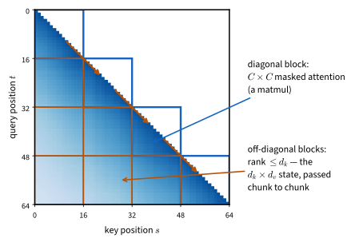

# Matrix-State Recurrences
:label:`sec_matrix-state`

A program defines `rate = 0.05` near its top and uses `rate` two hundred
lines later. A story introduces a character as "the engineer" and refers to
"the engineer" again three pages on. To predict such a token, a model must
store a *pair*, a name together with what it stands for, and later retrieve
the second half of the pair when the first half reappears. This is
*associative recall*, and transformers do it with attention: the current
token's query is compared with the keys of all earlier tokens, and the
values of the best matches are returned. A recurrent state that holds one
decaying number per channel has no natural place to keep such pairs.

This section makes the state a matrix that stores key–value pairs. A pair
is written by adding the outer product of its value and its key; it is read
by multiplying the matrix by a query. This is linear attention, the
variant of attention in :numref:`sec_attention-at-scale` that drops the
softmax, and, up to its decay, it is also what the selective state space
model of :numref:`sec_mamba` computes, with different names for the same
vectors.
We ask how many pairs such a memory can hold, how a decay keeps it from
filling up, and how to train it fast: a decayed matrix recurrence can be
computed as masked attention, as a scan, or in chunks that combine the two.
The section ends with a limit that the next section removes: every write
adds, so a memory cannot change what it has stored.

```{.python .input #matrix-state-matrix-state-recurrences}
%%tab pytorch
%matplotlib inline
from d2l import torch as d2l
import math
import numpy as np
import torch
from torch import nn
from torch.nn import functional as F
```

```{.python .input #matrix-state-matrix-state-recurrences}
%%tab jax
%matplotlib inline
from d2l import jax as d2l
from flax import nnx
import jax
from jax import numpy as jnp
import math
import numpy as np
```

## An Associative Memory

### Writing and Reading Pairs

Start with two keys in $\mathbb{R}^2$, $\mathbf{k}_1 = (1, 0)^\top$ and
$\mathbf{k}_2 = (0, 1)^\top$, with the values $v_1 = 3$ and $v_2 = 5$.
Store both in one row vector, the sum of each value times its key,
$\mathbf{S} = v_1 \mathbf{k}_1^\top + v_2 \mathbf{k}_2^\top = (3, 5)$.
Multiplying by a key reads its value back: $\mathbf{S}\mathbf{k}_1 = 3$ and
$\mathbf{S}\mathbf{k}_2 = 5$. Now store a third pair, $\mathbf{k}_3 =
(1, 1)^\top / \sqrt{2}$ with $v_3 = 7$. The memory becomes $(3 + 7/\sqrt 2,
5 + 7/\sqrt 2) \approx (7.95, 9.95)$, and reading $\mathbf{k}_1$ now returns
7.95 instead of 3. Two dimensions hold two pairs exactly; a third key must
overlap with the others, and its value leaks into theirs.

With values $\mathbf{v}_t \in \mathbb{R}^{d_v}$ and keys $\mathbf{k}_t \in
\mathbb{R}^{d_k}$, the memory is a matrix $\mathbf{S}_t \in \mathbb{R}^{d_v
\times d_k}$, the transpose of the layout in
:numref:`sec_attention-at-scale`. Each step writes one pair and the output
reads the memory with a query $\mathbf{q}_t \in \mathbb{R}^{d_k}$:

$$
\mathbf{S}_t = \mathbf{S}_{t-1} + \mathbf{v}_t \mathbf{k}_t^\top, \qquad
\mathbf{y}_t = \mathbf{S}_t \mathbf{q}_t.
$$
:eqlabel:`eq_ms-recurrence`

The outer product $\mathbf{v}_t \mathbf{k}_t^\top$ is a matrix of rank one
that maps the direction $\mathbf{k}_t$ to $\mathbf{v}_t$; the state is the
sum of these maps. The keys, values, and queries are linear projections of
the input, as in attention, so the network learns what to store under
which key and what to look up. A weight matrix that the network rewrites at
every step is called a *fast weight*; :citet:`Schlag.Irie.Schmidhuber.2021`
trace linear attention back to this older idea.

### Linear Attention

Unrolling :eqref:`eq_ms-recurrence` from $\mathbf{S}_0 = \mathbf{0}$ gives

$$\mathbf{y}_t = \Big(\sum_{s \le t} \mathbf{v}_s \mathbf{k}_s^\top\Big)
\mathbf{q}_t = \sum_{s \le t} (\mathbf{k}_s^\top \mathbf{q}_t)\,
\mathbf{v}_s.$$

The right side is causal attention with the score $\mathbf{k}_s^\top
\mathbf{q}_t$ and no softmax: every earlier value, weighted by how well its
key matches the query. Softmax attention computes $\sum_s
\exp(\mathbf{k}_s^\top \mathbf{q}_t) \mathbf{v}_s$ divided by the sum of the
weights, and the exponential prevents the sum from being folded into a
fixed-size matrix. :citet:`Katharopoulos.Vyas.Pappas.ea.2020` replaced it by
a product of features, which can be folded, and called the result *linear
attention*: its cost per token does not grow with the length of the
context (:numref:`sec_attention-at-scale` develops it with its normalizer;
the models of this chapter normalize the output of the layer instead).
The left side is the recurrence. The same computation is a transformer
layer read one way and a recurrent network read the other.

### Interference

How many pairs can $\mathbf{S}$ hold? Store $n$ pairs, $\mathbf{S} =
\sum_{i=1}^n \mathbf{v}_i \mathbf{k}_i^\top$, with keys of unit length, and
read key $j$:

$$
\mathbf{S}\mathbf{k}_j = \mathbf{v}_j + \sum_{i \neq j}
(\mathbf{k}_i^\top \mathbf{k}_j)\, \mathbf{v}_i.
$$
:eqlabel:`eq_ms-retrieval-error`

The read returns the stored value plus every other value, weighted by the
overlap of its key with the target key. Only mutually orthogonal keys are
read back without error, and $\mathbb{R}^{d_k}$ holds at most $d_k$ of
them. For more pairs, or for keys that are not orthogonal, interference is
unavoidable. How large it is depends on the keys; for random keys we can
compute it.

**Proposition.** Let the keys $\mathbf{k}_1, \ldots, \mathbf{k}_n$ be
independent and uniformly distributed on the unit sphere of
$\mathbb{R}^{d_k}$, and let the values be unit vectors chosen independently
of the keys. Then the expected squared read error at every stored key is

$$
\mathbb{E}\,\big\|\mathbf{S}\mathbf{k}_j - \mathbf{v}_j\big\|^2 =
\frac{n - 1}{d_k}.
$$
:eqlabel:`eq_ms-capacity-law`

**Proof.** The error is $\sum_{i \neq j} (\mathbf{k}_i^\top \mathbf{k}_j)\,
\mathbf{v}_i$. Its squared norm is a double sum over $i$ and $l$. For $i
\neq l$, the expected cross term vanishes: given $\mathbf{k}_j$, the
overlaps $\mathbf{k}_i^\top \mathbf{k}_j$ and $\mathbf{k}_l^\top
\mathbf{k}_j$ are independent with mean zero. What remains is $\sum_{i \neq
j} \mathbb{E}[(\mathbf{k}_i^\top \mathbf{k}_j)^2]$, using $\|\mathbf{v}_i\|
= 1$. A random unit vector has the same expected squared coordinate in every
direction, and these $d_k$ expectations sum to $\|\mathbf{k}_i\|^2 = 1$, so
each term is $1/d_k$. There are $n - 1$ terms. $\blacksquare$

The error grows in proportion to the number of stored pairs and falls in
proportion to the key dimension. Once $n$ approaches $d_k$, the
interference is as large as the signal, whose squared norm is one. Time
does not appear: a pair written long ago is read back as well as one
written a moment ago: memories are lost because other pairs interfere with
them, not because they are old.

We check the proposition by storing random pairs and reading them back.
The values come from a codebook of 256 random unit vectors, so we can also
ask whether the nearest codebook entry to the read is the stored one. A last
curve breaks the assumptions: every key shares a common direction, with
weight $\rho = 0.5$, so the keys are correlated. The computation needs only
NumPy.

```{.python .input #matrix-state-interference-1}
%%tab pytorch, jax
def matrix_memory(d_k, nums, rho=0, num_values=256, trials=20, seed=0):
    """Read error and recall of S = sum_i v_i k_i^T over random unit keys."""
    rng = np.random.default_rng(seed)
    unit = lambda X: X / np.linalg.norm(X, axis=-1, keepdims=True)
    codebook = unit(rng.standard_normal((num_values, d_k)))
    errors, recalls = [], []
    for n in nums:
        error = recall = 0
        for _ in range(trials):
            K = unit(rng.standard_normal((n, d_k)))  # Keys as rows
            K = unit(np.sqrt(1 - rho**2) * K + rho * unit(rng.standard_normal(d_k)))
            ids = rng.integers(0, num_values, n)
            S = codebook[ids].T @ K  # Sum of v_i k_i^T
            reads = K @ S.T  # Row j is S k_j
            error += ((reads - codebook[ids]) ** 2).sum(1).mean() / trials
            recall += ((reads @ codebook.T).argmax(1) == ids).mean() / trials
        errors.append(error)
        recalls.append(recall)
    return errors, recalls
```

```{.python .input #matrix-state-interference-2}
%%tab pytorch, jax
nums = [8, 16, 32, 64, 128, 256, 512]
results = {f'dₖ = {d_k}': matrix_memory(d_k, nums) for d_k in (32, 64, 128)}
results['dₖ = 64, ρ = 0.5'] = matrix_memory(64, nums, rho=0.5)
predictions = [[(n - 1) / d_k for n in nums] for d_k in (32, 64, 128)]
d2l.plot(nums, [err for err, _ in results.values()] + predictions,
         'stored pairs n', 'squared read error',
         legend=list(results) + ['$(n-1)/d_k$'], xscale='log', yscale='log',
         fmts=('-o', '-o', '-o', '-s', 'k:', 'k:', 'k:'), figsize=(5, 3.5))
print('recall at n =    ', ' '.join(f'{n:4d}' for n in nums))
for name, (_, recalls) in results.items():
    print(f'{name:17s}', ' '.join(f'{r:4.2f}' for r in recalls))
```

The measured errors lie on the predicted lines $(n-1)/d_k$ at all three
widths. The recall shows what this means for retrieval: with $d_k = 64$,
every pair is recovered up to $n = 64$, 96% at $n = 128$, 72% at $n = 256$,
and 37% at $n = 512$, and doubling $d_k$ doubles the number of pairs held
at a given recall. Correlated keys do worse. With a shared component of
weight $\rho = 0.5$, the error is about four times larger already at $n =
8$, it grows faster than in proportion to $n$, and only half of 64 pairs
are recovered. What a matrix memory can hold depends on how different its
keys are, not only on how many there are.

## Decay

### Forgetting Old Pairs

Linear attention never forgets. After $n$ writes all $n$ pairs share the
memory, and by :eqref:`eq_ms-capacity-law` the read error grows with $n$,
however old most of the pairs are. A decay before each write shrinks the
old pairs,

$$
\mathbf{S}_t = a_t\, \mathbf{S}_{t-1} + \mathbf{v}_t \mathbf{k}_t^\top,
\qquad a_t \in (0, 1),
$$
:eqlabel:`eq_ms-decay`

so that a pair written $k$ steps ago has weight $a^k$ if the decay is
constant. The weights of all past pairs then sum to $1/(1 - a)$, and the
memory behaves as if it held about the last $1/(1-a)$ pairs: 10 for $a =
0.9$, 100 for $a = 0.99$. As in :numref:`sec_ssm`, a decay that depends on
the input lets the model choose: hold the memory through a paragraph and
clear it at a new document.

The decay can be shaped in several ways, each a one-line change of
:eqref:`eq_ms-decay`. RetNet :cite:`Sun.Dong.Huang.ea.2023` uses a fixed
scalar per head, so that different heads remember for different lengths.
Mamba-2 :cite:`Dao.Gu.2024` uses an input-dependent scalar per head, as
above. Gated linear attention :cite:`Yang.Wang.Shen.ea.2024` decays each key
coordinate at its own rate, $\mathbf{S}_t = \mathbf{S}_{t-1}
\textrm{diag}(\boldsymbol{\alpha}_t) + \mathbf{v}_t \mathbf{k}_t^\top$, so
that some directions of the key space are kept longer than others.

The selective state space model of :numref:`sec_mamba` is a matrix memory
of the same kind. Its state holds $N$ numbers for each of its $H$ channels,
an $H \times N$ matrix $\mathbf{S}_t$. Each step adds the outer product of the
channel inputs, scaled by the step sizes, $\boldsymbol{\Delta}_t \odot
\mathbf{x}_t$, with the vector $\mathbf{B}_t \in \mathbb{R}^N$, and the
output reads $\mathbf{S}_t \mathbf{C}_t$. In the terms of this section the
value is $\boldsymbol{\Delta}_t \odot \mathbf{x}_t$, the key is
$\mathbf{B}_t$, the query is $\mathbf{C}_t$, and $d_k = N$. Its decay is
elementwise, a different rate for every entry of $\mathbf{S}_t$. Mamba-2
replaced it by one scalar per head, which loses some flexibility and gains
the matrix products of the dual form below.

## The Dual Form

### Unrolling with Decay

With a scalar decay, unrolling :eqref:`eq_ms-decay` from $\mathbf{S}_0 =
\mathbf{0}$ gives each output as a weighted sum over the past, in which a
pair written at step $s$ is scaled by all decays met since:

$$\mathbf{y}_t = \sum_{s \le t} L_{ts}\, (\mathbf{k}_s^\top \mathbf{q}_t)\,
\mathbf{v}_s, \qquad L_{ts} = a_{s+1} a_{s+2} \cdots a_t.$$

Stack the queries, keys, values, and outputs of a sequence as the rows of
$\mathbf{Q}$, $\mathbf{K}$, $\mathbf{V}$, and $\mathbf{Y}$, and set $L_{ts}
= 0$ for $s > t$. Then all outputs together are

$$\mathbf{Y} = (\mathbf{L} \odot \mathbf{Q}\mathbf{K}^\top)\, \mathbf{V}.$$
:eqlabel:`eq_ms-semiseparable`

This is masked attention. With every $a_t = 1$, $\mathbf{L}$ is the causal
mask of a transformer, ones on and below the diagonal, and
:eqref:`eq_ms-semiseparable` is causal linear attention. With decays,
$\mathbf{L}$ is a *learned, decaying* mask: a decayed linear recurrence is
attention in which older tokens count less, by an amount the inputs choose.
:citet:`Dao.Gu.2024` call this correspondence *state space duality*. It
holds for linear attention, not for softmax attention, whose exponential
does not factor this way.

The two sides of the duality are two orders of computing the same
products. Forming $\mathbf{L} \odot \mathbf{Q}\mathbf{K}^\top$ first is
attention: all positions in parallel, at a cost and memory quadratic in
$T$. Summing from the left, one step at a time, is the recurrence: the
partial sums are the states $\mathbf{S}_t$, the cost is linear in $T$,
and the steps are sequential. We check that both give the same outputs,
starting with the recurrence.

```{.python .input #matrix-state-unrolling-with-decay-1}
%%tab pytorch
def linear_attention_recurrent(Q, K, V, a):
    """y_t = S_t q_t with S_t = a_t S_{t-1} + v_t k_t^T, step by step."""
    S, outputs = Q.new_zeros(V.shape[-1], K.shape[-1]), []
    for q, k, v, a_t in zip(Q, K, V, a):
        S = a_t * S + torch.outer(v, k)
        outputs.append(S @ q)
    return torch.stack(outputs)
```

```{.python .input #matrix-state-unrolling-with-decay-1}
%%tab jax
def linear_attention_recurrent(Q, K, V, a):
    """y_t = S_t q_t with S_t = a_t S_{t-1} + v_t k_t^T, step by step."""
    def step(S, inputs):
        q, k, v, a_t = inputs
        S = a_t * S + jnp.outer(v, k)
        return S, S @ q
    S0 = jnp.zeros((V.shape[-1], K.shape[-1]))
    return jax.lax.scan(step, S0, (Q, K, V, a))[1]
```

The dual form needs the mask $\mathbf{L}$. Its entries are products of
decays, which we compute from the logarithms of the decays: $\log L_{ts}$ is
the sum of $\log a_r$ over $s < r \le t$, a difference of two cumulative
sums. Above the diagonal these differences are positive and their
exponentials can overflow, so we set them to $-\infty$ before
exponentiating, which turns them into exact zeros. We save the mask,
because the chunked algorithms below and in the next section use it too.

```{.python .input #matrix-state-unrolling-with-decay-2}
%%tab pytorch
def decay_mask(log_a):  #@save
    """L[t, s] = a_{s+1} * ... * a_t for s <= t, and 0 for s > t."""
    cum = log_a.cumsum(-1)
    log_L = cum[..., :, None] - cum[..., None, :]  # Sum of log a over (s, t]
    causal = torch.ones(log_L.shape[-2:], dtype=torch.bool,
                        device=log_a.device).tril()
    return torch.exp(log_L.masked_fill(~causal, -torch.inf))

def linear_attention_dual(Q, K, V, a):
    """The same outputs as Y = (L * Q K^T) V, all positions at once."""
    return (decay_mask(torch.log(a)) * (Q @ K.T)) @ V
```

```{.python .input #matrix-state-unrolling-with-decay-2}
%%tab jax
def decay_mask(log_a):  #@save
    """L[t, s] = a_{s+1} * ... * a_t for s <= t, and 0 for s > t."""
    cum = log_a.cumsum(-1)
    log_L = cum[..., :, None] - cum[..., None, :]  # Sum of log a over (s, t]
    causal = jnp.tril(jnp.ones(log_L.shape[-2:], dtype=bool))
    return jnp.exp(jnp.where(causal, log_L, -jnp.inf))

def linear_attention_dual(Q, K, V, a):
    """The same outputs as Y = (L * Q K^T) V, all positions at once."""
    return (decay_mask(jnp.log(a)) * (Q @ K.T)) @ V
```

We compare the two on a random sequence of 512 steps with decays between
0.8 and 0.99.

```{.python .input #matrix-state-unrolling-with-decay-3}
%%tab pytorch
torch.manual_seed(0)
T, d_k, d_v = 512, 64, 64
Q, K, V = torch.randn(T, d_k), torch.randn(T, d_k), torch.randn(T, d_v)
a = 0.8 + 0.19 * torch.rand(T)
Y = linear_attention_recurrent(Q, K, V, a)
Y_dual = linear_attention_dual(Q, K, V, a)
print(f'relative deviation: {(Y_dual - Y).abs().max() / Y.abs().max():.1e}')
```

```{.python .input #matrix-state-unrolling-with-decay-3}
%%tab jax
T, d_k, d_v = 512, 64, 64
key_q, key_k, key_v, key_a = jax.random.split(jax.random.key(0), 4)
Q, K = jax.random.normal(key_q, (T, d_k)), jax.random.normal(key_k, (T, d_k))
V = jax.random.normal(key_v, (T, d_v))
a = 0.8 + 0.19 * jax.random.uniform(key_a, (T,))
with jax.default_matmul_precision('highest'):  # Full float32, not TF32
    Y = linear_attention_recurrent(Q, K, V, a)
    Y_dual = linear_attention_dual(Q, K, V, a)
print(f'relative deviation: {jnp.abs(Y_dual - Y).max() / jnp.abs(Y).max():.1e}')
```

The two orders agree to rounding error. Neither is what we want for
training: the recurrence is sequential, and the dual form stores a $T
\times T$ matrix, 64 MB per head in 32-bit floats at $T = 4{,}096$.

### Chunked Computation

Chunking combines the two. Cut the sequence into chunks of $m$ steps and
partition the matrix $\mathbf{L} \odot \mathbf{Q}\mathbf{K}^\top$ into $m
\times m$ blocks, as in :numref:`fig_ms-semiseparable`. The blocks on the
diagonal describe how tokens within a chunk interact; each is a small masked
attention product, and all of them are computed in parallel. The blocks
below the diagonal describe how earlier chunks influence later ones, and
they need not be formed at all: everything a chunk needs from the entire
past is the $d_v \times d_k$ state at the chunk's start. The chunked
computation therefore has three parts:

1. *Within chunks*: the dual form :eqref:`eq_ms-semiseparable` on each
   chunk.
2. *Across chunks*: each chunk's writes, decayed to the chunk's end, form
   one matrix; the states at the chunk boundaries follow from a linear
   recurrence over the $T/m$ chunks, $\mathbf{S}^{(c)} = (\textrm{decay
   over chunk } c)\, \mathbf{S}^{(c-1)} + (\textrm{writes of chunk } c)$,
   which `linear_scan` of :numref:`sec_ssm` computes with matrix-valued
   states.
3. *Reading the past*: each position adds the read of the state at its
   chunk's start, decayed to its own position.

Almost all of the work is in matrix products, which GPUs do well, and the
memory holds $m \times m$ blocks and one state per chunk instead of a $T
\times T$ matrix. Mamba-2 and the models of the next section train this way.


:label:`fig_ms-semiseparable`

The function takes a batch of sequences and the logarithms of the decays.
Its three parts follow the list above; the decay from the start of a chunk
to step $t$ is the exponential of a cumulative sum, `cum`, and the decay
from step $t$ to the end of its chunk is the exponential of a difference.

```{.python .input #matrix-state-chunked-computation-1}
%%tab pytorch
def chunked_linear_attention(Q, K, V, log_a, chunk_size):  #@save
    """y_t = S_t q_t with S_t = a_t S_{t-1} + v_t k_t^T, computed in chunks.

    Q, K: (batch_size, T, d_k); V: (batch_size, T, d_v); log_a: (batch_size, T)
    """
    B, T, m = Q.shape[0], Q.shape[1], chunk_size
    Q, K, V = (X.reshape(B, T // m, m, -1) for X in (Q, K, V))
    log_a = log_a.reshape(B, T // m, m)
    # 1. Within chunks: the dual form on every chunk at once
    Y = (decay_mask(log_a) * (Q @ K.mT)) @ V
    # 2. Across chunks: the writes of each chunk, decayed to its end, and
    #    a scan over chunks for the state at every chunk's end
    cum = log_a.cumsum(-1)
    writes = (V * torch.exp(cum[..., -1:] - cum).unsqueeze(-1)
              ).mT @ K
    S = d2l.linear_scan(torch.exp(cum[..., -1:, None]), writes)
    S = torch.cat([torch.zeros_like(S[:, :1]), S[:, :-1]], 1)  # At the start
    # 3. Every step reads the state at its chunk's start, decayed to it
    Y = Y + torch.exp(cum).unsqueeze(-1) * (Q @ S.mT)
    return Y.reshape(B, T, -1)
```

```{.python .input #matrix-state-chunked-computation-1}
%%tab jax
def chunked_linear_attention(Q, K, V, log_a, chunk_size):  #@save
    """y_t = S_t q_t with S_t = a_t S_{t-1} + v_t k_t^T, computed in chunks.

    Q, K: (batch_size, T, d_k); V: (batch_size, T, d_v); log_a: (batch_size, T)
    """
    B, T, m = Q.shape[0], Q.shape[1], chunk_size
    Q, K, V = (X.reshape(B, T // m, m, -1) for X in (Q, K, V))
    log_a = log_a.reshape(B, T // m, m)
    # 1. Within chunks: the dual form on every chunk at once
    Y = (decay_mask(log_a) * (Q @ K.mT)) @ V
    # 2. Across chunks: the writes of each chunk, decayed to its end, and
    #    a scan over chunks for the state at every chunk's end
    cum = log_a.cumsum(-1)
    writes = (V * jnp.exp(cum[..., -1:] - cum)[..., None]).mT @ K
    S = d2l.linear_scan(jnp.exp(cum[..., -1:, None]), writes)
    S = jnp.concatenate([jnp.zeros_like(S[:, :1]), S[:, :-1]], 1)  # At start
    # 3. Every step reads the state at its chunk's start, decayed to it
    Y = Y + jnp.exp(cum)[..., None] * (Q @ S.mT)
    return Y.reshape(B, T, -1)
```

The chunked outputs match the recurrence for every chunk size.

```{.python .input #matrix-state-chunked-computation-2}
%%tab pytorch
for m in [16, 64, 256]:
    Y_chunked = chunked_linear_attention(Q[None], K[None], V[None],
                                         torch.log(a)[None], m)[0]
    print(f'chunk size {m:3d}: relative deviation '
          f'{(Y_chunked - Y).abs().max() / Y.abs().max():.1e}')
```

```{.python .input #matrix-state-chunked-computation-2}
%%tab jax
for m in [16, 64, 256]:
    with jax.default_matmul_precision('highest'):
        Y_chunked = chunked_linear_attention(Q[None], K[None], V[None],
                                             jnp.log(a)[None], m)[0]
    print(f'chunk size {m:3d}: relative deviation '
          f'{jnp.abs(Y_chunked - Y).max() / jnp.abs(Y).max():.1e}')
```

How fast are the three orders? We time them on one sequence of 4,096 steps
on a GPU.

```{.python .input #matrix-state-chunked-computation-3}
%%tab pytorch
device = d2l.try_gpu()
T = 4096
Q, K, V = (torch.randn(T, d, device=device) for d in (d_k, d_k, d_v))
a = 0.8 + 0.19 * torch.rand(T, device=device)
forms = {'recurrence': lambda: linear_attention_recurrent(Q, K, V, a),
         'dual': lambda: linear_attention_dual(Q, K, V, a)}
for m in [16, 64, 256]:
    forms[f'chunks of {m}'] = lambda m=m: chunked_linear_attention(
        Q[None], K[None], V[None], torch.log(a)[None], m)
for name, f in forms.items():
    print(f'{name:14s} {1e3 * d2l.Benchmark(f, warmup=1, repeats=5).time:8.2f} ms')
```

```{.python .input #matrix-state-chunked-computation-3}
%%tab jax
T = 4096
key_q, key_k, key_v, key_a = jax.random.split(jax.random.key(1), 4)
Q, K = jax.random.normal(key_q, (T, d_k)), jax.random.normal(key_k, (T, d_k))
V = jax.random.normal(key_v, (T, d_v))
a = 0.8 + 0.19 * jax.random.uniform(key_a, (T,))
forms = {'recurrence': jax.jit(linear_attention_recurrent),
         'dual': jax.jit(linear_attention_dual)}
for m in [16, 64, 256]:
    forms[f'chunks of {m}'] = jax.jit(lambda Q, K, V, a, m=m:
        chunked_linear_attention(Q[None], K[None], V[None], jnp.log(a)[None], m))
for name, f in forms.items():
    bench = d2l.Benchmark(lambda: f(Q, K, V, a), warmup=1, repeats=5)
    print(f'{name:14s} {1e3 * bench.time:8.2f} ms')
```

The recurrence is the slowest by two orders of magnitude, because its 4,096
steps run one after another. At this length the dual form and the chunked
form take about the same time, a millisecond or less. They differ in
memory: the dual form stores the $T \times T$ matrix of weights, 64 MB per
head in 32-bit floats, which grows with the square of the length, while
chunks of 64 store $T \times 64$ weights and one $64 \times 64$ state per
chunk, about 2 MB, which grows in proportion to the length.

## A Gated Linear Attention Layer

### The Layer

A layer built on the decayed matrix memory computes, for every head, a
query, a key, a value, and a decay from the input, runs the chunked
recurrence, and projects the outputs of all heads back to the model width.
Three details follow current practice. The decay of each head is
$a_t = \sigma(\mathbf{w}^\top \mathbf{x}_t + b)$, and the biases $b$ are
initialized so that the heads start with memories of different lengths,
$\sigma(b) = 1 - 1/\tau$ with $\tau$ spread log-uniformly from 4 to 256
steps, as the timescales of :numref:`sec_ssm` were. Queries and keys are
scaled to unit length, the setting of :eqref:`eq_ms-capacity-law`. And the
output of each head is normalized to unit root mean square before the
projection, which keeps its scale independent of how many pairs the memory
holds. The recurrence itself sits in a method of its own, `memory`, so that
the next section can replace it. We call the layer *gated linear
attention*, after the decay gate; :citet:`Yang.Wang.Shen.ea.2024` use the
name for the variant with one gate per key coordinate.

```{.python .input #matrix-state-the-layer-1}
%%tab pytorch
class GatedLinearAttention(nn.Module):  #@save
    """Multi-head linear attention whose memory decays by an input gate."""
    def __init__(self, num_hiddens, num_heads, chunk_size=64):
        super().__init__()
        self.num_heads, self.chunk_size = num_heads, chunk_size
        self.W_qkv = nn.Linear(num_hiddens, 3 * num_hiddens, bias=False)
        self.W_a = nn.Linear(num_hiddens, num_heads)  # Decay gate
        tau = torch.logspace(math.log10(4), math.log10(256), num_heads)
        with torch.no_grad():  # Initial decays 1 - 1/tau
            self.W_a.bias.copy_(torch.log(tau - 1))
        self.W_o = nn.Linear(num_hiddens, num_hiddens, bias=False)

    def split_heads(self, Z):
        """(batch_size, T, num_heads * e) -> (batch_size * num_heads, T, e)."""
        B, T, _ = Z.shape
        return Z.reshape(B, T, self.num_heads, -1).transpose(1, 2).flatten(0, 1)

    def memory(self, X, Q, K, V, log_a):
        """Outputs of the decayed matrix memory of every head."""
        return chunked_linear_attention(Q, K, V, log_a, self.chunk_size)
```

```{.python .input #matrix-state-the-layer-1}
%%tab jax
class GatedLinearAttention(nnx.Module):  #@save
    """Multi-head linear attention whose memory decays by an input gate."""
    def __init__(self, num_hiddens, num_heads, chunk_size=64, *, rngs):
        self.num_heads, self.chunk_size = num_heads, chunk_size
        self.W_qkv = nnx.Linear(num_hiddens, 3 * num_hiddens, use_bias=False,
                                rngs=rngs)
        tau = jnp.logspace(math.log10(4), math.log10(256), num_heads)
        self.W_a = nnx.Linear(num_hiddens, num_heads, rngs=rngs,  # Decay gate
                              bias_init=lambda *_: jnp.log(tau - 1))
        self.W_o = nnx.Linear(num_hiddens, num_hiddens, use_bias=False,
                              rngs=rngs)

    def split_heads(self, Z):
        """(batch_size, T, num_heads * e) -> (batch_size * num_heads, T, e)."""
        B, T, _ = Z.shape
        return Z.reshape(B, T, self.num_heads, -1).swapaxes(1, 2).reshape(
            B * self.num_heads, T, -1)

    def memory(self, X, Q, K, V, log_a):
        """Outputs of the decayed matrix memory of every head."""
        return chunked_linear_attention(Q, K, V, log_a, self.chunk_size)
```

The forward pass computes the queries, keys, values, and decays of all
heads, runs the memory, normalizes each head's output, and projects the
concatenated heads back to the model width.

```{.python .input #matrix-state-the-layer-2}
%%tab pytorch
@d2l.add_to_class(GatedLinearAttention)  #@save
def forward(self, X):  # X: (batch_size, num_steps, num_hiddens)
    B, T, d = X.shape
    Q, K, V = (self.split_heads(Z) for Z in self.W_qkv(X).chunk(3, -1))
    Q, K = F.normalize(Q, dim=-1), F.normalize(K, dim=-1)  # Unit length
    log_a = self.split_heads(F.logsigmoid(self.W_a(X))).squeeze(-1)
    Y = self.memory(X, Q, K, V, log_a)  # (batch_size * num_heads, T, d / h)
    Y = F.rms_norm(Y, Y.shape[-1:])
    Y = Y.reshape(B, self.num_heads, T, -1).transpose(1, 2).reshape(B, T, d)
    return self.W_o(Y)
```

```{.python .input #matrix-state-the-layer-2}
%%tab jax
@d2l.add_to_class(GatedLinearAttention)  #@save
def __call__(self, X):  # X: (batch_size, num_steps, num_hiddens)
    B, T, d = X.shape
    Q, K, V = (self.split_heads(Z) for Z in jnp.split(self.W_qkv(X), 3, -1))
    unit = lambda Z: Z / jnp.linalg.norm(Z, axis=-1, keepdims=True)
    Q, K = unit(Q), unit(K)  # Unit length
    log_a = self.split_heads(jax.nn.log_sigmoid(self.W_a(X)))[..., 0]
    Y = self.memory(X, Q, K, V, log_a)  # (batch_size * num_heads, T, d / h)
    Y = Y / jnp.sqrt((Y ** 2).mean(-1, keepdims=True) + 1e-6)
    Y = Y.reshape(B, self.num_heads, T, -1).swapaxes(1, 2).reshape(B, T, d)
    return self.W_o(Y)
```

### Language Modeling

We train the layer with four heads of dimension 32 as the mixer of
`d2l.SeqLM`, on the character-level Penn Treebank with the recipe of
:numref:`sec_lstm` (`d2l.fit_lm`). Each head's state holds $32 \times 32$
numbers, so a layer holds 4,096, against 2,048 for the S4D layer of
:numref:`sec_ssm` with 16 states per channel.

```{.python .input #matrix-state-language-modeling-1}
%%tab pytorch, jax
data = d2l.PennTreebank(batch_size=64, num_steps=128)
```

```{.python .input #matrix-state-language-modeling-2}
%%tab pytorch
torch.manual_seed(0)
model = d2l.SeqLM(len(data.vocab), 128,
                  [GatedLinearAttention(128, num_heads=4) for _ in range(2)])
print(f'gated linear attention perplexity: {d2l.fit_lm(model, data):.2f}')
```

```{.python .input #matrix-state-language-modeling-2}
%%tab jax
rngs = nnx.Rngs(0)
model = d2l.SeqLM(len(data.vocab), 128, [GatedLinearAttention(
    128, num_heads=4, rngs=rngs) for _ in range(2)], rngs=rngs)
print(f'gated linear attention perplexity: {d2l.fit_lm(model, data):.2f}')
```

The model reaches a perplexity of about 3.25, close to the minGRU (3.2) and
better than S4D (3.35), behind the LSTM and the GRU (about 3.0) and Mamba
(2.95). On this
task the matrix memory does not help much, as the models of
:numref:`sec_ssm` suggested: predicting the next character rarely requires
looking up a pair stored a hundred characters earlier. The tasks of
:numref:`sec_hybrids` do, and there the size and the write rule of the
memory decide the outcome.

One limitation is built into every model in this section. A write adds
$\mathbf{v}_t \mathbf{k}_t^\top$ to the memory, whatever the memory already
holds under $\mathbf{k}_t$. If a program sets `rate = 0.05` and later
`rate = 0.07`, the memory returns the sum of both values, scaled by the
decays, when queried with the key of `rate`. A decay can make the old
value fade, but it fades every other pair as well. The next section changes
the write so that it replaces the value stored under a key.

## Summary

A matrix-valued state stores key–value pairs: a write adds the outer
product $\mathbf{v}_t\mathbf{k}_t^\top$, and a read multiplies the state with
a query. Unrolled, this recurrence is causal linear attention, and the
selective state space model of :numref:`sec_mamba` is a memory of this
kind with the step-scaled input as value and $\mathbf{B}_t$ and
$\mathbf{C}_t$ as key and query. Without decay, every stored pair
interferes with every read: for random unit keys the expected squared read
error is $(n-1)/d_k$ after $n$ writes. An input-dependent decay lets old
pairs fade. With a scalar decay per head, the outputs equal masked attention
with a learned, decaying mask, $(\mathbf{L} \odot \mathbf{Q}\mathbf{K}^\top)
\mathbf{V}$, and computing this product in chunks, attention within a chunk
and a recurrence over the chunk boundaries, trains the model with matrix
products in memory linear in the length. Every write adds, so a key that is
written twice returns the sum of its values.

## Exercises

1. **Mamba as a matrix memory.** Write the selective state space model of
   :numref:`sec_mamba` with its channel states as the rows of $\mathbf{S}_t
   \in \mathbb{R}^{H \times N}$, and drop the skip term.
    1. Write the update of $\mathbf{S}_t$ as an elementwise product of
       $\mathbf{S}_{t-1}$ with a decay matrix $\mathbf{E}_t$, plus an outer
       product, and the output as a matrix–vector product. Give every entry
       of $\mathbf{E}_t$.
    1. Under which condition on $\boldsymbol{\Delta}_t$ and on the rates
       $\lambda_n$ is $\mathbf{E}_t$ a scalar multiple of the matrix of
       ones, so that the update has the form :eqref:`eq_ms-decay`? Which of
       these conditions does Mamba-2 impose?
    1. For each form of decay in this section, count the input-dependent
       numbers per token that determine the decay of one head.

1. **Rank-one blocks.** Let $p_t = a_1 a_2 \cdots a_t$ be the products of
   the decays in :eqref:`eq_ms-semiseparable`.
    1. Express $L_{ts}$ through the $p_t$, and show that every submatrix of
       $\mathbf{L}$ whose row indices are all at least as large as its
       column indices has rank one.
    1. Deduce that every block of $\mathbf{L} \odot
       \mathbf{Q}\mathbf{K}^\top$ that couples a chunk to an earlier chunk
       has rank at most $d_k$. Identify where `chunked_linear_attention`
       applies the query-side and the key-side decays of such a block.
    1. With a decay per key coordinate, $\mathbf{S}_t = \mathbf{S}_{t-1}
       \textrm{diag}(\boldsymbol{\alpha}_t) + \mathbf{v}_t
       \mathbf{k}_t^\top$, no single mask $\mathbf{L}$ multiplies
       $\mathbf{Q}\mathbf{K}^\top$. Write the decayed score of query $t$
       and key $s$, and show that a block coupling two chunks still has
       rank at most $d_k$.

1. **Counting operations.** Count one multiply-add as two floating-point
   operations, set $d_k = d_v = d$, and keep the leading terms.
    1. Count the operations of the recurrence, the dual form, and the
       chunked form at length $T$ and chunk size $m$. Split the chunked
       count into the three parts of the algorithm.
    1. Show that the chunked form costs at most a small constant times the
       recurrence while $m \le d$, and compute the ratio of chunked to dual
       operations at $T = 4096$, $d = 64$, and $m = 256$.
    1. Model the run time of a schedule as its operations divided by a
       throughput $P$, plus a fixed time $\tau$ per sequential step: $T$
       steps for the recurrence and $T/m$ for the chunked form. Find the
       chunk size that minimizes the chunked time, and evaluate it for
       $T = 4096$, $d = 64$, $P = 10^{13}$ operations per second, and
       $\tau = 5\,\mu\textrm{s}$. Compare with the timings above.

1. [code] **The normalizer as a value column.** The linear attention of
   :numref:`sec_attention-at-scale` applies a positive feature map $\phi$
   to queries and keys and divides each output by
   $\phi(\mathbf{q}_t)^\top \mathbf{z}_t$, where $\mathbf{z}_t =
   \sum_{s \le t} \phi(\mathbf{k}_s)$. Give $\mathbf{z}_t$ the same decay
   as the state.
    1. Show that appending a constant 1 to every value vector makes the
       last coordinate of the output equal to the denominator.
    1. Compute the normalized outputs with one call of
       `chunked_linear_attention`, with $\phi = \textrm{elu} + 1$, and check
       them against a loop that carries $\mathbf{S}_t$ and $\mathbf{z}_t$.
    1. Which of the two changes, the feature map or the normalizer, alters
       the relative weights that a query gives to past positions, and which
       only rescales each output?

1. **Targeted forgetting.** Let a memory hold $\mathbf{S} =
   \mathbf{v}\mathbf{k}^\top + \sum_i \mathbf{v}_i \mathbf{k}_i^\top$,
   where $\mathbf{k}$ has unit length and every $\mathbf{k}_i$ is
   orthogonal to $\mathbf{k}$.
    1. Find a matrix $\mathbf{D}$ such that $\mathbf{S}\mathbf{D} =
       \sum_i \mathbf{v}_i \mathbf{k}_i^\top$ for all such memories. Is it
       unique?
    1. For which keys $\mathbf{k}$ is this transition one of the decays of
       this section?
    1. Apply the transition and then write a new value,
       $\mathbf{S}\mathbf{D} + \mathbf{v}'\mathbf{k}^\top$. Show that the
       memory now returns $\mathbf{v}'$ for $\mathbf{k}$ and is otherwise
       unchanged. The next section builds a layer on this update.

1. **Correlated keys.** ● The keys with $\rho = 0.5$ in
   `matrix_memory` are normalized versions of $\sqrt{1-\rho^2}\,
   \mathbf{g}_i + \rho\, \mathbf{c}$, with independent random unit vectors
   $\mathbf{g}_i$ and one shared unit vector $\mathbf{c}$. Model the overlap
   of two distinct keys as $\mathbf{k}_i^\top \mathbf{k}_j = \rho^2 +
   \epsilon_{ij}$, where the $\epsilon_{ij}$ with $i \neq j$ are independent
   with mean zero and variance $(1-\rho^2)^2/d_k$, and neglect the
   normalization.
    1. Assume that the values are independent unit vectors with mean zero.
       Derive the expected squared read error at key $j$, which generalizes
       :eqref:`eq_ms-capacity-law`, and identify the term that a larger
       $d_k$ does not reduce.
    1. The values of `matrix_memory` come from a codebook of 256 random
       vectors, whose mean $\bar{\mathbf{v}}$ is not exactly zero. Show
       that this adds a term proportional to $(n-1)(n-2)\,
       \|\bar{\mathbf{v}}\|^2$, and compare your complete prediction with
       the measured errors.

1. [code] **Decay as a sliding window.** ● Add a constant decay $a$ to
   `matrix_memory`, so that the pair written $k$ steps before the end
   enters the final memory with weight $a^k$.
    1. At $d_k = 64$ and $n = 256$, measure recall separately for the
       oldest and the newest quarter of the pairs, for $a \in \{1, 0.99,
       0.95, 0.9\}$. What does the decay give the newest pairs, and what
       does it cost the oldest?
    1. Following the proof of the proposition, show that the expected
       squared interference at any key is at most $1 / ((1-a^2)\, d_k)$.
       Show that the number of pairs whose squared signal $a^{2k}$ exceeds
       this bound is at most about $d_k / e$, whatever $a < 1$ is.

1. [extended] **Decay per key coordinate.** ● Generalize
   `chunked_linear_attention` to the decay $\mathbf{S}_t = \mathbf{S}_{t-1}
   \textrm{diag}(\boldsymbol{\alpha}_t) + \mathbf{v}_t \mathbf{k}_t^\top$ of
   gated linear attention :cite:`Yang.Wang.Shen.ea.2024`.
    1. State which of the three parts of the algorithm change, and give the
       shapes of their new inputs.
    1. Implement it with a log-space mask that has one entry per query,
       key, and key coordinate, and check it against a loop for chunk sizes
       16, 64, and 256 with decays drawn uniformly from $(0.8, 0.99)$.
    1. Factor the within-chunk scores instead as $(\mathbf{Q}_c \odot
       \mathbf{P}_c)(\mathbf{K}_c \oslash \mathbf{P}_c)^\top$, where row $t$
       of $\mathbf{P}_c$ holds the products of the decays of chunk $c$ up to
       step $t$ and $\oslash$ divides elementwise. Compare the memory of
       the two forms at $m = 64$ and $d_k = 64$, and explain why this
       factorization overflows for long chunks.

[Discussions](https://d2l.discourse.group/)

<!-- slides -->

::: {.slide}
::: {.cover}
[Dive into Deep Learning · §12.4]{.kicker}

Matrix-state recurrences<br>
**outer-product memory · interference · decay · attention with a decaying mask · chunked computation**
:::
:::

::: {.slide title="To Recall a Value, a Model Must Store a Pair"}
[The problem]{.kicker}

`rate = 0.05` near the top of a program; `rate` 200 lines later.

- Attention: compare the query with every earlier key, return the value.
- A vector state holds one decaying number per channel: no place for
  "this value goes with that key".

::: {.d2l-note}
Make the state a **matrix**: add $\mathbf{v}_t\mathbf{k}_t^\top$ to write,
multiply by $\mathbf{q}_t$ to read.
:::
:::

::: {.slide title="By the End of This Deck You Can"}
- write and read key–value pairs with outer products;
- predict the read error $(n-1)/d_k$ of $n$ random pairs;
- show that a decayed matrix recurrence is masked attention;
- compute it in chunks, with matrix products and a short scan.

**Running example:** 64-dimensional random keys; the Penn Treebank
results (minGRU 3.2, Mamba 2.95).
:::

::: {.slide title="Two Orthogonal Keys Store Two Values Exactly"}
$\mathbf{k}_1 = (1, 0)$, $\mathbf{k}_2 = (0, 1)$, values 3 and 5:

$$\mathbf{S} = 3\,\mathbf{k}_1^\top + 5\,\mathbf{k}_2^\top = (3, 5), \qquad \mathbf{S}\mathbf{k}_1 = 3,\ \mathbf{S}\mathbf{k}_2 = 5$$

Add $\mathbf{k}_3 = (1, 1)/\sqrt 2$ with value 7:
$\mathbf{S} \approx (7.95, 9.95)$, and $\mathbf{S}\mathbf{k}_1 = 7.95$.

::: {.d2l-note .warn}
Two dimensions hold two pairs exactly; the third leaks into both.
:::
:::

::: {.slide title="A Matrix Memory Is Linear Attention, Read Left to Right"}
$$\mathbf{S}_t = \mathbf{S}_{t-1} + \mathbf{v}_t\mathbf{k}_t^\top,\qquad
\mathbf{y}_t = \mathbf{S}_t\mathbf{q}_t = \sum_{s \le t} (\mathbf{k}_s^\top\mathbf{q}_t)\,\mathbf{v}_s$$

- Right side: causal attention without the softmax.
- Left side: a recurrence with a $d_v \times d_k$ state, constant cost per token.
- Softmax's $\exp(\mathbf{k}^\top\mathbf{q})$ does not fold into a matrix;
  a product of features does.
:::

::: {.slide title="Every Other Pair Leaks Into a Read"}
$$\mathbf{S}\mathbf{k}_j = \mathbf{v}_j + \sum_{i \neq j} (\mathbf{k}_i^\top\mathbf{k}_j)\,\mathbf{v}_i$$

For random unit keys and unit values:

$$\mathbb{E}\,\|\mathbf{S}\mathbf{k}_j - \mathbf{v}_j\|^2 = \frac{n - 1}{d_k}$$

Cross terms vanish in expectation; each of the $n - 1$ squared overlaps
averages $1/d_k$.
:::

::: {.slide title="The Measured Error Sits on (n − 1)/d_k"}
@!matrix-state-interference-2
:::

::: {.slide title="Check: When Does Interference Equal the Signal?"}
$d_k = 64$, random unit keys and values.

1. At which $n$ is the expected squared error 1?
2. And for correlated keys?

::: {.fragment .fade-up}
1. $(n - 1)/64 = 1$: $n = 65$. Recall is still 0.96 at 128 pairs with a
   codebook decoder, 0.72 at 256.
2. Sooner: with a shared direction of weight 0.5, half of 64 pairs are lost.
:::
:::

::: {.slide title="Decay Keeps About the Last 1/(1 − a) Pairs"}
$$\mathbf{S}_t = a_t\,\mathbf{S}_{t-1} + \mathbf{v}_t\mathbf{k}_t^\top$$

- Constant $a$: the weights $a^k$ of old pairs sum to $1/(1 - a)$:
  10 pairs for $a = 0.9$, 100 for $a = 0.99$.
- Fixed per head (RetNet), from the input per head (Mamba-2), per key
  coordinate (GLA).
- Mamba: value $\boldsymbol{\Delta}_t \odot \mathbf{x}_t$, key
  $\mathbf{B}_t$, query $\mathbf{C}_t$, a decay per entry.
:::

::: {.slide title="A Decayed Recurrence Is Attention With a Decaying Mask"}
$$\mathbf{Y} = (\mathbf{L} \odot \mathbf{Q}\mathbf{K}^\top)\,\mathbf{V},\qquad L_{ts} = a_{s+1}\cdots a_t \ (s \le t),\ 0 \textrm{ otherwise}$$

- All $a_t = 1$: $\mathbf{L}$ is the causal mask.
- Form $\mathbf{L} \odot \mathbf{Q}\mathbf{K}^\top$ first: attention,
  quadratic in $T$, parallel.
- Sum from the left: the recurrence, linear in $T$, sequential.
:::

::: {.slide title="Two Orders of One Product Agree"}
@!matrix-state-unrolling-with-decay-3

The dual form builds $\mathbf{L}$ from cumulative sums of $\log a_t$ and
masks before exponentiating. At $T = 4096$ it stores 64 MB per head.
:::

::: {.slide title="Chunks: Attention Inside, a Scan Across"}
::: {.cols .vc}
::: {.col}
1. **Within** chunks of $m$: the dual form, all chunks at once.
2. **Across:** each chunk's writes, decayed to its end; a scan over
   $T/m$ matrix states.
3. **Read:** each step reads the state at its chunk's start.

Mostly matrix products; memory $T \times m$ instead of $T \times T$.
:::

::: {.col .fig .big}

:::
:::
:::

::: {.slide title="Chunks Run as Fast as the Dual Form"}
@!matrix-state-chunked-computation-3

One sequence of 4,096 steps, $d_k = d_v = 64$. The recurrence is two
orders of magnitude slower.
:::

::: {.slide title="Gated Linear Attention: One Layer of This Memory"}
- Per head: query, key, value, and a decay gate $\sigma(\mathbf{w}^\top\mathbf{x}_t + b)$.
- Gate biases start at memories of 4 to 256 steps; unit-length keys and
  queries; outputs normalized.
- Four heads of 32: a state of 4,096 numbers per layer.

@!matrix-state-language-modeling-2
:::

::: {.slide title="Recap"}
| | write | transition | computed as |
|---|---|---|---|
| linear attention | $\mathbf{v}\mathbf{k}^\top$ | $\mathbf{S}$ | recurrence or masked attention |
| Mamba-2, gated linear attention | $\mathbf{v}\mathbf{k}^\top$ | $a_t\mathbf{S}$ | chunks |
| GLA (per key coordinate) | $\mathbf{v}\mathbf{k}^\top$ | $\mathbf{S}\,\textrm{diag}(\boldsymbol{\alpha}_t)$ | chunks |

Read error $(n-1)/d_k$; decay keeps about $1/(1-a)$ pairs.

**Next:** every write adds. `rate = 0.05`, then `rate = 0.07`: the memory
returns their sum.
:::
