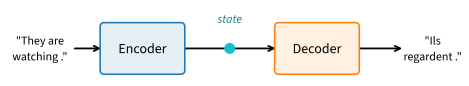
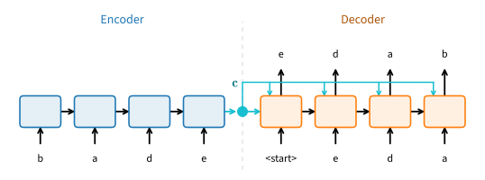

# Encoder-Decoder Models for Sequence Transduction
:label:`sec_seq2seq`

The language models of :numref:`chap_rnn` read a sequence and continue it. Many
of the most useful problems in machine learning have a different shape: read one
sequence and emit a *different* one. Translate an English sentence into French,
transcribe an audio clip into words, summarize a document, answer a question.
The input and the output are both sequences, they usually have different lengths,
and their tokens need not line up position by position. Problems of this kind are
called *sequence transduction*, or *sequence-to-sequence* (seq2seq) learning, and
they were the arena in which recurrent networks first beat classical pipelines at
scale :cite:`Sutskever.Vinyals.Le.2014,Cho.Van-Merrienboer.Gulcehre.ea.2014`.

<!-- WRITER: the translator is gone (D3). The paragraph below was trimmed to
what the section now does: the abstraction and its history, chrF against
BLEU on one sentence, and a measurement of the fixed-state bottleneck on
reversal. Rewrite the opening from the reader (guide 3.1); no em dashes. -->
This section is deliberately historical. You have already met both
successors of the 2014 system: the attention of :numref:`chap_attention`
grew directly out of its central weakness, and the transformer
encoder-decoders of :numref:`sec_transformer` displaced it outright. We
introduce the *encoder-decoder* abstraction that organizes almost every
transduction model built since, score translations with a character-level
metric and the word-level metric it replaced, and end by *measuring* the
weakness itself: the encoder squeezes the entire source through a single
fixed-size state, and that bottleneck is where attention began.

```{.python .input #seq2seq-imports}
%%tab pytorch
import math
import numpy as np
import torch
from torch import nn
from torch.nn import functional as F
from d2l import torch as d2l
```

```{.python .input #seq2seq-imports}
%%tab jax
import math
import numpy as np
import jax
from jax import numpy as jnp
from flax import nnx
import optax
from d2l import jax as d2l
```

```{.python .input #seq2seq-encoder-decoder-models-for-sequence-transduction-1}
%%tab pytorch, jax
import collections
```

## Sequence Transduction and the Abstraction
:label:`sec_encoder-decoder`

The trick that makes transduction tractable is to split the model in two
(:numref:`fig_encoder_decoder`). An *encoder* consumes the variable-length source
sequence and compresses it into an intermediate state of fixed shape. A *decoder*
consumes that state and produces the variable-length target, one token at a time.
The state is the sole channel between them: everything the decoder ever learns
about the source, it learns through that one object.


:label:`fig_encoder_decoder`

The decoder half should look familiar: it *is* a language model in the sense of
:numref:`sec_language-model`, factorizing the target probability autoregressively,
only now every factor is additionally conditioned on the encoder state
$\mathbf{c}$,

$$P(y_1, \ldots, y_{T'} \mid x_1, \ldots, x_T) = \prod_{t'=1}^{T'} P(y_{t'} \mid y_1, \ldots, y_{t'-1}, \mathbf{c}).$$
:eqlabel:`eq_seq2seq_conditional`

A decoder is a *conditional* language model, and conditioning is the whole game:
the same next-token machinery, pointed at a source. This is why the abstraction
long outlived the RNN that first filled it. Swap the encoder for a convolutional
audio front-end and you have Whisper transcribing speech; swap it for a vision
backbone and you have an image-captioning model; feed it text and images together
and you have the multimodal front-ends of current assistants. The shape in
:numref:`fig_encoder_decoder` survives; only the encoder changes.

<!-- WRITER: the Encoder/Decoder/EncoderDecoder interface classes and their
prose are retired (no caller in the book). One sentence: encoder-decoder
wiring as practiced today, with masks and cross-attention, is built in
:numref:`sec_transformer`. History paragraph per the worklist (Sutskever et
al. 2014 with LSTMs and the reversed source; Cho et al.). -->

## Scoring Translations
:label:`sec_translation-scoring`

By what number do we call one translation better than another? For decades the
default answer was BLEU (below), which counts matching word $n$-grams. The modern
default for lexical scoring is chrF :cite:`Popovic.2015`, the metric the WMT
evaluation campaigns recommend. chrF compares *character* $n$-grams rather than
word $n$-grams, which sidesteps tokenization entirely and rewards getting a word
*almost* right (a shared stem, a near-miss inflection) instead of scoring it a
flat zero. For orders $n = 1, \ldots, N$ it computes the precision and recall of
character $n$-grams, and combines them with an F-score weighted toward recall
($\beta = 2$). It is about ten lines.

```{.python .input #seq2seq-chrf}
%%tab pytorch, jax
def chrf(pred, label, n=6, beta=2):  #@save
    """chrF (Popovic, 2015): character n-gram F-score."""
    def ngrams(s, k):
        s = s.replace(' ', '')
        return collections.Counter(s[i:i + k] for i in range(len(s) - k + 1))
    prec = rec = 0.0
    for k in range(1, n + 1):
        p, r = ngrams(pred, k), ngrams(label, k)
        overlap = sum((p & r).values())
        if sum(p.values()) and sum(r.values()):
            prec += overlap / sum(p.values())
            rec += overlap / sum(r.values())
    prec, rec = prec / n, rec / n
    if prec + rec == 0:
        return 0.0
    return (1 + beta**2) * prec * rec / (beta**2 * prec + rec)
```

**A note on BLEU.** You will still meet BLEU :cite:`Papineni.Roukos.Ward.ea.2002`
constantly, so it is worth naming. It is a geometric mean of word $n$-gram
precisions $p_n$, damped by a *brevity penalty* that stops a model from gaming
precision by emitting only a couple of sure words:

$$\text{BLEU} = \exp\!\left(\min\!\left(0, 1 - \frac{\text{len}_{\text{label}}}{\text{len}_{\text{pred}}}\right)\right) \prod_{n=1}^{k} p_n^{1/2^n}.$$
:eqlabel:`eq_bleu`

<!-- WRITER: `d2l.bleu` is no longer kept "for the exercises" only: the
case below uses it. -->
Its implementation, `d2l.bleu`, is as short as chrF's.

```{.python .input #seq2seq-bleu}
%%tab pytorch, jax
def bleu(pred_seq, label_seq, k):  #@save
    """Compute the BLEU."""
    pred_tokens, label_tokens = pred_seq.split(' '), label_seq.split(' ')
    len_pred, len_label = len(pred_tokens), len(label_tokens)
    score = math.exp(min(0, 1 - len_label / len_pred))
    for n in range(1, min(k, len_pred) + 1):
        num_matches, label_subs = 0, collections.defaultdict(int)
        for i in range(len_label - n + 1):
            label_subs[' '.join(label_tokens[i: i + n])] += 1
        for i in range(len_pred - n + 1):
            if label_subs[' '.join(pred_tokens[i: i + n])] > 0:
                num_matches += 1
                label_subs[' '.join(pred_tokens[i: i + n])] -= 1
        score *= math.pow(num_matches / (len_pred - n + 1), math.pow(0.5, n))
    return score
```

The two metrics part ways on a single sentence. We score three candidates
against one reference: an exact copy, a near miss with one wrong inflection,
and a paraphrase that means the same thing in other words.

```{.python .input #seq2seq-scoring-translations-1}
%%tab pytorch, jax
reference = 'we will visit our grandparents tomorrow'
candidates = {'copy': reference,
              'near miss': 'we will visits our grandparents tomorrow',
              'paraphrase': 'we are going to see our grandparents tomorrow'}
for name, candidate in candidates.items():
    print(f'{name:10s}  chrF {chrf(candidate, reference):.2f}  '
          f'BLEU {bleu(candidate, reference, k=4):.2f}')
```

<!-- WRITER: deterministic output: copy chrF 1.00 BLEU 1.00; near miss chrF
0.91 BLEU 0.00; paraphrase chrF 0.67 BLEU 0.00. Lessons: one wrong
inflection in the third of six words leaves no word 4-gram intact, so
sentence-level BLEU is zero, while chrF loses only the character n-grams
around "visits"; and the correct paraphrase scores below the ungrammatical
near miss on chrF (0.67 against 0.91) and zero on BLEU: neither metric
knows meaning, which leads to the COMET / LLM-judge sentence below. -->

Both chrF and BLEU are surface-overlap metrics; neither knows whether a
translation *means* the same thing. That gap is filled by learned neural metrics
such as COMET and, increasingly, by prompting a large language model to judge —
a model of exactly the kind :numref:`chap_transformers` builds.

## The Fixed-State Bottleneck

<!-- WRITER: this section replaces the translator and its length plot (the
Tatoeba length curve was confounded: the held-out pairs came from the
length-sorted tail of the corpus). Restate the task in one sentence with a
pointer to :numref:`subsec_reversal-task` (reverse a random string over an
alphabet of 16 letters; every letter must pass through the state, since the
letters already written say nothing about the next one). Prediction from
counting: $T$ letters carry $4T$ bits. Then read the table below. -->

We measure the bottleneck on the reversal task of
:numref:`subsec_reversal-task`: reverse a random string over an alphabet of
16 letters. The letters are independent, so the letters the decoder has
already written tell it nothing about the next one, and every letter must
pass through the encoder's final state. Each batch is fresh. The model reads
one sequence `X`, the source followed by the decoder input, the reversed
string shifted right behind a start token (the teacher forcing of
:numref:`subsec_teacher-forcing`).

```{.python .input #seq2seq-the-fixed-state-bottleneck-1}
%%tab pytorch
class Reversal:
    """Fresh batches of random strings and their reversals."""
    def __init__(self, length, batch_size=128, num_letters=16):
        self.length, self.batch_size = length, batch_size
        self.num_letters = num_letters

    def batch(self, batch_size):
        V = self.num_letters  # Letters 0 to V - 1; V is the start token
        src = torch.randint(0, V, (batch_size, self.length),
                            device=d2l.try_gpu())
        tgt = src.flip(1)
        dec_in = torch.cat([torch.full_like(tgt[:, :1], V), tgt[:, :-1]], 1)
        return torch.cat([src, dec_in], 1), tgt

    def train_dataloader(self):
        while True:
            yield self.batch(self.batch_size)
```

```{.python .input #seq2seq-the-fixed-state-bottleneck-1}
%%tab jax
class Reversal:
    """Fresh batches of random strings and their reversals."""
    def __init__(self, length, batch_size=128, num_letters=16):
        self.length, self.batch_size = length, batch_size
        self.num_letters = num_letters

    def batch(self, batch_size, key):
        V = self.num_letters  # Letters 0 to V - 1; V is the start token
        src = jax.random.randint(key, (batch_size, self.length), 0, V)
        tgt = src[:, ::-1]
        dec_in = jnp.concatenate([jnp.full_like(tgt[:, :1], V),
                                  tgt[:, :-1]], 1)
        return jnp.concatenate([src, dec_in], 1), tgt

    def train_dataloader(self):
        key = d2l.get_key()
        while True:
            key, subkey = jax.random.split(key)
            yield self.batch(self.batch_size, subkey)
```

The model follows :numref:`fig_seq2seq_details`. A GRU encoder
(:numref:`sec_gru`) reads the source. Its final state $\mathbf{c}$ starts
the GRU decoder, which also reads $\mathbf{c}$ at every step, concatenated
to the embedding of its input letter:

$$\mathbf{s}_{t'} = g(y_{t'-1}, \mathbf{c}, \mathbf{s}_{t'-1}).$$
:eqlabel:`eq_seq2seq_s_t`

A linear layer maps each decoder state to scores for the 16 letters.


:label:`fig_seq2seq_details`

```{.python .input #seq2seq-the-fixed-state-bottleneck-2}
%%tab pytorch
class Reverser(nn.Module):
    """A GRU encoder whose final state starts and conditions a GRU decoder."""
    def __init__(self, num_letters, num_hiddens, num_inputs=32):
        super().__init__()  # One more embedding: the start token
        self.embedding = nn.Embedding(num_letters + 1, num_inputs)
        self.encoder = nn.GRU(num_inputs, num_hiddens, batch_first=True)
        self.decoder = nn.GRU(num_inputs + num_hiddens, num_hiddens,
                              batch_first=True)
        self.head = nn.Linear(num_hiddens, num_letters)
        d2l.init_lecun(self)
        nn.init.normal_(self.embedding.weight, std=num_inputs ** -0.5)

    def forward(self, X):  # X: the source, then the decoder input
        src, dec_in = X.chunk(2, dim=1)
        _, c = self.encoder(self.embedding(src))  # (1, batch, num_hiddens)
        context = c[0, :, None].expand(-1, dec_in.shape[1], -1)
        dec_X = torch.cat([self.embedding(dec_in), context], -1)
        return self.head(self.decoder(dec_X, c)[0])
```

```{.python .input #seq2seq-the-fixed-state-bottleneck-2}
%%tab jax
class Reverser(nnx.Module):
    """A GRU encoder whose final state starts and conditions a GRU decoder."""
    def __init__(self, num_letters, num_hiddens, num_inputs=32, *, rngs):
        lecun = {'recurrent_kernel_init': nnx.initializers.lecun_normal()}
        self.embedding = nnx.Embed(num_letters + 1, num_inputs, rngs=rngs,
            embedding_init=nnx.initializers.normal(num_inputs ** -0.5))
        self.encoder = nnx.RNN(nnx.GRUCell(
            num_inputs, num_hiddens, rngs=rngs, **lecun), return_carry=True)
        self.decoder = nnx.RNN(nnx.GRUCell(
            num_inputs + num_hiddens, num_hiddens, rngs=rngs, **lecun))
        self.head = nnx.Linear(num_hiddens, num_letters, rngs=rngs)

    def __call__(self, X):  # X: the source, then the decoder input
        src, dec_in = jnp.split(X, 2, axis=1)
        c, _ = self.encoder(self.embedding(src))  # (batch, num_hiddens)
        context = jnp.broadcast_to(c[:, None], (*dec_in.shape, c.shape[-1]))
        dec_X = jnp.concatenate([self.embedding(dec_in), context], -1)
        return self.head(self.decoder(dec_X, initial_carry=c))
```

<!-- WRITER: training recipe of 11.5's reversal model (`d2l.LMOptimizer`,
cosine to zero, no warmup, no weight decay), here at learning rate 3e-3
for a fixed budget of 1,000 steps of 128 fresh strings; `d2l.train_steps`
of :numref:`sec_test_models` runs the steps. Accuracy is per letter, on
1,000 fresh strings, given the correct previous letters (teacher forcing):
since the letters are independent, the previous letters reveal nothing
about the next one, so this measures what came through the state. -->

Each model trains for 1,000 steps of 128 fresh strings with the recipe of
the reversal model of :numref:`sec_transformer`, and is then scored on
1,000 fresh strings by the fraction of letters it predicts correctly.

```{.python .input #seq2seq-the-fixed-state-bottleneck-3}
%%tab pytorch
def reversal_accuracy(num_hiddens, length):
    """Train a fresh model for 1,000 steps; return its per-letter accuracy."""
    data = Reversal(length)
    model = Reverser(data.num_letters, num_hiddens).to(d2l.try_gpu())
    optimizer = d2l.LMOptimizer(model, lr=3e-3, num_steps=1000, warmup=0,
                                weight_decay=0.0)
    d2l.train_steps(model, data, optimizer, 1000)
    X, Y = data.batch(1000)
    with torch.inference_mode():
        return (model(X).argmax(-1) == Y).float().mean().item()
```

```{.python .input #seq2seq-the-fixed-state-bottleneck-3}
%%tab jax
def reversal_accuracy(num_hiddens, length):
    """Train a fresh model for 1,000 steps; return its per-letter accuracy."""
    data = Reversal(length)
    model = Reverser(data.num_letters, num_hiddens,
                     rngs=nnx.Rngs(d2l.get_key()))
    optimizer = d2l.LMOptimizer(model, lr=3e-3, num_steps=1000, warmup=0,
                                weight_decay=0.0)
    d2l.train_steps(model, data, optimizer, 1000)
    X, Y = data.batch(1000, d2l.get_key())
    return float((model(X).argmax(-1) == Y).mean())
```

We train two models for each state width and string length; the table
prints both accuracies. Guessing gives $1/16 \approx 0.06$.

```{.python .input #seq2seq-the-fixed-state-bottleneck-4}
%%tab pytorch, jax
lengths, widths = (8, 16, 32, 64), (64, 256)
print('width' + ''.join(f'{f"T = {T}":>12}' for T in lengths))
for num_hiddens in widths:
    row = [[reversal_accuracy(num_hiddens, T) for _ in range(2)]
           for T in lengths]
    print(f'{num_hiddens:5d}' + ''.join(f'   {a:.2f}/{b:.2f}' for a, b in row))
```

<!-- WRITER: direct notebook runs (2026-11-19, not captured), PyTorch then
JAX: width 64: 0.99/0.99 0.72/0.70 0.41/0.41 0.26/0.26 and 0.99/0.99
0.72/0.71 0.40/0.42 0.27/0.27; width 256: 1.00/1.00 0.99/0.99 0.80/0.79
0.51/0.51 and 1.00/1.00 0.99/0.99 0.79/0.79 0.51/0.51. Cell time about
2 min (PyTorch) and 2.5 min (JAX). Development runs (same design, two runs
per cell, both tabs; PyTorch / JAX):
width 64:  T=8 0.99/0.99 | 0.99/0.99; T=16 0.72/0.74 | 0.70/0.72;
           T=32 0.40/0.41 | 0.39/0.40; T=64 0.26/0.27 | 0.26/0.27
width 256: T=8 1.00/1.00 | 1.00/1.00; T=16 0.99/0.99 | 0.99/0.99;
           T=32 0.79/0.79 | 0.80/0.80; T=64 0.51/0.51 | 0.51/0.51
Firm lessons: at a fixed budget, accuracy falls as the string grows (width
64: 0.99 at T=8 to about 0.26 at T=64, run-to-run range at most 0.02), and
the wider state holds out longer (width 256 is at 0.99 at T=16 and about
0.5 at T=64). Both runs and both tabs agree to about 0.02. Caveat for the
prose: the budget matters. With 4,000 steps (PyTorch dev), width 64
reaches 0.97 at T=16, 0.64 at T=32, 0.38 at T=64: longer training helps the
short strings much more than the long ones, but does not close the gap.
Accuracy is about uniform over the positions of the string (width 64,
T=64: 0.36 for the first letter written, 0.22 to 0.27 elsewhere), so the
state keeps partial information about every letter rather than the last
few letters exactly. Cell cost about 2 min (PyTorch) and 2.5 min (JAX).
Close on Bahdanau (:numref:`sec_attention-scoring-functions`) and on
11.5's cross-attention model, which reverses strings of length 12 with a
loss below 0.03 by step 100 (stored); hand forward in one sentence: the
rest of the chapter keeps one state and makes it a better memory. -->

## Summary

<!-- WRITER: rewrite. The translator, shared BPE vocabulary, masked loss,
greedy and beam decoding are gone. True now: the abstraction (encoder to
fixed state to decoder, the decoder a conditional language model); chrF
against BLEU on the near miss and the paraphrase; at a fixed budget a GRU
encoder-decoder reverses 8 letters through a 64-number state almost
perfectly and 64 letters at about 0.26 per letter, and a 256-number state
holds out longer; attention and better recurrent memories are the two
escapes. -->
Sequence transduction maps one variable-length sequence to another. The
encoder-decoder abstraction handles it by compressing the source into a
fixed-shape state with an encoder and expanding that state into the target
with a decoder, which is a conditional language model. chrF, the
character-level metric that has displaced BLEU as the lexical default,
gives a near miss partial credit where sentence-level BLEU gives none, and
neither metric knows when two sentences mean the same thing. On string
reversal, a GRU encoder-decoder trained for a fixed budget gets fewer
letters right the longer the string, and a wider state holds out longer.
Escaping the single fixed state, through attention or through better
recurrent state, organizes everything that follows.

## Exercises

<!-- WRITER: exercises 1 to 4 of the old section (vocabularies, beam width,
length normalization, masked loss) are dropped with their code. Add per the
worklist: reverse the source (Sutskever's trick) and measure; the counting
bound for a state of $N$ numbers of $b$ bits (prepares `eq_hy-counting`).
Measured fact for an exercise on budget: with 4,000 steps instead of
1,000, width 64 reaches 0.97 at T=16, 0.64 at T=32, 0.38 at T=64. -->

1. Replace the GRUs with LSTMs (:numref:`sec_lstm`) in both encoder and
   decoder of `Reverser`. How does the per-letter accuracy change at each
   length? (An LSTM carries a memory cell besides its hidden state; decide
   which of the two the decoder should start from.)
1. Feed the context $\mathbf{c}$ only at the first decoder step (as in
   :citet:`Sutskever.Vinyals.Le.2014`), that is, only as the decoder's
   initial state, instead of at every step. How does that change the
   accuracies, and why might repeating the context help a small model?
1. Score the near miss and the paraphrase with `bleu` for $k = 1, 2, 3, 4$.
   Construct a candidate on which chrF and BLEU most disagree, and explain
   the mechanism.

:begin_tab:`pytorch`
[Discussions](https://d2l.discourse.group/t/1062)
:end_tab:

:begin_tab:`jax`
[Discussions](https://d2l.discourse.group/t/18022)
:end_tab:

<!-- slides -->


<!-- WRITER: deck rebuilt for the cut section (the translator slides and
their placeholders are gone); the slide step should finish it to the slide
guide (opener with a number, claim titles, recap). Numbers on the slides
come from the development runs listed in the WRITER note after the
reversal table. -->

::: {.slide}
::: {.cover}
[Dive into Deep Learning · §12.2]{.kicker}

Sequence-to-Sequence Learning<br>
**the encoder-decoder abstraction · chrF against BLEU · the fixed-state bottleneck, measured**
:::
:::

::: {.slide title="Two Recurrent Networks, One State Between Them"}
[The problem]{.kicker}

- Translation reads a whole sentence in one language before writing it in
  another: lengths differ, positions do not line up.
- 2014: an **encoder** RNN reads the source into one fixed-size state
  $\mathbf{c}$; a **decoder** RNN writes the target from it.

::: {.d2l-note .warn}
Everything the decoder learns about the source passes through
$\mathbf{c}$. How much can one state carry?
:::
:::

::: {.slide title="The Decoder Is a Conditional Language Model"}
{width=88%}

$$P(y_1, \ldots, y_{T'} \mid x_1, \ldots, x_T) = \prod_{t'=1}^{T'} P(y_{t'} \mid y_{<t'}, \mathbf{c})$$

Swap the encoder and the same shape transcribes speech (Whisper) or
captions images.
:::

::: {.slide title="chrF Gives a Near Miss the Credit BLEU Withholds"}
- **chrF:** F-score of character $n$-grams, $n \le 6$, weighted toward
  recall. **BLEU:** geometric mean of word $n$-gram precisions with a
  brevity penalty.

@seq2seq-scoring-translations-1

::: {.d2l-note}
One wrong inflection leaves no word 4-gram intact: BLEU 0. Neither metric
knows that the paraphrase means the same.
:::
:::

::: {.slide title="Reversal: Every Letter Must Pass Through the State"}
Reverse a random string over 16 letters. The letters are independent, so
the letters already written say nothing about the next: $T$ letters carry
$4T$ bits, all through $\mathbf{c}$.

{width=86%}
:::

::: {.slide title="The Final Encoder State Starts and Feeds the Decoder"}
@seq2seq-the-fixed-state-bottleneck-2
:::

::: {.slide title="Longer Strings Overflow a Fixed State"}
1,000 steps of 128 fresh strings per model, two models per entry;
per-letter accuracy on fresh strings (chance $= 0.06$):

@seq2seq-the-fixed-state-bottleneck-4

::: {.d2l-note}
Width 64: from 0.99 at 8 letters to about 0.26 at 64. Width 256 holds out
longer, but it falls too.
:::
:::

::: {.slide title="Two Escapes from the Bottleneck"}
- **Attention:** let the decoder look back at every encoder state
  (Bahdanau et al., 2014). The cross-attention model of the transformer
  chapter learns this reversal task in about a hundred steps.
- **A better state:** keep one state, but make it a better memory: the
  rest of this chapter.
:::

::: {.slide title="Recap"}
- Encoder-decoder: source $\to$ fixed state $\to$ target; the decoder is a
  conditional language model.
- chrF over BLEU for lexical scoring; neither measures meaning.
- A fixed state caps how much of the source reaches the decoder: accuracy
  falls with length, later for a wider state.
:::
