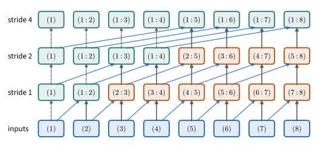
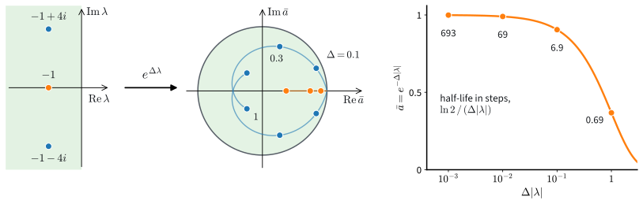
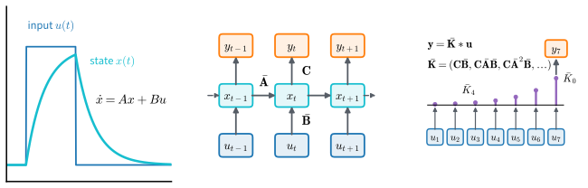

# Linear Recurrences and State Space Models
:label:`sec_ssm`

A gated network that reads a sequence of 4,096 tokens performs 4,096
updates, and each update needs the result of the one before. A GPU can
carry out tens of thousands of multiply-adds at the same time, but it cannot
start step 2,000 until step 1,999 has finished, so during training most of it
waits. A transformer layer has no such chain: it processes all 4,096
positions in a few large matrix products. This difference in training
speed, more than any difference in what the two kinds of model can
represent, was a main reason why transformers replaced recurrent networks
for large-scale language modeling.

The chain has a single cause. The gates of :numref:`sec_lstm` read the
previous state, and the state passes through a nonlinearity, so step $t$
cannot be computed until step $t-1$ is known. If the gates read only the
current input, the update becomes linear in the state. Linear updates can be
grouped like the terms of a sum, and the states at all 4,096 positions can
then be computed in $\log_2 4096 = 12$ rounds of batched arithmetic. When
the model generates text, it still updates its state once per token, in
constant memory, like any recurrent network.

A linear recurrence still has to decide how fast to forget, and a gate
learned from scratch starts with a memory of about one step. The second half
of the section borrows an answer from physics: write the recurrence as a
differential equation that is sampled at discrete steps. Such a recurrence
is stable for every value of its parameters, and it starts with memories
that range from a step to a thousand steps. When its dynamics are the same
at every position, it can also be computed as a convolution. These are the
*state space models*. The next section makes their dynamics depend on the input.

```{.python .input #ssm-linear-recurrence-and-state-space-models}
%%tab pytorch
%matplotlib inline
from d2l import torch as d2l
import math
import torch
from torch import nn
```

```{.python .input #ssm-linear-recurrence-and-state-space-models}
%%tab jax
%matplotlib inline
from d2l import jax as d2l
from flax import nnx
import jax
from jax import numpy as jnp
import math
import random
```

## Linear Recurrences
:label:`subsec_linear-recurrences`

### A Single Decaying Number

Consider a state $h_t$, a single number, that keeps a fraction $a$ of its
value at every step and adds the new input $x_t$:

$$h_t = a\, h_{t-1} + x_t, \qquad h_0 = 0.$$
:eqlabel:`eq_lr-scalar`

This is the gated memory of :numref:`sec_lstm` with both gates held fixed.
With $a = 0.9$ and a single input $x_1 = 1$ followed by zeros, the state
reads $1, 0.9, 0.81, 0.729, \ldots$: an input from $k$ steps ago survives
with weight $a^k$. Substituting the recurrence into itself shows that this
holds for any input sequence,

$$h_t = \sum_{s=1}^{t} a^{t-s} x_s.$$
:eqlabel:`eq_lr-unrolled`

The state is a weighted sum of all past inputs, with weights that shrink
geometrically with age. Two consequences follow. First, the sum does not
mention $h_{t-1}$: every $h_t$ is determined by the inputs alone, so in
principle all of them can be computed at once. Second, $a$ sets the length
of the memory, and it sets the length of learning too. The weight of an
input halves every $\ln 2 / \ln(1/a)$ steps, about 7 steps for $a = 0.9$
and 693 for $a = 0.999$, and the gradient of $h_t$ with respect to $x_s$ is
the same weight $a^{t-s}$. The decay that forgets an input also weakens the
signal that would teach the model to use it. This is the vanishing
gradient of :numref:`sec_lstm`, a product of $t-s$ Jacobians, except that
the product is now a power of one number that we can read off directly.

### Input-Dependent Decay

A memory of one number is too small for language. With a state
$\mathbf{h}_t \in \mathbb{R}^d$ we can give each coordinate its own decay,
collected in a vector $\mathbf{a} \in (0, 1)^d$ that multiplies the state
elementwise ($\odot$):

$$\mathbf{h}_t = \mathbf{a} \odot \mathbf{h}_{t-1} + \mathbf{b}_t.$$

Nothing new happens here. The coordinates do not interact, so this is $d$
copies of :eqref:`eq_lr-scalar` side by side, each with its own half-life. We
have also renamed the input term $\mathbf{b}_t$, because it will soon be a
learned function of the input.

A fixed decay forgets at the same rate whatever the input says. The gates of
:numref:`sec_lstm` exist to make the rate a decision: keep the state through
a run of uninformative tokens, and overwrite it when something important
arrives. We can keep that ability, and keep the update linear in the state,
by letting the decay depend on the current input:

$$
\mathbf{h}_t = \mathbf{a}_t \odot \mathbf{h}_{t-1} + \mathbf{b}_t,
\qquad \mathbf{a}_t = \mathbf{a}(\mathbf{x}_t), \quad
\mathbf{b}_t = \mathbf{b}(\mathbf{x}_t).
$$
:eqlabel:`eq_affine_recurrence`

Unrolling as before, the power $a^{t-s}$ becomes the product of the decays
met along the way:

$$
\mathbf{h}_t = \sum_{s=1}^{t} \Big( \prod_{r=s+1}^{t} \mathbf{a}_r \Big)
\odot \mathbf{b}_s.
$$
:eqlabel:`eq_lr-unrolled-gated`

An input survives for as long as the inputs after it choose to keep it.
Because every $\mathbf{a}_r$ lies in $(0, 1)$, the products can shrink but
never grow: no past input is ever amplified, however long the sequence. Because
$\mathbf{a}_t$ and $\mathbf{b}_t$ depend only on $\mathbf{x}_t$, they can be
computed for all positions in one batched matrix product before the
recurrence starts. What remains is the recurrence itself, an update that is
*affine* in $\mathbf{h}_{t-1}$: an elementwise multiplication followed by an
addition.

### The Minimal GRU
:label:`subsec_mingru`

The GRU of :numref:`sec_gru` almost has this form. Its update gate
$\mathbf{z}_t$, reset gate $\mathbf{r}_t$, and candidate state
$\tilde{\mathbf{h}}_t$ are

$$
\begin{aligned}
\mathbf{z}_t &= \sigma(\mathbf{W}_{\textrm{xz}} \mathbf{x}_t + \mathbf{W}_{\textrm{hz}} \mathbf{h}_{t-1} + \mathbf{b}_\textrm{z}),\\
\mathbf{r}_t &= \sigma(\mathbf{W}_{\textrm{xr}} \mathbf{x}_t + \mathbf{W}_{\textrm{hr}} \mathbf{h}_{t-1} + \mathbf{b}_\textrm{r}),\\
\tilde{\mathbf{h}}_t &= \tanh\big(\mathbf{W}_{\textrm{xh}} \mathbf{x}_t + \mathbf{W}_{\textrm{hh}} (\mathbf{r}_t \odot \mathbf{h}_{t-1}) + \mathbf{b}_\textrm{h}\big),
\end{aligned}
$$

and the new state is a blend of the old state and the candidate,

$$
\mathbf{h}_t = \mathbf{z}_t \odot \mathbf{h}_{t-1} + (1 - \mathbf{z}_t)
\odot \tilde{\mathbf{h}}_t.
$$

The blend is already affine in $\mathbf{h}_{t-1}$, with decay
$\mathbf{z}_t$. What stands in the way are the three places where
$\mathbf{h}_{t-1}$ enters a gate or the candidate.
:citet:`Feng.Tung.Ahmed.ea.2024` removed them: the update gate and the
candidate read only the input, and the reset gate, which no longer has a
previous state to filter, disappears. The result is the *minimal GRU*, or
*minGRU* (we keep a $\tanh$ on the candidate, which
:citet:`Feng.Tung.Ahmed.ea.2024` drop; an exercise compares the two):

$$
\mathbf{z}_t = \sigma(\mathbf{W}_\textrm{z} \mathbf{x}_t + \mathbf{b}_\textrm{z}), \qquad
\tilde{\mathbf{h}}_t = \tanh(\mathbf{W}_\textrm{h} \mathbf{x}_t + \mathbf{b}_\textrm{h}), \qquad
\mathbf{h}_t = \mathbf{z}_t \odot \mathbf{h}_{t-1} + (1 - \mathbf{z}_t) \odot \tilde{\mathbf{h}}_t.
$$
:eqlabel:`eq_mingru`

This is :eqref:`eq_affine_recurrence` with decay $\mathbf{a}_t =
\mathbf{z}_t$ and write $\mathbf{b}_t = (1 - \mathbf{z}_t) \odot
\tilde{\mathbf{h}}_t$. The update gate is now the decay of a linear
recurrence: a gate value of 0.9 keeps 90% of the state and admits 10% of
the candidate. The layer is also smaller. With input and hidden width $d$,
a GRU layer has $6d^2$ weights, three input matrices and three state
matrices, and the minGRU has $2d^2$.

The minGRU gives something up. A GRU can decide to keep its state because of
what the state contains; the minGRU decides only from the current token, and
between tokens its state can only be scaled and added to. Stacking layers
gives some of this back: the outputs of one layer, passed through a
nonlinearity, are the inputs of the next, and nonlinearities between layers
do not block parallel evaluation.

## Parallel Scans
:label:`subsec_parallel-scans`

### Composing Affine Steps

Computing $\mathbf{h}_1, \ldots, \mathbf{h}_T$ from the coefficients
$(\mathbf{a}_t, \mathbf{b}_t)$ is a relative of a familiar problem: compute
all running totals $s_t = x_1 + \cdots + x_t$ of a sequence, its *prefix
sums*. Prefix sums look sequential, yet they can be computed in parallel,
because addition is associative: the total $(x_1 + x_2) + (x_3 + x_4)$ can be
split into two halves that are computed independently and combined at the
end. Any associative operation allows the same trick, and composing the
steps of an affine recurrence is one.

Represent step $t$ by its coefficient pair $(\mathbf{a}_t, \mathbf{b}_t)$,
which stands for the map $\mathbf{h} \mapsto \mathbf{a}_t \odot \mathbf{h} +
\mathbf{b}_t$. Applying step 1 and then step 2 gives
$\mathbf{a}_2 \odot (\mathbf{a}_1 \odot \mathbf{h} + \mathbf{b}_1) +
\mathbf{b}_2$, which is again a map of the same form. We write the
composition as

$$
(\mathbf{a}_1, \mathbf{b}_1) \bullet (\mathbf{a}_2, \mathbf{b}_2) =
(\mathbf{a}_1 \odot \mathbf{a}_2,\ \mathbf{a}_2 \odot \mathbf{b}_1 +
\mathbf{b}_2).
$$
:eqlabel:`eq_scan_combine`

Read from left to right, $\bullet$ means "this step, then that one". It is
associative because composing functions is associative, and the composite of
any run of steps is again a single pair. This matters as much as
associativity: a block of a thousand steps costs no more to store or to
combine than a single step. As an example, two steps with $a_1 = a_2 = 0.5$,
$b_1 = 1$, and $b_2 = 2$ combine into $(0.25,\ 0.5 \cdot 1 + 2) = (0.25,
2.5)$. Running them one after the other from $h_0 = 0$ gives $h_1 = 1$ and
$h_2 = 0.5 \cdot 1 + 2 = 2.5$, as the composite says.

Composing the first $t$ pairs gives the map that carries $\mathbf{h}_0$ to
$\mathbf{h}_t$. With $\mathbf{h}_0 = \mathbf{0}$ the state $\mathbf{h}_t$ is
the $\mathbf{b}$-component of that composite, so all states together are the
prefix "sums" of the pairs under $\bullet$. Computing all prefixes of a
sequence under an associative operation is called a *scan*.

### The Doubling Schedule

:numref:`fig_scan_tree` shows a parallel schedule for eight steps. In the
first round, every position combines with its predecessor, so it holds the
composite of two steps. In the second round, every position combines with
the position two back and then holds four steps; in the third, with the
position four back, and then holds eight. After $\lceil \log_2 T \rceil$
rounds every position holds its full prefix. Each round is one elementwise
multiply-add over the whole sequence, the kind of work a GPU does well.


:label:`fig_scan_tree`

This schedule, due to :citet:`Hillis.Steele.1986`, performs about
$T \log_2 T$ combines, a factor $\log_2 T$ more than the $T - 1$ steps of a
loop, in exchange for $\log_2 T$ rounds instead of $T - 1$. A schedule of
:citet:`Blelloch.1990` needs only about $2T$ combines in about $2 \log_2 T$
rounds. The difference in total work matters once a sequence is long enough
to keep the whole GPU busy.

### Implementation

`linear_scan` implements the doubling schedule. The writes $\mathbf{b}_t$
have shape (batch size, number of steps, ...), with time along the second
axis. The decays are broadcast to the same shape, so decays that are the
same at every step can be passed once, without the batch and time axes. An
optional initial state is folded into the first step, since
$\mathbf{h}_1 = \mathbf{a}_1 \odot \mathbf{h}_0 + \mathbf{b}_1$.

:begin_tab:`pytorch`
Each round of the doubling schedule combines the sequence with a copy of
itself shifted by the stride, a few tensor operations per round.
:end_tab:

:begin_tab:`jax`
JAX provides scans as a primitive, `jax.lax.associative_scan`, which takes
the combine :eqref:`eq_scan_combine` as a function and uses a schedule with
linear total work.
:end_tab:

```{.python .input #ssm-implementation-1}
%%tab pytorch
def linear_scan(a, b, h0=None):  #@save
    """All states of h_t = a_t * h_{t-1} + b_t; time is the second axis."""
    a = a.expand_as(b)  # Decays may omit axes on which they do not vary
    if h0 is not None:  # Fold the initial state into the first step
        b = torch.cat([a[:, :1] * h0.unsqueeze(1) + b[:, :1], b[:, 1:]], 1)
    s = 1
    while s < b.shape[1]:  # Combine every position with the one s back
        a, b = (torch.cat([a[:, :s], a[:, :-s] * a[:, s:]], 1),
                torch.cat([b[:, :s], a[:, s:] * b[:, :-s] + b[:, s:]], 1))
        s *= 2
    return b
```

```{.python .input #ssm-implementation-1}
%%tab jax
def linear_scan(a, b, h0=None):  #@save
    """All states of h_t = a_t * h_{t-1} + b_t; time is the second axis."""
    a = jnp.broadcast_to(a, b.shape)  # Decays may omit axes; broadcast them
    if h0 is not None:  # Fold the initial state into the first step
        b = b.at[:, 0].add(a[:, 0] * h0)
    def combine(earlier, later):
        (a1, b1), (a2, b2) = earlier, later
        return a1 * a2, a2 * b1 + b2
    return jax.lax.associative_scan(combine, (a, b), axis=1)[1]
```

We check the scan against a loop that applies the recurrence one step at a
time, on random decays in $(0, 1)$ and a length that is not a power of two.

```{.python .input #ssm-implementation-2}
%%tab pytorch
def sequential_scan(a, b):
    h, states = torch.zeros_like(b[:, 0]), []
    for a_t, b_t in zip(a.unbind(1), b.unbind(1)):
        h = a_t * h + b_t
        states.append(h)
    return torch.stack(states, 1)

a, b = torch.rand(4, 100, 8), torch.randn(4, 100, 8)
print(f'max deviation: '
      f'{(linear_scan(a, b) - sequential_scan(a, b)).abs().max():.1e}')
```

```{.python .input #ssm-implementation-2}
%%tab jax
def sequential_scan(a, b):
    def step(h, ab):
        h = ab[0] * h + ab[1]
        return h, h
    # lax.scan steps through the leading axis, so time goes first
    ab = (jnp.swapaxes(a, 0, 1), jnp.swapaxes(b, 0, 1))
    return jnp.swapaxes(jax.lax.scan(step, jnp.zeros_like(b[:, 0]), ab)[1], 0, 1)

key_a, key_b = jax.random.split(jax.random.key(0))
a = jax.random.uniform(key_a, (4, 100, 8))
b = jax.random.normal(key_b, (4, 100, 8))
print(f'max deviation: '
      f'{jnp.abs(linear_scan(a, b) - sequential_scan(a, b)).max():.1e}')
```

The two agree to the rounding error of 32-bit floating point. The scan
groups the multiplications and additions differently from the loop, so the
results differ in the last digits; they are the same computation.

How much faster is the scan? We time both on a GPU for sequences of 256 to
16,384 steps, with a batch of 32 sequences of 128 coordinates each.
`d2l.Benchmark`, which :numref:`sec_perf_model` introduces, calls a function
a few times after a warm-up call and reports the average time, waiting for
the GPU to finish before it stops the clock.

```{.python .input #ssm-implementation-3}
%%tab pytorch
device = d2l.try_gpu()
lengths, times = [256, 1024, 4096, 16384], [[], []]
for T in lengths:
    a = torch.rand(32, T, 128, device=device)
    b = torch.randn(32, T, 128, device=device)
    for i, scan in enumerate([linear_scan, sequential_scan]):
        bench = d2l.Benchmark(lambda: scan(a, b), warmup=1, repeats=3)
        times[i].append(1e3 * bench.time)
d2l.plot(lengths, times, 'sequence length', 'milliseconds per call',
         legend=['parallel scan', 'loop'], xscale='log', yscale='log',
         figsize=(4.5, 3))
```

```{.python .input #ssm-implementation-3}
%%tab jax
lengths, times = [256, 1024, 4096, 16384], [[], []]
scans = [jax.jit(linear_scan), jax.jit(sequential_scan)]
for T in lengths:
    key_a, key_b = jax.random.split(jax.random.key(T))
    a = jax.random.uniform(key_a, (32, T, 128))
    b = jax.random.normal(key_b, (32, T, 128))
    for i, scan in enumerate(scans):
        bench = d2l.Benchmark(lambda: scan(a, b), warmup=1, repeats=3)
        times[i].append(1e3 * bench.time)
d2l.plot(lengths, times, 'sequence length', 'milliseconds per call',
         legend=['parallel scan', 'loop'], xscale='log', yscale='log',
         figsize=(4.5, 3))
```

The loop's time grows in proportion to the length: each step is a separate
small computation that must finish before the next one starts. The scan is
faster at every length, by a factor between a few and about a hundred,
depending on the length. Its time does not follow the length: while its rounds of
arithmetic are too small to keep the GPU busy, more positions cost little
extra time, and once the GPU is full, the total amount of work sets the
time. Where this happens depends on how the scan is compiled. The scan
changes how we train,
not how we generate: at inference the model still applies
:eqref:`eq_affine_recurrence` once per token, in constant memory.

### A Linear Recurrent Language Model

The minGRU :eqref:`eq_mingru` is a few lines around `linear_scan`. It maps
a minibatch of sequences to the states at every step, so it can serve as
the sequence mixer of `d2l.SeqLM`, the residual language model of
:numref:`sec_lstm`: an embedding, a stack of blocks that each apply a mixer
and a position-wise MLP, and a prediction head.

```{.python .input #ssm-a-linear-recurrent-language-model-1}
%%tab pytorch
class MinGRU(nn.Module):  #@save
    """The minimal GRU: its gate and candidate read only the input."""
    def __init__(self, num_inputs, num_hiddens):
        super().__init__()
        self.W_z = nn.Linear(num_inputs, num_hiddens)  # Update gate (decay)
        self.W_h = nn.Linear(num_inputs, num_hiddens)  # Candidate state
        d2l.init_lecun(self)

    def coefficients(self, X):
        """Decays a_t and writes b_t of the linear recurrence."""
        Z = torch.sigmoid(self.W_z(X))
        return Z, (1 - Z) * torch.tanh(self.W_h(X))

    def forward(self, X):  # X: (batch_size, num_steps, num_inputs)
        return linear_scan(*self.coefficients(X))
```

```{.python .input #ssm-a-linear-recurrent-language-model-1}
%%tab jax
class MinGRU(nnx.Module):  #@save
    """The minimal GRU: its gate and candidate read only the input."""
    def __init__(self, num_inputs, num_hiddens, *, rngs):
        self.W_z = nnx.Linear(num_inputs, num_hiddens, rngs=rngs)  # Decay
        self.W_h = nnx.Linear(num_inputs, num_hiddens, rngs=rngs)

    def coefficients(self, X):
        """Decays a_t and writes b_t of the linear recurrence."""
        Z = jax.nn.sigmoid(self.W_z(X))
        return Z, (1 - Z) * jnp.tanh(self.W_h(X))

    def __call__(self, X):  # X: (batch_size, num_steps, num_inputs)
        return linear_scan(*self.coefficients(X))
```

We train it with the recipe of :numref:`sec_lstm`: character-level Penn
Treebank in windows of 128 characters, two blocks of width 128, and 3,000
steps of AdamW, all wrapped in `d2l.fit_lm`, which returns the validation
perplexity. With the same recipe, the GRU reached a perplexity of about 3.0
and the plain recurrent network about 3.1.

```{.python .input #ssm-a-linear-recurrent-language-model-2}
%%tab pytorch, jax
data = d2l.PennTreebank(batch_size=64, num_steps=128)
```

```{.python .input #ssm-a-linear-recurrent-language-model-3}
%%tab pytorch
model = d2l.SeqLM(len(data.vocab), 128, [MinGRU(128, 128) for _ in range(2)])
print(f'minGRU perplexity: {d2l.fit_lm(model, data):.2f}')
```

```{.python .input #ssm-a-linear-recurrent-language-model-3}
%%tab jax
rngs = nnx.Rngs(random.getrandbits(32))
model = d2l.SeqLM(len(data.vocab), 128,
                  [MinGRU(128, 128, rngs=rngs) for _ in range(2)], rngs=rngs)
print(f'minGRU perplexity: {d2l.fit_lm(model, data):.2f}')
```

The minGRU reaches a perplexity of about 3.2, a little behind the GRU's 3.0,
with a third of the GRU's weights per layer. On this task, taking
the state out of the gates costs a few percent.

Because the minGRU's decay is its update gate, we can look inside the
trained model. Two questions are easy to answer. First, does the model use
its memory at all? We compare its perplexity with that of the same model
whose layers reset their state to zero before every step, so that
$\mathbf{h}_t = (1 - \mathbf{z}_t) \odot \tilde{\mathbf{h}}_t$ and each
prediction sees only the current character, as transformed by the layers.
Second, how often does a gate hold the state rather than overwrite it?

```{.python .input #ssm-a-linear-recurrent-language-model-4}
%%tab pytorch
class StateReset(nn.Module):
    """A minGRU layer whose state is reset to zero before every step."""
    def __init__(self, layer):
        super().__init__()
        self.layer = layer

    def forward(self, X):
        return self.layer.coefficients(X)[1]

layers = model.mixers
model.mixers = nn.ModuleList([StateReset(layer) for layer in layers])
print(f'perplexity with the state reset: {d2l.lm_perplexity(model, data):.2f}')
model.mixers = layers
X, _ = next(iter(data.val_dataloader()))
X = X.to(next(model.parameters()).device)
with torch.inference_mode():  # Gates of the first layer on validation text
    Z = layers[0].coefficients(model.norms[0](model.embedding(X)))[0]
print(f'gates above 0.5: {(Z > 0.5).float().mean():.0%}, '
      f'above 0.9: {(Z > 0.9).float().mean():.0%}')
```

```{.python .input #ssm-a-linear-recurrent-language-model-4}
%%tab jax
class StateReset(nnx.Module):
    """A minGRU layer whose state is reset to zero before every step."""
    def __init__(self, layer):
        self.layer = layer

    def __call__(self, X):
        return self.layer.coefficients(X)[1]

layers = model.mixers
model.mixers = nnx.List([StateReset(layer) for layer in layers])
print(f'perplexity with the state reset: {d2l.lm_perplexity(model, data):.2f}')
model.mixers = layers
X, _ = next(iter(data.val_dataloader()))  # Gates of the first layer
Z = layers[0].coefficients(model.norms[0](model.embedding(X)))[0]
print(f'gates above 0.5: {(Z > 0.5).mean():.0%}, '
      f'above 0.9: {(Z > 0.9).mean():.0%}')
```

Resetting the state raises the perplexity from about 3.2 to more than 10, so
the model relies heavily on what it remembers: the next character is hard
to predict from the current one alone. About half of the gate values in
the first layer exceed 0.5, and about a quarter exceed 0.9, which keeps the
state with a half-life of 7 steps or more. Each gate value is computed from
the current character, so how long an input survives depends on the
characters that follow it, as :eqref:`eq_lr-unrolled-gated` describes;
an exercise asks how much the gates of a unit vary from character to
character.

The minGRU shows that a gated recurrence can be linear in its state, and
therefore trained with a scan, at a small cost in perplexity. It leaves two
questions open. Its gates start near $\sigma(0) = 1/2$, a half-life of one
step, so an input 20 steps back initially reaches the state, and sends its
gradient back, with weight $2^{-20}$, about one in a million; nothing in the
model offers longer memories from the start. And its memory holds only one
number per hidden unit. The rest of the section derives the decay from a
continuous-time model, which gives stable decays with a spread of timescales
from the first step of training, and a larger state at little extra cost.

## State Space Models
:label:`subsec_state-space`

A linear recurrence holds a value for a thousand steps only if its decay
stays within about 0.001 of one for all thousand steps: a decay of 0.999
has a half-life of 693 steps. The minGRU starts with decays near one half
and must find such values by gradient descent, from gradients that, at the
start, have been halved a thousand times. Nothing in the recurrence says
which memory lengths a model will need, either. The subject of a sentence
matters for a few words, the topic of a paragraph for hundreds. Physics and
control theory have long described systems whose state changes
continuously in time, such as a cooling cup of coffee or the charge on a
capacitor. Reading such a system at discrete steps gives a linear
recurrence whose decays are stable for every value of the parameters and
can be initialized to cover many timescales at once.

### Continuous-Time Dynamics

The smallest case is one number $h(t)$ that changes at a rate proportional
to its own value, driven by an input $x(t)$:

$$h'(t) = \lambda\, h(t) + x(t).$$
:eqlabel:`eq_ssm_scalar`

Without input, the solution is $h(t) = e^{\lambda t} h(0)$. For $\lambda <
0$ the state decays to zero, faster for larger $|\lambda|$; with $\lambda =
-1$, a fraction $e^{-1} \approx 0.37$ remains after one unit of time. For
$\lambda > 0$ it grows without bound. The parameter $\lambda$ is a rate: it
says how fast the state forgets per unit of time, not per step.

A *state space model* (SSM) generalizes this to a vector state
$\mathbf{h}(t) \in \mathbb{R}^N$ that is driven by a scalar input $x(t)$ and
read out as a scalar output $y(t)$:

$$
\mathbf{h}'(t) = \mathbf{A}\, \mathbf{h}(t) + \mathbf{B}\, x(t),
\qquad
y(t) = \mathbf{C}\, \mathbf{h}(t) + D\, x(t).
$$
:eqlabel:`eq_ssm_cont`

The *state matrix* $\mathbf{A} \in \mathbb{R}^{N \times N}$ sets the
dynamics, $\mathbf{B} \in \mathbb{R}^N$ says how the input enters the state,
$\mathbf{C} \in \mathbb{R}^{1 \times N}$ reads the state, and $D$ passes the
input straight through. Control engineers use such models for motors and
circuits; the name says that the system is described by the space of its
states. We take $\mathbf{A} = \textrm{diag}(\lambda_1, \ldots, \lambda_N)$
diagonal, so that the model is $N$ independent copies of
:eqref:`eq_ssm_scalar`, each with its own rate, read out together by
$\mathbf{C}$. A sequence of $d$-dimensional vectors gets one such SSM per
coordinate, or *channel*, so the state of a layer holds $d \times N$
numbers, $N$ times as many as a minGRU of the same width.

### Discretization
:label:`subsec_zoh`

To process a sequence, we read the continuous system at steps of length
$\Delta$. If the input stays constant during each step, a rule called the
*zero-order hold*, then :eqref:`eq_ssm_scalar` can be solved exactly over
one step, and the result is a linear recurrence:

$$
h_t = \bar{a}\, h_{t-1} + \bar{b}\, x_t, \qquad
\bar{a} = e^{\Delta \lambda}, \qquad
\bar{b} = \frac{e^{\Delta \lambda} - 1}{\lambda}.
$$
:eqlabel:`eq_zoh`

The state decays by $e^{\Delta\lambda}$ over the step, and the input, which
enters continuously during the step, contributes $\int_0^\Delta
e^{\lambda\tau}\,d\tau = \bar{b}$ times its value. For $\lambda = -1$ the
two coefficients are $\bar{a}$ and $1 - \bar{a}$, so the update reads
$h_t = \bar{a}\, h_{t-1} + (1 - \bar{a})\, x_t$: the blend of the GRU,
with $\bar{a}$ in the role of the update gate. The step size decides the
gate. With $\Delta = 0.01$ the state keeps $\bar{a} = 0.990$ of its value,
a half-life of 69 steps, and admits 1% of the input; with $\Delta = 0.1$ it
keeps 0.905, a half-life of 7 steps; with $\Delta = 1$ it keeps 0.37 and is
mostly overwritten. A small step size means a long memory.

The same formula guarantees stability. For every $\lambda < 0$ and every
$\Delta > 0$, the decay $\bar{a} = e^{\Delta\lambda}$ lies in $(0, 1)$. If we
store the rate as $\lambda = -e^{\theta}$ and learn $\theta$, then no value
of the parameters, and no gradient step, can produce a recurrence that
grows. :numref:`fig_ssm_discretization` shows the map from rates to decays.
Rates may also be complex, $\lambda = -\alpha + i\omega$, in which case the
state decays while it rotates, a damped oscillation; the models of this
chapter use real rates.


:label:`fig_ssm_discretization`

With a diagonal $\mathbf{A}$, the zero-order hold applies to each state
separately: $\bar{a}_n = e^{\Delta \lambda_n}$ and $\bar{b}_n =
(e^{\Delta \lambda_n} - 1) b_n / \lambda_n$. (For small $\Delta\lambda_n$,
the difference $e^{\Delta\lambda_n} - 1$ loses digits in floating point, so
the code computes it with `expm1`, which evaluates $e^x - 1$ accurately.)

Discretization also tells us how to initialize. State $n$ forgets with a
time constant of $1 / (\Delta |\lambda_n|)$ steps. The S4D model of
:citet:`Gu.Gupta.Goel.Re.2022`, in the variant with real rates that we
build below, sets $\lambda_n = -(n + 1)$ for $n = 0, \ldots, N-1$ and draws one step size per channel,
log-uniformly between 0.001 and 0.1. With $N = 16$ states, the time
constants then range from under one step ($\Delta = 0.1$, $\lambda = -16$)
to 1,000 steps ($\Delta = 0.001$, $\lambda = -1$): before training, the
layer already holds memories of every length in between. These rates come
from the HiPPO theory of :citet:`Gu.Dao.Ermon.ea.2020`, which designs
$\mathbf{A}$ so that the state stores the coefficients of a polynomial
approximation of the input's history; the diagonal rates above
approximate that design.

### The Convolutional Form
:label:`subsec_ssm-conv`

When $\bar{a}_n$, $\bar{b}_n$, and $\mathbf{C}$ are the same at every step,
the model is *linear time-invariant*, and unrolling it gives the outputs
directly in terms of the inputs. State $n$ holds
$\sum_{k \ge 0} \bar{a}_n^k \bar{b}_n x_{t-k}$, as in :eqref:`eq_lr-unrolled`,
and the readout adds the states with weights $c_n$:

$$
y_t = \sum_{k=0}^{t-1} K_k\, x_{t-k} + D x_t, \qquad
K_k = \sum_{n=1}^{N} c_n \bar{a}_n^k \bar{b}_n.
$$
:eqlabel:`eq_ssm_kernel`

The output is a *causal convolution* of the input with the kernel
$\mathbf{K} = (K_0, K_1, \ldots)$: every input contributes with a weight
that depends only on how many steps ago it arrived. The kernel is a sum of
$N$ decaying exponentials, one per state. A single state with
$\lambda = -1$, $\Delta = 0.1$, and $c = 1$ gives $K_k = 0.095 \cdot
0.905^k$, the weights of an exponential moving average.

One model therefore has three equivalent forms
(:numref:`fig_ssm_views`). The differential equation is where we choose the
parameters and see that they are stable. The recurrence is how the model
generates, one step at a time in constant memory. The convolution is a
second way to train in parallel: the convolution of two sequences of
length $T$ can be computed with the fast Fourier transform (FFT) in
$O(T \log T)$ operations, by transforming both, multiplying them, and
transforming back. The S4 model of :citet:`Gu.Goel.Re.2022` trained this
way on sequences of tens of thousands of steps. The convolution requires
dynamics that are the same at every step; the scan does not.


:label:`fig_ssm_views`

## S4D
:label:`subsec_s4d`

### The S4D Layer

The `S4D` layer runs one diagonal SSM with $N$ states per channel. It
stores the rates as $\lambda_n = -e^{\theta_n}$ and one step size per
channel as $\log \Delta$, initialized as described above. Following
:citet:`Gu.Gupta.Goel.Re.2022`, it fixes $\mathbf{B} = \mathbf{1}$ and lets
the learned readout $\mathbf{C}$ absorb its scale. We start with the
parameters and the method `discretize`, which applies the zero-order hold
:eqref:`eq_zoh` to every state of every channel.

```{.python .input #ssm-the-s4d-layer-1}
%%tab pytorch
class S4D(nn.Module):  #@save
    """A diagonal state space layer: N states per channel, fixed dynamics."""
    def __init__(self, num_hiddens, num_states=16, dt_min=1e-3, dt_max=1e-1):
        super().__init__()
        d, N = num_hiddens, num_states
        # Rates lambda_n = -(n + 1), stored as log(-lambda) to stay negative
        self.log_neg_rate = nn.Parameter(
            torch.log(torch.arange(1., N + 1)).repeat(d, 1))
        self.log_dt = nn.Parameter(  # Log-uniform in [dt_min, dt_max]
            torch.rand(d, 1) * math.log(dt_max / dt_min) + math.log(dt_min))
        self.C = nn.Parameter(torch.randn(d, N) / math.sqrt(N))
        self.D = nn.Parameter(torch.ones(d))

    def discretize(self):
        """Zero-order hold with B = 1: decays a_bar and input weights b_bar."""
        rate = -torch.exp(self.log_neg_rate)  # (d, N)
        dt_rate = torch.exp(self.log_dt) * rate
        return torch.exp(dt_rate), torch.expm1(dt_rate) / rate
```

```{.python .input #ssm-the-s4d-layer-1}
%%tab jax
class S4D(nnx.Module):  #@save
    """A diagonal state space layer: N states per channel, fixed dynamics."""
    def __init__(self, num_hiddens, num_states=16, dt_min=1e-3, dt_max=1e-1,
                 *, rngs):
        d, N = num_hiddens, num_states
        # Rates lambda_n = -(n + 1), stored as log(-lambda) to stay negative
        self.log_neg_rate = nnx.Param(
            jnp.tile(jnp.log(jnp.arange(1., N + 1)), (d, 1)))
        self.log_dt = nnx.Param(  # Log-uniform in [dt_min, dt_max]
            rngs.params.uniform((d, 1)) * math.log(dt_max / dt_min)
            + math.log(dt_min))
        self.C = nnx.Param(rngs.params.normal((d, N)) / math.sqrt(N))
        self.D = nnx.Param(jnp.ones(d))

    def discretize(self):
        """Zero-order hold with B = 1: decays a_bar and input weights b_bar."""
        rate = -jnp.exp(self.log_neg_rate[...])  # (d, N)
        dt_rate = jnp.exp(self.log_dt[...]) * rate
        return jnp.exp(dt_rate), jnp.expm1(dt_rate) / rate
```

For training, `forward` computes the kernel :eqref:`eq_ssm_kernel` of every
channel from the discretized parameters and convolves it with the input by
the FFT. Both sequences are padded to twice their length, because the FFT
computes a *circular* convolution, in which the end of a sequence would
otherwise wrap around and leak into its beginning.

```{.python .input #ssm-the-s4d-layer-2}
%%tab pytorch
@d2l.add_to_class(S4D)  #@save
def forward(self, X):  # X: (batch_size, num_steps, d)
    T = X.shape[1]
    a_bar, b_bar = self.discretize()
    powers = a_bar.unsqueeze(-1) ** torch.arange(T, device=X.device)
    K = ((self.C * b_bar).unsqueeze(-1) * powers).sum(1)  # Kernel, (d, T)
    Y = torch.fft.irfft(torch.fft.rfft(X, n=2 * T, dim=1) *
                        torch.fft.rfft(K.T, n=2 * T, dim=0), n=2 * T, dim=1)
    return Y[:, :T] + self.D * X
```

```{.python .input #ssm-the-s4d-layer-2}
%%tab jax
@d2l.add_to_class(S4D)  #@save
def __call__(self, X):  # X: (batch_size, num_steps, d)
    T = X.shape[1]
    a_bar, b_bar = self.discretize()
    powers = a_bar[..., None] ** jnp.arange(T)
    K = ((self.C[...] * b_bar)[..., None] * powers).sum(1)  # Kernel, (d, T)
    Y = jnp.fft.irfft(jnp.fft.rfft(X, n=2 * T, axis=1) *
                      jnp.fft.rfft(K.T, n=2 * T, axis=0), n=2 * T, axis=1)
    return Y[:, :T] + self.D[...] * X
```

For generation, `step` advances the recurrence :eqref:`eq_zoh` of every
state by one token and reads the output. Its state has $d \times N$
numbers per sequence, whatever the length of the text generated so far.

```{.python .input #ssm-the-s4d-layer-3}
%%tab pytorch
@d2l.add_to_class(S4D)  #@save
def step(self, x, h):
    """One step: x is (batch_size, d); the state h is (batch_size, d, N)."""
    a_bar, b_bar = self.discretize()
    h = a_bar * h + b_bar * x.unsqueeze(-1)
    return (h * self.C).sum(-1) + self.D * x, h
```

```{.python .input #ssm-the-s4d-layer-3}
%%tab jax
@d2l.add_to_class(S4D)  #@save
def step(self, x, h):
    """One step: x is (batch_size, d); the state h is (batch_size, d, N)."""
    a_bar, b_bar = self.discretize()
    h = a_bar * h + b_bar * x[..., None]
    return (h * self.C[...]).sum(-1) + self.D[...] * x, h
```

We check that the three forms agree on a random layer: the FFT convolution
of `forward`, the parallel scan of the recurrence, and the recurrence run
one step at a time with `step`.

```{.python .input #ssm-the-s4d-layer-4}
%%tab pytorch
layer = S4D(8, num_states=4)
X = torch.randn(2, 50, 8)  # (batch_size, num_steps, d)
with torch.no_grad():
    a_bar, b_bar = layer.discretize()
    H = linear_scan(a_bar, b_bar * X.unsqueeze(-1))  # (batch, T, d, N)
    Y_scan = (H * layer.C).sum(-1) + layer.D * X
    h, Y_step = torch.zeros(2, 8, 4), []
    for x in X.unbind(1):
        y, h = layer.step(x, h)
        Y_step.append(y)
    Y_conv = layer(X)
print(f'convolution vs scan: {(Y_conv - Y_scan).abs().max():.1e}, '
      f'convolution vs steps: {(Y_conv - torch.stack(Y_step, 1)).abs().max():.1e}')
```

```{.python .input #ssm-the-s4d-layer-4}
%%tab jax
layer = S4D(8, num_states=4, rngs=nnx.Rngs(0))
X = jax.random.normal(jax.random.key(1), (2, 50, 8))  # (batch, T, d)
a_bar, b_bar = layer.discretize()
H = linear_scan(a_bar, b_bar * X[..., None])  # (batch, T, d, N)
Y_scan = (H * layer.C[...]).sum(-1) + layer.D[...] * X
h, Y_step = jnp.zeros((2, 8, 4)), []
for x in jnp.unstack(X, axis=1):
    y, h = layer.step(x, h)
    Y_step.append(y)
Y_conv = layer(X)
print(f'convolution vs scan: {jnp.abs(Y_conv - Y_scan).max():.1e}, '
      f'convolution vs steps: {jnp.abs(Y_conv - jnp.stack(Y_step, 1)).max():.1e}')
```

The three forms agree to rounding error. The FFT and the scan both train in
parallel; for the time-invariant S4D, the FFT does so without storing the
$d \times N$ state at every position, only the kernel of length $T$ per
channel.

### Long-Range Recall

Do the timescales of the initialization matter? We return to the delayed
recall task of :numref:`sec_lstm`: a sequence starts with one of eight
symbols, and after $T - 1$ filler tokens the model must name it. There, no
network with gates that start near one half kept the symbol for 50 steps.
Here the fillers are all the same token, and the delays are 100 and 1,000
steps. Identical fillers isolate the question of timescales: a model with
fixed dynamics cannot ignore random fillers, which the next section
addresses, but identical ones add only a constant to its state. We compare
an LSTM and a minGRU whose gates start near one half, one S4D layer with
64 channels of 16 states, and two controls. The first is an S4D layer whose
step sizes start between 0.1 and 1, so that its time constants are at most
about 10 steps. The second is a minGRU whose gate biases are set so that its
decays start at the values $e^{-\Delta}$ of the slowest state of S4D, with
$\Delta$ log-uniform between 0.001 and 0.1.

```{.python .input #ssm-long-range-recall-1}
%%tab pytorch
def init_timescales(layer, dt_min=1e-3, dt_max=1e-1):  #@save
    """Start a minGRU's gates at the decays exp(-dt) of S4D."""
    dt = dt_min * (dt_max / dt_min) ** torch.rand(layer.W_z.bias.shape)
    with torch.no_grad():  # sigmoid(b) = exp(-dt)
        layer.W_z.bias.copy_(-torch.log(torch.expm1(dt)))
    return layer
```

```{.python .input #ssm-long-range-recall-1}
%%tab jax
def init_timescales(layer, key, dt_min=1e-3, dt_max=1e-1):  #@save
    """Start a minGRU's gates at the decays exp(-dt) of S4D."""
    dt = dt_min * (dt_max / dt_min) ** jax.random.uniform(
        key, layer.W_z.bias.shape)
    layer.W_z.bias[...] = -jnp.log(jnp.expm1(dt))  # sigmoid(b) = exp(-dt)
    return layer
```

We reuse the model and the training function `d2l.train_delayed_recall` of
:numref:`sec_lstm`: an embedding, the sequence layer, and a classifier of
its last output, trained with Adam on fresh batches. Here the learning rate
is 0.01.

```{.python .input #ssm-long-range-recall-2}
%%tab pytorch
layers = {
    'LSTM': lambda: (d2l.Recurrent(d2l.init_lecun(
        nn.LSTM(32, 64, batch_first=True))), 32),
    'minGRU': lambda: (MinGRU(32, 64), 32),
    'S4D': lambda: (S4D(64), 64),
    'S4D, short timescales': lambda: (S4D(64, dt_min=0.1, dt_max=1.0), 64),
    'minGRU, S4D timescales': lambda: (init_timescales(MinGRU(32, 64)), 32)}
print(' ' * 23, '  T=100  T=1000')
for name, layer in layers.items():
    accuracy = []
    for T in [100, 1000]:
        layer_T, num_inputs = layer()
        model = d2l.RecallModel(layer_T, 64, num_inputs=num_inputs)
        accuracy.append(d2l.train_delayed_recall(model, T, blank_fillers=True,
                                                 lr=1e-2))
    print(f'{name:23s}', ' '.join(f'{a:6.2f}' for a in accuracy))
```

```{.python .input #ssm-long-range-recall-2}
%%tab jax
layers = {
    'LSTM': lambda rngs: (nnx.RNN(nnx.LSTMCell(
        32, 64, rngs=rngs,
        recurrent_kernel_init=nnx.initializers.lecun_normal())), 32),
    'minGRU': lambda rngs: (MinGRU(32, 64, rngs=rngs), 32),
    'S4D': lambda rngs: (S4D(64, rngs=rngs), 64),
    'S4D, short timescales': lambda rngs: (
        S4D(64, dt_min=0.1, dt_max=1.0, rngs=rngs), 64),
    'minGRU, S4D timescales': lambda rngs: (init_timescales(
        MinGRU(32, 64, rngs=rngs), rngs.params()), 32)}
print(' ' * 23, '  T=100  T=1000')
for name, layer in layers.items():
    accuracy = []
    for T in [100, 1000]:
        rngs = nnx.Rngs(random.getrandbits(32))
        layer_T, num_inputs = layer(rngs)
        model = d2l.RecallModel(layer_T, 64, num_inputs=num_inputs, rngs=rngs)
        accuracy.append(d2l.train_delayed_recall(model, T, blank_fillers=True,
                                                 lr=1e-2))
    print(f'{name:23s}', ' '.join(f'{a:6.2f}' for a in accuracy))
```

The LSTM and the minGRU, with gates that start near one half, are at chance
already after 100 steps. S4D recalls the symbol after 1,000 steps. The two
controls show where its advantage comes from. With short time constants,
S4D recalls the symbol after 100 steps but not after 1,000; given the time
constants of S4D, the minGRU recalls it after 1,000 steps too. On this task
the initialization decides: memories of many lengths, present from the first
step of training. The continuous-time view supplies them, together with
decays that are stable for every value of the parameters, while the
convolution makes training fast but is not needed for the result.

### Language Modeling

An S4D layer is linear and mixes no information across channels. In
`d2l.SeqLM` each S4D layer is followed by the position-wise MLP, which
mixes the channels and supplies the nonlinearity. We train two such blocks
with 16 states per channel, with the recipe of the minGRU above.

```{.python .input #ssm-language-modeling}
%%tab pytorch
model = d2l.SeqLM(len(data.vocab), 128, [S4D(128) for _ in range(2)])
print(f'S4D perplexity: {d2l.fit_lm(model, data):.2f}')
```

```{.python .input #ssm-language-modeling}
%%tab jax
rngs = nnx.Rngs(random.getrandbits(32))
model = d2l.SeqLM(len(data.vocab), 128, [S4D(128, rngs=rngs) for _ in range(2)],
                  rngs=rngs)
print(f'S4D perplexity: {d2l.fit_lm(model, data):.2f}')
```

S4D reaches a perplexity of about 3.35, behind the minGRU's 3.2 and the
GRU's 3.0, although each of its layers holds 16 times as many numbers in
its state as a minGRU layer. Its dynamics are the same at every step, so
an input's weight in the state depends only on how many steps ago it
arrived. Whether the character four steps back ended a word or sat in its
middle, its influence on the present is the same fixed number $K_4$.
The minGRU, whose decays are chosen by each input, can hold its state
through some characters and overwrite it at others; S4D cannot.

## Summary

A recurrence whose update is linear in its state, $\mathbf{h}_t =
\mathbf{a}_t \odot \mathbf{h}_{t-1} + \mathbf{b}_t$, keeps a weighted sum of
its past inputs, with weights that are products of decays. Because affine
steps compose into affine steps, a parallel scan computes all states in
about $\log_2 T$ rounds of batched arithmetic. The minGRU obtains such a
recurrence from the GRU by letting its gate and candidate read only the
input; it comes within a few percent of the GRU's perplexity, and resetting
its state shows that it relies on its memory.
A state space model derives the decays from a continuous-time system read
at steps of size $\Delta$: the decays $e^{\Delta\lambda}$ are stable for
every value of the parameters, and the initialization of S4D gives every
layer memories from one step to a thousand. With fixed dynamics the model is
also a convolution, which the FFT computes. On long-range recall, this
initialization lets S4D, and a minGRU with the same timescales, keep a
token for 1,000 steps where gates that start at one half fail. The weights
of S4D, however, depend only on distance, so it cannot choose what to keep;
the next section lets the dynamics depend on the input.

## Exercises

1. **Closure under composition.** A parallel scan needs more than
   associativity: the composite of any run of steps must be described by as
   many numbers as a single step, so that every combine costs the same.
    1. Generalize :eqref:`eq_scan_combine` to the recurrence
       $\mathbf{h}_t = \mathbf{A}_t \mathbf{h}_{t-1} + \mathbf{b}_t$ with
       dense matrices $\mathbf{A}_t \in \mathbb{R}^{d \times d}$, keeping
       the factors of each product in the right order. Count the
       multiply-adds of one combine and of one sequential step. Compare the
       total work of the doubling scan, about $T \log_2 T$ combines, with
       that of the loop at $T = 4096$ and $d = 64$. What does the
       comparison suggest about dense transition matrices?
    1. For the scalar step $h \mapsto \tanh(w_t h + c_t)$, show that the
       composite of two steps with $w_1, w_2 \neq 0$ is not of the form
       $h \mapsto \tanh(w h + c)$ for any $w$ and $c$. What would a scan
       have to store to represent the composite of $k$ steps?

1. [code] **Candidate nonlinearity.** `MinGRU` keeps a $\tanh$ on the
   candidate $\tilde{\mathbf{h}}_t$, whereas
   :citet:`Feng.Tung.Ahmed.ea.2024` use a linear candidate.
    1. Starting from $\mathbf{h}_0 = \mathbf{0}$, write each coordinate of
       $\mathbf{h}_t$ as a weighted sum of the candidates
       $\tilde{\mathbf{h}}_1, \ldots, \tilde{\mathbf{h}}_t$. Show that the
       weights are nonnegative and sum to at most one, and derive a bound on
       $|\mathbf{h}_t|$ that holds at every length, with and without the
       $\tanh$.
    1. Remove the $\tanh$, retrain with `d2l.fit_lm`, and compare the
       perplexity with that of `MinGRU`. Relate what you observe to your
       bound.

1. [code] **A minimal LSTM.** Apply the same two cuts to the LSTM of
   :numref:`sec_lstm`: compute its input, forget, and output gates and its
   input node from $\mathbf{x}_t$ alone, and keep its cell update
   $\mathbf{c}_t = \mathbf{f}_t \odot \mathbf{c}_{t-1} + \mathbf{i}_t \odot
   \tilde{\mathbf{c}}_t$.
    1. Show that only the cell needs a scan. Implement the layer as a mixer,
       train it with `d2l.fit_lm`, and compare its perplexity with that of
       `MinGRU`.
    1. Unlike the minGRU, this layer does not tie its input gate to its
       forget gate. Show that if $|\tilde{\mathbf{c}}_t| < 1$ and every
       forget gate stays below $f_\textrm{max} < 1$, the cell stays below
       $1 / (1 - f_\textrm{max})$ in magnitude, and give gate values under
       which it approaches this bound. What bound holds if the gates are
       replaced by $\mathbf{f}_t / (\mathbf{f}_t + \mathbf{i}_t)$ and
       $\mathbf{i}_t / (\mathbf{f}_t + \mathbf{i}_t)$, as
       :citet:`Feng.Tung.Ahmed.ea.2024` propose?

1. [code] **State passing.** `linear_scan` accepts an initial state, so a
   long sequence can be processed in pieces.
    1. Split a sequence of length $T$ into chunks of length $\tau$, run the
       scan on each chunk starting from the final state of the previous
       one, and check that the concatenated states match a single call on
       the whole sequence.
    1. Now stop gradients through the carried state at every chunk
       boundary. The states do not change. Which contributions to the
       gradient of the loss at step $t$ disappear, and which dependencies
       can the trained model still use when it generates text? Compare with
       truncated backpropagation through time (:numref:`sec_bptt`).

1. [code] **How long must memories start?** `init_timescales` starts the
   minGRU's gates at half-lives of up to about 700 steps.
    1. What bias $b$ gives a gate $\sigma(b)$ with a half-life of $k$ steps?
    1. Initialize the gates with half-lives log-uniform between 1 and
       $k_\textrm{max}$ steps and repeat the long-range recall experiment
       at 1,000 steps for $k_\textrm{max} \in \{10, 30, 100, 300\}$. What
       is the smallest $k_\textrm{max}$ that solves the task? Relate it to
       the size of the gradient that reaches the first token at
       initialization.
    1. Measure how much the gates of each unit vary across the characters
       of a validation window in the trained language model. Do some units
       hold their state on some characters and overwrite it on others?

1. [code] **Work-efficient scans.** ● A recursive schedule does less work
   than the doubling schedule: combine adjacent pairs, which halves the
   sequence; scan the half-length sequence recursively, which yields every
   second prefix; then obtain each remaining prefix with one more combine.
    1. For $T = 2^k$, count the combines and the rounds of combines of each
       schedule, and compare both with the $T - 1$ steps of the loop at
       $T = 16384$.
    1. Implement the recursive schedule with slicing, check it against
       `sequential_scan`, and time it against `linear_scan` at the lengths
       used above. Does the ratio of times follow the ratio of combines?
       Explain why it might not at short lengths.

1. [code] **Discretization rules.** The zero-order hold is one of several
   ways to turn :eqref:`eq_ssm_scalar` into a recurrence. The forward Euler
   rule uses $\bar{a} = 1 + \Delta\lambda$, the backward Euler rule
   $\bar{a} = 1/(1 - \Delta\lambda)$, and the bilinear rule $\bar{a} = (1 +
   \Delta\lambda/2)/(1 - \Delta\lambda/2)$.
    1. For each rule, find the step sizes $\Delta$ for which every
       $\lambda < 0$ gives $|\bar{a}| < 1$. Which rule can make a stable
       continuous system unstable?
    1. Show that backward Euler with $\lambda = -1$ gives the update $h_t =
       z h_{t-1} + (1 - z) x_t$ with $z = \sigma(-\log\Delta)$, the blend of
       a GRU whose update gate has the negative logarithm of the step size as
       its pre-activation.
    1. Simulate the response of each rule to a unit step input for
       $\lambda = -1$ and $\Delta \in \{0.1, 1, 3\}$, and compare with the
       exact solution $1 - e^{-t}$.

1. [code] **Convolution by the FFT.** `S4D.forward` pads the sequence and
   the kernel to length $2T$ before the FFT.
    1. Remove the padding, so that the FFT has length $T$, and compare the
       outputs with those of `step`. Which outputs are wrong, and what has
       been added to them?
    1. What is the shortest padded length that gives the exact causal
       convolution? Why do implementations often round it up to a power of
       two?

[Discussions](https://d2l.discourse.group/)

<!-- slides -->

::: {.slide}
::: {.cover}
[Dive into Deep Learning · §12.2]{.kicker}

Linear recurrences and state space models<br>
**affine steps compose · parallel scans · the minGRU · the step size is a gate · S4D as a convolution**
:::
:::

::: {.slide title="A GRU Waits 4,095 Times on a 4,096-Token Sequence"}
[The problem]{.kicker}

- A GPU does tens of thousands of multiply-adds at once.
- A gated network cannot start step 2,000 before step 1,999 is done.
- A transformer layer processes all 4,096 positions in a few matrix products.

::: {.d2l-note}
The chain has one cause: the gates read $\mathbf{h}_{t-1}$ through a
nonlinearity. Make the update **linear in the state**, and
$\log_2 4096 = 12$ rounds suffice.
:::
:::

::: {.slide title="By the End of This Deck You Can"}
- unroll a linear recurrence into a weighted sum of inputs;
- compose affine steps and run a scan in $\log_2 T$ rounds;
- read the **step size** of a discretized ODE as a gate;
- compute a time-invariant SSM as a **convolution**;
- say how the initialization of S4D affects long-range recall.

**Running example:** the Penn Treebank results (GRU 3.0, RNN 3.1), and
delayed recall over 1,000 steps.
:::

::: {.slide title="A Linear Recurrence Is a Weighted Sum of Its Inputs"}
$$h_t = a\,h_{t-1} + x_t \quad\Longrightarrow\quad h_t = \sum_{s \le t} a^{t-s} x_s$$

- $a = 0.9$, one input $x_1 = 1$: the state reads $1, 0.9, 0.81, \ldots$
- No $h_{t-1}$ on the right: every state follows from the inputs alone.
- The gradient $\partial h_t / \partial x_s = a^{t-s}$: forgetting and
  vanishing gradients are the same number.
:::

::: {.slide title="Input-Chosen Decays Keep the Update Affine"}
$$\mathbf{h}_t = \mathbf{a}_t \odot \mathbf{h}_{t-1} + \mathbf{b}_t,
\qquad \mathbf{a}_t = \mathbf{a}(\mathbf{x}_t),\ \mathbf{b}_t = \mathbf{b}(\mathbf{x}_t)$$

$$\mathbf{h}_t = \sum_{s \le t} \Big(\prod_{r=s+1}^{t} \mathbf{a}_r\Big) \odot \mathbf{b}_s$$

- An input survives as long as the inputs after it choose to keep it.
- All $\mathbf{a}_t, \mathbf{b}_t$ come from one batched matrix product
  before the recurrence starts.
:::

::: {.slide title="The minGRU Is a GRU Whose Gates Read Only the Input"}
$$\mathbf{z}_t = \sigma(\mathbf{W}_\textrm{z}\mathbf{x}_t + \mathbf{b}_\textrm{z}),\quad
\tilde{\mathbf{h}}_t = \tanh(\mathbf{W}_\textrm{h}\mathbf{x}_t + \mathbf{b}_\textrm{h}),\quad
\mathbf{h}_t = \mathbf{z}_t \odot \mathbf{h}_{t-1} + (1 - \mathbf{z}_t) \odot \tilde{\mathbf{h}}_t$$

- Decay $\mathbf{a}_t = \mathbf{z}_t$, write $\mathbf{b}_t = (1 - \mathbf{z}_t)\odot\tilde{\mathbf{h}}_t$.
- No reset gate; $2d^2$ weights instead of the GRU's $6d^2$.
- Gives up: deciding to keep the state *because of what it contains*.
:::

::: {.slide title="Affine Steps Compose Into Affine Steps"}
A step is the pair $(\mathbf{a}, \mathbf{b})$: the map
$\mathbf{h} \mapsto \mathbf{a} \odot \mathbf{h} + \mathbf{b}$.

$$(\mathbf{a}_1, \mathbf{b}_1) \bullet (\mathbf{a}_2, \mathbf{b}_2) =
(\mathbf{a}_1 \odot \mathbf{a}_2,\ \mathbf{a}_2 \odot \mathbf{b}_1 + \mathbf{b}_2)$$

Example: $(0.5, 1) \bullet (0.5, 2) = (0.25,\ 2.5)$; stepping from
$h_0 = 0$ gives $h_1 = 1$, $h_2 = 2.5$.

::: {.d2l-note}
Associative, and a block of a thousand steps is still **one pair**.
:::
:::

::: {.slide title="A Scan Combines With a Doubling Stride"}
{width=60%}

```{.python #ssm-exercises}
s = 1
while s < T:  # Combine each position with the one s steps back
    a, b = (cat(a[:s], a[:-s] * a[s:]),
            cat(b[:s], a[s:] * b[:-s] + b[s:]))
    s *= 2
```
$\lceil\log_2 T\rceil$ rounds, about $T\log_2 T$ combines.
:::

::: {.slide title="The Scan Beats the Loop at Every Length"}
@!ssm-implementation-3

Batch of 32 sequences of 128 coordinates. More positions cost little until
the GPU is busy; then the total work sets the time.
:::

::: {.slide title="Check: Rounds and Work"}
$T = 4096$.

1. How many rounds does the doubling scan need?
2. About how many combines, against the loop's steps?

::: {.fragment .fade-up}
1. $\log_2 4096 = 12$ rounds.
2. About $4096 \cdot 12 \approx 49{,}000$ combines against 4,095 steps:
   12 times the work, in 340 times fewer rounds.
:::
:::

::: {.slide title="The minGRU Uses Its Memory Selectively"}
Penn Treebank: minGRU about 3.2, GRU 3.0.

@!ssm-a-linear-recurrent-language-model-4

- Reset the state at every step: perplexity jumps to more than 10.
- About a quarter of the gates exceed 0.9 (half-life of 7 steps or more);
  each is chosen by the current character.
:::

::: {.slide title="Continuous Time Gives a Decay a Rate"}
$$h'(t) = \lambda h(t) + x(t), \qquad h(t) = e^{\lambda t} h(0) \textrm{ without input}$$

A state space model, one per channel, with $N$ states:

$$\mathbf{h}'(t) = \mathbf{A}\mathbf{h}(t) + \mathbf{B}x(t), \qquad y(t) = \mathbf{C}\mathbf{h}(t) + D x(t)$$

$\mathbf{A} = \textrm{diag}(\lambda_1, \ldots, \lambda_N)$: $N$ rates per
channel, a $d \times N$ state per layer.
:::

::: {.slide title="The Step Size Is a Gate"}
Hold the input fixed over a step of length $\Delta$ (zero-order hold):

$$h_t = \bar a\, h_{t-1} + \bar b\, x_t, \qquad \bar a = e^{\Delta\lambda},\ \bar b = \frac{e^{\Delta\lambda} - 1}{\lambda}$$

| $\lambda = -1$ | $\Delta = 0.01$ | $\Delta = 0.1$ | $\Delta = 1$ |
|---|---|---|---|
| keeps $\bar a$ | 0.990 | 0.905 | 0.37 |
| half-life | 69 | 7 | 0.7 |

For $\lambda = -1$: $h_t = \bar a\,h_{t-1} + (1 - \bar a)\,x_t$, the GRU's blend.
:::

::: {.slide title="Every Negative Rate Gives a Stable Decay"}
{width=100%}

Store $\lambda = -e^\theta$: no parameter value and no gradient step can
make the recurrence grow.
:::

::: {.slide title="S4D Starts With Memories From One Step to a Thousand"}
- Rates $\lambda_n = -(n+1)$, $n = 0, \ldots, 15$.
- One step size per channel, log-uniform in $[0.001, 0.1]$.
- Time constant $1/(\Delta|\lambda_n|)$: from $1/(0.1 \cdot 16) = 0.6$ to
  $1/(0.001 \cdot 1) = 1000$ steps.

::: {.d2l-note}
The rates approximate HiPPO, a design that makes the state hold a
polynomial summary of the input's history.
:::
:::

::: {.slide title="Fixed Dynamics Make the Model a Convolution"}
$$y_t = \sum_{k=0}^{t-1} K_k\, x_{t-k} + D x_t, \qquad K_k = \sum_n c_n\, \bar a_n^k\, \bar b_n$$

{width=95%}

The FFT computes the convolution in $O(T \log T)$; pad to $2T$ so it does
not wrap around.
:::

::: {.slide title="Convolution, Scan, and Steps Agree"}
@!ssm-the-s4d-layer-4

- Train with the FFT (or the scan): all positions in parallel.
- Generate with `step`: a $d \times N$ state, whatever the length.
:::

::: {.slide title="Timescales From the Start Decide Long Recall"}
Name the first token after $T - 1$ identical fillers.

@!ssm-long-range-recall-2

::: {.d2l-note .rule}
The minGRU **with S4D's time constants** succeeds; S4D **with short ones**
fails at 1,000. The initialization decides, not the convolution.
:::
:::

::: {.slide title="Check: A Thousand-Step Memory"}
For $\lambda = -1$, which step size $\Delta$ gives a half-life of 1,000
steps?

::: {.fragment .fade-up}
$e^{-\Delta \cdot 1000} = 1/2$, so $\Delta = \ln 2 / 1000 \approx 0.0007$,
just below S4D's smallest initial step size.
:::
:::

::: {.slide title="S4D Weighs an Input by Its Distance, Not Its Content"}
- Penn Treebank: S4D about 3.35, behind the minGRU (3.2), with 16 times
  the state.
- $K_4$ is the same number whether the character four steps back ended a
  word or sat in its middle.
- The minGRU chooses its decays from the input; S4D cannot.
:::

::: {.slide title="Recap"}
| | decay | trains by | long recall at 1,000 | PTB |
|---|---|---|---|---|
| minGRU | from the input, starts at 1/2 | scan | fails | 3.2 |
| minGRU, S4D init | from the input, long | scan | succeeds | |
| S4D | fixed, rates × step sizes | FFT or scan | succeeds | 3.35 |

**Next:** combine both: decays chosen by the input, with S4D's timescales
and $N$ states per channel.
:::
