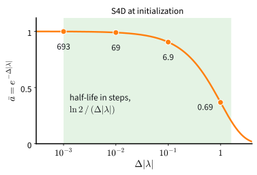

# State Space Models
:label:`sec_ssm`

The minGRU trains in parallel, but like the gated networks of
:numref:`sec_lstm` it must learn from scratch how long to remember. A
linear recurrence holds a value for a thousand steps only if its decay stays
within about 0.001 of one for all thousand steps: a decay of 0.999
has a half-life of 693 steps. The minGRU starts with decays near one half
and must find such values by gradient descent, from gradients that, at the
start, have been halved a thousand times. Nothing in the recurrence says
which memory lengths a model will need, either. The subject of a sentence
matters for a few words, the topic of a paragraph for hundreds. Physics and
control theory have long described systems whose state changes
continuously in time, such as a cooling cup of coffee or the charge on a
capacitor. Reading such a system at discrete steps gives a linear
recurrence whose decays are stable for every value of the parameters and
can be initialized to cover many timescales at once.

<!-- WRITER: opening of the split section (worklist Part 5 B.1): reader's question stated once; the
stability claim at its end goes (SSM-1, SSM-12). -->

```{.python .input #ssm-linear-recurrence-and-state-space-models}
%%tab pytorch
import math
import numpy as np
import torch
from torch import nn
from torch.nn import functional as F
from d2l import torch as d2l
```

```{.python .input #ssm-linear-recurrence-and-state-space-models}
%%tab jax
import math
import numpy as np
import jax
from jax import numpy as jnp
from flax import nnx
import optax
from d2l import jax as d2l
```

## From Continuous Time to a Recurrence

### Continuous-Time Dynamics
:label:`subsec_state-space`

The smallest case is one number $h(t)$ that changes at a rate proportional
to its own value, driven by an input $x(t)$:

$$h'(t) = \lambda\, h(t) + x(t).$$
:eqlabel:`eq_ssm_scalar`

Without input, the solution is $h(t) = e^{\lambda t} h(0)$. For $\lambda <
0$ the state decays to zero, faster for larger $|\lambda|$; with $\lambda =
-1$, a fraction $e^{-1} \approx 0.37$ remains after one unit of time. For
$\lambda > 0$ it grows without bound. The parameter $\lambda$ is a rate: it
says how fast the state forgets per unit of time, not per step.

A *state space model* (SSM) generalizes this to a vector state
$\mathbf{h}(t) \in \mathbb{R}^N$ that is driven by a scalar input $x(t)$ and
read out as a scalar output $y(t)$:

$$
\mathbf{h}'(t) = \mathbf{A}\, \mathbf{h}(t) + \mathbf{B}\, x(t),
\qquad
y(t) = \mathbf{C}\, \mathbf{h}(t) + D\, x(t).
$$
:eqlabel:`eq_ssm_cont`

The *state matrix* $\mathbf{A} \in \mathbb{R}^{N \times N}$ sets the
dynamics, $\mathbf{B} \in \mathbb{R}^N$ says how the input enters the state,
$\mathbf{C} \in \mathbb{R}^{1 \times N}$ reads the state, and $D$ passes the
input straight through. Control engineers use such models for motors and
circuits; the name says that the system is described by the space of its
states. We take $\mathbf{A} = \textrm{diag}(\lambda_1, \ldots, \lambda_N)$
diagonal, so that the model is $N$ independent copies of
:eqref:`eq_ssm_scalar`, each with its own rate, read out together by
$\mathbf{C}$. A sequence of $d$-dimensional vectors gets one such SSM per
coordinate, or *channel*, so the state of a layer holds $d \times N$
numbers, $N$ times as many as a minGRU of the same width.

### Discretization
:label:`subsec_zoh`

To process a sequence, we read the continuous system at steps of length
$\Delta$. If the input stays constant during each step, a rule called the
*zero-order hold*, then :eqref:`eq_ssm_scalar` can be solved exactly over
one step, and the result is a linear recurrence:

$$
h_t = \bar{a}\, h_{t-1} + \bar{b}\, x_t, \qquad
\bar{a} = e^{\Delta \lambda}, \qquad
\bar{b} = \frac{e^{\Delta \lambda} - 1}{\lambda}.
$$
:eqlabel:`eq_zoh`

The state decays by $e^{\Delta\lambda}$ over the step, and the input, which
enters continuously during the step, contributes $\int_0^\Delta
e^{\lambda\tau}\,d\tau = \bar{b}$ times its value
(:numref:`subsec_mdl-ode-driven-linear` derives the step, also for a full
matrix $\mathbf{A}$). For $\lambda = -1$ the
two coefficients are $\bar{a}$ and $1 - \bar{a}$, so the update reads
$h_t = \bar{a}\, h_{t-1} + (1 - \bar{a})\, x_t$: the blend of the GRU,
with $\bar{a}$ in the role of the update gate. The step size decides the
gate. With $\Delta = 0.01$ the state keeps $\bar{a} = 0.990$ of its value,
a half-life of 69 steps, and admits 1% of the input; with $\Delta = 0.1$ it
keeps 0.905, a half-life of 7 steps; with $\Delta = 1$ it keeps 0.37 and is
mostly overwritten. A small step size means a long memory.

The same formula guarantees stability. For every $\lambda < 0$ and every
$\Delta > 0$, the decay $\bar{a} = e^{\Delta\lambda}$ lies in $(0, 1)$. If we
store the rate as $\lambda = -e^{\theta}$ and learn $\theta$, then no value
of the parameters, and no gradient step, can produce a recurrence that
grows. :numref:`fig_ssm_discretization` shows the map from rates to decays.
Rates may also be complex, $\lambda = -\alpha + i\omega$, in which case the
state decays while it rotates, a damped oscillation; the models of this
chapter use real rates.


:label:`fig_ssm_discretization`

With a diagonal $\mathbf{A}$, the zero-order hold applies to each state
separately: $\bar{a}_n = e^{\Delta \lambda_n}$ and $\bar{b}_n =
(e^{\Delta \lambda_n} - 1) b_n / \lambda_n$. (For small $\Delta\lambda_n$,
the difference $e^{\Delta\lambda_n} - 1$ loses digits in floating point, so
the code computes it with `expm1`, which evaluates $e^x - 1$ accurately.)

Discretization also tells us how to initialize. State $n$ forgets with a
time constant of $1 / (\Delta |\lambda_n|)$ steps. The S4D model of
:citet:`Gu.Gupta.Goel.Re.2022`, in the variant with real rates that we
build below, sets $\lambda_n = -(n + 1)$ for $n = 0, \ldots, N-1$ and draws one step size per channel,
log-uniformly between 0.001 and 0.1. With $N = 16$ states, the time
constants then range from under one step ($\Delta = 0.1$, $\lambda = -16$)
to 1,000 steps ($\Delta = 0.001$, $\lambda = -1$): before training, the
layer already holds memories of every length in between. These rates come
from the HiPPO theory of :citet:`Gu.Dao.Ermon.ea.2020`, which designs
$\mathbf{A}$ so that the state stores the coefficients of a polynomial
approximation of the input's history; the diagonal rates above
approximate that design.

### The Convolutional Form
:label:`subsec_ssm-conv`

The scan is one way to compute all states at once, and dynamics that do not
change along the sequence allow a second. When $\bar{a}_n$, $\bar{b}_n$,
and $\mathbf{C}$ are the same at every step, the model is *linear time-invariant*, and unrolling it gives the outputs
directly in terms of the inputs. State $n$ holds
$\sum_{k \ge 0} \bar{a}_n^k \bar{b}_n x_{t-k}$, as in :eqref:`eq_lr-unrolled`,
and the readout adds the states with weights $c_n$:

$$
y_t = \sum_{k=0}^{t-1} K_k\, x_{t-k} + D x_t, \qquad
K_k = \sum_{n=1}^{N} c_n \bar{a}_n^k \bar{b}_n.
$$
:eqlabel:`eq_ssm_kernel`

The output is a *causal convolution* of the input with the kernel
$\mathbf{K} = (K_0, K_1, \ldots)$: every input contributes with a weight
that depends only on how many steps ago it arrived. The kernel is a sum of
$N$ decaying exponentials, one per state. A single state with
$\lambda = -1$, $\Delta = 0.1$, and $c = 1$ gives $K_k = 0.095 \cdot
0.905^k$, the weights of an exponential moving average.

One model therefore has three equivalent forms
(:numref:`fig_ssm_views`). The differential equation is where we choose the
parameters and see that they are stable. The recurrence is how the model
generates, one step at a time in constant memory. The convolution is a
second way to train in parallel: the convolution of two sequences of
length $T$ can be computed with the fast Fourier transform (FFT) in
$O(T \log T)$ operations, by transforming both, multiplying them, and
transforming back. The S4 model of :citet:`Gu.Goel.Re.2022` trained this
way on sequences of tens of thousands of steps, and it solved benchmarks
whose dependencies span thousands of steps. The convolution requires
dynamics that are the same at every step; the scan does not.


:label:`fig_ssm_views`

### What the Continuous-Time View Adds

@@E7@@

## S4D
:label:`subsec_s4d`

### The S4D Layer

The `S4D` layer runs one diagonal SSM with $N$ states per channel. It
stores the rates as $\lambda_n = -e^{\theta_n}$ and one step size per
channel as $\log \Delta$, initialized as described above. Following
:citet:`Gu.Gupta.Goel.Re.2022`, it fixes $\mathbf{B} = \mathbf{1}$ and lets
the learned readout $\mathbf{C}$ absorb its scale. We start with the
parameters and the method `discretize`, which applies the zero-order hold
:eqref:`eq_zoh` to every state of every channel.

```{.python .input #ssm-the-s4d-layer-1}
%%tab pytorch
class S4D(nn.Module):  #@save
    """A diagonal state space layer: N states per channel, fixed dynamics."""
    def __init__(self, num_hiddens, num_states=16, dt_min=1e-3, dt_max=1e-1):
        super().__init__()
        d, N = num_hiddens, num_states
        # Rates lambda_n = -(n + 1), stored as log(-lambda) to stay negative
        self.log_neg_rate = nn.Parameter(
            torch.log(torch.arange(1., N + 1)).repeat(d, 1))
        self.log_dt = nn.Parameter(  # Log-uniform in [dt_min, dt_max]
            torch.rand(d, 1) * math.log(dt_max / dt_min) + math.log(dt_min))
        self.C = nn.Parameter(torch.randn(d, N) / math.sqrt(N))
        self.D = nn.Parameter(torch.ones(d))

    def discretize(self):
        """Zero-order hold with B = 1: decays a_bar and input weights b_bar."""
        rate = -torch.exp(self.log_neg_rate)  # (d, N)
        dt_rate = torch.exp(self.log_dt) * rate
        return torch.exp(dt_rate), torch.expm1(dt_rate) / rate
```

```{.python .input #ssm-the-s4d-layer-1}
%%tab jax
class S4D(nnx.Module):  #@save
    """A diagonal state space layer: N states per channel, fixed dynamics."""
    def __init__(self, num_hiddens, num_states=16, dt_min=1e-3, dt_max=1e-1,
                 *, rngs):
        d, N = num_hiddens, num_states
        # Rates lambda_n = -(n + 1), stored as log(-lambda) to stay negative
        self.log_neg_rate = nnx.Param(
            jnp.tile(jnp.log(jnp.arange(1., N + 1)), (d, 1)))
        self.log_dt = nnx.Param(  # Log-uniform in [dt_min, dt_max]
            rngs.params.uniform((d, 1)) * math.log(dt_max / dt_min)
            + math.log(dt_min))
        self.C = nnx.Param(rngs.params.normal((d, N)) / math.sqrt(N))
        self.D = nnx.Param(jnp.ones(d))

    def discretize(self):
        """Zero-order hold with B = 1: decays a_bar and input weights b_bar."""
        rate = -jnp.exp(self.log_neg_rate[...])  # (d, N)
        dt_rate = jnp.exp(self.log_dt[...]) * rate
        return jnp.exp(dt_rate), jnp.expm1(dt_rate) / rate
```

For training, `forward` computes the kernel :eqref:`eq_ssm_kernel` of every
channel from the discretized parameters and convolves it with the input by
the FFT. Both sequences are padded to twice their length, because the FFT
computes a *circular* convolution, in which the end of a sequence would
otherwise wrap around and leak into its beginning.

```{.python .input #ssm-the-s4d-layer-2}
%%tab pytorch
@d2l.add_to_class(S4D)  #@save
def forward(self, X):  # X: (batch_size, num_steps, d)
    T = X.shape[1]
    a_bar, b_bar = self.discretize()
    powers = a_bar.unsqueeze(-1) ** torch.arange(T, device=X.device)
    K = ((self.C * b_bar).unsqueeze(-1) * powers).sum(1)  # Kernel, (d, T)
    Y = torch.fft.irfft(torch.fft.rfft(X, n=2 * T, dim=1) *
                        torch.fft.rfft(K.T, n=2 * T, dim=0), n=2 * T, dim=1)
    return Y[:, :T] + self.D * X
```

```{.python .input #ssm-the-s4d-layer-2}
%%tab jax
@d2l.add_to_class(S4D)  #@save
def __call__(self, X):  # X: (batch_size, num_steps, d)
    T = X.shape[1]
    a_bar, b_bar = self.discretize()
    powers = a_bar[..., None] ** jnp.arange(T)
    K = ((self.C[...] * b_bar)[..., None] * powers).sum(1)  # Kernel, (d, T)
    Y = jnp.fft.irfft(jnp.fft.rfft(X, n=2 * T, axis=1) *
                      jnp.fft.rfft(K.T, n=2 * T, axis=0), n=2 * T, axis=1)
    return Y[:, :T] + self.D[...] * X
```

For generation, `step` advances the recurrence :eqref:`eq_zoh` of every
state by one token and reads the output. Its state has $d \times N$
numbers per sequence, whatever the length of the text generated so far.

```{.python .input #ssm-the-s4d-layer-3}
%%tab pytorch
@d2l.add_to_class(S4D)  #@save
def step(self, x, h):
    """One step: x is (batch_size, d); the state h is (batch_size, d, N)."""
    a_bar, b_bar = self.discretize()
    h = a_bar * h + b_bar * x.unsqueeze(-1)
    return (h * self.C).sum(-1) + self.D * x, h
```

```{.python .input #ssm-the-s4d-layer-3}
%%tab jax
@d2l.add_to_class(S4D)  #@save
def step(self, x, h):
    """One step: x is (batch_size, d); the state h is (batch_size, d, N)."""
    a_bar, b_bar = self.discretize()
    h = a_bar * h + b_bar * x[..., None]
    return (h * self.C[...]).sum(-1) + self.D[...] * x, h
```

We check that the three forms agree on a random layer: the FFT convolution
of `forward`, the parallel scan of the recurrence, and the recurrence run
one step at a time with `step`.

```{.python .input #ssm-the-s4d-layer-4}
%%tab pytorch
layer = S4D(8, num_states=4)
X = torch.randn(2, 50, 8)  # (batch_size, num_steps, d)
with torch.no_grad():
    a_bar, b_bar = layer.discretize()
    H = d2l.linear_scan(a_bar, b_bar * X.unsqueeze(-1))  # (batch, T, d, N)
    Y_scan = (H * layer.C).sum(-1) + layer.D * X
    h, Y_step = torch.zeros(2, 8, 4), []
    for x in X.unbind(1):
        y, h = layer.step(x, h)
        Y_step.append(y)
    Y_conv = layer(X)
print(f'convolution vs scan: {(Y_conv - Y_scan).abs().max():.1e}, '
      f'convolution vs steps: {(Y_conv - torch.stack(Y_step, 1)).abs().max():.1e}')
```

```{.python .input #ssm-the-s4d-layer-4}
%%tab jax
layer = S4D(8, num_states=4, rngs=nnx.Rngs(0))
X = jax.random.normal(jax.random.key(1), (2, 50, 8))  # (batch, T, d)
a_bar, b_bar = layer.discretize()
H = d2l.linear_scan(a_bar, b_bar * X[..., None])  # (batch, T, d, N)
Y_scan = (H * layer.C[...]).sum(-1) + layer.D[...] * X
h, Y_step = jnp.zeros((2, 8, 4)), []
for x in jnp.unstack(X, axis=1):
    y, h = layer.step(x, h)
    Y_step.append(y)
Y_conv = layer(X)
print(f'convolution vs scan: {jnp.abs(Y_conv - Y_scan).max():.1e}, '
      f'convolution vs steps: {jnp.abs(Y_conv - jnp.stack(Y_step, 1)).max():.1e}')
```

The three forms agree to rounding error. The FFT and the scan both train in
parallel; for the time-invariant S4D, the FFT does so without storing the
$d \times N$ state at every position, only the kernel of length $T$ per
channel.

### Long-Range Recall

Do the timescales of the initialization matter? We return to the delayed
recall task of :numref:`sec_lstm`: a sequence starts with one of eight
symbols, and after $T - 1$ filler tokens the model must name it. There, no
network with gates that start near one half kept the symbol for 50 steps.
Here the fillers are all the same token, and the delays are 100 and 1,000
steps. Identical fillers isolate the question of timescales: a model with
fixed dynamics cannot ignore random fillers, which the next section
addresses, but identical ones add only a constant to its state. We compare
an LSTM and a minGRU whose gates start near one half, one S4D layer with
64 channels of 16 states, and two controls. The first is an S4D layer whose
step sizes start between 0.1 and 1, so that its time constants are at most
about 10 steps. The second is a minGRU whose gate biases are set so that its
decays start at the values $e^{-\Delta}$ of the slowest state of S4D, with
$\Delta$ log-uniform between 0.001 and 0.1.

```{.python .input #ssm-long-range-recall-1}
%%tab pytorch
def init_timescales(layer, dt_min=1e-3, dt_max=1e-1):  #@save
    """Start a minGRU's gates at the decays exp(-dt) of S4D."""
    dt = dt_min * (dt_max / dt_min) ** torch.rand(layer.W_z.bias.shape)
    with torch.no_grad():  # sigmoid(b) = exp(-dt)
        layer.W_z.bias.copy_(-torch.log(torch.expm1(dt)))
    return layer
```

```{.python .input #ssm-long-range-recall-1}
%%tab jax
def init_timescales(layer, dt_min=1e-3, dt_max=1e-1, *, rngs):  #@save
    """Start a minGRU's gates at the decays exp(-dt) of S4D."""
    dt = dt_min * (dt_max / dt_min) ** rngs.params.uniform(
        layer.W_z.bias.shape)
    layer.W_z.bias[...] = -jnp.log(jnp.expm1(dt))  # sigmoid(b) = exp(-dt)
    return layer
```

We reuse the model and the training function `d2l.train_delayed_recall` of
:numref:`sec_lstm`: an embedding, the sequence layer, and a classifier read
at the last position, trained with Adam on fresh batches. Here the learning
rate is 0.01.

```{.python .input #ssm-long-range-recall-2}
%%tab pytorch
# (layer, embedding width): S4D keeps its width; the others map 32 to 64
layers = {
    'LSTM': lambda: (d2l.Recurrent(d2l.init_lecun(
        nn.LSTM(32, 64, batch_first=True))), 32),
    'minGRU': lambda: (d2l.MinGRU(32, 64), 32),
    'S4D': lambda: (S4D(64), 64),
    'S4D, short timescales': lambda: (S4D(64, dt_min=0.1, dt_max=1.0), 64),
    'minGRU, S4D timescales': lambda: (init_timescales(d2l.MinGRU(32, 64)), 32)}
print(' ' * 23, '  T=100  T=1000')
for name, layer in layers.items():
    accuracy = []
    for T in [100, 1000]:
        layer_T, num_inputs = layer()
        model = d2l.RecallModel(layer_T, 64, num_inputs=num_inputs)
        accuracy.append(d2l.train_delayed_recall(model, T, blank_fillers=True,
                                                 lr=1e-2))
    print(f'{name:23s}', ' '.join(f'{a:6.2f}' for a in accuracy))
```

```{.python .input #ssm-long-range-recall-2}
%%tab jax
# (layer, embedding width): S4D keeps its width; the others map 32 to 64
layers = {
    'LSTM': lambda rngs: (nnx.RNN(nnx.LSTMCell(
        32, 64, rngs=rngs,
        recurrent_kernel_init=nnx.initializers.lecun_normal())), 32),
    'minGRU': lambda rngs: (d2l.MinGRU(32, 64, rngs=rngs), 32),
    'S4D': lambda rngs: (S4D(64, rngs=rngs), 64),
    'S4D, short timescales': lambda rngs: (
        S4D(64, dt_min=0.1, dt_max=1.0, rngs=rngs), 64),
    'minGRU, S4D timescales': lambda rngs: (init_timescales(
        d2l.MinGRU(32, 64, rngs=rngs), rngs=rngs), 32)}
print(' ' * 23, '  T=100  T=1000')
for name, layer in layers.items():
    accuracy = []
    for T in [100, 1000]:
        rngs = nnx.Rngs(d2l.get_key())
        layer_T, num_inputs = layer(rngs)
        model = d2l.RecallModel(layer_T, 64, num_inputs=num_inputs, rngs=rngs)
        accuracy.append(d2l.train_delayed_recall(model, T, blank_fillers=True,
                                                 lr=1e-2))
    print(f'{name:23s}', ' '.join(f'{a:6.2f}' for a in accuracy))
```

The LSTM and the minGRU, with gates that start near one half, are at chance
already after 100 steps. S4D recalls the symbol after 1,000 steps. The two
controls show where its advantage comes from. With short time constants,
S4D recalls the symbol after 100 steps but not after 1,000; given the time
constants of S4D, the minGRU recalls it after 1,000 steps too. On this task
the initialization decides: memories of many lengths, present from the first
step of training. The continuous-time view supplies them, together with
decays that are stable for every value of the parameters, while the
convolution makes training fast but is not needed for the result.

## Summary

A state space model derives the decays from a continuous-time system read
at steps of size $\Delta$: the decays $e^{\Delta\lambda}$ are stable for
every value of the parameters, and the initialization of S4D gives every
layer memories from one step to a thousand. With fixed dynamics the model is
also a convolution, which the FFT computes. On long-range recall, this
initialization lets S4D, and a minGRU with the same timescales, keep a
token for 1,000 steps where gates that start at one half fail. The weights
of S4D, however, depend only on distance, so it cannot choose what to keep;
the next section lets the dynamics depend on the input.

<!-- WRITER: second half of the old Summary; no stability claim (worklist Part 5 B.10). -->

## Exercises

1. [code] **How long must memories start?** `init_timescales` starts the
   minGRU's gates at half-lives of up to about 700 steps.
    1. What bias $b$ gives a gate $\sigma(b)$ with a half-life of $k$ steps?
    1. Initialize the gates with half-lives log-uniform between 1 and
       $k_\textrm{max}$ steps and repeat the long-range recall experiment
       at 1,000 steps for $k_\textrm{max} \in \{10, 30, 100, 300\}$. What
       is the smallest $k_\textrm{max}$ that solves the task? Relate it to
       the size of the gradient that reaches the first token at
       initialization.

<!-- WRITER: two new exercises planned here (worklist Part 5, Exercises): a conceptual one on a complex
rate (what an oscillating state adds; the kernel-fit cell's large weights are a lead-in: with complex
rates lambda_n = -1/2 + i*pi*n the same spike fit reaches a residual of about 0.56 with weights below 3,
measured in dev), and one on the delay-kernel fit (vary the delay and N). -->

1. [code] **Discretization rules.** The zero-order hold is one of several
   ways to turn :eqref:`eq_ssm_scalar` into a recurrence. The forward Euler
   rule uses $\bar{a} = 1 + \Delta\lambda$, the backward Euler rule
   $\bar{a} = 1/(1 - \Delta\lambda)$, and the bilinear rule $\bar{a} = (1 +
   \Delta\lambda/2)/(1 - \Delta\lambda/2)$
   (:numref:`sec_mdl-stiffness-implicit` studies the two Euler rules as
   solvers of a differential equation).
    1. For each rule, find the step sizes $\Delta$ for which every
       $\lambda < 0$ gives $|\bar{a}| < 1$. Which rule can make a stable
       continuous system unstable?
    1. Show that backward Euler with $\lambda = -1$ gives the update $h_t =
       z h_{t-1} + (1 - z) x_t$ with $z = \sigma(-\log\Delta)$, the blend of
       a GRU whose update gate has the negative logarithm of the step size as
       its pre-activation.
    1. Simulate the response of each rule to a unit step input for
       $\lambda = -1$ and $\Delta \in \{0.1, 1, 3\}$, and compare with the
       exact solution $1 - e^{-t}$.

1. [code] **Convolution by the FFT.** `S4D.forward` pads the sequence and
   the kernel to length $2T$ before the FFT.
    1. Remove the padding, so that the FFT has length $T$, and compare the
       outputs with those of `step`. Which outputs are wrong, and what has
       been added to them?
    1. What is the shortest padded length that gives the exact causal
       convolution? Why do implementations often round it up to a power of
       two?

[Discussions](https://d2l.discourse.group/t/36781)

<!-- slides -->

::: {.slide}
::: {.cover}
[Dive into Deep Learning · §12.3]{.kicker}

State space models<br>
**the step size is a gate · a learned kernel per channel · S4D as a convolution**
:::
:::
::: {.slide title="By the End of This Deck You Can"}
- read the **step size** of a discretized ODE as a gate;
- compute a time-invariant SSM as a **convolution**;
- say how the initialization of S4D affects long-range recall.

**Running example:** delayed recall over 1,000 steps.
:::

::: {.slide title="Continuous Time Gives a Decay a Rate"}
$$h'(t) = \lambda h(t) + x(t), \qquad h(t) = e^{\lambda t} h(0) \textrm{ without input}$$

A state space model, one per channel, with $N$ states:

$$\mathbf{h}'(t) = \mathbf{A}\mathbf{h}(t) + \mathbf{B}x(t), \qquad y(t) = \mathbf{C}\mathbf{h}(t) + D x(t)$$

$\mathbf{A} = \textrm{diag}(\lambda_1, \ldots, \lambda_N)$: $N$ rates per
channel, a $d \times N$ state per layer.
:::

::: {.slide title="The Step Size Is a Gate"}
Hold the input fixed over a step of length $\Delta$ (zero-order hold):

$$h_t = \bar a\, h_{t-1} + \bar b\, x_t, \qquad \bar a = e^{\Delta\lambda},\ \bar b = \frac{e^{\Delta\lambda} - 1}{\lambda}$$

| $\lambda = -1$ | $\Delta = 0.01$ | $\Delta = 0.1$ | $\Delta = 1$ |
|---|---|---|---|
| keeps $\bar a$ | 0.990 | 0.905 | 0.37 |
| half-life | 69 | 7 | 0.7 |

For $\lambda = -1$: $h_t = \bar a\,h_{t-1} + (1 - \bar a)\,x_t$, the GRU's blend.
:::

::: {.slide title="Every Negative Rate Gives a Stable Decay"}
{width=100%}

Store $\lambda = -e^\theta$: no parameter value and no gradient step can
make the recurrence grow.
:::

::: {.slide title="S4D Starts With Memories From One Step to a Thousand"}
- Rates $\lambda_n = -(n+1)$, $n = 0, \ldots, 15$.
- One step size per channel, log-uniform in $[0.001, 0.1]$.
- Time constant $1/(\Delta|\lambda_n|)$: from $1/(0.1 \cdot 16) = 0.6$ to
  $1/(0.001 \cdot 1) = 1000$ steps.

::: {.d2l-note}
The rates approximate HiPPO, a design that makes the state hold a
polynomial summary of the input's history.
:::
:::

::: {.slide title="Fixed Dynamics Make the Model a Convolution"}
$$y_t = \sum_{k=0}^{t-1} K_k\, x_{t-k} + D x_t, \qquad K_k = \sum_n c_n\, \bar a_n^k\, \bar b_n$$

{width=95%}

The FFT computes the convolution in $O(T \log T)$; pad to $2T$ so it does
not wrap around.
:::

::: {.slide title="Convolution, Scan, and Steps Agree"}
@!ssm-the-s4d-layer-4

- Train with the FFT (or the scan): all positions in parallel.
- Generate with `step`: a $d \times N$ state, whatever the length.
:::

::: {.slide title="Timescales From the Start Decide Long Recall"}
Name the first token after $T - 1$ identical fillers.

@!ssm-long-range-recall-2

::: {.d2l-note .rule}
The minGRU **with S4D's time constants** succeeds; S4D **with short ones**
fails at 1,000. The initialization decides, not the convolution.
:::
:::

::: {.slide title="Check: A Thousand-Step Memory"}
For $\lambda = -1$, which step size $\Delta$ gives a half-life of 1,000
steps?

::: {.fragment .fade-up}
$e^{-\Delta \cdot 1000} = 1/2$, so $\Delta = \ln 2 / 1000 \approx 0.0007$,
just below S4D's smallest initial step size.
:::
:::

::: {.slide title="S4D Weighs an Input by Its Distance, Not Its Content"}
- Penn Treebank: S4D about 3.35, behind the minGRU (3.2), with 16 times
  the state.
- $K_4$ is the same number whether the character four steps back ended a
  word or sat in its middle.
- The minGRU chooses its decays from the input; S4D cannot.
:::

::: {.slide title="Recap"}
| | decay | trains by | long recall at 1,000 | PTB |
|---|---|---|---|---|
| minGRU | from the input, starts at 1/2 | scan | fails | 3.2 |
| minGRU, S4D init | from the input, long | scan | succeeds | |
| S4D | fixed, rates × step sizes | FFT or scan | succeeds | 3.35 |

**Next:** combine both: decays chosen by the input, with S4D's timescales
and $N$ states per channel.
:::
