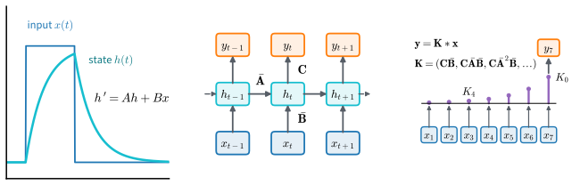

# State Space Models
:label:`sec_ssm`

How long should a memory last? The subject of a sentence matters for a few words, the topic of a paragraph for a few hundred, and the identity of a character in a novel for an entire book. In principle, the minGRU of :numref:`sec_linear-recurrence` can learn any of these timescales, yet its gates start near $\sigma(0) = 1/2$ (a half-life of one step). Retaining a symbol over 1,000 steps requires a decay near $0.999$ (half-life 693 steps), and a gradient carried back 1,000 steps through initial decays of $1/2$ shrinks by $2^{-1000}$, which underflows to zero in single precision. Nor does uniform gate initialization give each channel a diverse bank of timescales from the start.

Continuous-time dynamical systems provide a natural parameterization of multi-timescale decay. A *state space model* (SSM) treats each channel's memory as a bank of continuous-time linear differential equations with distinct decay rates, sampled at discrete step size $\Delta$. Discretizing the system yields a linear recurrence whose per-step decay is set by the product of a state rate and a channel step size—letting us initialize a wide spectrum of half-lives before training begins, give each channel $N$ timescales at once, and evaluate time-invariant dynamics in parallel as a causal convolution via the FFT. Below we derive exact zero-order-hold discretization, implement the diagonal S4D layer of :citet:`Gu.Gupta.Goel.Re.2022`, and test on 1,000-step delayed recall whether multi-timescale initialization is the key ingredient for long-range memory.

```{.python .input #ssm-linear-recurrence-and-state-space-models}
%%tab pytorch
import math
import numpy as np
import torch
from torch import nn
from torch.nn import functional as F
from d2l import torch as d2l
```

```{.python .input #ssm-linear-recurrence-and-state-space-models}
%%tab jax
import math
import numpy as np
import jax
from jax import numpy as jnp
from flax import nnx
import optax
from d2l import jax as d2l
```

## From Continuous Time to a Recurrence

### Continuous-Time Dynamics
:label:`subsec_state-space`

Start with a scalar state $h(t)$ that decays at rate $\lambda$ while driven by an input signal $x(t)$:

$$h'(t) = \lambda\, h(t) + x(t).$$
:eqlabel:`eq_ssm_scalar`

With $x(t) = 0$, the solution is $h(t) = e^{\lambda t} h(0)$. Stability requires $\lambda < 0$, so that $h(t)$ decays exponentially (at $\lambda = -1$, a fraction $e^{-1} \approx 0.37$ remains after one unit of continuous time), whereas $\lambda > 0$ grows without bound. Crucially, $\lambda$ is a decay rate *per unit of time*, not per token step.

A *state space model* (SSM) generalizes :eqref:`eq_ssm_scalar` to an $N$-dimensional state vector $\mathbf{h}(t) \in \mathbb{R}^N$ driven by a scalar input $x(t)$ and projected to a scalar output $y(t)$:

$$
\begin{aligned}
\mathbf{h}'(t) &= \mathbf{A}\, \mathbf{h}(t) + \mathbf{B}\, x(t), \\
y(t) &= \mathbf{C}\, \mathbf{h}(t) + D\, x(t),
\end{aligned}
$$
:eqlabel:`eq_ssm_cont`

where $\mathbf{B} \in \mathbb{R}^N$ projects the input into the state, the *state matrix* $\mathbf{A} \in \mathbb{R}^{N \times N}$ evolves the state, $\mathbf{C} \in \mathbb{R}^{1 \times N}$ reads it out, and $D \in \mathbb{R}$ is a direct skip connection.

We restrict $\mathbf{A} = \textrm{diag}(\lambda_1, \ldots, \lambda_N)$ to be diagonal, reducing :eqref:`eq_ssm_cont` to $N$ independent copies of :eqref:`eq_ssm_scalar` evolving at rates $\lambda_1, \ldots, \lambda_N$ and linearly combined by $\mathbf{C}$. While a dense $\mathbf{A}$ costs $O(N^2)$ per step and $O(N^3)$ per associative scan combine, a diagonal $\mathbf{A}$ costs $O(N)$ scalar operations. Over the complex numbers, almost every matrix is diagonalizable and $\mathbf{B}, \mathbf{C}$ absorb the eigenvector change of basis, so diagonal structure sacrifices almost no expressive power :cite:`Gu.Gupta.Goel.Re.2022`. Using *real* rates $\lambda_n < 0$ drops oscillatory modes ($\lambda = -\alpha + i\omega$, explored in the exercises) in exchange for purely real arithmetic.

An SSM layer processes a $d$-dimensional input sequence by running one such $N$-state system independently per coordinate (*channel*), giving a total layer state of $d \times N$ numbers—$N$ times larger than a minGRU of width $d$.

### Discretization
:label:`subsec_zoh`

To apply :eqref:`eq_ssm_cont` to a discrete token sequence, we sample the system at intervals of step size $\Delta$, so step $t$ corresponds to continuous time $t\Delta$. Holding the input constant at $x_t$ over the interval $((t-1)\Delta, t\Delta]$—the *zero-order hold* (ZOH) assumption—allows us to integrate :eqref:`eq_ssm_scalar` exactly. Since $\frac{\textrm{d}}{\textrm{d}t}(h + x_t/\lambda) = \lambda(h + x_t/\lambda)$, the shifted state $h + x_t/\lambda$ decays by $e^{\Delta\lambda}$ over one step: $h_t + x_t/\lambda = e^{\Delta\lambda}(h_{t-1} + x_t/\lambda)$. Rearranging yields the exact discrete linear recurrence:

$$
\begin{aligned}
h_t &= \bar{a}\, h_{t-1} + \bar{b}\, x_t, \\
\bar{a} &= e^{\Delta \lambda}, \qquad
\bar{b} = \frac{e^{\Delta \lambda} - 1}{\lambda}.
\end{aligned}
$$
:eqlabel:`eq_zoh`

When $\lambda = -1$, we have $\bar{b} = 1 - \bar{a}$, so :eqref:`eq_zoh` becomes the convex combination $h_t = \bar{a}\, h_{t-1} + (1 - \bar{a})\, x_t$—identical to the GRU update :eqref:`eq_mingru` with $\bar{a} = e^{-\Delta}$ acting as the update gate. The step size $\Delta$ directly controls memory length: at $\lambda = -1$, $\Delta = 0.01$ gives $\bar{a} = 0.990$ (half-life 69 steps), $\Delta = 0.1$ gives $\bar{a} = 0.905$ (half-life 7 steps), and $\Delta = 1$ gives $\bar{a} = 0.37$.

Parameterizing $\lambda = -e^\theta < 0$ and $\Delta > 0$ guarantees $\bar{a} = e^{\Delta\lambda} \in (0, 1)$, just like a sigmoid gate. What is new is the factored structure of the half-life $\ln 2 / (\Delta|\lambda|)$ (:numref:`fig_ssm_discretization`): the $N$ rates $\lambda_1, \ldots, \lambda_N$ spread the states of a channel across distinct relative timescales, while the single channel step size $\Delta$ dilates or compresses all $N$ timescales together.


:label:`fig_ssm_discretization`

For a diagonal $\mathbf{A}$, ZOH applies elementwise: $\bar{a}_n = e^{\Delta \lambda_n}$ and $\bar{b}_n = (e^{\Delta \lambda_n} - 1) b_n / \lambda_n$ (computed via `expm1` to avoid catastrophic cancellation when $\Delta\lambda_n$ is small; for the dense matrix exponential $\bar{\mathbf{A}} = e^{\Delta\mathbf{A}}$, see :numref:`subsec_mdl-ode-driven-linear`).

Real-valued S4D initializes $\lambda_n = -n$ for $n = 1, \ldots, N$ (the diagonal of the HiPPO legendre projection matrix :cite:`Gu.Dao.Ermon.ea.2020`) and draws each channel's step size $\Delta$ log-uniformly from $[0.001, 0.1]$. With $N = 16$, initial half-lives span from under half a step ($\Delta = 0.1, \lambda = -16$) to 693 steps ($\Delta = 0.001, \lambda = -1$), covering the shaded band of :numref:`fig_ssm_discretization` before a single gradient step is taken.

### The Convolutional Form
:label:`subsec_ssm-conv`

When $\bar{a}_n$, $\bar{b}_n$, and $\mathbf{C}$ do not vary with token position $t$, the system is *linear time-invariant* (LTI). Unrolling :eqref:`eq_zoh` from $\mathbf{h}_0 = \mathbf{0}$ shows that state $n$ accumulates $\sum_{k \ge 0} \bar{a}_n^k \bar{b}_n x_{t-k}$, and the readout $\mathbf{C}$ sums the $N$ states into a single *causal convolution*:

$$
\begin{aligned}
y_t &= \sum_{k=0}^{t-1} K_k\, x_{t-k} + D x_t, \\
K_k &= \sum_{n=1}^{N} c_n \bar{a}_n^k \bar{b}_n.
\end{aligned}
$$
:eqlabel:`eq_ssm_kernel`

Each channel's impulse response $\mathbf{K} = (K_0, K_1, \ldots)$ is a linear combination of $N$ decaying exponentials. A time-invariant SSM therefore admits three equivalent views (:numref:`fig_ssm_views`):

1. **Continuous-time ODE**, where parameters specify rates and step sizes;
2. **Discrete recurrence**, used during autoregressive generation in $O(1)$ time and state per token;
3. **Causal convolution**, evaluated across all $T$ training positions in $O(T \log T)$ work via the Fast Fourier Transform (FFT). S4 :cite:`Gu.Goel.Re.2022` used this convolutional view to solve the 16,384-step Path-X benchmark. Note that the convolutional view requires time-invariant dynamics, whereas the parallel scan of :numref:`sec_linear-recurrence` works even when decays vary per token.


:label:`fig_ssm_views`

### Timescales and Learned Kernels

What does a multi-state diagonal SSM add beyond setting a minGRU's initial gate biases to match S4D's decays? First, the single step size $\Delta$ per channel scales all $N$ timescales together, which :numref:`sec_mamba` will make input-dependent. Second, combining $N$ states via the readout $\mathbf{C}$ lets each channel shape a convolutional kernel $K_k = \sum_{n=1}^N c_n \bar{a}_n^k \bar{b}_n$ that is a sum of $N$ exponentials rather than a single monotone decay.

How closely can $N$ real exponentials approximate a non-monotone delay kernel? Suppose a channel needs to read the input from 20 steps back: either a sharp spike ($K_{20} = 1$, zero elsewhere) or a smooth Gaussian bump around lag 20. A single state ($N = 1$) always peaks at lag $0$. Below we fit the readout weights $\mathbf{c}$ of $N \in \{1, 4, 16\}$ states (at S4D rates $\lambda_n = -n$ and fixed $\Delta = 0.05$) by least squares and inspect both the relative residual error $\|\mathbf{K} - \textrm{target}\| / \|\textrm{target}\|$ and the magnitude of the required readout weights $|\mathbf{c}|_\infty$.

```{.python .input #ssm-what-the-continuous-time-view-adds}
%%tab pytorch, jax
def fit_kernel(N, target, dt=0.05):
    """Fit the readout c of N states at S4D's rates to a target kernel."""
    rate = -np.arange(1., N + 1)
    a_bar, b_bar = np.exp(dt * rate), np.expm1(dt * rate) / rate
    basis = a_bar ** np.arange(len(target))[:, None] * b_bar  # K = basis @ c
    c = np.linalg.lstsq(basis, target, rcond=None)[0]
    K = basis @ c
    return K, c, np.linalg.norm(K - target) / np.linalg.norm(target)

k = np.arange(100)
spike = (k == 20).astype(float)      # Exactly the input 20 steps back
bump = np.exp(-(k - 20) ** 2 / 32)   # About 20 steps back, give or take 4
print(' N  peak  spike |c|  spike residual  bump |c|  bump residual')
for N in [1, 4, 16]:
    K, c, spike_error = fit_kernel(N, spike)
    _, c_bump, bump_error = fit_kernel(N, bump)
    print(f'{N:2d}  {K.argmax():4d}  {np.abs(c).max():9.0e}  '
          f'{spike_error:14.2f}  {np.abs(c_bump).max():8.0e}  '
          f'{bump_error:13.2f}')
```

With $N = 1$, the kernel peaks at lag 0 and misses both targets. With $N = 16$, the peak shifts to lag 20 and fits the smooth bump to 0.03 relative error, while the sharp spike remains poorly approximated (0.89 error). Look at `|c|`, however: achieving that fit with real exponentials requires readout weights around $10^{11}$ of alternating sign that nearly cancel, because real exponentials $e^{-n\Delta k}$ are severely ill-conditioned as a basis. Gradient descent from order-one weights cannot reach such cancellation, so real-valued SSM kernels remain broad averages over time windows (whereas complex oscillatory rates $\lambda = -\alpha + i\omega$ provide an orthogonal Fourier-like basis; see Exercise 3).

## A Diagonal State Space Layer
:label:`subsec_s4d`

### The S4D Layer

The `S4D` layer maintains $N$ real states for each of its $d$ channels. It parameterizes rates as $\lambda_n = -e^{\theta_n} < 0$ (`log_neg_rate`) and step sizes via `log_dt`, fixes $\mathbf{B} = \mathbf{1}$ (since only the product $b_n c_n$ enters :eqref:`eq_ssm_kernel` and $\mathbf{C}$ is learned), and computes $(\bar{\mathbf{a}}, \bar{\mathbf{b}})$ in `discretize` via :eqref:`eq_zoh`.

```{.python .input #ssm-the-s4d-layer-1}
%%tab pytorch
class S4D(nn.Module):  #@save
    """A diagonal state space layer: N states per channel, fixed dynamics."""
    def __init__(self, num_hiddens, num_states=16, dt_min=1e-3, dt_max=1e-1):
        super().__init__()
        d, N = num_hiddens, num_states
        # lambda_n = -n for n = 1..N, stored as log(-lambda) to stay negative
        self.log_neg_rate = nn.Parameter(
            torch.log(torch.arange(1., N + 1)).repeat(d, 1))
        self.log_dt = nn.Parameter(  # Log-uniform in [dt_min, dt_max]
            torch.rand(d, 1) * math.log(dt_max / dt_min) + math.log(dt_min))
        self.C = nn.Parameter(torch.randn(d, N) / math.sqrt(N))
        self.D = nn.Parameter(torch.ones(d))

    def discretize(self):
        """Zero-order hold with B = 1: decays a_bar and input weights b_bar."""
        rate = -torch.exp(self.log_neg_rate)  # (d, N)
        dt_rate = torch.exp(self.log_dt) * rate
        return torch.exp(dt_rate), torch.expm1(dt_rate) / rate
```

```{.python .input #ssm-the-s4d-layer-1}
%%tab jax
class S4D(nnx.Module):  #@save
    """A diagonal state space layer: N states per channel, fixed dynamics."""
    def __init__(self, num_hiddens, num_states=16, dt_min=1e-3, dt_max=1e-1,
                 *, rngs):
        d, N = num_hiddens, num_states
        # lambda_n = -n for n = 1..N, stored as log(-lambda) to stay negative
        self.log_neg_rate = nnx.Param(
            jnp.tile(jnp.log(jnp.arange(1., N + 1)), (d, 1)))
        self.log_dt = nnx.Param(  # Log-uniform in [dt_min, dt_max]
            rngs.params.uniform((d, 1)) * math.log(dt_max / dt_min)
            + math.log(dt_min))
        self.C = nnx.Param(rngs.params.normal((d, N)) / math.sqrt(N))
        self.D = nnx.Param(jnp.ones(d))

    def discretize(self):
        """Zero-order hold with B = 1: decays a_bar and input weights b_bar."""
        rate = -jnp.exp(self.log_neg_rate[...])  # (d, N)
        dt_rate = jnp.exp(self.log_dt[...]) * rate
        return jnp.exp(dt_rate), jnp.expm1(dt_rate) / rate
```

During training, the forward pass forms the length-$T$ kernel :eqref:`eq_ssm_kernel` for every channel and performs causal convolution via a zero-padded length-$2T$ FFT (preventing circular wrap-around).

```{.python .input #ssm-the-s4d-layer-2}
%%tab pytorch
@d2l.add_to_class(S4D)  #@save
def forward(self, X):  # X: (batch_size, num_steps, d)
    T = X.shape[1]
    a_bar, b_bar = self.discretize()
    # All powers a_bar^k for k < T: d * N * T numbers held in memory
    powers = a_bar.unsqueeze(-1) ** torch.arange(T, device=X.device)
    K = ((self.C * b_bar).unsqueeze(-1) * powers).sum(1)  # Kernel, (d, T)
    Y = torch.fft.irfft(torch.fft.rfft(X, n=2 * T, dim=1) *
                        torch.fft.rfft(K.T, n=2 * T, dim=0), n=2 * T, dim=1)
    return Y[:, :T] + self.D * X
```

```{.python .input #ssm-the-s4d-layer-2}
%%tab jax
@d2l.add_to_class(S4D)  #@save
def __call__(self, X):  # X: (batch_size, num_steps, d)
    T = X.shape[1]
    a_bar, b_bar = self.discretize()
    # All powers a_bar^k for k < T: d * N * T numbers held in memory
    powers = a_bar[..., None] ** jnp.arange(T)
    K = ((self.C[...] * b_bar)[..., None] * powers).sum(1)  # Kernel, (d, T)
    Y = jnp.fft.irfft(jnp.fft.rfft(X, n=2 * T, axis=1) *
                      jnp.fft.rfft(K.T, n=2 * T, axis=0), n=2 * T, axis=1)
    return Y[:, :T] + self.D[...] * X
```

During autoregressive generation, `step` advances the $d \times N$ recurrent state by one token in $O(dN)$ time and constant memory.

```{.python .input #ssm-the-s4d-layer-3}
%%tab pytorch
@d2l.add_to_class(S4D)  #@save
def step(self, x, h):
    """One step: x is (batch_size, d); the state h is (batch_size, d, N)."""
    a_bar, b_bar = self.discretize()
    h = a_bar * h + b_bar * x.unsqueeze(-1)
    return (h * self.C).sum(-1) + self.D * x, h
```

```{.python .input #ssm-the-s4d-layer-3}
%%tab jax
@d2l.add_to_class(S4D)  #@save
def step(self, x, h):
    """One step: x is (batch_size, d); the state h is (batch_size, d, N)."""
    a_bar, b_bar = self.discretize()
    h = a_bar * h + b_bar * x[..., None]
    return (h * self.C[...]).sum(-1) + self.D[...] * x, h
```

Let us verify that the FFT convolution, the parallel `linear_scan`, and sequential `step` evaluation agree to single-precision floating-point tolerance.

```{.python .input #ssm-the-s4d-layer-4}
%%tab pytorch
layer = S4D(8, num_states=4)
X = torch.randn(2, 50, 8)  # (batch_size, num_steps, d)
with torch.no_grad():
    a_bar, b_bar = layer.discretize()
    H = d2l.linear_scan(a_bar, b_bar * X.unsqueeze(-1))  # (batch, T, d, N)
    Y_scan = (H * layer.C).sum(-1) + layer.D * X
    h, Y_step = torch.zeros(2, 8, 4), []
    for x in X.unbind(1):
        y, h = layer.step(x, h)
        Y_step.append(y)
    Y_conv = layer(X)
Y_step = torch.stack(Y_step, 1)
print(f'convolution vs scan: {(Y_conv - Y_scan).abs().max():.1e}, '
      f'convolution vs steps: {(Y_conv - Y_step).abs().max():.1e}')
```

```{.python .input #ssm-the-s4d-layer-4}
%%tab jax
layer = S4D(8, num_states=4, rngs=nnx.Rngs(0))
X = jax.random.normal(jax.random.key(1), (2, 50, 8))  # (batch, T, d)
a_bar, b_bar = layer.discretize()
H = d2l.linear_scan(a_bar, b_bar * X[..., None])  # (batch, T, d, N)
Y_scan = (H * layer.C[...]).sum(-1) + layer.D[...] * X
h, Y_step = jnp.zeros((2, 8, 4)), []
for x in jnp.unstack(X, axis=1):
    y, h = layer.step(x, h)
    Y_step.append(y)
Y_conv = layer(X)
Y_step = jnp.stack(Y_step, 1)
print(f'convolution vs scan: {jnp.abs(Y_conv - Y_scan).max():.1e}, '
      f'convolution vs steps: {jnp.abs(Y_conv - Y_step).max():.1e}')
```

All three views match to $\sim 10^{-7}$. Notice that for LTI layers, the FFT convolution avoids materializing the four-dimensional $(B, T, d, N)$ intermediate state tensor across the batch, requiring only the $(d, N, T)$ kernel powers.

### Long-Range Recall

To test whether initial timescales govern long-range memory, we return to the delayed recall benchmark of :numref:`sec_lstm` at delays of $T = 100$ and $T = 1{,}000$ steps, using identical blank fillers (`blank_fillers=True`) so the task tests pure retention duration rather than content-based filtering (:numref:`sec_mamba`).

We compare four configurations:

1. **Default `minGRU`**, whose gates start near $1/2$;
2. **Default `S4D`** ($d = 64, N = 16$, $\Delta \in [0.001, 0.1]$, half-lives up to 693 steps);
3. **`S4D, short timescales`**, initialized with $\Delta \in [0.1, 1.0]$ so no initial half-life exceeds 7 steps;
4. **`minGRU, S4D timescales`**, whose update-gate biases are initialized via `init_timescales` so $\sigma(b) = e^{-\Delta}$ with $\Delta \in [0.001, 0.1]$ ($b = -\log(e^\Delta - 1)$), matching the slowest state of each S4D channel.

```{.python .input #ssm-long-range-recall-1}
%%tab pytorch
def init_timescales(layer, dt_min=1e-3, dt_max=1e-1):  #@save
    """Start a minGRU's gates at the decays exp(-dt) of S4D."""
    dt = dt_min * (dt_max / dt_min) ** torch.rand(layer.W_z.bias.shape)
    with torch.no_grad():  # sigmoid(b) = exp(-dt)
        layer.W_z.bias.copy_(-torch.log(torch.expm1(dt)))
    return layer
```

```{.python .input #ssm-long-range-recall-1}
%%tab jax
def init_timescales(layer, dt_min=1e-3, dt_max=1e-1, *, rngs):  #@save
    """Start a minGRU's gates at the decays exp(-dt) of S4D."""
    dt = dt_min * (dt_max / dt_min) ** rngs.params.uniform(
        layer.W_z.bias.shape)
    layer.W_z.bias[...] = -jnp.log(jnp.expm1(dt))  # sigmoid(b) = exp(-dt)
    return layer
```

We train two seeds of each model via `d2l.train_delayed_recall` (1,500 steps of Adam at learning rate $3 \times 10^{-3}$) and also print the slowest half-life $\ln 2 / \min_{d,n}(\Delta|\lambda_n|)$ after training for the two S4D variants.

```{.python .input #ssm-long-range-recall-2}
%%tab pytorch
# (layer, embedding width): S4D keeps its width; the minGRUs map 32 to 64
layers = {
    'minGRU': lambda: (d2l.MinGRU(32, 64), 32),
    'S4D': lambda: (S4D(64), 64),
    'S4D, short timescales': lambda: (S4D(64, dt_min=0.1, dt_max=1.0), 64),
    'minGRU, S4D timescales': lambda: (
        init_timescales(d2l.MinGRU(32, 64)), 32)}

def recall(make_layer, T):
    """Train a fresh model at delay T; return its test accuracy and layer."""
    layer, num_inputs = make_layer()
    model = d2l.RecallModel(layer, 64, num_inputs=num_inputs)
    return d2l.train_delayed_recall(model, T, blank_fillers=True), layer

def slowest_half_life(layer):  # ln 2 / min(dt |lambda|), in steps
    rates = torch.exp(layer.log_dt + layer.log_neg_rate).detach()
    return math.log(2) / rates.min().item()

runs = {name: {T: [recall(make_layer, T) for _ in range(2)]  # Two runs each
               for T in [100, 1000]} for name, make_layer in layers.items()}
print(f"{'accuracy':23s} {'T=100':^11s}  {'T=1000':^11s}")
for name, by_T in runs.items():
    print(f'{name:23s}', '  '.join(' '.join(f'{acc:5.2f}' for acc, _ in r)
                                   for r in by_T.values()))
print('slowest half-life after training, in steps')
for name in ['S4D', 'S4D, short timescales']:
    print(f'{name:23s}', '  '.join(' '.join(
        f'{slowest_half_life(layer):5.0f}' for _, layer in r)
        for r in runs[name].values()))
```

```{.python .input #ssm-long-range-recall-2}
%%tab jax
# (layer, embedding width): S4D keeps its width; the minGRUs map 32 to 64
layers = {
    'minGRU': lambda rngs: (d2l.MinGRU(32, 64, rngs=rngs), 32),
    'S4D': lambda rngs: (S4D(64, rngs=rngs), 64),
    'S4D, short timescales': lambda rngs: (
        S4D(64, dt_min=0.1, dt_max=1.0, rngs=rngs), 64),
    'minGRU, S4D timescales': lambda rngs: (init_timescales(
        d2l.MinGRU(32, 64, rngs=rngs), rngs=rngs), 32)}

def recall(make_layer, T):
    """Train a fresh model at delay T; return its test accuracy and layer."""
    rngs = nnx.Rngs(d2l.get_key())
    layer, num_inputs = make_layer(rngs)
    model = d2l.RecallModel(layer, 64, num_inputs=num_inputs, rngs=rngs)
    return d2l.train_delayed_recall(model, T, blank_fillers=True), layer

def slowest_half_life(layer):  # ln 2 / min(dt |lambda|), in steps
    rates = jnp.exp(layer.log_dt[...] + layer.log_neg_rate[...])
    return math.log(2) / rates.min().item()

runs = {name: {T: [recall(make_layer, T) for _ in range(2)]  # Two runs each
               for T in [100, 1000]} for name, make_layer in layers.items()}
print(f"{'accuracy':23s} {'T=100':^11s}  {'T=1000':^11s}")
for name, by_T in runs.items():
    print(f'{name:23s}', '  '.join(' '.join(f'{acc:5.2f}' for acc, _ in r)
                                   for r in by_T.values()))
print('slowest half-life after training, in steps')
for name in ['S4D', 'S4D, short timescales']:
    print(f'{name:23s}', '  '.join(' '.join(
        f'{slowest_half_life(layer):5.0f}' for _, layer in r)
        for r in runs[name].values()))
```

The outcome tracks initial timescales rather than layer class: at $T = 1{,}000$, both `S4D` and `minGRU, S4D timescales` achieve 100% accuracy across all runs, whereas default `minGRU` and `S4D, short timescales` remain stuck at chance ($0.12$). Notice why `S4D, short timescales` still succeeds at $T = 100$: even though its slowest initial half-life is 7 steps, the attenuation over 99 steps is $e^{-0.1 \times 99} \approx 5 \times 10^{-5}$, which remains above float32 precision and supplies enough gradient signal for Adam to stretch the slowest half-life to 100–200 steps. Over 999 steps, however, $e^{-100} \approx 10^{-44}$ vanishes below machine precision, leaving the slowest half-life frozen near 7 steps.

Yet time-invariant dynamics have a fundamental blind spot: every token at lag $k$ receives the exact same weight $K_k$, regardless of whether that token was a crucial symbol or an uninformative filler. In :numref:`sec_mamba`, we combine S4D's multi-timescale state bank with input-dependent selection by letting each token choose its own step size $\Delta_t$.

## Summary

Discretizing a continuous-time diagonal state space model $\mathbf{h}'(t) = \mathbf{A}\mathbf{h}(t) + \mathbf{B}x(t)$ with rates $\lambda_n < 0$ under zero-order hold at step size $\Delta$ yields a linear recurrence with decays $\bar{a}_n = e^{\Delta\lambda_n}$ and half-lives $\ln 2 / (\Delta|\lambda_n|)$. Initializing $\lambda_n = -n$ and drawing $\Delta$ log-uniformly across $[0.001, 0.1]$ equips each channel of `S4D` with $N$ exponentially decaying states spanning half-lives from under 1 step to nearly 700 steps. Because its parameters are time-invariant, `S4D` can be evaluated equivalently as an $O(1)$-state recurrence at inference time or as a causal convolution via the FFT during training. On 1,000-step delayed recall, starting with long-timescale decays—whether in `S4D` or transferred to `minGRU` gate biases—is the decisive factor that enables learning, though fixed dynamics still cannot selectively ignore irrelevant inputs.

## Exercises

1. [code] **Discretization rules.** The zero-order hold is one of several
   ways to turn :eqref:`eq_ssm_scalar` into a recurrence. The forward Euler
   rule uses $\bar{a} = 1 + \Delta\lambda$, the backward Euler rule
   $\bar{a} = 1/(1 - \Delta\lambda)$, and the bilinear rule $\bar{a} = (1 +
   \Delta\lambda/2)/(1 - \Delta\lambda/2)$
   (:numref:`sec_mdl-stiffness-implicit` studies the two Euler rules as
   solvers of a differential equation).
    1. For each rule, find the step sizes $\Delta$ for which every
       $\lambda < 0$ gives $|\bar{a}| < 1$. Which rule can make a stable
       continuous system unstable?
    1. Show that backward Euler with $\lambda = -1$ gives the update $h_t =
       z h_{t-1} + (1 - z) x_t$ with $z = \sigma(-\log\Delta)$, the blend of
       a GRU whose update gate has the negative logarithm of the step size as
       its pre-activation.
    1. Simulate the response of each rule to a unit step input for
       $\lambda = -1$ and $\Delta \in \{0.1, 1, 3\}$, and compare with the
       exact solution $1 - e^{-t}$.

1. [code] **Delays and kernels.** Use `fit_kernel` to study which memories
   $N$ real exponentials can represent.
    1. Fit a unit spike at delays 5, 20, and 50 with $N = 16$ states and
       $\Delta = 0.05$. How does the error change with the delay? Relate
       your answer to the half-lives of the slowest and the fastest state.
    1. Fit the spike at delay 20 for step sizes $\Delta$ between 0.01 and
       0.2. Which $\Delta$ fits best? What does this suggest about how a
       trained S4D should set the step size of a channel that needs a
       memory of a particular length?
    1. Fit $\mathbf{c}$ by gradient descent from zero (Adam, a few thousand
       steps) instead of least squares. How close do you come to the
       least-squares error for the bump, and for the spike? What do the
       weights of the least-squares fits predict?

1. [code] **Complex rates.** A state with the complex rate $\lambda =
   -\alpha + i\omega$, $\alpha > 0$, decays while it rotates.
    1. Show that the zero-order hold gives $\bar{a} = e^{-\alpha\Delta}
       e^{i\omega\Delta}$, and that two states with conjugate rates, input
       weights, and readout weights contribute a real kernel $K_k = r\,
       e^{-\alpha\Delta k} \cos(\omega\Delta k + \varphi)$ for some $r \ge 0$
       and $\varphi$. How many real parameters does such a pair have, and
       how many does a pair of real states have?
    1. Which kernels can such pairs represent that real rates cannot? Think
       of an input that repeats with a fixed period.
    1. Change `fit_kernel` to use the complex rates $\lambda_m = -1/2 + i\pi
       m$ for $m = 0, \ldots, N-1$ (the S4D-Lin initialization of
       :citet:`Gu.Gupta.Goel.Re.2022`) and to fit the real part of the
       kernel. For the spike at delay 20, compare the error and the size of
       the weights with the fit of real rates, and explain the difference.

1. [code] **Convolution by the FFT.** The forward pass of `S4D` pads the
   sequence and the kernel to length $2T$ before the FFT.
    1. Remove the padding, so that the FFT has length $T$, and compare the
       outputs with those of `step`. Which outputs are wrong, and what has
       been added to them?
    1. What is the shortest padded length that gives the exact causal
       convolution? Why do implementations often round it up to a power of
       two?

[Discussions](https://d2l.discourse.group/t/36781)

<!-- slides -->

::: {.slide}
::: {.cover}
[Dive into Deep Learning · §12.4]{.kicker}

Structured State Space Models (S4D)<br>**continuous-time dynamics · zero-order-hold discretization · ODE–recurrence–convolution trinity · multi-timescale initialization**
:::
:::

::: {.slide title="Why Multi-Timescale Memory Needs Structured Decays"}
[Motivation]{.kicker}

::: {.cols .vc}
::: {.col}
- **Three Orders of Magnitude:** Language spans 10-token syntax, 200-token paragraph topics, and 1,000+ token entity persistence.
- **Zero-Bias Underflow:** Gates at $\sigma(0) = 0.5$ attenuate a 1,000-step signal by $2^{-1000} = 0$ in `float32`.
- **Structured State Bank:** Continuous-time SSMs give each channel $N$ log-spaced decay rates $\lambda_1, \ldots, \lambda_N$ scaled by $\Delta$.
:::

::: {.col .fig .big}
@fig:ch12-mrnn-timescale-hierarchy
:::
:::
:::

::: {.slide title="Continuous-Time Linear State Space Models (ODE View)"}
[Continuous-Time Dynamics]{.kicker}

::: {.cols .vc}
::: {.col}
$$\mathbf{h}'(t) = \mathbf{A}\,\mathbf{h}(t) + \mathbf{B}\,x(t), \qquad y(t) = \mathbf{C}\,\mathbf{h}(t) + D\,x(t)$$

- **Exponential Stability:** Negative real parts $\textrm{Re}(\lambda_n) < 0$ ensure homogeneous solutions $e^{\lambda_n t}$ decay smoothly without explosion.
- **Four Operators:** Write vector $\mathbf{B}$, state evolution matrix $\mathbf{A} \in \mathbb{C}^{N \times N}$, readout $\mathbf{C}$, and skip $D$.
:::

::: {.col .fig}
@fig:ch12-mrnn-continuous-ssm-block
:::
:::
:::

::: {.slide title="Diagonal State Matrices: N Leaky Integrators/Channel"}
[Diagonal Structure]{.kicker}

::: {.cols .vc}
::: {.col}
$$h_n'(t) = \lambda_n\, h_n(t) + b_n\, x(t), \quad y(t) = \sum_{n=1}^{N} c_n\, h_n(t) + D\, x(t)$$

- **Decoupled $O(N)$ Bank:** Diagonal $\mathbf{A} = \textrm{diag}(\lambda_1, \ldots, \lambda_N)$ turns an $O(N^2)$ matrix ODE into $N$ parallel scalar leaky integrators per channel ($d \times N$ total state).
- **Real vs. Complex Diagonal:** Real rates $\lambda_n = -e^{\theta_n}$ give smooth decay windows; complex rates add oscillation.
:::

::: {.col .fig}
@fig:ch12-mrnn-diagonal-ode-bank
:::
:::
:::

::: {.slide title="Exact Discretization via Zero-Order Hold (ZOH)"}
[From Continuous to Discrete]{.kicker}

::: {.cols .vc}
::: {.col}
$$h_t = \bar{a}\, h_{t-1} + \bar{b}\, x_t, \quad \bar{a} = e^{\Delta\lambda}, \quad \bar{b} = \frac{e^{\Delta\lambda} - 1}{\lambda}$$

- **Zero-Order Hold:** Holding $x(\tau) \equiv x_t$ constant on $((t-1)\Delta, t\Delta]$ integrates the linear ODE in closed form.
- **Numerical Stability:** Evaluate $\bar{b}$ via `expm1(dt * rate) / rate` to avoid cancellation when $\Delta|\lambda| \ll 1$.
:::

::: {.col .fig}
@fig:ch12-mrnn-zoh-step-hold
:::
:::
:::

::: {.slide title="The Step Size Δ Acts as a Timescale Dilation Gate"}
[Step Size vs. Update Gate]{.kicker}

::: {.cols .vc}
::: {.col}
$$h_t = e^{-\Delta}\, h_{t-1} + (1 - e^{-\Delta})\, x_t, \qquad \tau_{1/2} = \frac{\ln 2}{\Delta|\lambda|}$$

- **Exact Convex Blend ($\lambda = -1$):** Discretized ZOH matches the GRU/`minGRU` update with keep gate $\bar{a} = e^{-\Delta}$.
- **Inverse Timescale Law:** Shrinking $\Delta$ from $1.0$ to $0.001$ dilates discrete memory half-life from $0.7$ to $693$ steps.
:::

::: {.col .fig}
@fig:ch12-mrnn-delta-dilation-table
:::
:::
:::

::: {.slide title="Factored Half-Lives and the S4D Initialization Band"}
[Multi-Timescale Initialization]{.kicker}

::: {.cols .vc}
::: {.col}
- **Factored half-life:** With $\lambda_n < 0$ and channel step size $\Delta_c > 0$, state $(c, n)$ has half-life:
  $$\tau_{1/2}(c, n) = \frac{\ln 2}{\Delta_c\, |\lambda_n|}$$
- **Real S4D initialization:** Sets $\lambda_n = -n$ for $n = 1, \ldots, 16$ (the diagonal of the HiPPO Legendre matrix, Gu et al., 2020) and draws $\Delta_c$ log-uniformly on $[0.001, 0.1]$.
- **Spectrum at step 0:** Initial half-lives span from $\ln 2 / (0.1 \times 16) = \mathbf{0.43\text{ steps}}$ to $\ln 2 / (0.001 \times 1) = \mathbf{693\text{ steps}}$.
:::

::: {.col .fig}
{.nostretch width=100%}
:::
:::
:::

::: {.slide title="The Convolutional View of Time-Invariant SSMs"}
[LTI Duality]{.kicker}

::: {.cols .vc}
::: {.col}
$$y_t = \sum_{k=0}^{t-1} K_k\, x_{t-k} + D\, x_t, \qquad K_k = \sum_{n=1}^{N} c_n\, \bar{a}_n^k\, \bar{b}_n$$

- **Impulse Filter:** When $(\bar{a}_n, \bar{b}_n, c_n)$ are time-invariant, unrolling the recurrence yields a length-$T$ causal filter $\mathbf{K}$.
- **$O(T \log T)$ FFT Training:** Zero-padding $\mathbf{X}$ and $\mathbf{K}$ to length $2T$ evaluates all $T$ outputs in parallel via `rfft` / `irfft`.
:::

::: {.col .fig}
@fig:ch12-mrnn-fft-conv-pipeline
:::
:::
:::

::: {.slide title="One System, Three Views: ODE, Recurrence, Convolution"}
[The SSM Trinity]{.kicker}

{.nostretch width=92%}

| Representation | Mathematical Form | Primary Deep Learning Role |
| :--- | :--- | :--- |
| **1. Continuous-Time ODE** | $\mathbf{h}'(t) = \mathbf{A}\mathbf{h}(t) + \mathbf{B}x(t)$ | Principled multi-timescale initialization ($\lambda_n, \Delta$) & resolution invariance |
| **2. Discrete Recurrence** | $\mathbf{h}_t = \bar{\mathbf{a}} \odot \mathbf{h}_{t-1} + \bar{\mathbf{b}} x_t$ | Fast $O(1)$-state, $O(dN)$-work autoregressive token generation (`step`) |
| **3. Causal Convolution** | $y = \mathbf{K} * x + D x$ | Fast $O(Td\log T)$ parallel LTI training via zero-padded length-$2T$ FFT |
:::

::: {.slide title="What N Real Exponentials Can—and Cannot—Approximate"}
[Kernel Expressivity & Conditioning]{.kicker}

Can a sum of $N$ monotone real exponentials $K_k = \sum_{n=1}^N c_n \bar{a}_n^k \bar{b}_n$ ($\lambda_n = -n, \Delta = 0.05$) peak at lag $k = 20$ to read a past token? We fit $\mathbf{c} \in \mathbb{R}^N$ by least squares to a sharp lag-20 **spike** and a smooth lag-20 **Gaussian bump**:

@!ssm-what-the-continuous-time-view-adds

::: {.d2l-note .warn}
**Look at `bump |c|` ($\mathbf{6 \times 10^{10}}$):** While $N = 16$ real exponentials fit the lag-20 bump in least squares ($0.03$ error), doing so requires readout weights of magnitude $\sim 10^{11}$ with alternating signs that cancel to $10$ decimal places!
:::
:::

::: {.slide title="Pitfall: Ill-Conditioning of Real Exponential Bases"}
[Why Real SSMs Average Windows]{.kicker}

::: {.cols .vc}
::: {.col}
- **Vandermonde Ill-Conditioning:** Real modes $e^{-n\Delta k}$ decay monotonically; forming a delayed bump at $k^*=20$ requires subtracting nearly colinear curves with $\|\mathbf{c}\|_\infty \sim 10^{11}$.
- **Complex Conjugate Rates (`S4D-Lin`):** Adding imaginary parts $\lambda_m = -1/2 \pm i\pi m$ creates orthogonal damped cosines $e^{-\Delta k/2}\cos(\omega_m \Delta k)$ that fit delayed spikes with $O(1)$ weights.
:::

::: {.col .fig .big}
@fig:ch12-mrnn-real-vs-complex-basis
:::
:::
:::

::: {.slide title="Implementing S4D: Discretization, FFT, and Step"}
[The S4D Code Architecture]{.kicker}

`S4D` parameterizes `log_neg_rate` ($\lambda_n = -e^{\theta_n} < 0$) and `log_dt` ($\Delta = e^\phi > 0$), fixes $\mathbf{B} = \mathbf{1}$ (since only $b_n c_n$ enters $K_k$), and supports both FFT training and $O(1)$-state generation:

@-ssm-the-s4d-layer-2

- **Memory advantage during LTI training:** The FFT path forms only the $(d, N, T)$ power tensor once per batch rather than materializing the 4D $(B, T, d, N)$ state across sequences.
:::

::: {.slide title="Numerical Equivalence of Convolution, Scan, and Step"}
[The S4D Layer Verified]{.kicker}

Our `S4D` module stores `log_neg_rate` ($\lambda_n = -e^{\theta_n} < 0$), `log_dt` ($\Delta = e^{\phi} > 0$), readout `C`, and skip `D` (fixing $\mathbf{B} = \mathbf{1}$ since only $b_n c_n$ enters $K_k$). Comparing FFT `forward`, `linear_scan`, and token-by-token `step` on $T = 50$:

@!ssm-the-s4d-layer-4

::: {.d2l-note .rule}
All three evaluation algorithms compute the exact same mathematical function up to `float32` rounding ($\sim 10^{-7}$).
:::
:::

::: {.slide title="Disentangling Timescales from Architecture on Recall"}
[Controlled Ablation Design]{.kicker}

::: {.cols .vc}
::: {.col}
- **2×2 Experimental Matrix:** Crosses architecture (`minGRU` with $N=1$ vs. `S4D` with $N=16$) against initial half-life spectrum ($\le 7$ steps vs. $693$ steps) on delayed recall ($T \in \{100, 1{,}000\}$).
- **Transferring S4D Timescales to Gates:** Setting $b_c = -\log(e^{\Delta_c} - 1)$ aligns `minGRU`'s initial gate $\sigma(b_c) = e^{-\Delta_c}$ with S4D's log-uniform horizon.
:::

::: {.col .fig .big}
@fig:ch12-mrnn-recall-2x2-grid
:::
:::
:::

::: {.slide title="1,000-Step Delayed Recall: Initial Timescales Decide"}
[Long-Range Recall Results]{.kicker}

Test accuracy (chance $= 0.125$) and post-training slowest half-life ($\ln 2 / \min(\Delta|\lambda_n|)$) across two seeds at $T = 100$ and $T = 1{,}000$:

@!ssm-long-range-recall-2

::: {.d2l-note .rule}
**The controls swap places:** At $T = 1{,}000$, `minGRU` initialized with S4D's timescales achieves **$1.00$ accuracy**, whereas `S4D` initialized with short timescales ($\le 7$ steps) collapses to **$0.12$ (chance)**!
:::
:::

::: {.slide title="Why 7-Step Initial Half-Lives Succeed at 100, Not 1000"}
[Floating-Point Gradient Horizon]{.kicker}

Look closely at the bottom rows of the output table (`slowest half-life after training`):

- **At $T = 100$ (`S4D, short timescales` succeeds):** With slowest initial rate $\Delta|\lambda_1| = 0.1$, the initial signal attenuation over $99$ filler steps is $e^{-0.1 \times 99} = e^{-9.9} \approx \mathbf{5 \times 10^{-5}}$. Because $5 \times 10^{-5}$ is well above `float32` precision ($\sim 10^{-7}$), Adam receives a nonzero gradient and stretches the slowest half-life from **$7$ steps to $107$–$170$ steps**!
- **At $T = 1{,}000$ (`S4D, short timescales` freezes):** Over $999$ steps, initial attenuation is $e^{-0.1 \times 999} \approx \mathbf{4 \times 10^{-44}}$—underflowing `float32` gradient accumulation completely, so the slowest half-life stays frozen at **$7$ steps**.
:::

::: {.slide title="The Blind Spot of LTI Models: Content Blindness"}
[From LTI to Selectivity]{.kicker}

Why did we use *identical blank fillers* (`blank_fillers=True`) in the $1{,}000$-step S4D recall test?

- **Fixed lag weights:** In a time-invariant convolution $y_t = \sum_{k=0}^{t-1} K_k x_{t-k} + D x_t$, the weight $K_k$ depends **only on the distance $k$**, never on the token $x_{t-k}$ itself.
- **Cannot ignore noisy fillers or variable lags:** If salient tokens appear at unpredictable positions among varying filler tokens, any fixed filter $K_k$ blends target tokens and filler noise with fixed weights.

::: {.d2l-note}
**Up next (§12.5 Selective State Space Models):** Make the step size $\boldsymbol{\Delta}_t$, write vector $\mathbf{B}_t$, and read vector $\mathbf{C}_t$ functions of the input token $\mathbf{x}_t$—combining S4D's multi-timescale state bank with `minGRU`'s content-based gating.
:::
:::

::: {.slide title="Concept Check: ZOH Discretization and FFT Padding"}
[Check Your Understanding]{.kicker}

Test your grasp of continuous-time state space models with these three questions:

1. For a continuous-time state with rate $\lambda = -2$, what step size $\Delta$ yields a discrete half-life of $500$ token steps under zero-order hold?
2. Why does `S4D.forward` pad both the input sequence $\mathbf{X}$ and the kernel $\mathbf{K}$ from length $T$ to length $2T$ before calling `rfft` and `irfft`?
3. How can you transfer S4D's initial decay spectrum $\bar{a} = e^{-\Delta}$ ($\Delta \in [0.001, 0.1]$) to the update-gate bias $b$ of a standard sigmoid gate $\sigma(b)$?

::: {.d2l-note .fragment .fade-up}
**Answers:**

1. $\tau_{1/2} = \ln 2 / (\Delta|\lambda|) = 500 \implies \Delta = \ln 2 / (2 \times 500) \approx \mathbf{0.000693}$.
2. Multiplication in the DFT frequency domain computes **circular convolution** of period $N_{\text{FFT}}$; without zero-padding to at least $2T - 1$ (rounded to $2T$), late tokens at $t \approx T$ wrap around and corrupt early outputs at $t \approx 0$ (violating causality!).
3. Solve $\sigma(b) = 1/(1 + e^{-b}) = e^{-\Delta} \implies e^{-b} = e^\Delta - 1 \implies \mathbf{b = -\log(e^\Delta - 1)}$ (computed via `-log(expm1(dt))`).
:::
:::

::: {.slide title="Summary: Structured State Space Models (S4D)"}
[Key Takeaways]{.kicker}

| Concept / Component | Mathematical Form | Practical & Systems Role |
| :--- | :--- | :--- |
| **Diagonal ODE Bank** | $h_n'(t) = \lambda_n h_n(t) + x(t)$, $\lambda_n = -e^{\theta_n} < 0$ | $N$ independent rates per channel; $O(dN)$ state and per-step work |
| **Zero-Order Hold (ZOH)** | $\bar{a}_n = e^{\Delta \lambda_n}$, $\bar{b}_n = (e^{\Delta \lambda_n} - 1)/\lambda_n$ | Exact discrete recurrence for piecewise-constant inputs over step $\Delta$ |
| **Factored Half-Life** | $\tau_{1/2} = \ln 2 / (\Delta|\lambda_n|)$ | Rates $\lambda_n = -n$ separate states; $\Delta \in [10^{-3}, 10^{-1}]$ scales half-lives to $693$ steps |
| **Convolutional Duality** | $K_k = \sum_{n=1}^N c_n \bar{a}_n^k \bar{b}_n$, $y = \mathbf{K} * x + D x$ | Zero-padded length-$2T$ FFT evaluates LTI training pass in $O(Td\log T)$ |
| **Real vs. Complex Rates** | $\lambda_n \in \mathbb{R}_-$ vs. $\lambda_n = -\alpha + i\omega$ | Real rates form smooth window averages; complex rates fit sharp delay spikes |
| **LTI Limitation** | Fixed lag weights $K_k$ independent of $x_{t-k}$ | Solves $1{,}000$-step fixed-lag recall, but fails when target positions vary (§12.5) |
:::

