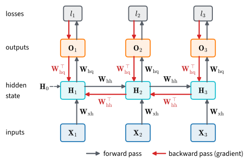
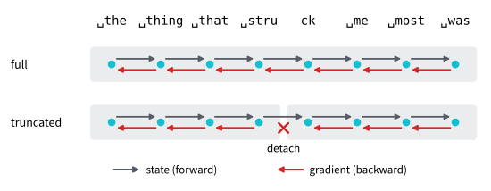

# Backpropagation Through Time
:label:`sec_bptt`

Our experiments with the RNN language model in :numref:`sec_rnn-scratch` left
us with two striking empirical findings: without gradient clipping, most
training runs destabilized; with clipping, training converged reliably, yet
the learned network used only the last few tokens of its 32-token context
window. Both phenomena share the exact same mathematical root. Because a
recurrent network applies the same weight matrix at every time step, any
gradient propagating backward through a sequence is multiplied by a state
Jacobian at each step. Over many steps these factors compound—much like
compound interest—causing the gradient to grow or shrink geometrically.

Even a scalar recurrence $h_t = w_\textrm{h} h_{t-1} + x_t$ shows why:
unrolling gives $h_t = \sum_{s \leq t} w_\textrm{h}^{t-s} x_s$, so
$\partial h_t / \partial h_{t-k} = w_\textrm{h}^k$. Over forty steps,
$w_\textrm{h} = 0.9$ shrinks a gradient to $0.9^{40} \approx 0.015$, whereas
$w_\textrm{h} = 1.1$ inflates it to $1.1^{40} \approx 45$. Exploding gradients
destabilize optimization immediately, forcing us to clip updates; vanishing
gradients are quieter yet more insidious, attenuating error signals from
distant tokens until the model cannot learn long-range dependencies.

Computing gradients in an RNN requires no new differentiation algorithm: we
unroll the recurrence across time into a deep feedforward network with shared
weights and apply standard backpropagation (:numref:`sec_backprop`), a
procedure known as *backpropagation through time* (BPTT) :cite:`Werbos.1990`.
Below, we derive the backward recursion directly in matrix form, measure how
far gradients actually travel inside our trained RNN from
:numref:`sec_rnn-scratch`, and examine truncated backpropagation through time.

```{.python .input}
%load_ext d2lbook.tab
tab.interact_select('mxnet', 'pytorch', 'tensorflow', 'jax')
```

```{.python .input #bptt-backpropagation-through-time}
%%tab mxnet
import math
import numpy as np
from mxnet import autograd, gluon, init, np as mnp, npx
from mxnet.gluon import nn
from d2l import mxnet as d2l
npx.set_np()
```

```{.python .input #bptt-backpropagation-through-time}
%%tab pytorch
import math
import numpy as np
import torch
from torch import nn
from torch.nn import functional as F
from d2l import torch as d2l
```

```{.python .input #bptt-backpropagation-through-time}
%%tab tensorflow
import math
import numpy as np
import tensorflow as tf
from d2l import tensorflow as d2l
```

```{.python .input #bptt-backpropagation-through-time}
%%tab jax
import math
import numpy as np
import jax
from jax import numpy as jnp
from flax import nnx
import optax
from d2l import jax as d2l
```

## Vanishing and Exploding Gradients
:label:`subsec_bptt_analysis`

Consider an RNN unrolled across $T$ steps with shared recurrent parameters and
average sequence loss $L = \frac{1}{T}\sum_{t=1}^T l(\mathbf{y}_t,
\mathbf{o}_t)$. Backpropagation handles weight sharing by summing the local
gradient contributions from every time step where a weight matrix appears. To
see the structure of the backward pass transparently, take the RNN of
:numref:`sec_rnn` and temporarily omit biases and the $\tanh$ nonlinearity (we
restore $\tanh$ immediately afterward). For a minibatch of $b$ sequences with
step inputs $\mathbf{X}_t \in \mathbb{R}^{b\times d}$, the linear RNN computes

$$
\mathbf{H}_t = \mathbf{X}_t \mathbf{W}_\textrm{xh} +
\mathbf{H}_{t-1}\mathbf{W}_\textrm{hh}, \qquad
\mathbf{O}_t = \mathbf{H}_t \mathbf{W}_\textrm{hq},
$$
:eqlabel:`eq_bptt_linear_rnn`

with $\mathbf{W}_\textrm{xh}\in\mathbb{R}^{d\times h}$,
$\mathbf{W}_\textrm{hh}\in\mathbb{R}^{h\times h}$, and
$\mathbf{W}_\textrm{hq}\in\mathbb{R}^{h\times q}$. :numref:`fig_rnn_bptt`
depicts three unrolled time steps of this network, showing the forward pass in
grey and the backward pass in red.


:label:`fig_rnn_bptt`

Let $\mathbf{G}_t = \partial L/\partial \mathbf{H}_t$ denote the gradient of
the total loss with respect to $\mathbf{H}_t$. Because $\mathbf{H}_t$ feeds
into both its immediate output $\mathbf{O}_t$ and the next hidden state
$\mathbf{H}_{t+1}$, and backpropagating through a right-multiplication
multiplies by the transposed weight matrix (:numref:`sec_backprop`),
$\mathbf{G}_t$ obeys the backward recursion

$$
\mathbf{G}_t = \frac{\partial L}{\partial \mathbf{O}_t}\mathbf{W}_\textrm{hq}^\top +
\mathbf{G}_{t+1}\mathbf{W}_\textrm{hh}^\top, \qquad \mathbf{G}_{T+1} = \mathbf{0},
$$
:eqlabel:`eq_bptt_partial_L_ht_recur`

corresponding to the two incoming red arrows at each hidden state in
:numref:`fig_rnn_bptt`. Unrolling :eqref:`eq_bptt_partial_L_ht_recur` backward
from $\mathbf{G}_T$ down to $\mathbf{G}_t$ yields

$$
\mathbf{G}_t = \sum_{j=t}^{T} \frac{\partial L}{\partial \mathbf{O}_j}\,
\mathbf{W}_\textrm{hq}^\top\big(\mathbf{W}_\textrm{hh}^\top\big)^{j-t}.
$$
:eqlabel:`eq_bptt_partial_L_ht`

Thus, the loss at future step $j$ communicates back to the state $k = j - t$
steps earlier through the $k^\textrm{th}$ power of
$\mathbf{W}_\textrm{hh}^\top$ (for a general nonlinear transition
$\mathbf{H}_t = g(\mathbf{H}_{t-1}, \mathbf{X}_t, \mathbf{W}_\textrm{hh})$,
this matrix power is replaced by the product of the $j - t$ intermediate state
Jacobians $\prod_{i=t+1}^j \partial \mathbf{H}_i / \partial \mathbf{H}_{i-1}$).
Once $\mathbf{G}_1, \ldots, \mathbf{G}_T$ are computed in a single backward
sweep, the parameter gradients simply sum one outer product per step:

$$
\frac{\partial L}{\partial \mathbf{W}_\textrm{hh}} = \sum_{t=1}^{T}
\mathbf{H}_{t-1}^\top \mathbf{G}_t, \qquad
\frac{\partial L}{\partial \mathbf{W}_\textrm{xh}} = \sum_{t=1}^{T}
\mathbf{X}_t^\top \mathbf{G}_t.
$$
:eqlabel:`eq_bptt_param_grads`

As we saw in :numref:`subsec_lin-alg-eigenvalues` and
:numref:`sec_numerical_stability`, raising a matrix to the $k^\textrm{th}$
power scales each eigenvector by $\lambda^k$. Letting $\rho$ denote the
*spectral radius* (largest $|\lambda|$) of $\mathbf{W}_\textrm{hh}$, the norm
of $(\mathbf{W}_\textrm{hh}^\top)^k$ scales asymptotically as $\rho^k$: when
$\rho < 1$, contributions from distant steps vanish exponentially; when
$\rho > 1$, they explode exponentially. Reintroducing the $\tanh$ activation
multiplies each step's backward gradient entrywise by its local derivative
$1 - \mathbf{H}_t^2 \in (0, 1]$ before multiplying by
$\mathbf{W}_\textrm{hh}^\top$. Because $1 - h^2 \leq 1$, $\tanh$ never
amplifies a gradient and pulls strongly toward vanishing whenever hidden units
saturate near $\pm 1$, while still permitting explosion if
$\mathbf{W}_\textrm{hh}$ is large and activations stay near zero.

Let us measure what actually happens inside our trained language model from
:numref:`sec_rnn-scratch`. We first load the `TimeMachine` dataset with
32-token windows.

```{.python .input #bptt-vanishing-and-exploding-gradients-1}
data = d2l.TimeMachine(batch_size=1024, num_steps=32)
```

Next, we instantiate the from-scratch recurrent language model `RNNLMScratch`
with embedding dimension $d = 512$, hidden size $h = 128$, and dropout.

```{.python .input #bptt-vanishing-and-exploding-gradients-2}
%%tab pytorch, mxnet, jax
rnn = d2l.RNNScratch(num_inputs=512, num_hiddens=128)
model = d2l.RNNLMScratch(rnn, vocab_size=len(data.vocab), lr=4, dropout=0.5,
                         emb_dropout=0.1)
```

```{.python .input #bptt-vanishing-and-exploding-gradients-2}
%%tab tensorflow
with d2l.try_gpu():
    rnn = d2l.RNNScratch(num_inputs=512, num_hiddens=128)
    model = d2l.RNNLMScratch(rnn, vocab_size=len(data.vocab), lr=4,
                             dropout=0.5, emb_dropout=0.1)
```

We train `model` for 10 epochs with learning rate `lr=4` and global gradient
clipping at `gradient_clip_val=1`.

```{.python .input #bptt-vanishing-and-exploding-gradients-3}
trainer = d2l.Trainer(max_epochs=10, gradient_clip_val=1, num_gpus=1)
trainer.fit(model, data)
```

To probe gradient flow over a longer horizon, we sample 256 random validation
segments `seqs` of length $L = 64$—twice the training window—along with their
following tokens `targets`.

```{.python .input #bptt-vanishing-and-exploding-gradients-4}
L = 64
val = d2l.numpy(data.X[data.num_train:data.num_train + data.num_val, 0])
starts = np.random.default_rng().choice(len(val) - L, 256, replace=False)
seqs = np.stack([val[s:s + L] for s in starts])  # (256, L) token ids
targets = val[starts + L]                        # The token after each stretch
```

We now run `model.rnn` forward across `seqs` to collect all 64 per-step hidden
states in `H`, the final-step `logits`, and the weight matrices `W_hh` and
`W_hq`.

```{.python .input #bptt-vanishing-and-exploding-gradients-5}
%%tab mxnet
states, _ = model.rnn(model.embedding(
    d2l.tensor(seqs, dtype=d2l.int32, ctx=d2l.try_gpu())))
logits = model.output_layer(states[-1:])[:, 0]  # The last step only
H, logits = d2l.numpy(d2l.stack(states, 0)), d2l.numpy(logits)
W_hh, W_hq = d2l.numpy(model.rnn.W_hh.data()), d2l.numpy(model.W_hq.data())
```

```{.python .input #bptt-vanishing-and-exploding-gradients-5}
%%tab pytorch
with torch.inference_mode():
    states, _ = model.rnn(model.embedding(
        d2l.tensor(seqs, device=d2l.try_gpu())))
    logits = model.output_layer(states[-1:])[:, 0]  # The last step only
H, logits = d2l.numpy(d2l.stack(states, 0)), d2l.numpy(logits)
W_hh, W_hq = d2l.numpy(model.rnn.W_hh), d2l.numpy(model.W_hq)
```

```{.python .input #bptt-vanishing-and-exploding-gradients-5}
%%tab tensorflow
states, _ = model.rnn(model.embedding(tf.constant(seqs)))
logits = model.output_layer(states[-1:])[:, 0]  # The last step only
H, logits = d2l.numpy(tf.stack(states, 0)), d2l.numpy(logits)
W_hh, W_hq = d2l.numpy(model.rnn.W_hh), d2l.numpy(model.W_hq)
```

```{.python .input #bptt-vanishing-and-exploding-gradients-5}
%%tab jax
states, _ = model.rnn(model.embedding(jnp.array(seqs)))
logits = model.output_layer(states[-1:])[:, 0]  # The last step only
H, logits = d2l.numpy(jnp.stack(states, 0)), d2l.numpy(logits)
W_hh, W_hq = d2l.numpy(model.rnn.W_hh[...]), d2l.numpy(model.W_hq[...])
```

Starting from the final-step loss gradient $\partial L_L / \partial
\mathbf{O}_L = \textrm{softmax}(\mathbf{O}_L) - \mathbf{Y}_L$, we step backward
through time via $\mathbf{G}_{t-1} = (\mathbf{G}_t \odot (1 -
\mathbf{H}_t^2))\mathbf{W}_\textrm{hh}^\top$ and plot the geometric mean of
the relative gradient norm $\|\mathbf{G}_{L-k}\| / \|\mathbf{G}_L\|$ as a
function of the lag $k$.

```{.python .input #bptt-vanishing-and-exploding-gradients-6}
P = np.exp(logits - logits.max(1, keepdims=True))
P /= P.sum(1, keepdims=True)
P[np.arange(len(targets)), targets] -= 1  # dL/dO: softmax minus one-hot
G = (P @ W_hq.T).astype(np.float64)       # dL/dH at the last step
norms = []
for t in range(L - 1, -1, -1):            # Backward through time
    norms.append(np.linalg.norm(G, axis=1))
    G = (G * (1 - H[t] ** 2)) @ W_hh.T    # Through the tanh, then W_hh
rel = np.exp(np.log(np.array(norms) / norms[0]).mean(1))
print(f'spectral radius of W_hh: {np.abs(np.linalg.eigvals(W_hh)).max():.2f}; '
      f'mean tanh derivative: {(1 - H ** 2).mean():.2f}')
print('relative gradient norm at lags 1, 2, 4, 8, 16, 32:',
      [float(f'{rel[k]:.2g}') for k in (1, 2, 4, 8, 16, 32)])
d2l.plot(np.arange(L), rel, 'lag $k$', 'relative gradient norm',
         yscale='log', figsize=(4.5, 3))
```

Even though the trained $\mathbf{W}_\textrm{hh}$ has a spectral radius near
$1.8$—which would explode in a purely linear recurrence—the actual gradient
vanishes rapidly: it drops below 1% of its initial norm within roughly eight
steps and shrinks to a few billionths across 32 tokens. Because the $\tanh$
derivative averages roughly $0.27$, each backward step retains only about
$1.8 \times 0.27 \approx 0.5$ of the gradient norm. This directly explains our
finding in :numref:`sec_rnn-scratch` that per-position validation loss
flattens out after roughly three tokens of context.

### Remedies for Exploding and Vanishing Gradients
:label:`subsec_bptt-gradient-pathologies`

Exploding and vanishing gradients demand fundamentally different remedies.
Because an exploding gradient threatens to corrupt the parameters in a single
oversized update, global gradient clipping (:eqref:`eq_grad_clipping`) provides
a simple safeguard—yet multiplying the entire gradient sum
:eqref:`eq_bptt_partial_L_ht` by a scalar never changes the *relative* weight
of distant versus recent lags. Overcoming vanishing gradients therefore
requires changing the recurrence itself so that state Jacobians stay near unity
along memory directions: either via *gated* recurrent cells (such as LSTMs and
GRUs) that create an additive memory path controlled by learned gates, or via
*structured linear recurrences* and state space models that remove the state
nonlinearity and constrain eigenvalues near the unit circle. Both families are
developed in :numref:`chap_modern_rnn`.

## Truncated Backpropagation Through Time

Evaluating :eqref:`eq_bptt_partial_L_ht_recur` across an entire corpus of $T$
tokens requires retaining all $T$ forward hidden states in memory and
traversing all $T$ steps for a single parameter update. *Truncated
backpropagation through time* caps both memory and compute per update by
slicing long streams into fixed-length segments of length $T_0$ and halting
backpropagation at each segment boundary (:numref:`fig_truncated_bptt`).


:label:`fig_truncated_bptt`

Whether each window resets $\mathbf{H}_0 = \mathbf{0}$ (as in
:numref:`sec_rnn-scratch`) or carries the previous segment's final state
forward while *detaching* it from the computational graph (as in
:numref:`fig_truncated_bptt`), no gradient ever crosses a segment boundary,
imposing a hard learning horizon of at most $T_0$ steps :cite:`Jaeger.2002`. In
a vanilla RNN, however, vanishing gradients already choke off the backward
signal after roughly eight steps—well inside our 32-token window—so lengthening
the window alone cannot extend the model's effective memory.

## Summary

Backpropagation through time applies ordinary backpropagation to an unrolled
RNN, propagating loss sensitivities backward via
:eqref:`eq_bptt_partial_L_ht_recur` and summing parameter gradients across time
steps (:eqref:`eq_bptt_param_grads`). Because a gradient traveling back $k$
steps multiplies $k$ state Jacobians—reducing in a linear RNN to
$(\mathbf{W}_\textrm{hh}^\top)^k \sim \rho^k$—gradients explode when $\rho > 1$
and vanish when $\rho < 1$. Including $\tanh$ multiplies each step by
$1 - \mathbf{H}_t^2 \in (0, 1]$, causing gradients in our trained RNN to fall
below 1% within roughly eight steps despite $\rho \approx 1.8$. Gradient
clipping contains exploding spikes, truncated BPTT bounds memory and compute
per update, and architectural innovations (:numref:`chap_modern_rnn`) are
required to preserve gradients over long horizons.

## Exercises

1. **Backward pass by hand.** One step of
   `RNNScratch` (:numref:`sec_rnn-scratch`) computes
   $$\mathbf{H}_t = \tanh(\mathbf{X}_t \mathbf{W}_{\textrm{xh}} + \mathbf{H}_{t-1} \mathbf{W}_{\textrm{hh}} + \mathbf{b}_\textrm{h}).$$
   Let $\mathbf{G}_t = \partial L / \partial \mathbf{H}_t$ be the gradient
   arriving from later steps and from the output at step $t$.
    1. Derive the contributions of this step to
       $\partial L / \partial \mathbf{W}_{\textrm{xh}}$,
       $\partial L / \partial \mathbf{W}_{\textrm{hh}}$,
       $\partial L / \partial \mathbf{b}_\textrm{h}$, and
       $\partial L / \partial \mathbf{H}_{t-1}$ as functions of
       $\mathbf{G}_t$, $\mathbf{X}_t$, $\mathbf{H}_t$, $\mathbf{H}_{t-1}$,
       and $\mathbf{W}_{\textrm{hh}}$.
    1. Adding the output contribution at step $t-1$ to the contribution
       to $\partial L / \partial \mathbf{H}_{t-1}$ gives a recursion for
       $\mathbf{G}_{t-1}$. Show that it reduces to
       :eqref:`eq_bptt_partial_L_ht_recur` when the $\tanh$ and the bias
       are dropped, and name the factor that the $\tanh$ adds at every step.
       Explain also how the parameter gradients accumulate over the $T$
       steps of a window, and compare with :eqref:`eq_bptt_param_grads`.

    *Adapted from CMU 11-785,
    [Homework 3 Part 1](https://deeplearning.cs.cmu.edu/F22/document/homework/HW3/HW3P1_F22.pdf).*
   :exlabel:`ex_bptt-backward-pass-hand`

1. **Power iteration and alignment.** Let
   $\mathbf{M} \in \mathbb{R}^{h \times h}$ be symmetric with eigenvalues
   $\lambda_i$ and eigenvectors $\mathbf{v}_i$ for $i = 1, \ldots, h$,
   ordered so that $|\lambda_i| \geq |\lambda_{i+1}|$.
    1. Show that $\mathbf{M}^k$ has eigenvalues $\lambda_i^k$ with the
       same eigenvectors.
    1. Show that for a random vector $\mathbf{x} \in \mathbb{R}^h$ with
       independent standard normal entries, $\mathbf{M}^k \mathbf{x}$
       becomes aligned with $\mathbf{v}_1$ as $k$ grows. State the
       condition on the eigenvalues that this requires and the sense in
       which the alignment holds.
    1. What does this imply for the gradient :eqref:`eq_bptt_partial_L_ht`
       of an RNN, beyond the change in its norm?

1. [code] **Backward pass in code.** ● Train `d2l.RNNLMScratch` on
   `d2l.TimeMachine` as in :numref:`sec_rnn-scratch`. Using the
   single-step gradients and the recursion of problem :exref:`ex_bptt-backward-pass-hand`,
   implement the backward pass of its `RNNScratch` cell over a full
   window with tensor operations only, starting from the gradient of the
   loss with respect to the
   logits (:numref:`subsec_softmax_and_derivatives`). Run it on one training
   minibatch, and compare your gradients of `W_xh`, `W_hh`, and `b_h`
   with those computed by automatic differentiation.

    *Adapted from CMU 11-785,
    [Homework 3 Part 1](https://deeplearning.cs.cmu.edu/F22/document/homework/HW3/HW3P1_F22.pdf).*

1. [code] **Nonlinear Jacobians.** ● Draw a random symmetric
   $100 \times 100$ matrix, rescale it to spectral radius
   $\rho \in \{0.9, 1.0, 1.1\}$, and plot the norm of its $k^\textrm{th}$
   power $\|\mathbf{J}^k\|$ against $k$ on a logarithmic axis: three
   straight lines, as the eigenvalues predict. Then leave the symmetric
   linear case.
    1. Replace the symmetric matrix by a general, nonsymmetric
       $\mathbf{W}_\textrm{hh}$ rescaled to each radius, and plot
       $\|\mathbf{J}^k\|$ against $k$. Report the largest value of
       $\|\mathbf{J}^k\|$ at $\rho = 0.9$ and the lag at which it occurs.
       Explain why the ratio $\|\mathbf{J}^k\| / \rho^k$ can exceed one
       and why it stays bounded as $k$ grows (a random matrix is
       diagonalizable with probability one).
    1. Return to the symmetric $\mathbf{W}_\textrm{hh}$ and run the
       $\tanh$ RNN
       $$\mathbf{H}_t = \tanh(\mathbf{H}_{t-1}\mathbf{W}_\textrm{hh} + \mathbf{X}_t), \qquad \mathbf{H}_0 = \mathbf{0},$$
       for a single sequence ($\mathbf{H}_t \in \mathbb{R}^{1 \times h}$)
       with inputs $\mathbf{X}_t$ whose entries are drawn independently
       from $\mathcal{N}(0, s^2)$.
       Plot the norm of the product of the Jacobians
       $\partial \mathbf{H}_j / \partial \mathbf{H}_{j-1}$ along the
       trajectory for $s = 0.1$ and $s = 1$. How do the nonlinearity and
       the input scale change the growth of the norm, and why?
    1. Explain why a largest singular value of $\mathbf{W}_\textrm{hh}$
       below one is sufficient for the product to shrink, whereas a
       largest singular value above one is necessary but not sufficient
       for it to grow :cite:`bengio1994learning,Pascanu.Mikolov.Bengio.2013`.
       Relate the argument to your $\tanh$ curves at $\rho = 0.9$ and
       $\rho = 1.1$.

1. [code] **Window length and memory horizon.** ● In the model of
   :numref:`subsec_bptt_analysis`, the gradient of the last loss
   falls below 1% of its size within about eight steps, well inside the
   training window of 32 tokens.
    1. Before running anything: if the model is retrained with
       `num_steps=128`, do you expect this horizon to move? Argue from the
       product of state Jacobians in :eqref:`eq_bptt_partial_L_ht`.
    1. Retrain with `num_steps` set to 128, measure the gradient against
       the lag on stretches of 256 validation tokens, and compare the
       result with your prediction.
    1. Repeat the loss-by-position measurement of
       :numref:`sec_rnn-scratch` for the retrained model. Does the loss
       now keep improving beyond the third token of context?

[Discussions](https://d2l.discourse.group/t/334)

<!-- slides -->

::: {.slide}
::: {.cover}
[Dive into Deep Learning · §8.5]{.kicker}

Backpropagation Through Time<br>**unrolled computational graphs · Jacobian products · matrix powers & spectral radius · vanishing vs. exploding gradients · truncated BPTT**
:::
:::

::: {.slide title="Two Empirical Mysteries with One Mathematical Root"}
[Motivation & Scalar Intuition]{.kicker}

Our experiments in §8.4 uncovered two seemingly opposite behaviors in the exact same RNN language model: without gradient clipping, optimization exploded; with clipping, training converged smoothly, yet the model ignored every token more than $\sim 3$ steps back in its 32-token window:

- **Compound multiplication through time:** Even in a 1D linear recurrence $h_t = w_{\textrm{h}} h_{t-1} + x_t$, unrolling gives $h_t = \sum_{s \le t} w_{\textrm{h}}^{t-s} x_s$, so the sensitivity of state $h_t$ to an earlier state $h_{t-k}$ scales geometrically with lag $k$:
  $$\frac{\partial h_t}{\partial h_{t-k}} = w_{\textrm{h}}^k$$
- **The 40-step razor's edge:** At $w_{\textrm{h}} = 0.9$, a gradient traveling back 40 steps shrinks to $0.9^{40} \approx 0.015$ (**vanishing**); at $w_{\textrm{h}} = 1.1$, it inflates to $1.1^{40} \approx 45.3$ (**exploding**).
- **Backpropagation Through Time (BPTT):** Unrolling the recurrence across $T$ steps and applying standard reverse-mode automatic differentiation (Werbos, 1990) explains both phenomena in full matrix form.
:::

::: {.slide title="Unrolling a Recurrence into a Shared-Weight Graph"}
[Computational Graph Structure]{.kicker}

Consider a general recurrent network with state transition $h_t = g(h_{t-1}, x_t, w_{\textrm{h}})$, readout $o_t = f(h_t, w_{\textrm{o}})$, and average sequence loss $L = \frac{1}{T}\sum_{t=1}^T l(y_t, o_t)$:

- **Weight tying across depth:** Unrolling across $T$ steps produces a deep network of depth $T$ where the recurrent parameter $w_{\textrm{h}}$ is shared across every single layer $t \in \{1, \ldots, T\}$.
- **Total derivative under weight sharing:** By the multivariable chain rule, a parameter used at multiple nodes accumulates the **sum** of its local gradient paths across all time steps:
  $$\frac{\partial L}{\partial w_{\textrm{h}}} = \frac{1}{T}\sum_{t=1}^T \frac{\partial l(y_t, o_t)}{\partial o_t}\,\frac{\partial o_t}{\partial h_t}\,\frac{\partial h_t}{\partial w_{\textrm{h}}}$$
- **Why $\partial h_t / \partial w_{\textrm{h}}$ is recursive:** Changing $w_{\textrm{h}}$ alters $h_t = g(h_{t-1}, x_t, w_{\textrm{h}})$ both **directly** at step $t$ and **indirectly** because $h_{t-1}$ itself was computed using $w_{\textrm{h}}$ at steps $1, \ldots, t-1$.
:::

::: {.slide title="Chain Rule Over Time: Forward Sensitivity Recursion"}
[Jacobian Product Expansion]{.kicker}

Applying the total derivative to $h_t = g(h_{t-1}, x_t, w_{\textrm{h}})$ yields a linear first-order recursion of the form $a_t = u_t + c_t a_{t-1}$ (with $a_0 = 0$):

$$\frac{\partial h_t}{\partial w_{\textrm{h}}} = \underbrace{\frac{\partial g(h_{t-1}, x_t, w_{\textrm{h}})}{\partial w_{\textrm{h}}}}_{\text{immediate effect } u_t} + \underbrace{\frac{\partial g(h_{t-1}, x_t, w_{\textrm{h}})}{\partial h_{t-1}}}_{\text{step Jacobian } c_t}\frac{\partial h_{t-1}}{\partial w_{\textrm{h}}}$$

Unrolling this recursion from step $1$ up to step $t$ expresses $\partial h_t / \partial w_{\textrm{h}}$ as a sum over all historical steps $i \le t$, weighted by the product of $t - i$ intermediate state-to-state Jacobians:

$$\frac{\partial h_t}{\partial w_{\textrm{h}}} = \frac{\partial g_t}{\partial w_{\textrm{h}}} + \sum_{i=1}^{t-1}\left(\prod_{j=i+1}^t \frac{\partial g(h_{j-1}, x_j, w_{\textrm{h}})}{\partial h_{j-1}}\right)\frac{\partial g(h_{i-1}, x_i, w_{\textrm{h}})}{\partial w_{\textrm{h}}}$$

::: {.d2l-note .rule}
**Why We Do Not Evaluate This Forward Sum Directly:** Computing $\prod_{j=i+1}^t (\partial g_j / \partial h_{j-1})$ separately for every pair $(i, t)$ would cost $O(T^2)$ Jacobian multiplications. Reverse-mode autodiff (BPTT) factors the sum backward in a single $O(T)$ sweep.
:::
:::

::: {.slide title="Forward and Backward Flows in an Unrolled Linear RNN"}
[Matrix BPTT Setup]{.kicker}

To see the exact matrix structure of the backward sweep, consider a minibatch linear RNN ($\phi = \textrm{id}$, zero biases) with inputs $\mathbf{X}_t \in \mathbb{R}^{b \times d}$, states $\mathbf{H}_t \in \mathbb{R}^{b \times h}$, and outputs $\mathbf{O}_t \in \mathbb{R}^{b \times q}$:

::: {.cols .vc}
::: {.col}
- **Forward equations (grey arrows):**
  $$\mathbf{H}_t = \mathbf{X}_t\mathbf{W}_{\textrm{xh}} + \mathbf{H}_{t-1}\mathbf{W}_{\textrm{hh}}$$
  $$\mathbf{O}_t = \mathbf{H}_t\mathbf{W}_{\textrm{hq}}$$
- **Two outgoing children per hidden state:** In the unrolled graph, each state $\mathbf{H}_t$ (for $t < T$) feeds into two downstream nodes: its immediate output $\mathbf{O}_t$ (via $\mathbf{W}_{\textrm{hq}}$) and the next state $\mathbf{H}_{t+1}$ (via $\mathbf{W}_{\textrm{hh}}$).
- **Backward flow (red arrows):** By reverse-mode differentiation, the adjoint $\mathbf{G}_t = \partial L / \partial \mathbf{H}_t$ is the sum of the two incoming red arrows at node $\mathbf{H}_t$.
:::

::: {.col .fig}
{.nostretch width=100%}
:::
:::
:::

::: {.slide title="The Backward Recursion for Hidden-State Gradients"}
[Reverse-Mode Dynamic Program]{.kicker}

Let $\mathbf{G}_t = \partial L / \partial \mathbf{H}_t \in \mathbb{R}^{b \times h}$ denote the total gradient of the sequence loss $L$ with respect to $\mathbf{H}_t$. Because differentiating a right-multiplication $\mathbf{Y} = \mathbf{A}\mathbf{B}$ with respect to $\mathbf{A}$ right-multiplies by $\mathbf{B}^\top$, $\mathbf{G}_t$ obeys the backward recursion from $t = T$ down to $t = 1$ (with boundary condition $\mathbf{G}_{T+1} = \mathbf{0}$):

$$\mathbf{G}_t = \underbrace{\frac{\partial L}{\partial \mathbf{O}_t}\mathbf{W}_{\textrm{hq}}^\top}_{\text{from step-}t\text{ loss } l_t} + \underbrace{\mathbf{G}_{t+1}\mathbf{W}_{\textrm{hh}}^\top}_{\text{from future steps } > t}$$

- **Single $O(T)$ backward sweep:** Starting at $\mathbf{G}_T = (\partial L / \partial \mathbf{O}_T)\mathbf{W}_{\textrm{hq}}^\top$, each backward step performs one matrix multiplication by $\mathbf{W}_{\textrm{hh}}^\top$ and adds the local output gradient from step $t$.
- **Cost parity with the forward pass:** One backward step through the linear cell requires the exact same $(b \times h) \times (h \times h)$ GEMM footprint as one forward recurrent step.
:::

::: {.slide title="Unrolling G_t: Matrix Powers Across Time Lags"}
[Explicit Matrix Power Expansion]{.kicker}

Unrolling the backward recursion $\mathbf{G}_t = (\partial L / \partial \mathbf{O}_t)\mathbf{W}_{\textrm{hq}}^\top + \mathbf{G}_{t+1}\mathbf{W}_{\textrm{hh}}^\top$ from step $T$ down to step $t$ reveals how future loss signals at step $j \ge t$ propagate back across lag $k = j - t$:

$$\mathbf{G}_t = \sum_{j=t}^T \frac{\partial L}{\partial \mathbf{O}_j}\,\mathbf{W}_{\textrm{hq}}^\top \big(\mathbf{W}_{\textrm{hh}}^\top\big)^{j-t}$$

Once the sequence of state adjoints $\mathbf{G}_1, \ldots, \mathbf{G}_T$ has been computed, the shared weight gradients accumulate one outer product per time step:

$$\frac{\partial L}{\partial \mathbf{W}_{\textrm{hh}}} = \sum_{t=1}^T \mathbf{H}_{t-1}^\top \mathbf{G}_t, \qquad \frac{\partial L}{\partial \mathbf{W}_{\textrm{xh}}} = \sum_{t=1}^T \mathbf{X}_t^\top \mathbf{G}_t$$

::: {.d2l-note .rule}
**The Lag-$k$ Operator:** A loss signal originating at future step $j$ must pass through the **$k^\textrm{th}$ matrix power** $(\mathbf{W}_{\textrm{hh}}^\top)^k$ ($k = j - t$) to influence hidden state $\mathbf{H}_t$ and the parameter contribution $\mathbf{H}_{t-1}^\top \mathbf{G}_t$.
:::
:::

::: {.slide title="Spectral Radius Governs Matrix Power Growth"}
[Eigenvalue & Singular-Value Analysis]{.kicker}

Let $\lambda_1, \ldots, \lambda_h$ be the eigenvalues of $\mathbf{W}_{\textrm{hh}}$ (identical to those of $\mathbf{W}_{\textrm{hh}}^\top$), and let $\rho(\mathbf{W}_{\textrm{hh}}) = \max_i |\lambda_i|$ denote its **spectral radius**:

- **Asymptotic exponential scaling ($\|(\mathbf{W}_{\textrm{hh}}^\top)^k\| \sim \rho^k$):** Raising a diagonalizable matrix to the $k^\textrm{th}$ power scales each eigenvector $\mathbf{v}_i$ by $\lambda_i^k$, so for large lag $k$ the dominant eigenspace scales as $\rho^k$:
  - **Vanishing regime ($\rho < 1$):** $\|(\mathbf{W}_{\textrm{hh}}^\top)^k\| \to 0$ exponentially; distant tokens cannot send gradient signals back to early steps.
  - **Exploding regime ($\rho > 1$):** Components along the top eigenvector grow as $\rho^k \to \infty$, causing exponential gradient overflow.
  - **Critical boundary ($\rho = 1$):** Only eigenvalues on the complex unit circle $|\lambda_i| = 1$ preserve gradient magnitude over arbitrarily long horizons.
- **Transient non-normal growth:** When $\mathbf{W}_{\textrm{hh}}$ is asymmetric (non-normal), its largest singular value $\sigma_{\max}(\mathbf{W}_{\textrm{hh}})$ can exceed $1$ even when $\rho < 1$, allowing $\|(\mathbf{W}_{\textrm{hh}}^\top)^k\|$ to grow transiently at small lags before $\rho^k$ eventually decays.
:::

::: {.slide title="How the tanh Nonlinearity Contrasts with Linear BPTT"}
[Nonlinear State Jacobians]{.kicker}

Restoring the elementwise $\tanh$ activation in $\mathbf{H}_t = \tanh(\mathbf{X}_t\mathbf{W}_{\textrm{xh}} + \mathbf{H}_{t-1}\mathbf{W}_{\textrm{hh}} + \mathbf{b}_{\textrm{h}})$ inserts an entrywise multiplication ($\odot$) by the local activation derivative $\tanh'(z) = 1 - \mathbf{H}_t^2$ at every step of the backward recursion:

$$\mathbf{G}_{t-1} = \frac{\partial L}{\partial \mathbf{O}_{t-1}}\mathbf{W}_{\textrm{hq}}^\top + \Big(\mathbf{G}_t \odot \big(1 - \mathbf{H}_t^2\big)\Big)\mathbf{W}_{\textrm{hh}}^\top$$

- **The $\tanh$ derivative is a strict contraction:** Because $H_{t,i} \in (-1, 1)$, every entry of $1 - \mathbf{H}_t^2$ lies in $(0, 1]$ and never amplifies a gradient.
- **Saturation accelerates vanishing:** Whenever a hidden unit saturates near $\pm 1$, its local derivative $1 - H_{t,i}^2 \approx 0$ chokes off backward gradient flow through that coordinate.
- **Effective step multiplier:** Even if $\rho(\mathbf{W}_{\textrm{hh}}) > 1$, the effective Jacobian norm per step scales roughly as $\overline{(1 - H^2)} \cdot \rho(\mathbf{W}_{\textrm{hh}})$, which can still fall well below $1$!
:::

::: {.slide title="Setting Up the Gradient Horizon Experiment (L = 64)"}
[Empirical Probe on Our Trained RNN]{.kicker}

To measure how far gradients actually travel inside our trained language model from §8.4 ($d = 512, h = 128$, dropout $0.5$, clipped at $\theta = 1$), we run the trained network forward over 256 validation segments of length $L = 64$ tokens:

@-bptt-vanishing-and-exploding-gradients-4

@-bptt-vanishing-and-exploding-gradients-5

- **Isolating the lag-$k$ sensitivity:** We take the cross-entropy loss at the final position $t = L$ ($\partial L_L / \partial \mathbf{O}_L = \textrm{softmax}(\mathbf{O}_L) - \mathbf{Y}_L$) and propagate $\mathbf{G}_t$ backward 64 steps via $\mathbf{G}_{t-1} = (\mathbf{G}_t \odot (1 - \mathbf{H}_t^2))\mathbf{W}_{\textrm{hh}}^\top$ without adding intermediate output losses.
:::

::: {.slide title="Measured Gradient Decay Inside the Trained RNN"}
[Empirical Probe Results]{.kicker}

Plotting the geometric-mean relative gradient norm $\|\mathbf{G}_{L-k}\| / \|\mathbf{G}_L\|$ on a logarithmic axis against lag $k \in \{0, \ldots, 63\}$ resolves the puzzle from §8.4:

::: {.cols .vc}
::: {.col}
- **Large weights, yet fast vanishing:** The trained recurrent matrix has spectral radius $\rho(\mathbf{W}_{\textrm{hh}}) \approx 1.80$ (which would explode as $1.80^k$ in a linear RNN!), yet the mean $\tanh$ derivative is $\overline{1 - H^2} \approx 0.27$.
- **Halving every step ($1.80 \times 0.27 \approx 0.49$):** The gradient norm drops by roughly half at every step back in time—falling **below $1\%$ within $k = 8$ steps** and shrinking to $\sim 10^{-9}$ across 32 tokens.
- **Explains the 3-token horizon:** Tokens at lag $k \ge 4$ contribute almost zero gradient to $\mathbf{W}_{\textrm{hh}}$ during training!
:::

::: {.col .fig}
@!bptt-vanishing-and-exploding-gradients-6
:::
:::
:::

::: {.slide title="Why Gradient Clipping Fixes Explosion, Not Vanishing"}
[Asymmetry of the Two Gradient Pathologies]{.kicker}

Why did global gradient clipping $\mathbf{g} \leftarrow \min(1, \theta / \|\mathbf{g}\|)\mathbf{g}$ stabilize training so effectively in §8.4 yet fail to extend the model's 3-token memory horizon?

$$\mathbf{G}_t = \underbrace{\frac{\partial L}{\partial \mathbf{O}_t}\mathbf{W}_{\textrm{hq}}^\top}_{\text{lag } 0\text{ (dominant)}} + \underbrace{\frac{\partial L}{\partial \mathbf{O}_{t+1}}\mathbf{W}_{\textrm{hq}}^\top \mathbf{J}_{t+1}}_{\text{lag } 1} + \cdots + \underbrace{\frac{\partial L}{\partial \mathbf{O}_T}\mathbf{W}_{\textrm{hq}}^\top \prod_{i=t+1}^T \mathbf{J}_i}_{\text{lag } T-t\text{ (}\sim 10^{-9}\text{)}}$$

- **What clipping fixes (Exploding spikes):** When an occasional trajectory keeps activations unsaturated ($1 - H^2 \approx 1$), the product of $\rho \approx 1.8$ Jacobians spikes; rescaling $\mathbf{g}$ by $\theta / \|\mathbf{g}\|$ caps the step size at $\eta\theta$ so the parameters cannot diverge.
- **What clipping cannot fix (Vanishing ratios):** Multiplying the entire gradient sum $\mathbf{g}$ by a single scalar factor rescales lag-$0$ and lag-$20$ terms equally—leaving the **relative ratio** ($1 : 10^{-6}$) between short-range and long-range credit assignment completely unchanged!
:::

::: {.slide title="Architectural Remedies: Gates and Linear Recurrences"}
[Preview of Chapter 9 (Modern RNNs & SSMs)]{.kicker}

Overcoming vanishing gradients requires redesigning the recurrent state transition $g$ so that the step-to-step Jacobian $\mathbf{J}_t = \partial \mathbf{H}_t / \partial \mathbf{H}_{t-1}$ has eigenvalues near $1$ along memory directions:

| Architectural Family | Core State Transition Mechanism | Why State Jacobians Stay Near Unity ($\mathbf{J}_t \approx \mathbf{I}$) |
|---|---|---|
| **Vanilla $\tanh$ RNN (§8.4)** | $\mathbf{H}_t = \tanh(\mathbf{X}_t\mathbf{W}_{\textrm{xh}} + \mathbf{H}_{t-1}\mathbf{W}_{\textrm{hh}} + \mathbf{b}_{\textrm{h}})$ | $\mathbf{J}_t = \textrm{diag}(1 - \mathbf{H}_t^2)\mathbf{W}_{\textrm{hh}}^\top$ contracts by $\sim 0.5\times$ per step whenever units saturate |
| **Gated RNNs (LSTM, GRU — §9.1–§9.2)** | Additive cell state $\mathbf{C}_t = \mathbf{F}_t \odot \mathbf{C}_{t-1} + \mathbf{I}_t \odot \tilde{\mathbf{C}}_t$ with learned sigmoid gates $\mathbf{F}_t \in (0, 1)^h$ | When forget gate $\mathbf{F}_t \approx \mathbf{1}$, $\partial \mathbf{C}_t / \partial \mathbf{C}_{t-1} = \textrm{diag}(\mathbf{F}_t) \approx \mathbf{I}$, creating an unattenuated gradient highway |
| **Structured State Space Models (SSMs / Linear RNNs — §9.4+)** | Linear state recurrence $\mathbf{h}_t = \mathbf{A}\mathbf{h}_{t-1} + \mathbf{B}\mathbf{x}_t$ with nonlinear readout layers | Removes recurrent $\tanh$ saturation altogether and constrains eigenvalues of $\mathbf{A}$ near the unit disk ($|\lambda_i| \le 1$) |
:::

::: {.slide title="The Memory and Compute Cost of Full-Sequence BPTT"}
[Systems Bottleneck on Long Streams]{.kicker}

Even if vanishing gradients were solved, running full BPTT across an entire book of $T = 65{,}741$ BPE tokens is computationally prohibitive for two systems reasons:

- **Activation memory grows linearly with $T$ ($O(Tbh)$):** Evaluating the backward pass at step $t$ requires both $\mathbf{H}_t$ (to compute $1 - \mathbf{H}_t^2$) and $\mathbf{H}_{t-1}$ (to compute the outer product $\mathbf{H}_{t-1}^\top \mathbf{G}_t$). Reverse-mode autodiff must retain all $T$ forward hidden states in GPU memory until the backward sweep finishes.
- **Update latency scales as $O(T)$:** A single SGD parameter update would require $65{,}741$ sequential forward matrix multiplications followed by $65{,}741$ sequential backward matrix multiplications—yielding only **one weight update per pass through the entire book**!
:::

::: {.slide title="Truncated BPTT: Detaching State Across Segments"}
[Bounding Memory and Compute per Update]{.kicker}

**Truncated Backpropagation Through Time (TBPTT)** slices a long sequence into fixed segments of length $T_0$ (e.g., $T_0 = 32$ tokens) and halts the backward pass at each segment boundary:

::: {.cols .vc}
::: {.col}
- **Forward state carries over, backward gradient stops:** When streaming through contiguous segments, the final state $\mathbf{H}_{T_0}$ is passed as the initial state of the next segment after **detaching** it from the autograd graph (`state = state.detach()` in PyTorch or `jax.lax.stop_gradient(state)` in JAX).
- **$O(T_0 bh)$ memory and frequent updates:** Autograd frees each segment's computation graph immediately after its update, bounding memory to $T_0$ states.
:::

::: {.col .fig .big}
{.nostretch width=100%}
:::
:::
:::

::: {.slide title="Statistical Trade-Offs of Truncation Horizons"}
[What Truncation Sacrifices]{.kicker}

Truncating backpropagation to windows of length $T_0$ trades long-range gradient credit assignment for bounded memory and parallel minibatch shuffling:

- **Hard credit-assignment horizon of $T_0$ steps:** Within a segment of length $T_0 = 32$, the loss at position $j \in \{1, \ldots, 32\}$ backpropagates through $j - 1$ steps within that segment (at most $31$ steps, $15.5$ steps on average) and **never sends gradient across the detached boundary** into the preceding segment.
- **Zero-state windows vs. detached streaming:** In §8.4, `d2l.TimeMachine` sampled shuffled 32-token windows starting from $\mathbf{H}_0 = \mathbf{0}$ so minibatches are i.i.d. for SGD; stateful streaming carries $\mathbf{H}_{T_0}$ across segments for inference context but still blocks gradients at $T_0$.
- **Which horizon binds first?** In our vanilla $\tanh$ RNN, gradients already vanish below $1\%$ by lag $k = 8 \ll T_0 = 32$—so the cell's Jacobian decay, not the 32-token window, is the active bottleneck!
:::

::: {.slide title="Concept Check: BPTT Jacobians, Clipping & Detach"}
[Check Your Understanding]{.kicker}

Test your understanding of matrix powers, graph detachment, and gradient horizons:

1. **Sensitivity Across a 32-Token Window:** In a linear RNN over a window of $T_0 = 32$ tokens, how many step Jacobians separate the final loss at $t = 32$ from the initial state $\mathbf{H}_1$, and by what factor does that sensitivity scale if $\rho(\mathbf{W}_{\textrm{hh}}) = 0.9$ versus $\rho(\mathbf{W}_{\textrm{hh}}) = 1.1$?
2. **The Missing `detach()` Bug:** Suppose you train an RNN over 1,000 consecutive 32-token segments on a GPU, carrying `state` from segment $s$ into segment $s+1$, but you forget to call `state = state.detach()` (`stop_gradient`) at the end of each segment. What happens to GPU memory and backward runtime on segment $s = 1, 2, 3, \ldots$?
3. **Widening the Window on a Vanilla RNN:** If you retrain our vanilla $\tanh$ RNN from §8.4 with `num_steps = 128` instead of `num_steps = 32`, will its validation loss-by-position curve keep improving beyond token 3? Why or why not?

::: {.d2l-note .fragment .fade-up}
**Answers:**

1. **$31$ Jacobians:** At $\rho = 0.9$, $0.9^{31} \approx 0.038$ ($96\%$ lost); at $\rho = 1.1$, $1.1^{31} \approx 19.2$. Shifting $\rho$ by $\pm 10\%$ around $1.0$ changes the 32-step gradient norm by **$500\times$**.
2. **Unbounded graph growth (OOM):** Without `detach()`, segment $s$ stays connected to the computational graphs of all previous segments $1, \ldots, s-1$. Backward runtime and GPU memory grow linearly as $O(s \cdot T_0)$ at every step until `loss.backward()` crashes with an out-of-memory or "backward through graph a second time" error.
3. **No:** Because $\overline{(1 - H^2)}\,\rho(\mathbf{W}_{\textrm{hh}}) \approx 0.49$ attenuates gradients below $1\%$ within 8 steps regardless of window length, extending $T_0$ from $32 \to 128$ adds zero usable long-range gradient signal.
:::
:::

::: {.slide title="Summary: Backpropagation Through Time (BPTT)"}
[Section Takeaways]{.kicker}

| Concept / Mechanism | Mathematical Expression | Scaling / Asymptotics | Practical Consequence |
|---|---|---|---|
| **Linear Backward Recursion** | $\mathbf{G}_t = \nabla_{\mathbf{O}_t} L\,\mathbf{W}_{\textrm{hq}}^\top + \mathbf{G}_{t+1}\mathbf{W}_{\textrm{hh}}^\top$ | $O(T)$ backward sweep ($1$ GEMM/step) | Exact reverse-mode autodiff on the unrolled graph |
| **Unrolled Lag-$k$ Expansion** | $\mathbf{G}_t = \sum_{j=t}^T \nabla_{\mathbf{O}_j} L\,\mathbf{W}_{\textrm{hq}}^\top (\mathbf{W}_{\textrm{hh}}^\top)^{j-t}$ | $\|(\mathbf{W}_{\textrm{hh}}^\top)^k\| \sim \rho(\mathbf{W}_{\textrm{hh}})^k$ | $\rho < 1 \implies$ vanishing; $\rho > 1 \implies$ exploding |
| **Nonlinear $\tanh$ BPTT** | $\mathbf{G}_{t-1} = \nabla_{\mathbf{O}_{t-1}} L\,\mathbf{W}_{\textrm{hq}}^\top + (\mathbf{G}_t \odot (1 - \mathbf{H}_t^2))\mathbf{W}_{\textrm{hh}}^\top$ | Multiplier $\sim \overline{(1 - H^2)}\,\rho \approx 0.49$ | Gradient norm falls below $1\%$ in $\sim 8$ steps despite $\rho \approx 1.8$ |
| **Shared Parameter Gradients** | $\nabla_{\mathbf{W}_{\textrm{hh}}} L = \sum_{t=1}^T \mathbf{H}_{t-1}^\top \mathbf{G}_t$, $\nabla_{\mathbf{W}_{\textrm{xh}}} L = \sum_{t=1}^T \mathbf{X}_t^\top \mathbf{G}_t$ | Sum of $T$ outer products; requires storing $\mathbf{H}_{1:T}$ | Dominated by small-lag terms ($j - t \le 3$) when gradients vanish |
| **Global Gradient Clipping** | $\mathbf{g} \leftarrow \min(1, \theta / \|\mathbf{g}\|)\mathbf{g}$ | Uniform scalar factor on entire sum $\mathbf{g}$ | Cures exploding update spikes; cannot alter near-vs-far lag ratio |
| **Truncated BPTT (`detach`)** | Stop gradient across segment boundaries of length $T_0$ | Bounds memory to $O(T_0 bh)$ per update | Capped credit-assignment horizon $k < T_0$; mandatory for long streams |
:::

