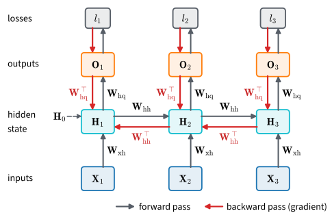
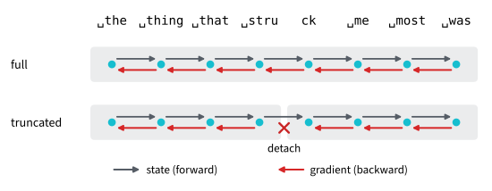

# Backpropagation Through Time
:label:`sec_bptt`

The RNN language model of :numref:`sec_rnn-scratch` left us with two
observations. Without gradient clipping, its training fell apart. With
clipping it trained, but it learned to use no more than the last few tokens
of its 32-token window. Both have the same origin. A recurrent
network applies the same weights at every time step, so a gradient that
travels backward through the sequence is multiplied by a similar factor at
each step. Over many steps these factors compound, the way interest
compounds a deposit, and the gradient grows or shrinks geometrically.

The simplest recurrence shows the effect. Consider a scalar state that
keeps a fraction $w_\textrm{h}$ of its value at each step and adds the new
input, $h_t = w_\textrm{h} h_{t-1} + x_t$. Unrolling it gives $h_t =
\sum_{s \leq t} w_\textrm{h}^{t-s} x_s$, so the derivative of $h_t$ with
respect to the state $k$ steps earlier is $w_\textrm{h}^k$. With
$w_\textrm{h} = 0.9$, forty steps shrink this derivative to $0.9^{40}
\approx 0.015$. With $w_\textrm{h} = 1.1$, they inflate it to $1.1^{40}
\approx 45$, as forty years at 10% interest multiply a deposit 45-fold.
Over long sequences the gradient either fades or blows up.

Both outcomes hurt. A gradient that explodes destabilizes training, which is
why we had to clip. A gradient that vanishes is harder to notice and does
more damage. The model receives almost no signal about how a token forty steps
back should have changed its prediction now, because that signal is buried
under the gradients of nearby tokens, so it learns the dependency slowly if
at all.

To compute the gradient of a recurrent network, we unroll the recurrence
over time into a feedforward network whose layers share their weights, and
apply the backpropagation of :numref:`sec_backprop` to it. This is called
*backpropagation through time* :cite:`Werbos.1990`. As an algorithm it is
nothing new; what is new is the shape of the result. The gradient turns out
to be a sum over earlier steps, and each term carries a product of
Jacobians. For a linear recurrence this product is a matrix power, whose
eigenvalues decide whether the gradient vanishes or explodes. We then
measure how far back the gradient reaches in the model we trained.
Finally, we bound the cost of backpropagating through long sequences by
truncation and ask what truncation gives up.

```{.python .input}
%load_ext d2lbook.tab
tab.interact_select('mxnet', 'pytorch', 'tensorflow', 'jax')
```

```{.python .input #bptt-backpropagation-through-time}
%%tab mxnet
import math
import numpy as np
from mxnet import autograd, gluon, init, np as mnp, npx
from mxnet.gluon import nn
from d2l import mxnet as d2l
npx.set_np()
```

```{.python .input #bptt-backpropagation-through-time}
%%tab pytorch
import math
import numpy as np
import torch
from torch import nn
from torch.nn import functional as F
from d2l import torch as d2l
```

```{.python .input #bptt-backpropagation-through-time}
%%tab tensorflow
import math
import numpy as np
import tensorflow as tf
from d2l import tensorflow as d2l
```

```{.python .input #bptt-backpropagation-through-time}
%%tab jax
import math
import numpy as np
import jax
from jax import numpy as jnp
from flax import nnx
import optax
from d2l import jax as d2l
```

## The Unrolled Computational Graph
:label:`subsec_bptt_analysis`

Let us start with scalars. They show the whole dependency structure, and the
vector case merely replaces each derivative by a Jacobian. Write $h_t$,
$x_t$, and $o_t \in \mathbb{R}$ for the state, the input, and the output at
step $t$. The state update $g$ has parameter $w_\textrm{h}$ and the output map $f$
has parameter $w_\textrm{o}$, the same at every step:

$$
\begin{aligned}h_t &= g(h_{t-1}, x_t, w_\textrm{h}),\\
o_t &= f(h_t, w_\textrm{o}).\end{aligned}
$$
:eqlabel:`eq_bptt_ht_ot`

The objective averages the per-step loss over all $T$ steps,
$L = \frac{1}{T}\sum_{t=1}^T l(y_t, o_t)$.

The unrolled network has one layer per time step, and every layer uses the
same $w_\textrm{h}$. Backpropagation through it is ordinary backpropagation
with one rule for shared parameters: the gradient of a parameter that is
used in many places is the sum of its gradients at each place, just as the
gradient of a convolution kernel sums over the positions where the kernel is
applied.

The output parameter $w_\textrm{o}$ is easy, since it reaches $L$ only
through each $o_t$ directly. The state parameter $w_\textrm{h}$ is harder:
it affects every state, and every state affects all later ones. By the chain
rule,

$$
\frac{\partial L}{\partial w_\textrm{h}} = \frac{1}{T}\sum_{t=1}^T
\frac{\partial l(y_t, o_t)}{\partial o_t}\,
\frac{\partial f(h_t, w_\textrm{o})}{\partial h_t}\,
\frac{\partial h_t}{\partial w_\textrm{h}}.
$$
:eqlabel:`eq_bptt_partial_L_wh`

The first two factors are local to step $t$. The third is not, because
$h_t$ depends on $w_\textrm{h}$ directly and also through $h_{t-1}$, which
depends on $w_\textrm{h}$ in turn:

$$
\frac{\partial h_t}{\partial w_\textrm{h}} =
\frac{\partial g(h_{t-1}, x_t, w_\textrm{h})}{\partial w_\textrm{h}} +
\frac{\partial g(h_{t-1}, x_t, w_\textrm{h})}{\partial h_{t-1}}\,
\frac{\partial h_{t-1}}{\partial w_\textrm{h}}.
$$
:eqlabel:`eq_bptt_partial_ht_wh_recur`

This recursion has the form $a_t = u_t + c_t a_{t-1}$ with $a_0 = 0$, since
the initial state does not depend on $w_\textrm{h}$. Substituting the
recursion into itself $t-1$ times gives, for $t \geq 1$,

$$
a_t = u_t + \sum_{i=1}^{t-1}\Big(\prod_{j=i+1}^{t} c_j\Big) u_i.
$$
:eqlabel:`eq_bptt_at`

Each $u_i$ enters once, multiplied by all the $c_j$ that come after it. With
$a_t = \partial h_t/\partial w_\textrm{h}$,
$u_t = \partial g/\partial w_\textrm{h}$, and
$c_t = \partial g/\partial h_{t-1}$, the recursion
:eqref:`eq_bptt_partial_ht_wh_recur` unrolls into

$$
\frac{\partial h_t}{\partial w_\textrm{h}} =
\frac{\partial g(h_{t-1}, x_t, w_\textrm{h})}{\partial w_\textrm{h}} +
\sum_{i=1}^{t-1}\Big(\prod_{j=i+1}^{t}
\frac{\partial g(h_{j-1}, x_j, w_\textrm{h})}{\partial h_{j-1}}\Big)
\frac{\partial g(h_{i-1}, x_i, w_\textrm{h})}{\partial w_\textrm{h}}.
$$
:eqlabel:`eq_bptt_partial_ht_wh_gen`

The term for step $i$ is the effect of $w_\textrm{h}$ at that step, carried
forward to step $t$ by the product of the $t-i$ state Jacobians
$\partial g/\partial h_{j-1}$ in between. For the recurrence of the opening,
$g = w_\textrm{h} h_{t-1} + x_t$, every one of these Jacobians equals
$w_\textrm{h}$, and the term from $t-i$ steps back is scaled by
$w_\textrm{h}^{t-i}$. The full sum is exact, but its cost grows with $t$,
and its long products are where the numbers go wrong. To see how, we need
the vector case.

## Vanishing and Exploding Gradients
:label:`subsec_vanishing-exploding`

In the vector case the product of Jacobians becomes a product of matrices.
Take the RNN of :numref:`sec_rnn` and drop the biases and the nonlinearity,
a crude simplification to which we return below. For a minibatch of $b$
examples with inputs $\mathbf{X}_t \in \mathbb{R}^{b\times d}$, the states
and outputs are

$$
\mathbf{H}_t = \mathbf{X}_t \mathbf{W}_\textrm{xh} +
\mathbf{H}_{t-1}\mathbf{W}_\textrm{hh}, \qquad
\mathbf{O}_t = \mathbf{H}_t \mathbf{W}_\textrm{hq},
$$
:eqlabel:`eq_bptt_linear_rnn`

with $\mathbf{W}_\textrm{xh}\in\mathbb{R}^{d\times h}$,
$\mathbf{W}_\textrm{hh}\in\mathbb{R}^{h\times h}$, and
$\mathbf{W}_\textrm{hq}\in\mathbb{R}^{h\times q}$, as in :numref:`sec_rnn`.
:numref:`fig_rnn_bptt` draws three steps of this network, with the forward
pass in grey and the backward pass in red.


:label:`fig_rnn_bptt`

The scalar derivation followed the influence of the weight forward from each
step. Backpropagation computes the same sum from the other end: it carries
the gradient of the loss backward, one state at a time. Write
$\mathbf{G}_t = \partial L/\partial \mathbf{H}_t$ for the gradient of the
objective with respect to the state, a matrix of the same shape as
$\mathbf{H}_t$. The state $\mathbf{H}_t$ affects $L$ along two paths, through
its output $\mathbf{O}_t$ and through the next state $\mathbf{H}_{t+1}$.
Backpropagating through a matrix product multiplies the gradient by the
transpose of the weight (:numref:`sec_backprop`), so

$$
\mathbf{G}_t = \frac{\partial L}{\partial \mathbf{O}_t}\mathbf{W}_\textrm{hq}^\top +
\mathbf{G}_{t+1}\mathbf{W}_\textrm{hh}^\top, \qquad \mathbf{G}_{T+1} = \mathbf{0}.
$$
:eqlabel:`eq_bptt_partial_L_ht_recur`

These are the two red arrows into each state of :numref:`fig_rnn_bptt`. The
recursion runs backward in time, from $\mathbf{G}_T$ to $\mathbf{G}_1$.
Otherwise it has the form of :eqref:`eq_bptt_at` with matrices, and it
unrolls in the same way:

$$
\mathbf{G}_t = \sum_{j=t}^{T} \frac{\partial L}{\partial \mathbf{O}_j}\,
\mathbf{W}_\textrm{hq}^\top\big(\mathbf{W}_\textrm{hh}^\top\big)^{j-t}.
$$
:eqlabel:`eq_bptt_partial_L_ht`

The loss at step $j$ reaches the state $k = j - t$ steps earlier through the
$k^\textrm{th}$ power of $\mathbf{W}_\textrm{hh}^\top$. The parameter
gradients add one term per step, each containing $\mathbf{G}_t$:

$$
\frac{\partial L}{\partial \mathbf{W}_\textrm{hh}} = \sum_{t=1}^{T}
\mathbf{H}_{t-1}^\top \mathbf{G}_t, \qquad
\frac{\partial L}{\partial \mathbf{W}_\textrm{xh}} = \sum_{t=1}^{T}
\mathbf{X}_t^\top \mathbf{G}_t.
$$
:eqlabel:`eq_bptt_param_grads`

Whatever happens to $\mathbf{G}_t$ therefore happens to the gradients of the
weights as well.

How large is the $k^\textrm{th}$ power of a matrix? We have met this question
twice, in :numref:`subsec_lin-alg-eigenvalues` and for the layers of a deep
network in :numref:`sec_numerical_stability`: the power multiplies each
eigenvector by $\lambda^k$, and the largest $|\lambda|$ soon dominates.
$\mathbf{W}_\textrm{hh}^\top$ has the same eigenvalues as
$\mathbf{W}_\textrm{hh}$; let $\rho$ be the largest of their magnitudes, the
*spectral radius*. For large $k$ the norm of the power behaves like
$\rho^k$. If $\rho < 1$, the contribution from far ahead vanishes; if
$\rho > 1$, it explodes. This is the scalar $w_\textrm{h}^k$ of the opening,
with $\rho$ in the role of $|w_\textrm{h}|$. Unlike the layers of a deep
network, the steps of a recurrence all contribute the same matrix. At
$\rho = 0.9$ and $\rho = 1.1$, forty steps scale a contribution by about
0.015 and 45, the numbers of the opening. A contribution shrunk to 1.5% is
lost among the nearer ones; one amplified 45-fold swamps them.

The model of :numref:`sec_rnn-scratch` is not this tidy: it has a $\tanh$,
and its $\mathbf{W}_\textrm{hh}$ is a general, nonsymmetric matrix. Does the
analysis survive? In outline, yes. The powers of a nonsymmetric matrix can
grow for a while even when $\rho < 1$, but the $\rho^k$ trend wins for large
$k$. The $\tanh$ multiplies the gradient of each unit by its derivative
$1 - h^2$, a number between 0 and 1, so it never lengthens a gradient that
passes through it. It pushes toward vanishing, most strongly when units
saturate, and it does not rule out explosion when $\mathbf{W}_\textrm{hh}$
is large and the states are near zero.

So much for what can happen. What does happen in the model we trained? To
find out, we train the RNN language model of :numref:`sec_rnn-scratch`
again, with the wider embedding and dropout, for ten epochs.

```{.python .input #bptt-vanishing-and-exploding-gradients-1}
data = d2l.TimeMachine(batch_size=1024, num_steps=32)
```

```{.python .input #bptt-vanishing-and-exploding-gradients-2}
%%tab pytorch, mxnet, jax
rnn = d2l.RNNScratch(num_inputs=512, num_hiddens=128)
model = d2l.RNNLMScratch(rnn, vocab_size=len(data.vocab), lr=4, dropout=0.5,
                         emb_dropout=0.1)
```

```{.python .input #bptt-vanishing-and-exploding-gradients-2}
%%tab tensorflow
with d2l.try_gpu():
    rnn = d2l.RNNScratch(num_inputs=512, num_hiddens=128)
    model = d2l.RNNLMScratch(rnn, vocab_size=len(data.vocab), lr=4,
                             dropout=0.5, emb_dropout=0.1)
```

```{.python .input #bptt-vanishing-and-exploding-gradients-3}
trainer = d2l.Trainer(max_epochs=10, gradient_clip_val=1, num_gpus=1)
trainer.fit(model, data)
```

We feed the trained model 256 stretches of 64 validation tokens, twice the
window it was trained on, and keep its states and the logits of its last
step.

```{.python .input #bptt-vanishing-and-exploding-gradients-4}
L = 64
val = d2l.numpy(data.X[data.num_train:data.num_train + data.num_val, 0])
starts = np.random.default_rng().choice(len(val) - L, 256, replace=False)
seqs = np.stack([val[s:s + L] for s in starts])  # (256, L) token ids
targets = val[starts + L]                        # The token after each stretch
```

```{.python .input #bptt-vanishing-and-exploding-gradients-5}
%%tab mxnet
states, _ = model.rnn(model.embedding(
    d2l.tensor(seqs, dtype=d2l.int32, ctx=d2l.try_gpu())))
logits = model.output_layer(states[-1:])[:, 0]  # The last step only
H, logits = d2l.numpy(d2l.stack(states, 0)), d2l.numpy(logits)
W_hh, W_hq = d2l.numpy(model.rnn.W_hh.data()), d2l.numpy(model.W_hq.data())
```

```{.python .input #bptt-vanishing-and-exploding-gradients-5}
%%tab pytorch
with torch.inference_mode():
    states, _ = model.rnn(model.embedding(
        d2l.tensor(seqs, device=d2l.try_gpu())))
    logits = model.output_layer(states[-1:])[:, 0]  # The last step only
H, logits = d2l.numpy(d2l.stack(states, 0)), d2l.numpy(logits)
W_hh, W_hq = d2l.numpy(model.rnn.W_hh), d2l.numpy(model.W_hq)
```

```{.python .input #bptt-vanishing-and-exploding-gradients-5}
%%tab tensorflow
states, _ = model.rnn(model.embedding(tf.constant(seqs)))
logits = model.output_layer(states[-1:])[:, 0]  # The last step only
H, logits = d2l.numpy(tf.stack(states, 0)), d2l.numpy(logits)
W_hh, W_hq = d2l.numpy(model.rnn.W_hh), d2l.numpy(model.W_hq)
```

```{.python .input #bptt-vanishing-and-exploding-gradients-5}
%%tab jax
states, _ = model.rnn(model.embedding(jnp.array(seqs)))
logits = model.output_layer(states[-1:])[:, 0]  # The last step only
H, logits = d2l.numpy(jnp.stack(states, 0)), d2l.numpy(logits)
W_hh, W_hq = d2l.numpy(model.rnn.W_hh[...]), d2l.numpy(model.W_hq[...])
```

We backpropagate the loss at the last step by hand. Its gradient with
respect to the logits is the softmax minus the one-hot target
(:numref:`subsec_softmax_and_derivatives`), and $\mathbf{W}_\textrm{hq}^\top$
carries it to the last state. From there, each step back multiplies the
gradient entrywise by the $\tanh$ derivative $1 - \mathbf{H}_t^2$ and then
by $\mathbf{W}_\textrm{hh}^\top$: this is
:eqref:`eq_bptt_partial_L_ht_recur` with the $\tanh$, and with no output
term, since we follow a single loss. We record the norm of the gradient at
every lag $k$, relative to its norm at the last state, and average over the
256 stretches on a logarithmic scale.

```{.python .input #bptt-vanishing-and-exploding-gradients-6}
P = np.exp(logits - logits.max(1, keepdims=True))
P /= P.sum(1, keepdims=True)
P[np.arange(len(targets)), targets] -= 1  # dL/dO: softmax minus one-hot
G = (P @ W_hq.T).astype(np.float64)       # dL/dH at the last step
norms = []
for t in range(L - 1, -1, -1):            # Backward through time
    norms.append(np.linalg.norm(G, axis=1))
    G = (G * (1 - H[t] ** 2)) @ W_hh.T    # Through the tanh, then W_hh
rel = np.exp(np.log(np.array(norms) / norms[0]).mean(1))
print(f'spectral radius of W_hh: {np.abs(np.linalg.eigvals(W_hh)).max():.2f}; '
      f'mean tanh derivative: {(1 - H ** 2).mean():.2f}')
print('relative gradient norm at lags 1, 2, 4, 8, 16, 32:',
      [float(f'{rel[k]:.2g}') for k in (1, 2, 4, 8, 16, 32)])
d2l.plot(np.arange(L), rel, 'lag $k$', 'relative gradient norm',
         yscale='log', figsize=(4.5, 3))
```

The result is not what the linear analysis leads us to expect. The
spectral radius of the trained $\mathbf{W}_\textrm{hh}$ is well above 1,
near 1.8, and a linear recurrence with this matrix would have exploding
gradients. Yet the gradient vanishes. It loses about a third of its size at
the first step back, falls below 1% within about eight steps, and at the
start of a 32-token window it is a few billionths of what it was. The
$\tanh$ makes the difference. Its derivative averages about 0.27 over the
states, which means that many units sit close to saturation and pass back
little gradient. As a rough estimate, a factor near 1.8 from the weights
and 0.27 from the $\tanh$ leave about half of the gradient at each step,
and the measured line indeed falls by a little less than half per step.

The memory of this model is thus limited by its gradients long before the
window cuts them off. We have seen the same limit from the other side: the
loss by position in :numref:`sec_rnn-scratch` stopped improving after the
third token of context. A model trained by gradient descent cannot learn
to use context from which no gradient reaches it.

### Remedies for Exploding and Vanishing Gradients
:label:`subsec_bptt-gradient-pathologies`

The two failure modes need different remedies, and explosion is the easier
one. Its immediate danger is a single update so large that it wrecks the
parameters. Gradient clipping :eqref:`eq_grad_clipping` bounds the step: a
gradient longer than $\theta$ is scaled down to norm $\theta$ before the
update, so no spike can move the parameters far. Note, however, that
clipping does not repair the gradient itself. The gradient is a sum over
lags, as in :eqref:`eq_bptt_partial_L_ht`, and rescaling multiplies
every term by the same factor, so the balance between near and distant lags
is unchanged. For a vanishing gradient that balance is the whole problem.
The terms from distant steps are tiny next to the recent ones, and there is
no large step to limit.

The remedy for vanishing gradients has to change the recurrence itself, so
that the product of Jacobians does not shrink along the directions the model
needs for memory. Two designs do this. *Gated* cells such as the LSTM add a
path along which the state is copied from step to step, scaled by a gate that
the network sets close to 1 when it needs to remember; along this path each
Jacobian is close to the identity. *Linear recurrences* drop the
nonlinearity from the state update and parameterize the state matrix so that
its eigenvalues have magnitude at most 1 by construction. Their gradients
cannot explode, and the network can learn eigenvalues close to 1 for the
directions that must remember. Both designs are the subject of
:numref:`chap_modern_rnn`.

## Truncated Backpropagation Through Time

Full backpropagation through time has a more mundane problem as well, its
cost. The backward recursion :eqref:`eq_bptt_partial_L_ht_recur` needs every
state $\mathbf{H}_1, \ldots, \mathbf{H}_T$ of the forward pass, so memory grows
linearly with the sequence length, and every parameter update requires a
forward and a backward pass over the whole sequence. *The Time Machine* is
about 66,000 BPE tokens long; treated as a single sequence, it would allow
one update per pass through the book, and the backward pass would have to
store all 66,000 states.

*Truncation* bounds both costs. We cut the stream into segments of a fixed
length and backpropagate only within each segment, so that the sum
:eqref:`eq_bptt_partial_L_ht` stops at the end of the segment.
:numref:`fig_truncated_bptt` contrasts the two.


:label:`fig_truncated_bptt`

Truncation drops every term of :eqref:`eq_bptt_partial_L_ht` that crosses a
segment boundary, so the truncated gradient is biased, and biased toward
short dependencies :cite:`Jaeger.2002`. How much is dropped depends on where
a loss sits in its segment. In a segment of 32 tokens, the loss at the last
position reaches back 31 steps and the loss at the first reaches no earlier
state at all, about 16 steps on average. This is a hard limit. No gradient
ever connects two tokens in different segments, so the model cannot be
trained to use a dependency longer than a segment, however well its
recurrence preserves the state. The windows of 32 tokens in
:numref:`sec_rnn-scratch` are such segments in their simplest form: every
window starts from a zero state, so neither state nor gradient crosses a
boundary.

:numref:`fig_truncated_bptt` shows the variant that is common for long
sequences. The final
state of one segment becomes the initial state of the next, so the forward
pass sees the whole history. The carried state is *detached* from the
computational graph: its value crosses the boundary, but backpropagation
stops there, and the cost of a backward pass does not grow with every
segment. The gradient is cut all the same. The model may come to rely on an
old state, but it is never told how that state should have been different.

Simple as it is, truncation at a fixed length remains the common choice. For
a plain recurrence it also costs less than the hard limit suggests: unless
the spectral radius sits close to 1, the signal from a few dozen steps back
has faded geometrically before truncation removes it. For our trained
model, as we measured, the fading sets the limit, well inside the window.
By this measurement a longer window alone would change little (the last
exercise tests the prediction). What the model lacks is a recurrence that
preserves its gradient, and no change to the training procedure can supply
one.

## Summary

Backpropagation through time is backpropagation on the unrolled recurrence:
the network becomes a feedforward network with one layer per time step, and
each shared weight sums its gradient over all steps. The gradient that
reaches back $k$ steps carries a product of $k$ state Jacobians, which for a
linear RNN is the $k^\textrm{th}$ power of $\mathbf{W}_\textrm{hh}^\top$ and
scales like $\rho^k$. A spectral radius below 1 makes distant contributions
vanish; one above 1 makes them explode. A $\tanh$ shortens the gradient
further at every step: in our trained model the spectral radius is near
1.8, and still the gradient falls below 1% within about eight steps.
Clipping controls explosion, while vanishing requires a change of
architecture, such as gating or a linear recurrence with stable
eigenvalues. Truncation bounds the memory and the
compute of the backward pass, but a model trained with it cannot learn
dependencies longer than a segment.

## Exercises

1. **Backward pass by hand.** One step of
   `RNNScratch` (:numref:`sec_rnn-scratch`) computes
   $$\mathbf{H}_t = \tanh(\mathbf{X}_t \mathbf{W}_{\textrm{xh}} + \mathbf{H}_{t-1} \mathbf{W}_{\textrm{hh}} + \mathbf{b}_\textrm{h}).$$
   Let $\mathbf{G}_t = \partial L / \partial \mathbf{H}_t$ be the gradient
   arriving from later steps and from the output at step $t$.
    1. Derive the contributions of this step to
       $\partial L / \partial \mathbf{W}_{\textrm{xh}}$,
       $\partial L / \partial \mathbf{W}_{\textrm{hh}}$,
       $\partial L / \partial \mathbf{b}_\textrm{h}$, and
       $\partial L / \partial \mathbf{H}_{t-1}$ as functions of
       $\mathbf{G}_t$, $\mathbf{X}_t$, $\mathbf{H}_t$, $\mathbf{H}_{t-1}$,
       and $\mathbf{W}_{\textrm{hh}}$.
    1. Adding the output contribution at step $t-1$ to the contribution
       to $\partial L / \partial \mathbf{H}_{t-1}$ gives a recursion for
       $\mathbf{G}_{t-1}$. Show that it reduces to
       :eqref:`eq_bptt_partial_L_ht_recur` when the $\tanh$ and the bias
       are dropped, and name the factor that the $\tanh$ adds at every step.
       Explain also how the parameter gradients accumulate over the $T$
       steps of a window, and compare with :eqref:`eq_bptt_param_grads`.

    *Adapted from CMU 11-785,
    [Homework 3 Part 1](https://deeplearning.cs.cmu.edu/F22/document/homework/HW3/HW3P1_F22.pdf).*
   :exlabel:`ex_bptt-backward-pass-hand`

1. **Power iteration and alignment.** Let
   $\mathbf{M} \in \mathbb{R}^{h \times h}$ be symmetric with eigenvalues
   $\lambda_i$ and eigenvectors $\mathbf{v}_i$ for $i = 1, \ldots, h$,
   ordered so that $|\lambda_i| \geq |\lambda_{i+1}|$.
    1. Show that $\mathbf{M}^k$ has eigenvalues $\lambda_i^k$ with the
       same eigenvectors.
    1. Show that for a random vector $\mathbf{x} \in \mathbb{R}^h$ with
       independent standard normal entries, $\mathbf{M}^k \mathbf{x}$
       becomes aligned with $\mathbf{v}_1$ as $k$ grows. State the
       condition on the eigenvalues that this requires and the sense in
       which the alignment holds.
    1. What does this imply for the gradient :eqref:`eq_bptt_partial_L_ht`
       of an RNN, beyond the change in its norm?

1. **Beyond clipping.** Propose two ways of coping with exploding
   gradients in a plain RNN other than clipping, truncation, and the two
   architectural remedies of :numref:`subsec_bptt-gradient-pathologies`:
   one that acts on the parameters and one that acts on the optimizer
   step. For each, say whether it changes the product of Jacobians in
   :eqref:`eq_bptt_partial_L_ht` or only limits what a large gradient does
   to the update, and whether it also helps against vanishing gradients.

1. [code] **Backward pass in code.** ● Train `d2l.RNNLMScratch` on
   `d2l.TimeMachine` as in :numref:`sec_rnn-scratch`. Using the
   single-step gradients and the recursion of problem :exref:`ex_bptt-backward-pass-hand`,
   implement the backward pass of its `RNNScratch` cell over a full
   window with tensor operations only, starting from the gradient of the
   loss with respect to the
   logits (:numref:`subsec_softmax_and_derivatives`). Run it on one training
   minibatch, and compare your gradients of `W_xh`, `W_hh`, and `b_h`
   with those computed by automatic differentiation.

    *Adapted from CMU 11-785,
    [Homework 3 Part 1](https://deeplearning.cs.cmu.edu/F22/document/homework/HW3/HW3P1_F22.pdf).*

1. [code] **Nonlinear Jacobians.** ● Draw a random symmetric
   $100 \times 100$ matrix, rescale it to spectral radius
   $\rho \in \{0.9, 1.0, 1.1\}$, and plot the norm of its $k^\textrm{th}$
   power $\|\mathbf{J}^k\|$ against $k$ on a logarithmic axis: three
   straight lines, as the eigenvalues predict. Then leave the symmetric
   linear case.
    1. Replace the symmetric matrix by a general, nonsymmetric
       $\mathbf{W}_\textrm{hh}$ rescaled to each radius, and plot
       $\|\mathbf{J}^k\|$ against $k$. Report the largest value of
       $\|\mathbf{J}^k\|$ at $\rho = 0.9$ and the lag at which it occurs.
       Explain why the ratio $\|\mathbf{J}^k\| / \rho^k$ can exceed one
       and why it stays bounded as $k$ grows (a random matrix is
       diagonalizable with probability one).
    1. Return to the symmetric $\mathbf{W}_\textrm{hh}$ and run the
       $\tanh$ RNN
       $$\mathbf{H}_t = \tanh(\mathbf{H}_{t-1}\mathbf{W}_\textrm{hh} + \mathbf{X}_t), \qquad \mathbf{H}_0 = \mathbf{0},$$
       for a single sequence ($\mathbf{H}_t \in \mathbb{R}^{1 \times h}$)
       with inputs $\mathbf{X}_t$ whose entries are drawn independently
       from $\mathcal{N}(0, s^2)$.
       Plot the norm of the product of the Jacobians
       $\partial \mathbf{H}_j / \partial \mathbf{H}_{j-1}$ along the
       trajectory for $s = 0.1$ and $s = 1$. How do the nonlinearity and
       the input scale change the growth of the norm, and why?
    1. Explain why a largest singular value of $\mathbf{W}_\textrm{hh}$
       below one is sufficient for the product to shrink, whereas a
       largest singular value above one is necessary but not sufficient
       for it to grow :cite:`bengio1994learning,Pascanu.Mikolov.Bengio.2013`.
       Relate the argument to your $\tanh$ curves at $\rho = 0.9$ and
       $\rho = 1.1$.

1. [code] **Window length and memory horizon.** ● In the model of
   :numref:`subsec_vanishing-exploding`, the gradient of the last loss
   falls below 1% of its size within about eight steps, well inside the
   training window of 32 tokens.
    1. Before running anything: if the model is retrained with
       `num_steps=128`, do you expect this horizon to move? Argue from the
       product of state Jacobians in :eqref:`eq_bptt_partial_ht_wh_gen`.
    1. Retrain with `num_steps` set to 128, measure the gradient against
       the lag on stretches of 256 validation tokens, and compare the
       result with your prediction.
    1. Repeat the loss-by-position measurement of
       :numref:`sec_rnn-scratch` for the retrained model. Does the loss
       now keep improving beyond the third token of context?

[Discussions](https://d2l.discourse.group/t/334)

<!-- slides -->

::: {.slide}
::: {.cover}
[Dive into Deep Learning · §8.6]{.kicker}

Backpropagation Through Time<br>**unrolled graphs · products of Jacobians · vanishing and exploding gradients · truncation**
:::
:::

::: {.slide title="Forty Steps Shrink a Gradient to 1.5% or Inflate It 45-Fold"}
[The problem]{.kicker}

- Scalar recurrence $h_t = w_\textrm{h} h_{t-1} + x_t$ unrolls to
  $h_t = \sum_{s \leq t} w_\textrm{h}^{t-s} x_s$.
- So $\partial h_t / \partial h_{t-k} = w_\textrm{h}^k$.
- $w_\textrm{h} = 0.9$: $\;0.9^{40} \approx 0.015$.
  $\quad w_\textrm{h} = 1.1$: $\;1.1^{40} \approx 45$.
- Our RNN language model failed to train without clipping, and with it
  used only about three tokens of context. Both effects start here.

::: {.d2l-note .warn}
Where do these factors come from in a real RNN, and which of them can we fix?
:::
:::

::: {.slide title="By the End of This Deck You Can"}
[Goals]{.kicker}

- unroll a recurrence and write its gradient as a sum of Jacobian products;
- write the backward recursion of a linear RNN and read off powers of
  $\mathbf{W}_\textrm{hh}^\top$;
- predict vanishing or explosion from the spectral radius $\rho$, and say
  what a $\tanh$ changes;
- measure the gradient against the lag in a trained model;
- say why clipping fixes explosion but not vanishing;
- explain what truncation saves and what it gives up.

**Running example:** the RNN language model on *The Time Machine*
(BPE-1024, 128 hidden units, windows of 32 tokens, clipping at norm 1).
:::

::: {.slide title="The Gradient of the Recurrence Behind the Language Model"}
[Where this fits]{.kicker}

::: {.cols .vc}
::: {.col}
| section | adds |
|---|---|
| Working with Sequences | autoregression, latent state, rollout error |
| From Text to Tokens | characters, words, bytes, BPE |
| Language Models | $n$-grams, perplexity, bits per byte |
| Recurrent Neural Networks | a hidden state updated at every step |
| Implementing RNNs | an RNN language model, scratch and concise |
| **Backpropagation Through Time** | **gradients through time, truncation** |
| Decoding and Generation | greedy decoding, beam search, sampling |
:::

::: {.col .narrow}
- **Uses:** the chain rule, the RNN update, gradient clipping.
- **Skips:** gated and linear-recurrent cells (State Space Models chapter).
:::
:::
:::

::: {.slide}
::: {.divider}
[01]{.dnum}

[The Unrolled Graph]{.dtitle}

[a deep network with shared weights]{.dsub}
:::
:::

::: {.slide title="Unrolling Turns a Recurrence Into a Deep Network With Shared Weights"}
[Setup]{.kicker}

$$h_t = g(h_{t-1}, x_t, w_\textrm{h}), \qquad o_t = f(h_t, w_\textrm{o}),
\qquad L = \tfrac{1}{T}\textstyle\sum_{t=1}^T l(y_t, o_t)$$

- One layer per time step; every layer uses the **same** $w_\textrm{h}$.
- A weight used in many places gets the **sum** of its gradients there,
  as a convolution kernel sums over positions.
- $w_\textrm{o}$ is easy: it reaches $L$ through each $o_t$ directly.
- $w_\textrm{h}$ is hard: it acts at step $t$ **and** through every earlier
  state.
:::

::: {.slide title="I. The Chain Rule Gives a Recursion Over Time"}
[Derivation]{.kicker}

Write $g_t = g(h_{t-1}, x_t, w_\textrm{h})$:

$$\frac{\partial h_t}{\partial w_\textrm{h}} =
\frac{\partial g_t}{\partial w_\textrm{h}} +
\frac{\partial g_t}{\partial h_{t-1}}\,
\frac{\partial h_{t-1}}{\partial w_\textrm{h}}$$

Same form as $a_t = u_t + c_t a_{t-1}$, $a_0 = 0$, which unrolls to

$$a_t = u_t + \sum_{i=1}^{t-1}\Big(\prod_{j=i+1}^{t} c_j\Big) u_i.$$
:::

::: {.slide title="II. Each Earlier Step Arrives Through a Product of Jacobians"}
[Derivation]{.kicker}

$$\frac{\partial h_t}{\partial w_\textrm{h}} =
\frac{\partial g_t}{\partial w_\textrm{h}} +
\sum_{i=1}^{t-1}\Big(\prod_{j=i+1}^{t}\frac{\partial g_j}{\partial h_{j-1}}\Big)
\frac{\partial g_i}{\partial w_\textrm{h}}$$

- Term $i$: the effect of $w_\textrm{h}$ at step $i$, carried to step $t$
  by $t - i$ state Jacobians.
- For $g = w_\textrm{h} h_{t-1} + x_t$ every Jacobian is $w_\textrm{h}$:
  the term is scaled by $w_\textrm{h}^{t-i}$.
:::

::: {.slide title="Check: How Much of the Gradient Survives Three Steps?"}
[Check]{.kicker}

For $h_t = 0.5\, h_{t-1} + x_t$, what is $\partial h_5 / \partial h_2$?
And for $h_t = 2\, h_{t-1} + x_t$?

::: {.fragment .fade-up}
::: {.d2l-note}
**Answer.** Three Jacobians of $0.5$: $0.5^3 = 0.125$. With $2$:
$2^3 = 8$. After 20 steps the two would be $10^{-6}$ and $10^{6}$.
:::
:::
:::

::: {.slide}
::: {.divider}
[02]{.dnum}

[Vanishing and Exploding Gradients]{.dtitle}

[the linear RNN, where the product is a matrix power]{.dsub}
:::
:::

::: {.slide title="Each State Collects Gradient From Its Output and From the Next State"}
[Linear RNN]{.kicker}

$\mathbf{H}_t = \mathbf{X}_t\mathbf{W}_\textrm{xh} + \mathbf{H}_{t-1}\mathbf{W}_\textrm{hh}$,
$\;\mathbf{O}_t = \mathbf{H}_t\mathbf{W}_\textrm{hq}$,
$\;\mathbf{G}_t = \partial L/\partial\mathbf{H}_t$:

{width=50%}

$$\mathbf{G}_t = \tfrac{\partial L}{\partial \mathbf{O}_t}\mathbf{W}_\textrm{hq}^\top +
\mathbf{G}_{t+1}\mathbf{W}_\textrm{hh}^\top$$
:::

::: {.slide title="The Loss $k$ Steps Ahead Arrives Through $(\mathbf{W}_\textrm{hh}^\top)^k$"}
[Unrolled]{.kicker}

$$\mathbf{G}_t = \sum_{j=t}^{T} \frac{\partial L}{\partial \mathbf{O}_j}\,
\mathbf{W}_\textrm{hq}^\top\big(\mathbf{W}_\textrm{hh}^\top\big)^{j-t}$$

The weight gradients add one term per step, each containing $\mathbf{G}_t$:

$$\frac{\partial L}{\partial \mathbf{W}_\textrm{hh}} = \sum_{t}
\mathbf{H}_{t-1}^\top \mathbf{G}_t, \qquad
\frac{\partial L}{\partial \mathbf{W}_\textrm{xh}} = \sum_{t}
\mathbf{X}_t^\top \mathbf{G}_t$$
:::

::: {.slide title="The Spectral Radius Decides: $\rho < 1$ Vanishes, $\rho > 1$ Explodes"}
[Eigenvalues]{.kicker}

$\rho$ = largest $|\lambda|$ over the eigenvalues of $\mathbf{W}_\textrm{hh}$
(the same for $\mathbf{W}_\textrm{hh}^\top$).

- Along an eigenvector, the $k^\textrm{th}$ power multiplies by
  $\lambda^k$.
- $\rho < 1$: every distant contribution **vanishes** like $\rho^k$.
- $\rho > 1$: the top eigen-direction **explodes** like $\rho^k$.
- $\rho = 1$: the boundary between the two.

::: {.d2l-note .rule}
The scalar $w_\textrm{h}^k$ again, with $\rho$ in the role of $|w_\textrm{h}|$.
:::
:::

::: {.slide title="A tanh Multiplies Every Step by a Factor Between 0 and 1"}
[The real model]{.kicker}

With $\mathbf{H}_t = \tanh(\cdots)$, one step back multiplies entrywise
($\odot$) by the $\tanh$ derivative, then by the weights:

$$\mathbf{G}_{t-1} \leftarrow
\big(\mathbf{G}_t \odot (1 - \mathbf{H}_t^2)\big)\,\mathbf{W}_\textrm{hh}^\top$$

- $1 - h^2 \in (0, 1]$: never lengthens a gradient; near 0 for a saturated
  unit.
- It pushes toward vanishing. Explosion remains possible when
  $\mathbf{W}_\textrm{hh}$ is large and the states are near zero.
- A nonsymmetric $\mathbf{W}_\textrm{hh}$: powers can grow for a while even
  when $\rho < 1$; $\rho^k$ wins for large $k$.
:::

::: {.slide title="Trained Model: $\rho \approx 1.8$, Yet the Gradient Falls Below 1% in Eight Steps"}
[Experiment]{.kicker}

Loss at the last of 64 validation tokens, backpropagated by hand; gradient
norm at lag $k$ relative to lag 0:

@!bptt-vanishing-and-exploding-gradients-6

- $\rho > 1$: a linear recurrence would explode. The mean $\tanh$
  derivative, about 0.27, leaves about half of the gradient per step.
- It agrees with the loss by position: no gain beyond about three tokens
  of context.
:::

::: {.slide title="Check: What Reaches the Start of a 32-Token Window?"}
[Check]{.kicker}

Our language model backpropagates through windows of 32 tokens. If the
recurrence had $\rho = 0.9$ or $\rho = 1.1$, by roughly what factor would the
loss at the end of a window reach the first state?

::: {.fragment .fade-up}
::: {.d2l-note}
**Answer.** 31 Jacobians lie between them: about $0.9^{31} \approx 0.04$
or $1.1^{31} \approx 19$. Moving $\rho$ from 10% below 1 to 10% above
changes the factor by almost three orders of magnitude.
:::
:::
:::

::: {.slide title="Clipping Bounds the Step but Cannot Fix Vanishing"}
[Remedies]{.kicker}

- **Explosion:** one huge update can wreck the parameters. Clipping bounds
  the step: $\mathbf{g} \leftarrow \min(1, \theta/\|\mathbf{g}\|)\,\mathbf{g}$.
- The gradient is a sum over lags; rescaling multiplies every term by the
  same factor, so the balance between near and far lags stays.
- **Vanishing:** the distant terms are tiny next to the recent ones, and
  there is no large step to limit.

::: {.d2l-note .warn}
Vanishing needs a different recurrence, not a different update rule.
:::
:::

::: {.slide title="Vanishing Needs a Recurrence Whose Jacobians Stay Near One"}
[Remedies]{.kicker}

- **Gating (LSTM, GRU):** the state is copied from step to step, scaled by a
  gate set near 1 when the model must remember; Jacobian $\approx$ identity.
- **Linear recurrences:** no nonlinearity in the state update; the state
  matrix is parameterized so its eigenvalues have magnitude at most 1.
  No explosion, and eigenvalues near 1 keep a long memory.

Both are the subject of the State Space Models chapter.
:::

::: {.slide}
::: {.divider}
[03]{.dnum}

[Truncation]{.dtitle}

[bounded cost, bounded memory]{.dsub}
:::
:::

::: {.slide title="Full BPTT on The Time Machine Would Store 66,000 States per Update"}
[Cost]{.kicker}

- The backward recursion needs every state $\mathbf{H}_1, \ldots,
  \mathbf{H}_T$ of the forward pass: memory grows linearly with $T$.
- Each update needs a forward and a backward pass over the whole sequence.
- *The Time Machine* is about 66,000 BPE tokens: one sequence means one
  update per pass through the book.
:::

::: {.slide title="Truncation Cuts the Gradient at Segment Boundaries, Not the State"}
[Truncated BPTT]{.kicker}

{width=88%}

Carry the state across each boundary and **detach** it: same values, no
gradient. Without the detach the graph grows with every segment.
:::

::: {.slide title="Truncation Cuts Each Loss Off at the Start of Its Segment"}
[What it gives up]{.kicker}

- In a 32-token segment, the loss at position $j$ reaches back $j - 1$
  steps: at most 31, about 16 on average.
- No gradient ever connects two segments: no dependency longer than a
  segment can be learned.
- Our model: 32-token windows from a zero state. Its gradient fades
  below 1% after about eight steps, so the fading, not the window, sets
  its limit.
:::

::: {.slide title="Check: Can a 32-Token Window Learn to Close a Quote Opened 50 Tokens Ago?"}
[Check]{.kicker}

The model sees windows of 32 tokens, each from a zero state. A quotation
opens 50 tokens before it closes. Can training teach the model to close it?

::: {.fragment .fade-up}
::: {.d2l-note}
**Answer.** Not from that dependency: the opening and the closing quote are
never in the same window, so no gradient links them. The model can only
learn cues that appear inside one window.
:::
:::
:::

::: {.slide title="Gradients Through Time Are Products of Jacobians"}
[Wrap-up]{.kicker}

- BPTT = backpropagation on the unrolled recurrence; shared weights sum
  their gradients over steps.
- The gradient from $k$ steps away carries $k$ Jacobians; in a linear RNN,
  $(\mathbf{W}_\textrm{hh}^\top)^k \sim \rho^k$: $0.9^{40} \approx 0.015$,
  $1.1^{40} \approx 45$.
- Trained model: $\rho \approx 1.8$, mean $\tanh$ derivative 0.27, gradient
  below 1% within about eight steps.
- Clipping tames explosion; vanishing needs gates or stable linear
  recurrences.
- Truncation bounds memory and compute; no dependency longer than a segment.

**Next:** turning the trained model's next-token distributions into text.
:::
