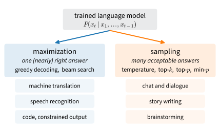
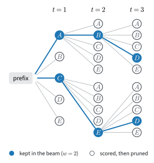

# Decoding and Generation
:label:`sec_decoding`

The language models of this chapter have been judged by how well they
predict the next token. To write text, a model must also choose one token
at each step from the distribution it returns, and different rules for that
choice make the same model write very different text. The two simplest
rules, tried in :numref:`sec_rnn-scratch`, both fell short. How should the
choice be made?

After the prefix "The Time Traveller", the model of :numref:`sec_rnn-scratch`
returns a probability for each of its 1,027 tokens, and a 50-token
continuation takes fifty such choices in a row. There are
$1027^{50} > 10^{150}$ possible continuations, far too many to compare.
Always taking the most probable token is cheap, but in practice it produces
generic text that tends to repeat itself. Drawing tokens at random from the
model's distribution produces varied text, which every so often derails on
an improbable token.

The rule that turns next-token distributions into sequences is called
*decoding* :cite:`Graves.2013,Holtzman.Buys.Du.ea.2020`. This section
develops the two families of decoding rules. *Maximization* searches for a
sequence of high probability under the model: greedy decoding takes the
most probable token at each step, and beam search keeps several candidates
alive. *Sampling* draws each token from the model's distribution, reshaped
by a few settings that cut off its unreliable tail. All of these rules see
the model only through its next-token distribution, so they apply unchanged
to any language model, recurrent or not, and to the translation models that
reuse them in :numref:`sec_machine_translation`.

```{.python .input}
%load_ext d2lbook.tab
tab.interact_select('mxnet', 'pytorch', 'tensorflow', 'jax')
```

```{.python .input #decoding-decoding-and-generation}
%%tab mxnet
%matplotlib inline
from d2l import mxnet as d2l
import math
import numpy as np
from mxnet import npx
npx.set_np()
```

```{.python .input #decoding-decoding-and-generation}
%%tab pytorch
%matplotlib inline
from d2l import torch as d2l
import math
import numpy as np
import torch
```

```{.python .input #decoding-decoding-and-generation}
%%tab tensorflow
%matplotlib inline
from d2l import tensorflow as d2l
import math
import numpy as np
import tensorflow as tf
```

```{.python .input #decoding-decoding-and-generation}
%%tab jax
%matplotlib inline
from d2l import jax as d2l
import math
import numpy as np
from flax import nnx
```

## The Decoding Problem

A trained language model supplies conditionals: writing $x_{<t}$ for the
prefix $x_1, \ldots, x_{t-1}$, it turns any prefix into a distribution
$P(x_t \mid x_{<t})$ over the next token. By the chain rule of probability
:eqref:`eq_chain_rule`, these conditionals assign every sequence the
probability $P(x_1, \ldots, x_T) = \prod_{t=1}^{T} P(x_t \mid x_{<t})$.

Decoding asks the inverse question: given the conditionals, which sequence
should we output? One answer is the *most probable* sequence. Finding it is
intractable. With vocabulary $\mathcal{V}$ and $T$ tokens to generate there
are $|\mathcal{V}|^T$ candidates, which for our 1,027 tokens and a 50-token
continuation is more than $10^{150}$. A
practical decoder therefore extends only a few prefixes at each step and
must decide which ones to keep.

Even if we could find it, the most probable sequence is often not what we
want. When the input admits only a narrow set of acceptable outputs, as in
transcribing speech, a high-probability output is a good target. When many
continuations are acceptable, as in writing a story, each of them is
individually improbable, and a model that has learned this spreads its
probability across them. Insisting on the single most probable output then
throws away the variety the model has learned. Sampling keeps it, because
it draws the output from the model's distribution instead of maximizing it.

:numref:`fig_decoding-taskmap` sorts the decoding rules into these two
families. Maximization methods, greedy decoding and beam search, are common
when the acceptable outputs are few. Sampling methods, which reshape the
distribution with settings called temperature, top-$k$, top-$p$, and
min-$p$, are the default for open-ended generation such as dialogue and
stories.


:label:`fig_decoding-taskmap`

### A Model to Decode From

We decode from the concise RNN language model of :numref:`sec_rnn-concise`:
an embedding of dimension 512, a recurrent layer with 128 hidden units,
dropout on the embeddings and the hidden states, and an output layer over
the 1,027 BPE tokens of *The Time Machine*, trained for ten epochs on
windows of 32 tokens with gradient clipping. We retrain it
with the same settings and print its validation perplexity, which should be
close to the value reached there.

```{.python .input #decoding-a-model-to-decode-from-1}
data = d2l.TimeMachine(batch_size=1024, num_steps=32,
                       num_train=50000, num_val=5000)
```

```{.python .input #decoding-a-model-to-decode-from-2}
%%tab pytorch, mxnet, jax
rnn = d2l.RNN(num_inputs=512, num_hiddens=128)
model = d2l.RNNLM(rnn, vocab_size=len(data.vocab), lr=4, dropout=0.5,
                  emb_dropout=0.1)
```

```{.python .input #decoding-a-model-to-decode-from-2}
%%tab tensorflow
with d2l.try_gpu():
    rnn = d2l.RNN(num_inputs=512, num_hiddens=128)
    model = d2l.RNNLM(rnn, vocab_size=len(data.vocab), lr=4, dropout=0.5,
                      emb_dropout=0.1)
```

```{.python .input #decoding-a-model-to-decode-from-3}
trainer = d2l.Trainer(max_epochs=10, gradient_clip_val=1, num_gpus=1)
trainer.fit(model, data)
print(f'validation perplexity {math.exp(trainer.history["val_loss"][-1]):.1f}')
```

Every decoding rule in this section interacts with the model through one
interface: given the token ids so far, return the logits of the next token.
We wrap the trained network in a function `step_fn` with this interface.
It returns a NumPy vector, so that the decoding rules can be written once,
in NumPy, for all frameworks. Any model that predicts next tokens can fill
this interface.

```{.python .input #decoding-a-model-to-decode-from-4}
%%tab mxnet
def step_fn(ids):  # Token ids in, NumPy logits for the next token out
    logits = model(d2l.tensor([ids], ctx=d2l.try_gpu()))
    return d2l.numpy(logits)[0, -1]
```

```{.python .input #decoding-a-model-to-decode-from-4}
%%tab pytorch
model.eval()  # Dropout off

def step_fn(ids):  # Token ids in, NumPy logits for the next token out
    with torch.inference_mode():
        logits = model(d2l.tensor([ids], device=d2l.try_gpu()))
    return d2l.numpy(logits)[0, -1]
```

```{.python .input #decoding-a-model-to-decode-from-4}
%%tab tensorflow
forward = tf.function(lambda X: model(X, training=False), input_signature=[
    tf.TensorSpec([1, None], tf.int32)])  # One trace for every length

def step_fn(ids):  # Token ids in, NumPy logits for the next token out
    logits = forward(tf.constant([ids], dtype=tf.int32))
    return d2l.numpy(logits)[0, -1]
```

```{.python .input #decoding-a-model-to-decode-from-4}
%%tab jax
@nnx.jit
def forward(model, X):
    return model(X)

model_eval = nnx.view(model, deterministic=True, raise_if_not_found=False)

def step_fn(ids):  # Token ids in, NumPy logits for the next token out
    padded = ids + [0] * (-len(ids) % 32)  # Few distinct lengths to compile
    logits = forward(model_eval, d2l.tensor([padded]))  # Dropout off
    return d2l.numpy(logits)[0, len(ids) - 1]
```

:begin_tab:`tensorflow`
`tf.function` traces the model once into a graph; the input signature with
length `None` lets that one graph serve prefixes of every length. Run
eagerly, each of the thousands of calls below would incur Python overhead
for every operation.
:end_tab:

:begin_tab:`jax`
`nnx.jit` compiles the forward pass once per input shape; uncompiled, every
call would retrace the recurrent scan. Padding each prefix with zeros to a
multiple of 32 tokens limits the shapes, and thus the compilations, to a few.
Since the network reads the sequence from left to right, the padding does
not change the logits at the last real position, which is the one we read.
:end_tab:

Each call runs the network over the *entire* prefix to produce one vector
of logits. This is simple but wasteful; we return to its cost at the end of
the section.

## Greedy Decoding

The simplest decoder commits, at every step, to the most probable token:

$$x_t = \operatorname*{argmax}_{x \in \mathcal{V}} P(x \mid x_{<t}).$$

Score, take the argmax, append, repeat. Greedy decoding costs one model
evaluation per token and is deterministic: the same prefix always yields
the same continuation. To print continuations, `show` decodes token ids
and quotes the text, with line breaks written as `\n`. A generated byte
token can decode to an invisible control character, which `show` replaces
by U+FFFD, the replacement character that also marks invalid bytes.

```{.python .input #decoding-greedy-decoding}
def show(ids):  # Decoded text as a literal; control characters -> U+FFFD
    text = data.tokenizer.decode(ids)
    return repr(''.join(c if c.isprintable() or c == '\n' else '\ufffd'
                        for c in text))

def decode_greedy(text, num_tokens=50):
    ids = data.tokenizer.encode(text)
    for _ in range(num_tokens):
        ids.append(int(step_fn(ids).argmax()))
    return ids

for text in ('The Time Traveller', 'It seemed to me that'):
    d2l.print_wrapped(show(decode_greedy(text)))
```

Each continuation is locally plausible but has no plan beyond the next
token. Two flaws are built into the rule. The first is *myopia*: a sequence
of locally best tokens need not be the best sequence. Suppose the model
gives the first token the probabilities $P(A) = 0.5$ and $P(B) = 0.4$.
After $A$ the model is unsure, and its most probable second token has
probability $0.3$; after $B$ it is confident, with $0.9$ for its favorite.
Greedy decoding picks $A$ and ends with a sequence of probability $0.5
\times 0.3 = 0.15$, whereas starting with $B$ gives $0.4 \times 0.9 = 0.36$.
Greedy decoding cannot see that the more probable first token leads into an
uncertain second step.

The second flaw is that greedy decoding feeds its own argmax back in as
context, and maximization favors repetition. Once a phrase has occurred, a
language model tends to assign its recurrence a higher probability, because
text that repeats tends to keep repeating. Taking the most probable token at
every step follows this tendency, and with enough steps it can lock into a
fixed cycle. :citet:`Holtzman.Buys.Du.ea.2020` documented this
*degeneration* in language models about a thousand times larger than ours:
maximization-based decoding of open-ended text produces output that is
repetitive and measurably unlike human text, however good the model.

## Beam Search
:label:`sec_beam-search`

Greedy decoding commits immediately; exhaustive search never commits at all.
*Beam search* lies between them, with a single setting, the *beam width*
$w$: it keeps the $w$ most probable prefixes alive at every step. At the
first step it selects the $w$ most probable tokens. After that, each of the
$w$ surviving prefixes is extended by every token in the vocabulary, the
resulting $w \cdot |\mathcal{V}|$ candidates are scored by their cumulative
log-probability, and the best $w$ survive. Greedy decoding is the case
$w = 1$. Exhaustive search is the limit in which $w$ exceeds the number of
candidates and nothing is ever pruned.


:label:`fig_beam-search`

:numref:`fig_beam-search` traces an example with $w = 2$ over the
vocabulary $\mathcal{V} = \{A, B, C, D, E\}$ and three steps. Let
$x_{\leq t_0}$ be the given prefix of $t_0$ tokens, and suppose that the two most
probable first tokens are $A$ and $C$; they form the initial beam. At the
second step we compute, for every $x' \in \mathcal{V}$, the scores of the
ten extensions

$$
\begin{aligned}
P(A, x' \mid x_{\leq t_0}) &= P(A \mid x_{\leq t_0})\, P(x' \mid A, x_{\leq t_0}),\\
P(C, x' \mid x_{\leq t_0}) &= P(C \mid x_{\leq t_0})\, P(x' \mid C, x_{\leq t_0}),
\end{aligned}
$$

and keep the two largest, say for $AB$ and $CE$. The third step repeats the
calculation from these survivors and keeps, say, $ABD$ and $CED$. Instead
of the $5^3 = 125$ sequences of exhaustive search, beam search scored
$5 + 10 + 10 = 25$. In general it costs $\mathcal{O}(w |\mathcal{V}| T)$
for $T$ steps, $w$ times as much as greedy decoding and exponentially less
than exhaustive search.

One correction is needed before finished candidates of different lengths
can be compared. The log-probability of a token is never positive, so the
score of a sequence can only fall as it grows, and comparing raw scores
favors short candidates. This matters once an end-of-sequence token lets
some candidates stop early. The standard remedy is *length normalization*
:cite:`Wu.Schuster.Chen.ea.2016`: rank a candidate that adds $T$ tokens to
the prefix by

$$\frac{1}{T^\beta} \sum_{t=t_0+1}^{t_0+T} \log P(x_t \mid x_{<t}),$$
:eqlabel:`eq_beam-search-score`

where the exponent $\beta$, typically around 0.75, interpolates between no
correction ($\beta = 0$) and the average log-probability per token
($\beta = 1$). In the code below it is the argument `alpha`, the name used
in :citet:`Wu.Schuster.Chen.ea.2016`.

The implementation below follows this procedure. Finished candidates, those
that produced `eos_id`, pass from round to round unchanged; live ones are
expanded and rescored. Since the best $w$ candidates contain at most $w$
continuations of any single prefix, it suffices to expand each prefix by
its $w$ most probable tokens rather than by all $|\mathcal{V}|$ of them.

```{.python .input #decoding-beam-search-1}
def beam_search(step_fn, prefix, num_tokens, beam_size=4,  #@save
                alpha=0.75, eos_id=None):
    """Length-normalized beam search (score = log P / len^alpha).
    Returns candidates sorted best-first; [0][1] is the argmax sequence."""
    def log_softmax(logits):
        logits = [float(l) for l in logits]
        m = max(logits)
        lse = m + math.log(sum(math.exp(l - m) for l in logits))
        return [l - lse for l in logits]
    score = lambda logp, ids: logp / max(1, len(ids) - len(prefix))**alpha
    beams = [(0.0, list(prefix), False)]  # (log-prob, sequence, finished)
    for _ in range(num_tokens):
        if all(done for _, _, done in beams):
            break
        candidates = [b for b in beams if b[2]]  # Finished pass through
        for logp, ids, _ in (b for b in beams if not b[2]):
            logprobs = log_softmax(step_fn(ids))
            best = sorted(range(len(logprobs)),
                          key=lambda i: -logprobs[i])[:beam_size]
            candidates += [(logp + logprobs[i], ids + [i], i == eos_id)
                           for i in best]
        beams = sorted(candidates, key=lambda b: score(b[0], b[1]),
                       reverse=True)[:beam_size]
    return sorted([(score(logp, ids), ids) for logp, ids, _ in beams],
                  reverse=True)
```

We decode the two prefixes from before with $w = 1$, which reproduces
greedy decoding, and with $w = 4$, and print the score
:eqref:`eq_beam-search-score` of the winning candidate.

```{.python .input #decoding-beam-search-2}
for text in ('The Time Traveller', 'It seemed to me that'):
    prefix = data.tokenizer.encode(text)
    for w in (1, 4):
        score, ids = beam_search(step_fn, prefix, 30, beam_size=w)[0]
        d2l.print_wrapped(f'w={w}, score {score:.2f}: {show(ids)}')
```

The wider beam usually finds continuations that the model scores higher
than the greedy ones, but it cannot guarantee it: beam search is still an
approximate search, and it can prune the prefix that greedy decoding would
have completed. Whether the higher-scoring text is
also *better* text is a separate question. In large language models, beam
search on open-ended text produces output far more repetitive than human
text :cite:`Holtzman.Buys.Du.ea.2020`, and we measure below how our
maximizers compare with sampling. Where the acceptable outputs are few, as
in speech recognition and machine translation, beam search with a small
width, typically between 4 and 10, is the standard decoder
:cite:`Sutskever.Vinyals.Le.2014,Wu.Schuster.Chen.ea.2016`.

## Sampling

If we trust the model's distribution, the natural way to generate is to
sample from it: draw $x_t \sim P(x_t \mid x_{<t})$, append, repeat. Text
produced this way is distributed as the model believes text should be, with
the variety that maximization throws away. The problem lies in the tail.
Our model spreads small probabilities over a thousand tokens, a large model
over a hundred thousand. Each unlikely token is negligible on its own, but
their combined probability at each step is not. Sampling therefore
regularly picks a token that the model itself considers nearly impossible,
and one absurd token, fed back as context, can derail everything after it.
:citet:`Holtzman.Buys.Du.ea.2020` call this the *unreliable tail*: the
model's estimates are trustworthy for its most probable tokens and mostly
noise far down the ranking. The fix is to reshape or truncate the
distribution before sampling, and each of the settings below does this in
its own way.

**Temperature** rescales the logits before the softmax. Dividing every
logit $o_x$ by a temperature $\tau > 0$ gives

$$P_\tau(x \mid x_{<t}) = \frac{\exp(o_x / \tau)}{\sum_{x' \in \mathcal{V}} \exp(o_{x'} / \tau)} \propto P(x \mid x_{<t})^{1/\tau}.$$
:eqlabel:`eq_temperature`

At $\tau = 1$ we sample the model as it is. As $\tau \to 0$ the
distribution concentrates on its most probable token, and sampling becomes
greedy decoding. As $\tau$ grows the distribution flattens toward uniform.
Temperature reshapes the head and the tail together, so cooling the
distribution enough to suppress the tail also removes legitimate variety at
the head.

**Top-$k$** truncates by count: keep the $k$ most probable tokens,
renormalize, and sample :cite:`Radford.Wu.Child.ea.2019`. **Top-$p$** (or
*nucleus*) sampling truncates by probability mass: keep the smallest set of
most probable tokens whose total probability reaches $p$, for example
$p = 0.9$ :cite:`Holtzman.Buys.Du.ea.2020`. The difference matters because
the model's confidence changes from step to step. Where the model is nearly
certain of the next token, a fixed $k = 20$ admits nineteen poor options;
where dozens of words are plausible, the same $k$ may cut off real variety.
Top-$p$ adapts: it keeps few tokens when the head of the distribution is
heavy and many when it is flat. It has its own failure on peaked
distributions: if the top token holds 0.95 of the mass, top-$p$ with
$p = 0.9$ keeps one token and acts greedily even where the runner-up was a
good choice.

**Min-$p$** sets the cutoff relative to the model's confidence
:cite:`Nguyen.Baker.Neo.ea.2025`: keep every token whose probability is at
least $p_{\min}$ times that of the most probable token, for example
$p_{\min} = 0.05$. When the model is sure, the bar is high and few tokens
pass; when it is unsure, the bar drops and more of them survive.
:citet:`Nguyen.Baker.Neo.ea.2025` find that this relative rule degrades
less than top-$p$ at high temperatures, where an absolute rule admits much
of the flattened tail.

### A Unified Sampler

All four settings act on the same object, the next-token distribution, so
one function can implement them. `sample_next` turns a vector of logits
into a token id. At temperature 0 it returns the argmax, which is greedy
decoding. Otherwise it computes $P_\tau$ of :eqref:`eq_temperature`, sorts
the tokens by probability, and applies the optional top-$k$, top-$p$, and
min-$p$ cutoffs. Each cutoff only decides how many tokens of the sorted
order to keep, and the function keeps the smallest of these numbers. It
then renormalizes the kept probabilities and draws one token. It takes a
NumPy random generator `rng` and creates a fresh one if none is given.

```{.python .input #decoding-a-unified-sampler-1}
def sample_next(logits, temperature=1.0, k=None, p=None, min_p=None,
                rng=None):
    """Draw a token id from 1-D NumPy logits; temperature 0 is greedy.
    Top-k, top-p, and min-p truncate the temperature-scaled distribution."""
    logits = np.asarray(logits, dtype=np.float64)
    if temperature == 0:
        return int(logits.argmax())
    probs = np.exp((logits - logits.max()) / temperature)
    order = np.argsort(-probs)               # token ids, most probable first
    probs = probs[order] / probs.sum()
    keep = len(probs)
    if k is not None:                        # top-k: a fixed count
        keep = min(keep, k)
    if p is not None:                        # top-p: smallest head of mass p
        keep = min(keep, int(np.searchsorted(probs.cumsum(), p)) + 1)
    if min_p is not None:                    # min-p: a fraction of the top
        keep = min(keep, int((probs >= min_p * probs[0]).sum()))
    rng = np.random.default_rng() if rng is None else rng
    return int(order[rng.choice(keep, p=probs[:keep] / probs[:keep].sum())])
```

`generate` is the loop we have been writing by hand: query `step_fn`,
choose with `sample_next` (extra keyword arguments pass through to it),
append, and stop early if the end-of-sequence token `eos_id` appears.
Open-ended generation has no such token, so our examples run for a fixed
number of tokens.

```{.python .input #decoding-a-unified-sampler-2}
def generate(step_fn, prefix, num_tokens, eos_id=None, **strategy):
    """Extend prefix by up to num_tokens ids, each chosen by sample_next
    from step_fn(ids), the next-token logits; stop early at eos_id."""
    ids = list(prefix)
    for _ in range(num_tokens):
        ids.append(sample_next(step_fn(ids), **strategy))
        if eos_id is not None and ids[-1] == eos_id:
            break
    return ids
```

A toy distribution makes the cutoffs concrete. Five tokens have
probabilities 0.45, 0.25, 0.15, 0.10, and 0.05. Top-$k$ with $k = 2$ can
only emit tokens 0 and 1. Top-$p$ with $p = 0.8$ keeps three tokens,
since the cumulative probability first reaches 0.8 at the third (0.85).
Min-$p$ with $p_{\min} = 0.5$ keeps the tokens with probability at least $0.5
\times 0.45 = 0.225$, again tokens 0 and 1. We draw 15 tokens under each
rule.

```{.python .input #decoding-a-unified-sampler-3}
logits = np.log([0.45, 0.25, 0.15, 0.10, 0.05])
print('greedy:', sample_next(logits, temperature=0))
for cutoff in (dict(k=2), dict(p=0.8), dict(min_p=0.5)):
    print(cutoff, [sample_next(logits, **cutoff) for _ in range(15)])
```

Every draw respects its cutoff: tokens 3 and 4 never appear, and token 2
can appear only under top-$p$.

### Cutoffs on a Trained Model

We now apply the cutoffs to the trained model. We compute its next-token
distribution after "The Time Traveller", sort it by decreasing probability,
and plot it on logarithmic axes. On this plot each rule is a single line.
Top-$k$ is a vertical line at rank $k$, wherever the probabilities lie.
Top-$p$ is a vertical line at the rank where the cumulative probability
reaches $p$, so its position depends on the shape of the head. Min-$p$ is a
*horizontal* line at $p_{\min}$ times the top probability: every token
above it is kept, and the line moves up and down with the model's
confidence. Everything to the right of the vertical lines, or below the
horizontal one, is the tail that truncation removes.

```{.python .input #decoding-one-distribution-three-cutoffs-1}
def next_probs(text):  # Next-token probabilities after text, sorted
    logits = step_fn(data.tokenizer.encode(text))
    probs = np.exp(logits - logits.max())
    return np.sort(probs / probs.sum())[::-1]

def cutoffs(probs, p=0.9, min_p=0.05):  # Tokens kept by top-p and min-p
    return (int(np.searchsorted(probs.cumsum(), p)) + 1,
            int((probs >= min_p * probs[0]).sum()))

probs = next_probs('The Time Traveller')
n_p, n_m = cutoffs(probs)
lo, hi = probs[-1], probs[0]
d2l.plot([np.arange(1, len(probs) + 1), [20, 20], [n_p, n_p],
          [1, len(probs)]], [probs, [lo, hi], [lo, hi], [0.05 * hi] * 2],
         xlabel='token rank', ylabel='probability', xscale='log',
         yscale='log', figsize=(5.5, 3),
         legend=['model', 'top-k, k=20', f'top-p=0.9: keep {n_p}',
                 f'min-p=0.05: keep {n_m}'])
```

The distribution falls steeply over the first few dozen ranks and then
flattens into a long tail of tokens with tiny probabilities, the tail that
all three rules cut. To compare the rules, we also apply them after the
shorter prefix "The Time", which the novel continues with " Traveller" in
11 of its 13 occurrences, so the model should be nearly sure of the next
token. We count the tokens each rule keeps after both prefixes.

```{.python .input #decoding-one-distribution-three-cutoffs-2}
for text in ('The Time Traveller', 'The Time'):
    probs = next_probs(text)
    n_p, n_m = cutoffs(probs)
    print(f'{text!r}: top probability {probs[0]:.2f}; kept: top-k 20, '
          f'top-p {n_p}, min-p {n_m}')
```

Top-$k$ keeps 20 tokens whatever the distribution. After "The Time" the
top probability is high, so the min-$p$ bar of $p_{\min}$ times that
probability is high too, and min-$p$ keeps only a handful of tokens; after
"The Time Traveller" it keeps more, typically several times as many.
Top-$p$ shrinks too, but it
depends on the whole head of the distribution, not only on its top
probability. Min-$p$ is strict where the model is sure and permissive where
it is not.

### Strategies Compared on One Prefix

We now read the text that each setting produces, starting with temperature
alone at $\tau = 0.5$, $1$, and $2$.

```{.python .input #decoding-the-same-prefix-under-every-strategy-1}
prefix = data.tokenizer.encode('The Time Traveller')
for tau in (0.5, 1.0, 2.0):
    out = generate(step_fn, prefix, 50, temperature=tau)
    d2l.print_wrapped(f'tau={tau}: {show(out)}')
```

At $\tau = 0.5$ the text stays close to the model's most probable tokens.
At $\tau = 1$ it is more varied and occasionally strays into invented
words. At $\tau = 2$ the flattened distribution draws so many tail tokens
that the text stops being English; the tokens may even combine into bytes
that do not form valid characters. Next we run the main strategies on the
same prefix, each with its typical setting.

```{.python .input #decoding-the-same-prefix-under-every-strategy-2}
strategies = {'greedy': dict(temperature=0), 'tau=1': dict(),
              'top-k=20': dict(k=20), 'top-p=0.9': dict(p=0.9),
              'min-p=0.05': dict(min_p=0.05)}
for name, strategy in strategies.items():
    out = generate(step_fn, prefix, 50, **strategy)
    d2l.print_wrapped(f'{name:>10}: {show(out)}')
```

Our small model cannot make any of these continuations good, but it makes
their differences visible. Greedy decoding is deterministic: rerunning the
cell reproduces its text exactly, while every sampler gives new text each
time. Pure sampling is varied and erratic. The truncated samplers sit
in between: they keep the variety of sampling and cut the tail on which pure
sampling trips. A temperature combined with top-$p$ or min-$p$ is a common
default for open-ended generation.

## Evaluation and Cost

### The Quality of Generated Text
:label:`subsec_evaluating-generated-text`

How can we decide, beyond reading samples, which strategy writes better
text? Perplexity is of little help. It evaluates the *model*: how well its
conditionals predict text that people wrote. It says nothing about a
particular generated sample, and scoring a sample by its probability under
the model would reward maximization by definition. A strategy is not better
because its output is more probable; sampling deviates from the most
probable output on purpose.

Automated statistics can still catch specific failures. A simple one for
repetition is *distinct-3*, the fraction of distinct 3-grams among all
3-grams of a continuation: it is 1 when no three consecutive tokens ever
recur and close to 0 for text stuck in a loop. We decode 100 tokens after 20
random six-token prefixes from the validation text with greedy decoding,
beam search with $w = 4$, and min-$p$ sampling, and report two averages:
the log-probability per generated token under the model, and distinct-3.

```{.python .input #decoding-evaluating-generated-text}
def log_prob(ids, start):  # Mean log-probability of ids[start:]
    lps = []
    for t in range(start, len(ids)):
        logits = step_fn(ids[:t])
        lse = logits.max() + np.log(np.exp(logits - logits.max()).sum())
        lps.append(logits[ids[t]] - lse)
    return np.mean(lps)

def distinct(ids, n=3):  # Fraction of distinct n-grams in ids
    grams = [tuple(ids[i:i + n]) for i in range(len(ids) - n + 1)]
    return len(set(grams)) / len(grams)

val = d2l.numpy(data.X[data.num_train:data.num_train + data.num_val])
rows = np.random.default_rng().choice(len(val), 20, replace=False)
prefixes = [[int(i) for i in val[r, :6]] for r in rows]
decoders = {
    'greedy': lambda pre: generate(step_fn, pre, 100, temperature=0),
    'beam, w=4': lambda pre: beam_search(step_fn, pre, 100, beam_size=4)[0][1],
    'min-p=0.05': lambda pre: generate(step_fn, pre, 100, min_p=0.05)}
for name, decode in decoders.items():
    outs = [decode(pre) for pre in prefixes]
    print(f'{name:>10}: log-prob per token '
          f'{np.mean([log_prob(o, 6) for o in outs]):.2f}, distinct-3 '
          f'{np.mean([distinct(o[6:]) for o in outs]):.2f}')
```

The two averages disagree. The two maximizers produce continuations with a
clearly higher log-probability per token than the min-$p$ samples. Beam
search is usually ahead of greedy decoding, by a margin that varies from
run to run and occasionally reverses. Yet the samples are the
most varied: their distinct-3 is close to 1,
higher than that of either maximizer. Maximization raises the probability of
the text and lowers its variety, the degeneration described by
:citet:`Holtzman.Buys.Du.ea.2020` on a small scale.

Such statistics detect particular failures; they do not say whether the
text is good. The final judge of open-ended generation is a human reader:
can people tell the model's text from text that people wrote, and which do
they prefer? Tasks with a reference answer, such as translation, are easier
to score automatically, by the overlap between the output and reference
translations. In short, perplexity selects the model, and human judgment,
or a proxy for it, selects the decoding strategy.

### The Cost of Generation
:label:`subsec_cost-of-generation`

Our `step_fn` runs the network over the whole prefix for every token it
generates, so a continuation of $T$ tokens costs $\mathcal{O}(T^2)$ updates
of the recurrent cell. Generation is also *sequential*: during training,
all positions of a known sequence are processed together, but token $t + 1$
cannot be scored before token $t$ has been chosen. For a recurrent network
the quadratic part is pure waste. The hidden state already summarizes the
prefix, so carrying it forward, as `predict` in :numref:`sec_rnn-scratch`
does, makes each new token cost one cell update, independent of the length
of the prefix. This constant cost and memory per generated token is a
property of every recurrent architecture, and a reason for the interest in
recurrent language models.

We can now turn a language model into a text generator and choose between
searching for probable text and sampling varied text. What we cannot yet do
is measure the quality of open-ended text without human readers, and our
small model limits how good any decoder can make its output.

## Summary

Decoding turns a language model's next-token distributions into sequences.
Maximization targets the most probable output. Greedy decoding takes the
most probable token at each step and is myopic. Beam search keeps the $w$
best prefixes under the length-normalized score
:eqref:`eq_beam-search-score`, at $w$ times the cost. Maximization suits
tasks with few acceptable outputs, but on open-ended text it yields
repetitive output that is less varied than sampled text.

Sampling draws from the model's distribution, reshaped by temperature
:eqref:`eq_temperature` and truncated by top-$k$ (a fixed count), top-$p$
(a fixed probability mass), or min-$p$ (a fixed fraction of the top
probability). Perplexity evaluates the model, not its samples, and
generating naively re-runs the model over the whole prefix for every new
token, which a carried recurrent state avoids.

## Exercises

1. [code] **Repetition penalty.** The *repetition penalty* of
   :citet:`Keskar.McCann.Varshney.ea.2019` discourages tokens that already
   appear in the sequence by dividing each such token's logit by a constant
   $\gamma > 1$. Add it to `sample_next` so that it acts on the logits
   before both the greedy argmax and the temperature scaling. `generate`
   then has to pass the ids so far to `sample_next`. Decode
   `'The Time Traveller'` and `'It seemed to me that'` greedily with
   $\gamma = 1.2$.
    1. Does the penalty remove the repeating cycles? Report the distinct-3
       of each continuation, computed with `distinct`, with and without
       the penalty.
    1. Adding the same constant to every logit leaves the softmax
       unchanged. Does it leave the penalized distribution unchanged? Work
       out what the penalty does to a token whose logit is negative.
    1. Which legitimate repetitions in English text does the penalty
       discourage, and what happens as $\gamma$ grows large?

1. **Beam search properties.**
    1. Take beam width 2, the five-token vocabulary of
       :numref:`fig_beam-search`, and three steps. Assign conditional
       probabilities for which beam search does not return the most
       probable three-token sequence, and compute the probabilities of
       both sequences. What does your construction imply about how beam
       search can miss the most probable sequence?
    1. What is the smallest beam width that guarantees that beam search
       over $T$ steps returns the most probable of all
       $|\mathcal{V}|^T$ sequences, whatever the model?
    1. Let $w \leq |\mathcal{V}|$, and assume that no end-of-sequence
       token occurs. Count the calls to `step_fn` that `beam_search`
       makes over $T$ steps. Count also the calls that exhaustive search
       makes when it evaluates every prefix once. Evaluate both counts
       for $|\mathcal{V}| = 1{,}027$, $T = 50$, and $w = 4$.

1. [code] **Length normalization.** Run `beam_search` with $w = 4$ for up
   to 40 tokens after `'The Time Traveller'` and `'It seemed to me that'`.
   Pass the id of the newline character, `data.tokenizer.encode('\n')[0]`,
   as `eos_id`, and vary $\beta$ (the argument `alpha`) over
   $\{0, 0.75, 1.5\}$. Compare the lengths and the total log-probabilities
   of the winning candidates, and explain the trend using :eqref:`eq_beam-search-score`.

1. **Truncation under temperature.** `sample_next` applies every
   cutoff to the temperature-scaled distribution $P_\tau$
   of :eqref:`eq_temperature`. Write the min-$p$ condition
   $P_\tau(x \mid x_{<t}) \geq p_{\min} \max_{x'} P_\tau(x' \mid x_{<t})$ as
   a condition on the untempered probabilities. For the five-token
   distribution 0.45, 0.25, 0.15, 0.10, 0.05, compute the sets that
   top-$k$ with $k = 2$, top-$p$ with $p = 0.85$, and min-$p$ with
   $p_{\min} = 0.5$ keep at $\tau = 2$. Which of the three rules keeps the
   same set at every temperature?

1. [code] **Constrained sampling.** Ban every token whose text contains the
   letter "e" by setting its logit to $-\infty$ in a wrapper around
   `step_fn`. Generate 50 tokens greedily after `'The Time Traveller'`
   with and without the ban. Report the probability mass that the ban
   removes, averaged over the steps of the banned continuation, and
   describe how the two continuations differ.
    1. Why is banning a *word* harder than banning a token under a subword
       tokenizer, and what can go wrong at the boundary between two
       tokens?
    1. Grammar and schema constraints are usually enforced by this same
       per-step masking, with a parser deciding at each step which tokens
       keep the output valid. Some constraints span several tokens, such
       as forcing a given phrase to appear somewhere in the output. What
       does keeping several prefixes alive, as beam search does, add over
       masking one token at a time for such a constraint?

1. [code] **Top-$p$ versus min-$p$.** ● At $\tau = 1.5$, sweep $p$ for
   top-$p$ and $p_{\min}$ for min-$p$ over a grid of values. For each
   setting, generate 50-token continuations of five prefixes of your
   choice and record two averages over the generated tokens: the number
   of tokens the rule keeps, and the log-probability of the drawn token
   under the untempered model. Plot the second average against the
   first, one curve per rule. Which rule draws more probable tokens at
   the same average number of kept tokens? Compare your finding with
   those of :citet:`Nguyen.Baker.Neo.ea.2025`.

1. [code] **Failure taxonomy.** ● Choose 20 prefixes and decode a 50-token
   greedy continuation of each.
    1. Sort the failures into a taxonomy of your own, with categories such
       as a repeating cycle or a drift away from the prefix's topic, and
       report the frequency of each category with one example.
    1. Decode one continuation of each prefix with min-$p$ sampling at
       $p_{\min} = 0.05$ and classify its failures with the same
       taxonomy, adding categories where needed. Which categories does
       sampling remove, and which does it introduce?
    1. Which of the automated statistics of
       :numref:`subsec_evaluating-generated-text` would detect each
       category, and which categories need a human judge?

    *Adapted from Stanford CS224n,
    [Assignment 4](https://web.stanford.edu/class/archive/cs/cs224n/cs224n.1234/assignments/a4.pdf),
    Part 2(b).*

1. [code] **Constant cost per token.** ● `step_fn` re-runs the network over
   the entire prefix for every generated token, so a $T$-token
   continuation costs $\mathcal{O}(T^2)$ cell
   updates (:numref:`subsec_cost-of-generation`).
    1. Write a stateful replacement for `step_fn` that keeps the hidden
       state of `model.rnn` and consumes only the newest token, so that
       each call performs one cell update. Verify that `generate` produces
       the same greedy continuation with both versions.
    1. Time `generate` for 50, 200, and 800 tokens with both versions.
       Estimate from the ratios how each time grows with the number of
       tokens, and explain any departure from the quadratic and linear
       growth that the count of cell updates predicts.
    1. Why does the same replacement not carry over directly to
       `beam_search`, and what bookkeeping would make it work?

[Discussions](https://d2l.discourse.group/t/338)

<!-- slides -->

::: {.slide}
::: {.cover}
[Dive into Deep Learning · §8.7]{.kicker}

Decoding and Generation<br>**greedy decoding · beam search · temperature · top-k, top-p, min-p · evaluation and cost**
:::
:::

::: {.slide title="One Distribution per Step, More Than $10^{150}$ Continuations"}
[The problem]{.kicker}

- After "The Time Traveller" the model returns a probability for each of
  its 1,027 tokens.
- A 50-token continuation: $1027^{50} > 10^{150}$ candidates. No search can
  compare them all.
- Always taking the most probable token: generic text that tends to repeat.
- Drawing at random from the model: varied text that sometimes derails.

::: {.d2l-note .warn}
Which rule turns next-token distributions into good text?
:::
:::

::: {.slide title="By the End of This Deck You Can"}
[Goals]{.kicker}

- decode greedily and explain why it is myopic;
- run beam search with width $w$ and length normalization, and count its
  cost;
- reshape a distribution with temperature $\tau$ and cut it with top-$k$,
  top-$p$, and min-$p$;
- explain why the most probable text is not the best open-ended text;
- count the cost of generating $T$ tokens, with and without a carried state.

**Running example:** the RNN language model on *The Time Machine*
(BPE-1024, 128 hidden units), prefixes "The Time Traveller" and "It seemed
to me that".
:::

::: {.slide title="From Next-Token Distributions to Text"}
[Where this fits]{.kicker}

::: {.cols .vc}
::: {.col}
| section | adds |
|---|---|
| Working with Sequences | autoregression, latent state, rollout error |
| From Text to Tokens | characters, words, bytes, BPE |
| Language Models | $n$-grams, perplexity, bits per byte |
| Recurrent Neural Networks | a hidden state updated at every step |
| Implementing RNNs | an RNN language model, scratch and concise |
| Backpropagation Through Time | gradients through time, truncation |
| **Decoding and Generation** | **greedy decoding, beam search, sampling** |
:::

::: {.col .narrow}
- **Uses:** the trained RNN language model, softmax, the chain rule of
  probability.
- **Skips:** speculative decoding, constrained decoding, learned judges.
:::
:::
:::

::: {.slide title="Every Decoder Sees the Model Through One Function"}
[Interface]{.kicker}

Token ids in, logits of the next token out, as a NumPy vector:

@-decoding-a-model-to-decode-from-4

- The decoding rules are written once, in NumPy, for any framework.
- Any model that predicts next tokens fits: an RNN, an LSTM, a transformer.
:::

::: {.slide}
::: {.divider}
[01]{.dnum}

[Maximization]{.dtitle}

[greedy decoding and beam search]{.dsub}
:::
:::

::: {.slide title="Greedy Decoding Takes the Best Token and Can Miss the Best Sequence"}
[Greedy]{.kicker}

$$x_t = \operatorname*{argmax}_{x \in \mathcal{V}} P(x \mid x_{<t})$$

One model call per token; deterministic.

| first token | best second token | sequence |
|---|---|---|
| $A$: 0.5 (greedy) | 0.3 | $0.5 \times 0.3 = 0.15$ |
| $B$: 0.4 | 0.9 | $0.4 \times 0.9 = 0.36$ |

::: {.d2l-note .rule}
Myopia: greedy cannot see that $B$ leads into a confident second step.
:::
:::

::: {.slide title="Maximization Feeds Repetition Back Into the Context"}
[Degeneration]{.kicker}

- The chosen token becomes context for the next choice.
- A phrase that has occurred becomes more probable: text that repeats tends
  to keep repeating.
- Taking the argmax every step follows this pull and can lock into a cycle.
- Holtzman et al. (2020) found the same *degeneration* in models about a
  thousand times larger: maximized open-ended text is repetitive and unlike human
  text.
:::

::: {.slide title="Beam Search Keeps the $w$ Best Prefixes"}
[Beam search]{.kicker}

{width=36%}

Expand each of $w$ prefixes, keep the best $w$ of $w|\mathcal{V}|$:
cost $\mathcal{O}(w|\mathcal{V}|T)$. Greedy is $w = 1$.
:::

::: {.slide title="Check: How Many Candidates Does Beam Search Score?"}
[Check]{.kicker}

Vocabulary of 10 tokens, 4 steps, beam width $w = 3$. How many candidate
prefixes does beam search score, and how many sequences would exhaustive
search compare?

::: {.fragment .fade-up}
::: {.d2l-note}
**Answer.** $10 + 3 \cdot 10 + 3 \cdot 10 + 3 \cdot 10 = 100$ against
$10^4 = 10{,}000$. For 1,027 tokens and 50 steps: about $1.5 \times 10^5$
against more than $10^{150}$.
:::
:::
:::

::: {.slide title="Length Normalization Stops Short Candidates From Winning"}
[Scoring]{.kicker}

Log-probabilities are $\leq 0$, so a raw sum only falls as a candidate
grows. Rank a candidate that adds $T$ tokens to a prefix of length $t_0$ by

$$\frac{1}{T^\beta} \sum_{t=t_0+1}^{t_0+T} \log P(x_t \mid x_{<t}),
\qquad \beta \approx 0.75.$$

- $\beta = 0$: raw sum. $\beta = 1$: average per token.
- Matters once an end-of-sequence token lets candidates stop early.
:::

::: {.slide title="A Wider Beam Usually Finds Continuations the Model Scores Higher"}
[Beam search, run]{.kicker}

@!decoding-beam-search-2

Usually a higher score than greedy, never guaranteed: beam search is
approximate. Higher score does not mean better text.
:::

::: {.slide}
::: {.divider}
[02]{.dnum}

[Sampling]{.dtitle}

[temperature and three cutoffs]{.dsub}
:::
:::

::: {.slide title="Sampling Keeps the Variety but Trips on the Unreliable Tail"}
[Sampling]{.kicker}

Draw $x_t \sim P(x_t \mid x_{<t})$, append, repeat.

- The output has the variety the model has learned.
- But a thousand unlikely tokens together carry real probability at every
  step, and one absurd token derails all that follows.
- The model's estimates are reliable for its top tokens, noise far down
  the ranking.

::: {.d2l-note .rule}
Fix: reshape or cut the distribution before sampling.
:::
:::

::: {.slide title="Temperature Reshapes the Head and the Tail Together"}
[Temperature]{.kicker}

Divide every logit $o_x$ by $\tau > 0$:

$$P_\tau(x \mid x_{<t}) \propto \exp(o_x/\tau) \propto P(x \mid x_{<t})^{1/\tau}$$

- $\tau \to 0$: greedy decoding. $\tau = 1$: the model as is.
  $\tau \to \infty$: uniform.
- Cooling enough to suppress the tail also removes variety at the head.
:::

::: {.slide title="Three Cutoffs: a Count, a Mass, a Fraction of the Top"}
[Truncation]{.kicker}

| rule | keeps | on 0.45, 0.25, 0.15, 0.10, 0.05 |
|---|---|---|
| top-$k$ | the $k$ most probable tokens | $k = 2$: tokens 0, 1 |
| top-$p$ | smallest head with mass $\geq p$ | $p = 0.8$: tokens 0, 1, 2 |
| min-$p$ | $P(x) \geq p_{\min} \max_{x'} P(x')$ | $p_{\min} = 0.5$: tokens 0, 1 |

Then renormalize what is kept and sample.
:::

::: {.slide title="Each Cutoff Only Decides How Many Sorted Tokens to Keep"}
[Sampler]{.kicker}

```{.python #decoding-sampler-core}
probs = np.exp((logits - logits.max()) / temperature)
order = np.argsort(-probs)            # most probable first
probs = probs[order] / probs.sum()
keep = min(k, len(probs))                                  # top-k
keep = min(keep, np.searchsorted(probs.cumsum(), p) + 1)   # top-p
keep = min(keep, (probs >= min_p * probs[0]).sum())        # min-p
head = probs[:keep] / probs[:keep].sum()
token = order[rng.choice(keep, p=head)]
```

Each `keep` line runs only if its setting is given.
:::

::: {.slide title="On a Log–Log Plot, Top-$k$ and Top-$p$ Are Vertical Cuts, Min-$p$ Horizontal"}
[The trained model]{.kicker}

@!decoding-one-distribution-three-cutoffs-1

A steep head and a long flat tail: the tail is what all three rules cut.
:::

::: {.slide title="Min-$p$ Is Strict Where the Model Is Sure, Permissive Where It Is Not"}
[Adaptivity]{.kicker}

@!decoding-one-distribution-three-cutoffs-2

- Top-$k$ keeps 20 tokens whatever the distribution.
- "The Time" is followed by " Traveller" in 11 of 13 cases in the novel:
  a high top probability, a high min-$p$ bar, few tokens kept.
- Top-$p$ moves too, but depends on the whole head.
:::

::: {.slide title="Check: What Do Top-$p$ and Min-$p$ Keep When One Token Has 0.95?"}
[Check]{.kicker}

The top token has probability 0.95; the other 1,026 share 0.05. How many
tokens do top-$p$ with $p = 0.9$ and min-$p$ with $p_{\min} = 0.05$ keep?

::: {.fragment .fade-up}
::: {.d2l-note}
**Answer.** Top-$p$ keeps 1 token: it acts greedily. Min-$p$ keeps every
token above $0.05 \times 0.95 \approx 0.048$: the top one, plus a runner-up
only if it holds almost all of the remaining 0.05.
:::
:::
:::

::: {.slide}
::: {.divider}
[03]{.dnum}

[Evaluation and Cost]{.dtitle}

[what perplexity cannot judge, and what generation costs]{.dsub}
:::
:::

::: {.slide title="Maximizers Score Higher, Samples Are More Varied"}
[Measured]{.kicker}

20 random validation prefixes, 100 tokens each; *distinct-3* = fraction of
distinct 3-grams (1: no repeats, near 0: a loop).

@!decoding-evaluating-generated-text

- Probability under the model: both maximizers clearly above sampling.
- Variety ranks sampling first: maximization raises probability and lowers
  variety.
:::

::: {.slide title="Perplexity Selects the Model; Readers Select the Decoder"}
[Evaluation]{.kicker}

- Perplexity measures how well the model predicts human text, not how good
  one sample is.
- Scoring samples by model probability would reward maximization by
  definition.
- Statistics such as distinct-3 catch particular failures (loops).
- Open-ended text is judged by people; tasks with references (translation)
  can be scored automatically.
:::

::: {.slide title="Re-Running the Prefix Costs $\mathcal{O}(T^2)$; a Carried State Costs One Step per Token"}
[Cost]{.kicker}

- `step_fn` runs the network over the whole prefix for every new token:
  $\mathcal{O}(T^2)$ cell updates for $T$ tokens.
- Generation is sequential: token $t+1$ needs token $t$.
- An RNN's hidden state already summarizes the prefix: carry it forward and
  each token costs **one** cell update, whatever the prefix length.
:::

::: {.slide title="Decoding Is a Choice Between Probable and Varied Text"}
[Wrap-up]{.kicker}

- Greedy: argmax per step, myopic. Beam search: $w$ best prefixes,
  length-normalized, $w\times$ the cost, higher model score.
- On open-ended text, maximized output is less varied than sampled output.
- Sampling: temperature $\tau$, then top-$k$ (count), top-$p$ (mass), or
  min-$p$ (fraction of the top).
- Perplexity judges the model; people judge the samples.
- A carried recurrent state makes each new token cost one step.
:::
