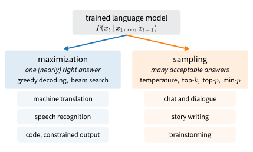
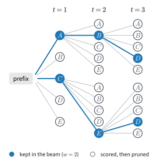

# Decoding and Generation
:label:`sec_decoding`

So far in this chapter, we have judged language models strictly by how well
they assign probabilities to the next token. To *generate* text, however, a
model must also select a concrete token at each step from its predicted
distribution—and this decision matters far more than one might expect, because
different selection rules cause the very same model to produce dramatically
different prose. In :numref:`sec_rnn-scratch`, we saw the simplest rule fall
short: greedily picking the single most probable token at every step rapidly
traps the generator in repetitive loops. How, then, should we turn next-token
distributions into fluent text?

The algorithm that converts a sequence of next-token distributions into output
tokens is called *decoding* :cite:`Graves.2013,Holtzman.Buys.Du.ea.2020`, and
decoding strategies fall into two broad families. *Maximization* algorithms
search for an output sequence with high joint probability under the model,
whereas *sampling* algorithms draw each token stochastically after reshaping
or pruning the unreliable tail of the distribution. Below, we develop and
compare both families in turn. Crucially, every decoding rule interacts with
the language model solely through its next-token distribution, so the
algorithms we build here apply unchanged to any autoregressive language
model—whether an RNN, a state space model, or a Transformer.

```{.python .input}
%load_ext d2lbook.tab
tab.interact_select('mxnet', 'pytorch', 'tensorflow', 'jax')
```

```{.python .input #decoding-decoding-and-generation}
%%tab mxnet
import math
import numpy as np
from mxnet import autograd, gluon, init, np as mnp, npx
from mxnet.gluon import nn
from d2l import mxnet as d2l
npx.set_np()
```

```{.python .input #decoding-decoding-and-generation}
%%tab pytorch
import math
import numpy as np
import torch
from torch import nn
from torch.nn import functional as F
from d2l import torch as d2l
```

```{.python .input #decoding-decoding-and-generation}
%%tab tensorflow
import math
import numpy as np
import tensorflow as tf
from d2l import tensorflow as d2l
```

```{.python .input #decoding-decoding-and-generation}
%%tab jax
import math
import numpy as np
import jax
from jax import numpy as jnp
from flax import nnx
import optax
from d2l import jax as d2l
```

## The Decoding Problem

A trained language model supplies next-token conditional distributions: given
any prefix $x_{<t} = x_1, \ldots, x_{t-1}$, it outputs $P(x_t \mid x_{<t})$,
and by the chain rule of probability (:eqref:`eq_chain_rule`), these
conditionals define the joint probability of any complete sequence via
$P(x_1, \ldots, x_T) = \prod_{t=1}^{T} P(x_t \mid x_{<t})$.

Decoding poses the inverse problem: given those conditionals, which sequence
should we emit? At first glance, finding the *most probable* sequence seems
like the obvious goal, yet exact maximization is completely intractable. Over
a vocabulary $\mathcal{V}$ and horizon $T$, there are $|\mathcal{V}|^T$
possible continuations—for our 1,027-token vocabulary and a 50-token
continuation, $1027^{50} > 10^{150}$ candidates, far beyond anything we could
ever enumerate. Every practical decoder must therefore explore only a tiny
slice of the search tree, deciding at each step which prefixes to retain.

Even if exact search were feasible, the single highest-probability sequence is
frequently *not* what we want. When a task admits only a narrow band of
correct outputs—such as transcribing speech or translating a technical
sentence—seeking a high-probability sequence works well. By contrast, when
many continuations are equally valid—as in dialogue or creative writing—each
individual continuation necessarily carries tiny probability mass, because a
well-calibrated model spreads probability across many plausible trajectories.
Forcing the model to pick the single most probable path destroys that natural
variety, whereas sampling preserves it by drawing directly from the learned
distribution.

:numref:`fig_decoding-taskmap` organizes decoding strategies along this
divide. Maximization methods (greedy decoding and beam search) remain the
standard choice for constrained tasks with few valid outputs, while
sampling methods—augmented with temperature scaling or truncation—are the
default for open-ended generation.


:label:`fig_decoding-taskmap`

### A Model to Decode From

For our experiments, we use the concise RNN language model from
:numref:`sec_rnn-concise`: 512-dimensional embeddings, 128 hidden units,
dropout on both embeddings and hidden states, and an output layer over the
1,027 BPE tokens of *The Time Machine*. We begin by loading the 32-token
training and validation windows from `d2l.TimeMachine`.

```{.python .input #decoding-a-model-to-decode-from-1}
data = d2l.TimeMachine(batch_size=1024, num_steps=32)
```

Next, we construct the concise recurrent cell `d2l.RNN` and language model
`d2l.RNNLM` with $d = 512$, $h = 128$, dropout, and learning rate `lr=4`.

```{.python .input #decoding-a-model-to-decode-from-2}
%%tab pytorch, mxnet, jax
rnn = d2l.RNN(num_inputs=512, num_hiddens=128)
model = d2l.RNNLM(rnn, vocab_size=len(data.vocab), lr=4, dropout=0.5,
                  emb_dropout=0.1)
```

```{.python .input #decoding-a-model-to-decode-from-2}
%%tab tensorflow
with d2l.try_gpu():
    rnn = d2l.RNN(num_inputs=512, num_hiddens=128)
    model = d2l.RNNLM(rnn, vocab_size=len(data.vocab), lr=4, dropout=0.5,
                      emb_dropout=0.1)
```

Training `model` for 10 epochs with gradient clipping at `gradient_clip_val=1`
reproduces a validation perplexity near 60 on *The Time Machine*.

```{.python .input #decoding-a-model-to-decode-from-3}
trainer = d2l.Trainer(max_epochs=10, gradient_clip_val=1, num_gpus=1)
trainer.fit(model, data)
print(f'validation perplexity {math.exp(trainer.history["val_loss"][-1]):.1f}')
```

Every decoding algorithm in this section accesses the language model through a
single model-agnostic interface `step_fn(ids)` that takes the prefix token ids
so far and returns a 1-D NumPy vector of next-token logits. Returning plain
NumPy arrays lets us write every decoder once across all four frameworks, and
omitting any explicit hidden state is deliberate: any autoregressive model,
recurrent or Transformer, fits this exact signature.

```{.python .input #decoding-a-model-to-decode-from-4}
%%tab mxnet
def seq_logits(ids):  # Token ids in, NumPy logits at every position out
    return d2l.numpy(model(d2l.tensor([ids], ctx=d2l.try_gpu())))[0]

def step_fn(ids):  # Token ids in, NumPy logits for the next token out
    return seq_logits(ids)[-1]
```

```{.python .input #decoding-a-model-to-decode-from-4}
%%tab pytorch
model.eval()  # Dropout off

def seq_logits(ids):  # Token ids in, NumPy logits at every position out
    with torch.inference_mode():
        logits = model(d2l.tensor([ids], device=d2l.try_gpu()))
    return d2l.numpy(logits)[0]

def step_fn(ids):  # Token ids in, NumPy logits for the next token out
    return seq_logits(ids)[-1]
```

```{.python .input #decoding-a-model-to-decode-from-4}
%%tab tensorflow
forward = tf.function(lambda X: model(X, training=False), jit_compile=True)

def seq_logits(ids):  # Token ids in, NumPy logits at every position out
    padded = ids + [0] * (-len(ids) % 32)  # Few distinct lengths to compile
    logits = forward(tf.constant([padded], dtype=tf.int32))
    return d2l.numpy(logits)[0, :len(ids)]

def step_fn(ids):  # Token ids in, NumPy logits for the next token out
    return seq_logits(ids)[-1]
```

```{.python .input #decoding-a-model-to-decode-from-4}
%%tab jax
@nnx.jit
def forward(model, X):
    return model(X)

model_eval = nnx.view(model, deterministic=True, raise_if_not_found=False)

def seq_logits(ids):  # Token ids in, NumPy logits at every position out
    padded = ids + [0] * (-len(ids) % 32)  # Few distinct lengths to compile
    logits = forward(model_eval, d2l.tensor([padded]))  # Dropout off
    return d2l.numpy(logits)[0, :len(ids)]

def step_fn(ids):  # Token ids in, NumPy logits for the next token out
    return seq_logits(ids)[-1]
```

:begin_tab:`tensorflow`
`tf.function` with `jit_compile=True` compiles the forward pass with XLA
once per input shape, so we pad each prefix with zeros to a multiple of 32
tokens and compile only a few shapes. The network reads the sequence from
left to right, so the padding does not change the logits at the last real
position, which is the one we read.
:end_tab:

:begin_tab:`jax`
`nnx.jit` compiles the forward pass once per input shape, so we pad each
prefix with zeros to a multiple of 32 tokens and compile only a few shapes.
The network reads the sequence from left to right, so the padding does not
change the logits at the last real position, which is the one we read.
:end_tab:

The trade-off is efficiency: each call re-evaluates the network across the
*entire* prefix just to extract one vector of logits. For an RNN, that extra
work is avoidable, and we return to its computational cost at the end of the
section.

## Greedy Decoding

The simplest possible decoder commits at every step to the single token with
highest conditional probability:

$$x_t = \operatorname*{argmax}_{x \in \mathcal{V}} P(x \mid x_{<t}).$$

Score the prefix, pick the argmax, append it, and repeat. Greedy decoding
requires just one model evaluation per generated token and is completely
deterministic—the same prefix always yields the exact same continuation. The
helper `show` below decodes token ids into a quoted string, displaying line
breaks as `\n` and replacing any unprintable bytes with `U+FFFD`.

```{.python .input #decoding-greedy-decoding}
def show(ids):  # Decoded text as a literal; control characters -> U+FFFD
    text = data.tokenizer.decode(ids)
    return repr(''.join(c if c.isprintable() or c == '\n' else '\ufffd'
                        for c in text))

def decode_greedy(text, num_tokens=50):
    ids = data.tokenizer.encode(text)
    for _ in range(num_tokens):
        ids.append(int(step_fn(ids).argmax()))
    return ids

for text in ('The Time Traveller', 'It seemed to me that'):
    d2l.print_wrapped(show(decode_greedy(text)))
```

Just as in :numref:`sec_rnn-scratch`, both continuations quickly collapse into
repetitive loops. Two structural weaknesses are built into greedy decoding.
The first is *myopia*: stringing together locally optimal choices does not
necessarily yield the globally optimal sequence. Suppose the model assigns
first-token probabilities $P(A) = 0.5$ and $P(B) = 0.4$, followed by an
uncertain second step after $A$ (top continuation probability $0.3$) but a
highly confident step after $B$ (top probability $0.9$). Greedy decoding
immediately commits to $A$ and finishes with joint probability
$0.5 \times 0.3 = 0.15$, missing the far more probable sequence beginning with
$B$ at $0.4 \times 0.9 = 0.36$.

The second weakness is repetition itself. Because greedy decoding feeds its
own deterministic argmax back into the recurrence at every step, the next
hidden state is a deterministic function of the current state; once the
trajectory falls into an attracting cycle, there is no randomness to knock it
out. Nor is this merely a quirk of our small RNN:
:citet:`Holtzman.Buys.Du.ea.2020` demonstrated the exact same *neural text
degeneration* in language models a thousand times larger, showing that
likelihood maximization on open-ended text consistently yields repetitive,
bland prose noticeably unlike human writing.

## Beam Search
:label:`sec_beam-search`

Whereas greedy decoding commits immediately to a single path and exhaustive
search retains every possible path, *beam search* strikes a controlled middle
ground parameterized by a single hyperparameter—the *beam width* $w$. At every
step, beam search keeps the $w$ highest-scoring prefixes alive. Starting from
the $w$ most probable first tokens, each subsequent step expands every
surviving prefix across the vocabulary, scores all $w \cdot |\mathcal{V}|$
candidate extensions by their cumulative log-probability, and prunes back down
to the top $w$ sequences. Setting $w = 1$ recovers greedy decoding, while
letting $w$ grow large enough that no candidate is ever pruned recovers
exhaustive search.


:label:`fig_beam-search`

:numref:`fig_beam-search` illustrates beam search with $w = 2$ over a
five-token vocabulary $\mathcal{V} = \{A, B, C, D, E\}$ across three steps
(suppressing the shared prompt from the notation). Suppose $A$ and $C$ are the
two most probable first tokens. At step 2, we score all ten extensions
$x' \in \mathcal{V}$,

$$
\begin{aligned}
P(A, x') &= P(A)\, P(x' \mid A),\\
P(C, x') &= P(C)\, P(x' \mid C),
\end{aligned}
$$

and retain the top two—say $AB$ and $CE$—repeating the same expansion at step
3 to keep $ABD$ and $CED$. Rather than scoring all $5^3 = 125$ sequences, beam
search evaluates only $5 + 10 + 10 = 25$. In general, generating $T$ tokens
costs $O(w |\mathcal{V}| T)$—just $w$ times the cost of greedy decoding and
exponentially less than exhaustive search.

When sequences are allowed to terminate early by emitting an end-of-sequence
token, comparing candidates of different lengths requires a length correction.
Because every token log-probability is non-positive, raw cumulative
log-probability monotonically decreases as a sequence grows, unfairly favoring
short hypotheses. The standard remedy is *length normalization*
:cite:`Wu.Schuster.Chen.ea.2016`, scoring a candidate that adds $T$ tokens to
a prefix of length $t_0$ by

$$\frac{1}{T^\beta} \sum_{t=t_0+1}^{t_0+T} \log P(x_t \mid x_{<t}),$$
:eqlabel:`eq_beam-search-score`

where the exponent $\beta$ (typically around $0.75$) interpolates between
unnormalized log-probability ($\beta = 0$) and per-token average
log-probability ($\beta = 1$); in the code below, we name this argument
`alpha` following :citet:`Wu.Schuster.Chen.ea.2016`.

The `beam_search` implementation below carries completed hypotheses (those
ending in `eos_id`) forward untouched while expanding only active beams. Note
one clean optimization: because the overall top $w$ candidates can include at
most $w$ extensions of any single prefix, we only need to take the top $w$
next tokens from each active beam rather than sorting all $|\mathcal{V}|$
extensions.

```{.python .input #decoding-beam-search-1}
def beam_search(step_fn, prefix, num_tokens, beam_size=4,  #@save
                alpha=0.75, eos_id=None):
    """Length-normalized beam search (score = log P / len^alpha).
    Returns candidates sorted best-first; [0][1] is the argmax sequence."""
    def log_softmax(logits):
        logits = [float(l) for l in logits]
        m = max(logits)
        lse = m + math.log(sum(math.exp(l - m) for l in logits))
        return [l - lse for l in logits]
    score = lambda logp, ids: logp / max(1, len(ids) - len(prefix))**alpha
    beams = [(0.0, list(prefix), False)]  # (log-prob, sequence, finished)
    for _ in range(num_tokens):
        if all(done for _, _, done in beams):
            break
        candidates = [b for b in beams if b[2]]  # Finished pass through
        for logp, ids, _ in (b for b in beams if not b[2]):
            logprobs = log_softmax(step_fn(ids))
            best = sorted(range(len(logprobs)),
                          key=lambda i: -logprobs[i])[:beam_size]
            candidates += [(logp + logprobs[i], ids + [i], i == eos_id)
                           for i in best]
        beams = sorted(candidates, key=lambda b: score(b[0], b[1]),
                       reverse=True)[:beam_size]
    return sorted([(score(logp, ids), ids) for logp, ids, _ in beams],
                  reverse=True)
```

Let us decode the same two prompts with $w = 1$ (reproducing greedy decoding)
and $w = 4$, printing the length-normalized score :eqref:`eq_beam-search-score`
of the top hypothesis. Since our corpus has no end-of-sequence token, all
candidates reach length 30 and the constant denominator
$30^{0.75} \approx 12.8$ leaves their relative ranking unchanged.

```{.python .input #decoding-beam-search-2}
for text in ('The Time Traveller', 'It seemed to me that'):
    prefix = data.tokenizer.encode(text)
    for w in (1, 4):
        score, ids = beam_search(step_fn, prefix, 30, beam_size=w)[0]
        d2l.print_wrapped(f'w={w}, score {score:.2f}: {show(ids)}')
```

Expanding the beam generally discovers higher-probability continuations than
greedy decoding—though not with certainty, since approximate pruning can still
discard a prefix that would have paid off later. Yet higher probability does
not automatically equate to *better* prose: on open-ended generation, beam
search in large language models produces text markedly more repetitive than
human writing :cite:`Holtzman.Buys.Du.ea.2020`, a contrast we quantify shortly.
By contrast, on tightly constrained tasks such as speech recognition and
machine translation, beam search with a modest width (typically 4 to 10)
remains the standard decoder
:cite:`Sutskever.Vinyals.Le.2014,Wu.Schuster.Chen.ea.2016`.

## Sampling

If our model has learned a reasonable distribution over continuations, the
most natural alternative to maximization is direct *ancestral sampling*: draw
$x_t \sim P(x_t \mid x_{<t})$, append it, and repeat. Sampling restores the
rich variety that maximization suppresses, but raw sampling runs straight into
a tail problem. Because the softmax assigns nonzero probability to every entry
in the vocabulary—a thousand tokens here, and over a hundred thousand in
modern LLMs—the tiny probabilities across thousands of implausible tokens add
up to a substantial collective mass at every step. Consequently, pure sampling
regularly draws a wildly implausible token, and feeding that token back in as
context can derail the rest of the passage—the exact rollout error compounding
discussed in :numref:`sec_sequence`. :citet:`Holtzman.Buys.Du.ea.2020` termed
this the *unreliable tail*: a language model's probabilities are well
calibrated near the head of the distribution, yet noisy far down the tail. The
practical remedy is to reshape or truncate the distribution before sampling,
and four widely used controls accomplish this in distinct ways.

**Temperature scaling** divides every logit $o_x$ by a positive scalar
$\tau > 0$ prior to the softmax:

$$P_\tau(x \mid x_{<t}) = \frac{\exp(o_x / \tau)}{\sum_{x' \in \mathcal{V}} \exp(o_{x'} / \tau)} \propto P(x \mid x_{<t})^{1/\tau}.$$
:eqlabel:`eq_temperature`

Lowering $\tau$ below 1 sharpens the distribution (converging to greedy
decoding as $\tau \to 0$), whereas raising $\tau$ above 1 flattens it toward
uniform. Because temperature rescales the entire distribution uniformly,
however, it is a blunt instrument: cooling the softmax enough to suppress the
unreliable tail simultaneously collapses legitimate diversity among plausible
head tokens.

**Top-$k$ sampling** truncates by rank, keeping only the $k$ most probable
tokens, renormalizing, and sampling
:cite:`Fan.Lewis.Dauphin.2018,Radford.Wu.Child.ea.2019`. **Top-$p$** (or
*nucleus*) sampling truncates by cumulative probability mass instead,
retaining the smallest head of tokens whose probabilities sum to at least $p$
(commonly $p = 0.9$) :cite:`Holtzman.Buys.Du.ea.2020`. This distinction
matters because the model's entropy fluctuates dramatically from token to
token: when the next word is nearly certain, a fixed $k = 20$ lets in nineteen
poor candidates, whereas when dozens of words are equally natural, $k = 20$
may clip genuine variety. Top-$p$ adapts dynamically—shrinking its candidate
set on peaked distributions and widening it on flat ones—though it can still
behave overly greedily when a single top token exceeds $p$ (e.g., probability
$0.95$ under $p = 0.9$, excluding a solid runner-up).

**Min-$p$ sampling** sets the threshold relative to the model's top
probability :cite:`Nguyen.Baker.Neo.ea.2025`, retaining every token whose
probability is at least $p_{\min}$ times that of the single most likely token
(for instance, $p_{\min} = 0.05$). When the model is confident, the cutoff
rises automatically and admits only strong contenders; when the model is
uncertain, the cutoff lowers to allow broader exploration.
:citet:`Nguyen.Baker.Neo.ea.2025` show that this relative threshold degrades
far more gracefully than top-$p$ at elevated temperatures, where an absolute
mass threshold sweeps in much of the flattened tail.

### A Unified Sampler

Because temperature, top-$k$, top-$p$, and min-$p$ all operate on the exact
same next-token distribution, a single compact function handles every
combination. Below, `sample_next` returns the greedy argmax when
`temperature == 0`, and otherwise forms $P_\tau$ via :eqref:`eq_temperature`,
sorts tokens in descending probability order, computes how many leading tokens
each active cutoff permits, keeps the tightest bound, renormalizes, and draws
one token using a NumPy random generator `rng`.

```{.python .input #decoding-a-unified-sampler-1}
def sample_next(logits, temperature=1.0, k=None, p=None, min_p=None,
                rng=None):
    """Draw a token id from 1-D NumPy logits; temperature 0 is greedy.
    Top-k, top-p, and min-p truncate the temperature-scaled distribution."""
    logits = np.asarray(logits, dtype=np.float64)
    if temperature == 0:
        return int(logits.argmax())
    probs = np.exp((logits - logits.max()) / temperature)
    order = np.argsort(-probs)               # token ids, most probable first
    probs = probs[order] / probs.sum()
    keep = len(probs)
    if k is not None:                        # top-k: a fixed count
        keep = min(keep, k)
    if p is not None:                        # top-p: smallest head of mass p
        keep = min(keep, int(np.searchsorted(probs.cumsum(), p)) + 1)
    if min_p is not None:                    # min-p: a fraction of the top
        keep = min(keep, int((probs >= min_p * probs[0]).sum()))
    rng = np.random.default_rng() if rng is None else rng
    return int(order[rng.choice(keep, p=probs[:keep] / probs[:keep].sum())])
```

The wrapper `generate` packages the autoregressive decoding loop: call
`step_fn`, draw the next token with `sample_next` (forwarding any strategy
keyword arguments), append it, and terminate early if `eos_id` is emitted.
Because open-ended prose from *The Time Machine* has no end-of-sequence token,
our examples generate a fixed number of tokens.

```{.python .input #decoding-a-unified-sampler-2}
def generate(step_fn, prefix, num_tokens, eos_id=None, **strategy):
    """Extend prefix by up to num_tokens ids, each chosen by sample_next
    from step_fn(ids), the next-token logits; stop early at eos_id."""
    ids = list(prefix)
    for _ in range(num_tokens):
        ids.append(sample_next(step_fn(ids), **strategy))
        if eos_id is not None and ids[-1] == eos_id:
            break
    return ids
```

A five-token toy distribution with probabilities $0.45, 0.25, 0.15, 0.10$, and
$0.05$ lets us verify each cutoff directly: top-$k$ with $k = 2$ retains only
tokens 0 and 1; top-$p$ with $p = 0.8$ retains tokens 0, 1, and 2 (whose
cumulative mass reaches $0.85$); and min-$p$ with $p_{\min} = 0.5$ retains
tokens with probability at least $0.5 \times 0.45 = 0.225$, again tokens 0
and 1. Drawing 1,000 samples under each rule confirms the exact support.

```{.python .input #decoding-a-unified-sampler-3}
logits = np.log([0.45, 0.25, 0.15, 0.10, 0.05])
print('greedy:', sample_next(logits, temperature=0))
for cutoff in (dict(k=2), dict(p=0.8), dict(min_p=0.5)):
    drawn = {sample_next(logits, **cutoff) for _ in range(1000)}
    print(cutoff, 'tokens drawn:', sorted(drawn))
```

As expected, each rule samples strictly from its surviving support: tokens 0
and 1 for top-$k$ and min-$p$, and tokens 0 through 2 for top-$p$.

### Cutoffs on a Trained Model

To see how these three rules behave on a real language model, let us plot our
RNN's sorted next-token distribution following `"The Time Traveller"` on
log–log axes. Viewed this way, each truncation rule has a clean geometric
interpretation: top-$k$ draws a fixed vertical line at rank $k$ regardless of
the curve's shape; top-$p$ draws a vertical line at whichever rank accumulates
probability mass $p$; and min-$p$ draws a *horizontal* line at $p_{\min}$
times the top probability, rising and falling with the model's confidence.
Everything to the right of a vertical cutoff, or beneath the horizontal cutoff,
is pruned away.

```{.python .input #decoding-one-distribution-three-cutoffs-1}
def next_probs(text):  # Next-token probabilities after text, sorted
    logits = step_fn(data.tokenizer.encode(text))
    probs = np.exp(logits - logits.max())
    return np.sort(probs / probs.sum())[::-1]

def cutoffs(probs, p=0.9, min_p=0.05):  # Tokens kept by top-p and min-p
    return (int(np.searchsorted(probs.cumsum(), p)) + 1,
            int((probs >= min_p * probs[0]).sum()))

probs = next_probs('The Time Traveller')
n_p, n_m = cutoffs(probs)
lo, hi = probs[-1], probs[0]
d2l.plot([np.arange(1, len(probs) + 1), [20, 20], [n_p, n_p],
          [1, len(probs)]], [probs, [lo, hi], [lo, hi], [0.05 * hi] * 2],
         xlabel='token rank', ylabel='probability', xscale='log',
         yscale='log', figsize=(5.5, 3),
         legend=['model', 'top-k, k=20', f'top-p=0.9: keep {n_p}',
                 f'min-p=0.05: keep {n_m}'])
```

On log–log axes, the sorted probabilities fall steadily from between $0.1$ and
$0.25$ at rank 1 down to about $10^{-3}$ near rank 100 before plunging more steeply
across the remaining hundreds of tokens—the vast low-probability tail that
truncation removes. To observe how adaptively each rule responds to model
confidence, we compare `"The Time Traveller"` against the shorter prefix
`"The Time"`, which is followed by `" Traveller"` in 11 of its 13 occurrences
in the novella and therefore yields a sharply peaked distribution.

```{.python .input #decoding-one-distribution-three-cutoffs-2}
for text in ('The Time Traveller', 'The Time'):
    probs = next_probs(text)
    n_p, n_m = cutoffs(probs)
    print(f'{text!r}: top probability {probs[0]:.2f}; kept: top-k 20, '
          f'top-p {n_p}, min-p {n_m}')
```

While top-$k$ rigidly retains 20 tokens regardless of context, both adaptive
rules contract sharply once the model is confident: after `"The Time"`, where
the top token dominates, both prune aggressively, with min-$p$ retaining only
a handful of candidates. When the model is uncertain after `"The Time
Traveller"`, however, the two diverge: top-$p$ must reach deep into the tail
to accumulate 90% of the mass—admitting well over a hundred tokens, most
individually below 1%—whereas min-$p$ anchors solely on the leading candidate,
retaining at most a few dozen tokens within a factor of twenty of the top
probability.

### Strategies Compared on One Prefix

Let us inspect the actual continuations produced by each strategy, starting
with pure temperature scaling at $\tau = 0.5$, $1.0$, and $2.0$.

```{.python .input #decoding-the-same-prefix-under-every-strategy-1}
prefix = data.tokenizer.encode('The Time Traveller')
for tau in (0.5, 1.0, 2.0):
    out = generate(step_fn, prefix, 50, temperature=tau)
    d2l.print_wrapped(f'tau={tau}: {show(out)}')
```

At $\tau = 0.5$, the sampler stays conservatively close to high-probability
tokens; at $\tau = 1.0$, outputs become noticeably more varied and occasionally
slip into garbled words; and at $\tau = 2.0$, flattening the distribution lets
tail tokens overwhelm the stream, breaking out of English and even emitting
byte sequences that fail to form valid UTF-8 characters. Next, we compare our
main decoding strategies head to head on the same prompt at their standard
settings.

```{.python .input #decoding-the-same-prefix-under-every-strategy-2}
strategies = {'greedy': dict(temperature=0), 'tau=1': dict(),
              'top-k=20': dict(k=20), 'top-p=0.9': dict(p=0.9),
              'min-p=0.05': dict(min_p=0.05)}
for name, strategy in strategies.items():
    out = generate(step_fn, prefix, 50, **strategy)
    d2l.print_wrapped(f'{name:>10}: {show(out)}')
```

Naturally, a small single-layer RNN trained on one novella cannot produce
flawless prose under any decoder, and a single sample per rule is noisy
evidence. Even so, the qualitative contrast is unmistakable: greedy decoding
is deterministic and falls into a repeating cycle, whereas every sampler
produces fresh, non-looping text on every call. In practice, combining a
moderate temperature with top-$p$ or min-$p$ truncation balances fluency and
diversity well and serves as the default for open-ended generation.

## Evaluation and Cost

### The Quality of Generated Text
:label:`subsec_evaluating-generated-text`

Beyond eyeballing individual passages, how can we compare decoding strategies
systematically? Perplexity cannot answer this question: perplexity evaluates
the *model* on held-out human text, not a particular decoding rule, and
scoring generated samples by their own model likelihood would tautologically
crown maximization the winner even though sampling deliberately trades peak
likelihood for diversity.

Automated diagnostics can nonetheless pinpoint specific failure modes. To
quantify repetition, we use *distinct-3*—the ratio of unique 3-grams to total
3-grams in a generated continuation, equal to 1 when no three-token span ever
repeats and approaching 0 when text locks into a cycle. Below, we generate
100-token continuations from 20 random six-token validation prefixes under
greedy decoding, beam search ($w = 4$), and each sampler, reporting both mean
per-token log-probability under the model and mean distinct-3.

```{.python .input #decoding-evaluating-generated-text}
def log_prob(ids, start):  # Mean log-probability of ids[start:] in one pass
    logits = seq_logits(ids[:-1])[start - 1:]
    lse = logits.max(1) + np.log(np.exp(logits - logits.max(1, keepdims=True)).sum(1))
    return float(np.mean(logits[np.arange(len(logits)), ids[start:]] - lse))

def distinct(ids, n=3):  # Fraction of distinct n-grams in ids
    grams = [tuple(ids[i:i + n]) for i in range(len(ids) - n + 1)]
    return len(set(grams)) / len(grams)

val = d2l.numpy(data.X[data.num_train:data.num_train + data.num_val])
rows = np.random.default_rng().choice(len(val), 20, replace=False)
prefixes = [[int(i) for i in val[r, :6]] for r in rows]
decoders = {
    'greedy': lambda pre: generate(step_fn, pre, 100, temperature=0),
    'beam, w=4': lambda pre: beam_search(step_fn, pre, 100, beam_size=4)[0][1],
    'tau=1': lambda pre: generate(step_fn, pre, 100),
    'top-k=20': lambda pre: generate(step_fn, pre, 100, k=20),
    'top-p=0.9': lambda pre: generate(step_fn, pre, 100, p=0.9),
    'min-p=0.05': lambda pre: generate(step_fn, pre, 100, min_p=0.05)}
for name, decode in decoders.items():
    outs = [decode(pre) for pre in prefixes]
    print(f'{name:>10}: log-prob per token '
          f'{np.mean([log_prob(o, 6) for o in outs]):.2f}, distinct-3 '
          f'{np.mean([distinct(o[6:]) for o in outs]):.2f}')
```

The two metrics pull cleanly in opposite directions. Both maximization
strategies achieve markedly higher per-token log-probability than any sampler
(with beam search typically edging out greedy decoding), yet their distinct-3
scores plunge because they repeat most of their 3-grams. All four samplers
achieve distinct-3 near 1, reproducing on a miniature scale the exact
likelihood-versus-diversity trade-off documented by
:citet:`Holtzman.Buys.Du.ea.2020`.

Within the sampling family, diversity is nearly saturated across all four
rules, while per-token log-probability cleanly separates them. Pure ancestral
sampling ($\tau = 1$) incurs the lowest average log-probability (around $-4$
nats per token), whereas all three truncated samplers raise likelihood
substantially without sacrificing distinct-3. Consistent with our earlier
cutoff counts, top-$p$ ($0.9$) sits closest to pure sampling because it
retains the broadest support, while top-$k$ ($20$) and min-$p$ ($0.05$) prune
more aggressively and boost per-token log-probability by roughly a full
nat—demonstrating directly that tail truncation works as intended.

Automatic metrics like distinct-3 are valuable for catching concrete failure
modes, yet they cannot measure coherence, factuality, or style. Ultimately,
open-ended text generation is judged by human readers (or calibrated proxy
evaluators), while constrained tasks with ground-truth references such as
translation can be measured against reference outputs. In short, perplexity
guides *model* selection, whereas human preference—or task-specific
benchmarks—guides *decoder* selection.

### The Cost of Generation
:label:`subsec_cost-of-generation`

Because we kept `step_fn` stateless so that it could wrap any autoregressive
model, every newly generated token re-runs the RNN over the *entire* prefix,
making a $T$-token continuation cost $O(T^2)$ cell updates. Autoregressive
generation is also inherently *sequential*: unlike teacher-forced training,
where all positions are known up front, token $t + 1$ cannot be scored until
token $t$ has been chosen. While that sequential dependency is fundamental,
the quadratic recomputation is completely unnecessary for an RNN: because the
hidden state already summarizes the prefix, carrying that state forward from
step to step (as `predict` did in :numref:`sec_rnn-scratch`) brings the cost
down to exactly one cell update per token, independent of sequence length.

Constant compute and constant memory per generated token are the defining
efficiency advantages of recurrent language models. Yet that same fixed-size
state is also our model's bottleneck, forcing everything remembered from the
prefix through just 128 floating-point numbers
(:numref:`subsec_rnn-constant-memory`). No decoding trick can coax nuance out
of a model whose next-token distributions fail to capture long-range
structure—though because our decoders treat the model purely as a black box,
every algorithm developed here transfers unchanged to far stronger models.

With this, Part *Basics* draws to a close—and it closes right on a sharp
architectural boundary. Our RNN predicts text one token at a time at constant
cost, yet it effectively uses only about three tokens of history
(:numref:`sec_rnn-scratch`) because vanilla recurrent gradients vanish within
a handful of steps (:numref:`sec_bptt`). Two paths lead forward from here.
The first retains a fixed-size state while redesigning the recurrence so that
gradients survive across long horizons (:numref:`chap_modern_rnn`). The second
abandons fixed-size compression altogether, retaining representations of every
past token and attending directly across them at a cost that grows with
sequence length—the *attention* mechanism (:numref:`chap_attention`) at the
heart of modern large language models. Whichever architecture lies underneath,
the subword tokenizers, bits-per-byte evaluation, and decoding algorithms of
this chapter carry directly over.

## Summary

Decoding converts a language model's next-token distributions into concrete
token sequences. Maximization methods seek high-probability outputs: greedy
decoding commits locally at each step and suffers from both myopia and
repetitive loops, while beam search tracks the top $w$ hypotheses at $w$ times
the cost (using length normalization when candidates can terminate early) and
excels on constrained tasks with narrow output spaces. For open-ended
generation, sampling preserves natural diversity, while temperature scaling
(:eqref:`eq_temperature`) and tail truncation via top-$k$, top-$p$, or min-$p$
prevent low-probability tail tokens from derailing the rollout—producing text
that matches pure sampling in distinct-3 diversity while remaining
substantially more probable. Finally, perplexity evaluates models rather than
decoders, and carrying a recurrent hidden state avoids the $O(T^2)$
recomputation of naive stateless decoding.

## Exercises

1. **Beam search properties.**
    1. Take beam width 2, the five-token vocabulary of
       :numref:`fig_beam-search`, and three steps. Assign conditional
       probabilities for which beam search does not return the most
       probable three-token sequence, and compute the probabilities of
       both sequences. What does your construction imply about how beam
       search can miss the most probable sequence?
    1. What is the smallest beam width that guarantees that beam search
       over $T$ steps returns the most probable of all
       $|\mathcal{V}|^T$ sequences, whatever the model?
    1. Let $w \leq |\mathcal{V}|$, and assume that no end-of-sequence
       token occurs. Count the calls to `step_fn` that `beam_search`
       makes over $T$ steps. Count also the calls that exhaustive search
       makes when it evaluates every prefix once. Evaluate both counts
       for $|\mathcal{V}| = 1{,}027$, $T = 50$, and $w = 4$.

1. [code] **Length normalization.** Run `beam_search` with $w = 4$ for up
   to 40 tokens after `'The Time Traveller'` and `'It seemed to me that'`.
   Pass the id of the newline character, `data.tokenizer.encode('\n')[0]`,
   as `eos_id`, and vary $\beta$ (the argument `alpha`) over
   $\{0, 0.75, 1.5\}$. Compare the lengths and the total log-probabilities
   of the winning candidates, and explain the trend using :eqref:`eq_beam-search-score`.

1. **Truncation under temperature.** `sample_next` applies every
   cutoff to the temperature-scaled distribution $P_\tau$
   of :eqref:`eq_temperature`. Write the min-$p$ condition
   $P_\tau(x \mid x_{<t}) \geq p_{\min} \max_{x'} P_\tau(x' \mid x_{<t})$ as
   a condition on the untempered probabilities. For the five-token
   distribution 0.45, 0.25, 0.15, 0.10, 0.05, compute the sets that
   top-$k$ with $k = 2$, top-$p$ with $p = 0.85$, and min-$p$ with
   $p_{\min} = 0.5$ keep at $\tau = 2$. Which of the three rules keeps the
   same set at every temperature?

1. [code] **Top-$p$ versus min-$p$.** ● At $\tau = 1.5$, sweep $p$ for
   top-$p$ and $p_{\min}$ for min-$p$ over a grid of values. For each
   setting, generate 50-token continuations of five prefixes of your
   choice and record two averages over the generated tokens: the number
   of tokens the rule keeps, and the log-probability of the drawn token
   under the untempered model. Plot the second average against the
   first, one curve per rule. Which rule draws more probable tokens at
   the same average number of kept tokens? Compare your finding with
   those of :citet:`Nguyen.Baker.Neo.ea.2025`.

1. [code] **Constant cost per token.** ● `step_fn` re-runs the network over
   the entire prefix for every generated token, so a $T$-token
   continuation costs $O(T^2)$ cell
   updates (:numref:`subsec_cost-of-generation`).
    1. Write a stateful replacement for `step_fn` that keeps the hidden
       state of `model.rnn` and consumes only the newest token, so that
       each call performs one cell update. Verify that `generate` produces
       the same greedy continuation with both versions.
    1. Time `generate` for 50, 200, and 800 tokens with both versions.
       Estimate from the ratios how each time grows with the number of
       tokens, and explain any departure from the quadratic and linear
       growth that the count of cell updates predicts.
    1. Why does the same replacement not carry over directly to
       `beam_search`, and what bookkeeping would make it work?

[Discussions](https://d2l.discourse.group/t/338)

<!-- slides -->

::: {.slide}
::: {.cover}
[Dive into Deep Learning · §8.6]{.kicker}

Decoding and Generation<br>**greedy search · beam search & length normalization · temperature scaling · top-k, nucleus (top-p) & min-p sampling · distinct-n & complexity**
:::
:::

::: {.slide title="The Decoding Problem: 10¹⁵⁰ Candidate Continuations"}
[Motivation & Combinatorial Search Space]{.kicker}

::: {.cols .vc}
::: {.col}
$$P(x_1, \ldots, x_T) = \prod_{t=1}^T P(x_t \mid x_{<t})$$

- **Exact global maximization is intractable:** Over our 1,027-token BPE vocabulary and a 50-token horizon, $1027^{50} > 10^{150}$ continuations exist—no decoder can enumerate the search tree.
- **The maximization vs. sampling dilemma:** Greedy argmax rapidly traps the generator in deterministic repetition loops, whereas unpruned sampling draws low-probability tail tokens that derail the rollout.
:::

::: {.col .fig}
@fig:ch08-rnn-search-space-explosion
:::
:::
:::

::: {.slide title="Two Families of Decoders: Maximization vs. Sampling"}
[Task-Driven Decoder Selection]{.kicker}

Whether we should search for a high-probability sequence or sample stochastically depends fundamentally on the **entropy of the target task**:

::: {.cols .vc}
::: {.col}
- **Maximization Decoders (Greedy & Beam Search):** Approximate $\operatorname*{argmax}_{x_{1:T}} P(x_{1:T})$. Best for **constrained, low-entropy tasks** (speech recognition, machine translation, OCR) where the input admits only a narrow band of correct outputs.
- **Truncated Sampling Decoders (Temperature, Top-$k$, Top-$p$, Min-$p$):** Reshape or prune the unreliable low-probability tail of $P(x_t \mid x_{<t})$ and draw stochastically. Standard for **open-ended generation** (dialogue, creative writing) where a well-calibrated model spreads mass across many valid continuations.
:::

::: {.col .fig .big}
{.nostretch width=100%}
:::
:::
:::

::: {.slide title="A Model-Agnostic Next-Token Logit Interface"}
[Unified Decoder Boundary]{.kicker}

Every decoding algorithm in this section interacts with our trained RNN language model (`RNNLM`, $d = 512, h = 128$, validation perplexity $\approx 60$) solely through a black-box function `step_fn(ids) -> logits` returning a 1D NumPy vector of length $|\mathcal{V}| = 1{,}027$:

@-decoding-a-model-to-decode-from-4

- **Architecture and framework invariance:** Because `step_fn` takes a list of integer token IDs and returns next-token logits as a NumPy array, the exact same decoder code drives an RNN, a state space model, or a Transformer in any framework.
:::

::: {.slide title="Greedy Decoding and the Myopia Trap"}
[Maximization Family I: Greedy Search]{.kicker}

::: {.cols .vc}
::: {.col}
$$x_t = \operatorname*{argmax}_{x \in \mathcal{V}} P(x \mid x_{<t})$$

- **One model call per token:** Deterministic and fast, committing irreversibly to the top token at each step.
- **Why local argmax is myopic:** Committing to $A$ at step 1 ($0.50 > 0.40$) leads to a diffuse step 2 ($0.50 \times 0.30 = 0.15$), pruning branch $B$ whose confident continuation yields $0.40 \times 0.90 = 0.36$ ($2.4\times$ higher!).
:::

::: {.col .fig}
@fig:ch08-rnn-greedy-myopia-tree
:::
:::
:::

::: {.slide title="Neural Text Degeneration: Deterministic Limit Cycles"}
[Why Greedy Rollouts Loop]{.kicker}

Running greedy decoding for 50 tokens after `'The Time Traveller'` and `'It seemed to me that'` exposes its second, even more severe failure mode—**repetitive looping**:

@!decoding-greedy-decoding

- **Deterministic state-space attractors:** In an autoregressive RNN under greedy decoding, both $\mathbf{H}_t = g(\mathbf{H}_{t-1}, x_t)$ and $x_t = \operatorname*{argmax} \mathbf{O}_{t-1}$ are deterministic mappings. Once the trajectory lands near a hidden state it visited a few tokens earlier, it is mathematically locked into a periodic limit cycle forever.
- **Not just a small-RNN artifact:** Holtzman et al. (2020) proved that the exact same **neural text degeneration** afflicts 1.5B-parameter GPT-2 Transformers whenever open-ended text is decoded by likelihood maximization.
:::

::: {.slide title="Beam Search: Retaining the Top-w Partial Hypotheses"}
[Maximization Family II: Beam Search]{.kicker}

**Beam search** mitigates greedy myopia by maintaining a beam of the $w$ highest-scoring partial prefixes at every step (where **beam width** $w = 1$ recovers greedy search and $w \to \infty$ approaches exhaustive search):

::: {.cols .vc}
::: {.col}
- **Expand-and-prune loop (width $w = 2$, $|\mathcal{V}| = 5$):**
  1. **Step 1:** Keep the $w = 2$ most probable first tokens ($A$ and $C$).
  2. **Step 2:** Expand each active beam across all $|\mathcal{V}|$ tokens ($w|\mathcal{V}| = 10$ candidates), score by cumulative log-probability $\log P(x_1) + \log P(x_2 \mid x_1)$, and prune back to the top $w = 2$ ($AB$ and $CE$).
  3. **Step $T$:** Total evaluations scale linearly as $O(w|\mathcal{V}|T)$ ($5 + 10 + 10 = 25$ instead of $|\mathcal{V}|^3 = 125$).
:::

::: {.col .fig}
{.nostretch width=100%}
:::
:::
:::

::: {.slide title="Length Normalization for Early-Stopping Beams"}
[Comparing Variable-Length Hypotheses]{.kicker}

::: {.cols .vc}
::: {.col}
$$\textrm{score}\bigl(x_{t_0+1:t_0+T}\bigr) = \frac{1}{T^\beta}\sum_{t=t_0+1}^{t_0+T} \log P(x_t \mid x_{<t})$$

- **Why raw log-likelihood ($\beta = 0$) biases short:** Every term $\log P \le 0$ is non-positive, so adding tokens monotonically lowers cumulative log-probability and favors premature `<eos>`.
- **Interpolating exponent $\beta \in [0, 1]$ (Wu et al., 2016):** $\beta \approx 0.75$ balances cumulative likelihood against per-token average ($\beta = 1$).
:::

::: {.col .fig}
@fig:ch08-rnn-length-norm-curves
:::
:::
:::

::: {.slide title="Implementing Length-Normalized Beam Search"}
[From-Scratch Implementation & Evaluation]{.kicker}

Because at most $w$ extensions of any single beam can survive into the global top $w$, `beam_search` only needs to inspect the top $w$ tokens per active beam (`best[:beam_size]`):

@-decoding-beam-search-1

@!decoding-beam-search-2

- **Higher model likelihood, persistent repetition:** Widening the beam from $w = 1 \to 4$ finds continuations with higher log-probability scores (`-1.56` vs. `-1.61`), yet open-ended prose still collapses into repetitive clauses!
:::

::: {.slide title="Ancestral Sampling and the Unreliable Tail Problem"}
[Sampling Family: Motivation]{.kicker}

::: {.cols .vc}
::: {.col}
$$x_t \sim P(x_t \mid x_{<t})$$

- **Why pure sampling derails (Holtzman et al., 2020):** Softmax assigns positive probability to all $|\mathcal{V}|$ tokens; $\sim 900$ implausible tail tokens at $0.0002$ each sum to **$18\%$ collective mass at every step**.
- **50-step compounding failure:** At an $18\%$ tail-draw rate per step, $(1 - 0.18)^{50} \approx 0.00005$ of 50-token rollouts avoid drawing a tail token that derails subsequent context.
:::

::: {.col .fig}
@fig:ch08-rnn-unreliable-tail-rollout
:::
:::
:::

::: {.slide title="Temperature Scaling: Reshaping Softmax Entropy"}
[Sampling Control I: Temperature]{.kicker}

**Temperature scaling** divides the logit vector $\mathbf{o} \in \mathbb{R}^{|\mathcal{V}|}$ by $\tau > 0$ before applying the softmax:

$$P_\tau(x \mid x_{<t}) = \frac{\exp(o_x / \tau)}{\sum_{x' \in \mathcal{V}} \exp(o_{x'} / \tau)} \propto P(x \mid x_{<t})^{1/\tau}$$

@!decoding-the-same-prefix-under-every-strategy-1

- **Three regimes:** $\tau \to 0^+$ converges to deterministic greedy argmax; $\tau = 1$ recovers unaltered ancestral sampling; $\tau > 1$ flattens the distribution toward uniform (at $\tau = 2.0$, tail bytes break English and even valid UTF-8).
- **Why temperature alone is a blunt instrument:** Lowering $\tau$ (e.g., $\tau = 0.5$) suppresses the unreliable tail only by simultaneously crushing diversity among the top 3–5 plausible head tokens.
:::

::: {.slide title="Three Tail-Truncation Rules: Top-k, Top-p, and Min-p"}
[Sampling Control II: Tail Truncation]{.kicker}

Rather than distorting the head of the distribution, **truncated samplers** sort tokens in descending order $P(x_{(1)}) \ge P(x_{(2)}) \ge \cdots \ge P(x_{(|\mathcal{V}|)})$, zero out everything beyond a cutoff rank $K$, renormalize the surviving head, and sample:

| Truncation Rule | Surviving Support Set $\mathcal{S}$ | Toy Distribution $(0.45, 0.25, 0.15, 0.10, 0.05)$ | Adaptation to Model Entropy |
|---|---|---|---|
| **Top-$k$** (Fan et al., 2018) | Fixed rank count: $\{x_{(1)}, \ldots, x_{(k)}\}$ | $k = 2 \implies \{0, 1\}$ (mass $0.70$) | **None (rigid):** Keeps $k$ tokens whether entropy is near $0$ or high |
| **Top-$p$ / Nucleus** (Holtzman et al., 2020) | Smallest head with $\sum_{i=1}^K P(x_{(i)}) \ge p$ | $p = 0.80 \implies \{0, 1, 2\}$ (cum. mass $0.85 \ge 0.80$) | **Cumulative mass:** Shrinks when peaked, widens when flat |
| **Min-$p$** (Nguyen et al., 2025) | Relative floor: $\{x : P(x) \ge p_{\min}\,P(x_{(1)})\}$ | $p_{\min} = 0.50 \implies P(x) \ge 0.225 \implies \{0, 1\}$ | **Leader-relative:** Scales threshold directly with top confidence $P(x_{(1)})$ |

@!decoding-a-unified-sampler-3
:::

::: {.slide title="A Unified Composable Sampler in Fifteen Lines"}
[From-Scratch Implementation]{.kicker}

Because temperature, top-$k$, top-$p$, and min-$p$ all reduce to choosing how many sorted head tokens `keep` survive before renormalization, `sample_next` composes any combination of them cleanly:

@-decoding-a-unified-sampler-1

@-decoding-a-unified-sampler-2
:::

::: {.slide title="Geometric View of Cutoffs on a Trained Model"}
[Visualizing Truncation on Log–Log Axes]{.kicker}

Plotting our trained RNN's sorted next-token probabilities after `'The Time Traveller'` on log–log axes gives each truncation rule a clear geometric meaning:

::: {.cols .vc}
::: {.col}
- **Head vs. tail structure:** Probabilities decay gently across ranks $1\text{--}50$ ($0.15 \to 10^{-3}$) before plunging into a 900-token noise tail.
- **Vertical vs. horizontal cutoffs:**
  - **Top-$k$ ($k = 20$, orange):** Fixed vertical wall at rank 20.
  - **Top-$p$ ($p = 0.9$, green):** Vertical wall placed dynamically where cumulative area reaches $90\%$.
  - **Min-$p$ ($p_{\min} = 0.05$, red):** Horizontal floor at $5\%$ of the rank-1 peak ($0.05\,P(x_{(1)})$); everything below the bar is pruned.
:::

::: {.col .fig}
@!decoding-one-distribution-three-cutoffs-1
:::
:::
:::

::: {.slide title="How Adaptive Cutoffs Respond to Model Confidence"}
[Peaked vs. Uncertain Contexts]{.kicker}

Comparing the uncertain prefix `'The Time Traveller'` against the highly predictable prefix `'The Time'` (which is followed by `' Traveller'` in 11 of 13 occurrences in the novella) highlights how the three cutoffs behave across entropy regimes:

@!decoding-one-distribution-three-cutoffs-2

- **When the model is confident (`'The Time'`, high $P_{\max}$):** Top-$k = 20$ foolishly admits 19 unlikely tokens, whereas both top-$p$ and min-$p$ contract sharply to just a few candidates.
- **When the model is uncertain (`'The Time Traveller'`, flat head):** To accumulate $90\%$ of the probability mass, **top-$p = 0.9$ must reach over 200 tokens deep into the tail** (admitting tokens below $0.1\%$ probability), whereas **min-$p = 0.05$ keeps only tokens within $20\times$ of the leader** (a few dozen plausible choices).
:::

::: {.slide title="Head-to-Head Generation Across Decoding Strategies"}
[Qualitative Rollout Comparison]{.kicker}

Generating 50-token continuations from `'The Time Traveller'` under greedy decoding, pure sampling ($\tau = 1$), and our three truncated samplers demonstrates the qualitative improvement immediately:

@!decoding-the-same-prefix-under-every-strategy-2

- **Breaking the cycle without tail gibberish:** Greedy decoding locks into a deterministic loop, pure $\tau = 1$ sampling occasionally stumbles into implausible subword splices, and `top-k=20`, `top-p=0.9`, and `min-p=0.05` all generate diverse, non-looping continuations.
:::

::: {.slide title="Quantifying Likelihood vs. Diversity (Distinct-3)"}
[Systematic Benchmark Across 20 Prompts]{.kicker}

To quantify the trade-off between **model likelihood** (mean log-probability per generated token) and **lexical diversity**, we measure **$\textrm{distinct-}3$** (the ratio of unique 3-grams to total 3-grams, where $1.00$ means zero repetition) across 20 random 100-token rollouts:

@!decoding-evaluating-generated-text

- **The maximization collapse:** Greedy and beam search ($w = 4$) achieve the highest per-token log-probability ($\approx -1.4$ to $-1.6$ nats), yet their `distinct-3` scores collapse ($\approx 0.15\text{--}0.30$) because over $70\%$ of their output consists of repeated 3-grams.
- **The truncated sampling sweet spot:** Pure sampling ($\tau = 1$) reaches `distinct-3` $\approx 0.99$ but suffers low likelihood ($\approx -4.0$ nats); `top-k=20` and `min-p=0.05` preserve nearly identical diversity (`distinct-3` $\approx 0.97\text{--}0.99$) while boosting per-token log-probability by a full nat ($\approx -2.9$ nats)!
:::

::: {.slide title="Why Perplexity Evaluates Models, Not Decoders"}
[Separating Model Quality from Decoder Choice]{.kicker}

A common pitfall in language modeling is attempting to use perplexity (or model log-likelihood of generated text) to rank decoding algorithms:

- **Perplexity scores the model on human text:** $\textrm{PPL} = \exp(-\frac{1}{T}\sum_t \log P(x_t \mid x_{<t}))$ evaluates how much probability mass the model's distributions assign to **held-out ground-truth passages**—before any decoder is invoked.
- **Why model likelihood of generated text is tautological:** Scoring generated outputs by $\frac{1}{T}\sum_t \log P(\hat{x}_t \mid \hat{x}_{<t})$ will always crown greedy or beam search the "winner," even when the resulting text is a degenerate loop (`"and the time traveller and the time traveller..."`).
- **Proper decoder evaluation:** Use surface diagnostics (`distinct-n`, repetition rate) to catch degeneration, reference metrics (BLEU, COMET, WER) on constrained tasks, and blind human preference (or calibrated judge evaluations) on open-ended generation.
:::

::: {.slide title="Inference Complexity: Stateless O(T²) vs. Cached O(T)"}
[Systems Cost of Autoregressive Generation]{.kicker}

::: {.cols .vc}
::: {.col}
- **Stateless prefix re-evaluation (`step_fn(ids)`):** Re-running the network over $x_{1:t}$ at step $t$ performs $\sum_{t=1}^T t = O(T^2)$ cell updates.
- **Stateful recurrent carry (`predict`):** Passing $\mathbf{H}_{t-1} \in \mathbb{R}^h$ forward costs **1 cell update per token** ($O(T)$ total) and a fixed $512$-byte state at any sequence length.
- **Next horizon (Chapters 10–12):** Upgrade $\mathbf{H}_t$ with gates/SSMs so gradients survive in $O(1)$ space (Ch 12), or retain all past token K/V vectors via self-attention at $O(T)$ memory cost (Ch 10–11).
:::

::: {.col .fig .big}
@fig:ch08-rnn-stateless-vs-stateful-decode
:::
:::
:::

::: {.slide title="Concept Check: Beam Search, Cutoffs & Complexity"}
[Check Your Understanding]{.kicker}

Test your mastery of decoding algorithms and their computational properties:

1. **Beam Search Function Evaluations:** With vocabulary size $|\mathcal{V}| = 1{,}027$, generation length $T = 50$, and beam width $w = 4$ (assuming no early `<eos>`), how many times does `beam_search` call `step_fn` across the 50 steps, compared to exhaustive search over all $|\mathcal{V}|^T$ sequences?
2. **Top-$p$ vs. Min-$p$ on a Peaked Distribution:** Suppose at step $t$, the top token has probability $P(x_{(1)}) = 0.95$, the runner-up has $P(x_{(2)}) = 0.04$, and the remaining 1,025 tokens share $0.01$. Which exact token(s) survive under (a) top-$p$ with $p = 0.90$ versus (b) min-$p$ with $p_{\min} = 0.05$?
3. **Temperature Invariance of Cutoffs:** `sample_next` applies top-$k$, top-$p$, and min-$p$ *after* temperature scaling $P_\tau(x) \propto P(x)^{1/\tau}$. Which of the three rules keeps the **exact same support set of tokens** at every temperature $\tau > 0$?

::: {.d2l-note .fragment .fade-up}
**Answers:**

1. **`beam_search` makes $1 + 49 \times 4 = 197$ calls to `step_fn`** (1 call on the initial prompt at step 1, then $w = 4$ calls per step for steps $2, \ldots, 50$, scoring $1027 + 49 \times 4 \times 1027 = 202{,}319$ candidate extensions), versus $> 10^{150}$ sequences in exhaustive search.
2. **(a) Top-$p$ ($p = 0.90$) keeps only $1$ token ($x_{(1)}$)** because $0.95 \ge 0.90$ already exceeds the threshold, acting purely greedily and excluding the $4\%$ runner-up! **(b) Min-$p$ ($p_{\min} = 0.05$) keeps $1$ token ($x_{(1)}$)** since the cutoff is $0.05 \times 0.95 = 0.0475 > 0.04$ (or keeps $x_{(2)}$ as well whenever $P(x_{(2)}) \ge 0.0475$).
3. **Top-$k$ is invariant to $\tau > 0$:** Because $p \mapsto p^{1/\tau}$ is strictly increasing for all $\tau > 0$, it preserves the rank ordering of all tokens, so the top $k$ tokens never change (whereas top-$p$ and min-$p$ change their support size as $\tau$ flattens or sharpens the distribution).
:::
:::

::: {.slide title="Summary: Decoding Strategies Compared"}
[Section Takeaways]{.kicker}

| Strategy | Selection / Truncation Rule | Key Hyperparameter | Adaptivity to Distribution Shape | Per-Step Model Calls | Primary Use Case & Failure Mode |
|---|---|---|---|---|---|
| **Greedy Decoding** | $x_t = \operatorname*{argmax}_{x} P(x \mid x_{<t})$ | None ($\tau = 0$) | Deterministic single peak | $1$ | Fast baseline; myopic and locks into deterministic repetition loops |
| **Beam Search** | Keep top-$w$ prefixes by $\frac{1}{T^\beta}\sum \log P$ | Width $w$, length exp. $\beta \approx 0.75$ | Tracks $w$ paths in parallel | $w$ | Standard for constrained tasks (MT, ASR); still loops on open-ended text |
| **Temperature Sampling** | Sample $P_\tau(x) \propto \exp(o_x / \tau)$ | Temperature $\tau > 0$ | Uniformly sharpens ($\tau < 1$) or flattens ($\tau > 1$) | $1$ | Reshapes entropy globally; cooling tail also kills head diversity |
| **Top-$k$ Sampling** | Sample from top $k$ ranks of $P_\tau$ | Count $k \in \{1, \ldots, \lvert\mathcal{V}\rvert\}$ | **Fixed size $k$** regardless of model confidence | $1$ | Cuts tail beyond rank $k$; admits $k-1$ bad tokens when distribution is peaked |
| **Top-$p$ (Nucleus)** | Smallest head with $\sum_{i=1}^K P_\tau(x_{(i)}) \ge p$ | Cumulative mass $p \in (0, 1)$ (e.g. $0.9$) | **Mass-adaptive** (shrinks when peaked, widens when flat) | $1$ | Adapts to entropy; can reach hundreds of tokens into a flat tail at high $\tau$ |
| **Min-$p$ Sampling** | Keep $\{x : P_\tau(x) \ge p_{\min} P_\tau(x_{(1)})\}$ | Relative floor $p_{\min}$ (e.g. $0.05$) | **Confidence-adaptive** (scales directly with leader $P_{\max}$) | $1$ | Robust across temperatures; prevents flat distributions from sweeping in noise tail |
:::

