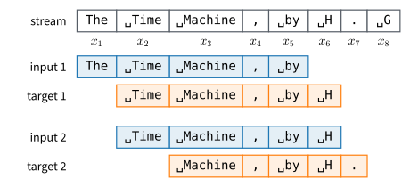

# Language Models
:label:`sec_language-model`

A phone keyboard that proposes the next word, and a speech recognizer that
must decide whether it heard "to recognize speech" or "to wreck a nice
beach", need the same thing: a number that says how plausible a piece of
text is. The two phrases sound almost alike, so the acoustics cannot settle
the question. What settles it is knowing that the first is a common English
phrase and the second is not. A *language model* supplies this number: given a
sequence of tokens $x_1, \ldots, x_T$ from a vocabulary $\mathcal{V}$, such
as the BPE tokens of :numref:`sec_text-sequence`, it assigns the sequence a
probability $P(x_1, \ldots, x_T)$.

Assigning a probability to every sequence looks hopeless at first. With our
vocabulary of 1,024 tokens there are $1024^{10} \approx 10^{30}$ sequences
of only ten tokens. The chain rule of probability,
:eqref:`eq_chain_rule` in :numref:`sec_sequence`, turns the problem into
one we know. It writes the joint probability, with no approximation, as a
product of next-token predictions, each conditioned on the prefix
$x_{<t} = x_1, \ldots, x_{t-1}$:

$$P(x_1, \ldots, x_T) = \prod_{t=1}^T P(x_t \mid x_{<t}).$$
:eqlabel:`eq_lm_factorization`

A language model is therefore a next-token predictor. The same conditionals
score a sequence (multiply them) and generate one (draw $x_1$, then $x_2$
given $x_1$, and so on). Surprisingly many tasks can be phrased as a
continuation as well. Continuing "The novella The Time Machine was written
by" answers a question, and this is how large language models are used
(:numref:`sec_gpt`).

Let us start with the simplest estimate of the conditionals, counting, and
find out where it fails and why. We then define a number that says how good
a language model is, use it to judge two repairs of the counts, and free it
from the choice of tokenizer. Last, we prepare the training data for the
neural language models of the following sections.

```{.python .input}
%load_ext d2lbook.tab
tab.interact_select('mxnet', 'pytorch', 'tensorflow', 'jax')
```

```{.python .input #language-model-language-models}
%%tab mxnet
import math
import numpy as np
from mxnet import autograd, gluon, init, np as mnp, npx
from mxnet.gluon import nn
from d2l import mxnet as d2l
npx.set_np()
```

```{.python .input #language-model-language-models}
%%tab pytorch
import math
import numpy as np
import torch
from torch import nn
from torch.nn import functional as F
from d2l import torch as d2l
```

```{.python .input #language-model-language-models}
%%tab tensorflow
import math
import numpy as np
import tensorflow as tf
from d2l import tensorflow as d2l
```

```{.python .input #language-model-language-models}
%%tab jax
import math
import numpy as np
import jax
from jax import numpy as jnp
from flax import nnx
import optax
from d2l import jax as d2l
```

```{.python .input #language-model-language-models-1}
import collections
import random
import re
```

## $n$-gram Language Models
:label:`subsec_markov-models-and-n-grams`

### Markov Models and Counting

The conditionals in :eqref:`eq_lm_factorization` depend on the whole
prefix, so the number of distinct contexts grows without bound as $t$
grows. The Markov condition of :numref:`subsec_markov-models` cuts the
context to the most recent $n-1$ tokens:

$$P(x_t \mid x_{<t}) \approx P(x_t \mid x_{t-n+1}, \ldots, x_{t-1}).$$

The assumption is crude, since a sentence does not forget its subject after
two words, but it leaves a finite number of contexts to estimate. A model
with no context ($n=1$) is called a *unigram* model, one that
conditions on the previous token ($n=2$) a *bigram* model, and one that
conditions on the previous two ($n=3$) a *trigram* model. The conditional
probabilities are the model's parameters, and maximum likelihood estimates
each of them as a ratio of counts. Writing $N(\cdot)$ for the number of
occurrences of a sequence of tokens in the training corpus,

$$\hat{P}(x_t \mid x_{t-n+1}, \ldots, x_{t-1}) = \frac{N(x_{t-n+1}, \ldots, x_{t})}{N(x_{t-n+1}, \ldots, x_{t-1})}.$$
:eqlabel:`eq_ngram_mle`

Thus the estimate is the fraction of the occurrences of the context that
were followed by $x_t$. An $n$-gram language model is nothing but a table
of these ratios.

Let us build such tables for *The Time Machine*. The neural language models
of this chapter read BPE tokens, but here we split the text into words. The
reason is simply that we want to read what the models generate, and words
read more easily than subword fragments. We repeat the download and
normalization of :numref:`sec_text-sequence` (letters only, lowercase),
split on whitespace, and hold out the final 10% of the text to judge the
models on text they did not see. The vocabulary consists of the words of the
training text; a held-out word that training never saw becomes the unknown
token `<unk>`.

```{.python .input #language-model-markov-models-and-counting-1}
fname = d2l.download(d2l.DATA_URL + 'timemachine.txt',
                     sha1_hash='090b5e7e70c295757f55df93cb0a180b9691891a')
raw_text = open(fname).read()
text = re.sub('[^A-Za-z]+', ' ', raw_text).lower()
split = text.rindex(' ', 0, int(0.9 * len(text)))
words_train = text[:split].split()
known = set(words_train)  # A held-out word never seen in training is <unk>
words_val = [w if w in known else '<unk>' for w in text[split:].split()]
len(words_train), len(words_val)
```

The class below stores, for every context of $n-1$ tokens, a counter of the
tokens that followed it in training. That is all :eqref:`eq_ngram_mle`
needs. (The constructor also stores a constant `alpha`, which plays no
role until we smooth the counts.) `sample` extends a prefix by drawing each
next token in proportion to its count, looking only at the last $n-1$
tokens of the text so far.

```{.python .input #language-model-markov-models-and-counting-2}
class NGramLM:
    """An n-gram language model estimated from counts."""
    def __init__(self, tokens, n, vocab_size, alpha=0.01):
        self.n, self.vocab_size, self.alpha = n, vocab_size, alpha
        cont = collections.defaultdict(collections.Counter)
        for gram in zip(*(tokens[i:] for i in range(n))):
            cont[gram[:-1]][gram[-1]] += 1
        self.cont = dict(cont)
        self.total = {ctx: sum(c.values()) for ctx, c in self.cont.items()}

    def sample(self, prefix, num_tokens, rng):
        """Extend prefix by sampling from the unsmoothed count model."""
        out = list(prefix)
        for _ in range(num_tokens):
            ctx = tuple(out[len(out) - self.n + 1:])
            counts = self.cont[ctx]
            out.append(rng.choices(list(counts), counts.values())[0])
        return out

vocab_size = len(known) + 1  # The training words and <unk>
models = {n: NGramLM(words_train, n, vocab_size) for n in (1, 2, 3)}
```

What do the counts look like? We take the trigram table and look up the
context "the time", which occurs often in a novel about time travel.

```{.python .input #language-model-markov-models-and-counting-3}
trigram = models[3]
total = trigram.total[('the', 'time')]
for word, count in trigram.cont[('the', 'time')].most_common(3):
    print(f'P({word} | the time) = {count}/{total} = {count / total:.2f}')
single = sum(len(c) == 1 for c in trigram.cont.values()) / len(trigram.cont)
print(f'word pairs followed by a single word in training: {single:.0%}')
```

The pair "the time" occurs 87 times in the training text and is followed by
"traveller" in about half of them and by "machine" in about a third, so the
model has learned that the novel's protagonist is the Time Traveller.
Common contexts like this one are the exception, though. For more than four
in five word pairs the table lists a single successor: the model has seen
only one way to continue them.

### Sampling from $n$-gram Models

Generation follows :eqref:`eq_lm_factorization`: draw the next token from
the model's conditional given the text so far, append it, and repeat. It is
tempting to judge a model by the text it writes. As a precaution, we also
measure the longest run of consecutive sampled words that occurs verbatim in
the training text.

```{.python .input #language-model-sampling-from-n-gram-models-1}
def longest_copy(words, train_words):
    """Length of the longest run of words that also occurs in train_words."""
    corpus, best = ' ' + ' '.join(train_words) + ' ', 0
    for i in range(len(words)):
        while (i + best < len(words) and
               ' ' + ' '.join(words[i:i + best + 1]) + ' ' in corpus):
            best += 1
    return best
```

We hand each model the prefix "the time" and let it generate 25 words. The
random number generator is not seeded, so every run draws new samples.

```{.python .input #language-model-sampling-from-n-gram-models}
rng = random.Random()
for n, model in models.items():
    sample = model.sample(['the', 'time'], 25, rng)
    copied = longest_copy(sample, words_train)
    d2l.print_wrapped(f'{n}-gram (longest copied run: {copied} words): '
                      + ' '.join(sample))
```

The unigram model emits words with the right frequencies but no relation to
one another. The bigram model produces plausible pairs that drift without
direction, since each word depends only on its predecessor. The trigram
text reads like Wells.

Unfortunately, on a corpus of 30,000 words it reads like Wells because much
of it *is* Wells. The longest copied run measures how much. It grows with
the order: two or three words for the unigram, a few more for the bigram,
and typically seven to a dozen for the trigram. We have seen why. A word
pair with a single successor leaves the trigram model no choice but to
continue as Wells did, so it replays clauses of the novella verbatim. It has
memorized its training data rather than generalized from it. Trained on
billions of words, the same tables do capture much of the local syntax of
English, which is why $n$-gram models served speech recognition and
translation systems for decades.

### Count Sparsity

Memorization is a symptom of a quantitative problem. The number of
*possible* $n$-grams is $|\mathcal{V}|^n$, which grows exponentially in
$n$, while the number of $n$-grams a corpus contains grows only linearly
with its length. We measure the resulting sparsity directly: for each
order, which fraction of the held-out $n$-grams has a training count of
zero?

```{.python .input #language-model-the-sparsity-wall}
for n in (1, 2, 3):
    seen = set(zip(*(words_train[i:] for i in range(n))))
    grams = list(zip(*(words_val[i:] for i in range(n))))
    rate = sum(gram not in seen for gram in grams) / len(grams)
    print(f'unseen held-out {n}-grams: {rate:.1%} '
          f'({len(seen)} distinct in training)')
```

About one held-out word in twelve never occurs in training. For word
*pairs* it is one in two, and for word triples nearly nine in ten. The
maximum likelihood estimate :eqref:`eq_ngram_mle` gives each of them
probability zero, and a single zero in the product
:eqref:`eq_lm_factorization` declares impossible a text that we hold in our
hands.

### Word Frequency and Zipf's Law
:label:`subsec_natural-lang-stat`

Why do the count tables go sparse so fast? The answer lies in how word
frequencies are distributed. We use the `Vocab` class of
:numref:`sec_text-sequence`, which orders tokens by frequency, to list the
most common words of *The Time Machine*.

```{.python .input #language-model-word-frequency-and-zipf-s-law-1}
words = text.split()
vocab = d2l.Vocab(words)
vocab.token_freqs[:10]
```

The ten most frequent words say nothing about time travel. They are
articles, pronouns, and prepositions, so-called *stop words*, and any
Victorian novel would yield much the same list. More interesting is how
fast the frequencies fall: the tenth most common word is less than a fifth
as frequent as the most common one. On log-log axes, frequency against rank
is close to a straight line past the first few words. A straight line on
log-log axes is a power law: the frequency $n_i$ of the $i^\textrm{th}$
most frequent word obeys

$$n_i \propto \frac{1}{i^s}, \quad \textrm{equivalently} \quad \log n_i = -s \log i + c,$$
:eqlabel:`eq_zipf_law`

for an exponent $s$ and a constant $c$. This is *Zipf's law*. We estimate
$s$ by a least-squares fit of the line over ranks 10 to 1,000 and draw the
fitted law next to the data.

```{.python .input #language-model-word-frequency-and-zipf-s-law-4}
def zipf_fit(freqs, lo=10, hi=1000):
    """Fit log n_i = -s log i + c over ranks lo..hi; return (s, c)."""
    ranks = np.arange(lo, hi + 1)
    slope, c = np.polyfit(np.log(ranks), np.log(freqs[lo - 1:hi]), 1)
    return -slope, c
```

```{.python .input #language-model-word-frequency-and-zipf-s-law-2}
freqs = [freq for token, freq in vocab.token_freqs]
s, c = zipf_fit(freqs)
print(f'Zipf exponent s = {s:.2f}')
ranks = np.arange(1, len(freqs) + 1)
d2l.plot(ranks, [freqs, np.exp(c) * ranks ** -s], xlabel='rank $i$',
         ylabel='frequency $n_i$', xscale='log', yscale='log',
         legend=['words', 'Zipf fit'])
```

The exponent is close to 1, the value Zipf reported for word frequencies
in many languages. A power law has a heavy tail: each rare word is rare,
but there are so many of them that together they make up a large part of
any text. Does the same hold for word pairs and triples? We count the
$n$-grams of each order, fit the exponent, measure which fraction of the
distinct $n$-grams occurs only once, and draw the three curves on common
axes.

```{.python .input #language-model-word-frequency-and-zipf-s-law-3}
counts = [sorted(collections.Counter(zip(*(words[i:] for i in range(n))))
                 .values(), reverse=True) for n in (1, 2, 3)]
for n, f in zip((1, 2, 3), counts):
    print(f'{n}-grams: s = {zipf_fit(f)[0]:.2f}, '
          f'{np.mean(np.array(f) == 1):.0%} of distinct {n}-grams occur once')
d2l.plot([np.arange(1, len(f) + 1) for f in counts], counts,
         xlabel='rank $i$', ylabel='frequency $n_i$', xscale='log',
         yscale='log', legend=['unigram', 'bigram', 'trigram'])
```

Pairs and triples follow power laws too, with smaller exponents, about 0.7
and 0.5. More important for count models, the curves shift toward count one
as $n$ grows. Half of the distinct words occur once, but more than nine in
ten distinct trigrams do, and each of their estimates rests on a single
observation. This is the heavy tail behind the unseen trigrams of the
held-out text. A model that estimates the probability of each context
separately needs exponentially more data as the context grows.

## Perplexity and Smoothing
:label:`subsec_perplexity`

### Perplexity

The count tables are mostly empty, and the samples hid it from us. Before
we repair the tables we need a number that says how good a language model
is, so that we can tell whether a repair has worked. The probability that a
model assigns to held-out text is the natural candidate, but it shrinks
with the length of the text: any model gives Tolstoy's *War and Peace* a
far smaller probability than Saint-Exupéry's *The Little Prince*, whatever
its quality. We need an average per token.

Information theory provides it. In :numref:`subsec_info_theory_basics`, the
cross-entropy loss of a classifier was the *surprisal* of the true label,
the negative logarithm of the probability the classifier assigned to it. A
language model is a classifier over the next token, so we score it by its
surprisal averaged over all $T$ tokens of the text,

$$\frac{1}{T} \sum_{t=1}^T -\log P(x_t \mid x_{<t}),$$
:eqlabel:`eq_avg_ce_for_lm`

where $P$ is given by the language model and $x_t$ is the token
observed at step $t$. This average no longer depends on the length of the
text. Natural language processing reports its exponential, called
*perplexity* :cite:`Jelinek.Mercer.Bahl.ea.1977`:

$$\textrm{PPL} = \exp\left(-\frac{1}{T} \sum_{t=1}^T \log P(x_t \mid x_{<t})\right).$$

Thus perplexity is the geometric mean, over the tokens of the text, of the
inverse probability that the model assigned to each of them. A model that
gives every observed token probability $1/4$ has perplexity 4: it is as
uncertain as a fair choice among four tokens. Perplexity is therefore read
as the *effective branching factor*, the number of equally likely choices
the model faces per token. Three reference points fix the scale:

* A model that always assigns the observed token probability 1 has
  perplexity 1, the best possible value.
* A model that assigns some observed token probability 0 has infinite
  perplexity.
* A model that predicts the uniform distribution over the vocabulary has
  perplexity $|\mathcal{V}|$. Any useful model must do better.

The second case is ours. The maximum likelihood estimate gives every
unseen $n$-gram probability zero, and a single unseen trigram in the
held-out text makes the perplexity of the trigram model infinite. Before we
can measure anything, the zeros must go: the counts must be *smoothed*.

### Laplace Smoothing

The classical remedy is *Laplace smoothing*, also called add-$\alpha$
smoothing. It adds a constant $\alpha > 0$ to every count and
$\alpha |\mathcal{V}|$ to the denominator, so that the probabilities still
sum to one:

$$\hat{P}(x_t \mid x_{t-n+1}, \ldots, x_{t-1}) = \frac{N(x_{t-n+1}, \ldots, x_{t}) + \alpha}{N(x_{t-n+1}, \ldots, x_{t-1}) + \alpha |\mathcal{V}|}.$$
:eqlabel:`eq_laplace_smoothing`

An unseen $n$-gram now gets a small positive probability, and an unseen
context gets the uniform distribution $1/|\mathcal{V}|$. The idea is two
centuries older than language modeling: Laplace introduced it, with
$\alpha = 1$, to estimate the probability that the sun will rise tomorrow
given that it has risen on every day so far.

We add Laplace smoothing to `NGramLM` as a method `prob`, which uses the
`alpha` that the constructor stored, and evaluate the three word-level
models on the held-out text.

```{.python .input #language-model-laplace-smoothing-1}
@d2l.add_to_class(NGramLM)
def prob(self, context, token):
    """Laplace-smoothed P(token | last n-1 tokens of context)."""
    ctx = tuple(context[len(context) - self.n + 1:])
    num = self.cont.get(ctx, {}).get(token, 0) + self.alpha
    return num / (self.total.get(ctx, 0) + self.alpha * self.vocab_size)
```

```{.python .input #language-model-perplexity}
def eval_nll(model, tokens):
    """Total negative log-likelihood of tokens, in nats."""
    return -sum(math.log(model.prob(tokens[max(0, t - model.n + 1):t],
                                    tokens[t]))
                for t in range(len(tokens)))

for n, model in models.items():
    ppl = math.exp(eval_nll(model, words_val) / len(words_val))
    print(f'{n}-gram held-out perplexity, Laplace smoothing: {ppl:7.1f}')
```

With Laplace smoothing, the trigram model, which wrote by far the most
convincing text, has by far the *worst* held-out perplexity. At the shared
smoothing constant, the bigram barely improves on the unigram. Both
results come from count sparsity. When 87% of the held-out trigrams are
unseen, most of the trigram model's predictions are smoothed, nearly
uniform guesses. No choice of $\alpha$ rescues it: the best value in the
sweep of exercise :exref:`ex_language-model-smoothing-constant` still
leaves its perplexity above 2,400. The fluent samples were a poor guide.

Laplace smoothing is a crude remedy, and the numbers point to its two
defects. It treats every unseen successor alike. And it ignores what the
shorter contexts know: a trigram never seen in training gets the same
probability whether its last two words form a common pair or not.

### Kneser--Ney Smoothing
:label:`subsec_kneser-ney`

Kneser--Ney smoothing :cite:`Kneser.Ney.1995`, in the interpolated form of
:citet:`Chen.Goodman.1999`, repairs both defects, and it was the strongest
count-based language model for two decades. Write $u$ for a context of
$n-1$ tokens, $w$ for the token that follows it, and $u'$ for $u$ without
its first token. The method rests on three ideas.

The first is *absolute discounting*. An $n$-gram that occurred once in
training is, on average, seen less than once in new text of the same size:
among all the $n$-grams that could have occurred once, those that did were
partly lucky. Subtracting a fixed discount $0 < D < 1$ from every observed
count corrects this, most strongly for the small counts where the error is
largest. The probability mass freed in context $u$ is $D\,S(u)/N(u)$, where
$S(u)$ is the number of distinct tokens that followed $u$ in training.

The second is *interpolation*: the freed mass goes to the estimate of the
next lower order, which is defined in the same way, down to the uniform
distribution $1/|\mathcal{V}|$:

$$P_\textrm{KN}(w \mid u) = \frac{\max(N(u, w) - D, 0)}{N(u)} + \frac{D\,S(u)}{N(u)}\, P_\textrm{KN}(w \mid u').$$
:eqlabel:`eq_kneser_ney`

Thus a context seen often relies mostly on its own counts. A context
followed by many different tokens hands more mass to the shorter context,
since so many distinct successors suggest that new ones are likely as well.
A context never seen in training passes all of the mass down:
$P_\textrm{KN}(w \mid u) = P_\textrm{KN}(w \mid u')$.

The third idea concerns what the lower orders count. The lower-order
estimate matters mainly for successors that the longer context has not
been seen with. It should therefore measure how readily a token follows a
*new* context, not how often it occurs. In the training text, "traveller"
occurs 49 times but after only two different words ("time" 48 times,
"real" once), while "said" occurs 76 times after 48 different words. A raw
count makes "traveller" a likely successor of any unseen context; the
number of distinct predecessors says correctly that it is not. (The
standard example is "Francisco", frequent but almost always preceded by
"San".) Kneser--Ney therefore replaces $N(u, w)$ in every order below the
highest by the *continuation count*, the number of distinct tokens that
precede $(u, w)$ in training, and $N(u)$ and $S(u)$ by the total and the
number of nonzero continuation counts in context $u$.

The discount need not be tuned. :citet:`Ney.Essen.Kneser.1994` derived the
estimate $D = c_1 / (c_1 + 2 c_2)$ for each order, where $c_1$ and $c_2$
are the numbers of distinct $n$-grams of that order whose count is one and
two (below the highest order, the continuation count).

The function below implements :eqref:`eq_kneser_ney`. It counts the
$n$-grams of the training tokens and derives the continuation counts of each
lower order from the distinct $n$-grams one order up. It then computes
$N(u)$, $S(u)$, and $D$ for each order and evaluates the recursion for every
token of a sequence, using as much context as precedes it. It returns the
natural logarithm of each probability.

```{.python .input #language-model-kneser-ney-smoothing}
def kneser_ney(train, tokens, vocab_size, n=3):  #@save
    """Interpolated Kneser-Ney log-probabilities (nats) of each of tokens."""
    counts = {n: collections.Counter(zip(*(train[i:] for i in range(n))))}
    for k in range(n - 1, 0, -1):  # Lower orders: continuation counts
        counts[k] = collections.Counter(g[1:] for g in counts[k + 1])
    stats = {}
    for k, c in counts.items():
        c1, c2 = (sum(x == r for x in c.values()) for r in (1, 2))
        N, S = collections.Counter(), collections.Counter()
        for g, x in c.items():
            N[g[:-1]] += x
            S[g[:-1]] += 1
        stats[k] = c, N, S, c1 / max(c1 + 2 * c2, 1)
    logp = []
    for i in range(len(tokens)):
        p = 1 / vocab_size  # Below the unigram: uniform
        for k in range(1, min(n, i + 1) + 1):
            c, N, S, D = stats[k]
            g = tuple(tokens[i - k + 1:i + 1])
            if N[g[:-1]]:  # An unseen context passes p down unchanged
                p = (max(c[g] - D, 0) + D * S[g[:-1]] * p) / N[g[:-1]]
        logp.append(math.log(p))
    return logp
```

Before we evaluate the model, it is instructive to watch it at work on the
one context we know well, "the time". The cell below prints the discount
for trigrams, and then the probabilities that Kneser--Ney and Laplace
smoothing assign to three successors: "traveller", which followed "the
time" in 47 of its 87 occurrences, and two words that never followed it in
training, "was" and "filby".

```{.python .input #language-model-kneser-ney-smoothing-1}
c3 = collections.Counter(zip(words_train, words_train[1:], words_train[2:]))
c1, c2 = (sum(x == r for x in c3.values()) for r in (1, 2))
print(f'trigram discount D = {c1 / (c1 + 2 * c2):.2f}')
for w in ('traveller', 'was', 'filby'):
    lp = kneser_ney(words_train, ['the', 'time', w], vocab_size)[-1]
    print(f'P({w} | the time): Kneser-Ney {math.exp(lp):.2g}, '
          f'Laplace {models[3].prob(["the", "time"], w):.2g}')
```

The discount is about 0.9, so Kneser--Ney takes nearly a whole count from
every observed trigram. That is how little a single observation is worth.
A count of 47 hardly notices the loss, and "traveller" stays close to its
relative frequency of 47/87, whereas Laplace smoothing gives away a third
of that probability to the rest of the vocabulary. The unseen successors
are more telling still. Laplace smoothing assigns "was" and "filby" the
same probability, since it cannot tell a likely word from an unlikely one.
Kneser--Ney can: "was" follows many different contexts and "filby" very
few, and its estimates for the two differ by more than a factor of ten.
How much is this worth on the held-out text?

```{.python .input #language-model-kneser-ney-smoothing-2}
for n in (1, 2, 3):
    kn = kneser_ney(words_train, words_val, vocab_size, n)
    print(f'{n}-gram held-out perplexity, Kneser-Ney: '
          f'{math.exp(-sum(kn) / len(kn)):7.1f}')
```

Kneser--Ney turns the ranking around. Its unigram is already better than
Laplace's, and its bigram halves the unigram's perplexity. Its trigram is
the best of all six models, because an unseen trigram now falls back on
the bigram and unigram estimates instead of on a uniform guess. The
trigram gains little over the bigram, however: most held-out trigrams are
still unseen, so for most tokens the trigram model is the bigram model.
The job of a language model is low perplexity on *unseen* text, and
perplexity is our main metric for the neural models of the following
sections.

Kneser--Ney has one limit, which it shares with every count model. It can
move probability mass to unseen events, but it cannot know which of them
are plausible. A count table
treats every token as an unrelated symbol, so it cannot see that "cat" and
"feline" should behave alike, or that "I want to eat, grandma" is benign
while "I want to eat grandma" is not. Sharing statistical strength between
related words and contexts requires learned representations, and these are
where neural networks enter, in :numref:`sec_rnn`.

### Bits per Byte
:label:`subsec_bits-per-byte`

Perplexity has one serious flaw: it depends on what a token is. A character
model chooses among 27 symbols per step and our word model among thousands,
so their perplexities cannot be compared. Tokenization is a design choice
(:numref:`sec_text-sequence`), and a metric for comparing models must not
depend on it. The repair is simple: we change the denominator. Instead of
dividing the total surprisal by the number of tokens, we divide it by the
number of *bytes* of text, which depends on the text alone. Measuring
surprisal in bits (base-2 logarithms) gives *bits per byte*,

$$\textrm{bpb} = \frac{1}{B} \sum_{t=1}^T -\log_2 P(x_t \mid x_{<t}),$$
:eqlabel:`eq_bpb`

where $B$ is the length of the evaluated text in UTF-8 bytes. Bits per
byte is a compression rate: a model at $\textrm{bpb}$ bits per byte,
combined with an arithmetic coder, compresses the text to a fraction
$\textrm{bpb}/8$ of its raw size.

To see the two metrics side by side, we estimate the same model class on
the same normalized training text under three tokenizations: characters,
words, and a 1,024-token BPE (the tokenizer of
:numref:`sec_text-sequence`, trained here on the normalized training
text). The model is a trigram with Laplace smoothing, and in the last
column with Kneser--Ney smoothing. A fair comparison needs one correction.
The word model's `<unk>` stands for any word it cannot name, so a
prediction of `<unk>` does not yet say which word the text contains. To
describe the held-out text, the word model must still spell each unknown
word out, and we add $\log_2 27$ bits for each of its letters and for the
space that ends it: the cost of a uniform choice among the 27 symbols of
the normalized text.

```{.python .input #language-model-bits-per-byte}
bpe = d2l.BPETokenizer(vocab_size=1024, pattern=d2l.BPETokenizer.GPT2_PATTERN)
bpe.train(text[:split])
streams = {'character': (list(text[:split]), list(text[split:]),
                         len(set(text))),
           'BPE (1,024)': (bpe.encode(text[:split]), bpe.encode(text[split:]),
                           bpe.vocab_size),
           'word': (words_train, words_val, vocab_size)}
n_bytes = len(text[split:].encode('utf-8'))
spell = sum((len(w) + 1) * math.log(27)  # Nats to spell out the <unk> words
            for w in text[split:].split() if w not in known)
print(f'{"tokenization":>12} {"|V|":>5} {"tokens":>7} {"ppl":>7} '
      f'{"bpb":>5} {"KN bpb":>6}')
for name, (train, val, m) in streams.items():
    nll = eval_nll(NGramLM(train, 3, m), val)
    nll_kn = -sum(kneser_ney(train, val, m))
    extra = spell if name == 'word' else 0
    print(f'{name:>12} {m:>5} {len(val):>7} {math.exp(nll / len(val)):>7.1f} '
          f'{(nll + extra) / math.log(2) / n_bytes:>5.2f} '
          f'{(nll_kn + extra) / math.log(2) / n_bytes:>6.2f}')
```

Judged by perplexity, the three Laplace-smoothed models differ by more than
two orders of magnitude. Judged by bits per byte, they lie within a third of
a bit of each other, and the character model, by far the best by
perplexity, no longer comes first. At a fixed order $n$, coarser tokens
condition on more text: two words of context reach about ten characters
back, while two characters barely finish a syllable. The word model would
come first, were it not for its unknown words. Spelling them out adds about
0.6 bits per byte, which leaves it last with Laplace smoothing. The BPE
model needs no such help, since any text can be written in its byte-level
tokens, and it compresses best. This is one more reason modern models use
subword tokenization.

Kneser--Ney, in the last column, lowers the bits per byte of the BPE and
word trigrams by more than half a bit, but barely changes the character
trigram. With 27 characters, few character trigrams are unseen, so
smoothing has little to repair. The BPE trigram with Kneser--Ney, at about
1.9 bits per byte, is the strongest count model of this section.

This is why modern language models are compared by bits per byte: a model
with a 50,000-token vocabulary and one with a 200,000-token vocabulary have
no common perplexity scale. Three magnitudes are worth remembering. Shannon
estimated from human predictions that printed English carries about one bit
per character :cite:`Shannon.1951`. Strong neural language models compress
diverse web text to below one bit per byte, while the count models of this
section need between about 1.9 and 2.8.

## Partitioning Sequences
:label:`subsec_partitioning-seqs`

The neural language models of the following sections read the BPE token
ids of :numref:`sec_text-sequence` in minibatches of fixed-length
subsequences. We now build that pipeline.

Think of the corpus as one stream of token ids $x_1, x_2, x_3, \ldots$. An
input window of length $T$ that starts at position $t$ holds
$x_t, \ldots, x_{t+T-1}$. Its target is the same window shifted forward by
one token, $x_{t+1}, \ldots, x_{t+T}$. While the model reads the input, it
is trained to predict each next token, so one window supplies $T$
next-token predictions. Every position of the corpus except the last $T$
starts a window, and consecutive windows overlap in all but one token.
:numref:`fig_lang_model_data` shows the first two (input, target) pairs
over the opening tokens of the corpus, its title line. At training time we
draw minibatches of windows at random, which provides the randomness that
stochastic gradient descent expects.


:label:`fig_lang_model_data`

The constructor below assembles the pipeline. It downloads the corpus,
trains the tokenizer of :numref:`sec_text-sequence` on it, and encodes the
corpus into token ids. It then lays out all overlapping windows as rows of
two aligned arrays, inputs `X` and targets `Y`. The window length $T$ is the
argument `num_steps`. The trained tokenizer remains available as
`data.tokenizer` for decoding ids back into text, and `data.vocab` refers to
it too, so that `len(data.vocab)` gives the vocabulary size.

```{.python .input #language-model-partitioning-sequences-1}
%%tab mxnet
@d2l.add_to_class(d2l.TimeMachine)  #@save
def __init__(self, batch_size, num_steps, num_train=50000, num_val=5000,
             tokenization='bpe', vocab_size=1024):
    super(d2l.TimeMachine, self).__init__()
    self.save_hyperparameters()
    raw_text = self._download()
    if tokenization == 'bpe':
        self.tokenizer = d2l.BPETokenizer(
            vocab_size, pattern=d2l.BPETokenizer.GPT2_PATTERN)
        self.tokenizer.train(raw_text)
        corpus, self.vocab = self.tokenizer.encode(raw_text), self.tokenizer
    else:  # tokenization='char': characters, via TimeMachine.build
        corpus, self.vocab = self.build(raw_text)
    windows = [corpus[i:i+num_steps+1] for i in range(len(corpus)-num_steps)]
    # Drop the windows that straddle the split, so that no validation token
    # is a training target
    windows = windows[:num_train] + windows[num_train+num_steps:]
    array = d2l.tensor(windows, dtype=d2l.int32)  # Integer ids, not float32
    self.X, self.Y = array[:,:-1], array[:,1:]
```

```{.python .input #language-model-partitioning-sequences-1}
%%tab pytorch, tensorflow, jax
@d2l.add_to_class(d2l.TimeMachine)  #@save
def __init__(self, batch_size, num_steps, num_train=50000, num_val=5000,
             tokenization='bpe', vocab_size=1024):
    super(d2l.TimeMachine, self).__init__()
    self.save_hyperparameters()
    raw_text = self._download()
    if tokenization == 'bpe':
        self.tokenizer = d2l.BPETokenizer(
            vocab_size, pattern=d2l.BPETokenizer.GPT2_PATTERN)
        self.tokenizer.train(raw_text)
        corpus, self.vocab = self.tokenizer.encode(raw_text), self.tokenizer
    else:  # tokenization='char': characters, via TimeMachine.build
        corpus, self.vocab = self.build(raw_text)
    windows = [corpus[i:i+num_steps+1] for i in range(len(corpus)-num_steps)]
    # Drop the windows that straddle the split, so that no validation token
    # is a training target
    windows = windows[:num_train] + windows[num_train+num_steps:]
    array = d2l.tensor(windows)
    self.X, self.Y = array[:,:-1], array[:,1:]
```

:begin_tab:`mxnet`
MXNet arrays hold float32 numbers unless told otherwise, so the MXNet
constructor asks for integer token ids explicitly.
:end_tab:

The first `num_train` windows are used for training and `num_val` later ones
for validation. One detail needs care. Consecutive windows overlap, so the
windows right after the training range contain tokens that training has
already used as targets. The constructor therefore drops `num_steps` windows
between the two ranges, and no validation token is a training target.
Validation minibatches are read in order.

```{.python .input #language-model-partitioning-sequences-2}
@d2l.add_to_class(d2l.TimeMachine)  #@save
def get_dataloader(self, train):
    idx = slice(0, self.num_train) if train else slice(
        self.num_train, self.num_train + self.num_val)
    return self.get_tensorloader([self.X, self.Y], train, idx)
```

Each minibatch is a pair of integer arrays of shape (`batch_size`,
`num_steps`). Decoding one row checks that the ids are Wells' prose and
that the target is the input shifted by one token.

```{.python .input #language-model-partitioning-sequences-3}
data = d2l.TimeMachine(batch_size=2, num_steps=10)
for X, Y in data.train_dataloader():
    print('X:', X, '\nY:', Y)
    break
print('X[0]:', repr(data.tokenizer.decode([int(i) for i in X[0]])))
print('Y[0]:', repr(data.tokenizer.decode([int(i) for i in Y[0]])))
```

A window offers far more context than a count table can use: our tables ran
out of data at two words of context. The next section replaces the table
with a neural network that carries a summary of the whole prefix.

## Summary

A language model assigns probabilities to token sequences, and the chain
rule turns this into next-token prediction, so one model both scores and
generates text. $n$-gram models estimate the conditionals by counting under
a Markov assumption. They are easy to estimate and write locally convincing
text. But the number of possible contexts grows exponentially in $n$, and
Zipf's law leaves most observed $n$-grams with a single count, so these
models memorize rather than generalize. Perplexity, the exponentiated
average cross-entropy, measures a model as an effective branching factor
per token, and it shows that the fluent trigram with Laplace smoothing is
the worst of our models on new text. Interpolated Kneser--Ney discounts
every count and hands the freed mass to lower orders that count distinct
predecessors. It makes the trigram the best count model, but like any
smoothing it can only move probability mass to the zeros. Because
perplexity is defined per token, it cannot compare models with different
tokenizers, while bits per byte can. The
training data for the rest of the chapter is one stream of BPE token ids,
cut into overlapping windows whose targets are the inputs shifted by one
token.

## Exercises

1. [code] **Temperature sampling.** `NGramLM.sample` draws each next token
   in proportion to its raw count $N$. Add a temperature $\tau > 0$ by
   drawing in proportion to $N^{1/\tau}$ instead.
    1. Generate trigram text from the prefix `['the', 'time']` at
       $\tau \in \{0.3, 1, 3\}$ and describe what changes.
    1. Which distribution over successors does the sampler approach as
       $\tau \to 0$, and which as $\tau \to \infty$? For a context that
       occurred exactly once in training, what does the temperature
       change?

1. **Dense versus sparse storage.** Consider a 5-gram model over a
   vocabulary of $|\mathcal{V}| = 50{,}000$ word tokens.
    1. How many entries does a dense table of the conditional
       probabilities :eqref:`eq_ngram_mle` contain?
    1. Suppose instead that only the 5-grams observed in a trillion-token
       corpus are stored, at 16 bytes per entry. How much memory is needed
       at most, and what fraction of all possible 5-grams is covered?
    1. The word vocabulary of :numref:`subsec_markov-models-and-n-grams`
       has $|\mathcal{V}| = 4{,}316$ entries, and the code there prints the
       number of distinct word trigrams in the training text. Which
       fraction of all possible trigrams occurs in training? Which fraction
       of the held-out trigrams does? Is the coverage computed in (b)
       therefore a good estimate of how often a query on new text finds
       its 5-gram in the table?

1. [code] **Smoothing constant.** Sweep $\alpha$ in
   :eqref:`eq_laplace_smoothing` over the 19 values
   $\alpha = 10^{k/4}$ for $k = -16, -15, \ldots, 2$, for the unigram,
   bigram, and trigram word models, and plot held-out perplexity against
   $\alpha$ on a logarithmic axis.
    1. How does the best $\alpha$ change with $n$, and why?
    1. Rank the three models, each at its own best $\alpha$, by held-out
       perplexity. How does this ranking differ from the one printed in
       :numref:`subsec_perplexity` with the default $\alpha = 0.01$ of
       `NGramLM`?
   :exlabel:`ex_language-model-smoothing-constant`

1. **Perplexity under skew.** A training corpus over ten symbols consists
   of one symbol 91% of the time and each of the other nine 1% of the
   time.
    1. Compute the perplexity of the unigram model estimated from this
       corpus on a long test text drawn from the same distribution. How
       does it compare with the vocabulary size of ten?
    1. The word-level unigram model of :numref:`subsec_perplexity` chooses
       among thousands of word types. Read off its held-out perplexity as
       an effective number of equally likely choices, and explain with
       Zipf's law :eqref:`eq_zipf_law` why this number is far below
       $|\mathcal{V}|$.

    *Adapted from Daniel Jurafsky and James H. Martin,
    [Speech and Language Processing](https://web.stanford.edu/~jurafsky/slp3/),
    3rd ed. draft, Exercise 3.12.*

1. **Bits per byte from perplexity.** A model achieves per-token
   perplexity $\textrm{PPL}$ on a text that its tokenizer splits into $T$
   tokens and whose size is $B$ UTF-8 bytes.
    1. Show that its bits per byte :eqref:`eq_bpb` equals
       $$\textrm{bpb} = \frac{T}{B} \log_2 \textrm{PPL}.$$
    1. Use the formula and the table printed in
       :numref:`subsec_bits-per-byte` to compute the average number of
       bytes per token, $B/T$, for each tokenization. Explain how bits per
       byte that nearly agree can coexist with perplexities that differ by
       more than two orders of magnitude.
    1. What held-out perplexity would the BPE-level trigram need in order
       to reach one bit per byte?

1. **Overlapping windows.** `d2l.TimeMachine` builds one row of
   `num_steps + 1` consecutive tokens for every possible start position
   in the corpus. The first `num_steps` tokens of a row form a row of `X`,
   and the last `num_steps` tokens form the matching row of `Y`. The first
   `num_train` rows go to training, the next `num_steps` rows are dropped,
   and the `num_val` rows after them go to validation
   (:numref:`subsec_partitioning-seqs`). Take `num_steps=32`,
   `num_train=10000`, and `num_val=5000`.
    1. Counting input and target tokens together, which corpus positions do
       the training rows touch, and which do the validation rows touch?
       How many positions would both touch if no rows were dropped, and
       why would that inflate the validation score?
    1. How many times per epoch does a token in the interior of the
       training range serve as a target?
    1. How many windows does a partition of the entire corpus of about
       66,000 tokens into non-overlapping 32-token windows yield? Compare
       this partition with the 10,000 overlapping training rows in the
       number of windows and in the number of distinct corpus positions
       covered.

1. [code] **Normalization across lengths.** ● `NGramLM` has no
   end-of-sequence token. Train a bigram `NGramLM` with $\alpha = 1$ and
   `vocab_size=3` on a short string over a three-symbol vocabulary. Use
   `prob` and the chain rule :eqref:`eq_lm_factorization` to sum the
   probabilities of all sequences of length 2, and separately those of all
   sequences of length 3.
    1. What does each sum equal, and what do the two sums say about the
       model as a distribution over sequences whose length is not fixed in
       advance?
    1. Add an end-of-sequence token to the vocabulary, so that
       `vocab_size=4`, and append it to the training string. Treat a
       sequence as complete once it emits this token. Show that the
       probabilities of all complete sequences now sum to exactly one.
       Which property of the model rules out probability mass on
       sequences that never end?

    *Adapted from Daniel Jurafsky and James H. Martin,
    [Speech and Language Processing](https://web.stanford.edu/~jurafsky/slp3/),
    3rd ed. draft, Exercise 3.5.*

1. [code] **Seen and unseen trigrams.** ● Split the held-out positions
   from the third word on by whether the word trigram ending at that
   position occurred in training. Take the bigram and the trigram word
   models, each at its best $\alpha$ from the sweep of
   problem :exref:`ex_language-model-smoothing-constant`,
   and compute the average negative log-likelihood of each model
   on each group. On which group is the trigram the better model, and how
   does Kneser--Ney :eqref:`eq_kneser_ney` exploit this?

:begin_tab:`mxnet`
[Discussions](https://d2l.discourse.group/t/117)
:end_tab:

:begin_tab:`pytorch`
[Discussions](https://d2l.discourse.group/t/118)
:end_tab:

:begin_tab:`tensorflow`
[Discussions](https://d2l.discourse.group/t/1049)
:end_tab:

:begin_tab:`jax`
[Discussions](https://d2l.discourse.group/t/18012)
:end_tab:


<!-- slides -->

::: {.slide}
::: {.cover}
[Dive into Deep Learning · §8.3]{.kicker}

Language Models<br>**chain rule · n-gram counts · Zipf's law · perplexity · smoothing · bits per byte · training windows**
:::
:::

::: {.slide title="Ten Tokens from a 1,024-Token Vocabulary Form 10³⁰ Sequences"}
[The problem]{.kicker}

- "to recognize speech" and "to wreck a nice beach" sound alike; only
  knowing which is plausible English decides between them.
- A **language model** assigns a probability $P(x_1, \ldots, x_T)$ to
  every token sequence.
- With $|\mathcal{V}| = 1{,}024$ BPE tokens there are
  $1024^{10} \approx 10^{30}$ sequences of length 10.

::: {.d2l-note .warn}
How can a model give each of them a probability, and how do we tell a
good model from a bad one?
:::
:::

::: {.slide title="By the End of This Deck You Can"}
[Goals]{.kicker}

- estimate an $n$-gram probability by counting, and explain with Zipf's
  law why count tables go sparse as $n$ grows;
- compute perplexity and read it as a number of choices per token;
- smooth the counts with Laplace and with Kneser–Ney smoothing, and say
  what each does to an unseen $n$-gram;
- convert perplexity to bits per byte to compare tokenizers;
- cut a token stream into (input, target) training windows.

**Running example:** *The Time Machine*: word $n$-grams, then 1,024-token
BPE ids.
:::

::: {.slide title="Counting, Measuring, Repairing, and Preparing the Data"}
[Where this fits]{.kicker}

::: {.cols .vc}
::: {.col}
| section | adds |
|---|---|
| Working with Sequences | autoregression, latent state, rollout error |
| From Text to Tokens | characters, words, bytes, BPE |
| **Language Models** | **$n$-grams, perplexity, bits per byte** |
| Recurrent Neural Networks | a hidden state updated at every step |
| Implementing RNNs | an RNN language model, scratch and concise |
| Backpropagation Through Time | gradients through time, truncation |
| Decoding and Generation | greedy decoding, beam search, sampling |
:::

::: {.col .narrow}
- **Uses:** chain rule, Markov assumption, BPE, cross-entropy.
- **Skips:** modified Kneser–Ney (several discounts per order).
:::
:::
:::

::: {.slide title="The Chain Rule Turns a Sequence Probability into Next-Token Predictions"}
[Language models]{.kicker}

Exact, for any distribution over sequences, with the prefix
$x_{<t} = x_1, \ldots, x_{t-1}$:

$$P(x_1, \ldots, x_T) = \prod_{t=1}^T P(x_t \mid x_{<t}).$$

- **Score** a sequence: multiply the conditionals.
- **Generate** a sequence: draw $x_t$ from $P(x_t \mid x_{<t})$, append,
  repeat.
- **Prompt:** "The Time Machine was written by …" is a question.

**A language model is a next-token predictor.**
:::

::: {.slide}
::: {.divider}
[01]{.dnum}

[$n$-gram Language Models]{.dtitle}

[counting, and where it runs out]{.dsub}
:::
:::

::: {.slide title="A Trigram Estimate Is a Ratio of Counts"}
[$n$-gram models]{.kicker}

Markov assumption: keep only the last $n-1$ tokens. Maximum likelihood,
with $N(\cdot)$ the number of occurrences in training:

$$\hat{P}(x_t \mid x_{t-n+1}, \ldots, x_{t-1}) =
  \frac{N(x_{t-n+1}, \ldots, x_{t})}{N(x_{t-n+1}, \ldots, x_{t-1})}.$$

Word trigrams of *The Time Machine*, context "the time" (87 times):

@!language-model-markov-models-and-counting-3
:::

::: {.slide title="Higher Orders Write Better Text by Copying It"}
[Sampling]{.kicker}

Prefix "the time", 25 sampled words; copied run = longest verbatim run from
the novella:

@!language-model-sampling-from-n-gram-models

A word pair with a single successor leaves the trigram no choice but to
continue as Wells did.
:::

::: {.slide title="87% of Held-Out Word Triples Never Occur in Training"}
[Count sparsity]{.kicker}

Possible $n$-grams grow as $|\mathcal{V}|^n$; a corpus grows linearly.

@!language-model-the-sparsity-wall

. . .

Maximum likelihood gives each unseen $n$-gram probability 0, and one zero
makes the whole held-out text impossible.
:::

::: {.slide title="Word Frequency Falls Roughly as 1/Rank"}
[Zipf's law]{.kicker}

$n_i \propto i^{-s}$ for the $i$-th most frequent word: a straight line
of slope $-s$ on log-log axes, fitted over ranks 10 to 1,000.

@!language-model-word-frequency-and-zipf-s-law-2
:::

::: {.slide title="Pairs and Triples Follow Power Laws Shifted Toward Count One"}
[Zipf's law]{.kicker}

@!language-model-word-frequency-and-zipf-s-law-3

Half of the distinct words occur once, and more than nine in ten distinct
trigrams: their estimates rest on one observation. This is why the tables
go sparse.
:::

::: {.slide}
::: {.divider}
[02]{.dnum}

[Perplexity and Smoothing]{.dtitle}

[a number for a model, then two repairs judged by it]{.dsub}
:::
:::

::: {.slide title="Perplexity Is the Effective Number of Choices per Token"}
[Perplexity]{.kicker}

$$\textrm{PPL} = \exp\Big(-\frac{1}{T}\sum_{t=1}^{T}
\log P(x_t \mid x_{<t})\Big).$$

- Every observed token at probability $1/4$: PPL $= 4$.
- Perfect prediction: 1. Uniform guess: $|\mathcal{V}|$. One zero:
  $\infty$.
- Averaging per token makes texts of different lengths comparable.

::: {.d2l-note .warn}
One unseen trigram makes the count model's perplexity infinite: the
counts must be smoothed.
:::
:::

::: {.slide title="Laplace Smoothing Adds α to Every Count"}
[Laplace smoothing]{.kicker}

$$\hat{P}(x_t \mid x_{t-n+1}, \ldots, x_{t-1}) =
\frac{N(x_{t-n+1}, \ldots, x_{t}) + \alpha}{N(x_{t-n+1}, \ldots, x_{t-1}) + \alpha |\mathcal{V}|}.$$

- Unseen $n$-grams get a small probability; unseen contexts get
  $1/|\mathcal{V}|$.
- Laplace, with $\alpha = 1$: will the sun rise tomorrow, given that it
  has risen every day so far?
:::

::: {.slide title="Check: How Much Does Smoothing Change P(traveller | the time)?"}
[Check]{.kicker}

"the time" occurs 87 times, followed by "traveller" 47 times;
$|\mathcal{V}| = 4{,}316$ words. Compute $\hat{P}$ for $\alpha = 0.01$ and
$\alpha = 1$.

::: {.fragment .fade-up}
::: {.d2l-note}
**Answer.** $\alpha = 0.01$: $47.01 / 130.2 \approx 0.36$.
$\alpha = 1$: $48 / 4{,}403 \approx 0.01$. With $\alpha = 1$ the 4,316
pretend counts swamp the 87 real ones.
:::
:::
:::

::: {.slide title="With Laplace Smoothing, the Fluent Trigram Is the Worst Model"}
[Laplace smoothing]{.kicker}

Word models on held-out text, $\alpha = 0.01$:

@!language-model-perplexity

- 87% of held-out trigrams are unseen, so most trigram predictions are
  nearly uniform guesses. The best $\alpha$ still leaves it above 2,400.
- Two defects: every unseen successor is treated alike, and the shorter
  contexts are ignored.
:::

::: {.slide title="Kneser–Ney Discounts Counts and Backs Off to Shorter Contexts"}
[Kneser–Ney]{.kicker}

Context $u$, successor $w$, $u'$ = $u$ without its first token:

$$P_\textrm{KN}(w \mid u) = \frac{\max(N(u, w) - D, 0)}{N(u)} +
\frac{D\,S(u)}{N(u)}\, P_\textrm{KN}(w \mid u').$$

- $S(u)$: distinct successors of $u$. $D = c_1/(c_1 + 2c_2)$, $c_r$ =
  number of $n$-grams with count $r$.
- Lower orders count **distinct predecessors**: "traveller" occurs 49
  times after only 2 words, "said" 76 times after 48.
:::

::: {.slide title="Kneser–Ney Tells a Likely Unseen Word from an Unlikely One"}
[Kneser–Ney]{.kicker}

After "the time": "traveller" followed 47 times out of 87; "was" and
"filby" never did.

@!language-model-kneser-ney-smoothing-1

- "traveller" keeps its relative frequency, 0.54; Laplace gives away a
  third of it.
- Laplace gives both unseen words the same probability. "was" follows
  many contexts, "filby" few.
:::

::: {.slide title="With Kneser–Ney the Trigram Is the Best Count Model"}
[Kneser–Ney]{.kicker}

@!language-model-kneser-ney-smoothing-2

- An unseen trigram now falls back on the bigram and unigram, not on a
  uniform guess: 2,481 → 300.
- The trigram gains little over the bigram: for most tokens it *is* the
  bigram.
- No count model knows that "cat" behaves like "feline".
:::

::: {.slide title="Bits per Byte Divides Surprisal by Bytes, Not Tokens"}
[Bits per byte]{.kicker}

$$\textrm{bpb} = \frac{1}{B}\sum_{t=1}^{T} -\log_2 P(x_t \mid x_{<t}),
\qquad B = \textrm{bytes of text}.$$

- Tokens depend on the tokenizer; bytes depend on the text only.
- bpb $= \frac{T}{B}\log_2 \textrm{PPL}$.
- A model at bpb bits per byte compresses the text to bpb/8 of its size.
:::

::: {.slide title="Perplexities Differ by 400×; Laplace Bits per Byte Lie Within a Third of a Bit"}
[Bits per byte]{.kicker}

Trigrams on the same lowercased text, three tokenizations; Laplace, then
Kneser–Ney (KN):

@!language-model-bits-per-byte

- Coarser tokens see more text through the same 2 tokens of context.
- The word row also spells out each `<unk>`, at $\log_2 27$ bits per
  letter (about 0.6 bits per byte): BPE compresses best in both columns.
- KN saves over half a bit for BPE and words, almost none for characters.
:::

::: {.slide title="Check: Convert a Perplexity to Bits per Byte"}
[Check]{.kicker}

A BPE model reaches perplexity 100 on text that averages 2.8 bytes per
token. How many bits per byte is that?

::: {.fragment .fade-up}
::: {.d2l-note}
**Answer.** $\log_2 100 / 2.8 = 6.64 / 2.8 \approx 2.4$ bits per byte:
each token carries 6.6 bits of surprisal, spread over 2.8 bytes.
:::
:::
:::

::: {.slide}
::: {.divider}
[03]{.dnum}

[Partitioning Sequences]{.dtitle}

[training windows for the neural models]{.dsub}
:::
:::

::: {.slide title="Every Position Starts a Window; the Target Is the Window Shifted by One"}
[Training data]{.kicker}



One window of length $T$ gives $T$ next-token predictions.
:::

::: {.slide title="The Pipeline Emits Minibatches of BPE Ids"}
[Training data]{.kicker}

`d2l.TimeMachine(batch_size=2, num_steps=10)`: train BPE on the corpus,
encode it, store all overlapping windows.

@!language-model-partitioning-sequences-3

`Y` is `X` shifted by one token, and both decode back to Wells.
:::

::: {.slide title="Recap"}
[Wrap-up]{.kicker}

- **Chain rule:** a language model is a next-token predictor.
- **Counts:** $\hat{P}(\textrm{traveller} \mid \textrm{the time}) =
  47/87$; trigrams copy their training text.
- **Sparsity:** 87% of held-out word trigrams are unseen (Zipf's law).
- **Perplexity and smoothing:** word trigram 2,481 with Laplace, 300 with
  Kneser–Ney.
- **Bits per byte:** compares tokenizers; BPE trigram 2.58 → 1.90.

**Next:** a recurrent network replaces the count table with a learned
state that summarizes the whole prefix.
:::
