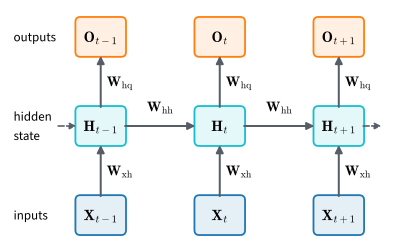
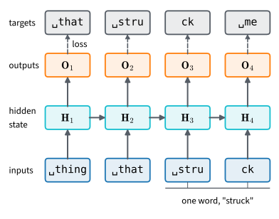

# Recurrent Neural Networks
:label:`sec_rnn`

The language models of :numref:`sec_language-model` predict each token from
a short window of the tokens just before it. The trigram model, for
example, sees only the two words before the one it predicts, and nothing
older can influence the prediction. A human reader does better: a character
introduced on the first page of a novel still shapes how its last page
reads. How can a model take the whole prefix into account without growing
as the prefix grows?

Widening the window does not answer this. A count table over a context of 20
BPE tokens has $1024^{20} \approx 10^{60}$ possible contexts, almost none of
which any corpus contains. A neural network that reads the last 20 tokens
can generalize between similar contexts, but its window is still fixed: a
token 21 positions back is invisible, and every additional token of context
adds weights.

:numref:`sec_sequence` described the alternative: a *latent* model that
summarizes the whole prefix in a *hidden state* $\mathbf{h}_{t-1}$, a vector
of fixed size, and predicts from that summary,

$$P(x_t \mid x_{t-1}, \ldots, x_1) \approx P(x_t \mid \mathbf{h}_{t-1}).$$

After each token, the state is updated from the new input and the previous
state:

$$\mathbf{h}_t = g(\mathbf{h}_{t-1}, x_t).$$
:eqlabel:`eq_ht_xt`

Each step then needs the same computation whether the prefix holds ten tokens or a
million. The approximation is exact only if $\mathbf{h}_{t-1}$ retains
everything about the prefix that matters for predicting $x_t$. A state of
fixed size cannot keep everything, so it must learn what to keep. A
*recurrent neural network* (RNN) computes $g$ with a neural network layer
whose weights are the same at every step :cite:`elman1990finding`. This
section defines the RNN, turns it into a language model, and counts that
model's parameters and computation.
:numref:`sec_rnn-scratch` then implements and trains it.

The word "hidden" means something different here than in the hidden layers
of :numref:`chap_perceptrons`. A hidden layer sits between the input and
the output of one computation. A hidden state is carried from one time step
to the next, and it depends on every input seen so far.

```{.python .input}
%load_ext d2lbook.tab
tab.interact_select('mxnet', 'pytorch', 'tensorflow', 'jax')
```

```{.python .input #rnn-recurrent-neural-networks}
%%tab mxnet
from d2l import mxnet as d2l
from mxnet import npx
npx.set_np()
```

```{.python .input #rnn-recurrent-neural-networks}
%%tab pytorch
from d2l import torch as d2l
```

```{.python .input #rnn-recurrent-neural-networks}
%%tab tensorflow
from d2l import tensorflow as d2l
```

```{.python .input #rnn-recurrent-neural-networks}
%%tab jax
from d2l import jax as d2l
import jax
```

## Neural Networks without Hidden States

A recurrent network is an MLP with one extra input, the previous hidden
state, so we first write down the MLP of :numref:`sec_mlp`, with one hidden
layer and activation function $\phi$. Its input is a minibatch of $b$
examples with $d$ features each, $\mathbf{X} \in \mathbb{R}^{b \times d}$. (We write $b$ for the minibatch size, since $n$ is
the order of an $n$-gram in this chapter.) The hidden layer computes

$$\mathbf{H} = \phi(\mathbf{X} \mathbf{W}_{\textrm{xh}} + \mathbf{b}_\textrm{h}),$$
:eqlabel:`rnn_h_without_state`

with weight $\mathbf{W}_{\textrm{xh}} \in \mathbb{R}^{d \times h}$, bias
$\mathbf{b}_\textrm{h} \in \mathbb{R}^{1 \times h}$ (broadcast over the
rows, :numref:`subsec_broadcasting`), and $h$ hidden units, so that
$\mathbf{H} \in \mathbb{R}^{b \times h}$. The output layer computes

$$\mathbf{O} = \mathbf{H} \mathbf{W}_{\textrm{hq}} + \mathbf{b}_\textrm{q},$$

with $\mathbf{W}_{\textrm{hq}} \in \mathbb{R}^{h \times q}$ and
$\mathbf{b}_\textrm{q} \in \mathbb{R}^{1 \times q}$. For classification,
$\textrm{softmax}(\mathbf{O})$ gives a distribution over $q$ classes.

To turn this MLP into a language model, we feed it the last $m$ tokens and
let it classify the next one, with one class per vocabulary token,
$q = |\mathcal{V}|$. A token id is not a useful input by itself, since the
ids are arbitrary labels. Instead each id selects one row of a learned table
$\mathbf{E} \in \mathbb{R}^{|\mathcal{V}| \times d}$. This row is the
token's *embedding*, a vector of $d$ numbers. The $m$ embeddings are
concatenated into one input of length $md$. This *neural $n$-gram* model
:cite:`Bengio.Ducharme.Vincent.ea.2003` replaces the count table by a
learned function, so a context that never occurred in training still gets
a sensible prediction when it resembles contexts that did. The window
remains, however. The model sees $m$ tokens and nothing older, and its
first weight matrix has $md$ rows, so each additional token of context adds
$dh$ weights: 8,192 for $d = 64$ and $h = 128$.

## Recurrent Neural Networks with Hidden States
:label:`subsec_rnn_w_hidden_states`

An RNN gives the hidden layer one more input: its own output from the
previous time step. At step $t$ the input is a minibatch
$\mathbf{X}_t \in \mathbb{R}^{b \times d}$, whose rows are the inputs of
$b$ sequences at that step, and the hidden state is
$\mathbf{H}_t \in \mathbb{R}^{b \times h}$, one state $\mathbf{h}_t$ per
row. A new weight $\mathbf{W}_{\textrm{hh}} \in \mathbb{R}^{h \times h}$
says how the previous state enters the current one:

$$\mathbf{H}_t = \phi(\mathbf{X}_t \mathbf{W}_{\textrm{xh}} + \mathbf{H}_{t-1} \mathbf{W}_{\textrm{hh}}  + \mathbf{b}_\textrm{h}).$$
:eqlabel:`rnn_h_with_state`

Thus the new state is a hidden layer whose inputs are the current input and
the previous state. Compared with :eqref:`rnn_h_without_state`, the only
new term is $\mathbf{H}_{t-1} \mathbf{W}_{\textrm{hh}}$, and with it
:eqref:`rnn_h_with_state` is an instance of :eqref:`eq_ht_xt`. Because
$\mathbf{H}_t$ is computed from $\mathbf{H}_{t-1}$ by the same formula at
every step, the computation is *recurrent*. A layer that computes
:eqref:`rnn_h_with_state` is a *recurrent layer*, and a network with
recurrent layers is a recurrent neural network. The state starts from
$\mathbf{H}_0 = \mathbf{0}$. At each step the output layer reads the
state,

$$\mathbf{O}_t = \mathbf{H}_t \mathbf{W}_{\textrm{hq}} + \mathbf{b}_\textrm{q}.$$

The parameters are $\mathbf{W}_{\textrm{xh}}$, $\mathbf{W}_{\textrm{hh}}$,
and $\mathbf{b}_\textrm{h}$ of the recurrent layer and
$\mathbf{W}_{\textrm{hq}}$ and $\mathbf{b}_\textrm{q}$ of the output layer.
The same parameters are used at every time step, so their number does not
depend on the length of the sequence.

How does the state remember? Take the smallest case: one input and one
hidden unit ($d = h = 1$), $\phi = \tanh$, $w_\textrm{xh} = 1$,
$w_\textrm{hh} = 0.5$, no bias, and the input sequence $1, 0, 0$. The state
is $\tanh(1) = 0.76$ after the first step, $\tanh(0.5 \cdot 0.76) = 0.36$
after the second, and $\tanh(0.5 \cdot 0.36) = 0.18$ after the third. The
first input still shapes the state two steps later, scaled by about
$w_\textrm{hh}$ at every step. With $w_\textrm{hh} = 0$ it would be gone
after one step. The recurrent weight sets how long the past persists.

:numref:`fig_rnn` unrolls an RNN across three adjacent time steps. At each
step the network reads $\mathbf{X}_t$, combines it with
$\mathbf{H}_{t-1}$ into the new state $\mathbf{H}_t$, and emits
$\mathbf{O}_t$. The horizontal arrows carry the state forward, and the
weight labels repeat at every step because the parameters are shared.
Unrolled over $T$ steps, an RNN is a network $T$ layers deep whose layers
all have the same weights.


:label:`fig_rnn`

The two products in :eqref:`rnn_h_with_state` can be computed as one.
Concatenate the input and the state along the columns into
$[\mathbf{X}_t, \mathbf{H}_{t-1}] \in \mathbb{R}^{b \times (d + h)}$, and
stack the two weight matrices along the rows into a
$(d + h) \times h$ matrix. Each entry of the product is then a sum over
$d + h$ terms, of which the first $d$ form the entry of
$\mathbf{X}_t \mathbf{W}_{\textrm{xh}}$ and the last $h$ the entry of
$\mathbf{H}_{t-1} \mathbf{W}_{\textrm{hh}}$:

$$[\mathbf{X}_t, \mathbf{H}_{t-1}] \begin{bmatrix} \mathbf{W}_{\textrm{xh}} \\ \mathbf{W}_{\textrm{hh}} \end{bmatrix} = \mathbf{X}_t \mathbf{W}_{\textrm{xh}} + \mathbf{H}_{t-1} \mathbf{W}_{\textrm{hh}}.$$

So the recurrent layer is a fully connected layer applied to the
concatenation of input and state. Some early implementations computed it
this way. Current libraries keep the two products separate, for the reason
that exercise :exref:`ex_rnn-input-product` explores. We check the identity
numerically with $b = 3$ sequences, $d = 1$ input, and $h = 4$ hidden
units, first with two products:

```{.python .input #rnn-recurrent-neural-networks-with-hidden-states-1}
%%tab mxnet, pytorch
X, W_xh = d2l.randn(3, 1), d2l.randn(1, 4)
H, W_hh = d2l.randn(3, 4), d2l.randn(4, 4)
separate = d2l.matmul(X, W_xh) + d2l.matmul(H, W_hh)
separate
```

```{.python .input #rnn-recurrent-neural-networks-with-hidden-states-1}
%%tab tensorflow
X, W_xh = d2l.normal((3, 1)), d2l.normal((1, 4))
H, W_hh = d2l.normal((3, 4)), d2l.normal((4, 4))
separate = d2l.matmul(X, W_xh) + d2l.matmul(H, W_hh)
separate
```

```{.python .input #rnn-recurrent-neural-networks-with-hidden-states-1}
%%tab jax
X, W_xh = jax.random.normal(d2l.get_key(), (3, 1)), jax.random.normal(
                                                        d2l.get_key(), (1, 4))
H, W_hh = jax.random.normal(d2l.get_key(), (3, 4)), jax.random.normal(
                                                        d2l.get_key(), (4, 4))
separate = d2l.matmul(X, W_xh) + d2l.matmul(H, W_hh)
separate
```

and then with one product of the concatenated matrices, of shapes (3, 5)
and (5, 4), printing the largest difference between the two results:

```{.python .input #rnn-recurrent-neural-networks-with-hidden-states-2}
fused = d2l.matmul(d2l.concat((X, H), 1), d2l.concat((W_xh, W_hh), 0))
float(d2l.numpy(d2l.abs(fused - separate)).max())
```

The two (3, 4) results differ by at most a few millionths, the rounding
error of 32-bit arithmetic.

### Constant Memory per Step
:label:`subsec_rnn-constant-memory`

To compute $\mathbf{H}_t$, the recurrence needs only $\mathbf{H}_{t-1}$
and $\mathbf{X}_t$. Everything older can be discarded once $\mathbf{H}_t$
is formed, so memory and computation per step stay constant however long
the sequence grows. For the model that :numref:`sec_rnn-scratch` trains,
with $h = 128$ hidden units stored as 32-bit floats, the state of one
sequence occupies 512 bytes, whether the prefix holds ten tokens or a
million. The neural $n$-gram, by contrast, must widen its window, and add
weights, to look further back.

The constant size has a drawback. The state is a *lossy* summary of the
past. A state of 128 numbers cannot store an arbitrarily long text, so to record
something new the network must overwrite something old, and it has to learn
what to keep. The opposite design keeps a representation of every past
token and lets the model look back over all of them when it predicts. This
is *attention* (:numref:`chap_attention`), whose memory and computation per
step grow with the length of the sequence.

## RNN Language Models

An RNN language model reads one token per step and predicts the next. Its
input layer is the embedding table of the neural $n$-gram: at step $t$,
the token ids of the $b$ sequences select $b$ rows of $\mathbf{E}$, which
form $\mathbf{X}_t \in \mathbb{R}^{b \times d}$. Selecting a row is the
same as multiplying a one-hot vector of length $|\mathcal{V}|$ by
$\mathbf{E}$, but the lookup never forms that vector. The recurrent layer
updates the state, and the output layer maps $\mathbf{H}_t$ to
$q = |\mathcal{V}|$ logits per sequence. A softmax over the logits gives
$P(x_{t+1} \mid x_t, \ldots, x_1)$, the model's distribution over the next
token. Because $\mathbf{H}_t$ depends on the entire prefix, the model
approximates every conditional of the factorization
$P(x_1, \ldots, x_T) = \prod_t P(x_t \mid x_{t-1}, \ldots, x_1)$
(:eqref:`eq_lm_factorization` in :numref:`sec_language-model`) without a
Markov cutoff.

:numref:`fig_rnn_train` shows how such a model is trained on the data of
:numref:`subsec_partitioning-seqs`. *The Time Machine* contains the phrase
"thing that struck me", which the BPE tokenizer of
:numref:`sec_text-sequence` splits into the five tokens `␣thing`, `␣that`,
`␣stru`, `ck`, and `␣me` (␣ marks a leading space; "struck" is not in the
1,024-token vocabulary and becomes two tokens). The input is the first
four tokens, and the target is the same stream shifted forward by one,
`␣that`, `␣stru`, `ck`, `␣me`. At every step, the cross-entropy loss
compares the softmax of the output with the target, and the losses are
averaged over the steps. At step 3, for instance, the model has read
`␣thing ␣that ␣stru` and must predict `ck`, completing the word it has
started. The average loss is the logarithm of the perplexity of
:numref:`sec_language-model`, so minimizing it minimizes perplexity.


:label:`fig_rnn_train`

### Model Size and Computation

Where do the parameters of an RNN language model sit? We count them for
the first model that :numref:`sec_rnn-scratch` trains on *The Time
Machine*: the BPE vocabulary has $|\mathcal{V}| = 1{,}027$ ids (1,024
tokens and three special tokens), the embeddings have $d = 64$ dimensions,
and the state has $h = 128$ units. (That section later widens the
embeddings to $d = 512$ and adds dropout: 740,355 parameters, still 89%
facing the vocabulary, and 81,920 multiply-adds per token in the
recurrence.)

| part | shape | parameters |
|---|---|--:|
| embedding table $\mathbf{E}$ | $1{,}027 \times 64$ | 65,728 |
| input weight $\mathbf{W}_\textrm{xh}$ | $64 \times 128$ | 8,192 |
| recurrent weight $\mathbf{W}_\textrm{hh}$ | $128 \times 128$ | 16,384 |
| hidden bias $\mathbf{b}_\textrm{h}$ | $128$ | 128 |
| output weight $\mathbf{W}_\textrm{hq}$ | $128 \times 1{,}027$ | 131,456 |
| output bias $\mathbf{b}_\textrm{q}$ | $1{,}027$ | 1,027 |
| total | | 222,915 |

The recurrent layer itself holds 24,704 parameters, 11% of the total. The
other 89% face the vocabulary, in the embedding table and the output
layer. Computation per token is split the same way. The recurrent layer
takes $64 \cdot 128 + 128 \cdot 128 = 24{,}576$ multiply-adds, the output
layer $128 \cdot 1{,}027 = 131{,}456$, more than five times as many, and
the embedding lookup only copies a row. Neither count depends on the length
of the sequence. A larger vocabulary therefore makes the model larger and
slower without enlarging the state. A larger state holds more of the past,
and its recurrent weight grows with $h^2$.

### Teacher Forcing
:label:`subsec_teacher-forcing`

During training, the input at each step is the *true* previous token, taken
from the corpus, whatever the model predicted at the step before. Training
a sequence model on the true prefixes in this way is called *teacher
forcing*. Every step is conditioned on a correct history, and all the
targets of a window are known in advance, so the loss of the whole window
is computed in one pass over it.

At generation time there are no true tokens to feed. We give the model a
short prompt, draw a token from its next-token distribution (or take the
most probable one), and feed that token back in as the next input. The
model is now conditioned on its *own* outputs. This is the gap between
one-step and multistep prediction that :numref:`sec_sequence` measured on a
sine wave. A token the model gets slightly wrong changes the state it
continues from, and errors can compound over a long generation. Teacher
forcing trains the model only on the first situation, and
:numref:`sec_decoding` studies generation in the second.

We can now write down an RNN language model and its training objective,
and count its parameters and computation. One question remains before we
train it. The loss at step $t$ depends on the weights through every earlier
step of the recurrence, so its gradient is a product of one factor per
step. :numref:`sec_bptt` shows that such products tend to vanish or explode
as the number of steps grows.

## Summary

A recurrent neural network computes its hidden state from the current
input and the previous state with the same weights at every step. Its
parameter count does not depend on the sequence length, and its state is a
fixed-size, lossy summary of the whole past, so memory and computation per
step stay constant. An RNN language model embeds each token, updates the
state, and maps it to logits over the vocabulary. Most of its parameters
and computation sit in these vocabulary-facing layers. It is trained by
teacher forcing to predict each next token from the true prefix, which
minimizes perplexity, while generation feeds back its own outputs.

## Exercises

1. **Parameter counts.** Consider next-token prediction over a vocabulary
   $\mathcal{V}$ from a context of $m$ previous tokens. Evaluate every
   count below for $|\mathcal{V}| = 10{,}000$, $m = 20$, and
   $h = d = 256$.
    1. An $(m+1)$-gram stores a count for every possible context and
       successor. How many entries does its table hold, and by what
       factor does that number grow when $m$ increases by one?
    1. The RNN language model of this section has $h$ hidden units, an
       embedding table of $d$-dimensional vectors, and an output layer
       with one logit per vocabulary token. Count its parameters,
       embedding table included. How does the count depend on $m$?
    1. The neural $n$-gram of :citet:`Bengio.Ducharme.Vincent.ea.2003`
       feeds the concatenated embeddings of the $m$ context tokens to a
       hidden layer of width $h$, followed by the same output layer.
       Count its parameters as a function of $m$, embedding table
       included, and state how many parameters each additional context
       token adds. Compare the growth in $m$ of the three models.

1. **Separating the input product.** Let
   $\mathbf{X}_t \in \mathbb{R}^{b \times d}$ and
   $\mathbf{H}_{t-1} \in \mathbb{R}^{b \times h}$ be the input and
   the state in :eqref:`rnn_h_with_state`.
    1. During training, the inputs $\mathbf{X}_1, \ldots, \mathbf{X}_T$
       of a window are all known before the first time step is computed.
       Which of the two products $\mathbf{X}_t \mathbf{W}_{\textrm{xh}}$
       and $\mathbf{H}_{t-1} \mathbf{W}_{\textrm{hh}}$ can be computed for
       all $T$ steps in a single matrix multiplication, and what are the
       shapes of its factors? Which product must stay inside the
       sequential loop over time steps, and why?
    1. Compare the work per step left inside the loop with the work per
       step of the concatenated form $[\mathbf{X}_t, \mathbf{H}_{t-1}]$.
       During generation, the input at step $t$ is the token generated at
       step $t-1$. Does the advantage of the separate form survive there?
   :exlabel:`ex_rnn-input-product`

1. **Exposure bias.** Teacher forcing (:numref:`subsec_teacher-forcing`)
   conditions every training step on the true prefix, whereas generation
   conditions each step on the model's own earlier outputs. The resulting
   mismatch is called *exposure bias* :cite:`Ranzato.Chopra.Auli.ea.2016`.
    1. Suppose generation samples each token from the model's next-token
       distribution, and the model assigns probability $1 - \epsilon$ to
       the correct next token whenever its prefix is correct. What is the
       probability that $T$ generated tokens contain no error? Evaluate
       it for $\epsilon = 0.01$ and $T = 100$.
    1. *Scheduled sampling* :cite:`Bengio.Vinyals.Jaitly.ea.2015` exposes
       the model to its own outputs during training: at each step, with
       some probability, the input is a token sampled from the model's
       prediction at the previous step instead of the true token. Which
       property of teacher forcing that
       :numref:`subsec_teacher-forcing` relies on does this give up, and
       how does that change the computation of a training window?

1. **A window inside a recurrence.** The neural $n$-gram reads a fixed
   window of the last $m$ input embeddings. Take $\phi$ to be the identity
   and $\mathbf{b}_\textrm{h} = \mathbf{0}$ in :eqref:`rnn_h_with_state`,
   and give the state $h = md$ units.
    1. Choose $\mathbf{W}_{\textrm{xh}}$ and $\mathbf{W}_{\textrm{hh}}$ so
       that, starting from $\mathbf{H}_0 = \mathbf{0}$, the state is the
       concatenation
       $\mathbf{H}_t = [\mathbf{X}_t, \mathbf{X}_{t-1}, \ldots, \mathbf{X}_{t-m+1}]$
       for every $t \geq m$.
    1. Show that $\mathbf{W}_{\textrm{hh}}^m = \mathbf{0}$, and explain why
       this means that no input older than $m$ steps affects
       $\mathbf{H}_t$.
    1. For $d = 256$ and $m = 20$, how many state units does this
       construction need? Explain what an RNN whose state has only 256
       units must do instead of storing the window.

1. [code] **Embedding lookup as a product.** Let
   $\mathbf{E} \in \mathbb{R}^{|\mathcal{V}| \times d}$ be an embedding
   table, and let $\mathbf{x}$ hold the token ids of a minibatch of $b$
   tokens.
    1. Compute the inputs once by selecting the rows of $\mathbf{E}$ that
       $\mathbf{x}$ indexes and once as the product of the
       $b \times |\mathcal{V}|$ one-hot matrix of $\mathbf{x}$ with
       $\mathbf{E}$, and check that the two agree. Time both for
       $|\mathcal{V}| \in \{10^3, 10^4, 10^5\}$ with $d = b = 256$, and
       state how the running time of each grows with $|\mathcal{V}|$.
    1. Differentiate the sum of all entries of the selected rows with
       respect to $\mathbf{E}$ by automatic differentiation. Which rows of
       the gradient are nonzero, and what does a row contain when its
       token occurs several times in the minibatch? For
       $|\mathcal{V}| = 10^4$ and $b = 256$ ids drawn uniformly at random,
       estimate the fraction of rows that receive a nonzero gradient.

1. **Parity beyond any window.** ● Let $x_1, x_2, \ldots$ be a sequence of
   bits, and let the desired output at step $t$ be the parity of
   $x_1 + \cdots + x_t$.
    1. Show that no model that reads only the last $m$ inputs can produce
       the correct output at every step of a sequence longer than $m$,
       whatever the finite $m$.
    1. Let $\phi$ be a threshold activation. Construct an RNN of the form
       :eqref:`rnn_h_with_state` with two hidden units whose output
       equals the parity at every step, for any sequence length. Give
       the weights, and show that one hidden unit does not suffice.
    1. How many bits of information about $x_1, \ldots, x_t$ must the
       hidden state retain for the outputs at all later steps to be
       correct? Relate this to the description of the state as a lossy
       fixed-size summary in :numref:`subsec_rnn-constant-memory`.

:begin_tab:`mxnet`
[Discussions](https://d2l.discourse.group/t/337)
:end_tab:

:begin_tab:`pytorch`
[Discussions](https://d2l.discourse.group/t/1050)
:end_tab:

:begin_tab:`tensorflow`
[Discussions](https://d2l.discourse.group/t/1051)
:end_tab:

:begin_tab:`jax`
[Discussions](https://d2l.discourse.group/t/18013)
:end_tab:

<!-- slides -->

::: {.slide}
::: {.cover}
[Dive into Deep Learning · §8.4]{.kicker}

Recurrent Neural Networks<br>**hidden state · shared weights · constant memory · RNN language model · teacher forcing**
:::
:::

::: {.slide title="A Window Forgets Everything Older Than Its Width"}
[The problem]{.kicker}

- The trigram model predicts from the last **2** words; the 3rd word back
  is invisible.
- A count table over 20 BPE tokens of context: $1024^{20} \approx 10^{60}$
  contexts.
- A neural $n$-gram over $m$ tokens (embedding size $d$, hidden width
  $h$): each extra token adds $d h$ weights (8,192 at $d = 64$,
  $h = 128$), and token $m+1$ is still invisible.

::: {.d2l-note .warn}
Can a summary of fixed size replace the window, with constant work per step?
:::
:::

::: {.slide title="By the End of This Deck You Can"}
[Goals]{.kicker}

- compute one RNN step and give the shape of every term;
- show that the two products of a step equal one product on
  $[\mathbf{X}_t, \mathbf{H}_{t-1}]$;
- count the parameters and per-token work of an RNN language model;
- explain teacher forcing and why generation differs from training.

**Running example:** the first RNN language model of the next deck, on
*The Time Machine*: BPE vocabulary 1,027 ids, embeddings $d = 64$, state
$h = 128$.
:::

::: {.slide title="A Hidden State Replaces the Window"}
[Where this fits]{.kicker}

::: {.cols .vc}
::: {.col}
| section | adds |
|---|---|
| Working with Sequences | autoregression, latent state, rollout error |
| From Text to Tokens | characters, words, bytes, BPE |
| Language Models | $n$-grams, perplexity, bits per byte |
| **Recurrent Neural Networks** | **a hidden state updated at every step** |
| Implementing RNNs | an RNN language model, scratch and concise |
| Backpropagation Through Time | gradients through time, truncation |
| Decoding and Generation | greedy decoding, beam search, sampling |
:::

::: {.col .narrow}
- **Uses:** MLP, softmax and cross-entropy, BPE windows with shifted
  targets.
- **Skips:** training (next deck), gradients through time.
:::
:::
:::

::: {.slide title="One Update Rule, the Same Weights at Every Step"}
[The recurrence]{.kicker}

$$\underbrace{\mathbf{H}_t}_{b \times h} = \phi\big(
\underbrace{\mathbf{X}_t}_{b \times d}\,\underbrace{\mathbf{W}_\textrm{xh}}_{d \times h}
+ \underbrace{\mathbf{H}_{t-1}}_{b \times h}\,\underbrace{\mathbf{W}_\textrm{hh}}_{h \times h}
+ \underbrace{\mathbf{b}_\textrm{h}}_{1 \times h}\big).$$

- $b$ sequences in the minibatch (not the bias $\mathbf{b}_\textrm{h}$),
  $d$ inputs, $h$ hidden units,
  $\mathbf{H}_0 = \mathbf{0}$; output
  $\mathbf{O}_t = \mathbf{H}_t \mathbf{W}_\textrm{hq} + \mathbf{b}_\textrm{q}$.
- Compared with an MLP layer, the only new term is
  $\mathbf{H}_{t-1}\mathbf{W}_\textrm{hh}$.
- The parameter count does not depend on the sequence length.
:::

::: {.slide title="Inputs 1, 0, 0 Leave the States 0.76, 0.36, 0.18"}
[Smallest case]{.kicker}

One input, one hidden unit: $h_t = \tanh(x_t + 0.5\, h_{t-1})$,
$h_0 = 0$.

| step | $x_t$ | $h_t$ |
|---|--:|--:|
| 1 | 1 | $\tanh(1) = 0.76$ |
| 2 | 0 | $\tanh(0.38) = 0.36$ |
| 3 | 0 | $\tanh(0.18) = 0.18$ |

The first input persists, scaled by about $w_\textrm{hh} = 0.5$ per step.
**The recurrent weight sets how long the past persists.**
:::

::: {.slide title="Unrolled, an RNN Is a Deep Network with Tied Weights"}
[Unrolling]{.kicker}

{width=62%}

$T$ steps: a network $T$ layers deep, every layer with the same weights.
:::

::: {.slide title="Two Products Equal One Product on the Concatenation"}
[One matrix multiplication]{.kicker}

$$[\mathbf{X}_t, \mathbf{H}_{t-1}]
\begin{bmatrix} \mathbf{W}_\textrm{xh} \\ \mathbf{W}_\textrm{hh} \end{bmatrix}
= \mathbf{X}_t \mathbf{W}_\textrm{xh} + \mathbf{H}_{t-1} \mathbf{W}_\textrm{hh}.$$

- Each entry is a sum over $d + h$ terms: the first $d$ come from
  $\mathbf{X}_t$, the last $h$ from $\mathbf{H}_{t-1}$.
- The recurrent layer is a fully connected layer on
  $[\mathbf{X}_t, \mathbf{H}_{t-1}]$.
:::

::: {.slide title="Checked Numerically: the Two Forms Differ Only by Rounding"}
[One matrix multiplication]{.kicker}

Random $\mathbf{X}_t$, $\mathbf{H}_{t-1}$, weights; $b = 3$, $d = 1$,
$h = 4$. `separate` holds the two-product result:

@rnn-recurrent-neural-networks-with-hidden-states-2

Largest difference: a few millionths at most, float32 rounding.
:::

::: {.slide title="Check: Shapes of One Step"}
[Check]{.kicker}

$b = 32$ sequences, $d = 64$, $h = 128$. What are the shapes of
$\mathbf{X}_t \mathbf{W}_\textrm{xh}$, of $[\mathbf{X}_t, \mathbf{H}_{t-1}]$,
and of the stacked weight matrix?

::: {.fragment .fade-up}
::: {.d2l-note}
**Answer.** $\mathbf{X}_t \mathbf{W}_\textrm{xh}$: $32 \times 128$.
$[\mathbf{X}_t, \mathbf{H}_{t-1}]$: $32 \times 192$. Stacked weights:
$192 \times 128$, and the product is again $32 \times 128$.
:::
:::
:::

::: {.slide title="The State Is 512 Bytes for Any Prefix Length"}
[Constant memory]{.kicker}

- $\mathbf{H}_t$ needs only $\mathbf{H}_{t-1}$ and $\mathbf{X}_t$; older
  inputs can be discarded.
- $h = 128$ float32 numbers: **512 bytes** per sequence, after ten tokens
  or a million.
- The drawback: a **lossy** summary. To record something new, the network
  must overwrite something old.
- Attention (later) keeps every past token instead; its memory grows with
  the sequence.
:::

::: {.slide title="An RNN Language Model Is Embedding, Recurrence, Output Layer"}
[RNN language model]{.kicker}

| stage | shape per step |
|---|---|
| token ids | $b$ |
| embedding rows of $\mathbf{E}$ ($1{,}027 \times 64$) | $b \times 64$ |
| state $\mathbf{H}_t$ | $b \times 128$ |
| logits $\mathbf{O}_t$ | $b \times 1{,}027$ |
| softmax | $P(x_{t+1} \mid x_t, \ldots, x_1)$ |

No Markov cutoff: $\mathbf{H}_t$ depends on the entire prefix.
:::

::: {.slide title="89% of the 222,915 Parameters Face the Vocabulary"}
[Model size]{.kicker}

| part | shape | parameters |
|---|---|--:|
| embedding $\mathbf{E}$ | $1{,}027 \times 64$ | 65,728 |
| $\mathbf{W}_\textrm{xh}$, $\mathbf{W}_\textrm{hh}$, $\mathbf{b}_\textrm{h}$ | $64 \times 128$, $128 \times 128$, $128$ | 24,704 |
| $\mathbf{W}_\textrm{hq}$, $\mathbf{b}_\textrm{q}$ | $128 \times 1{,}027$, $1{,}027$ | 132,483 |

The recurrent layer, which does the remembering, is 11% of the model.
:::

::: {.slide title="Per Token, the Output Layer Does 5× the Work of the Recurrence"}
[Work per token]{.kicker}

- Recurrence: $64 \cdot 128 + 128 \cdot 128 = 24{,}576$ multiply-adds.
- Output layer: $128 \cdot 1{,}027 = 131{,}456$ multiply-adds.
- Embedding: a row copy.

Neither depends on the sequence length. A larger vocabulary makes the
model larger and slower without enlarging the state.
:::

::: {.slide title="Check: Which Terms Grow 4× When the Hidden Size Doubles?"}
[Check]{.kicker}

Double $h$ from 128 to 256, keep $d = 64$ and $|\mathcal{V}| = 1{,}027$.
Which parameter blocks and per-token multiply-adds grow 4×, 2×, or not at all?

::: {.fragment .fade-up}
::: {.d2l-note}
**Answer.** 4×: $\mathbf{W}_\textrm{hh}$ ($h^2$: 16,384 → 65,536). 2×:
$\mathbf{W}_\textrm{xh}$, $\mathbf{b}_\textrm{h}$, $\mathbf{W}_\textrm{hq}$
and the output-layer work. Recurrence work: 3.3× (24,576 → 81,920; its
$h^2$ part 4×, its $dh$ part 2×). Unchanged: $\mathbf{E}$,
$\mathbf{b}_\textrm{q}$.
:::
:::
:::

::: {.slide title="Training Predicts Every Next Token from the True Prefix"}
[Teacher forcing]{.kicker}

{width=48%}

Loss: cross-entropy at every step, averaged. Its exponential is the
perplexity.
:::

::: {.slide title="An Untrained Model Starts at Perplexity 1,027"}
[Teacher forcing]{.kicker}

- A near-uniform prediction over 1,027 ids: loss
  $\log 1{,}027 \approx 6.93$ nats per token, perplexity $\approx 1{,}027$.
- Check it before training: an initial loss far above
  $\log |\mathcal{V}|$ means the initial logits are too large.
- All targets of a window are known in advance: one pass computes the
  loss of all $T$ steps.
:::

::: {.slide title="Generation Feeds Back the Model's Own Outputs"}
[Generation]{.kicker}

- Training: the input at step $t$ is the **true** token $x_t$.
- Generation: the input is the token the model **itself** produced.
- A slightly wrong token changes the state the model continues from, and
  errors compound, as in the multistep sine-wave rollouts.

Training never shows the model its own mistakes.
:::

::: {.slide title="Recap"}
[Wrap-up]{.kicker}

- **RNN:** $\mathbf{H}_t = \phi(\mathbf{X}_t\mathbf{W}_\textrm{xh} +
  \mathbf{H}_{t-1}\mathbf{W}_\textrm{hh} + \mathbf{b}_\textrm{h})$, the
  same weights at every step; one product on $[\mathbf{X}_t, \mathbf{H}_{t-1}]$.
- **Constant memory:** 512 bytes of state per sequence, at any length;
  the summary is lossy.
- **Language model:** embedding, recurrence, output layer: 222,915
  parameters, 89% vocabulary-facing.
- **Teacher forcing:** true prefixes in training, own outputs in
  generation.

**Next:** gradients cross every step; over 40 steps a factor of 0.9 per
step shrinks them to $0.9^{40} \approx 0.015$, a factor of 1.1 grows them
to $1.1^{40} \approx 45$.
:::
