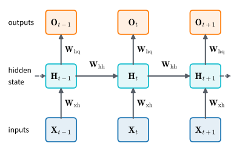

# Recurrent Neural Networks
:label:`sec_rnn`

The count-based language models of :numref:`sec_language-model` predict each
token from a short window of immediate predecessors. A trigram model, for
example, conditions only on the two preceding words; anything earlier in the
document has zero influence on its prediction. Human readers, by contrast,
carry context across an entire book—a character introduced in the opening
chapter still shapes how we interpret the final page. How can a model
condition on an arbitrarily long prefix without growing larger as the prefix
grows?

Simply widening the context window quickly hits a wall. A count table spanning
20 BPE tokens must track $1024^{20} \approx 10^{60}$ possible contexts,
virtually none of which will ever appear in any corpus. A neural network
reading the last 20 tokens fares considerably better because it can generalize
across related contexts, yet its window remains rigid: any token 21 positions
back is still completely invisible.

In :numref:`sec_sequence`, we introduced a fundamentally different approach:
a *latent* autoregressive model that compresses the entire history into a
fixed-size *hidden state* vector $\mathbf{h}_{t-1}$ and predicts the next
token from that summary:

$$P(x_t \mid x_{<t}) \approx P(x_t \mid \mathbf{h}_{t-1}).$$

After observing each new token $x_t$, the model updates its state using both
the previous state and the new input:

$$\mathbf{h}_t = g(\mathbf{h}_{t-1}, x_t).$$
:eqlabel:`eq_ht_xt`

Under this recurrence, the computational cost per step stays constant no
matter how long the prefix becomes. Strictly speaking, the approximation above
is exact only if $\mathbf{h}_{t-1}$ preserves everything about the prefix that
is relevant to predicting $x_t$. Because a fixed-size vector cannot retain
every detail of an arbitrarily long text, the network must learn what to
remember and what to discard. A *recurrent neural network* (RNN) parameterizes
the transition function $g$ with a neural network layer whose weights are
shared across all time steps :cite:`elman1990finding`. In this section, we
formulate the RNN, assemble it into a language model, and analyze its
parameter count and computational cost before implementing and training it in
:numref:`sec_rnn-scratch`.

One terminological point deserves care: "hidden" here differs from the
*hidden layers* of :numref:`chap_perceptrons`. A hidden layer sits between
the input and output within a single feedforward pass, whereas a *hidden
state* is passed forward from one time step to the next, acting as a learned
memory that depends on every input observed so far.

## Neural Networks without Hidden States

An RNN is easiest to understand as a multilayer perceptron augmented with one
additional input—the previous hidden state. Let us therefore revisit the
single-hidden-layer MLP of :numref:`sec_mlp` with activation function $\phi$.
Given a minibatch of $b$ examples with $d$ features each,
$\mathbf{X} \in \mathbb{R}^{b \times d}$ (we denote the batch size by $b$
here because $n$ denotes the $n$-gram order throughout this chapter), the
hidden layer computes

$$\mathbf{H} = \phi(\mathbf{X} \mathbf{W}_{\textrm{xh}} + \mathbf{b}_\textrm{h}),$$
:eqlabel:`rnn_h_without_state`

using weight matrix $\mathbf{W}_{\textrm{xh}} \in \mathbb{R}^{d \times h}$,
bias $\mathbf{b}_\textrm{h} \in \mathbb{R}^{1 \times h}$ (broadcast across
the $b$ rows; see :numref:`subsec_broadcasting`), and $h$ hidden units, so
that $\mathbf{H} \in \mathbb{R}^{b \times h}$. The output layer then maps
$\mathbf{H}$ to logits

$$\mathbf{O} = \mathbf{H} \mathbf{W}_{\textrm{hq}} + \mathbf{b}_\textrm{q},$$

with $\mathbf{W}_{\textrm{hq}} \in \mathbb{R}^{h \times q}$ and
$\mathbf{b}_\textrm{q} \in \mathbb{R}^{1 \times q}$; for classification,
applying $\textrm{softmax}(\mathbf{O})$ yields a probability distribution over
the $q$ classes.

We can adapt this MLP into a language model by feeding it the $m$ most recent
tokens and asking it to classify the next token across all $q = |\mathcal{V}|$
entries in the vocabulary. Because integer token ids are arbitrary labels with
no meaningful numerical order, we represent each token by looking up its
corresponding row in a learned matrix
$\mathbf{E} \in \mathbb{R}^{|\mathcal{V}| \times d}$, called its
*embedding*—a $d$-dimensional dense vector. Because $\mathbf{E}$ is trained
end to end alongside the network, tokens appearing in similar contexts acquire
similar vectors, allowing statistical evidence about `"cat"` to generalize
naturally to `"feline"` in a way that count tables
(:numref:`sec_language-model`) could never achieve.

Concatenating the $m$ context embeddings into a single input vector of length
$md$ yields the *neural $n$-gram* language model
:cite:`Bengio.Ducharme.Vincent.ea.2003`. Replacing discrete lookup tables with
a smooth neural function allows the model to assign sensible probabilities to
unseen contexts that resemble training examples. Even so, the fixed window
remains: tokens more than $m$ steps in the past remain out of reach, and the
input weight matrix grows linearly with $m$, adding $dh$ parameters for every
extra token of context (8,192 extra weights per token when $d = 64$ and
$h = 128$).

## Recurrent Neural Networks with Hidden States
:label:`subsec_rnn_w_hidden_states`

A recurrent neural network removes the fixed window by feeding the hidden
layer its own state from the previous time step. At step $t$, let
$\mathbf{X}_t \in \mathbb{R}^{b \times d}$ hold the $d$-dimensional inputs for
a minibatch of $b$ sequences, and let
$\mathbf{H}_t \in \mathbb{R}^{b \times h}$ hold their hidden states (one state
vector $\mathbf{h}_t$ per row). Introducing a recurrent weight matrix
$\mathbf{W}_{\textrm{hh}} \in \mathbb{R}^{h \times h}$ that governs how the
prior state feeds into the current one gives

$$\mathbf{H}_t = \phi(\mathbf{X}_t \mathbf{W}_{\textrm{xh}} + \mathbf{H}_{t-1} \mathbf{W}_{\textrm{hh}}  + \mathbf{b}_\textrm{h}).$$
:eqlabel:`rnn_h_with_state`

Compared with :eqref:`rnn_h_without_state`, the sole addition is the recurrent
term $\mathbf{H}_{t-1} \mathbf{W}_{\textrm{hh}}$, turning
:eqref:`rnn_h_with_state` into a concrete instantiation of :eqref:`eq_ht_xt`.
Because the same formula computes $\mathbf{H}_t$ from $\mathbf{H}_{t-1}$ at
every time step (starting from $\mathbf{H}_0 = \mathbf{0}$), the update is
*recurrent*; a layer executing :eqref:`rnn_h_with_state` is a *recurrent
layer*, and a network built from such layers is a recurrent neural network. At
each step, the output layer maps the current hidden state to logits exactly as
before:

$$\mathbf{O}_t = \mathbf{H}_t \mathbf{W}_{\textrm{hq}} + \mathbf{b}_\textrm{q}.$$

Crucially, the very same five parameter tensors—three in the recurrent layer
and two in the output layer—are reused at every time step, so the total number
of parameters is completely independent of the sequence length.

To build intuition for how this state retains memory, consider the smallest
possible scalar RNN ($d = h = 1$) with $\phi = \tanh$, $w_\textrm{xh} = 1$,
$w_\textrm{hh} = 0.5$, zero bias, and the input sequence $1, 0, 0$. Starting
from $h_0 = 0$, the hidden state evolves as $\tanh(1) = 0.76$ after step 1,
$\tanh(0.5 \cdot 0.76) = 0.36$ after step 2, and
$\tanh(0.5 \cdot 0.36) = 0.18$ after step 3. The initial input continues to
influence the state several steps later, attenuated by roughly $w_\textrm{hh}$
at each step; had $w_\textrm{hh}$ been zero, it would have vanished
immediately. Thus, the recurrent weight controls how rapidly past information
fades.

Better still, a recurrent state can solve tasks that are impossible for *any*
fixed-window model. Suppose a model reads a stream of bits and must report at
every step whether the total number of ones seen so far is even or odd
(parity). No model restricted to the last $m$ inputs can succeed for any
finite $m$, because flipping a single bit that has already fallen out of the
window reverses the true parity while leaving the model's input completely
unchanged. A recurrent state, by contrast, needs to store only a single bit—the
running parity—and flip it whenever the current input is 1; two hidden units
with a threshold activation solve this task for sequences of arbitrary length
(as you will verify in the final exercise).

:numref:`fig_rnn` unrolls an RNN across three consecutive time steps. The
horizontal arrows pass the hidden state forward through time, and the weight
labels repeat at every step to emphasize parameter sharing. Viewed in this
unrolled form, an RNN running over $T$ steps is equivalent to a $T$-layer
feedforward network whose layers all share the same weights.

:label:`fig_rnn`

Notice that the two matrix multiplications in :eqref:`rnn_h_with_state` can
equally be written as a single product by concatenating the input and previous
state horizontally and stacking the two weight matrices vertically:

$$[\mathbf{X}_t, \mathbf{H}_{t-1}] \begin{bmatrix} \mathbf{W}_{\textrm{xh}} \\ \mathbf{W}_{\textrm{hh}} \end{bmatrix} = \mathbf{X}_t \mathbf{W}_{\textrm{xh}} + \mathbf{H}_{t-1} \mathbf{W}_{\textrm{hh}}.$$

Mathematically, a recurrent layer is therefore nothing more than a standard
fully connected layer applied to the concatenation $[\mathbf{X}_t, \mathbf{H}_{t-1}]$.
Deep learning libraries nevertheless keep the two products separate because
during training all inputs $\mathbf{X}_1, \ldots, \mathbf{X}_T$ are available
up front, allowing $\mathbf{X}_t \mathbf{W}_{\textrm{xh}}$ across all time
steps to be computed in a single batched matrix multiplication outside the
sequential time loop (exercise :exref:`ex_rnn-input-product`).

### Constant Memory per Step
:label:`subsec_rnn-constant-memory`

Computing $\mathbf{H}_t$ requires only $\mathbf{H}_{t-1}$ and $\mathbf{X}_t$;
all earlier inputs and states can be discarded once $\mathbf{H}_t$ is formed.
Consequently, both memory and computation per step remain constant regardless
of sequence length. For the model we train in :numref:`sec_rnn-scratch`, with
$h = 128$ hidden units stored in 32-bit floating point, the hidden state of a
single sequence occupies just 512 bytes—whether the model has read ten tokens
or a million.

That constant footprint comes with an inherent trade-off: the hidden state is
necessarily a *lossy* bottleneck. No entire novel can be stored losslessly in
512 bytes, so recording new information inevitably overwrites older details.
The alternative paradigm retains a representation of every past token and lets
the model attend directly back to all of them at each step—namely, *attention*
(:numref:`chap_attention`), which lifts this bottleneck at the cost of memory
and compute that grow with sequence length.

## RNN Language Models

An RNN language model consumes one token per time step and predicts the next.
Its input stage is the same embedding lookup used by the neural $n$-gram: at
step $t$, the $b$ token ids in the minibatch index $b$ rows of the embedding
table $\mathbf{E}$ to form $\mathbf{X}_t \in \mathbb{R}^{b \times d}$
(mathematically identical to multiplying a one-hot matrix by $\mathbf{E}$,
without ever materializing the sparse one-hot vectors). The recurrent layer
updates $\mathbf{H}_t$, and the output layer projects $\mathbf{H}_t$ to
$q = |\mathcal{V}|$ logits per sequence, whose softmax defines the predictive
distribution $P(x_{t+1} \mid x_{\leq t})$. Because $\mathbf{H}_t$ incorporates
the entire prefix, the model parameterizes every conditional in the exact
chain-rule factorization
$P(x_1, \ldots, x_T) = \prod_t P(x_t \mid x_{<t})$
(:eqref:`eq_lm_factorization` in :numref:`sec_language-model`) without
imposing a hard Markov cutoff.

:numref:`fig_rnn_train` illustrates training on the windowed sequences from
:numref:`subsec_partitioning-seqs`. Consider the phrase `"thing that struck me"`
from *The Time Machine*, which our 1,024-token BPE tokenizer
(:numref:`sec_text-sequence`) splits into the five tokens `␣thing`, `␣that`,
`␣stru`, `ck`, and `␣me` (where `␣` denotes a leading space, and `"struck"`
splits into two subwords). We feed the first four tokens as input and use the
same sequence shifted forward by one token—`␣that`, `␣stru`, `ck`, `␣me`—as
the targets. At every time step, cross-entropy compares the softmax output
against the target token, and we average the loss across steps. At step 3, for
instance, the model has read `␣thing ␣that ␣stru` and is trained to predict
`ck`, completing the partially spelled word. Since this average cross-entropy
is the logarithm of perplexity (:numref:`sec_language-model`), minimizing the
training loss directly minimizes perplexity.

:label:`fig_rnn_train`

### Model Size and Computation

Where do the parameters of an RNN language model actually live? Let us tally
them for the model we will train on *The Time Machine* in
:numref:`sec_rnn-scratch`, using our BPE vocabulary of
$|\mathcal{V}| = 1{,}027$ ids (1,024 BPE tokens plus three special tokens),
embedding dimension $d = 64$, and hidden size $h = 128$:

| part | shape | parameters |
|---|---|--:|
| embedding table $\mathbf{E}$ | $1{,}027 \times 64$ | 65,728 |
| input weight $\mathbf{W}_\textrm{xh}$ | $64 \times 128$ | 8,192 |
| recurrent weight $\mathbf{W}_\textrm{hh}$ | $128 \times 128$ | 16,384 |
| hidden bias $\mathbf{b}_\textrm{h}$ | $128$ | 128 |
| output weight $\mathbf{W}_\textrm{hq}$ | $128 \times 1{,}027$ | 131,456 |
| output bias $\mathbf{b}_\textrm{q}$ | $1{,}027$ | 1,027 |
| total | | 222,915 |

Surprisingly, the recurrent layer—the part responsible for all sequential
memory—accounts for just 24,704 parameters, or 11% of the model. The remaining
89% reside in the embedding table and output projection, both of which scale
linearly with vocabulary size. Per-token compute breaks down along the same
lines: the recurrent step performs
$64 \cdot 128 + 128 \cdot 128 = 24{,}576$ multiply-adds, whereas the output
projection requires $128 \cdot 1{,}027 = 131{,}456$—over five times as
many—while the embedding lookup simply copies a row. Enlarging the vocabulary
therefore increases both memory and per-token latency without expanding the
hidden state, whereas expanding the hidden state adds memory capacity at a
quadratic parameter cost in $h^2$ inside $\mathbf{W}_{\textrm{hh}}$.

### Teacher Forcing
:label:`subsec_teacher-forcing`

During training, the input fed at every time step is always the *ground-truth*
token from the corpus, regardless of what the model predicted at the preceding
step. This standard training regime is called *teacher forcing*. Because every
step conditions on an error-free prefix and all targets in a window are known
beforehand, the entire window's loss can be computed in a single forward pass.

During text generation, however, ground-truth continuations do not exist.
Instead, we prime the model with a short prompt, draw a token from its
predicted distribution (or pick the highest-probability token), and feed that
generated token right back in as the next input. The model now conditions on
its *own* predictions—recreating the exact gap between one-step training and
multistep rollouts we encountered on the noisy sine wave in
:numref:`sec_sequence`. A slightly awkward token perturbs the hidden state
carried forward, and mistakes can compound over long passages. Because teacher
forcing never exposes the network to its own errors, decoding strategies
(:numref:`sec_decoding`) play a critical role in keeping generation on track.

Two important issues remain to be investigated. First, because the loss at
step $t$ depends on the shared weights through every preceding step of the
recurrence, its gradient involves long products of Jacobians that can vanish
or explode as sequences lengthen; :numref:`sec_rnn-scratch` introduces
gradient clipping to stabilize training, and :numref:`sec_bptt` analyzes the
underlying gradient dynamics mathematically. Second, while the hidden state
*can* in principle depend on the entire prefix, the architecture alone does not
guarantee how much of that prefix a trained vanilla RNN will actually retain—a
question we will measure directly once we train the model.

## Summary

A recurrent neural network updates a fixed-size hidden state from the current
input and the previous state while sharing the same parameters across all time
steps. Because its parameter count is independent of sequence length and older
inputs need not be stored once summarized, both memory and computation per
step stay constant—at the cost of compressing an arbitrarily long past into a
lossy state vector. An RNN language model embeds each input token, advances
the hidden state, and projects that state into logits over the vocabulary,
with most parameters and compute concentrated in the vocabulary-sized
embedding and output layers. Training proceeds via teacher forcing—feeding
true prefixes to minimize cross-entropy (and thus perplexity)—whereas
generation feeds the model's own predictions back into the recurrence.

## Exercises

1. **Parameter counts.** Consider next-token prediction over a vocabulary
   $\mathcal{V}$ from a context of $m$ previous tokens. Evaluate every
   count below for $|\mathcal{V}| = 10{,}000$, $m = 20$, and
   $h = d = 256$.
    1. An $(m+1)$-gram stores a count for every possible context and
       successor. How many entries does its table hold, and by what
       factor does that number grow when $m$ increases by one?
    1. The RNN language model of this section has $h$ hidden units, an
       embedding table of $d$-dimensional vectors, and an output layer
       with one logit per vocabulary token. Count its parameters,
       embedding table included. How does the count depend on $m$?
    1. The neural $n$-gram of :citet:`Bengio.Ducharme.Vincent.ea.2003`
       feeds the concatenated embeddings of the $m$ context tokens to a
       hidden layer of width $h$, followed by the same output layer.
       Count its parameters as a function of $m$, embedding table
       included, and state how many parameters each additional context
       token adds. Compare the growth in $m$ of the three models.

1. **Separating the input product.** Let
   $\mathbf{X}_t \in \mathbb{R}^{b \times d}$ and
   $\mathbf{H}_{t-1} \in \mathbb{R}^{b \times h}$ be the input and
   the state in :eqref:`rnn_h_with_state`.
    1. During training, the inputs $\mathbf{X}_1, \ldots, \mathbf{X}_T$
       of a window are all known before the first time step is computed.
       Which of the two products $\mathbf{X}_t \mathbf{W}_{\textrm{xh}}$
       and $\mathbf{H}_{t-1} \mathbf{W}_{\textrm{hh}}$ can be computed for
       all $T$ steps in a single matrix multiplication, and what are the
       shapes of its factors? Which product must stay inside the
       sequential loop over time steps, and why?
    1. Compare the work per step left inside the loop with the work per
       step of the concatenated form $[\mathbf{X}_t, \mathbf{H}_{t-1}]$.
       During generation, the input at step $t$ is the token generated at
       step $t-1$. Does the advantage of the separate form survive there?
   :exlabel:`ex_rnn-input-product`

1. **Exposure bias.** Teacher forcing (:numref:`subsec_teacher-forcing`)
   conditions every training step on the true prefix, whereas generation
   conditions each step on the model's own earlier outputs. The resulting
   mismatch is called *exposure bias* :cite:`Ranzato.Chopra.Auli.ea.2016`.
    1. Suppose generation samples each token from the model's next-token
       distribution, and the model assigns probability $1 - \epsilon$ to
       the correct next token whenever its prefix is correct. What is the
       probability that $T$ generated tokens contain no error? Evaluate
       it for $\epsilon = 0.01$ and $T = 100$.
    1. *Scheduled sampling* :cite:`Bengio.Vinyals.Jaitly.ea.2015` exposes
       the model to its own outputs during training: at each step, with
       some probability, the input is a token sampled from the model's
       prediction at the previous step instead of the true token. Which
       property of teacher forcing that
       :numref:`subsec_teacher-forcing` relies on does this give up, and
       how does that change the computation of a training window?

1. **A window inside a recurrence.** The neural $n$-gram reads a fixed
   window of the last $m$ input embeddings. Take $\phi$ to be the identity
   and $\mathbf{b}_\textrm{h} = \mathbf{0}$ in :eqref:`rnn_h_with_state`,
   and give the state $h = md$ units.
    1. Choose $\mathbf{W}_{\textrm{xh}}$ and $\mathbf{W}_{\textrm{hh}}$ so
       that, starting from $\mathbf{H}_0 = \mathbf{0}$, the state is the
       concatenation
       $\mathbf{H}_t = [\mathbf{X}_t, \mathbf{X}_{t-1}, \ldots, \mathbf{X}_{t-m+1}]$
       for every $t \geq m$.
    1. Show that $\mathbf{W}_{\textrm{hh}}^m = \mathbf{0}$, and explain why
       this means that no input older than $m$ steps affects
       $\mathbf{H}_t$.
    1. For $d = 256$ and $m = 20$, how many state units does this
       construction need? Explain what an RNN whose state has only 256
       units must do instead of storing the window.

1. [code] **Embedding lookup as a product.** Let
   $\mathbf{E} \in \mathbb{R}^{|\mathcal{V}| \times d}$ be an embedding
   table, and let $\mathbf{x}$ hold the token ids of a minibatch of $b$
   tokens.
    1. Compute the inputs once by selecting the rows of $\mathbf{E}$ that
       $\mathbf{x}$ indexes and once as the product of the
       $b \times |\mathcal{V}|$ one-hot matrix of $\mathbf{x}$ with
       $\mathbf{E}$, and check that the two agree. Time both for
       $|\mathcal{V}| \in \{10^3, 10^4, 10^5\}$ with $d = b = 256$, and
       state how the running time of each grows with $|\mathcal{V}|$.
    1. Differentiate the sum of all entries of the selected rows with
       respect to $\mathbf{E}$ by automatic differentiation. Which rows of
       the gradient are nonzero, and what does a row contain when its
       token occurs several times in the minibatch? For
       $|\mathcal{V}| = 10^4$ and $b = 256$ ids drawn uniformly at random,
       estimate the fraction of rows that receive a nonzero gradient.

1. **Parity beyond any window.** ● Let $x_1, x_2, \ldots$ be a sequence of
   bits, and let the desired output at step $t$ be the parity of
   $x_1 + \cdots + x_t$.
    1. Show that no model that reads only the last $m$ inputs can produce
       the correct output at every step of a sequence longer than $m$,
       whatever the finite $m$.
    1. Let $\phi$ be a threshold activation. Construct an RNN of the form
       :eqref:`rnn_h_with_state` with two hidden units whose output
       equals the parity at every step, for any sequence length. Give
       the weights, and show that one hidden unit does not suffice.
    1. How many bits of information about $x_1, \ldots, x_t$ must the
       hidden state retain for the outputs at all later steps to be
       correct? Relate this to the description of the state as a lossy
       fixed-size summary in :numref:`subsec_rnn-constant-memory`.

:begin_tab:`mxnet`
[Discussions](https://d2l.discourse.group/t/337)
:end_tab:

:begin_tab:`pytorch`
[Discussions](https://d2l.discourse.group/t/1050)
:end_tab:

:begin_tab:`tensorflow`
[Discussions](https://d2l.discourse.group/t/1051)
:end_tab:

:begin_tab:`jax`
[Discussions](https://d2l.discourse.group/t/18013)
:end_tab:

<!-- slides -->

::: {.slide}
::: {.cover}
[Dive into Deep Learning · §8.4]{.kicker}

Recurrent Neural Networks **hidden state · shared weights · constant memory · RNN language model · teacher forcing**
:::
:::

::: {.slide title="A Window Forgets Everything Older Than Its Width"}
[The problem]{.kicker}

- The trigram model predicts from the last **2** words; the 3rd word back
  is invisible.
- A count table over 20 BPE tokens of context: $1024^{20} \approx 10^{60}$
  contexts.
- A neural $n$-gram over $m$ tokens (embedding size $d$, hidden width
  $h$): each extra token adds $d h$ weights (8,192 at $d = 64$,
  $h = 128$), and token $m+1$ is still invisible.

::: {.d2l-note .warn}
Can a summary of fixed size replace the window, with constant work per step?
:::
:::

::: {.slide title="By the End of This Deck You Can"}
[Goals]{.kicker}

- compute one RNN step and give the shape of every term;
- show that the two products of a step equal one product on
  $[\mathbf{X}_t, \mathbf{H}_{t-1}]$;
- count the parameters and per-token work of an RNN language model;
- explain teacher forcing and why generation differs from training.

**Running example:** the first RNN language model of the next deck, on
*The Time Machine*: BPE vocabulary 1,027 ids, embeddings $d = 64$, state
$h = 128$.
:::

::: {.slide title="A Hidden State Replaces the Window"}
[Where this fits]{.kicker}

::: {.cols .vc}
::: {.col}
| section | adds |
|---|---|
| Working with Sequences | autoregression, latent state, rollout error |
| From Text to Tokens | characters, words, bytes, BPE |
| Language Models | $n$-grams, perplexity, bits per byte |
| **Recurrent Neural Networks** | **a hidden state updated at every step** |
| Implementing RNNs | an RNN language model, scratch and concise |
| Backpropagation Through Time | gradients through time, truncation |
| Decoding and Generation | greedy decoding, beam search, sampling |
:::

::: {.col .narrow}
- **Uses:** MLP, softmax and cross-entropy, BPE windows with shifted
  targets.
- **Skips:** training (next deck), gradients through time.
:::
:::
:::

::: {.slide title="One Update Rule, the Same Weights at Every Step"}
[The recurrence]{.kicker}

$$\underbrace{\mathbf{H}_t}_{b \times h} = \phi\big(
\underbrace{\mathbf{X}_t}_{b \times d}\,\underbrace{\mathbf{W}_\textrm{xh}}_{d \times h}
+ \underbrace{\mathbf{H}_{t-1}}_{b \times h}\,\underbrace{\mathbf{W}_\textrm{hh}}_{h \times h}
+ \underbrace{\mathbf{b}_\textrm{h}}_{1 \times h}\big).$$

- $b$ sequences in the minibatch (not the bias $\mathbf{b}_\textrm{h}$),
  $d$ inputs, $h$ hidden units,
  $\mathbf{H}_0 = \mathbf{0}$; output
  $\mathbf{O}_t = \mathbf{H}_t \mathbf{W}_\textrm{hq} + \mathbf{b}_\textrm{q}$.
- Compared with an MLP layer, the only new term is
  $\mathbf{H}_{t-1}\mathbf{W}_\textrm{hh}$.
- The parameter count does not depend on the sequence length.
:::

::: {.slide title="Inputs 1, 0, 0 Leave the States 0.76, 0.36, 0.18"}
[Smallest case]{.kicker}

One input, one hidden unit: $h_t = \tanh(x_t + 0.5\, h_{t-1})$,
$h_0 = 0$.

| step | $x_t$ | $h_t$ |
|---|--:|--:|
| 1 | 1 | $\tanh(1) = 0.76$ |
| 2 | 0 | $\tanh(0.38) = 0.36$ |
| 3 | 0 | $\tanh(0.18) = 0.18$ |

The first input persists, scaled by about $w_\textrm{hh} = 0.5$ per step.
**The recurrent weight sets how long the past persists.**
:::

::: {.slide title="A State Can Track Parity; No Window Can"}
[What a state can do]{.kicker}

Task: read bits one at a time; after each, say whether the number of ones
so far is even or odd.

- **Window of the last $m$ inputs:** flip a bit that has left the window.
  The answer flips; the model's input does not. It fails for every $m$.
- **State:** hold one bit, the parity so far, and flip it whenever the
  input is 1. Two hidden units with a threshold activation suffice, for
  sequences of any length.

::: {.d2l-note}
A fixed-size state can depend on arbitrarily old inputs. A window cannot.
:::
:::

::: {.slide title="Unrolled, an RNN Is a Deep Network with Tied Weights"}
[Unrolling]{.kicker}

{width=62%}

$T$ steps: a network $T$ layers deep, every layer with the same weights.
:::

::: {.slide title="Two Products Equal One Product on the Concatenation"}
[One matrix multiplication]{.kicker}

$$[\mathbf{X}_t, \mathbf{H}_{t-1}]
\begin{bmatrix} \mathbf{W}_\textrm{xh} \\ \mathbf{W}_\textrm{hh} \end{bmatrix}
= \mathbf{X}_t \mathbf{W}_\textrm{xh} + \mathbf{H}_{t-1} \mathbf{W}_\textrm{hh}.$$

- Each entry is a sum over $d + h$ terms: the first $d$ come from
  $\mathbf{X}_t$, the last $h$ from $\mathbf{H}_{t-1}$.
- The recurrent layer is a fully connected layer on
  $[\mathbf{X}_t, \mathbf{H}_{t-1}]$.
:::

::: {.slide title="Check: Shapes of One Step"}
[Check]{.kicker}

$b = 32$ sequences, $d = 64$, $h = 128$. What are the shapes of
$\mathbf{X}_t \mathbf{W}_\textrm{xh}$, of $[\mathbf{X}_t, \mathbf{H}_{t-1}]$,
and of the stacked weight matrix?

::: {.fragment .fade-up}
::: {.d2l-note}
**Answer.** $\mathbf{X}_t \mathbf{W}_\textrm{xh}$: $32 \times 128$.
$[\mathbf{X}_t, \mathbf{H}_{t-1}]$: $32 \times 192$. Stacked weights:
$192 \times 128$, and the product is again $32 \times 128$.
:::
:::
:::

::: {.slide title="The State Is 512 Bytes for Any Prefix Length"}
[Constant memory]{.kicker}

- $\mathbf{H}_t$ needs only $\mathbf{H}_{t-1}$ and $\mathbf{X}_t$; older
  inputs can be discarded.
- $h = 128$ float32 numbers: **512 bytes** per sequence, after ten tokens
  or a million.
- The drawback: a **lossy** summary. To record something new, the network
  must overwrite something old.
- Attention (later) keeps every past token instead; its memory grows with
  the sequence.
:::

::: {.slide title="An RNN Language Model Is Embedding, Recurrence, Output Layer"}
[RNN language model]{.kicker}

| stage | shape per step |
|---|---|
| token ids | $b$ |
| embedding rows of $\mathbf{E}$ ($1{,}027 \times 64$) | $b \times 64$ |
| state $\mathbf{H}_t$ | $b \times 128$ |
| logits $\mathbf{O}_t$ | $b \times 1{,}027$ |
| softmax | $P(x_{t+1} \mid x_1, \ldots, x_t)$ |

- Ids are arbitrary labels. Learned rows of $\mathbf{E}$ can give "cat"
  and "feline" similar vectors, which no count table can.
- No Markov cutoff: $\mathbf{H}_t$ depends on the entire prefix.
:::

::: {.slide title="89% of the 222,915 Parameters Sit in the Embedding and Output Layers"}
[Model size]{.kicker}

| part | shape | parameters |
|---|---|--:|
| embedding $\mathbf{E}$ | $1{,}027 \times 64$ | 65,728 |
| $\mathbf{W}_\textrm{xh}$, $\mathbf{W}_\textrm{hh}$, $\mathbf{b}_\textrm{h}$ | $64 \times 128$, $128 \times 128$, $128$ | 24,704 |
| $\mathbf{W}_\textrm{hq}$, $\mathbf{b}_\textrm{q}$ | $128 \times 1{,}027$, $1{,}027$ | 132,483 |

The recurrent layer, which does the remembering, is 11% of the model.
The rest scales with the vocabulary.
:::

::: {.slide title="Per Token, the Output Layer Does 5× the Work of the Recurrence"}
[Work per token]{.kicker}

- Recurrence: $64 \cdot 128 + 128 \cdot 128 = 24{,}576$ multiply-adds.
- Output layer: $128 \cdot 1{,}027 = 131{,}456$ multiply-adds.
- Embedding: a row copy.

Neither depends on the sequence length. A larger vocabulary makes the
model larger and slower without enlarging the state.
:::

::: {.slide title="Check: Which Terms Grow 4× When the Hidden Size Doubles?"}
[Check]{.kicker}

Double $h$ from 128 to 256, keep $d = 64$ and $|\mathcal{V}| = 1{,}027$.
Which parameter blocks and per-token multiply-adds grow 4×, 2×, or not at all?

::: {.fragment .fade-up}
::: {.d2l-note}
**Answer.** 4×: $\mathbf{W}_\textrm{hh}$ ($h^2$: 16,384 → 65,536). 2×:
$\mathbf{W}_\textrm{xh}$, $\mathbf{b}_\textrm{h}$, $\mathbf{W}_\textrm{hq}$
and the output-layer work. Recurrence work: 3.3× (24,576 → 81,920; its
$h^2$ part 4×, its $dh$ part 2×). Unchanged: $\mathbf{E}$,
$\mathbf{b}_\textrm{q}$.
:::
:::
:::

::: {.slide title="Training Predicts Every Next Token from the True Prefix"}
[Teacher forcing]{.kicker}

{width=48%}

Loss: cross-entropy at every step, averaged. Its exponential is the
perplexity.
:::

::: {.slide title="An Untrained Model Starts at Perplexity 1,027"}
[Teacher forcing]{.kicker}

- A near-uniform prediction over 1,027 ids: loss
  $\log 1{,}027 \approx 6.93$ nats per token, perplexity $\approx 1{,}027$.
- Check it before training: an initial loss far above
  $\log |\mathcal{V}|$ means the initial logits are too large.
- All targets of a window are known in advance: one pass computes the
  loss of all $T$ steps.
:::

::: {.slide title="Generation Feeds Back the Model's Own Outputs"}
[Generation]{.kicker}

- Training: the input at step $t$ is the **true** token $x_t$.
- Generation: the input is the token the model **itself** produced.
- A slightly wrong token changes the state the model continues from, and
  errors can compound.

Training never shows the model its own mistakes.
:::

::: {.slide title="Recap"}
[Wrap-up]{.kicker}

- **RNN:** $\mathbf{H}_t = \phi(\mathbf{X}_t\mathbf{W}_\textrm{xh} +
  \mathbf{H}_{t-1}\mathbf{W}_\textrm{hh} + \mathbf{b}_\textrm{h})$, the
  same weights at every step; one product on $[\mathbf{X}_t, \mathbf{H}_{t-1}]$.
- **Constant memory:** 512 bytes of state per sequence, at any length;
  the summary is lossy.
- **Language model:** embedding, recurrence, output layer: 222,915
  parameters, 89% of them in the embedding table and the output layer.
- **Teacher forcing:** true prefixes in training, own outputs in
  generation.

**Next:** we implement and train this model, with a limit on the size of
its gradient, and measure how much of the prefix the trained state uses.
:::
