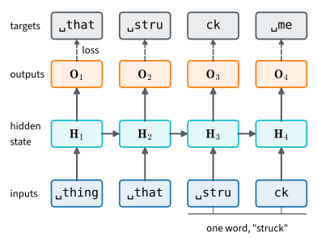

# Recurrent Neural Networks
:label:`sec_rnn`

The count-based language models of :numref:`sec_language-model` predict each
token from a short window of immediate predecessors. A trigram model conditions
only on the two preceding tokens; anything earlier in the document has zero
influence on its prediction. Simply widening the window quickly hits a wall: a
count table spanning 20 BPE tokens would have to track $1024^{20} \approx
10^{60}$ contexts, and even a neural network reading a fixed window of $m$
concatenated token embeddings :cite:`Bengio.Ducharme.Vincent.ea.2003` remains
blind to any token $m + 1$ steps back while growing linearly in parameter count
with $m$.

In :numref:`sec_sequence`, we introduced a fundamentally different approach: a
*latent* autoregressive model that compresses the entire history into a
fixed-size *hidden state* vector $\mathbf{h}_{t-1}$ and predicts the next token
from that summary,

$$P(x_t \mid x_{<t}) \approx P(x_t \mid \mathbf{h}_{t-1}), \qquad \mathbf{h}_t = g(\mathbf{h}_{t-1}, x_t).$$
:eqlabel:`eq_ht_xt`

Under this recurrence, the computational cost per step stays constant no matter
how long the prefix becomes. A *recurrent neural network* (RNN) parameterizes
the transition function $g$ with a neural network layer whose weights are
shared across all time steps :cite:`elman1990finding`. (Note that a *hidden
state* carried across time steps differs from a feedforward *hidden layer*
sitting between input and output within a single step.) In this section, we
formulate the RNN language model, tally its parameters and compute, and
implement it both from scratch and with high-level framework layers on *The
Time Machine*.

```{.python .input}
%load_ext d2lbook.tab
tab.interact_select('mxnet', 'pytorch', 'tensorflow', 'jax')
```

```{.python .input #rnn-implementation-implementing-rnn-language-models}
%%tab mxnet
import math
import numpy as np
from mxnet import autograd, gluon, init, np as mnp, npx
from mxnet.gluon import nn
from d2l import mxnet as d2l
npx.set_np()
```

```{.python .input #rnn-implementation-implementing-rnn-language-models}
%%tab pytorch
import math
import numpy as np
import torch
from torch import nn
from torch.nn import functional as F
from d2l import torch as d2l
```

```{.python .input #rnn-implementation-implementing-rnn-language-models}
%%tab tensorflow
import math
import numpy as np
import tensorflow as tf
from d2l import tensorflow as d2l
```

```{.python .input #rnn-implementation-implementing-rnn-language-models}
%%tab jax
import math
import numpy as np
import jax
from jax import numpy as jnp
from flax import nnx
import optax
from d2l import jax as d2l
```

```{.python .input #rnn-implementation-implementing-rnns-1}
%%tab jax
import random
```

## Recurrent Neural Networks with Hidden States
:label:`subsec_rnn_w_hidden_states`

An RNN is easiest to understand by starting from a single-hidden-layer MLP
(:numref:`sec_mlp`) and adding one recurrent connection. Given a minibatch of
$b$ examples with $d$ features each, $\mathbf{X} \in \mathbb{R}^{b \times d}$
(we use $b$ for batch size throughout this chapter because $n$ denotes $n$-gram
order), an ordinary hidden layer with activation function $\phi$ computes

$$\mathbf{H} = \phi(\mathbf{X} \mathbf{W}_{\textrm{xh}} + \mathbf{b}_\textrm{h}),$$
:eqlabel:`rnn_h_without_state`

with $\mathbf{W}_{\textrm{xh}} \in \mathbb{R}^{d \times h}$ and
$\mathbf{b}_\textrm{h} \in \mathbb{R}^{1 \times h}$, followed by an output
projection $\mathbf{O} = \mathbf{H} \mathbf{W}_{\textrm{hq}} +
\mathbf{b}_\textrm{q}$ into $q$ logits.

Now suppose we receive a sequence of minibatch inputs
$\mathbf{X}_t \in \mathbb{R}^{b \times d}$ indexed by time step $t$. To let the
hidden representation remember earlier steps, we feed the previous hidden state
$\mathbf{H}_{t-1} \in \mathbb{R}^{b \times h}$ back into the layer via a
recurrent weight matrix
$\mathbf{W}_{\textrm{hh}} \in \mathbb{R}^{h \times h}$:

$$
\begin{aligned}
\mathbf{H}_t &= \phi(\mathbf{X}_t \mathbf{W}_{\textrm{xh}} + \mathbf{H}_{t-1} \mathbf{W}_{\textrm{hh}} + \mathbf{b}_\textrm{h}), \\
\mathbf{O}_t &= \mathbf{H}_t \mathbf{W}_{\textrm{hq}} + \mathbf{b}_\textrm{q}.
\end{aligned}
$$
:eqlabel:`rnn_h_with_state`

Because the same five parameter tensors—$\mathbf{W}_{\textrm{xh}}$,
$\mathbf{W}_{\textrm{hh}}$, $\mathbf{b}_\textrm{h}$ in the recurrent layer and
$\mathbf{W}_{\textrm{hq}}$, $\mathbf{b}_\textrm{q}$ in the output layer—are
reused at every step (starting from $\mathbf{H}_0 = \mathbf{0}$), the parameter
count is completely independent of sequence length (:numref:`fig_rnn`). Viewed
in unrolled form, an RNN running over $T$ steps is a $T$-layer feedforward
network whose layers all share the same weights.


:label:`fig_rnn`

Notice that the two matrix products in :eqref:`rnn_h_with_state` equal a single
product of the horizontally concatenated inputs with the vertically stacked
weights:

$$[\mathbf{X}_t, \mathbf{H}_{t-1}] \begin{bmatrix} \mathbf{W}_{\textrm{xh}} \\ \mathbf{W}_{\textrm{hh}} \end{bmatrix} = \mathbf{X}_t \mathbf{W}_{\textrm{xh}} + \mathbf{H}_{t-1} \mathbf{W}_{\textrm{hh}}.$$

Libraries nevertheless keep the two products separate because during training
all inputs $\mathbf{X}_1, \ldots, \mathbf{X}_T$ are known up front, allowing
$\mathbf{X}_t \mathbf{W}_{\textrm{xh}}$ across all $T$ steps to be batched
outside the sequential time loop (exercise :exref:`ex_rnn-input-product`).

Furthermore, a recurrent state can solve tasks that are impossible for *any*
fixed-window model, such as reporting at every step whether the running count
of ones in a bit stream is even or odd (parity): flipping a bit older than any
fixed window $m$ reverses the true parity while leaving the last $m$ bits
unchanged, whereas a two-unit recurrent state tracks parity over arbitrary
lengths.

### Constant Memory per Step
:label:`subsec_rnn-constant-memory`

Because computing $\mathbf{H}_t$ requires only $\mathbf{H}_{t-1}$ and
$\mathbf{X}_t$, both memory and computation per step remain constant regardless
of sequence length: with $h = 128$ `float32` hidden units, the state of a
sequence occupies just 512 bytes whether the model has read ten tokens or a
million. That constant footprint is also an inherent *lossy* bottleneck—every
detail remembered from the prefix must pass through those 512 bytes, unlike
*attention* (:numref:`chap_attention`), which retains representations of every
past token at a cost that grows with sequence length.

### RNN Language Models and Teacher Forcing
:label:`subsec_teacher-forcing`

An RNN language model consumes one token id per step and predicts a
distribution over the next token across all $q = |\mathcal{V}|$ vocabulary
entries (:numref:`fig_rnn_train`). At step $t$, the $b$ token ids in the
minibatch look up their corresponding rows in a learned embedding table
$\mathbf{E} \in \mathbb{R}^{|\mathcal{V}| \times d}$ to form
$\mathbf{X}_t \in \mathbb{R}^{b \times d}$ (mathematically identical to
multiplying a $b \times |\mathcal{V}|$ one-hot matrix by $\mathbf{E}$, without
materializing or multiplying by zeros). The recurrent layer updates
$\mathbf{H}_t$, and $\textrm{softmax}(\mathbf{O}_t)$ defines
$P(x_{t+1} \mid x_{\leq t})$ in the chain-rule factorization
:eqref:`eq_lm_factorization`.


:label:`fig_rnn_train`

Where do the parameters and FLOPs sit? For our BPE vocabulary of
$|\mathcal{V}| = 1{,}027$ ids (1,024 BPE tokens plus three special tokens),
embedding width $d = 64$, and hidden size $h = 128$:

| part | shape | parameters |
|---|---|--:|
| embedding table $\mathbf{E}$ | $1{,}027 \times 64$ | 65,728 |
| input weight $\mathbf{W}_\textrm{xh}$ | $64 \times 128$ | 8,192 |
| recurrent weight $\mathbf{W}_\textrm{hh}$ | $128 \times 128$ | 16,384 |
| hidden bias $\mathbf{b}_\textrm{h}$ | $128$ | 128 |
| output weight $\mathbf{W}_\textrm{hq}$ | $128 \times 1{,}027$ | 131,456 |
| output bias $\mathbf{b}_\textrm{q}$ | $1{,}027$ | 1,027 |
| total | | 222,915 |

The recurrent layer accounts for just 24,704 parameters (11% of the model) and
$24{,}576$ multiply-adds per token, whereas the vocabulary-sized embedding and
output layers hold 89% of the parameters and the output projection alone costs
$128 \cdot 1{,}027 = 131{,}456$ multiply-adds.

During training, the input at every step is the *ground-truth* token from the
corpus regardless of what the model predicted at the previous step—a regime
known as *teacher forcing*. Because all ground-truth inputs in a window are
known up front, the entire window's cross-entropy loss (the logarithm of
perplexity) is evaluated in one forward pass. During generation, however, each
sampled or greedy token is fed back in as the next input, exposing the rollout
to its own errors just like our multistep sine-wave forecast in
:numref:`sec_sequence`.

## An RNN Language Model from Scratch
:label:`sec_rnn-scratch`

We now implement the three components of this language model—the recurrent
cell, the embedding lookup, and the output layer—from scratch.

### The Recurrent Cell

The `RNNScratch` class stores the parameters of :eqref:`rnn_h_with_state` with
$\phi = \tanh$. We draw $\mathbf{W}_{\textrm{xh}}$ and
$\mathbf{W}_{\textrm{hh}}$ from $\mathcal{N}(0, \sigma^2)$ with $\sigma = 0.01$
and initialize $\mathbf{b}_\textrm{h}$ to zero. At this scale, the spectral
radius of $\mathbf{W}_{\textrm{hh}}$ is roughly $\sigma\sqrt{h} \approx 0.11$,
so an untrained cell decays its past state rapidly and leaves training to grow
recurrent weights where needed.

:begin_tab:`tensorflow`
Each weight gets its own initializer object. An unseeded Keras initializer
returns the same values every time it is called, so one shared initializer
would make the first rows of $\mathbf{W}_{\textrm{hh}}$ a copy of
$\mathbf{W}_{\textrm{xh}}$.
:end_tab:

```{.python .input #rnn-implementation-the-recurrent-cell-1}
%%tab mxnet
class RNNScratch(d2l.Module):  #@save
    """The RNN model implemented from scratch."""
    def __init__(self, num_inputs, num_hiddens, sigma=0.01):
        super().__init__()
        self.save_hyperparameters()
        self.W_xh = gluon.Parameter('W_xh', shape=(num_inputs, num_hiddens),
                                    init=init.Normal(sigma))
        self.W_hh = gluon.Parameter('W_hh', shape=(num_hiddens, num_hiddens),
                                    init=init.Normal(sigma))
        self.b_h = gluon.Parameter('b_h', shape=(num_hiddens,),
                                   init=init.Zero())
        self.initialize()
```

```{.python .input #rnn-implementation-the-recurrent-cell-1}
%%tab pytorch
class RNNScratch(d2l.Module):  #@save
    """The RNN model implemented from scratch."""
    def __init__(self, num_inputs, num_hiddens, sigma=0.01):
        super().__init__()
        self.save_hyperparameters()
        self.W_xh = nn.Parameter(
            d2l.randn(num_inputs, num_hiddens) * sigma)
        self.W_hh = nn.Parameter(
            d2l.randn(num_hiddens, num_hiddens) * sigma)
        self.b_h = nn.Parameter(d2l.zeros(num_hiddens))
```

```{.python .input #rnn-implementation-the-recurrent-cell-1}
%%tab tensorflow
class RNNScratch(d2l.Module):  #@save
    """The RNN model implemented from scratch."""
    def __init__(self, num_inputs, num_hiddens, sigma=0.01):
        super().__init__()
        self.save_hyperparameters()
        self.W_xh = self.add_weight(  # One initializer per weight
            name='W_xh', shape=(num_inputs, num_hiddens),
            initializer=tf.keras.initializers.RandomNormal(stddev=sigma))
        self.W_hh = self.add_weight(
            name='W_hh', shape=(num_hiddens, num_hiddens),
            initializer=tf.keras.initializers.RandomNormal(stddev=sigma))
        self.b_h = self.add_weight(name='b_h', shape=(num_hiddens,),
                                   initializer='zeros')
```

```{.python .input #rnn-implementation-the-recurrent-cell-1}
%%tab jax
class RNNScratch(nnx.Module):  #@save
    """The RNN model implemented from scratch."""
    def __init__(self, num_inputs, num_hiddens, sigma=0.01, rngs=None):
        rngs = nnx.Rngs(random.getrandbits(32)) if rngs is None else rngs
        self.num_inputs, self.num_hiddens = num_inputs, num_hiddens
        self.sigma = sigma
        self.W_xh = nnx.Param(
            rngs.params.normal((num_inputs, num_hiddens)) * sigma)
        self.W_hh = nnx.Param(
            rngs.params.normal((num_hiddens, num_hiddens)) * sigma)
        self.b_h = nnx.Param(jnp.zeros(num_hiddens))
```

The forward pass loops over the leading time axis of `inputs`—of shape
(`num_steps`, `batch_size`, `num_inputs`)—initializing the hidden state to
zeros when none is supplied and returning the list of all per-step hidden
states alongside the final state.

:begin_tab:`mxnet`
The MXNet version reads the values of the parameters with `data()`, here and
in the language model below.
:end_tab:

:begin_tab:`jax`
When the training step is compiled, the Python loop is unrolled into one
copy of the cell per time step, so the compilation time grows with the
number of steps. The concise implementation at the end of this section
uses `nnx.RNN`, which runs the cell under `jax.lax.scan` and compiles it
only once.
:end_tab:

```{.python .input #rnn-implementation-the-recurrent-cell-2}
%%tab mxnet
@d2l.add_to_class(RNNScratch)  #@save
def forward(self, inputs, state=None):
    if state is None:
        # Initial state with shape: (batch_size, num_hiddens)
        state = d2l.zeros((inputs.shape[1], self.num_hiddens),
                          ctx=inputs.ctx)
    outputs = []
    for X in inputs:  # Shape of inputs: (num_steps, batch_size, num_inputs)
        state = d2l.tanh(d2l.matmul(X, self.W_xh.data()) +
                         d2l.matmul(state, self.W_hh.data()) +
                         self.b_h.data())
        outputs.append(state)
    return outputs, state
```

```{.python .input #rnn-implementation-the-recurrent-cell-2}
%%tab pytorch
@d2l.add_to_class(RNNScratch)  #@save
def forward(self, inputs, state=None):
    if state is None:
        # Initial state with shape: (batch_size, num_hiddens)
        state = d2l.zeros((inputs.shape[1], self.num_hiddens),
                          device=inputs.device)
    outputs = []
    for X in inputs:  # Shape of inputs: (num_steps, batch_size, num_inputs)
        state = d2l.tanh(d2l.matmul(X, self.W_xh) +
                         d2l.matmul(state, self.W_hh) + self.b_h)
        outputs.append(state)
    return outputs, state
```

```{.python .input #rnn-implementation-the-recurrent-cell-2}
%%tab tensorflow
@d2l.add_to_class(RNNScratch)  #@save
def forward(self, inputs, state=None):
    if state is None:
        # Initial state with shape: (batch_size, num_hiddens)
        state = tf.zeros((tf.shape(inputs)[1], self.num_hiddens))
    outputs = []
    for X in tf.unstack(inputs):  # Shape: (num_steps, batch_size, num_inputs)
        state = d2l.tanh(d2l.matmul(X, self.W_xh) +
                         d2l.matmul(state, self.W_hh) + self.b_h)
        outputs.append(state)
    return outputs, state
```

```{.python .input #rnn-implementation-the-recurrent-cell-2}
%%tab jax
@d2l.add_to_class(RNNScratch)  #@save
def __call__(self, inputs, state=None):
    if state is None:
        # Initial state with shape: (batch_size, num_hiddens)
        state = jnp.zeros((inputs.shape[1], self.num_hiddens))
    outputs = []
    for X in inputs:  # Shape of inputs: (num_steps, batch_size, num_inputs)
        state = d2l.tanh(d2l.matmul(X, self.W_xh) +
                         d2l.matmul(state, self.W_hh) + self.b_h)
        outputs.append(state)
    return outputs, state
```

To verify the recurrent cell's dimensions, we first run `RNNScratch` forward on
a dummy minibatch `X` of shape `(num_steps, batch_size, num_inputs)`.

```{.python .input #rnn-implementation-the-recurrent-cell-3}
batch_size, num_inputs, num_hiddens, num_steps = 2, 16, 32, 100
rnn = RNNScratch(num_inputs, num_hiddens)
X = d2l.ones((num_steps, batch_size, num_inputs))
outputs, state = rnn(X)
```

We now define a `check_shape` helper (reused throughout later chapters) to
confirm that stacking `outputs` produces `(num_steps, batch_size, num_hiddens)`
and `state` has shape `(batch_size, num_hiddens)`.

```{.python .input #rnn-implementation-the-recurrent-cell-4}
def check_shape(a, shape):  #@save
    """Check the shape of a tensor."""
    assert a.shape == shape, \
            f'tensor\'s shape {a.shape} != expected shape {shape}'

check_shape(d2l.stack(outputs, 0), (num_steps, batch_size, num_hiddens))
check_shape(state, (batch_size, num_hiddens))
```

### The Embedding and Output Layers

`RNNLMScratch` wraps a recurrent cell `rnn` with an embedding table `E` and an
output projection (`W_hq`, `b_q`), plus optional dropout rates on the
embeddings and hidden states. Embedding rows are initialized from
$\mathcal{N}(0, 1)$ (matching unit-scale one-hot inputs) while output weights
use scale $\sigma = 0.01$ with zero bias, so an untrained model produces
near-zero logits and an initial perplexity close to $|\mathcal{V}|$. Subclassing
`d2l.Classifier` provides mean cross-entropy loss, and overriding
`validation_step` records that loss directly so its exponential gives
validation perplexity.

```{.python .input #rnn-implementation-from-token-ids-to-embeddings-1}
%%tab mxnet
class RNNLMScratch(d2l.Classifier):  #@save
    """The RNN-based language model implemented from scratch."""
    def __init__(self, rnn, vocab_size, lr=0.01, dropout=0, emb_dropout=0):
        super().__init__()
        self.save_hyperparameters()
        self.sigma = getattr(rnn, 'sigma', 0.01)  # Scale of the output weights
        self.init_params()

    def init_params(self):
        self.E = gluon.Parameter(
            'E', shape=(self.vocab_size, self.rnn.num_inputs),
            init=init.Normal(1))
        self.W_hq = gluon.Parameter(
            'W_hq', shape=(self.rnn.num_hiddens, self.vocab_size),
            init=init.Normal(self.sigma))
        self.b_q = gluon.Parameter('b_q', shape=(self.vocab_size,),
                                   init=init.Zero())
        for param in (self.E, self.W_hq, self.b_q):  # The cell has its own
            param.initialize()

    def validation_step(self, batch):
        return self.loss(self(*batch[:-1]), batch[-1])
```

```{.python .input #rnn-implementation-from-token-ids-to-embeddings-1}
%%tab pytorch
class RNNLMScratch(d2l.Classifier):  #@save
    """The RNN-based language model implemented from scratch."""
    def __init__(self, rnn, vocab_size, lr=0.01, dropout=0, emb_dropout=0):
        super().__init__()
        self.save_hyperparameters()
        self.sigma = getattr(rnn, 'sigma', 0.01)  # Scale of the output weights
        self.init_params()

    def init_params(self):
        self.E = nn.Parameter(
            d2l.randn(self.vocab_size, self.rnn.num_inputs))
        self.W_hq = nn.Parameter(
            d2l.randn(self.rnn.num_hiddens, self.vocab_size) * self.sigma)
        self.b_q = nn.Parameter(d2l.zeros(self.vocab_size))

    def validation_step(self, batch):
        return self.loss(self(*batch[:-1]), batch[-1])
```

```{.python .input #rnn-implementation-from-token-ids-to-embeddings-1}
%%tab tensorflow
class RNNLMScratch(d2l.Classifier):  #@save
    """The RNN-based language model implemented from scratch."""
    def __init__(self, rnn, vocab_size, lr=0.01, dropout=0, emb_dropout=0):
        super().__init__()
        self.save_hyperparameters()
        self.sigma = getattr(rnn, 'sigma', 0.01)  # Scale of the output weights
        self.init_params()

    def init_params(self):
        self.E = self.add_weight(
            name='E', shape=(self.vocab_size, self.rnn.num_inputs),
            initializer=tf.keras.initializers.RandomNormal(stddev=1))
        self.W_hq = self.add_weight(
            name='W_hq', shape=(self.rnn.num_hiddens, self.vocab_size),
            initializer=tf.keras.initializers.RandomNormal(stddev=self.sigma))
        self.b_q = self.add_weight(name='b_q', shape=(self.vocab_size,),
                                   initializer='zeros')

    def validation_step(self, batch):
        return self.loss(self(*batch[:-1], training=False), batch[-1])
```

```{.python .input #rnn-implementation-from-token-ids-to-embeddings-1}
%%tab jax
class RNNLMScratch(d2l.Classifier):  #@save
    """The RNN-based language model implemented from scratch."""
    def __init__(self, rnn, vocab_size, lr=0.01, dropout=0, emb_dropout=0,
                 rngs=None):
        super().__init__()
        self.save_hyperparameters(ignore=['rnn', 'rngs'])
        self.rnn = rnn
        rngs = nnx.Rngs(random.getrandbits(32)) if rngs is None else rngs
        sigma = getattr(rnn, 'sigma', 0.01)  # Scale of the output weights
        self.E = nnx.Param(rngs.params.normal((vocab_size, rnn.num_inputs)))
        self.W_hq = nnx.Param(rngs.params.normal(
            (rnn.num_hiddens, vocab_size)) * sigma)
        self.b_q = nnx.Param(jnp.zeros(vocab_size))
        self.drop = nnx.Dropout(dropout, rngs=rngs)
        self.emb_drop = nnx.Dropout(emb_dropout, rngs=rngs)

    def validation_step(self, batch):
        return self.loss(self(*batch[:-1]), batch[-1])
```

Because the data loader yields minibatches of shape (`batch_size`,
`num_steps`), `embedding` transposes the token ids before indexing `E`,
returning a (`num_steps`, `batch_size`, `num_inputs`) tensor whose leading axis
is time.

```{.python .input #rnn-implementation-from-token-ids-to-embeddings-2}
%%tab mxnet
@d2l.add_to_class(RNNLMScratch)  #@save
def embedding(self, X):
    # Output shape: (num_steps, batch_size, num_inputs)
    return self.E.data()[X.T]
```

```{.python .input #rnn-implementation-from-token-ids-to-embeddings-2}
%%tab pytorch
@d2l.add_to_class(RNNLMScratch)  #@save
def embedding(self, X):
    # Output shape: (num_steps, batch_size, num_inputs)
    return self.E[X.T]
```

```{.python .input #rnn-implementation-from-token-ids-to-embeddings-2}
%%tab tensorflow
@d2l.add_to_class(RNNLMScratch)  #@save
def embedding(self, X):
    # Output shape: (num_steps, batch_size, num_inputs)
    return tf.gather(self.E, tf.transpose(X))
```

```{.python .input #rnn-implementation-from-token-ids-to-embeddings-2}
%%tab jax
@d2l.add_to_class(RNNLMScratch)  #@save
def embedding(self, X):
    # Output shape: (num_steps, batch_size, num_inputs)
    return self.E[X.T]
```

`output_layer` stacks the per-step states into shape (`batch_size`,
`num_steps`, `num_hiddens`) and applies the shared output projection in a
single batched matrix product, while `forward` chains embedding lookup,
dropout, the recurrent cell, and the output projection.

```{.python .input #rnn-implementation-the-output-layer-1}
%%tab mxnet
@d2l.add_to_class(RNNLMScratch)  #@save
def output_layer(self, rnn_outputs):
    # A list of per-step states, or a tensor whose first axis is time
    H = d2l.stack(list(rnn_outputs), 1)  # (batch_size, num_steps, num_hiddens)
    return d2l.matmul(H, self.W_hq.data()) + self.b_q.data()

@d2l.add_to_class(RNNLMScratch)  #@save
def forward(self, X, state=None):
    # npx.dropout is active only inside autograd.record, that is, in training
    embs = npx.dropout(self.embedding(X), p=self.emb_dropout)
    rnn_outputs, _ = self.rnn(embs, state)
    H = d2l.stack(list(rnn_outputs), 0)  # (num_steps, batch_size, num_hiddens)
    return self.output_layer(npx.dropout(H, p=self.dropout))
```

```{.python .input #rnn-implementation-the-output-layer-1}
%%tab pytorch
@d2l.add_to_class(RNNLMScratch)  #@save
def output_layer(self, rnn_outputs):
    # A list of per-step states, or a tensor whose first axis is time
    H = d2l.stack(list(rnn_outputs), 1)  # (batch_size, num_steps, num_hiddens)
    return d2l.matmul(H, self.W_hq) + self.b_q

@d2l.add_to_class(RNNLMScratch)  #@save
def forward(self, X, state=None):
    embs = F.dropout(self.embedding(X), self.emb_dropout, self.training)
    rnn_outputs, _ = self.rnn(embs, state)
    H = d2l.stack(list(rnn_outputs), 0)  # (num_steps, batch_size, num_hiddens)
    return self.output_layer(F.dropout(H, self.dropout, self.training))
```

```{.python .input #rnn-implementation-the-output-layer-1}
%%tab tensorflow
@d2l.add_to_class(RNNLMScratch)  #@save
def output_layer(self, rnn_outputs):
    # A list of per-step states, or a tensor whose first axis is time
    H = d2l.stack(list(rnn_outputs), 1)  # (batch_size, num_steps, num_hiddens)
    return d2l.matmul(H, self.W_hq) + self.b_q

@d2l.add_to_class(RNNLMScratch)  #@save
def forward(self, X, state=None):
    embs = self.embedding(X)
    if self.training:  # tf.nn.dropout is always active; apply it in training
        embs = tf.nn.dropout(embs, self.emb_dropout)
    rnn_outputs, _ = self.rnn(embs, state)
    if self.training:  # A list of per-step states (scratch) or one tensor
        rnn_outputs = tf.nest.map_structure(
            lambda H: tf.nn.dropout(H, self.dropout), rnn_outputs)
    return self.output_layer(rnn_outputs)
```

```{.python .input #rnn-implementation-the-output-layer-1}
%%tab jax
@d2l.add_to_class(RNNLMScratch)  #@save
def output_layer(self, rnn_outputs):
    # A list of per-step states, or a tensor whose first axis is time
    H = d2l.stack(list(rnn_outputs), 1)  # (batch_size, num_steps, num_hiddens)
    return d2l.matmul(H, self.W_hq) + self.b_q

@d2l.add_to_class(RNNLMScratch)  #@save
def forward(self, X, state=None):
    embs = self.emb_drop(self.embedding(X))
    rnn_outputs, _ = self.rnn(embs, state)
    H = d2l.stack(list(rnn_outputs), 0)  # (num_steps, batch_size, num_hiddens)
    return self.output_layer(self.drop(H))
```

Passing a dummy minibatch of token indices of shape `(batch_size, num_steps)`
through `RNNLMScratch` confirms that the returned logits tensor `outputs` has
shape `(batch_size, num_steps, vocab_size)`.

```{.python .input #rnn-implementation-the-output-layer-2}
%%tab pytorch, mxnet, tensorflow
model = RNNLMScratch(rnn, vocab_size=1024)
outputs = model(d2l.ones((batch_size, num_steps), dtype=d2l.int64))
check_shape(outputs, (batch_size, num_steps, 1024))
```

```{.python .input #rnn-implementation-the-output-layer-2}
%%tab jax
model = RNNLMScratch(rnn, vocab_size=1024)
outputs = model(d2l.ones((batch_size, num_steps), dtype=d2l.int32))
check_shape(outputs, (batch_size, num_steps, 1024))
```

## Gradient Clipping

Because an unrolled RNN applies the same transition Jacobian across $T$ steps,
gradients can shrink or grow exponentially with $T$ (:numref:`sec_bptt`). A
sudden gradient spike moves the parameters by Euclidean distance
$\eta\|\mathbf{g}\|$, overshooting the local region where the first-order
Taylor approximation holds and undoing dozens of updates in a single step.
Rather than shrinking $\eta$ across the board, *gradient clipping* caps the
global gradient norm (computed jointly over all model parameters) at a
threshold $\theta$ by projecting $\mathbf{g}$ onto the ball of radius $\theta$:

$$\mathbf{g} \leftarrow \min\left(1, \frac{\theta}{\|\mathbf{g}\|}\right) \mathbf{g}.$$
:eqlabel:`eq_grad_clipping`

Whenever `gradient_clip_val` is positive, `d2l.Trainer` (:numref:`sec_oo-design`)
applies :eqref:`eq_grad_clipping` right after backpropagation and before the
optimizer step.

:begin_tab:`mxnet, pytorch`
The method below rescales each parameter's gradient in place.
:end_tab:

:begin_tab:`tensorflow`
The method below returns the (possibly rescaled) gradients, and the compiled
training step hands them to the optimizer.
:end_tab:

:begin_tab:`jax`
The JAX trainer updates the parameters with an optax transformation inside
its compiled training step, so the clipping goes there too:
`prepare_optimizer` turns `clip_gradients` into an optax transformation and
chains it in front of the model's optimizer.
:end_tab:

```{.python .input #rnn-implementation-gradient-clipping}
%%tab mxnet
@d2l.add_to_class(d2l.Trainer)  #@save
def clip_gradients(self, grad_clip_val, model):
    params = [p.data() for p in model.collect_params().values()
              if p.grad_req != 'null']
    norm = mnp.sqrt(sum((p.grad ** 2).sum() for p in params))
    scale = mnp.minimum(grad_clip_val / norm, 1.0)  # no `if` on the host
    for param in params:
        param.grad[:] *= scale
```

```{.python .input #rnn-implementation-gradient-clipping}
%%tab pytorch
@d2l.add_to_class(d2l.Trainer)  #@save
def clip_gradients(self, grad_clip_val, model):
    params = [p for p in model.parameters() if p.requires_grad]
    norm = torch.sqrt(sum(torch.sum(p.grad ** 2) for p in params))
    scale = torch.clamp(grad_clip_val / norm, max=1.0)  # no `if` on the host
    for param in params:
        param.grad.mul_(scale)
```

```{.python .input #rnn-implementation-gradient-clipping}
%%tab tensorflow
@d2l.add_to_class(d2l.Trainer)  #@save
def clip_gradients(self, grad_clip_val, grads):
    grad_clip_val = tf.constant(grad_clip_val, dtype=tf.float32)
    new_grads = [tf.convert_to_tensor(grad) if isinstance(
        grad, tf.IndexedSlices) else grad for grad in grads]
    norm = tf.math.sqrt(sum((tf.reduce_sum(grad ** 2)) for grad in new_grads))
    scale = tf.minimum(1.0, grad_clip_val / norm)
    return [grad * scale for grad in new_grads]
```

```{.python .input #rnn-implementation-gradient-clipping}
%%tab jax
def clip_gradients(grad_clip_val, grads):  #@save
    """Rescale the gradients to global norm at most grad_clip_val."""
    grad_leaves, _ = jax.tree_util.tree_flatten(grads)
    norm = jnp.sqrt(sum(jnp.vdot(x, x) for x in grad_leaves))
    clip = lambda grad: jnp.where(norm < grad_clip_val,
                                  grad, grad * (grad_clip_val / norm))
    return jax.tree_util.tree_map(clip, grads)

@d2l.add_to_class(d2l.Trainer)  #@save
def prepare_optimizer(self, model):
    val = self.gradient_clip_val
    key = (jax.tree.structure(model), type(model).configure_optimizers, val)
    if key not in d2l.optimizer_cache:
        tx = model.configure_optimizers()
        if val > 0:  # The closure holds only val, not the trainer
            clip = lambda grads, params: clip_gradients(val, grads)
            tx = optax.chain(optax.stateless(clip), tx)
        d2l.optimizer_cache.clear()
        d2l.optimizer_cache[key] = tx
    self.optim = nnx.Optimizer(model, d2l.optimizer_cache[key],
                               wrt=nnx.Param)
```

## Training and Evaluation

`d2l.TimeMachine` (:numref:`sec_language-model`) encodes the 65,741 BPE tokens
of the novella and yields minibatches of $T = 32$ overlapping windows—50,000
for training and 5,000 for validation, separated by a 32-window gap so no
validation token appears as a training target. Because each window starts from
$\mathbf{H}_0 = \mathbf{0}$, backpropagation is *truncated* to 32 steps
(:numref:`sec_bptt`).

```{.python .input #rnn-implementation-training-1}
data = d2l.TimeMachine(batch_size=1024, num_steps=32)
```

### A Plain Model and the Role of Clipping

We first instantiate our 222,915-parameter baseline model ($d = 64$, $h = 128$,
no dropout) with SGD learning rate $\eta = 4$.

```{.python .input #rnn-implementation-training-2}
%%tab pytorch, mxnet, jax
rnn = RNNScratch(num_inputs=64, num_hiddens=128)
model = RNNLMScratch(rnn, vocab_size=len(data.vocab), lr=4)
```

```{.python .input #rnn-implementation-training-2}
%%tab tensorflow
with d2l.try_gpu():
    rnn = RNNScratch(num_inputs=64, num_hiddens=128)
    model = RNNLMScratch(rnn, vocab_size=len(data.vocab), lr=4)
```

Before training begins, we snapshot a NumPy copy of the random initial
embedding matrix `model.E` in `E_init` so we can measure how far SGD moves it.

```{.python .input #rnn-implementation-a-plain-model-1}
%%tab mxnet
E_init = d2l.numpy(model.E.data()).copy()
```

```{.python .input #rnn-implementation-a-plain-model-1}
%%tab pytorch, tensorflow
E_init = d2l.numpy(model.E).copy()
```

```{.python .input #rnn-implementation-a-plain-model-1}
%%tab jax
E_init = d2l.numpy(model.E[...]).copy()
```

We next evaluate the untrained model's initial validation perplexity `ppl_init`
and then train `model` for 10 epochs with gradient clipping at
`gradient_clip_val=1`.

```{.python .input #rnn-implementation-training-3}
trainer = d2l.Trainer(max_epochs=10, gradient_clip_val=1, num_gpus=1)
ppl_init = math.exp(trainer.evaluate(model, data)['loss'])
print(f'initial validation perplexity {ppl_init:.0f}')
trainer.fit(model, data)
```

Exponentiating the final validation cross-entropy loss
`trainer.history['val_loss'][-1]` gives the trained baseline's validation
perplexity `ppl_plain`.

```{.python .input #rnn-implementation-training-4}
ppl_plain = math.exp(trainer.history['val_loss'][-1])
print(f'validation perplexity {ppl_plain:.1f}')
```

Initial validation perplexity sits near $|\mathcal{V}| = 1{,}027$, and after
ten epochs the clipped model converges smoothly to a validation perplexity
around 90–100 (while training perplexity drops below half that value as the
222,915 parameters begin overfitting the 50,000 training tokens).

To see why gradient clipping is essential at $\eta = 4$, we define a helper
`unclipped_model()` that constructs a fresh baseline instance with the exact
same architecture and learning rate.

```{.python .input #rnn-implementation-a-plain-model-2}
%%tab pytorch, mxnet, jax
def unclipped_model():
    return RNNLMScratch(RNNScratch(num_inputs=64, num_hiddens=128),
                        vocab_size=len(data.vocab), lr=4)
```

```{.python .input #rnn-implementation-a-plain-model-2}
%%tab tensorflow
def unclipped_model():
    with d2l.try_gpu():
        return RNNLMScratch(RNNScratch(num_inputs=64, num_hiddens=128),
                            vocab_size=len(data.vocab), lr=4)
```

We now train three independent unseeded instances without gradient clipping,
recording each run's epoch-by-epoch validation perplexities in `ppl_runs` and
reporting its peak and final values.

```{.python .input #rnn-implementation-a-plain-model-3}
ppl_runs = []
for run in range(3):  # Three unseeded runs, no clipping
    trainer_unclipped = d2l.Trainer(max_epochs=10, num_gpus=1)
    trainer_unclipped.board.display = False  # One plot for all runs below
    trainer_unclipped.fit(unclipped_model(), data)
    ppls = [math.exp(loss) for loss in trainer_unclipped.history['val_loss']]
    ppl_runs.append(ppls)
    print(f'run {run + 1}: highest {max(ppls):.3g}, final {ppls[-1]:.3g}')
finals = [ppls[-1] for ppls in ppl_runs]
print(f'{sum(f > 2 * ppl_plain for f in finals)} of 3 runs end above twice '
      f'the clipped {ppl_plain:.3g}; finals from {min(finals):.3g} to '
      f'{max(finals):.3g}')
```

Plotting the three unclipped trajectories in `ppl_runs` against the clipped
baseline `ppl_clipped` on a logarithmic axis makes the instability
unmistakable.

```{.python .input #rnn-implementation-a-plain-model-4}
ppl_clipped = [math.exp(loss) for loss in trainer.history['val_loss']]
d2l.plot(list(range(1, 11)), [ppl_clipped] + ppl_runs, 'epoch',
         'validation perplexity', yscale='log',
         legend=['clipped', 'run 1', 'run 2', 'run 3'],
         legend_loc='outside', figsize=(5, 2.5))
```

Without clipping, mid-training gradient spikes send validation perplexity
jumping violently—sometimes above the untrained baseline of 1,027—and most
runs finish at more than twice the clipped model's perplexity. Converting our
clipped validation perplexity to bits per byte (:eqref:`eq_bpb`) divides
$\log_2 \textrm{ppl}$ by the average UTF-8 bytes per BPE token ($\approx 2.8$):

```{.python .input #rnn-implementation-training-5}
ids = d2l.numpy(data.X[data.num_train:data.num_train+data.num_val, 0]).tolist()
bytes_per_token = len(data.tokenizer.decode(ids).encode('utf-8')) / len(ids)
print(f'{bytes_per_token:.2f} bytes/token, '
      f'{math.log2(ppl_plain) / bytes_per_token:.2f} bits per byte')
```

### Embeddings under SGD and a Wider Model with Dropout

Inspecting how far each row of $\mathbf{E}$ moved over the ten epochs of SGD
exposes a second bottleneck. We first extract the trained embedding table into
a NumPy array `E_final`.

```{.python .input #rnn-implementation-embeddings-under-sgd-1}
%%tab mxnet
E_final = d2l.numpy(model.E.data())
```

```{.python .input #rnn-implementation-embeddings-under-sgd-1}
%%tab pytorch, tensorflow
E_final = d2l.numpy(model.E)
```

```{.python .input #rnn-implementation-embeddings-under-sgd-1}
%%tab jax
E_final = d2l.numpy(model.E[...])
```

Computing the relative Euclidean displacement `change` between `E_final` and
`E_init` across all vocabulary rows reveals how little each token vector moved.

```{.python .input #rnn-implementation-embeddings-under-sgd-2}
change = (((E_final - E_init) ** 2).sum(1) / (E_init ** 2).sum(1)) ** 0.5
print(f'mean change of an embedding row: {change.mean():.1%} of its length')
```

Because row $i$ receives a gradient only from positions where token $i$ occurs,
and the loss averages over all $1{,}024 \times 32 = 32{,}768$ tokens in a
minibatch, rare or moderate-frequency tokens receive tiny gradients under a
uniform SGD learning rate, leaving $\mathbf{E}$ almost frozen. While adaptive
optimizers like Adam (:numref:`sec_adam`) rescale per-coordinate step sizes to
move embeddings much further (explored in the exercises), we can also address
this directly within SGD: widening the embedding from $d = 64$ to $d = 512$
gives the densely updated input matrix $\mathbf{W}_{\textrm{xh}}$ a far richer
random feature basis, while adding dropout (0.1 on embeddings, 0.5 on hidden
states) curbs overfitting.

```{.python .input #rnn-implementation-a-wider-embedding-with-dropout-1}
%%tab pytorch, mxnet, jax
rnn = RNNScratch(num_inputs=512, num_hiddens=128)
model = RNNLMScratch(rnn, vocab_size=len(data.vocab), lr=4, dropout=0.5,
                     emb_dropout=0.1)
```

```{.python .input #rnn-implementation-a-wider-embedding-with-dropout-1}
%%tab tensorflow
with d2l.try_gpu():
    rnn = RNNScratch(num_inputs=512, num_hiddens=128)
    model = RNNLMScratch(rnn, vocab_size=len(data.vocab), lr=4, dropout=0.5,
                         emb_dropout=0.1)
```

We train this wider regularized model for 10 epochs using the same learning
rate `lr=4` and clipping threshold `gradient_clip_val=1`.

```{.python .input #rnn-implementation-a-wider-embedding-with-dropout-2}
trainer = d2l.Trainer(max_epochs=10, gradient_clip_val=1, num_gpus=1)
trainer.fit(model, data)
```

From the final validation loss we compute both the validation perplexity
`ppl_scratch` and the corresponding compression rate in bits per byte.

```{.python .input #rnn-implementation-a-wider-embedding-with-dropout-3}
ppl_scratch = math.exp(trainer.history['val_loss'][-1])
print(f'validation perplexity {ppl_scratch:.1f}, '
      f'{math.log2(ppl_scratch) / bytes_per_token:.2f} bits per byte')
```

Validation perplexity drops from roughly 90–100 down to around 60, cutting bits
per byte from 2.3–2.4 to roughly 2.1.

### Comparison with Kneser–Ney and Effective Context Horizon

How does 2.1 bits per byte compare against interpolated Kneser--Ney smoothing
(:numref:`subsec_kneser-ney`)? We first fit Kneser--Ney $n$-grams
($n = 2, 3, 4$) on the exact same 50,000 BPE training tokens and evaluate them
on `val[32:]`, where each token is scored as the final target of its 32-token
validation window.

```{.python .input #rnn-implementation-training-6}
first_tokens = d2l.numpy(data.X[:, 0]).tolist()  # First token of each window
train = first_tokens[:data.num_train]
val = first_tokens[data.num_train:data.num_train + data.num_val]
lp_kns = {n: d2l.kneser_ney(train, val, len(data.vocab), n)[32:]
          for n in (2, 3, 4)}
for n, lp in lp_kns.items():
    bits = -sum(lp) / len(lp) / math.log(2)
    print(f'KN {n}-gram: {bits / bytes_per_token:.2f} bits per byte')
lp_kn = lp_kns[3]
```

To score our trained RNN on the exact same held-out tokens `val[32:]`, we
select the slice `[start:stop]` of validation windows whose final target covers
`val[32:]`.

```{.python .input #rnn-implementation-comparison-with-kneser-ney-1}
start, stop = data.num_train, data.num_train + data.num_val - 32  # val[32:]
```

Running `model` in evaluation mode over `data.X[start:stop]` in batches of
1,024 windows collects the matrix `logp` of per-position target
log-probabilities across all 32 window steps.

```{.python .input #rnn-implementation-comparison-with-kneser-ney-2}
%%tab mxnet
X_val = data.X[start:stop].as_in_ctx(d2l.try_gpu())
Y_val = data.Y[start:stop].as_in_ctx(d2l.try_gpu())
logp = d2l.numpy(mnp.concatenate([  # Log-probability of every target
    npx.pick(npx.log_softmax(model(X_val[i:i + 1024])), Y_val[i:i + 1024])
    for i in range(0, len(X_val), 1024)]))
```

```{.python .input #rnn-implementation-comparison-with-kneser-ney-2}
%%tab pytorch
model.eval()
with torch.inference_mode():  # Log-probability of every target
    logp = d2l.numpy(torch.cat([
        F.log_softmax(model(X.to(d2l.try_gpu())), -1).gather(
            -1, Y.to(d2l.try_gpu())[..., None])[..., 0]
        for X, Y in zip(data.X[start:stop].split(1024),
                        data.Y[start:stop].split(1024))]))
```

```{.python .input #rnn-implementation-comparison-with-kneser-ney-2}
%%tab tensorflow
X_val, Y_val = data.X[start:stop], data.Y[start:stop]
logp = d2l.numpy(tf.concat([  # Log-probability of every target
    tf.gather(tf.nn.log_softmax(model(X_val[i:i + 1024], training=False)),
              Y_val[i:i + 1024], batch_dims=2)
    for i in range(0, len(X_val), 1024)], 0))
```

```{.python .input #rnn-implementation-comparison-with-kneser-ney-2}
%%tab jax
model_eval = nnx.view(model, deterministic=True, raise_if_not_found=False)
X_val, Y_val = data.X[start:stop], data.Y[start:stop]
logp = d2l.numpy(jnp.concatenate([  # Log-probability of every target
    jnp.take_along_axis(jax.nn.log_softmax(model_eval(X_val[i:i + 1024])),
                        Y_val[i:i + 1024, :, None], -1)[..., 0]
    for i in range(0, len(X_val), 1024)]))
```

Why does a recurrent network reading 32 tokens of history land near the same
$\approx 2.1$ bits per byte as a Kneser--Ney trigram that looks back only two
tokens? (Note that the two models still make genuinely complementary
predictions: each assigns higher probability than the other on roughly half of
all validation tokens, and a 50/50 linear mixture
$0.5\, P_\textrm{RNN} + 0.5\, P_\textrm{KN}$ :cite:`Mikolov.Kombrink.Burget.ea.2011`
improves over the standalone trigram by roughly 0.06 bits per byte.) To see
how much context the trained RNN actually uses, we plot its average validation
bits per byte at each window position $1, \ldots, 32$ against the Kneser--Ney
trigram baseline.

```{.python .input #rnn-implementation-comparison-with-kneser-ney-4}
bits = -logp.mean(0) / math.log(2) / bytes_per_token  # One per position
kn_bits = -sum(lp_kn) / len(lp_kn) / math.log(2) / bytes_per_token
positions = np.arange(1, data.num_steps + 1)
d2l.plot(positions, [bits, [kn_bits] * data.num_steps],
         'tokens of context', 'bits per byte', legend=['RNN', 'KN trigram'],
         figsize=(4.5, 3))
print('bits per byte with 1, 2, 3, 4, 8, 32 tokens of context:',
      [round(float(bits[k - 1]), 2) for k in (1, 2, 3, 4, 8, 32)])
```

The diagnostic curve explains the tie immediately: surprisal drops sharply from
1 to 3 tokens of context, then goes completely flat from position 4 through 32.
Although the hidden state *can* depend on all 32 tokens in the forward pass,
gradient-based training only taught it to exploit the last three—a phenomenon
we trace directly to vanishing gradients in :numref:`sec_bptt`.

## Text Generation

Once trained, our language model generates text autoregressively via `predict`:
it first warms up the hidden state on the user's prefix tokens, then generates
`num_tokens` continuation tokens by feeding each chosen token back in as the
next input (using greedy argmax when `temperature=0.0`, or sampling from the
temperature-scaled softmax otherwise; see :numref:`sec_decoding`).

```{.python .input #rnn-implementation-generating-text-1}
%%tab mxnet
@d2l.add_to_class(RNNLMScratch)  #@save
def predict(self, prefix, num_tokens, tok, device=None, temperature=0.0):
    outputs, state = tok.encode(prefix), None
    for i in range(len(outputs) - 1):  # Warm up on the prefix
        X = d2l.tensor([[outputs[i]]], ctx=device)
        _, state = self.rnn(self.embedding(X), state)
    for _ in range(num_tokens):  # Generate num_tokens continuation tokens
        X = d2l.tensor([[outputs[-1]]], ctx=device)
        rnn_outputs, state = self.rnn(self.embedding(X), state)
        logits = self.output_layer(rnn_outputs)[0, 0]
        if temperature == 0:  # Greedy: the highest-scoring token
            token = logits.argmax()
        else:  # Sample from the softmax of logits / temperature
            token = npx.random.categorical(npx.softmax(logits / temperature))
        outputs.append(int(token))
    return tok.decode(outputs)
```

```{.python .input #rnn-implementation-generating-text-1}
%%tab pytorch
@d2l.add_to_class(RNNLMScratch)  #@save
@torch.inference_mode()  # Generation needs no autograd graph
def predict(self, prefix, num_tokens, tok, device=None, temperature=0.0):
    outputs, state = tok.encode(prefix), None
    for i in range(len(outputs) - 1):  # Warm up on the prefix
        X = d2l.tensor([[outputs[i]]], device=device)
        _, state = self.rnn(self.embedding(X), state)
    for _ in range(num_tokens):  # Generate num_tokens continuation tokens
        X = d2l.tensor([[outputs[-1]]], device=device)
        rnn_outputs, state = self.rnn(self.embedding(X), state)
        logits = self.output_layer(rnn_outputs)[0, 0]
        if temperature == 0:  # Greedy: the highest-scoring token
            token = logits.argmax()
        else:  # Sample from the softmax of logits / temperature
            token = torch.distributions.Categorical(
                logits=logits / temperature).sample()
        outputs.append(int(token))
    return tok.decode(outputs)
```

```{.python .input #rnn-implementation-generating-text-1}
%%tab tensorflow
@d2l.add_to_class(RNNLMScratch)  #@save
def predict(self, prefix, num_tokens, tok, device=None, temperature=0.0):
    outputs, state = tok.encode(prefix), None
    for i in range(len(outputs) - 1):  # Warm up on the prefix
        X = d2l.tensor([[outputs[i]]])
        _, state = self.rnn(self.embedding(X), state)
    for _ in range(num_tokens):  # Generate num_tokens continuation tokens
        X = d2l.tensor([[outputs[-1]]])
        rnn_outputs, state = self.rnn(self.embedding(X), state)
        logits = self.output_layer(rnn_outputs)[0]  # Shape: (1, vocab_size)
        if temperature == 0:  # Greedy: the highest-scoring token
            token = tf.argmax(logits[0])
        else:  # Sample from the softmax of logits / temperature
            token = tf.random.categorical(logits / temperature, 1)[0, 0]
        outputs.append(int(token))
    return tok.decode(outputs)
```

```{.python .input #rnn-implementation-generating-text-1}
%%tab jax
@d2l.add_to_class(RNNLMScratch)  #@save
def predict(self, prefix, num_tokens, tok, device=None, temperature=0.0):
    model = nnx.view(self, deterministic=True, use_running_average=True,
                     raise_if_not_found=False)
    outputs, state = tok.encode(prefix), None
    for i in range(len(outputs) - 1):  # Warm up on the prefix
        X = d2l.tensor([[outputs[i]]])
        _, state = model.rnn(model.embedding(X), state)
    for _ in range(num_tokens):  # Generate num_tokens continuation tokens
        X = d2l.tensor([[outputs[-1]]])
        rnn_outputs, state = model.rnn(model.embedding(X), state)
        logits = model.output_layer(rnn_outputs)[0, 0]
        if temperature == 0:  # Greedy: the highest-scoring token
            token = logits.argmax()
        else:  # Sample from the softmax of logits / temperature
            token = jax.random.categorical(d2l.get_key(), logits / temperature)
        outputs.append(int(token))
    return tok.decode(outputs)
```

Let us test `model.predict` with greedy decoding (`temperature=0.0`) by
generating a 50-token continuation from the prompt `'The Time Traveller'`.

```{.python .input #rnn-implementation-generating-text-2}
%%tab mxnet, pytorch
d2l.print_wrapped(repr(model.predict('The Time Traveller', 50,
                                     data.tokenizer, d2l.try_gpu())))
```

```{.python .input #rnn-implementation-generating-text-2}
%%tab tensorflow, jax
d2l.print_wrapped(repr(model.predict('The Time Traveller', 50,
                                     data.tokenizer)))
```

Because greedy decoding is deterministic, once the hidden state revisits a
recent phrase it cycles through that loop indefinitely—a failure mode we study
and fix in :numref:`sec_decoding`.

## Concise Implementation
:label:`sec_rnn-concise`

Framework-supplied recurrent layers fuse the recurrent step and time loop into
optimized low-level kernels. The `RNN` module below matches the interface and
initialization of `RNNScratch`, and `RNNLM` subclasses `RNNLMScratch` by
swapping in built-in embedding and linear layers.

:begin_tab:`mxnet`
Gluon's recurrent layer keeps two bias vectors, one for the input term and
one for the recurrent term. Their sum plays the role of
$\mathbf{b}_\textrm{h}$, and both start at zero. Gluon's default
activation is ReLU, so we ask for tanh.
:end_tab:

:begin_tab:`pytorch`
`nn.RNN` keeps two bias vectors, one for the input term and one for the
recurrent term. Their sum plays the role of $\mathbf{b}_\textrm{h}$, and
both start at zero.
:end_tab:

:begin_tab:`tensorflow`
`SimpleRNN` takes batch-major inputs, so `forward` transposes on the way in
and out. As in `RNNScratch`, each weight gets its own initializer object.
:end_tab:

:begin_tab:`jax`
Flax NNX provides `SimpleCell` for a plain recurrent cell. It consumes one
time step and an explicit hidden state, and `nnx.RNN` scans it over the
input sequence. The cell's input projection carries the bias, and its
recurrent projection has none, so the cell has one bias vector, as
`RNNScratch` does.
:end_tab:

```{.python .input #rnn-implementation-concise-implementation-1}
%%tab mxnet
class RNN(d2l.Module):  #@save
    """The RNN model implemented with high-level APIs."""
    def __init__(self, num_inputs, num_hiddens, sigma=0.01):
        super().__init__()
        self.save_hyperparameters()
        # Gluon's default activation is ReLU; use the tanh of RNNScratch
        self.rnn = gluon.rnn.RNN(num_hiddens, activation='tanh')
        self.rnn.initialize(init.Normal(sigma))  # The biases start at zero

    def forward(self, inputs, H=None):
        if H is None:
            H, = self.rnn.begin_state(inputs.shape[1], ctx=inputs.ctx)
        outputs, (H, ) = self.rnn(inputs, (H, ))
        return outputs, H
```

```{.python .input #rnn-implementation-concise-implementation-1}
%%tab pytorch
class RNN(d2l.Module):  #@save
    """The RNN model implemented with high-level APIs."""
    def __init__(self, num_inputs, num_hiddens, sigma=0.01):
        super().__init__()
        self.save_hyperparameters()
        self.rnn = nn.RNN(num_inputs, num_hiddens)
        for name, param in self.rnn.named_parameters():
            if name.startswith('weight'):
                nn.init.normal_(param, std=sigma)
            else:  # Both bias vectors start at zero
                nn.init.zeros_(param)

    def forward(self, inputs, H=None):
        return self.rnn(inputs, H)
```

```{.python .input #rnn-implementation-concise-implementation-1}
%%tab tensorflow
class RNN(d2l.Module):  #@save
    """The RNN model implemented with high-level APIs."""
    def __init__(self, num_inputs, num_hiddens, sigma=0.01):
        super().__init__()
        self.save_hyperparameters()
        normal = tf.keras.initializers.RandomNormal
        self.rnn = tf.keras.layers.SimpleRNN(
            num_hiddens, kernel_initializer=normal(stddev=sigma),
            recurrent_initializer=normal(stddev=sigma),
            return_sequences=True, return_state=True)

    # Keras builds the layer by calling `call` with named arguments, which
    # `Module.call(X, *args)` cannot pass on, so we name the state here
    def call(self, inputs, H=None, training=None):
        return self.forward(inputs, H)

    def forward(self, inputs, H=None):
        # The keras layer is batch-major: transpose in and out
        outputs, H = self.rnn(tf.transpose(inputs, perm=[1, 0, 2]), H)
        return tf.transpose(outputs, perm=[1, 0, 2]), H
```

```{.python .input #rnn-implementation-concise-implementation-1}
%%tab jax
class RNN(nnx.Module):  #@save
    """The RNN model implemented with high-level APIs."""
    def __init__(self, num_inputs, num_hiddens, sigma=0.01, rngs=None):
        rngs = nnx.Rngs(random.getrandbits(32)) if rngs is None else rngs
        self.num_inputs, self.num_hiddens = num_inputs, num_hiddens
        self.sigma = sigma
        normal = nnx.initializers.normal(sigma)
        cell = nnx.SimpleCell(num_inputs, num_hiddens, kernel_init=normal,
                              recurrent_kernel_init=normal, rngs=rngs)
        self.rnn = nnx.RNN(cell, time_major=True, return_carry=True,
                           rngs=rngs)

    def __call__(self, inputs, H=None):
        H, outputs = self.rnn(inputs, initial_carry=H)
        return outputs, H
```

:begin_tab:`pytorch`
`nn.Embedding` draws its rows from $\mathcal{N}(0, 1)$ by default; the
weights of `nn.Linear` are set explicitly.
:end_tab:

```{.python .input #rnn-implementation-concise-implementation-2}
%%tab mxnet
class RNNLM(d2l.RNNLMScratch):  #@save
    """The RNN-based language model implemented with high-level APIs."""
    def init_params(self):
        self.emb = nn.Embedding(self.vocab_size, self.rnn.num_inputs,
                                weight_initializer=init.Normal(1))
        self.linear = nn.Dense(self.vocab_size, flatten=False,
                               weight_initializer=init.Normal(self.sigma))
        # The recurrent layer initializes itself (d2l.RNN) or is initialized
        # by its owner; here we initialize only the layers defined here
        self.emb.initialize()
        self.linear.initialize()

    def embedding(self, X):
        return self.emb(X.T)

    def output_layer(self, hiddens):
        return d2l.swapaxes(self.linear(hiddens), 0, 1)
```

```{.python .input #rnn-implementation-concise-implementation-2}
%%tab pytorch
class RNNLM(d2l.RNNLMScratch):  #@save
    """The RNN-based language model implemented with high-level APIs."""
    def init_params(self):
        self.emb = nn.Embedding(self.vocab_size, self.rnn.num_inputs)
        self.linear = nn.Linear(self.rnn.num_hiddens, self.vocab_size)
        nn.init.normal_(self.linear.weight, std=self.sigma)
        nn.init.zeros_(self.linear.bias)

    def embedding(self, X):
        return self.emb(X.T)

    def output_layer(self, hiddens):
        return d2l.swapaxes(self.linear(hiddens), 0, 1)
```

```{.python .input #rnn-implementation-concise-implementation-2}
%%tab tensorflow
class RNNLM(d2l.RNNLMScratch):  #@save
    """The RNN-based language model implemented with high-level APIs."""
    def init_params(self):
        normal = tf.keras.initializers.RandomNormal
        self.emb = tf.keras.layers.Embedding(
            self.vocab_size, self.rnn.num_inputs,
            embeddings_initializer=normal(stddev=1))
        self.linear = tf.keras.layers.Dense(
            self.vocab_size, kernel_initializer=normal(stddev=self.sigma))

    def embedding(self, X):
        return self.emb(tf.transpose(X))

    def output_layer(self, hiddens):
        return d2l.transpose(self.linear(hiddens), (1, 0, 2))
```

```{.python .input #rnn-implementation-concise-implementation-2}
%%tab jax
class RNNLM(d2l.RNNLMScratch):  #@save
    """The RNN-based language model implemented with high-level APIs."""
    def __init__(self, rnn, vocab_size, lr=0.01, dropout=0, emb_dropout=0,
                 rngs=None):
        d2l.Classifier.__init__(self)
        self.save_hyperparameters(ignore=['rnn', 'rngs'])
        self.rnn = rnn
        rngs = nnx.Rngs(random.getrandbits(32)) if rngs is None else rngs
        sigma = getattr(rnn, 'sigma', 0.01)  # Scale of the output weights
        self.emb = nnx.Embed(vocab_size, rnn.num_inputs,
                             embedding_init=nnx.initializers.normal(1.0),
                             rngs=rngs)
        self.linear = nnx.Linear(
            rnn.num_hiddens, vocab_size,
            kernel_init=nnx.initializers.normal(sigma), rngs=rngs)
        self.drop = nnx.Dropout(dropout, rngs=rngs)
        self.emb_drop = nnx.Dropout(emb_dropout, rngs=rngs)

    def embedding(self, X):
        return self.emb(X.T)

    def output_layer(self, hiddens):
        return d2l.swapaxes(self.linear(hiddens), 0, 1)
```

To verify our high-level implementation, we instantiate `RNN` and `RNNLM` with
the same hyperparameters ($d = 512$, $h = 128$, and dropout).

```{.python .input #rnn-implementation-concise-implementation-3}
%%tab pytorch, mxnet, jax
rnn = RNN(num_inputs=512, num_hiddens=128)
model = RNNLM(rnn, vocab_size=len(data.vocab), lr=4, dropout=0.5,
              emb_dropout=0.1)
```

```{.python .input #rnn-implementation-concise-implementation-3}
%%tab tensorflow
with d2l.try_gpu():
    rnn = RNN(num_inputs=512, num_hiddens=128)
    model = RNNLM(rnn, vocab_size=len(data.vocab), lr=4, dropout=0.5,
                  emb_dropout=0.1)
```

We now train `RNNLM` for 10 epochs with `gradient_clip_val=1`, running the
fused recurrent kernel at a fraction of the from-scratch wall-clock time.

```{.python .input #rnn-implementation-concise-implementation-5}
trainer = d2l.Trainer(max_epochs=10, gradient_clip_val=1, num_gpus=1)
trainer.fit(model, data)
```

Finally, we report the concise model's validation perplexity `ppl_concise`
alongside a 30-token greedy continuation from `'The Time Traveller'`.

```{.python .input #rnn-implementation-concise-implementation-6}
%%tab pytorch, mxnet
ppl_concise = math.exp(trainer.history['val_loss'][-1])
pred = model.predict('The Time Traveller', 30, data.tokenizer, d2l.try_gpu())
d2l.print_wrapped(f'perplexity {ppl_concise:.1f}, {pred!r}')
```

```{.python .input #rnn-implementation-concise-implementation-6}
%%tab tensorflow, jax
ppl_concise = math.exp(trainer.history['val_loss'][-1])
pred = model.predict('The Time Traveller', 30, data.tokenizer)
d2l.print_wrapped(f'perplexity {ppl_concise:.1f}, {pred!r}')
```

## Summary

A recurrent neural network updates a fixed-size hidden state from the current
input and previous state using weights shared across all time steps, achieving
constant memory and compute per step at the cost of compressing history into a
lossy state vector. An RNN language model pairs an embedding table, a
$\tanh$ recurrent cell, and a vocabulary-sized output projection (where 89% of
our baseline's parameters reside), trained by teacher forcing to minimize
per-token cross-entropy. Global gradient clipping (:eqref:`eq_grad_clipping`)
prevents exploding gradient spikes from derailing training at high learning
rates. On *The Time Machine*, a wider embedding with dropout brings the
SGD-trained RNN to $\approx 2.1$ bits per byte—tying an interpolated
Kneser--Ney trigram—because the trained vanilla RNN effectively exploits only
the last three tokens of context, a limitation we explain mathematically in
:numref:`sec_bptt`.

## Exercises

1. **Separating the input product.** Let
   $\mathbf{X}_t \in \mathbb{R}^{b \times d}$ and
   $\mathbf{H}_{t-1} \in \mathbb{R}^{b \times h}$ be the input and
   the state in :eqref:`rnn_h_with_state`.
    1. During training, the inputs $\mathbf{X}_1, \ldots, \mathbf{X}_T$
       of a window are all known before the first time step is computed.
       Which of the two products $\mathbf{X}_t \mathbf{W}_{\textrm{xh}}$
       and $\mathbf{H}_{t-1} \mathbf{W}_{\textrm{hh}}$ can be computed for
       all $T$ steps in a single matrix multiplication, and what are the
       shapes of its factors? Which product must stay inside the
       sequential loop over time steps, and why?
    1. Compare the work per step left inside the loop with the work per
       step of the concatenated form $[\mathbf{X}_t, \mathbf{H}_{t-1}]$.
       During generation, the input at step $t$ is the token generated at
       step $t-1$. Does the advantage of the separate form survive there?
   :exlabel:`ex_rnn-input-product`

1. **Exposure bias.** Teacher forcing (:numref:`subsec_teacher-forcing`)
   conditions every training step on the true prefix, whereas generation
   conditions each step on the model's own earlier outputs. The resulting
   mismatch is called *exposure bias* :cite:`Ranzato.Chopra.Auli.ea.2016`.
    1. Suppose generation samples each token from the model's next-token
       distribution, and the model assigns probability $1 - \epsilon$ to
       the correct next token whenever its prefix is correct. What is the
       probability that $T$ generated tokens contain no error? Evaluate
       it for $\epsilon = 0.01$ and $T = 100$.
    1. *Scheduled sampling* :cite:`Bengio.Vinyals.Jaitly.ea.2015` exposes
       the model to its own outputs during training: at each step, with
       some probability, the input is a token sampled from the model's
       prediction at the previous step instead of the true token. Which
       property of teacher forcing that
       :numref:`subsec_teacher-forcing` relies on does this give up, and
       how does that change the computation of a training window?

1. **A window inside a recurrence.** The neural $n$-gram reads a fixed
   window of the last $m$ input embeddings. Take $\phi$ to be the identity
   and $\mathbf{b}_\textrm{h} = \mathbf{0}$ in :eqref:`rnn_h_with_state`,
   and give the state $h = md$ units.
    1. Choose $\mathbf{W}_{\textrm{xh}}$ and $\mathbf{W}_{\textrm{hh}}$ so
       that, starting from $\mathbf{H}_0 = \mathbf{0}$, the state is the
       concatenation
       $\mathbf{H}_t = [\mathbf{X}_t, \mathbf{X}_{t-1}, \ldots, \mathbf{X}_{t-m+1}]$
       for every $t \geq m$.
    1. Show that $\mathbf{W}_{\textrm{hh}}^m = \mathbf{0}$, and explain why
       this means that no input older than $m$ steps affects
       $\mathbf{H}_t$.
    1. For $d = 256$ and $m = 20$, how many state units does this
       construction need? Explain what an RNN whose state has only 256
       units must do instead of storing the window.

1. [code] **Embedding lookup as a product.** Let
   $\mathbf{E} \in \mathbb{R}^{|\mathcal{V}| \times d}$ be an embedding
   table, and let $\mathbf{x}$ hold the token ids of a minibatch of $b$
   tokens.
    1. Compute the inputs once by selecting the rows of $\mathbf{E}$ that
       $\mathbf{x}$ indexes and once as the product of the
       $b \times |\mathcal{V}|$ one-hot matrix of $\mathbf{x}$ with
       $\mathbf{E}$, and check that the two agree. Time both for
       $|\mathcal{V}| \in \{10^3, 10^4, 10^5\}$ with $d = b = 256$, and
       state how the running time of each grows with $|\mathcal{V}|$.
    1. Differentiate the sum of all entries of the selected rows with
       respect to $\mathbf{E}$ by automatic differentiation. Which rows of
       the gradient are nonzero, and what does a row contain when its
       token occurs several times in the minibatch? For
       $|\mathcal{V}| = 10^4$ and $b = 256$ ids drawn uniformly at random,
       estimate the fraction of rows that receive a nonzero gradient.

1. **Parity beyond any window.** ● Let $x_1, x_2, \ldots$ be a sequence of
   bits, and let the desired output at step $t$ be the parity of
   $x_1 + \cdots + x_t$.
    1. Show that no model that reads only the last $m$ inputs can produce
       the correct output at every step of a sequence longer than $m$,
       whatever the finite $m$.
    1. Let $\phi$ be a threshold activation. Construct an RNN of the form
       :eqref:`rnn_h_with_state` with two hidden units whose output
       equals the parity at every step, for any sequence length. Give
       the weights, and show that one hidden unit does not suffice.
    1. How many bits of information about $x_1, \ldots, x_t$ must the
       hidden state retain for the outputs at all later steps to be
       correct? Relate this to the description of the state as a lossy
       fixed-size summary in :numref:`subsec_rnn-constant-memory`.

1. [code] **Gradient clipping ablation.** `d2l.Trainer` applies the
   projection :eqref:`eq_grad_clipping` whenever `gradient_clip_val` is
   positive.
    1. Record the norm of the gradient before clipping at every update
       of the first epoch, and plot it. How often does clipping act, and
       when?
    1. Most unclipped runs of this section jumped at `lr=4`. Halve the
       learning rate until three unclipped runs in a row train without a
       jump in the validation perplexity. How does their validation
       perplexity after ten epochs compare with that of the clipped run at
       `lr=4`? What, then, does clipping make possible?
    1. Replace $\tanh$ by ReLU in `RNNScratch` and train again, with and
       without clipping. Is clipping still needed? Explain the difference
       from the $\tanh$ cell in terms of the range of the hidden state.

1. [code] **Usable history.** Every training window starts from a zero
   state, so the model is never trained to use more than `num_steps`
   tokens of context, and the loss by position showed that it uses far
   fewer. `predict`, by contrast, carries the state across the whole
   prefix and every generated token. Evaluate the trained model
   on 512 consecutive validation tokens in two ways: resetting the state
   to zero every 32 tokens as in training, and carrying the state across
   all 512 tokens. Compare the average cross-entropy of the two. Does the
   carried state help, hurt, or make no difference, and what does the
   answer say about the states the model reaches beyond its training
   horizon?

1. [code] **Adam.** Train the model with the wider embedding with the Adam
   optimizer of :numref:`sec_adam` instead of SGD: subclass
   `RNNLMScratch`, override `configure_optimizers` to return Adam with
   learning rate 0.003, and keep clipping at 1.
    1. With `emb_dropout=0.2`, score the tokens `val[32:]` as in the
       comparison above, and compare its bits per byte with the SGD
       model, the Kneser–Ney trigram and 4-gram, and the mixture of the
       RNN and the trigram at $\lambda = 0.5$.
    1. Record the validation loss after every epoch, with
       `emb_dropout=0.1` and with 0.2. At which epoch is it lowest, and what
       happens after that?
    1. Measure again how far the embedding rows move during training. Why
       does Adam move them further than SGD does?

1. [code] **Vocabulary size and bits per byte.** ● Retrain the model with
   the wider embedding for `vocab_size` 512, 1,024, 2,048, and 4,096 in
   `d2l.TimeMachine`. The number of windows depends on the vocabulary size,
   so split by fraction: build each dataset once to read off
   `n = len(data.X)`, then build it again with `num_train=int(0.8 * n)` and
   `num_val=n - int(0.8 * n)`. (Setting `data.num_train` afterwards would
   skip the step that keeps validation tokens out of the training targets.)
   Every model then trains and validates on about the same stretch of text.
   Their per-token perplexities are not comparable, so compare them by bits
   per byte.
    1. Which vocabulary size gives the lowest bits per byte?
    1. How do the parameter counts of the embedding table and the output
       layer, and the length of the corpus in tokens, change with the
       vocabulary size? Which of these effects best explains the trend
       you measured?

1. [code] **Cross-book generalization.** ● Subclass `d2l.TimeMachine` and
   override `_download` to return the text of a different H. G. Wells
   novel, such as *The War of the Worlds* (Project Gutenberg ebook 36).
   Train the tokenizer and the model on it.
    1. Evaluate the model on held-out text of its own novel and on *The
       Time Machine*, encoding both with the new novel's tokenizer.
       Report perplexity and bits per byte for both.
    1. Write $s = \log_2(\textrm{ppl})$ for the per-token surprisal and
       $b$ for the bytes per token of an evaluated text, so that bits per
       byte is $s / b$. The ratio of bits per byte on *The Time Machine*
       (TM) to bits per byte on the held-out text of the new novel (own)
       factors as
       $$\frac{s_\textrm{TM}}{s_\textrm{own}} \cdot \frac{b_\textrm{own}}{b_\textrm{TM}}.$$
       The first factor reflects the model's predictions and the second
       the tokenizer's compression. Measure both factors. Which lies
       further from one?

:begin_tab:`mxnet`
[Discussions](https://d2l.discourse.group/t/336)
:end_tab:

:begin_tab:`pytorch`
[Discussions](https://d2l.discourse.group/t/486)
:end_tab:

:begin_tab:`tensorflow`
[Discussions](https://d2l.discourse.group/t/1052)
:end_tab:

:begin_tab:`jax`
[Discussions](https://d2l.discourse.group/t/18014)
:end_tab:

<!-- slides -->

::: {.slide}
::: {.cover}
[Dive into Deep Learning · §8.4]{.kicker}

Recurrent Neural Networks<br>**hidden state recurrence · weight sharing · constant memory · teacher forcing · gradient clipping · Kneser–Ney comparison · framework APIs**
:::
:::

::: {.slide title="Why Fixed-Window Neural Models Hit a Horizon Wall"}
[Motivation & Latent Autoregressive State]{.kicker}

::: {.cols .vc}
::: {.col}
$$P(x_t \mid x_{<t}) \approx P(x_t \mid \mathbf{h}_{t-1}), \qquad \mathbf{h}_t = g(\mathbf{h}_{t-1}, x_t)$$

- **Linear parameter growth & hard cutoff:** Concatenating $m$ embeddings of width $d$ adds $d \times h$ weights per lag ($+8{,}192$ at $d=64, h=128$) while remaining blind to token $t - m - 1$.
- **Shared-weight recurrent state:** An **RNN** compresses the prefix into a fixed-size vector $\mathbf{h}_t \in \mathbb{R}^h$ updated with shared weights at every step—keeping parameter count and per-step compute $O(1)$ at any length $T$.
:::

::: {.col .fig}
@fig:ch08-rnn-window-vs-recurrent-params
:::
:::
:::

::: {.slide title="From an MLP Hidden Layer to a Recurrent State"}
[The Recurrent Layer Formulation]{.kicker}

::: {.cols .vc}
::: {.col}
$$\begin{aligned}
\mathbf{H}_t &= \phi(\mathbf{X}_t\mathbf{W}_{\textrm{xh}} + \mathbf{H}_{t-1}\mathbf{W}_{\textrm{hh}} + \mathbf{b}_{\textrm{h}}) \\
\mathbf{O}_t &= \mathbf{H}_t\mathbf{W}_{\textrm{hq}} + \mathbf{b}_{\textrm{q}}
\end{aligned}$$

- **Minibatch conventions:** Batch size $b$, embedding width $d$, hidden state size $h$, vocabulary size $q = |\mathcal{V}|$, and nonlinearity $\phi = \tanh$.
- **Five shared parameter tensors:** $(\mathbf{W}_{\textrm{xh}}, \mathbf{W}_{\textrm{hh}}, \mathbf{b}_{\textrm{h}}, \mathbf{W}_{\textrm{hq}}, \mathbf{b}_{\textrm{q}})$ are reused at every time step starting from $\mathbf{H}_0 = \mathbf{0}$.
:::

::: {.col .fig}
@fig:ch08-rnn-cell-dimensions
:::
:::
:::

::: {.slide title="Unrolling an RNN Across Time with Shared Weights"}
[Temporal Unrolling & State Persistence]{.kicker}

Unrolled across $T$ time steps, an RNN is a $T$-layer deep feedforward network where every layer shares identical weights $(\mathbf{W}_{\textrm{xh}}, \mathbf{W}_{\textrm{hh}}, \mathbf{b}_{\textrm{h}})$:

::: {.cols .vc}
::: {.col}
- **1D scalar impulse trace:** Consider $h_t = \tanh(x_t + 0.5\,h_{t-1})$ with $h_0 = 0$ and impulse $(x_1, x_2, x_3) = (1, 0, 0)$:
  - $t = 1$: $h_1 = \tanh(1 + 0) = 0.76$
  - $t = 2$: $h_2 = \tanh(0 + 0.5 \times 0.76) = 0.36$
  - $t = 3$: $h_3 = \tanh(0 + 0.5 \times 0.36) = 0.18$
- **Recurrent memory persistence:** Even after input returns to $0$, the initial impulse persists across time, decaying at a rate governed by $\mathbf{W}_{\textrm{hh}}$.
:::

::: {.col .fig}
{.nostretch width=100%}
:::
:::
:::

::: {.slide title="Concatenated Inputs vs. Batched Input Projections"}
[Linear Algebra & Systems Optimization]{.kicker}

::: {.cols .vc}
::: {.col}
$$[\mathbf{X}_t, \mathbf{H}_{t-1}] \begin{bmatrix} \mathbf{W}_{\textrm{xh}} \\ \mathbf{W}_{\textrm{hh}} \end{bmatrix} = \mathbf{X}_t \mathbf{W}_{\textrm{xh}} + \mathbf{H}_{t-1} \mathbf{W}_{\textrm{hh}}$$

- **Why keep the two products separate:** During teacher-forced training, all $T$ window inputs $\mathbf{X}_1, \ldots, \mathbf{X}_T$ are known up front.
- **Hoisting $\mathbf{X}_{1:T}\mathbf{W}_{\textrm{xh}}$ out of the loop:** Frameworks batch all $T$ input projections into one $(Tb \times d) \times (d \times h)$ GPU GEMM, leaving only $\mathbf{H}_{t-1}\mathbf{W}_{\textrm{hh}}$ inside the sequential loop over $t$.
:::

::: {.col .fig}
@fig:ch08-rnn-batched-input-gemm
:::
:::
:::

::: {.slide title="Expressive Power and the 512-Byte State Bottleneck"}
[Theoretical Power vs. Systems Bottleneck]{.kicker}

Replacing a finite window with a recursive hidden state creates a fundamental trade-off between **unbounded horizon reach** and **finite state bandwidth**:

- **Tasks impossible for any finite window $m$ (Parity):** Suppose a model must output at every step $t$ whether the running sum of bits $x_1 + \cdots + x_t$ is even or odd. Flipping bit $x_{t-m}$ flips the true parity at step $t$ without altering the last $m$ bits $(x_{t-m+1}, \ldots, x_t)$, so *every* $m$-window model fails on sequences of length $T > m$. A 2-unit threshold RNN solves parity for arbitrary $T$.
- **Constant 512-byte memory footprint:** Because $\mathbf{H}_t$ depends only on $(\mathbf{H}_{t-1}, \mathbf{X}_t)$, older activations can be discarded during inference. With $h = 128$ `float32` units, the entire state of a sequence occupies **$128 \times 4 = 512$ bytes** whether the prefix has 10 tokens or $10^6$ tokens.
- **The lossy compression bottleneck:** Every detail remembered from the entire past must squeeze through those 512 bytes—recording new information inevitably overwrites older state dimensions (unlike attention, whose KV cache grows as $O(T)$).
:::

::: {.slide title="RNN Language Model Architecture & Teacher Forcing"}
[End-to-End Language Model Pipeline]{.kicker}

An RNN language model wraps the recurrent cell between an input embedding table $\mathbf{E} \in \mathbb{R}^{|\mathcal{V}| \times d}$ and a vocabulary-sized output layer $(\mathbf{W}_{\textrm{hq}}, \mathbf{b}_{\textrm{q}})$:

::: {.cols .vc}
::: {.col}
- **Step-by-step forward pipeline:**
  1. **Embedding lookup:** Token IDs $\mathbf{x}_t \in \{0, \ldots, |\mathcal{V}|-1\}^b$ select rows $\mathbf{X}_t = \mathbf{E}[\mathbf{x}_t] \in \mathbb{R}^{b \times d}$ (equivalent to one-hot multiplication $\textrm{one\_hot}(\mathbf{x}_t)\mathbf{E}$ in $O(1)$ without multiplying zeros).
  2. **Recurrent state update:** $\mathbf{H}_t = \tanh(\mathbf{X}_t\mathbf{W}_{\textrm{xh}} + \mathbf{H}_{t-1}\mathbf{W}_{\textrm{hh}} + \mathbf{b}_{\textrm{h}}) \in \mathbb{R}^{b \times h}$.
  3. **Next-token distribution:** $\hat{\mathbf{P}}_{t+1} = \textrm{softmax}(\mathbf{H}_t\mathbf{W}_{\textrm{hq}} + \mathbf{b}_{\textrm{q}}) \in \mathbb{R}^{b \times |\mathcal{V}|}$.
- **Teacher forcing:** During training, step $t$ always receives the **ground-truth token** $x_t$ from the corpus, allowing all $T$ cross-entropy losses in a window to be evaluated in one pass.
:::

::: {.col .fig}
{.nostretch width=100%}
:::
:::
:::

::: {.slide title="Where Do the Parameters and FLOPs Actually Live?"}
[Parameter & Compute Accounting]{.kicker}

::: {.cols .vc}
::: {.col}
- **Baseline model ($|\mathcal{V}| = 1{,}027, d = 64, h = 128$):** Total $222{,}915$ parameters and $156{,}032$ multiply-adds (MACs) per token.
- **The recurrent cell is tiny ($11.1\%$ params):** $\mathbf{W}_{\textrm{xh}}$ ($8{,}192$) and $\mathbf{W}_{\textrm{hh}} + \mathbf{b}_{\textrm{h}}$ ($16{,}512$) account for just $24{,}704$ parameters and $15.8\%$ of the compute.
- **Vocabulary layers dominate ($88.9\%$ params):** Embedding $\mathbf{E}$ ($65{,}728$ params, $O(1)$ gather) and output projection $\mathbf{W}_{\textrm{hq}} + \mathbf{b}_{\textrm{q}}$ ($132{,}483$ params, $84.2\%$ of FLOPs) dominate the budget.
:::

::: {.col .fig .big}
@fig:ch08-rnn-param-flop-breakdown
:::
:::
:::

::: {.slide title="Implementing the Recurrent Cell from Scratch"}
[From-Scratch Implementation]{.kicker}

`RNNScratch` initializes $\mathbf{W}_{\textrm{xh}}, \mathbf{W}_{\textrm{hh}} \sim \mathcal{N}(0, \sigma^2)$ with $\sigma = 0.01$ (so initial spectral radius $\rho(\mathbf{W}_{\textrm{hh}}) \approx \sigma\sqrt{h} \approx 0.11$, ensuring stable initial decay) and loops over the leading time axis of `inputs` of shape `(num_steps, batch_size, num_inputs)`:

@-rnn-implementation-the-recurrent-cell-1

@-rnn-implementation-the-recurrent-cell-2
:::

::: {.slide title="Embedding Lookup and Batched Output Projection"}
[From-Scratch Language Model Wrapper]{.kicker}

`RNNLMScratch` transposes batch-major token IDs `X` of shape `(b, T)` to time-major `(T, b)` before indexing `self.E` ($\mathcal{N}(0, 1)$), runs `self.rnn`, and projects all stacked hidden states `(b, T, h)` to logits `(b, T, |V|)` in one batched matrix product:

@-rnn-implementation-from-token-ids-to-embeddings-2

@-rnn-implementation-the-output-layer-1

::: {.d2l-note}
**Sanity-Checking Initial Perplexity:** Because $\mathbf{W}_{\textrm{hq}} \sim \mathcal{N}(0, 0.01^2)$ and $\mathbf{b}_{\textrm{q}} = \mathbf{0}$, an untrained model outputs near-zero logits, yielding uniform probabilities $1/|\mathcal{V}|$, cross-entropy $\approx \log(1{,}027) = 6.93$ nats, and initial perplexity $\approx 1{,}027$.
:::
:::

::: {.slide title="Global Gradient Norm Clipping Stabilizes Updates"}
[Optimization Safeguard]{.kicker}

::: {.cols .vc}
::: {.col}
$$\mathbf{g} \leftarrow \min\left(1, \frac{\theta}{\|\mathbf{g}\|}\right)\mathbf{g}$$

@-rnn-implementation-gradient-clipping

- **Radial ball projection:** Caps the global Euclidean gradient norm $\|\mathbf{g}\|$ at $\theta$ without distorting the update direction, preventing rare Jacobian spikes from catapulting weights out of the basin.
:::

::: {.col .fig}
@fig:ch08-rnn-grad-clipping-ball
:::
:::
:::

::: {.slide title="Training the Plain RNN Baseline with Clipping"}
[Baseline Training & Bits-per-Byte Evaluation]{.kicker}

We train the 222,915-parameter baseline ($d = 64, h = 128$, no dropout) on $50{,}000$ overlapping 32-token windows (`batch_size = 1024`) for 10 epochs of SGD at $\eta = 4$ with global gradient clipping at $\theta = 1$:

::: {.cols .vc}
::: {.col}
@!rnn-implementation-training-4

@!rnn-implementation-training-5

- **Truncated window states:** Each 32-token window initializes $\mathbf{H}_0 = \mathbf{0}$, capping backpropagation at 32 steps.
- **Smooth convergence:** Validation perplexity drops from $1{,}027 \to \sim 95$, corresponding to $\log_2(95) / 2.78 \approx 2.36$ bits per byte (while training loss drops faster as the 223k parameters overfit the 50k tokens).
:::

::: {.col .fig}
@!rnn-implementation-training-3
:::
:::
:::

::: {.slide title="Ablation: Catastrophic Instability Without Clipping"}
[Why Gradient Clipping Is Essential]{.kicker}

To isolate the effect of gradient clipping, we train three fresh unclipped instances of the exact same model at $\eta = 4$ and plot their validation perplexity trajectories against the clipped baseline:

::: {.cols .vc}
::: {.col}
@!rnn-implementation-a-plain-model-3

- **Violent mid-training spikes:** Without $\theta = 1$ clipping, exploding gradient steps hurl the parameters out of the basin, spiking validation perplexity past the untrained level of $1{,}027$.
- **Unreliable final convergence:** Over $80\%$ of unclipped runs at $\eta = 4$ finish above twice the clipped model's perplexity.
:::

::: {.col .fig}
@!rnn-implementation-a-plain-model-4
:::
:::
:::

::: {.slide title="Why Sparse Embedding Rows Barely Move Under SGD"}
[Diagnosing the SGD Embedding Bottleneck]{.kicker}

Measuring the relative Euclidean distance $\|\mathbf{E}_{i,\textrm{final}} - \mathbf{E}_{i,\textrm{init}}\| / \|\mathbf{E}_{i,\textrm{init}}\|$ across all 1,027 rows of $\mathbf{E}$ after 10 epochs of SGD exposes a striking optimization bottleneck:

@!rnn-implementation-embeddings-under-sgd-2

- **Sparse vs. dense gradient accumulation:** Dense weights $(\mathbf{W}_{\textrm{xh}}, \mathbf{W}_{\textrm{hh}}, \mathbf{W}_{\textrm{hq}})$ accumulate gradient contributions from all $b \times T = 1{,}024 \times 32 = 32{,}768$ token positions in a minibatch, whereas embedding row $\mathbf{E}_i$ receives gradient *only* from the few positions where token $i$ appears!
- **Why uniform-step SGD stalls on $\mathbf{E}$:** Dividing by $32{,}768$ leaves rare and medium-frequency token rows with tiny updates ($\sim 2\text{--}3\%$ movement over 10 epochs), so $\mathbf{E}$ acts largely as a frozen random projection (adaptive optimizers like Adam rescale per-coordinate variance to move $\mathbf{E}$ rapidly).
- **SGD remedy:** Widen the random embedding basis from $d = 64 \to 512$ so $\mathbf{W}_{\textrm{xh}}$ has $8\times$ richer features to read, and add dropout (`emb_dropout = 0.1`, `dropout = 0.5`) to curb overfitting.
:::

::: {.slide title="Wider Embeddings + Dropout Reach ~2.1 Bits/Byte"}
[Regularized Wider Model]{.kicker}

Training `RNNLMScratch` with $d = 512$, $h = 128$, `emb_dropout = 0.1`, and `dropout = 0.5` ($740{,}355$ parameters) under the exact same SGD schedule ($\eta = 4, \theta = 1$, 10 epochs) cuts validation perplexity by a third:

::: {.cols .vc}
::: {.col}
@!rnn-implementation-a-wider-embedding-with-dropout-3

- **Overfitting suppressed:** Unlike the unregularized $d = 64$ baseline, dropout keeps the training and validation curves tightly coupled across all 10 epochs.
- **Validation improvement:** Validation perplexity falls from $\sim 95 \to \sim 60$, reducing bits per byte from $2.36 \to \mathbf{2.12\text{ bpb}}$.
:::

::: {.col .fig}
@!rnn-implementation-a-wider-embedding-with-dropout-2
:::
:::
:::

::: {.slide title="Benchmarking the RNN Against Kneser–Ney n-Grams"}
[Neural vs. Classical Count Baselines]{.kicker}

How does our trained RNN ($\approx 2.12$ bpb) compare against interpolated Kneser–Ney $n$-grams ($n = 2, 3, 4$) trained on the exact same 50,000 BPE tokens and evaluated on `val[32:]`?

@!rnn-implementation-training-6

- **A virtual tie at $\approx 2.1$ bpb:** The 32-token-window RNN lands right alongside the Kneser–Ney trigram ($2.09$ bpb) and 4-gram ($2.08$ bpb) that look back only 2 or 3 tokens!
- **Complementary errors (Mikolov et al., 2011):** Even at identical overall bpb, the RNN (continuous semantic representations) and Kneser–Ney (exact lexical specificity) each beat the other on $\approx 50\%$ of validation tokens; a $50/50$ mixture $0.5\,P_{\textrm{RNN}} + 0.5\,P_{\textrm{KN}}$ improves over the standalone trigram by $\approx 0.06$ bpb.
:::

::: {.slide title="Diagnosing the RNN's Effective Context Horizon"}
[Why the RNN Tied the Trigram]{.kicker}

To uncover why a recurrent network fed 32 tokens of history failed to pull ahead of a 3-gram, we plot validation bits per byte separately at each window position $k \in \{1, \ldots, 32\}$ (where position $k$ conditions on $k$ tokens of context):

::: {.cols .vc}
::: {.col}
- **Sharp drop from $k = 1 \to 3$, then flat:** Validation loss drops from $\approx 2.30$ bpb at 1 token of context to $\approx 2.12$ bpb at 3 tokens of context, and then **stays completely flat at $2.12$ bpb from position 4 through position 32**!
- **Forward capacity vs. backward learnability:** Although $\mathbf{H}_{32}$ is mathematically a function of all 32 tokens in the forward pass, gradient-based training failed to teach the cell to use any token more than $\sim 3$ steps back—the exact vanishing-gradient phenomenon we analyze in §8.5.
:::

::: {.col .fig}
@!rnn-implementation-comparison-with-kneser-ney-4
:::
:::
:::

::: {.slide title="Autoregressive Text Generation and Greedy Loops"}
[Inference & Rollout Behavior]{.kicker}

The `predict` method first runs a **prefix warm-up loop** feeding the user's prompt tokens one by one to build $\mathbf{H}_t$, and then runs an **autoregressive generation loop** feeding each newly chosen token back in as the next step's input:

@-rnn-implementation-generating-text-1

@!rnn-implementation-generating-text-2

::: {.d2l-note .warn}
**Why Greedy Decoding (`temperature=0.0`) Loops:** Because both the recurrent update and $\operatorname*{argmax}_i o_i$ are deterministic functions, once the hidden state $\mathbf{H}_t$ revisits a state near an earlier phrase, the trajectory locks into an infinite periodic cycle (§8.6).
:::
:::

::: {.slide title="Concise Implementation with Framework RNN Kernels"}
[High-Level Framework APIs]{.kicker}

The framework's built-in RNN layer replaces our Python `for X in inputs:` loop with a fused kernel, while `RNNLM` swaps in the built-in embedding and dense layers:

@-rnn-implementation-concise-implementation-1

@-rnn-implementation-concise-implementation-2
:::

::: {.slide title="Verifying Concise RNNLM Training & Perplexity"}
[Equivalence & Speedup]{.kicker}

Matching the weight initializations ($\mathcal{N}(0, 0.01^2)$ for cell and output weights, $\mathcal{N}(0, 1)$ for embeddings) reproduces the exact same validation perplexity ($\sim 60$) and greedy rollout at a fraction of the Python loop runtime:

::: {.cols .vc}
::: {.col}
@-rnn-implementation-concise-implementation-3

@!rnn-implementation-concise-implementation-6
:::

::: {.col .fig}
@!rnn-implementation-concise-implementation-5
:::
:::
:::

::: {.slide title="Concept Check: Shapes, Scaling & Context Horizon"}
[Check Your Understanding]{.kicker}

Test your grasp of RNN parameter scaling, batched projections, and model ensembling:

1. **Doubling Hidden State Dimension ($h: 128 \to 256$):** If we double $h$ from $128$ to $256$ while keeping $d = 64$ and $|\mathcal{V}| = 1{,}027$, by what exact factor ($1\times, 2\times, 4\times$) do the parameter counts of (a) $\mathbf{E}$, (b) $\mathbf{W}_{\textrm{xh}}$ and $\mathbf{W}_{\textrm{hq}}$, and (c) $\mathbf{W}_{\textrm{hh}}$ scale?
2. **Batched Input Projection at Training vs. Inference:** During teacher-forced training on a window of $T = 32$ steps, we can compute $\mathbf{X}_{1:T}\mathbf{W}_{\textrm{xh}}$ for all 32 steps in a single matrix product before the time loop. Why does this optimization *not* apply during 32 steps of autoregressive text generation?
3. **Why a 50/50 Probability Mixture Bounds Surprisal:** Suppose on token $A$, $P_{\textrm{RNN}}(A) = 0.50$ and $P_{\textrm{KN}}(A) = 0.02$, while on token $B$, $P_{\textrm{RNN}}(B) = 0.02$ and $P_{\textrm{KN}}(B) = 0.50$. Compare the total bits of surprisal $-\log_2 P(A) - \log_2 P(B)$ of each standalone model against their linear mixture $P_{\textrm{mix}} = \frac{1}{2}P_{\textrm{RNN}} + \frac{1}{2}P_{\textrm{KN}}$.

::: {.d2l-note .fragment .fade-up}
**Answers:**

1. **(a) $1\times$** ($\mathbf{E} \in \mathbb{R}^{|\mathcal{V}| \times d}$ is independent of $h$); **(b) $2\times$** ($\mathbf{W}_{\textrm{xh}} \in \mathbb{R}^{d \times h}$ and $\mathbf{W}_{\textrm{hq}} \in \mathbb{R}^{h \times |\mathcal{V}|}$ scale linearly with $h$); **(c) $4\times$** ($\mathbf{W}_{\textrm{hh}} \in \mathbb{R}^{h \times h}$ scales quadratically as $h^2$: $16{,}384 \to 65{,}536$).
2. **Sequential causal dependency:** During generation, input token $x_{t+1}$ is not known until step $t$ finishes computing $\mathbf{H}_t$, projecting $\mathbf{O}_t$, and sampling $x_{t+1}$.
3. **Standalone:** $-\log_2(0.50) - \log_2(0.02) \approx 1.00 + 5.64 = 6.64\text{ bits}$ for each model. **Mixture:** $P_{\textrm{mix}}(A) = P_{\textrm{mix}}(B) = 0.26$, costing $2 \times (-\log_2 0.26) \approx 3.89\text{ bits}$ ($2.75$ bits saved, because $\frac{1}{2}(p+q) \ge \frac{1}{2}\max(p,q)$ never pays more than $1$ bit over the better expert!).
:::
:::

::: {.slide title="Summary: RNN Language Models at a Glance"}
[Section Takeaways]{.kicker}

| Component / Mechanism | Mathematical Form | Shapes ($b, T, d, h, \lvert\mathcal{V}\rvert$) | Key Systems & Statistical Insight |
|---|---|---|---|
| **Embedding Lookup** | $\mathbf{X}_t = \mathbf{E}[\mathbf{x}_t] = \textrm{one\_hot}(\mathbf{x}_t)\mathbf{E}$ | $\mathbf{E}: (\lvert\mathcal{V}\rvert, d)$, $\mathbf{X}: (T, b, d)$ | $O(1)$ row gather; sparse gradients under SGD move rare rows slowly |
| **Recurrent State Update** | $\mathbf{H}_t = \tanh(\mathbf{X}_t\mathbf{W}_{\textrm{xh}} + \mathbf{H}_{t-1}\mathbf{W}_{\textrm{hh}} + \mathbf{b}_{\textrm{h}})$ | $\mathbf{W}_{\textrm{xh}}: (d, h)$, $\mathbf{W}_{\textrm{hh}}: (h, h)$, $\mathbf{H}_t: (b, h)$ | $11\%$ of baseline params; $512$-byte state per sequence at any length $T$ |
| **Output Projection** | $\mathbf{O}_t = \mathbf{H}_t\mathbf{W}_{\textrm{hq}} + \mathbf{b}_{\textrm{q}}$, $\hat{\mathbf{P}}_{t+1} = \textrm{softmax}(\mathbf{O}_t)$ | $\mathbf{W}_{\textrm{hq}}: (h, \lvert\mathcal{V}\rvert)$, $\mathbf{O}: (b, T, \lvert\mathcal{V}\rvert)$ | $59\%$ of baseline params and $84\%$ of per-token MACs scale with $\lvert\mathcal{V}\rvert$ |
| **Global Gradient Clipping** | $\mathbf{g} \leftarrow \min(1, \theta / \|\mathbf{g}\|)\mathbf{g}$ | Global norm $\|\mathbf{g}\|$ across all $\Theta$ | Prevents exploding Jacobian spikes from wrecking weights at $\eta = 4$ |
| **Effective Context Horizon** | Loss at window position $k \in \{1, \ldots, 32\}$ | Flat at $\approx 2.12$ bpb for $k \ge 4$ | Vanilla $\tanh$ RNN ties Kneser–Ney 3-gram because gradients vanish past $k \approx 3$ |
:::

