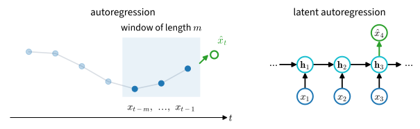

# Working with Sequences
:label:`sec_sequence`

An email client that sees "Thank you for your" proposes "help" or "time".
A weather service that has recorded the temperature every hour forecasts
the next hour. In both cases the best prediction depends on what came
before, and on its order: "your thank for you" calls for a different
continuation, and a falling temperature curve for a different forecast than
a rising one. The models of the earlier chapters cannot express this. They
map one input of fixed shape, a vector $\mathbf{x} \in \mathbb{R}^d$, to one
output, and they treat examples as independent. A sentence, a recording, or
a series of measurements has neither property: its length varies, and its
entries depend on each other.

This section turns sequence modeling into a problem we already know how to
solve, regression. We predict each entry from the entries before it, and we
keep the input of the predictor at a fixed size. Either we look only at a
window of recent entries, or we carry a running summary of everything seen
so far. We then fit a linear model on a fixed window to a noisy sine wave,
where we know the truth. Predicting one step ahead turns out to be easy.
Predicting many steps ahead, by feeding the model its own predictions, is
hard. The rest of the chapter applies the same ideas to text.

```{.python .input  n=6}
%load_ext d2lbook.tab
tab.interact_select('mxnet', 'pytorch', 'tensorflow', 'jax')
```

```{.python .input #sequence-working-with-sequences  n=7}
%%tab mxnet
%matplotlib inline
from d2l import mxnet as d2l
from mxnet import npx
npx.set_np()
```

```{.python .input #sequence-working-with-sequences  n=8}
%%tab pytorch
%matplotlib inline
from d2l import torch as d2l
import torch
```

```{.python .input #sequence-working-with-sequences  n=9}
%%tab tensorflow
%matplotlib inline
from d2l import tensorflow as d2l
import tensorflow as tf
```

```{.python .input #sequence-working-with-sequences  n=9}
%%tab jax
%matplotlib inline
from d2l import jax as d2l
import jax
from jax import numpy as jnp
```

## Sequential Data

The email and the temperature record of the opening look different, but we
can describe both, and every other kind of sequence, in the same terms.
A *sequence* is an ordered list of feature vectors
$\mathbf{x}_1, \ldots, \mathbf{x}_T$, or of scalars $x_1, \ldots, x_T$.
The index $t \in \mathbb{Z}^+$ is a *time step*, and the length $T$ may
differ from one sequence to the next.
Text is a sequence of characters or words.
Audio, whether speech or music, is a sequence of samples,
or of the spectrogram frames computed from them.
Time series such as prices, sensor readings, and patient vitals
arrive one measurement at a time, each shaped by its recent past.

We still assume that *entire* sequences (a whole document,
a whole patient trajectory) are drawn independently
from one fixed distribution over sequences.
*Within* a sequence, however, the entries depend on each other:
the medicine a patient receives on day ten of a hospital stay
depends heavily on the previous nine days.
This dependence is what makes the past useful: if the entries were
independent, conditioning on earlier entries would not improve a
prediction of the next one.
We do not even assume that the entries share one distribution.
A document reads differently at its end than at its beginning,
and a patient's status evolves toward recovery or decline.

Prediction tasks over sequences come in a few shapes.
Sometimes the target is a single label for an entire input sequence
(the sentiment of a movie review),
sometimes a sequence given a fixed input (captioning an image),
and sometimes a sequence given a sequence
(translating a sentence, transcribing speech).
Before handling targets of any kind, we model the sequence itself:
we estimate how probable a given sequence is,
$P(x_1, \ldots, x_T)$.

## Autoregressive Models

Take a numerical series such as a stock index or a temperature reading.
A forecaster who wants to act on the next step
cares about the conditional distribution of that step given the
observations before it,

$$P(x_t \mid x_1, \ldots, x_{t-1}).$$

Even when the full distribution is hard to pin down,
a useful summary is the conditional expectation
$E[x_t \mid x_1, \ldots, x_{t-1}]$,
which we could try to fit with linear regression
(:numref:`sec_linear_regression`).
A model that regresses a signal on its own past
is an *autoregressive model*: features and target
come from the same series.

There is an immediate obstacle.
The number of conditioning inputs $x_1, \ldots, x_{t-1}$
grows with $t$, so if we treat the history as a training set,
every example has a different number of features
and no fixed-input model applies.
Two strategies produce fixed-size representations of the history
(:numref:`fig_ar-vs-latent`).

### Fixed Windows

The first strategy conditions only on the last $m$ observations
$x_{t-m}, \ldots, x_{t-1}$ and discards older history.
Every example then has $m$ features (for $t > m$),
so any model with a fixed input length, linear or deep, applies.
This is *autoregression* in its narrow sense, and $m$ is the
*window length*.
The $n$-gram language models of :numref:`sec_language-model` use the same
idea for a stream of words.
A window is simple and easy to parallelize.
Its weakness is a hard horizon:
anything older than $m$ steps is invisible to the model.

### Latent Summaries

The second strategy keeps a running summary of the observations
$x_1, \ldots, x_t$, a vector $\mathbf{h}_t$, and updates it as each new
observation arrives, $\mathbf{h}_t = g(\mathbf{h}_{t-1}, x_t)$.
We predict the next entry from the summary,
$\hat{x}_{t+1} = f(\mathbf{h}_t)$.
Because $\mathbf{h}_t$ is never observed directly,
this is a *latent autoregressive model*.
The state $\mathbf{h}_t$ has the same size however long the history
grows, so a past of any length fits into bounded memory.
Recurrent neural networks (:numref:`sec_rnn`) are latent autoregressive
models with a learned $g$, and so are the state space models of
:numref:`chap_modern_rnn`.
What the state should retain, and how to update it, are the questions of
those sections.


:label:`fig_ar-vs-latent`

### From Conditionals to Sequences

Whichever strategy we pick, the one-step conditionals determine a model of
the whole sequence.
The *chain rule of probability* writes any joint distribution as a product
of conditionals, one factor per entry, each conditioned on all the entries
before it:

$$P(x_1, \ldots, x_T) = \prod_{t=1}^T P(x_t \mid x_1, \ldots, x_{t-1}).$$
:eqlabel:`eq_chain_rule`

The first factor has nothing to condition on and is $P(x_1)$.
The factorization is exact: it holds for every distribution over
sequences.
Thus a model of the next entry is a model of the entire sequence.
For three words,

$$P(\textrm{the}, \textrm{cat}, \textrm{sat}) =
P(\textrm{the})\, P(\textrm{cat} \mid \textrm{the})\,
P(\textrm{sat} \mid \textrm{the}, \textrm{cat}),$$

and a model that assigns $0.05$, $0.01$, and $0.2$ to the three factors
gives the sentence probability $10^{-4}$.
To score a sequence, we multiply its conditionals,
or add their logarithms, which avoids underflow for long sequences.
To generate a sequence, we sample $x_1$, then $x_2$ given $x_1$, and so
on, feeding each sample into the next condition.
When the entries are discrete tokens,
each conditional is a classifier over the vocabulary,
and estimating $P(x_1, \ldots, x_T)$ is called
*language modeling* (:numref:`sec_language-model`).
For now we keep the values continuous and focus on prediction.

## Markov Models and Stationarity

A fixed window assumes that the observations it discards do not matter.
Every autoregressive model also assumes that the rule linking an entry to
its predecessors is the same at all times. Both assumptions have names.

### The Markov Condition
:label:`subsec_markov-models`

When conditioning on the last $m$ steps loses no predictive power
relative to the full history, we say the sequence satisfies
a *Markov condition*: the future is conditionally independent
of the distant past given the recent past.
With $m = 1$ the series follows a *first-order* Markov model,
and in general an $m^{\textrm{th}}$-order one.
Under the first-order condition each factor of
:eqref:`eq_chain_rule` depends on its predecessor only,
and the factorization collapses to a product over adjacent pairs:

$$P(x_1, \ldots, x_T) = P(x_1) \prod_{t=2}^T P(x_t \mid x_{t-1}).$$

In practice the Markov condition rarely holds exactly.
Real text keeps yielding information as we widen the context,
though each additional token adds less than the one before.
We often assume an $m^{\textrm{th}}$-order condition anyway,
because it keeps the model small enough to compute and to estimate from data.
Even large language models read a context window of fixed length,
not everything that came before it.
For discrete data the simplest such model counts:
$P(x_t \mid x_{t-1})$ is estimated by the relative frequency
of each successor, an idea we take up again
for $n$-grams in :numref:`sec_language-model`.

### Stationarity
:label:`subsec_stationarity`

Fitting any of these models assumes that the *rule* generating
each entry from its predecessors does not itself change over time.
Dynamics with this property are called *stationary*.
The values still change, sometimes dramatically;
what stays fixed is the conditional distribution
$P(x_t \mid x_{t-m}, \ldots, x_{t-1})$.
Stationarity is what lets us pool examples from different parts
of one sequence, or from many sequences, into a single training set,
and it is why we build training data by sliding a window along a
series.

One choice above was implicit: we factored the sequence left to right.
Any order gives a valid factorization,
but for causal data the forward direction is usually easier to learn,
since predicting an effect from its cause tends to be simpler
than the reverse :cite:`Peters.Janzing.Scholkopf.2017`.
As we generally want to predict the future from the past anyway,
we factor left to right throughout.

## Forecasting a Noisy Sine Wave

We now fit an autoregressive model to data where we control the ground
truth, and compare predicting one step ahead with predicting many steps
ahead.

### Data and Model

The series has $T = 1000$ entries
$x_t = \sin(0.01\, t) + \epsilon_t$, where the noise $\epsilon_t$ is
drawn from $\mathcal{N}(0, 0.2^2)$ independently at every step.
One period of the sine spans $2\pi / 0.01 \approx 628$ steps.

```{.python .input #sequence-training-1  n=10}
%%tab mxnet, pytorch
class Data(d2l.DataModule):
    def __init__(self, batch_size=16, T=1000, num_train=600, m=4):
        self.save_hyperparameters()
        self.time = d2l.arange(1, T + 1, dtype=d2l.float32)
        self.x = d2l.sin(0.01 * self.time) + d2l.randn(T) * 0.2
```

```{.python .input #sequence-training-1  n=10}
%%tab tensorflow
class Data(d2l.DataModule):
    def __init__(self, batch_size=16, T=1000, num_train=600, m=4):
        self.save_hyperparameters()
        self.time = d2l.arange(1, T + 1, dtype=d2l.float32)
        self.x = d2l.sin(0.01 * self.time) + d2l.normal([T]) * 0.2
```

```{.python .input #sequence-training-1  n=10}
%%tab jax
class Data(d2l.DataModule):
    def __init__(self, batch_size=16, T=1000, num_train=600, m=4):
        self.save_hyperparameters()
        self.time = d2l.arange(1, T + 1, dtype=d2l.float32)
        noise = jax.random.normal(d2l.get_key(), (T,))
        self.x = d2l.sin(0.01 * self.time) + noise * 0.2
```

```{.python .input #sequence-training-2}
data = Data()
d2l.plot(data.time, data.x, 'time', 'x', xlim=[1, 1000], figsize=(6, 3))
```

To turn the series into supervised examples,
we adopt the fixed-window strategy with window length $m$:
the label is $y = x_t$ and the features are
$(x_{t-m}, \ldots, x_{t-1})$.
This yields $T - m$ examples,
since the first $m$ steps lack enough history and we drop them
(padding with zeros is the alternative).
The method `lag_features` builds all of them at once, one column per lag,
and the data loader serves the first 600 for training,
a bit less than one period of the sine.

```{.python .input #sequence-training-3}
@d2l.add_to_class(Data)
def lag_features(self):
    """Features (x_{t-m}, ..., x_{t-1}) and labels x_t for t > m."""
    features = [self.x[i : self.T-self.m+i] for i in range(self.m)]
    return d2l.stack(features, 1), d2l.reshape(self.x[self.m:], (-1, 1))

@d2l.add_to_class(Data)
def get_dataloader(self, train):
    i = slice(0, self.num_train) if train else slice(self.num_train, None)
    return self.get_tensorloader(self.lag_features(), train, i)
```

Our model is linear regression on the $m = 4$ lag features,
about the simplest autoregressive model there is.

```{.python .input #sequence-training-4}
%%tab mxnet, pytorch, tensorflow
model = d2l.LinearRegression(lr=0.01)
trainer = d2l.Trainer(max_epochs=5)
trainer.fit(model, data)
```

```{.python .input #sequence-training-4}
%%tab jax
model = d2l.LinearRegression(num_inputs=data.m, lr=0.01)
trainer = d2l.Trainer(max_epochs=5)
trainer.fit(model, data)
```

### One-Step-Ahead Prediction

First the easy case: predict $\hat{x}_t$ from the *observed* previous
$m$ values, for every $t > m$.

```{.python .input #sequence-prediction-1}
%%tab mxnet, tensorflow, jax
features, labels = data.lag_features()
onestep_preds = d2l.numpy(model(features))
```

```{.python .input #sequence-prediction-1}
%%tab pytorch
features, labels = data.lag_features()
with torch.inference_mode():  # prediction only: record no gradients
    onestep_preds = d2l.numpy(model(features))
```

```{.python .input #sequence-one-step-ahead-prediction-1}
d2l.plot(data.time[data.m:], [labels, onestep_preds], 'time', 'x',
         legend=['labels', '1-step preds'], figsize=(6, 3))
```

The predictions track the series closely, also beyond step 600,
where the model sees data it was not trained on.

### Multistep Rollout

The hard case is forecasting several steps ahead.
Suppose we have observed only up to step 604
(the 600 training examples need the first 604 observations)
and want to predict $\hat{x}_{609}$.
We cannot form the one-step input for step 609,
because we have not observed $x_{605}, \ldots, x_{608}$.
The fix is to feed our own predictions back in
as if they were observations, rolling forward one step at a time:

$$
\begin{aligned}
\hat{x}_{605} &= f(x_{601}, x_{602}, x_{603}, x_{604}), \\
\hat{x}_{606} &= f(x_{602}, x_{603}, x_{604}, \hat{x}_{605}), \\
\hat{x}_{607} &= f(x_{603}, x_{604}, \hat{x}_{605}, \hat{x}_{606}),\\
\hat{x}_{608} &= f(x_{604}, \hat{x}_{605}, \hat{x}_{606}, \hat{x}_{607}),\\
\hat{x}_{609} &= f(\hat{x}_{605}, \hat{x}_{606}, \hat{x}_{607}, \hat{x}_{608}).
\end{aligned}
$$

From step 609 on, the model sees only its own predictions.
For an observed series $x_1, \ldots, x_t$,
the prediction $\hat{x}_{t+k}$ is the *$k$-step-ahead prediction*,
and a *rollout* chains one-step predictions to reach it.
The loop below rolls forward from step 604 to the end of the series.

```{.python .input #sequence-prediction-2}
%%tab mxnet
multistep_preds = data.x.copy()
for i in range(data.num_train + data.m, data.T):
    multistep_preds[i] = model(multistep_preds[i-data.m : i].reshape(1, -1))
multistep_preds = d2l.numpy(multistep_preds)
```

```{.python .input #sequence-prediction-2}
%%tab pytorch
multistep_preds = data.x.clone()
with torch.inference_mode():
    for i in range(data.num_train + data.m, data.T):
        multistep_preds[i] = model(
            multistep_preds[i-data.m : i].reshape(1, -1))
multistep_preds = d2l.numpy(multistep_preds)
```

```{.python .input #sequence-prediction-2}
%%tab tensorflow
multistep_preds = tf.Variable(data.x)
for i in range(data.num_train + data.m, data.T):
    multistep_preds[i].assign(tf.reshape(model(
        tf.reshape(multistep_preds[i-data.m : i], (1, -1))), ()))
multistep_preds = d2l.numpy(multistep_preds)
```

```{.python .input #sequence-prediction-2}
%%tab jax
def rollout_step(window, _):
    pred = model(window[None])[0, 0]  # window: the last m values
    return jnp.append(window[1:], pred), pred

start = data.num_train + data.m
_, preds = jax.lax.scan(rollout_step, data.x[start-data.m : start],
                        length=data.T - start)
multistep_preds = d2l.numpy(data.x.at[start:].set(preds))
```

:begin_tab:`jax`
In JAX, a loop over time steps is a `jax.lax.scan`: it carries the window
from one step to the next and stacks the predictions.
:end_tab:

```{.python .input #sequence-prediction-3}
start = data.num_train + data.m
d2l.plot([data.time[data.m:], data.time[start:]],
         [onestep_preds, multistep_preds[start:]], 'time', 'x',
         legend=['1-step preds', 'multistep preds'], figsize=(6, 3))
```

The rollout never follows the oscillation.
It starts at the level of the last observed window and drifts slowly
toward a constant, while the series rises and falls.
The learned weights show why.

```{.python .input #sequence-multistep-rollout-1}
w, b = model.get_w_b()
print(f'weights on x[t-{data.m}], ..., x[t-1]:',
      d2l.numpy(d2l.reshape(w, -1)).round(3))
```

All four weights are close to $1/4$:
the model has learned to predict the next value as the average of the
last four.
For one step this is a sound rule.
The sine changes by at most $0.01$ from one step to the next,
while the noise has a standard deviation of $0.2$.
An average of four noisy observations carries only a quarter of their
noise variance, $0.04/4 = 0.01$, and lagging the curve by a step or two
adds almost no error.
Fed its own outputs, however, an average of the last four values can
only repeat their current level.
Because the weights sum to slightly less than one, that level also
drifts slowly toward the rollout's fixed point $b / (1 - \sum_i w_i)$,
where $b$ is the bias: a small bias divided by a small difference, so the
fixed point differs from run to run.
The model has not learned the curvature of the sine, which the one-step
loss barely rewarded, and over many steps that omission dominates the
error.
A linear model *could* continue a sine wave far better;
exercise :exref:`ex_sequence-window-length` asks how.

### Error Growth with the Horizon
:label:`subsec_error-accumulation`

How fast does the error grow with the horizon $k$?
To find out, we compute $k$-step-ahead predictions from every start
position at once.
`k_step_pred` keeps a list of columns, each with one entry per start
position.
The first $m$ columns hold the observed lags; each round appends the
predictions made from the last $m$ columns, so entry $j-1$ of the
returned list holds the $j$-step-ahead predictions.

```{.python .input #sequence-prediction-4}
def k_step_pred(model, x, m, k):
    """Predictions 1, 2, ..., k steps ahead from every start position."""
    n = len(x) - m - k + 1                       # number of start positions
    columns = [x[i : i + n] for i in range(m)]   # observed lags
    for j in range(k):
        preds = model(d2l.stack(columns[j : j + m], 1))
        columns.append(d2l.reshape(preds, -1))
    return columns[m:]                           # entry j-1: j steps ahead
```

```{.python .input #sequence-prediction-5}
%%tab mxnet, tensorflow, jax
steps = (1, 4, 16, 64)
preds = k_step_pred(model, data.x, data.m, steps[-1])
```

```{.python .input #sequence-prediction-5}
%%tab pytorch
steps = (1, 4, 16, 64)
with torch.inference_mode():
    preds = k_step_pred(model, data.x, data.m, steps[-1])
```

```{.python .input #sequence-error-accumulation-1}
d2l.plot([data.time[data.m+k-1 : data.T-steps[-1]+k] for k in steps],
         [d2l.numpy(preds[k-1]) for k in steps], 'time', 'x',
         legend=[f'{k}-step preds' for k in steps], figsize=(6, 3))
```

The 1- and 4-step forecasts follow the series.
The 16-step forecast lags it visibly, and the 64-step forecast is a copy
of the series delayed by about 64 steps and visibly shrunk in amplitude;
how much it shrinks depends on how far the weights' sum falls short of
one.
The mean squared error against the observed values puts numbers on this.
As a reference, the variance of the series is the mean squared error of a
forecast that always predicts the mean.

```{.python .input #sequence-error-accumulation-2}
x = d2l.numpy(data.x)
for k in steps:
    err = d2l.numpy(preds[k-1]) - x[data.m+k-1 : data.T-steps[-1]+k]
    print(f'{k:2d} steps ahead: mean squared error {(err**2).mean():.3f}')
print(f'variance of the series: {x.var():.3f}')
```

One step ahead, the error is about $0.05$: the noise variance
$0.2^2 = 0.04$, which no forecast can remove, plus the $0.01$ of noise
left in an average of four observations.
The growth with $k$ follows from the delay.
A $k$-step forecast is roughly the series $k$ steps earlier, so its
additional error is how far the sine moves in $k$ steps.
Averaged over the phase $a$ of the sine, that squared change is

$$\frac{1}{2\pi}\int_0^{2\pi} \bigl(\sin(a + 0.01\,k) - \sin a\bigr)^2 \, da
= 1 - \cos(0.01\,k),$$

which is $0.001$ for $k = 4$, $0.013$ for $k = 16$, and $0.20$ for
$k = 64$.
Added to the floor of $0.05$, it predicts errors of about $0.05$, $0.05$,
$0.065$, and $0.25$, close to the measured ones.
Sixty-four steps ahead, the error is four to six times the one-step
error and roughly half the variance of the series.

The averaging model damps whatever is fed back into it, so its rollout
drifts toward a constant instead of diverging.
The underlying problem is general, though: in a rollout every prediction
error becomes part of the input of all later steps, and nothing corrects
it.
A model that amplifies its errors instead of damping them drifts away from
the data altogether.

The same problem affects every autoregressive generator that consumes its
own outputs.
A language model that samples one token at a time can drift
off topic or into repetition once a few unusual choices
steer it into text unlike anything it saw during training.
A learned simulator of a physical system loses coherence
over a long rollout for the same reason.
Two remedies exist.
First, the rule that turns each predicted distribution into a concrete
next value matters: :numref:`sec_decoding` compares such rules for
text.
Second, exposing a model to its own predictions during training,
not only to observed histories,
narrows the gap between the one-step setting it is trained in
and the multistep setting it is used in
(exercise :exref:`ex_sequence-scheduled-sampling`).

## Summary

A sequence is an ordered list whose entries depend on each other, and
whose length varies.
Autoregressive models turn sequence modeling into ordinary
supervised learning by predicting each entry from its predecessors,
either through a fixed window of the last $m$ observations
(autoregression, the idea behind $n$-grams) or through a latent state
that summarizes the whole past in bounded memory
(latent autoregression, the idea behind recurrent networks).
By the chain rule of probability, the one-step conditionals multiply to a
model of the whole sequence, which can score and generate sequences.
Fitting one model to all positions of a series assumes that the rule
generating each entry does not change over time (stationarity).
One-step-ahead prediction is comparatively easy.
Multistep forecasting feeds predictions back as inputs,
so it can never correct its errors. On the noisy sine wave, the
averaging model carries the last observed level forward, and its error
64 steps ahead is four to six times the one-step error.

## Exercises

1. [code] **Window length.** `Data` supplies `m=4` lag features and
   `d2l.LinearRegression` fits them.
    1. Increase `m` and retrain. How many past observations are needed
       before the validation error stops improving?
    1. Suppose the noise term in `Data` were removed. How many past
       observations then suffice for exact prediction, and why?
   :exlabel:`ex_sequence-window-length`

1. **Momentum strategies.** An investor selects stocks by their own past
   returns, expecting those that rose to keep rising. State the assumption
   about the return series that this strategy requires, in the terms of
   :numref:`subsec_markov-models` and :numref:`subsec_stationarity`, and
   describe one mechanism by which the assumption fails.

1. [code] **Nonlinear autoregressor.** Replace `d2l.LinearRegression` by a
   small MLP on the same four lag features and retrain, possibly for more
   epochs. How do the one-step and the multistep predictions change?

1. [code] **Error growth with the horizon.** For each $k$, the last entry
   of the list that `k_step_pred(model, data.x, data.m, k)` returns holds
   the $k$-step-ahead predictions of `data.x[data.m+k-1:]`.
    1. For $k \in \{1, 2, 4, \ldots, 256\}$, plot the mean squared
       $k$-step error against $k$ on a logarithmic axis. Where does the
       curve bend upward, and how does the bend relate to the damping of
       the 16-step and 64-step forecasts?
    1. Find the smallest $k$ at which the mean squared $k$-step error
       exceeds the variance of the series. What does a forecast beyond
       this horizon offer over the constant forecast?

1. [code] **Dilated and averaged lags.** ● Keep four features for
   `d2l.LinearRegression` but let them reach further back: once as the
   lags $x_{t-1}, x_{t-2}, x_{t-4}, x_{t-8}$, and once as the four block
   means $\frac{1}{4}\sum_{i=0}^{3} x_{t-4j+i}$ for $j = 1, \ldots, 4$.
   Compare their validation errors with those for $m = 4$ and
   $m = 16$. Which construction helps, and why?

1. [code] **Regime switching.** ● Replace the single sine in `Data` by a
   series that alternates between $\sin(0.01\,t)$ and $\sin(0.05\,t)$
   every 200 time steps, and keep the additive noise. Both regimes then
   occur among the training examples and among the validation examples.
   The switching series violates the stationarity assumption
   of :numref:`subsec_stationarity`. Does one linear model with $m = 4$
   nevertheless fit both regimes, and why? Report training and validation
   error for each regime separately and locate the positions along the
   series where the fit is worst.

1. [code] **Scheduled sampling.** ● :numref:`subsec_error-accumulation`
   states that exposing a model to its own predictions during training
   narrows the gap between one-step training and multistep use. Test the
   claim with a variant of *scheduled sampling*
   :cite:`Bengio.Vinyals.Jaitly.ea.2015` for the linear model with
   $m = 4$. In every minibatch, replace each lag feature with
   probability $\epsilon$ by the model's current one-step prediction of
   that observation. Train one model for each
   $\epsilon \in \{0, 0.25, 0.5, 1\}$. For each model, measure the
   one-step validation error and the mean squared error of the last entry
   of `k_step_pred(model, data.x, data.m, 64)`. Does any $\epsilon > 0$
   lower the 64-step error below its value at $\epsilon = 0$? How does the
   one-step error change?
   :exlabel:`ex_sequence-scheduled-sampling`

:begin_tab:`mxnet`
[Discussions](https://d2l.discourse.group/t/113)
:end_tab:

:begin_tab:`pytorch`
[Discussions](https://d2l.discourse.group/t/114)
:end_tab:

:begin_tab:`tensorflow`
[Discussions](https://d2l.discourse.group/t/1048)
:end_tab:

:begin_tab:`jax`
[Discussions](https://d2l.discourse.group/t/18010)
:end_tab:

<!-- slides -->

::: {.slide}
::: {.cover}
[Dive into Deep Learning · §8.1]{.kicker}

Working with Sequences<br>**autoregression · latent state · the chain rule · Markov models · multistep rollouts**
:::
:::

::: {.slide title="Predicting One Step Ahead Is Easy; Predicting 64 Steps Ahead Is Not"}
[The problem]{.kicker}

- So far: one input of fixed shape, $\mathbf{x} \in \mathbb{R}^d$, one
  output, independent examples.
- Sequences: the length $T$ varies, and entries depend on each other
  ("Thank you for your" → "help").
- A linear model on the last 4 values of a noisy sine wave: error
  ≈ 0.05 one step ahead, ≈ 0.25 when it forecasts 64 steps ahead.

::: {.d2l-note .warn}
How do fixed-size models handle sequences, and why do long forecasts fail?
:::
:::

::: {.slide title="By the End of This Deck You Can"}
[Goals]{.kicker}

- turn a series into fixed-size regression examples (a window of $m$ lags);
- tell a fixed window from a latent state;
- factor $P(x_1, \ldots, x_T)$ with the chain rule, and score a sentence;
- state the Markov and stationarity assumptions;
- roll a model forward and measure how its error grows with the horizon.

**Running example:** $x_t = \sin(0.01\,t) + \epsilon_t$, noise standard
deviation 0.2, $T = 1000$. *The Time Machine*, the chapter's text,
starts in the next deck.
:::

::: {.slide title="Modeling the Sequence Itself, Before Any Targets"}
[Where this fits]{.kicker}

::: {.cols .vc}
::: {.col}
| section | adds |
|---|---|
| **Working with Sequences** | **autoregression, latent state, rollout error** |
| From Text to Tokens | characters, words, bytes, BPE |
| Language Models | $n$-grams, perplexity, bits per byte |
| Recurrent Neural Networks | a hidden state updated at every step |
| Implementing RNNs | an RNN language model, scratch and concise |
| Backpropagation Through Time | gradients through time, truncation |
| Decoding and Generation | greedy decoding, beam search, sampling |
:::

::: {.col .narrow}
- **Uses:** linear regression, `Trainer`.
- **Skips:** labels for sequences (sentiment, translation); learned
  states (recurrent networks).
:::
:::
:::

::: {.slide}
::: {.divider}
[01]{.dnum}

[Autoregressive Models]{.dtitle}

[predict each entry from its predecessors]{.dsub}
:::
:::

::: {.slide title="The History Grows with t, but a Regression Needs a Fixed Number of Features"}
[Autoregression]{.kicker}

Predict the next entry from the past:
$P(x_t \mid x_1, \ldots, x_{t-1})$, or its mean
$E[x_t \mid x_1, \ldots, x_{t-1}]$ by regression.

- Features and label come from the **same series**: an *autoregressive*
  model.
- Obstacle: step $t$ has $t - 1$ conditioning values, a different number
  for every example.

Two fixes: keep a **window** of the last $m$ values, or a **summary**
$\mathbf{h}_t$ of fixed size.
:::

::: {.slide title="A Window Discards the Old Past; a Latent State Summarizes All of It"}
[Two strategies]{.kicker}

{width=88%}

- Window: features $(x_{t-m}, \ldots, x_{t-1})$; the idea behind $n$-grams.
- State: $\mathbf{h}_t = g(\mathbf{h}_{t-1}, x_t)$,
  $\hat{x}_{t+1} = f(\mathbf{h}_t)$; the idea behind recurrent networks.
:::

::: {.slide title="The Chain Rule Turns Next-Step Predictions into a Model of the Sequence"}
[The chain rule]{.kicker}

$$P(x_1, \ldots, x_T) = \prod_{t=1}^T P(x_t \mid x_1, \ldots, x_{t-1}).$$

- Exact for every distribution; the first factor is $P(x_1)$.
- $P(\textrm{the}, \textrm{cat}, \textrm{sat}) = 0.05 \cdot 0.01 \cdot 0.2
  = 10^{-4}$.
- **Score:** add the log-conditionals. **Generate:** sample $x_1$, then
  $x_2$ given $x_1$, …
- Discrete tokens: each factor is a classifier over the vocabulary, and
  this is *language modeling*.
:::

::: {.slide title="The Markov Condition: The Recent Past Is All That Matters"}
[Markov models]{.kicker}

- Order $m$: given $x_{t-m}, \ldots, x_{t-1}$, the older past adds no
  information about $x_t$.
- First order: $P(x_1, \ldots, x_T) = P(x_1) \prod_{t=2}^T P(x_t \mid x_{t-1})$.
- Real text is not Markov, but the gain from a wider context shrinks
  fast; we assume order $m$ to keep the model small.
- Discrete data: estimate $P(x_t \mid x_{t-1})$ by counting successors.
:::

::: {.slide title="Check: Write Out P(x₁, x₂, x₃, x₄)"}
[Check]{.kicker}

Write the four factors (a) by the chain rule, (b) under a second-order
Markov model.

::: {.fragment .fade-up}
::: {.d2l-note}
**Answer.** (a) $P(x_1) P(x_2 \mid x_1) P(x_3 \mid x_1, x_2)
P(x_4 \mid x_1, x_2, x_3)$. (b) The same, except the last factor is
$P(x_4 \mid x_2, x_3)$: only it has more than two predecessors.
:::
:::
:::

::: {.slide title="Stationarity: The Rule Stays Fixed While the Values Change"}
[Stationarity]{.kicker}

- *Stationary*: $P(x_t \mid x_{t-m}, \ldots, x_{t-1})$ is the same at
  every $t$.
- The values may still drift, oscillate, or jump.
- This is what lets us pool windows from all positions, and from many
  sequences, into one training set.
- Left to right is a choice: any order factors exactly, but cause before
  effect is usually easier to learn.
:::

::: {.slide}
::: {.divider}
[02]{.dnum}

[Forecasting a Noisy Sine Wave]{.dtitle}

[one step ahead against a rollout]{.dsub}
:::
:::

::: {.slide title="1,000 Noisy Samples of a Sine; the First 600 Windows Train"}
[Data]{.kicker}

@!sequence-training-2

$x_t = \sin(0.01\,t) + \epsilon_t$, $\epsilon_t \sim \mathcal{N}(0, 0.2^2)$;
one period is $2\pi/0.01 \approx 628$ steps.
:::

::: {.slide title="Each Window of m = 4 Values Is One Regression Example"}
[Lag features]{.kicker}

| example | features | label |
|---|---|---|
| 1 | $x_1, x_2, x_3, x_4$ | $x_5$ |
| 2 | $x_2, x_3, x_4, x_5$ | $x_6$ |
| ⋮ | ⋮ | ⋮ |
| 996 | $x_{996}, \ldots, x_{999}$ | $x_{1000}$ |

- Training: examples 1–600; validation: the rest.
- Model: linear regression, 4 weights and a bias; SGD, learning rate
  0.01, 5 epochs, minibatches of 16.
:::

::: {.slide title="Given the Observed Past, the Model Tracks the Series"}
[One step ahead]{.kicker}

@!sequence-one-step-ahead-prediction-1

Each prediction uses the 4 observed values before it, also beyond step
600, on data the model never saw.
:::

::: {.slide title="A Rollout Feeds Each Prediction Back as an Input"}
[Multistep prediction]{.kicker}

Observed up to step 604; to reach $\hat{x}_{609}$:

$$
\begin{aligned}
\hat{x}_{605} &= f(x_{601}, x_{602}, x_{603}, x_{604}), \\
\hat{x}_{606} &= f(x_{602}, x_{603}, x_{604}, \hat{x}_{605}), \\
&\ \,\vdots \\
\hat{x}_{609} &= f(\hat{x}_{605}, \hat{x}_{606}, \hat{x}_{607}, \hat{x}_{608}).
\end{aligned}
$$

From step 609 on, the model reads only its own predictions.
:::

::: {.slide title="The Rollout Carries the Last Level Forward and Never Oscillates"}
[Multistep prediction]{.kicker}

@!sequence-prediction-3

The one-step predictions follow the sine. The rollout from step 604 starts
at the level of the last window and drifts slowly toward a constant.
:::

::: {.slide title="The Model Learned to Average the Last Four Values"}
[Why it never oscillates]{.kicker}

@!sequence-multistep-rollout-1

- The sine moves at most 0.01 per step; the noise has standard deviation
  0.2. An average of 4 keeps noise variance 0.04/4 = 0.01.
- One step ahead, averaging matters far more than the curvature.
- Fed its own outputs, an average can only repeat the current level;
  weights summing to just under 1 pull it slowly toward the fixed point
  $b / (1 - \sum_i w_i)$.
:::

::: {.slide title="Check: Roll Out an Exact Four-Point Average"}
[Check]{.kicker}

Weights $\tfrac14, \tfrac14, \tfrac14, \tfrac14$, bias 0. The last four
observations are $0.2, 0.4, 0.6, 0.8$. (a) What is the next prediction?
(b) Does the rollout keep rising?

::: {.fragment .fade-up}
::: {.d2l-note}
**Answer.** (a) $0.5$: the trend reverses at once. (b) No. Each step
leaves $x_{t-4} + 2x_{t-3} + 3x_{t-2} + 4x_{t-1}$ unchanged, so the
rollout settles at $(0.2 + 0.8 + 1.8 + 3.2)/10 = 0.6$.
:::
:::
:::

::: {.slide title="A k-Step Forecast Is the Series Delayed by About k Steps"}
[Error growth]{.kicker}

@!sequence-error-accumulation-1

Predictions from every start position, 1, 4, 16, and 64 steps ahead. The
64-step forecast lags by about 64 steps, at a reduced amplitude.
:::

::: {.slide title="The Error Is the Distance the Sine Moves in k Steps"}
[Error growth]{.kicker}

| steps ahead $k$ | 1 | 4 | 16 | 64 |
|---|--:|--:|--:|--:|
| measured | ≈ 0.05 | 0.05–0.06 | 0.06–0.07 | ≈ 0.25 |
| $0.05 + 1 - \cos(0.01\,k)$ | 0.05 | 0.05 | 0.063 | 0.25 |

- Floor 0.05: noise $0.2^2 = 0.04$, plus 0.01 left in the average.
- $1 - \cos(0.01\,k)$: mean squared change of the sine over $k$ steps.
- At $k = 64$: four to six times the one-step error, half the series
  variance (≈ 0.48).
:::

::: {.slide title="Every Generator That Reads Its Own Outputs Inherits Its Errors"}
[Beyond the sine]{.kicker}

- Each error enters the input of every later step; nothing corrects it.
  Our averaging model damps it; a model that amplifies it drifts away.
- Language models sampling token by token drift off topic or into
  repetition; learned simulators lose coherence over long rollouts.
- Remedies: choose each next value well (*decoding rules*); train on the
  model's own predictions (*scheduled sampling*).
:::

::: {.slide title="Recap"}
[Wrap-up]{.kicker}

- **Autoregression:** predict $x_t$ from a window of $m$ past values;
  **latent autoregression:** from a fixed-size state $\mathbf{h}_t$.
- **Chain rule:** next-step conditionals multiply to $P(x_1, \ldots, x_T)$;
  score by summing logs, generate by sampling left to right.
- **Assumptions:** Markov of order $m$; stationary rule.
- **Noisy sine, 4 lags:** the model averages, so the rollout carries the
  last level forward; error ≈ 0.05 one step ahead, ≈ 0.25 at 64 steps.

**Next:** turning text into a sequence of tokens.
:::
