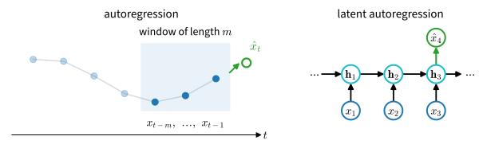

# Working with Sequences
:label:`sec_sequence`

When an email client sees the prefix "Thank you for your", it naturally
proposes continuations such as "help" or "time". Likewise, a weather service
that records the temperature every hour relies on recent readings to forecast
the next one. In both situations, a good prediction depends not only on what
appeared earlier, but also on the order in which it appeared: scrambling the
words to "your thank for you" changes the continuation entirely, and a falling
temperature curve calls for a very different forecast from a rising one. None
of the models from earlier chapters can capture this structure directly,
because they map a single input of fixed shape—a vector
$\mathbf{x} \in \mathbb{R}^d$—to an output and treat each example as
independent of the rest. A sentence, an audio recording, or a stream of sensor
measurements violates both assumptions: its length varies from one instance to
the next, and its entries depend strongly on one another.

In this section, we recast sequence modeling as a problem we already know how
to solve: regression. We predict each entry from the entries that precede it,
reducing the growing history to a fixed-size input either by keeping a window
of the most recent observations or by maintaining a running summary of
everything seen so far. To test these ideas in a setting where we know the
exact ground truth, we fit a linear autoregressive model on a fixed window to
a noisy sine wave. As we will discover, predicting a single step ahead is
straightforward, whereas predicting many steps ahead by feeding the model
its own predictions is considerably harder. The remainder of the chapter
carries these same principles over to text.

```{.python .input  n=6}
%load_ext d2lbook.tab
tab.interact_select('mxnet', 'pytorch', 'tensorflow', 'jax')
```

```{.python .input #sequence-working-with-sequences  n=7}
%%tab mxnet
import math
import numpy as np
from mxnet import autograd, gluon, init, np as mnp, npx
from mxnet.gluon import nn
from d2l import mxnet as d2l
npx.set_np()
```

```{.python .input #sequence-working-with-sequences  n=8}
%%tab pytorch
import math
import numpy as np
import torch
from torch import nn
from torch.nn import functional as F
from d2l import torch as d2l
```

```{.python .input #sequence-working-with-sequences  n=9}
%%tab tensorflow
import math
import numpy as np
import tensorflow as tf
from d2l import tensorflow as d2l
```

```{.python .input #sequence-working-with-sequences  n=9}
%%tab jax
import math
import numpy as np
import jax
from jax import numpy as jnp
from flax import nnx
import optax
from d2l import jax as d2l
```

## Sequential Data

A *sequence* is an ordered list of feature vectors
$\mathbf{x}_1, \ldots, \mathbf{x}_T$, or in the scalar case, values
$x_1, \ldots, x_T$, where the index $t \in \mathbb{Z}^+$ denotes the *time
step* and the length $T$ may vary from one sequence to the next. Familiar
examples abound: text is a sequence of characters, subwords, or words; audio
(whether speech or music) is a sequence of waveform samples or spectrogram
frames; and time series such as stock prices, sensor readings, and patient
vital signs arrive one measurement at a time.

While we continue to assume that *entire* sequences—such as complete documents
or full hospital stays—are drawn independently from a single underlying
distribution over sequences, we certainly cannot assume that entries *within*
a sequence are independent. The medication a patient receives on the tenth
day of a hospital stay depends heavily on what transpired over the preceding
nine days. Far from being a nuisance, this internal dependence is precisely
what makes the past informative: if consecutive entries were independent,
conditioning on earlier observations would tell us nothing about the next one.
Nor do we need to assume that every position in a sequence shares the same
marginal distribution; a document typically looks quite different at its
closing paragraph than at its opening sentence, and a patient's condition
evolves over the course of treatment toward recovery or decline.

Sequence prediction tasks arise in several distinct forms. We may want to
assign a single label to an entire sequence (such as classifying the sentiment
of a movie review), generate a sequence from a fixed input (such as captioning
an image), or map an input sequence to an output sequence (such as translating
a sentence or transcribing speech). Before tackling supervised targets of any
kind, however, it is instructive to model the sequence itself by estimating
its joint probability $P(x_1, \ldots, x_T)$. Estimating this distribution
requires no external labels, because every entry naturally serves as the
target for the entries preceding it. Moreover, a model that assigns
probabilities to sequences can both generate new sequences and rank competing
candidates—for instance, choosing the more plausible of two transcriptions
for the same audio clip.

## Autoregressive Models

Consider a numerical series such as a stock index or an hourly temperature
record. A forecaster deciding how to act on the next measurement is primarily
interested in the conditional distribution of the upcoming value given all
observations seen so far:

$$P(x_t \mid x_1, \ldots, x_{t-1}).$$

Because the prefix $x_1, \ldots, x_{t-1}$ appears throughout this chapter, we
abbreviate it as $x_{<t}$. Even when estimating the full conditional
distribution is difficult, its conditional expectation
$\mathbb{E}[x_t \mid x_{<t}]$ is already a useful summary—one we might attempt
to fit with linear regression (:numref:`sec_linear_regression`). Any model
that regresses a signal on its own past values is called an *autoregressive
model*, since both the features and the target come from the same series.

There is, however, an immediate snag: the number of conditioning inputs in
$x_{<t}$ grows with $t$, meaning that each time step presents a different
number of features and cannot be fed directly into a fixed-input model. Two
general strategies resolve this mismatch by compressing the history into a
fixed-size representation (:numref:`fig_ar-vs-latent`). Both remain
autoregressive, differing only in how much of the past they retain.

### Fixed Windows

The first strategy conditions only on the $m$ most recent observations,
$x_{t-m}, \ldots, x_{t-1}$, and discards all earlier history. For every
$t > m$, each training example has exactly $m$ features, so any fixed-input
architecture—linear or deep—applies directly. This is the classical form of
autoregression, with $m$ called the *window length*. Fixed windows are simple
to implement and easy to parallelize across time steps, because every
prediction depends only on its own local slice of the series. Their drawback
is a hard horizon: anything more than $m$ steps in the past is completely
invisible to the model.

### Latent Summaries

The second strategy maintains a fixed-size running summary $\mathbf{h}_t$ of
all observations $x_1, \ldots, x_t$, updating it recursively as each new value
arrives via $\mathbf{h}_t = g(\mathbf{h}_{t-1}, x_t)$ and predicting the next
entry from that summary via $\hat{x}_{t+1} = f(\mathbf{h}_t)$. Because
$\mathbf{h}_t$ is never observed directly, such a model is called a *latent
autoregressive model*. The state vector $\mathbf{h}_t$ occupies the same
fixed amount of memory regardless of how long the sequence becomes, allowing
the model to summarize an arbitrarily long history in bounded space. Recurrent
neural networks (:numref:`sec_rnn`) are latent autoregressive models with a
learned transition function $g$, as are the state space models of
:numref:`chap_modern_rnn`. Deciding what the hidden state should remember and
how to update it reliably are the central design questions of those chapters.


:label:`fig_ar-vs-latent`

### From Conditionals to Sequences

Whichever representation we choose, the one-step conditional distributions
completely specify a probability model over the entire sequence. By the
*chain rule of probability*, any joint distribution factors into a product of
conditionals, one per time step, each conditioned on all preceding entries:

$$P(x_1, \ldots, x_T) = \prod_{t=1}^T P(x_t \mid x_{<t}).$$
:eqlabel:`eq_chain_rule`

For $t = 1$, the prefix $x_{<1}$ is empty and the first factor is simply
$P(x_1)$. Because this identity is exact for every joint distribution over
sequences, modeling the next entry is mathematically equivalent to modeling
the entire sequence. For a three-word phrase, for example,

$$P(\textrm{the}, \textrm{cat}, \textrm{sat}) =
P(\textrm{the})\, P(\textrm{cat} \mid \textrm{the})\,
P(\textrm{sat} \mid \textrm{the}, \textrm{cat}),$$

so if a model assigns probabilities $0.05$, $0.01$, and $0.2$ to those three
factors, the sentence receives joint probability $10^{-4}$. In practice, we
score a sequence by summing the logarithms of its conditionals rather than
multiplying them directly, avoiding numerical underflow on long sequences. To
generate a new sequence, we reverse the process: sample $x_1$, then sample
$x_2$ given $x_1$, and continue feeding each newly drawn value into the next
conditional distribution.

Notice that :eqref:`eq_chain_rule` makes an implicit choice of ordering: we
factored the sequence from left to right. In principle, any permutation of the
indices yields a mathematically valid factorization. In causal domains,
however, the forward direction is usually much easier to model, because
predicting an effect from its causes tends to be simpler than inverting the
process :cite:`Peters.Janzing.Scholkopf.2017`. Since forecasting the future
from the past is also what we want in practice, we factor sequences left to
right throughout this chapter.

When the sequence entries are discrete tokens, each conditional distribution
is a classifier over the vocabulary, and estimating $P(x_1, \ldots, x_T)$ is
known as *language modeling* (:numref:`sec_language-model`). For the remainder
of this section, we stay with continuous values so that we can focus directly
on the mechanics of autoregressive prediction.

## Markov Models and Stationarity

Using a fixed window implicitly assumes that older observations can be safely
ignored, while fitting a single model across all time steps assumes that the
underlying predictive rule does not drift over time. Both assumptions are
classical concepts in probability and time-series analysis.

### The Markov Condition
:label:`subsec_markov-models`

When conditioning on the $m$ most recent steps provides just as much
predictive power as conditioning on the entire history, we say that the
sequence satisfies a *Markov condition*: the future is conditionally
independent of the distant past given the recent past. When $m = 1$, the
process is a *first-order* Markov model; in general, it is an
$m^{\textrm{th}}$-order Markov model. Under the first-order condition, each
factor in :eqref:`eq_chain_rule` depends solely on its immediate predecessor,
and the joint probability simplifies to a product over adjacent pairs:

$$P(x_1, \ldots, x_T) = P(x_1) \prod_{t=2}^T P(x_t \mid x_{t-1}).$$

Real-world sequences rarely obey a Markov condition exactly. In natural text,
extending the context continues to yield useful information, albeit with
diminishing returns for each additional token. Even so, assuming an
$m^{\textrm{th}}$-order Markov condition is often a practical necessity,
because it keeps the model tractable to compute and estimate from finite data;
even modern large language models operate over a bounded context window rather
than an infinite history. For discrete sequences, the simplest Markov model
estimates $P(x_t \mid x_{t-1})$ directly by counting how often each successor
follows each context—the exact principle behind the $n$-gram language models
we build in :numref:`sec_language-model`.

### Stationarity
:label:`subsec_stationarity`

Fitting a single predictor across all time steps relies on a second
assumption: that the *dynamics* generating each entry from its predecessors do
not change over time. Processes with time-invariant dynamics are called
*time-homogeneous*—or, more loosely and far more commonly in machine learning,
*stationary*. The observed values themselves may still fluctuate widely; what
remains constant is the conditional distribution
$P(x_t \mid x_{t-m}, \ldots, x_{t-1})$. Crucially, a fixed transition rule
does not force the entries to be identically distributed: the end of a
document still behaves differently from its beginning because the same rule is
evaluated on a different context. Stationarity is what justifies pooling
examples from different parts of a single sequence—or across many sequences—by
sliding a window along the series to assemble one shared training set.

## Forecasting a Noisy Sine Wave

To see these concepts in action in a setting where we know the exact ground
truth, let us fit a simple autoregressive model to synthetic data and compare
one-step-ahead forecasting against multistep rollouts.

### Data and Model

We generate a series of $T = 1000$ time steps from a noisy sine wave,
$x_t = \sin(0.01\, t) + \epsilon_t$, where the additive noise
$\epsilon_t \sim \mathcal{N}(0, 0.2^2)$ is drawn independently at every step.
At this frequency, one full period spans $2\pi / 0.01 \approx 628$ steps.

```{.python .input #sequence-training-1  n=10}
%%tab mxnet, pytorch
class Data(d2l.DataModule):
    def __init__(self, batch_size=16, T=1000, num_train=600, m=4):
        self.save_hyperparameters()
        self.time = d2l.arange(1, T + 1, dtype=d2l.float32)
        self.x = d2l.sin(0.01 * self.time) + d2l.randn(T) * 0.2
```

```{.python .input #sequence-training-1  n=10}
%%tab tensorflow
class Data(d2l.DataModule):
    def __init__(self, batch_size=16, T=1000, num_train=600, m=4):
        self.save_hyperparameters()
        self.time = d2l.arange(1, T + 1, dtype=d2l.float32)
        self.x = d2l.sin(0.01 * self.time) + d2l.normal([T]) * 0.2
```

```{.python .input #sequence-training-1  n=10}
%%tab jax
class Data(d2l.DataModule):
    def __init__(self, batch_size=16, T=1000, num_train=600, m=4):
        self.save_hyperparameters()
        self.time = d2l.arange(1, T + 1, dtype=d2l.float32)
        noise = jax.random.normal(d2l.get_key(), (T,))
        self.x = d2l.sin(0.01 * self.time) + noise * 0.2
```

```{.python .input #sequence-training-2}
data = Data()
d2l.plot(data.time, data.x, 'time', 'x', xlim=[1, 1000], figsize=(6, 3))
```

To turn this series into supervised training examples, we apply the
fixed-window strategy with window length $m$: each example pairs the feature
vector $(x_{t-m}, \ldots, x_{t-1})$ with the target label $y = x_t$. This
yields $T - m$ examples in total, since the first $m$ entries lack sufficient
history and are simply dropped (zero-padding is a common alternative). The
`lag_features` method builds the entire feature matrix at once, with one
column per lag, and the data loader uses the first 600 examples—just under
one full period of the sine wave—for training.

```{.python .input #sequence-training-3}
@d2l.add_to_class(Data)
def lag_features(self):
    """Features (x_{t-m}, ..., x_{t-1}) and labels x_t for t > m."""
    features = [self.x[i : self.T-self.m+i] for i in range(self.m)]
    return d2l.stack(features, 1), d2l.reshape(self.x[self.m:], (-1, 1))

@d2l.add_to_class(Data)
def get_dataloader(self, train):
    i = slice(0, self.num_train) if train else slice(self.num_train, None)
    return self.get_tensorloader(self.lag_features(), train, i)
```

For our predictor, we use ordinary linear regression over the $m = 4$ lag
features—about the simplest autoregressive model imaginable.

```{.python .input #sequence-training-4}
%%tab mxnet, pytorch, tensorflow
model = d2l.LinearRegression(lr=0.01)
trainer = d2l.Trainer(max_epochs=5)
trainer.fit(model, data)
```

```{.python .input #sequence-training-4}
%%tab jax
model = d2l.LinearRegression(num_inputs=data.m, lr=0.01)
trainer = d2l.Trainer(max_epochs=5)
trainer.fit(model, data)
```

### One-Step-Ahead Prediction

We begin with the easy case: predicting $\hat{x}_t$ from the *observed*
preceding $m$ values at every time step $t > m$.

```{.python .input #sequence-prediction-1}
%%tab mxnet, tensorflow, jax
features, labels = data.lag_features()
onestep_preds = d2l.numpy(model(features))
```

```{.python .input #sequence-prediction-1}
%%tab pytorch
features, labels = data.lag_features()
with torch.inference_mode():  # prediction only: record no gradients
    onestep_preds = d2l.numpy(model(features))
```

```{.python .input #sequence-one-step-ahead-prediction-1}
d2l.plot(data.time[data.m:], [labels, onestep_preds], 'time', 'x',
         legend=['labels', '1-step preds'], figsize=(6, 3))
```

The one-step predictions track the underlying wave closely, even beyond step
600 where the model is evaluated on data outside its training split.

### Multistep Rollout

Forecasting multiple steps into the future is considerably more challenging.
Suppose observations stop at time step $t$ and we wish to forecast
$\hat{x}_{t+5}$. We cannot evaluate the one-step predictor directly, because
$x_{t+1}, \ldots, x_{t+4}$ have not been observed. Instead, we feed the
model's own predictions back in as if they were true observations, stepping
forward one time step at a time:

$$
\begin{aligned}
\hat{x}_{t+1} &= f(x_{t-3}, x_{t-2}, x_{t-1}, x_{t}), \\
\hat{x}_{t+2} &= f(x_{t-2}, x_{t-1}, x_{t}, \hat{x}_{t+1}), \\
\hat{x}_{t+3} &= f(x_{t-1}, x_{t}, \hat{x}_{t+1}, \hat{x}_{t+2}),\\
\hat{x}_{t+4} &= f(x_{t}, \hat{x}_{t+1}, \hat{x}_{t+2}, \hat{x}_{t+3}),\\
\hat{x}_{t+5} &= f(\hat{x}_{t+1}, \hat{x}_{t+2}, \hat{x}_{t+3}, \hat{x}_{t+4}).
\end{aligned}
$$

From the fifth step onward, the model relies exclusively on its own prior
predictions. We refer to $\hat{x}_{t+k}$ as a *$k$-step-ahead prediction*,
and to the process of chaining one-step predictions forward as a *rollout*.
The code below rolls the linear model forward from $t = 604$—the last value
used by the training split—through the end of the series.

```{.python .input #sequence-prediction-2}
%%tab mxnet
multistep_preds = data.x.copy()
for i in range(data.num_train + data.m, data.T):
    multistep_preds[i] = model(multistep_preds[i-data.m : i].reshape(1, -1))
multistep_preds = d2l.numpy(multistep_preds)
```

```{.python .input #sequence-prediction-2}
%%tab pytorch
multistep_preds = data.x.clone()
with torch.inference_mode():
    for i in range(data.num_train + data.m, data.T):
        multistep_preds[i] = model(
            multistep_preds[i-data.m : i].reshape(1, -1))
multistep_preds = d2l.numpy(multistep_preds)
```

```{.python .input #sequence-prediction-2}
%%tab tensorflow
multistep_preds = tf.Variable(data.x)
for i in range(data.num_train + data.m, data.T):
    multistep_preds[i].assign(tf.reshape(model(
        tf.reshape(multistep_preds[i-data.m : i], (1, -1))), ()))
multistep_preds = d2l.numpy(multistep_preds)
```

```{.python .input #sequence-prediction-2}
%%tab jax
def rollout_step(window, _):
    pred = model(window[None])[0, 0]  # window: the last m values
    return jnp.append(window[1:], pred), pred

start = data.num_train + data.m
_, preds = jax.lax.scan(rollout_step, data.x[start-data.m : start],
                        length=data.T - start)
multistep_preds = d2l.numpy(data.x.at[start:].set(preds))
```

:begin_tab:`jax`
In JAX, a loop over time steps is a `jax.lax.scan`: it carries the window
from one step to the next and stacks the predictions.
:end_tab:

```{.python .input #sequence-prediction-3}
start = data.num_train + data.m
d2l.plot([data.time, data.time[start:]], [data.x, multistep_preds[start:]],
         'time', 'x', figsize=(6, 3))
ax = d2l.plt.gca()
ax.lines[0].set(color='0.6', linewidth=0.8)  # The series: thin and grey
ax.legend(['observed', 'rollout']);
```

The rollout fails completely to follow the oscillation: starting near the
level of the last observed window, it drifts gradually toward a constant while
the true wave continues to rise and fall. How can a model with such a low
one-step error break down so thoroughly? Inspecting the learned weights
immediately explains why.

```{.python .input #sequence-multistep-rollout-1}
w, b = model.get_w_b()
print(f'weights on x[t-{data.m}], ..., x[t-1]:',
      d2l.numpy(d2l.reshape(w, -1)).round(3))
```

All four weights sit close to $1/4$, meaning the model has simply learned to
predict the next observation as the average of the previous four. For
one-step prediction, this is a sensible strategy: the sine wave moves by at
most $0.01$ per step, whereas the additive noise has standard deviation $0.2$.
Averaging four noisy measurements cuts the noise variance by a factor of four
(from $0.04$ down to $0.01$), while lagging the slowly varying curve by a step
or two introduces negligible bias. Yet when fed its own outputs, a moving
average can only perpetuate its current level—and because the weights sum to
slightly less than one, that level slowly decays toward the rollout's fixed
point $b / (1 - \sum_i w_i)$, where $b$ is the bias (a ratio of two small
numbers, so the exact asymptote varies from run to run). The model never
learned the curvature of the sine wave because the one-step objective barely
rewarded doing so, and over long horizons that omission dominates the error.
Importantly, linearity itself is not the culprit. Without noise, a sine wave
satisfies the exact second-order recurrence
$x_t = 2\cos(0.01)\, x_{t-1} - x_{t-2}$, so just two lags with weights near
$2$ and $-1$ would reproduce the oscillation indefinitely. In the presence of
noise, however, those weights would amplify the noise variance fivefold, so
minimizing one-step squared error pushes the fit toward averaging instead
(exercise :exref:`ex_sequence-window-length`).

### Error Growth with the Horizon
:label:`subsec_error-accumulation`

To measure how rapidly the forecast degrades as the horizon $k$ grows, we
compute $k$-step-ahead predictions starting from every valid position in the
series simultaneously. The helper `k_step_pred` maintains a list of columns,
one entry per starting index: it begins with the $m$ observed lags and then
appends each round of predictions computed from the most recent $m$ columns,
returning a list whose $(j-1)^{\textrm{th}}$ element contains the
$j$-step-ahead forecasts.

```{.python .input #sequence-prediction-4}
def k_step_pred(model, x, m, k):
    """Predictions 1, 2, ..., k steps ahead from every start position."""
    n = len(x) - m - k + 1                       # number of start positions
    columns = [x[i : i + n] for i in range(m)]   # observed lags
    for j in range(k):
        preds = model(d2l.stack(columns[j : j + m], 1))
        columns.append(d2l.reshape(preds, -1))
    return columns[m:]                           # entry j-1: j steps ahead
```

```{.python .input #sequence-prediction-5}
%%tab mxnet, tensorflow, jax
steps = (1, 4, 16, 64)
preds = k_step_pred(model, data.x, data.m, steps[-1])
```

```{.python .input #sequence-prediction-5}
%%tab pytorch
steps = (1, 4, 16, 64)
with torch.inference_mode():
    preds = k_step_pred(model, data.x, data.m, steps[-1])
```

```{.python .input #sequence-error-accumulation-1}
d2l.plot([data.time[data.m+k-1 : data.T-steps[-1]+k] for k in steps],
         [d2l.numpy(preds[k-1]) for k in steps], 'time', 'x',
         legend=[f'{k}-step preds' for k in steps], figsize=(6, 3))
```

The 1-step and 4-step forecasts track the series closely, whereas the 16-step
forecast lags noticeably behind and the 64-step forecast looks like a copy of
the wave shifted by roughly 64 steps and visibly damped in amplitude (with the
degree of shrinkage governed by how far the sum of weights falls below one).
We can quantify this degradation via the mean squared error against the
observed values, using the variance of the series—the error of a trivial
constant forecast predicting the mean—as a baseline.

```{.python .input #sequence-error-accumulation-2}
x = d2l.numpy(data.x)
for k in steps:
    err = d2l.numpy(preds[k-1]) - x[data.m+k-1 : data.T-steps[-1]+k]
    print(f'{k:2d} steps ahead: mean squared error {(err**2).mean():.3f}')
print(f'variance of the series: {x.var():.3f}')
```

One step ahead, the mean squared error sits near $0.05$: the irreducible
noise variance $0.2^2 = 0.04$ plus the $0.01$ noise variance remaining in an
average of four observations. The subsequent growth with $k$ is explained
almost entirely by the phase lag. Because a $k$-step forecast roughly
reproduces the level of the series $k$ steps earlier, its additional error
equals how much the sine wave moves over $k$ steps. Averaged over the phase
$a$ of the wave, that squared change is

$$\frac{1}{2\pi}\int_0^{2\pi} \bigl(\sin(a + 0.01\,k) - \sin a\bigr)^2 \, da
= 1 - \cos(0.01\,k),$$

which evaluates to $0.001$ for $k = 4$, $0.013$ for $k = 16$, and $0.20$ for
$k = 64$. Adding the baseline floor of $0.05$ yields predicted errors of about
$0.05$, $0.05$, $0.065$, and $0.25$—closely matching our measurements. By 64
steps ahead, the error is four to six times the one-step error and already
roughly half the variance of the entire series.

Notice an important subtlety: none of this error arose from runaway
accumulation. Because the averaging model damps whatever is fed back into it,
its rollout decays smoothly toward a constant rather than diverging; the
$k$-step forecast misses the target because the true wave has moved on, not
because small errors compounded exponentially. The deeper lesson is that a
model trained strictly on a one-step objective learns only what helps one step
ahead. When rolled out over many steps, performance depends on capturing the
true underlying dynamics, and a low one-step loss offers no guarantee that
those dynamics have been learned.

Multistep rollouts also face a second, more famous failure mode that this
damped linear model does not exhibit: because every prediction error becomes
part of the input for all subsequent steps, a model that amplifies rather than
damps perturbations can drift progressively further away from the data
distribution. In language modeling, a few unfortunate sampled tokens can steer
a generator into unnatural phrasing unlike anything seen during training,
leading it off topic or into repetitive loops; learned physical simulators
lose stability over long trajectories for much the same reason. Two broad
strategies help mitigate this mismatch. During training, a model can be
exposed to its own predictions alongside ground-truth histories so that
imperfect prefixes are no longer out of distribution. At inference time, the decoding rule
that converts each predicted distribution into a concrete output can be
designed to suppress low-probability choices that derail a rollout—a topic we
return to for text in :numref:`sec_decoding`. First, however, we need to
convert raw text into a representation that sequence models can process.

## Summary

Autoregressive models cast sequence modeling as supervised prediction by
estimating each entry from its predecessors, using either a fixed window of
the $m$ most recent observations (the principle behind $n$-grams) or a
bounded-size latent state that summarizes the entire past (the principle
behind recurrent networks). By the chain rule of probability, multiplying the
one-step conditional distributions yields a complete probabilistic model of
the sequence capable of both scoring and generating sequences. Fitting a
single model across all time steps relies on stationarity—the assumption that
the conditional rule generating each entry from its history does not change
over time. Finally, strong one-step accuracy does not ensure strong multistep
forecasting, because one-step training rewards only short-range features: on
our noisy sine wave, an averaging linear model approaches the one-step noise
floor yet incurs four to six times greater error 64 steps ahead, even before
accounting for the compounding drift that afflicts models whose errors amplify
during rollouts.

## Exercises

1. [code] **Window length.** `Data` supplies `m=4` lag features and
   `d2l.LinearRegression` fits them.
    1. Increase `m` and retrain. How many past observations are needed
       before the validation error stops improving?
    1. Remove the noise term in `Data` and fit `m=2`. Compare the two
       weights with $2\cos(0.01)$ and $-1$, and roll the model out. Then
       restore the noise at standard deviations between $0.001$ and $0.2$.
       At what noise level do the weights give up the curvature and turn
       to averaging?
   :exlabel:`ex_sequence-window-length`

1. [code] **Nonlinear autoregressor.** Replace `d2l.LinearRegression` by a
   small MLP on the same four lag features and retrain, possibly for more
   epochs. How do the one-step and the multistep predictions change?

1. [code] **Error growth with the horizon.** For each $k$, the last entry
   of the list that `k_step_pred(model, data.x, data.m, k)` returns holds
   the $k$-step-ahead predictions of `data.x[data.m+k-1:]`.
    1. For $k \in \{1, 2, 4, \ldots, 256\}$, plot the mean squared
       $k$-step error against $k$ on a logarithmic axis. Where does the
       curve bend upward, and how does the bend relate to the damping of
       the 16-step and 64-step forecasts?
    1. Find the smallest $k$ at which the mean squared $k$-step error
       exceeds the variance of the series. What does a forecast beyond
       this horizon offer over the constant forecast?

1. [code] **Dilated and averaged lags.** ● Keep four features for
   `d2l.LinearRegression` but let them reach further back: once as the
   lags $x_{t-1}, x_{t-2}, x_{t-4}, x_{t-8}$, and once as the four block
   means $\frac{1}{4}\sum_{i=0}^{3} x_{t-4j+i}$ for $j = 1, \ldots, 4$.
   Compare their validation errors with those for $m = 4$ and
   $m = 16$. Which construction helps, and why?

1. [code] **Regime switching.** ● Replace the single sine in `Data` by a
   series that alternates between $\sin(0.01\,t)$ and $\sin(0.05\,t)$
   every 200 time steps, and keep the additive noise. Both regimes then
   occur among the training examples and among the validation examples.
   The switching series violates the stationarity assumption
   of :numref:`subsec_stationarity`. Does one linear model with $m = 4$
   nevertheless fit both regimes, and why? Report training and validation
   error for each regime separately and locate the positions along the
   series where the fit is worst.

:begin_tab:`mxnet`
[Discussions](https://d2l.discourse.group/t/113)
:end_tab:

:begin_tab:`pytorch`
[Discussions](https://d2l.discourse.group/t/114)
:end_tab:

:begin_tab:`tensorflow`
[Discussions](https://d2l.discourse.group/t/1048)
:end_tab:

:begin_tab:`jax`
[Discussions](https://d2l.discourse.group/t/18010)
:end_tab:
