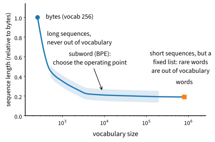
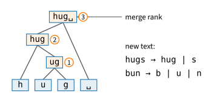
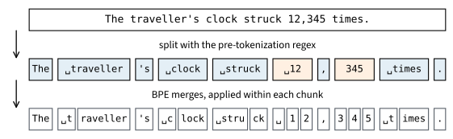

# From Text to Tokens
:label:`sec_text-sequence`

Most sequences we model in this chapter are text, which introduces a challenge
that the synthetic numerical series of :numref:`sec_sequence` did not: neural
networks operate on vectors of numbers, whereas text arrives as a raw string of
characters. Before we can train any language model, we must decide how to
segment a string into *tokens* (the atomic units treated as observations
$x_t$) and how to map each token to a numerical index. This seemingly mundane
preprocessing choice has far-reaching consequences: it determines the size of
the model's embedding and output layers, the sequence length of every document
the model reads, and even how hard tasks such as arithmetic turn out to be.
Splitting *The Time Machine* into individual characters forces a model to step
through roughly 170,000 time steps; splitting it into whole words requires an
output class for each of about 4,600 distinct words while still breaking on
any word not seen during training. For this reason, every modern language model
ships with a dedicated tokenizer, and it is best to think of the tokenizer as
an integral part of the model itself.

We begin by comparing character-level and word-level tokenization, which lie
at opposite ends of the trade-off between vocabulary size and sequence length.
We then drop down to raw bytes as a universal base alphabet and learn a
subword vocabulary directly from data using *byte pair encoding* (BPE), the
scheme underlying the GPT family of models
:cite:`Sennrich.Haddow.Birch.2015,Radford.Wu.Child.ea.2019`. Our from-scratch
implementation is only a few dozen lines of Python, yet it reproduces GPT-2's
production tokenizer token for token.

## Reading the Dataset

Throughout this chapter, our running corpus is H. G. Wells'
[The Time Machine](http://www.gutenberg.org/ebooks/35), a novella of just over
30,000 words. Although real-world pretraining corpora run to trillions of
tokens, this dataset is rich enough to exhibit the statistical properties of
natural language while remaining small enough to tokenize in seconds. The
`_download` method below fetches the book and reads the raw text into a single
string.

```{.python .input}
%load_ext d2lbook.tab
tab.interact_select('mxnet', 'pytorch', 'tensorflow', 'jax')
```

```{.python .input #text-sequence-converting-raw-text-into-sequence-data}
%%tab mxnet
import math
import numpy as np
from mxnet import autograd, gluon, init, np as mnp, npx
from mxnet.gluon import nn
from d2l import mxnet as d2l
npx.set_np()
```

```{.python .input #text-sequence-converting-raw-text-into-sequence-data}
%%tab pytorch
import math
import numpy as np
import torch
from torch import nn
from torch.nn import functional as F
from d2l import torch as d2l
```

```{.python .input #text-sequence-converting-raw-text-into-sequence-data}
%%tab tensorflow
import math
import numpy as np
import tensorflow as tf
from d2l import tensorflow as d2l
```

```{.python .input #text-sequence-converting-raw-text-into-sequence-data}
%%tab jax
import math
import numpy as np
import jax
from jax import numpy as jnp
from flax import nnx
import optax
from d2l import jax as d2l
```

```{.python .input #text-sequence-reading-the-dataset-3}
import collections
import re
import tiktoken
```

```{.python .input #text-sequence-reading-the-dataset-1}
class TimeMachine(d2l.DataModule): #@save
    """The Time Machine dataset."""
    def _download(self):
        fname = d2l.download(d2l.DATA_URL + 'timemachine.txt', self.root,
                             '090b5e7e70c295757f55df93cb0a180b9691891a')
        with open(fname) as f:
            return f.read()

data = TimeMachine()
raw_text = data._download()
raw_text[:60]
```

Classical NLP pipelines normalized raw text aggressively—stripping out
punctuation, folding all letters to lowercase, and only then splitting the
cleaned string into tokens. We keep a simple normalization step here for the
character- and word-level comparisons below, as well as for later sections
that still use those pipelines. Still, such preprocessing is undeniably crude:
it discards informative signals (capitalization distinguishes "Bill" from
"bill") and bakes in brittle assumptions about which characters matter. By
contrast, the byte-level tokenizer we construct later in this section requires
no normalization whatsoever.

```{.python .input #text-sequence-reading-the-dataset-2}
@d2l.add_to_class(TimeMachine)  #@save
def _preprocess(self, text):
    return re.sub('[^A-Za-z]+', ' ', text).lower()

text = data._preprocess(raw_text)
text[:60]
```

## Characters, Words, and Bytes

### Characters and Words

Because a sequence model processes one token per time step, the two most
natural choices of token are individual characters and whole words. Let us
examine both, starting with characters.

```{.python .input #text-sequence-tokenization}
@d2l.add_to_class(TimeMachine)  #@save
def _tokenize(self, text):
    return list(text)

tokens = data._tokenize(text)
','.join(tokens[:30])
```

Splitting on whitespace produces word tokens instead. For each scheme, we
count both the number of *distinct* token types (which sets the vocabulary
size) and the total number of tokens in the corpus (which sets the sequence
length).

```{.python .input #text-sequence-two-ends-of-a-spectrum-1}
words = text.split()
print(f'characters: {len(set(tokens)):>6} distinct, '
      f'{len(tokens):>7} tokens in the corpus')
print(f'words:      {len(set(words)):>6} distinct, '
      f'{len(words):>7} tokens in the corpus')
```

Character-level tokenization of our normalized text requires only 27 symbols
and can never encounter an unknown letter, yet it stretches the novella across
more than 170,000 time steps, forcing any long-range dependency, such as
agreement between a subject and its verb, to span dozens of steps. Word-level
tokenization compresses the same text into roughly one-fifth as many tokens,
each carrying far more semantic content. Even on this short novella, however,
splitting into words already yields thousands of distinct types, and the
vocabulary grows continually with the corpus: every proper name, typographical
error, and inflection ("traveller", "travellers", "travelled") claims its own
entry, most of which appear only once or twice (:numref:`sec_language-model`).
Worse still, any word absent from the training set is *out of vocabulary*
(OOV) at test time. :numref:`fig_granularity_spectrum` illustrates this
fundamental trade-off: enlarging the vocabulary shortens the resulting
sequences, and the central design question is where along this spectrum to
operate. Subword tokenizers allow us to choose that operating point flexibly,
and most of the remainder of this section is devoted to building one.


:label:`fig_granularity_spectrum`

### From Tokens to Indices

Before moving to subwords, let us complete the classical pipeline, which
several later sections of the book still use. Because neural networks operate
on integer indices rather than strings, character and word pipelines rely on a
*vocabulary* object that assigns each distinct token an index, sorted from most
to least frequent, and maps unseen tokens to a reserved `<unk>` entry. Rare
tokens occurring fewer than `min_freq` times can also be pruned to keep the
vocabulary compact, falling back to `<unk>` as well.

```{.python .input #text-sequence-vocabulary-1}
class Vocab:  #@save
    """Vocabulary for text."""
    def __init__(self, tokens=(), min_freq=0, reserved_tokens=()):
        # Flatten a 2D list if needed
        if tokens and isinstance(tokens[0], list):
            tokens = [token for line in tokens for token in line]
        # Count token frequencies
        counter = collections.Counter(tokens)
        self.token_freqs = sorted(counter.items(), key=lambda x: x[1],
                                  reverse=True)
        # The list of unique tokens, ordered by descending frequency.
        # Reserve <unk> at index 0 so vocab[0] is the unknown token.
        self.idx_to_token = ['<unk>'] + list(reserved_tokens) + [
            token for token, freq in self.token_freqs
            if freq >= min_freq and token not in reserved_tokens]
        self.token_to_idx = {token: idx
                             for idx, token in enumerate(self.idx_to_token)}

    def __len__(self):
        return len(self.idx_to_token)

    def __getitem__(self, tokens):
        if not isinstance(tokens, (list, tuple)):
            return self.token_to_idx.get(tokens, self.unk)
        return [self.__getitem__(token) for token in tokens]

    def to_tokens(self, indices):
        if isinstance(indices, (list, tuple)) or getattr(indices, 'ndim', 0):
            return [self.idx_to_token[int(index)] for index in indices]
        return self.idx_to_token[int(indices)]

    @property
    def unk(self):  # Index for the unknown token
        return self.token_to_idx['<unk>']
```

To test `Vocab`, we build a vocabulary over our character `tokens`, map the
first ten characters to integer `indices`, and invert them with
`vocab.to_tokens`.

```{.python .input #text-sequence-vocabulary-2}
vocab = Vocab(tokens)
indices = vocab[tokens[:10]]
print('indices:', indices)
print('tokens:', vocab.to_tokens(indices))
```

The `build` convenience method packages this entire classical
pipeline (preprocessing, tokenizing, and indexing) into a single call that
returns the corpus of integer indices alongside its vocabulary.

```{.python .input #text-sequence-putting-it-all-together}
@d2l.add_to_class(TimeMachine)  #@save
def build(self, raw_text, vocab=None):
    tokens = self._tokenize(self._preprocess(raw_text))
    if vocab is None: vocab = Vocab(tokens)
    corpus = [vocab[token] for token in tokens]
    return corpus, vocab

corpus, vocab = data.build(raw_text)
len(corpus), len(vocab)
```

### Text as Bytes

To interpolate smoothly between characters and words, we first need a base
alphabet capable of representing every possible string. Characters themselves
are surprisingly ill-suited for this role: Unicode defines roughly 150,000
characters across scripts, diacritics, mathematical symbols, and emoji, so a
character-level vocabulary ceases to be small as soon as we step beyond plain
English. Modern tokenizers drop one level lower. Every string stored on a
computer is ultimately represented as a sequence of *bytes* under a character
encoding, almost universally UTF-8. Because a single byte takes one of only
$2^8 = 256$ values, a byte-level base vocabulary contains just 256 symbols and
can *never* encounter an out-of-vocabulary input: any string, in any language,
complete with punctuation, code, or typos, decomposes cleanly into bytes.

UTF-8 achieves this universality through a variable-length encoding that uses
one byte for standard ASCII characters and up to four bytes for less common
scripts and symbols.

```{.python .input #text-sequence-text-as-bytes}
s = 'Hello, naïve café: 你好 🚀'
print(len(s), 'characters,', len(s.encode('utf-8')), 'bytes')
for ch in 'a é 你 🚀'.split():
    print(repr(ch), '->', list(ch.encode('utf-8')))
n_bytes = len(raw_text.encode('utf-8'))
print(f'The novella: {n_bytes} bytes, {n_bytes / len(words):.1f} per word')
```

The price of this universal alphabet is sequence length. Our novella expands
to nearly 180,000 bytes (more than five tokens per word), and because accented
letters such as "é" require two bytes, Chinese characters three, and emoji
four, raw byte sequences stretch non-English text even further. Everything
that follows preserves the universality of bytes while compressing sequences
back down to manageable lengths.

## Byte Pair Encoding

### The Merge Rule

Byte pair encoding (BPE) began as a compression scheme: replace the most
frequent pair of adjacent bytes by a new symbol, and repeat :cite:`Gage.1994`.
:citet:`Sennrich.Haddow.Birch.2015` applied the same rule to the characters
inside words to obtain subword units for machine translation, and GPT-2
returned it to raw bytes :cite:`Radford.Wu.Child.ea.2019`. This byte-level
variant is the one we build. It begins with the 256 single-byte symbols and
grows its vocabulary greedily: at each iteration, it counts every adjacent
*pair* of tokens in the training corpus, merges the most frequent pair into a
single new token, and repeats until the vocabulary reaches its target size.
Because each merge shortens the corpus by
exactly the number of occurrences it replaces, BPE acts as a greedy
compression algorithm whose learned vocabulary forms a dictionary of the
corpus's most common recurring fragments.

Tracing the algorithm by hand makes its behavior transparent. Consider a toy
corpus containing five distinct words across eight occurrences:

```
hug pug pun bun hugs hug hug pug
```

The raw corpus is 32 bytes long. The most frequent adjacent pair is (`u`, `g`),
appearing six times (inside "hug", "pug", and "hugs"), so the first merge
introduces the new token `ug`. After substituting `ug` everywhere, the most
frequent adjacent pair becomes (`h`, `ug`), and the process continues:

| step | most frequent pair | count | new token | corpus length |
|:----:|:------------------:|:-----:|:---------:|:-------------:|
| 0    | (start from bytes) |       |           | 32            |
| 1    | `u`, `g`           | 6     | `ug`      | 26            |
| 2    | `h`, `ug`          | 4 (tie) | `hug`   | 22            |
| 3    | `hug`, `' '`       | 3 (tie) | `'hug '` | 19           |

Note that steps 2 and 3 involve ties: (`ug`, `' '`) also appears four times at
step 2, while (`' '`, `p`) and (`' '`, `hug`) also appear three times at step
3. Following standard convention, we break ties in favor of the pair that
occurs earliest in the corpus.

Two important properties emerge directly from this trace. First, merges
compose hierarchically: because `hug` is formed from `h` and `ug`, the learned
vocabulary defines a *merge tree* over the byte alphabet
(:numref:`fig_merge_tree`), allowing any unseen text to be segmented by
replaying the learned merges. The word "hugs", for instance, splits cleanly
into `hug` and `s`, while the rare word "bun" remains three raw bytes—any
substring untouched by learned merges simply falls back to individual bytes.
Second, notice that step 3 fused a word with its *trailing space*. While a
trailing space is benign on its own, nothing prevents subsequent merges from
attaching the beginning of the following word as well. On a real corpus,
unconstrained BPE readily creates multi-word tokens, a flaw we remedy shortly.


:label:`fig_merge_tree`

### Implementation

We implement the BPE algorithm in three concise pieces. First, the
`BPETokenizer` class holds the tokenizer's state: token ids 0 through 255
represent raw bytes, and each learned merge receives the next available
integer id, so ids double as merge *ranks* (a smaller id indicates an earlier
merge). The dictionary `merges` maps each merged pair of ids to its new id,
while `vocab` maps every id to its corresponding byte string. The `pattern`
and `specials` arguments, along with `byte_ids`, come into play later in this
section and can be ignored for the moment. We also import the `regex` package,
an extension of Python's standard `re` module that supports Unicode character
classes (such as `\p{L}` for any letter) needed for pre-tokenization.

```{.python .input #text-sequence-implementation-1}
#@save
import regex

class BPETokenizer:  #@save
    """Byte-level BPE tokenizer trained by iterated most-frequent-pair
    merges.

    Token ids 0..255 are raw bytes; learned merges get ids
    256..vocab_size-1; special tokens sit above those and are never
    produced by BPE itself. `pattern` is an optional pre-tokenization
    regex: text is split into chunks and merges never cross chunk
    boundaries.
    """

    GPT2_PATTERN = (r"'s|'t|'re|'ve|'m|'ll|'d| ?\p{L}+| ?\p{N}+"
                    r"| ?[^\s\p{L}\p{N}]+|\s+(?!\S)|\s+")

    def __init__(self, vocab_size=1024, pattern=None,
                 specials=('<pad>', '<bos>', '<eos>')):
        self.vocab_size, self.pattern = vocab_size, pattern
        self.merges = {}                                  # (id, id) -> new id
        self.vocab = {i: bytes([i]) for i in range(256)}  # id -> bytes
        self.byte_ids = list(range(256))                  # byte value -> id
        self.specials = {s: vocab_size + i for i, s in enumerate(specials)}

    def __len__(self):
        return self.vocab_size + len(self.specials)

    @property
    def pad(self):
        return self.specials['<pad>']

    @property
    def bos(self):
        return self.specials['<bos>']

    @property
    def eos(self):
        return self.specials['<eos>']

    def _chunks(self, text):
        return [text] if self.pattern is None else regex.findall(
            self.pattern, text)
```

Both training and encoding depend on a single core operation: replacing every
occurrence of a target pair of adjacent ids with the id of their merged token.
The helper `_merge` scans left to right, writing `new_id` and advancing by two
whenever `pair` matches, and copying one id otherwise. Consequently, on the
string `aaa`, the pair (`a`, `a`) is replaced once on the left rather than
overlappingly.

```{.python .input #text-sequence-implementation-3}
@d2l.add_to_class(BPETokenizer)  #@save
def _merge(self, ids, pair, new_id):
    """Replace every occurrence of pair in ids by new_id."""
    out, i = [], 0
    while i < len(ids):
        if i + 1 < len(ids) and (ids[i], ids[i + 1]) == pair:
            out.append(new_id)  # Merge the pair and skip past it
            i += 2
        else:
            out.append(ids[i])
            i += 1
    return out
```

Training repeats the same loop we traced by hand: count all adjacent pairs,
merge the most frequent pair everywhere, and record the resulting rule. Just
as in the trace, ties are broken in favor of whichever pair was seen first—the
exact behavior of Python's `max`. One practical optimization is that identical
text chunks are stored only once, with their pair counts weighted by the
chunk's frequency in the corpus. Before pre-tokenization, the entire corpus is
a single chunk with weight 1; once pre-tokenization breaks text into words, a
common word is processed once instead of thousands of times. Production BPE
trainers go further by updating pair counts incrementally around each merge;
here we simply recount after each step, trading speed for clarity.

```{.python .input #text-sequence-implementation-4}
@d2l.add_to_class(BPETokenizer)  #@save
def train(self, text):
    """Learn vocab_size - 256 merges, most frequent pair first."""
    chunk_freq = collections.Counter(self._chunks(text))
    seqs = [list(chunk.encode('utf-8')) for chunk in chunk_freq]
    for new_id in range(256, self.vocab_size):
        pairs = collections.Counter()
        for seq, w in zip(seqs, chunk_freq.values()):
            for pair in zip(seq, seq[1:]):
                pairs[pair] += w  # A chunk that occurs w times counts w times
        if not pairs:
            break  # nothing left to merge
        pair = max(pairs, key=pairs.get)
        self.merges[pair] = new_id
        self.vocab[new_id] = self.vocab[pair[0]] + self.vocab[pair[1]]
        seqs = [self._merge(seq, pair, new_id) for seq in seqs]
```

Training `BPETokenizer` for three merges (`vocab_size=256 + 3`) on our toy
corpus and inspecting `toy_tok.merges` reproduces the three merge steps from
our hand trace above:

```{.python .input #text-sequence-implementation-2}
toy_tok = BPETokenizer(vocab_size=256 + 3)
toy_tok.train('hug pug pun bun hugs hug hug pug')
for (a, b), new_id in toy_tok.merges.items():
    print(f'{toy_tok.vocab[a]} + {toy_tok.vocab[b]} -> '
          f'{toy_tok.vocab[new_id]}')
```

### Encoding and Decoding

Training produces a merge table. To *encode* new text, we start from its raw
UTF-8 bytes and repeatedly merge the adjacent pair with the lowest merge rank
until no adjacent pair appears in the table. Notice that encoding consults
only the merge ranks—never corpus counts—so it is a pure function of the
learned table: **the tokenizer is completely defined by its merge ranks**.
Applying the lowest-ranked merge first faithfully retraces training, because
each training merge was learned on text where all earlier merges had already
been applied (a property formalized in the exercises). Decoding is simpler
still: every token id maps directly to a byte sequence, so we concatenate the
bytes and decode them as UTF-8, using `errors='replace'` so that any partial
or malformed byte sequence emitted by a generative model degrades gracefully
instead of raising an exception.

```{.python .input #text-sequence-encoding-and-decoding-1}
@d2l.add_to_class(BPETokenizer)  #@save
def _encode_chunk(self, text_bytes):
    ids = [self.byte_ids[b] for b in text_bytes]
    while len(ids) > 1:
        # The lowest-rank merge applicable anywhere in this chunk
        pair = min(zip(ids, ids[1:]),
                   key=lambda p: self.merges.get(p, float('inf')))
        if pair not in self.merges:
            break
        ids = self._merge(ids, pair, self.merges[pair])
    return ids

@d2l.add_to_class(BPETokenizer)  #@save
def encode(self, text, allow_special=False):
    if allow_special and self.specials:
        pat = '(' + '|'.join(regex.escape(s) for s in self.specials) + ')'
        ids = []
        for part in regex.split(pat, text):
            if part in self.specials:
                ids.append(self.specials[part])
            elif part:
                ids.extend(self.encode(part))
        return ids
    return [i for chunk in self._chunks(text)
            for i in self._encode_chunk(chunk.encode('utf-8'))]

@d2l.add_to_class(BPETokenizer)  #@save
def decode(self, ids):
    specials = {i: s.encode('utf-8') for s, i in self.specials.items()}
    data = b''.join(self.vocab[i] if i in self.vocab else specials[i]
                    for i in ids)
    return data.decode('utf-8', errors='replace')
```

On the toy tokenizer, encoding matches our hand trace and decoding recovers
the original string cleanly.

```{.python .input #text-sequence-encoding-and-decoding-2}
print([toy_tok.vocab[i] for i in toy_tok.encode('hugs')])
print([toy_tok.vocab[i] for i in toy_tok.encode('bun')])
toy_tok.decode(toy_tok.encode('hug pug hugs'))
```

### Training on The Time Machine

To see what BPE learns from real prose, we train it on *The Time Machine*.
Because token lists and generated passages often exceed the width of a
printed page, we first define a small printing helper that wraps long lines
neatly for use here and throughout the rest of the book.

```{.python .input #text-sequence-training-on-the-time-machine-3}
#@save
import textwrap

def print_wrapped(*args, width=76):  #@save
    """Print like `print`, folding each line to the width of a page."""
    for line in ' '.join(str(a) for a in args).split('\n'):
        print(textwrap.fill(line, width, subsequent_indent='    '))
```

We now train a 1,024-token vocabulary directly on the raw, unnormalized text
of the novella. The earliest merges capture common letter pairs, whereas the
final merges assemble whole words from Wells' prose. Notice, however, that
one token in the encoded sample below is the two-word composite
`"Time Traveller "`, spaces and all—an artifact we examine next.

```{.python .input #text-sequence-training-on-the-time-machine-1}
tok = BPETokenizer(vocab_size=1024)
tok.train(raw_text)
merged_ids = list(tok.merges.values())
print('first:', [tok.vocab[i] for i in merged_ids[:8]])
print('last: ', [tok.vocab[i] for i in merged_ids[-8:]])
ids = tok.encode('The Time Traveller smiled. Are you sure?')
print_wrapped(len(ids), 'tokens:', [tok.vocab[i] for i in ids])
```

How much shorter does a sequence become as we enlarge the vocabulary? Because
merges are numbered in the exact order they are learned, any smaller BPE
vocabulary is a *prefix* of a larger one trained on the same corpus: retaining
only merges with id strictly below $|\mathcal{V}|$ reproduces the exact
tokenizer we would have obtained by stopping training at size $|\mathcal{V}|$.
A single training run therefore lets us sweep vocabulary sizes from 256 up to
4,096. Below, we measure compression in bytes per token on the first 10,000
characters of the novella (exercise :exref:`ex_text-sequence-pretok-ablation`
evaluates held-out text).

```{.python .input #text-sequence-training-on-the-time-machine-2}
big = BPETokenizer(vocab_size=4096)
big.train(raw_text)
excerpt = raw_text[:10000]
sizes = [256, 384, 512, 768, 1024, 1536, 2048, 3072, 4096]
ratios = []
for v in sizes:
    sub = BPETokenizer(vocab_size=v)  # the first v - 256 merges of big
    sub.merges = {p: i for p, i in big.merges.items() if i < v}
    sub.vocab = {i: b for i, b in big.vocab.items() if i < v}
    ratios.append(len(excerpt.encode('utf-8')) / len(sub.encode(excerpt)))
d2l.plot(sizes, [ratios], 'vocabulary size', 'bytes per token',
         xscale='log')
```

Each doubling of the vocabulary buys roughly a constant gain in compression,
so bytes per token grows approximately logarithmically with vocabulary size.
This scaling follows directly from the greedy merge rule: early merges such as
`"e "`, `"th"`, and `"d "` collapse thousands of occurrences apiece, whereas
the 4,000th merge collapses only a handful. We should be careful, however, not
to extrapolate this curve blindly to production vocabularies of 50,000 to
200,000 tokens. The upper end of our plot is flattered because we evaluated on
the same text used to train the tokenizer, where a 4,096-token vocabulary has
memorized words and phrases specific to *The Time Machine*. On general English
prose, production vocabularies typically achieve four to five bytes per
token—roughly one token per word—as we verify below, devoting their extra
capacity to rarer words, source code, and (in multilingual vocabularies such
as `o200k_base`) other languages.

### Pre-Tokenization

The composite `"Time Traveller "` is hardly an isolated case. Alongside true
word fragments, our unconstrained tokenizer accumulates dozens of tokens that
straddle word boundaries:

```{.python .input #text-sequence-pre-tokenization-telling-bpe-where-words-end-1}
crossers = [v.decode('utf-8', 'replace') for i, v in tok.vocab.items()
            if i >= 256 and b' ' in v.strip(b' ')]
print_wrapped(len(crossers), 'tokens cross a word boundary, e.g.',
              crossers[:8])
```

Although multi-word merges like `"of the "` help compress the training text,
they are brittle composites: they consume vocabulary slots on fixed phrases
while fragmenting the statistical evidence for their constituent words (since
`"of"` now appears scattered across many distinct tokens). Every production
BPE tokenizer therefore inserts a *pre-tokenization* stage before merging.
A regular expression first splits the input string into chunks, and BPE is
trained and applied strictly *within* each chunk so that merges never cross
chunk boundaries. GPT-2's pattern :cite:`Radford.Wu.Child.ea.2019`, stored as
`BPETokenizer.GPT2_PATTERN`, consists of five branches:

```
's|'t|'re|'ve|'m|'ll|'d        common English contractions, split off
| ?\p{L}+                      a run of letters, with its leading space
| ?\p{N}+                      a run of digits, with its leading space
| ?[^\s\p{L}\p{N}]+            a run of punctuation or other symbols
|\s+(?!\S)|\s+                 remaining whitespace
```

This pattern encodes three deliberate conventions: each word retains its
*leading space* (`" the"` rather than `"the "`) so that spacing travels with
the word itself; letters, digits, and punctuation are separated into distinct
chunks so that numbers and symbols never fuse onto words; and common English
contractions are split off as standalone chunks.

```{.python .input #text-sequence-pre-tokenization-telling-bpe-where-words-end-2}
regex.findall(BPETokenizer.GPT2_PATTERN,
              "The traveller's clock struck 12,345 times.")
```

Enabling pre-tokenization requires only passing `pattern` to `BPETokenizer`;
:numref:`fig_pretok_pipeline` illustrates the full pipeline from raw text to
token ids. Compared with the unconstrained run, every boundary-crossing
composite vanishes, freeing those vocabulary slots for complete words paired
with their leading spaces. The earliest merges now attach frequent letters to
leading spaces (`" t"`, `" a"`) or join common letter pairs (`"he"`, `"in"`).

```{.python .input #text-sequence-pre-tokenization-telling-bpe-where-words-end-3}
bpe = BPETokenizer(vocab_size=1024, pattern=BPETokenizer.GPT2_PATTERN)
bpe.train(raw_text)
crossers = [v for i, v in bpe.vocab.items()
            if i >= 256 and b' ' in v.strip(b' ')]
print('boundary-crossing tokens now:', len(crossers))
gained = sorted(set(bpe.vocab.values()) - set(tok.vocab.values()),
                key=lambda v: (-len(v), v))
print_wrapped('longest tokens gained instead:',
              [v.decode('utf-8', 'replace') for v in gained[:6]])
print('first merges:', [bpe.vocab[i] for i in list(bpe.merges.values())[:6]])
```


:label:`fig_pretok_pipeline`

## Special Tokens
:label:`subsec_special-tokens`

Training and serving pipelines also require a small set of control tokens that
carry meaning for the *infrastructure* rather than the text itself: `<pad>`
pads shorter sequences to a common batch length, `<bos>` marks the start of a
sequence, and `<eos>` lets a model signal that generation has finished (the
decoders of :numref:`sec_decoding` watch for it as a stopping cue). Our
`BPETokenizer` places these special ids *above* the BPE range—a deliberate
safety invariant ensuring that ordinary text can never accidentally encode to
a special token. Otherwise, any document or user message containing the
literal characters `"<eos>"` could inject a control signal directly into the
model's input stream, a classic vector for *prompt injection* in which untrusted
user text is interpreted as a system instruction. Accordingly, our `encode`
method treats special token strings as ordinary bytes unless the caller
explicitly passes `allow_special=True`, mirroring `tiktoken`'s
`allowed_special` guard (which raises an error by default).

```{.python .input #text-sequence-special-tokens}
print('as plain text:  ', bpe.encode('<bos>the time machine'))
print('as control code:', bpe.encode('<bos>the time machine',
                                     allow_special=True))
print('pad/bos/eos ids:', bpe.pad, bpe.bos, bpe.eos, '| len:', len(bpe))
```

## Tokenizers in the Wild

### The Rank Table of a Production Tokenizer

Most widely deployed language models, including the GPT family and Llama from
version 3 onward, rely on byte-level BPE tokenizers built along these exact lines,
simply trained on vastly larger corpora. GPT-2's tokenizer
:cite:`Radford.Wu.Child.ea.2019` is stored compactly as a lookup table mapping
each token's byte sequence to its merge rank, paired with the pre-tokenization
regex and special-token registry; there is no neural network inside it.
(Other subword families, such as WordPiece or Unigram, additionally store text
normalization rules or token probabilities used to pick among competing
segmentations.) OpenAI's `tiktoken` library ships GPT-2's rank table directly.
Below, we inspect entries right across the boundary between single bytes and
learned merges—noting that the leading underscore on `_mergeable_ranks`
indicates an internal attribute whose name may change across library releases.

```{.python .input #text-sequence-what-a-production-tokenizer-stores}
enc = tiktoken.get_encoding('gpt2')
print(list(enc._mergeable_ranks.items())[254:260])
print(enc._special_tokens)
```

Ranks 0 through 255 correspond to the individual bytes in a permuted order
(GPT-2 lists printable ASCII characters first), followed from rank 256 onward
by the learned merges in training order—the exact same layout as our
`BPETokenizer`. Remarkably, GPT-2's first four merges learned from 40
gigabytes of web text (`" t"`, `" a"`, `"he"`, and `"in"`) are identical to the
first four merges `bpe` learned from a single nineteenth-century novella,
reflecting the stability of the most frequent English character patterns.

### Verifying Our Implementation

Because a BPE tokenizer is completely specified by its rank table, we can load
GPT-2's published ranks straight into our own `BPETokenizer` encoder. Each
rank becomes a token id, and the 256 single-byte entries define the byte
permutation. Since the published table records only the final bytes of each
token rather than the pair of parents that formed it, we reconstruct each
merge pair by replaying all lower-ranked merges on the token's bytes until
exactly two pieces remain. The reconstruction details below can be skimmed;
the key point is the verification cell that follows.

```{.python .input #text-sequence-verifying-our-implementation-1}
@d2l.add_to_class(BPETokenizer)  #@save
@classmethod
def from_tiktoken(cls, name):
    """Load a published bytes->rank table (e.g. 'gpt2') into our encoder."""
    import tiktoken  # lazy: d2l itself does not require tiktoken
    enc = tiktoken.get_encoding(name)
    ranks = enc._mergeable_ranks
    tok = cls(vocab_size=len(ranks), pattern=enc._pat_str, specials=())
    tok.specials = dict(enc._special_tokens)
    tok.vocab = {rank: b for b, rank in ranks.items()}
    tok.byte_ids = [ranks[bytes([b])] for b in range(256)]
    for token, rank in ranks.items():
        if len(token) > 1:  # recover which pair merged into this token
            parts = [bytes([b]) for b in token]
            while len(parts) > 2:
                a, b = min(zip(parts, parts[1:]),
                           key=lambda p: ranks.get(p[0] + p[1],
                                                   float('inf')))
                i = list(zip(parts, parts[1:])).index((a, b))
                parts[i:i + 2] = [a + b]
            tok.merges[ranks[parts[0]], ranks[parts[1]]] = rank
    return tok
```

On a test paragraph mixing prose, numbers, accented characters, currency
symbols, and an emoji, our encoder matches `tiktoken` token for token—an
assertion checked automatically whenever this book is built.

```{.python .input #text-sequence-verifying-our-implementation-2}
ours = BPETokenizer.from_tiktoken('gpt2')
para = ('The Time Traveller (for so it will be convenient to speak of '
        'him) was expounding a recondite matter to us; his pale grey '
        'eyes shone and twinkled. Prices rose 3.5% in 1895, and naïve '
        'café patrons paid £12,345 more! 🚀')
assert ours.encode(para) == enc.encode(para)
print(len(ours.encode(para)), 'tokens, identical to tiktoken')
print([ours.vocab[i].decode('utf-8', 'replace')
       for i in ours.encode(para)[:8]])
```

How well do large production vocabularies compress *The Time Machine*? Below,
we compare our 1,024-token tokenizer against GPT-2's 50,257-token vocabulary
and `o200k_base`, the roughly 200,000-token vocabulary used by GPT-4o.

```{.python .input #text-sequence-verifying-our-implementation-3}
rows = [('ours (1k, in-domain)', len(bpe.encode(raw_text)))]
for name in ('gpt2', 'o200k_base'):
    e = tiktoken.get_encoding(name)
    rows.append((f'{name} ({len(e._mergeable_ranks) // 1000}k)',
                 len(e.encode(raw_text))))
for name, n in rows:
    print(f'{name:>22}: {n:>6} tokens, {n_bytes / n:.2f} bytes/token')
```

Even though our vocabulary is 50 to 200 times smaller, it achieves roughly
two-thirds of their compression ratio because it was trained specifically on
this novella. Like any statistical model, a tokenizer is a compression model
of its training distribution and performs best on text resembling the corpus
it was built from.

### Fertility, Digits, and Glitch Tokens
:label:`subsec_fertility-digits-glitch`

The average number of tokens a tokenizer spends per word in a given language
is known as its *fertility*. Because GPT-2's tokenizer was trained primarily
on English web text, translating the very same sentence into three languages
yields starkly different token counts:

```{.python .input #text-sequence-fertility-digits-and-glitch-tokens-1}
sentences = {
    'English': 'The time traveller returned after many years.',
    'German': 'Der Zeitreisende kehrte nach vielen Jahren zurück.',
    'Greek': 'Ο ταξιδιώτης του χρόνου επέστρεψε μετά από πολλά χρόνια.'}
for lang, s in sentences.items():
    gpt2, o200k = [len(tiktoken.get_encoding(e).encode(s)) / len(s.split())
                   for e in ('gpt2', 'o200k_base')]
    print(f'{lang:>8}: {gpt2:.2f} (gpt2), {o200k:.2f} (o200k_base) '
          'tokens per word')
```

Under GPT-2's tokenizer, a Greek word consumes roughly seven tokens (each Greek
letter takes two UTF-8 bytes and very few Greek merges were learned), compared
with roughly one token per English word. Consequently, a 1,024-token context
window holds about 900 English words but only about 140 Greek words, making
inference both slower and more expensive for non-English users. By contrast,
the multilingual `o200k_base` vocabulary brings Greek fertility down to
roughly two tokens per word.

Numbers reveal how subtle tokenization details reshape what a model must
learn. Whereas GPT-2 splits digit sequences wherever BPE happened to discover
frequent fragments, newer tokenizers cap digit chunks at three characters
during pre-tokenization so that segmentation is more uniform:

```{.python .input #text-sequence-fertility-digits-and-glitch-tokens-2}
for name in ('gpt2', 'o200k_base'):
    e = tiktoken.get_encoding(name)
    print(f'{name}: 12345678 ->',
          [e.decode([t]) for t in e.encode('12345678')])
```

Even so, neither segmentation aligns with the columns of positional
arithmetic, which groups digits from right to left into ones, tens, and
hundreds. Under a left-to-right three-digit cap, `"12345678"` splits into
`"123"`, `"456"`, and `"78"`, forcing a language model to perform carries
across misaligned boundaries. This mismatch is a well-known contributor to
arithmetic errors in language models, and helps explain why inserting standard
thousands separators (`"12,345,678"`) can make numerical tasks easier.

Finally, a vocabulary entry is only as reliable as the model's exposure to it
during training. Early GPT-2 and GPT-3 vocabularies included tokens such as
`" SolidGoldMagikarp"`—a Reddit username that appeared frequently enough in
the *tokenizer's* training corpus to earn a dedicated merge, yet was largely
absent from the *language model's* pretraining data. Such a *glitch token* can
still be produced from user prompts even though its embedding vector received
almost no gradient updates; prompted to repeat it, early models often
responded with evasions or unrelated words.

```{.python .input #text-sequence-fertility-digits-and-glitch-tokens-3}
enc.encode(' SolidGoldMagikarp')  # one token for an 18-character string
```

## Summary

A tokenizer bridges raw text and the integer sequences consumed by neural
networks. Its vocabulary size governs a core trade-off between sequence length
and output-layer size, while fixed word vocabularies additionally break on
unseen words. Byte-level BPE begins with the 256 single-byte symbols, eliminating
out-of-vocabulary inputs altogether, and greedily merges the most frequent
adjacent token pairs until the target vocabulary size is reached. Because
encoding replays learned merges strictly in rank order, the merge table alone
defines the tokenizer. In practice, a pre-tokenization regex prevents merges
from crossing word boundaries, and special control tokens are assigned ids
above the BPE range so that ordinary text cannot synthesize them. GPT-2's
production tokenizer follows this exact construction at larger scale, and our
implementation reproduces it token for token; its varying fertility across
languages, its digit-splitting quirks, and its glitch tokens are all direct
consequences of its training data and merge rules. In the next section, we
turn to modeling the token sequences that a tokenizer produces.

## Exercises

1. **Encoding by rank.** Suppose a `BPETokenizer` with `vocab_size=258`
   has learned exactly two merges: (`b`, `c`) with id 256, and then
   (`a`, `b`) with id 257. The *rank rule* of `_encode_chunk` always
   applies the lowest-ranked applicable merge. The *leftmost rule* always
   merges the leftmost adjacent pair that appears in the merge table.
    1. Segment the string "abc" under each of the two rules.
    1. Give the segmentation that every occurrence of "abc" in the
       training corpus had at the end of training, and say which rule
       agrees with it.

1. [code] **Special-token round trip.** :numref:`subsec_special-tokens`
   places special tokens above the BPE id range so that ordinary text can
   never produce them. Construct a `BPETokenizer` whose `specials` add a
   document separator `<sep>` to the three defaults, and train it on
   `raw_text`. Let `x` be two short documents joined by `<sep>`.
    1. Encode `x` once with and once without `allow_special=True`, and
       check that both id sequences decode to `x`.
    1. Re-encode the decoded text once with `allow_special=True` and once
       without it. Which of the two id sequences from the previous
       sub-problem does each re-encoding reproduce? State what this
       implies for a pipeline that decodes a model's output and later
       feeds the text back in as input.
    1. `tiktoken` raises an error when a special string appears in text
       that is not allowed to contain it, whereas `encode` treats the
       string as plain bytes. Give one situation in which each policy is
       preferable.

    *Adapted from Andrej Karpathy,
    [minbpe](https://github.com/karpathy/minbpe/blob/master/exercise.md),
    Step 4.*

1. [code] **Digit chunking.** Tokenize the addition prompts "1234+5678=",
   "1234+567=" and "567+678=" and their sums "6912", "1801" and "1245"
   with the `gpt2` and `o200k_base` encodings of `tiktoken`, writing out
   the token boundaries of each number.
    1. Under the three-digit cap of `o200k_base`, label each digit token
       with the place values (ones, tens, hundreds, thousands) it covers.
       For each prompt, state whether the tokens at matching positions of
       the two summands and of the sum cover the same place values.
       Explain what goes wrong for a model that adds token by token when
       they do not.
    1. Propose a pre-tokenization rule that aligns tokens with place
       value, and state one drawback of your rule.

1. **Glitch tokens.** :numref:`subsec_fertility-digits-glitch` attributes
   a glitch token to a string that was frequent in the tokenizer's
   training corpus but rare in the language model's.
    1. Why does the merge rule of `BPETokenizer.train` turn such a string
       into a single token rather than several fragments, and what role
       does pre-tokenization play in fixing the token's extent?
    1. Propose a test that flags glitch tokens given the trained embedding
       table and the model's training corpus, and state what each of the
       two inputs contributes.

1. [code] **Pre-tokenization ablation.** ● Split `raw_text` into its first
   90% and its last 10%. On the first part, train two 4,096-token
   tokenizers that differ only in the pattern: one without a pattern, as
   `big` was trained, and one with `BPETokenizer.GPT2_PATTERN`.
    1. List the 20 longest tokens learned by each tokenizer, and mark
       those that span more than one word.
    1. Measure which of the two compresses the first part better, and
       explain the outcome in terms of the merge rule.
    1. Measure bytes per token of both tokenizers on the last 10%. Which
       tokenizer loses the larger fraction of its compression on this
       held-out text, and which compresses it better? Relate both answers
       to the tokens you listed.
   :exlabel:`ex_text-sequence-pretok-ablation`

:begin_tab:`mxnet`
[Discussions](https://d2l.discourse.group/t/115)
:end_tab:

:begin_tab:`pytorch`
[Discussions](https://d2l.discourse.group/t/3857)
:end_tab:

:begin_tab:`tensorflow`
[Discussions](https://d2l.discourse.group/t/3858)
:end_tab:

:begin_tab:`jax`
[Discussions](https://d2l.discourse.group/t/18011)
:end_tab:

<!-- slides -->

::: {.slide}
::: {.cover}
[Dive into Deep Learning · §8.2]{.kicker}

From Text to Tokens<br>**characters vs. words · UTF-8 bytes · byte pair encoding (BPE) · merge trees · regex pre-tokenization · special tokens · production tokenizers**
:::
:::

::: {.slide title="Why Tokenization Is an Integral Part of the Model"}
[Motivation & Core Mental Model]{.kicker}

::: {.cols .vc}
::: {.col}
- **Embedding & output parameter footprint:** Every token in $\mathcal{V}$ claims a row in $\mathbf{E} \in \mathbb{R}^{|\mathcal{V}| \times d}$ and a column in $\mathbf{W}_{\textrm{hq}} \in \mathbb{R}^{h \times |\mathcal{V}|}$ ($89\%$ of our §{sec_rnn} RNN parameters).
- **Effective context horizon ($T$):** Splitting *The Time Machine* into characters produces $173{,}428$ time steps, forcing subject–verb agreement to span dozens of recurrent updates.
- **Open-vocabulary robustness:** Splitting into $32{,}775$ whole words ($4{,}579$ types) breaks on any unseen word (*out-of-vocabulary*, OOV) at test time; subword BPE interpolates with zero OOVs.
:::

::: {.col .fig .big}
@fig:ch08-rnn-tokenizer-impact
:::
:::
:::

::: {.slide title="Ingesting and Normalizing The Time Machine"}
[Corpus Pipeline]{.kicker}

Our running corpus is H. G. Wells' *The Time Machine* (~30,000 words, 178,979 UTF-8 bytes). Classical character/word pipelines normalize text aggressively, whereas our byte-level BPE tokenizer processes `raw_text` losslessly:

@text-sequence-reading-the-dataset-1
:::

::: {.slide title="Ingesting and Normalizing The Time Machine (cont.)"}
[Corpus Pipeline]{.kicker}

@text-sequence-reading-the-dataset-2

::: {.d2l-note .warn}
**Why Aggressive Normalization Is Brittle:** Stripping non-ASCII characters and folding case (`re.sub('[^A-Za-z]+', ' ', text).lower()`) erases punctuation, numbers, code syntax, and proper-noun distinctions (*"Bill"* vs. *"bill"*).
:::
:::

::: {.slide title="The Granularity Trade-Off: Characters vs. Words"}
[Two Ends of the Spectrum]{.kicker}

Character-level and word-level tokenization occupy opposite extremes of the trade-off curve between vocabulary size $|\mathcal{V}|$ and corpus sequence length $T$:

::: {.cols .vc}
::: {.col}
@!text-sequence-two-ends-of-a-spectrum-1

- **Characters ($|\mathcal{V}| = 27$, $T = 173{,}428$):** Tiny output layer and no unknown ASCII letters, but $5.3\times$ longer sequences where individual tokens carry almost no semantic meaning.
- **Words ($|\mathcal{V}| = 4{,}579$, $T = 32{,}775$):** Compact sequences with semantically rich tokens, but inflections (*"traveller"*, *"travellers"*, *"travelled"*) fragment counts and unseen test words fall out of vocabulary (OOV).
:::

::: {.col .fig}
{.nostretch width=100%}
:::
:::
:::

::: {.slide title="Classical Indexing: Vocab and the `<unk>` Fallback"}
[Classical Word & Character Vocabularies]{.kicker}

::: {.cols .vc}
::: {.col}
@text-sequence-vocabulary-2

@text-sequence-putting-it-all-together
:::

::: {.col .fig}
@fig:ch08-rnn-vocab-unk

- **The `<unk>` collapse:** Mapping every rare (`< min_freq`) or unseen word to index `0 (<unk>)` erases morphological stems and incurs an explicit character-spelling penalty during evaluation (§{sec_language-model}).
:::
:::
:::

::: {.slide title="UTF-8 Bytes: A Universal 256-Symbol Base Alphabet"}
[Text as Bytes]{.kicker}

::: {.cols .vc}
::: {.col}
@text-sequence-text-as-bytes

- **Zero OOV guarantee:** Because a byte takes $2^8 = 256$ values, any string in any script, code, or emoji decomposes losslessly into IDs `0..255`.
- **Variable byte width:** UTF-8 spends 1 byte on ASCII, 2 on Latin diacritics/Greek, 3 on CJK, and 4 on emoji ($178{,}979$ bytes across the novella).
:::

::: {.col .fig .narrow}
@fig:ch08-rnn-utf8-bytes
:::
:::
:::

::: {.slide title="Byte Pair Encoding (BPE): Greedy Pair Merging"}
[The BPE Algorithm]{.kicker}

::: {.cols .vc}
::: {.col}
- **Iterative greedy compression (Sennrich et al., 2016):** Start from the 256 single-byte tokens (`0..255`). At each step, tally all adjacent token pairs, merge the most frequent pair into a new token ID (`256, 257, ...`), and repeat until reaching $|\mathcal{V}|$.
- **Corpus length reduction:** Replacing a pair of count $c$ everywhere shortens the training sequence by $c$ tokens (minus self-overlaps on runs like `'aaa'`).
- **Token IDs as merge ranks:** Because IDs are assigned sequentially (`256, 257, ...`), a token's integer ID records the exact rank order in which its merge was learned.
:::

::: {.col .fig .big}
@fig:ch08-rnn-bpe-greedy-loop
:::
:::
:::

::: {.slide title="Hierarchical Merge Trees and Byte Fallback"}
[Subword Generalization]{.kicker}

Because later merges combine tokens created by earlier merges (`'h'` + `'ug'` $\to$ `'hug'`), a trained BPE vocabulary defines a collection of binary **merge trees** rooted at the 256 raw bytes:

::: {.cols .vc}
::: {.col}
@text-sequence-implementation-2

- **Morphological composition:** On unseen or inflected text, `"hugs"` replays merge 1 (`u`+`g` $\to$ `ug`) and merge 2 (`h`+`ug` $\to$ `hug`), segmenting cleanly into stem + suffix `[b'hug', b's']`.
- **Graceful byte fallback:** The rare word `"bun"` shares no learned merges, so it remains three individual byte tokens `[b'b', b'u', b'n']` rather than collapsing to `<unk>`.
:::

::: {.col .fig}
{.nostretch width=100%}
:::
:::
:::

::: {.slide title="Implementing the Left-to-Right Pair Merge Step"}
[From-Scratch Implementation]{.kicker}

BPE training and encoding share one primitive, `_merge(ids, pair, new_id)`:

@text-sequence-implementation-3

- **Left-to-right non-overlapping semantics:** Whenever `(ids[i], ids[i + 1]) == pair`, we append `new_id` and advance by `i += 2`; thus on `[a, a, a]`, merging `(a, a)` yields `[aa, a]` rather than overlapping pairs.
- **State layout in `BPETokenizer`:** `self.vocab` maps each ID `0..vocab_size-1` to its raw `bytes` sequence (`vocab[new_id] = vocab[pair[0]] + vocab[pair[1]]`), while `self.merges` maps `(id_a, id_b) -> new_id`.
:::

::: {.slide title="Training BPE with Frequency-Weighted Chunks"}
[From-Scratch Implementation]{.kicker}

To train `vocab_size - 256` merges, we tally unique pre-tokenized chunks once via `collections.Counter` and weight each adjacent pair inside a chunk by that chunk's corpus frequency `w`:

@text-sequence-implementation-4

::: {.d2l-note}
**Why Deduplicate Chunks?** Once regex pre-tokenization splits a corpus into word chunks, a frequent word like `" the"` appears thousands of times; weighting pair counts by chunk frequency `w` processes `" the"` once per iteration instead of thousands of times.
:::
:::

::: {.slide title="Encoding New Text Strictly by Merge Rank Order"}
[Encoding & Decoding Mechanics]{.kicker}

@-text-sequence-encoding-and-decoding-1
:::

::: {.slide title="Encoding New Text Strictly by Merge Rank Order (cont.)"}
[Encoding & Decoding Mechanics]{.kicker}

To encode an arbitrary byte chunk, `_encode_chunk` repeatedly merges the adjacent pair with the **lowest merge rank** (smallest `new_id`) until no adjacent pair appears in `self.merges`:

@!text-sequence-encoding-and-decoding-2

- **The merge table is the tokenizer:** Encoding never consults corpus counts—only merge ranks.
- **Why rank order is mandatory:** During training, merge $r$ was learned on sequences where all merges $< r$ had *already* been exhausted; applying the lowest-rank pair first faithfully retraces training.
:::

::: {.slide title="What Unconstrained BPE Learns on Wells' Novella"}
[Empirical Behavior on Prose]{.kicker}

Training a 1,024-token BPE vocabulary ($1024 - 256 = 768$ merges) directly on the raw text of *The Time Machine* reveals a clear progression from frequent bigrams to domain-specific words:

@!text-sequence-training-on-the-time-machine-1

- **Earliest merges (`256..263`):** Common English letter pairs and trailing-space endings (`b'e '`, `b'th'`, `b't '`, `b'in'`, `b'd '`, `b'er'`).
- **Final merges (`1016..1023`):** Word stems and whole words with their trailing space (`b'ering '`, `b'door'`, `b'after '`).
- **Notice the flaw:** Token `[b'Time Traveller ']` fused two separate words and a trailing space into a single vocabulary entry.
:::

::: {.slide title="Logarithmic Compression Scaling with Vocabulary Size"}
[Compression vs. Vocabulary Capacity]{.kicker}

Because BPE assigns IDs sequentially in training order, retaining only merges with ID $< |\mathcal{V}|$ from a 4,096-token run gives the exact tokenizer of size $|\mathcal{V}|$:

::: {.cols .vc}
::: {.col}
- **Logarithmic gain per doubling:** Plotting UTF-8 bytes per token against $\log |\mathcal{V}|$ from $256 \to 4{,}096$ yields an almost straight line: each doubling of $|\mathcal{V}|$ adds roughly $0.7$–$1$ byte/token.
- **Diminishing marginal counts:** Merge 256 collapses thousands of occurrences of `b'e '`, whereas merge 4,095 collapses only a handful of occurrences.
- **In-domain overfitting caveat:** Evaluating on training text flatters large $|\mathcal{V}|$ because 4,096 merges memorize novella-specific phrases.
:::

::: {.col .fig}
@!text-sequence-training-on-the-time-machine-2
:::
:::
:::

::: {.slide title="Why Unconstrained BPE Leaks Across Word Boundaries"}
[The Pre-Tokenization Motivation]{.kicker}

Without boundary constraints, 78 of the 768 learned merges in our 1,024-token vocabulary straddle an internal space across multiple words:

@!text-sequence-pre-tokenization-telling-bpe-where-words-end-1

- **Why multi-word tokens hurt generalization:** Slots spent on `'of the '`, `'in the '`, and `'to the '` cannot represent content words, and the word `"of"` is fragmented across dozens of incompatible token IDs depending on what follows it.
:::

::: {.slide title="Why Unconstrained BPE Leaks Across Word Boundaries (cont.)"}
[The Pre-Tokenization Motivation]{.kicker}

@text-sequence-pre-tokenization-telling-bpe-where-words-end-2

- **GPT-2's 5-branch regex (`GPT2_PATTERN`):** Splits contractions (`'s`, `'ve`, `'ll`), attaches each **leading space** to its following letter run (` ?\p{L}+`) or digit run (` ?\p{N}+`), isolates punctuation (` ?[^\s\p{L}\p{N}]+`), and confines BPE merges strictly *within* each chunk.
:::

::: {.slide title="Regex Pre-Tokenization Pipeline in Production BPE"}
[Pre-Tokenized BPE Results]{.kicker}

Passing `pattern=BPETokenizer.GPT2_PATTERN` eliminates every boundary-crossing composite and reallocates those vocabulary slots to complete words with leading spaces:

::: {.cols .vc}
::: {.col}
@!text-sequence-pre-tokenization-telling-bpe-where-words-end-3

- **Zero boundary crossers:** `len(crossers)` drops from $78 \to 0$, replaced by clean whole-word tokens like `' Traveller'`, `' Machine'`, and `' Morlocks'`.
- **Leading-space convention:** Earliest merges become `b' t'`, `b' a'`, `b'he'`, `b'in'`—attaching the preceding space to the start of a word so decoding never needs heuristic space insertion.
:::

::: {.col .fig}
{.nostretch width=100%}
:::
:::
:::

::: {.slide title="Special Control Tokens and Prompt-Injection Safety"}
[Infrastructure & Security Invariants]{.kicker}

::: {.cols .vc}
::: {.col}
@text-sequence-special-tokens

- **ID isolation above BPE merges:** Special tokens (`<pad>`, `<bos>`, `<eos>`) sit at IDs `1024..1026`, so ordinary byte merges can never synthesize a control ID.
- **Explicit `allow_special` guard:** By default (`allow_special=False`), `"<bos>"` encodes as 5 literal ASCII bytes `[60, 98, 111, 115, 62]`, blocking prompt injection of control tokens.
:::

::: {.col .fig}
@fig:ch08-rnn-special-token-safety
:::
:::
:::

::: {.slide title="Inside GPT-2's Production Rank Table (tiktoken)"}
[Production Verification]{.kicker}

Production byte-level BPE tokenizers (GPT-2/3/4, Llama 3) store no neural weights—only a byte-string $\to$ rank dictionary, the pre-tokenization regex, and the special-token map:

@!text-sequence-what-a-production-tokenizer-stores

@!text-sequence-verifying-our-implementation-2

- **Universal English statistics:** GPT-2's first four merges trained on 40 GB of WebText (`b' t'`, `b' a'`, `b'he'`, `b'in'` at ranks `256..259`) are **identical** to the first four merges our tokenizer learned on a single 1895 novella.
- **Exact parity:** Loading GPT-2's 50,257 ranks into `BPETokenizer.from_tiktoken('gpt2')` matches `tiktoken` token-for-token across prose, decimals, diacritics, currency symbols, and emoji.
:::

::: {.slide title="In-Domain vs. General Production Compression Ratios"}
[Cross-Tokenizer & Cross-Lingual Fertility]{.kicker}

Comparing our 1,024-token novella tokenizer against OpenAI's 50k `gpt2` and 200k `o200k_base` (GPT-4o) vocabularies highlights domain compression and cross-lingual **fertility** (tokens per word):

@!text-sequence-verifying-our-implementation-3

@!text-sequence-fertility-digits-and-glitch-tokens-1

- **Domain adaptation:** Our 1k in-domain BPE reaches $2.72$ bytes/token—roughly two-thirds of the compression of vocabularies $50\times$ and $200\times$ larger ($4.06$ and $4.20$ bytes/token).
- **The multilingual fertility tax:** Under English-centric `gpt2`, Greek requires **$7.33$ tokens/word** vs. $1.14$ for English ($6.4\times$ less text fits in a fixed context window and $6.4\times$ higher inference cost); multilingual `o200k_base` cuts Greek fertility to $1.89$.
:::

::: {.slide title="Pitfalls: Place-Value Misalignment & Glitch Tokens"}
[Practical Systems Pitfalls]{.kicker}

Subword tokenization choices directly explain two famous behavioral quirks of modern large language models:

@text-sequence-fertility-digits-and-glitch-tokens-2

@text-sequence-fertility-digits-and-glitch-tokens-3

- **Arithmetic & left-to-right digit chunking:** `o200k_base` caps digit runs at 3 characters from left to right, splitting `"12345678"` into `['123', '456', '78']`—misaligned with right-to-left positional place values (`12,345,678`), forcing carry operations to shift across inconsistent token boundaries.
- **Glitch tokens (`' SolidGoldMagikarp'`):** When a string (such as a high-volume Reddit username) is frequent in the *tokenizer's* training scrape but filtered out of the *language model's* pretraining corpus, it claims a single token ID (`43453`) whose embedding row $\mathbf{E}_{43453}$ remains randomly initialized at test time.
:::

::: {.slide title="Concept Check: BPE Rank Order, Regex & Fertility"}
[Check Your Understanding]{.kicker}

Test your understanding of BPE encoding mechanics and production pre-tokenization:

1. **Rank Order vs. Leftmost Pair:** Suppose a BPE tokenizer learned two merges in order: `('b', 'c') -> 256` (rank 256) and then `('a', 'b') -> 257` (rank 257). How does the string `"abc"` segment under (a) the correct lowest-rank rule vs. (b) a naive leftmost-applicable-pair rule? Which matches the end of training?
2. **GPT-2 Pre-Tokenization Trace:** Into what exact chunks does `BPETokenizer.GPT2_PATTERN` split the sentence `"I've got 1234 cats!"` before BPE merges run?
3. **Context Window Capacity:** If an LLM has a 1,024-token context window and uses the `gpt2` tokenizer (English fertility $1.14$ tokens/word, Greek fertility $7.33$ tokens/word), roughly how many English words vs. Greek words fit inside one context window?

::: {.d2l-note .fragment .fade-up}
**Answers:**

1. **(a) Lowest-rank rule:** Merges `('b', 'c')` (rank 256 < 257) first to produce `['a', 'bc']` (`[97, 256]`), matching training (where every `'bc'` was already merged before `('a', 'b')` was ever counted). **(b) Leftmost rule:** Wrongly merges `('a', 'b')` first into `['ab', 'c']`.
2. **Six chunks:** `['I', "'ve", ' got', ' 1234', ' cats', '!']` (contraction split off, leading space attached to each word and digit run, trailing punctuation isolated).
3. **~898 English words vs. ~140 Greek words:** $1024 / 1.14 \approx 898$ words in English, compared to $1024 / 7.33 \approx 140$ words in Greek—a $6.4\times$ reduction in effective context length.
:::
:::

::: {.slide title="Summary: Tokenization Schemes Compared"}
[Section Takeaways]{.kicker}

| Tokenization Scheme | Base Alphabet | Vocab Size $|\mathcal{V}|$ (*Time Machine*) | Sequence Length $T$ | Out-of-Vocabulary (OOV) Behavior | Primary Architectural Trade-Off |
|---|---|---|---|---|---|
| **Character-Level** | Normalized ASCII / Unicode chars | $27$ (normalized) to $\sim 150\textrm{k}$ (Unicode) | $173{,}428$ | None on ASCII; breaks on unseen Unicode scripts | Tiny softmax layer, but sequences are $5\times$ longer and semantically weak |
| **Word-Level** | Whitespace-split word types | $4{,}579 + \texttt{<unk>}$ (unbounded with corpus) | $32{,}775$ | Unseen words collapse into `<unk>` | Short sequences, but massive softmax layer and severe OOV/inflection sparsity |
| **Raw UTF-8 Bytes** | Single bytes `0..255` | $256$ (fixed universal) | $178{,}979$ | **Zero OOV** on any string in any language | Universal coverage, but $5.5\times$ longer sequences ($2\text{--}4\times$ extra for non-ASCII) |
:::

::: {.slide title="Summary: Tokenization Schemes Compared (cont.)"}
[Section Takeaways]{.kicker}

| Tokenization Scheme | Base Alphabet | Vocab Size $|\mathcal{V}|$ (*Time Machine*) | Sequence Length $T$ | Out-of-Vocabulary (OOV) Behavior | Primary Architectural Trade-Off |
|---|---|---|---|---|---|
| **Unconstrained BPE** | UTF-8 bytes + greedy pair merges | Chosen hyperparameter (e.g., $1{,}024$) | $\sim 62{,}000$ | **Zero OOV** (unseen stems fall back to bytes) | Over-merges across spaces (`'of the '`), fragmenting single-word statistics |
| **Pre-Tokenized BPE (GPT-2 / Llama 3)** | Regex chunks + byte-level BPE + high-ID specials | $1{,}024 + 3$ (ours) or $50\textrm{k}\text{--}200\textrm{k}$ (prod) | $65{,}741$ ($2.72$ B/tok) | **Zero OOV** + prompt-injection-safe specials | Industry standard balancing sequence compression, softmax cost, and open vocabulary |
:::

