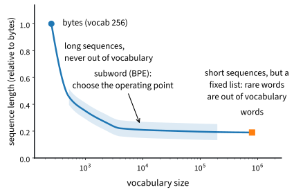
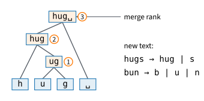
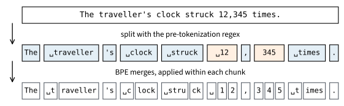

# From Text to Tokens
:label:`sec_text-sequence`

Most sequences in this chapter are text. Text poses a problem that the
synthetic series of :numref:`sec_sequence` did not: neural networks consume
vectors of numbers, while text arrives as a string of characters. Before we
can model language, we must decide how to cut a string into *tokens*, the
atomic units that our models treat as observations $x_t$, and how to map
each token to a numerical index. This choice determines the size of the
model's output layer, the length of every document it reads, and even how
hard arithmetic is for it. Split *The Time Machine* into characters, and a
model must read some 170,000 steps. Split it into words, and the model
needs an output for each of about 4,600 distinct words and still fails on
any word it has not seen. Every modern language model comes with a
tokenizer, and the tokenizer is best thought of as part of the model.

We first compare character and word tokens, which sit at opposite ends of a
trade-off between vocabulary size and sequence length. We then represent
text as raw bytes and learn a vocabulary *from data* with byte pair
encoding (BPE), the subword scheme of the GPT family of models
:cite:`Sennrich.Haddow.Birch.2015,Radford.Wu.Child.ea.2019`. Our
implementation is short, and it reproduces the output of the GPT-2
tokenizer token for token.

## Reading the Dataset

Throughout the chapter we work with H. G. Wells'
[The Time Machine](http://www.gutenberg.org/ebooks/35), a novella of just
over 30,000 words. Real corpora are measured in trillions of tokens, but
this one is large enough to show the statistics that matter and small
enough to tokenize in seconds. The `_download` method reads the raw text
into a single string.

```{.python .input}
%load_ext d2lbook.tab
tab.interact_select('mxnet', 'pytorch', 'tensorflow', 'jax')
```

```{.python .input #text-sequence-converting-raw-text-into-sequence-data}
%%tab mxnet
import math
import numpy as np
from mxnet import autograd, gluon, init, np as mnp, npx
from mxnet.gluon import nn
from d2l import mxnet as d2l
npx.set_np()
```

```{.python .input #text-sequence-converting-raw-text-into-sequence-data}
%%tab pytorch
import math
import numpy as np
import torch
from torch import nn
from torch.nn import functional as F
from d2l import torch as d2l
```

```{.python .input #text-sequence-converting-raw-text-into-sequence-data}
%%tab tensorflow
import math
import numpy as np
import tensorflow as tf
from d2l import tensorflow as d2l
```

```{.python .input #text-sequence-converting-raw-text-into-sequence-data}
%%tab jax
import math
import numpy as np
import jax
from jax import numpy as jnp
from flax import nnx
import optax
from d2l import jax as d2l
```

```{.python .input #text-sequence-reading-the-dataset-3}
import collections
import re
import tiktoken
```

```{.python .input #text-sequence-reading-the-dataset-1}
class TimeMachine(d2l.DataModule): #@save
    """The Time Machine dataset."""
    def _download(self):
        fname = d2l.download(d2l.DATA_URL + 'timemachine.txt', self.root,
                             '090b5e7e70c295757f55df93cb0a180b9691891a')
        with open(fname) as f:
            return f.read()

data = TimeMachine()
raw_text = data._download()
raw_text[:60]
```

Classical preprocessing pipelines normalized text of this kind
aggressively: they stripped punctuation, folded everything to lowercase,
and only then split it into units. We keep such a step for the character-
and word-level experiments below, and for the sections of the book that
still work with such tokens. It is crude, though: normalization throws away
information (capitalization distinguishes "Bill" from "bill"), and it
commits us in advance to decisions about what a token may look like. The
byte-level tokenizer we build later in this section needs none at all.

```{.python .input #text-sequence-reading-the-dataset-2}
@d2l.add_to_class(TimeMachine)  #@save
def _preprocess(self, text):
    return re.sub('[^A-Za-z]+', ' ', text).lower()

text = data._preprocess(raw_text)
text[:60]
```

## Characters, Words, and Bytes

### Characters and Words

A sequence model reads one token per time step. The two obvious choices
of token are characters and words. Let us try both, characters first.

```{.python .input #text-sequence-tokenization}
@d2l.add_to_class(TimeMachine)  #@save
def _tokenize(self, text):
    return list(text)

tokens = data._tokenize(text)
','.join(tokens[:30])
```

Splitting on whitespace instead yields word tokens. For each scheme we
count the *distinct* token values (the vocabulary a model must handle) and
the total number of tokens (the length of the sequence it must process).

```{.python .input #text-sequence-two-ends-of-a-spectrum-1}
words = text.split()
print(f'characters: {len(set(tokens)):>6} distinct, '
      f'{len(tokens):>7} tokens in the corpus')
print(f'words:      {len(set(words)):>6} distinct, '
      f'{len(words):>7} tokens in the corpus')
```

Character tokenization of our normalized text needs only 27 symbols and
never meets an unknown letter. But it stretches the corpus to some 170,000
time steps, and every long-range relationship (say, between a subject and
its verb) must be carried across dozens of steps. Word tokenization
compresses the same text into a fifth as many tokens, each far more
meaningful. Already on this small corpus, however, it produces thousands of
distinct types, and the vocabulary keeps growing with the corpus: every
name, typo, and inflection ("traveller", "travellers", "travelled") claims
its own slot, most of them rarely used (:numref:`sec_language-model`).
Worse, any word not seen during training is *out of
vocabulary* (OOV) at test time. :numref:`fig_granularity_spectrum` places
the two schemes on a common axis. A larger vocabulary gives shorter
sequences, and the question is where between the extremes to sit. Subword
tokenizers, to which we now turn, let us choose that point freely.


:label:`fig_granularity_spectrum`

### Text as Bytes

Before we can interpolate between characters and words we need a base
alphabet that covers every string. Characters are a poor choice for it.
Unicode defines around 150,000 of them, covering scripts, accents, and
emoji, so a character-level vocabulary is not small at all once we leave
English. Modern tokenizers go one level lower instead. Every string your
computer stores is ultimately a sequence of *bytes* under some encoding,
almost always UTF-8. A byte holds one of $2^8 = 256$ values, so a
byte-level model needs a base vocabulary of only 256 symbols, and *no input
can ever be out of vocabulary*: any string, in any language, with any typo,
is some sequence of bytes.

UTF-8 is a variable-length code: it uses one byte for an ASCII character
and up to four for rarer ones.

```{.python .input #text-sequence-text-as-bytes}
s = 'Hello, naïve café: 你好 🚀'
print(len(s), 'characters,', len(s.encode('utf-8')), 'bytes')
for ch in 'a é 你 🚀'.split():
    print(repr(ch), '->', list(ch.encode('utf-8')))
```

Unfortunately, the universal alphabet makes sequences long. Our novella
runs to nearly 180,000 bytes, more than five for each of its words, and
since "é" takes two bytes, the Chinese character three, and the emoji four,
raw bytes stretch non-English text even further. Everything that follows
keeps the universality of bytes while shortening the sequences.

## Byte Pair Encoding

### The Merge Rule

Byte pair encoding starts from the 256 byte symbols and grows the
vocabulary greedily: count how often each *pair* of adjacent tokens occurs
in the training corpus, merge the most frequent pair into a single new
token, and repeat until the vocabulary reaches a target size
:cite:`Sennrich.Haddow.Birch.2015`. Each merge shortens the corpus by the
number of occurrences it collapses, so BPE is a greedy compression
algorithm, and its vocabulary is a learned dictionary of the corpus's most
common fragments.

It is instructive to trace the algorithm by hand. Our toy corpus has five
distinct words in eight occurrences:

```
hug pug pun bun hugs hug hug pug
```

The corpus is 32 bytes long. The most frequent adjacent pair is
(`u`, `g`), which occurs six times (in "hug", "pug", and "hugs"), so the
first merge creates the token `ug`. After replacing every occurrence, the
most frequent pair is (`h`, `ug`), and so on:

| step | most frequent pair | count | new token | corpus length |
|:----:|:------------------:|:-----:|:---------:|:-------------:|
| 0    | (start from bytes) |       |           | 32            |
| 1    | `u`, `g`           | 6     | `ug`      | 26            |
| 2    | `h`, `ug`          | 4 (tie) | `hug`   | 22            |
| 3    | `hug`, `' '`       | 3 (tie) | `'hug '` | 19           |

Steps 2 and 3 are ties: (`ug`, `' '`) also occurs four times at step 2,
and (`' '`, `p`) and (`' '`, `hug`) also occur three times at step 3.
We break a tie in favor of the pair that occurs first in the corpus.

Two properties can be read off the trace. First, merges compose: the token
`hug` is built on top of `ug`, so the learned vocabulary forms a *merge
tree* over the byte alphabet (:numref:`fig_merge_tree`), and any new text
can be retokenized by replaying the same merges. The word "hugs", for
instance, becomes the two tokens `hug` and `s`, while the rare word "bun"
stays as three raw bytes: input that no merge applies to simply falls back
to bytes. Second, the third merge glued a word to the *space that follows
it*. A trailing space is harmless in itself, but nothing stops a later
merge from attaching the next word to it. On a real corpus this is exactly
what happens, and we fix it below.


:label:`fig_merge_tree`

### Implementation

We implement the loop we traced in three parts. The class holds the
state. Token ids 0 through 255 denote raw bytes, and each learned merge
gets the next free id, so ids double as merge *ranks*: a smaller id means
the merge was learned earlier. `merges` maps a pair of ids to the id of
their merge, and `vocab` maps every id to its bytes. The `pattern` and
`specials` arguments and the table `byte_ids` are needed only later in
this section and can be ignored for now. We import `regex`, an extension of
Python's `re` whose Unicode character classes (such as `\p{L}` for "any
letter") we need for pre-tokenization.

```{.python .input #text-sequence-implementation-1}
#@save
import regex

class BPETokenizer:  #@save
    """Byte-level BPE tokenizer trained by iterated most-frequent-pair
    merges.

    Token ids 0..255 are raw bytes; learned merges get ids
    256..vocab_size-1; special tokens sit above those and are never
    produced by BPE itself. `pattern` is an optional pre-tokenization
    regex: text is split into chunks and merges never cross chunk
    boundaries.
    """

    GPT2_PATTERN = (r"'s|'t|'re|'ve|'m|'ll|'d| ?\p{L}+| ?\p{N}+"
                    r"| ?[^\s\p{L}\p{N}]+|\s+(?!\S)|\s+")

    def __init__(self, vocab_size=1024, pattern=None,
                 specials=('<pad>', '<bos>', '<eos>')):
        self.vocab_size, self.pattern = vocab_size, pattern
        self.merges = {}                                  # (id, id) -> new id
        self.vocab = {i: bytes([i]) for i in range(256)}  # id -> bytes
        self.byte_ids = list(range(256))                  # byte value -> id
        self.specials = {s: vocab_size + i for i, s in enumerate(specials)}

    def __len__(self):
        return self.vocab_size + len(self.specials)

    @property
    def pad(self):
        return self.specials['<pad>']

    @property
    def bos(self):
        return self.specials['<bos>']

    @property
    def eos(self):
        return self.specials['<eos>']

    def _chunks(self, text):
        return [text] if self.pattern is None else regex.findall(
            self.pattern, text)
```

Training and encoding both rest on one operation: replace every occurrence
of a pair of adjacent ids by the id of their merge. `_merge` scans left to
right and merges greedily, so in `aaa` the pair (`a`, `a`) is replaced
once, at the left.

```{.python .input #text-sequence-implementation-3}
@d2l.add_to_class(BPETokenizer)  #@save
def _merge(self, ids, pair, new_id):
    """Replace every occurrence of pair in ids by new_id."""
    out, i = [], 0
    while i < len(ids):
        try:  # list.index scans for the next candidate at C speed
            j = ids.index(pair[0], i)
        except ValueError:
            j = len(ids)
        out.extend(ids[i:j])
        if j < len(ids) - 1 and ids[j + 1] == pair[1]:
            out.append(new_id)
            i = j + 2
        elif j < len(ids):
            out.append(ids[j])
            i = j + 1
        else:
            i = j
    return out
```

Training repeats the step of the hand trace: count all adjacent pairs,
merge the most frequent one everywhere, and record the merge. Ties go to
the pair counted first, as in the trace, which is what `max` returns.
Identical chunks of text (a frequent word, once pre-tokenization splits
text into words) are stored once, and their pair counts are weighted by
their frequency. Without a pattern there is a single chunk,
the whole corpus; with one, the deduplication makes training several times
faster. Production trainers go further and update pair counts locally
around each merge. We recount, for clarity.

```{.python .input #text-sequence-implementation-4}
@d2l.add_to_class(BPETokenizer)  #@save
def train(self, text):
    """Learn vocab_size - 256 merges, most frequent pair first."""
    chunk_freq = collections.Counter(self._chunks(text))
    seqs = [list(chunk.encode('utf-8')) for chunk in chunk_freq]
    for new_id in range(256, self.vocab_size):
        pairs = collections.Counter()
        for seq, w in zip(seqs, chunk_freq.values()):
            if w == 1:  # Counter.update counts at C speed
                pairs.update(zip(seq, seq[1:]))
            else:  # weight pair counts by chunk frequency
                for pair in zip(seq, seq[1:]):
                    pairs[pair] += w
        if not pairs:
            break  # nothing left to merge
        pair = max(pairs, key=pairs.get)
        self.merges[pair] = new_id
        self.vocab[new_id] = self.vocab[pair[0]] + self.vocab[pair[1]]
        seqs = [self._merge(seq, pair, new_id) for seq in seqs]
```

Training on our toy corpus reproduces the hand trace:

```{.python .input #text-sequence-implementation-2}
toy_tok = BPETokenizer(vocab_size=256 + 3)
toy_tok.train('hug pug pun bun hugs hug hug pug')
for (a, b), new_id in toy_tok.merges.items():
    print(f'{toy_tok.vocab[a]} + {toy_tok.vocab[b]} -> '
          f'{toy_tok.vocab[new_id]}')
```

### Encoding and Decoding

Training produced a merge table. To *encode* new text we replay merges on
its bytes: repeatedly find the adjacent pair with the lowest merge rank
and merge it, until no adjacent pair is in the table. Encoding consults
the ranks, not corpus statistics, so it is a pure function of the merge
table: **the tokenizer is defined by its merge ranks**. Why lowest rank
first? Training applied each merge to text in which all earlier merges had
already been made, so replaying them in rank order retraces training (the
exercises make this precise). Decoding is easier still. Every token id
maps to a byte string, so we concatenate the strings and decode them as
UTF-8. (A generation model can emit ids whose bytes do not align with
character boundaries, so we ask Python to replace, rather than reject,
malformed fragments.)

```{.python .input #text-sequence-encoding-and-decoding-1}
@d2l.add_to_class(BPETokenizer)  #@save
def _encode_chunk(self, text_bytes):
    ids = [self.byte_ids[b] for b in text_bytes]
    while len(ids) > 1:
        # The lowest-rank merge applicable anywhere in this chunk
        pair = min(zip(ids, ids[1:]),
                   key=lambda p: self.merges.get(p, float('inf')))
        if pair not in self.merges:
            break
        ids = self._merge(ids, pair, self.merges[pair])
    return ids

@d2l.add_to_class(BPETokenizer)  #@save
def encode(self, text, allow_special=False):
    if allow_special and self.specials:
        pat = '(' + '|'.join(regex.escape(s) for s in self.specials) + ')'
        ids = []
        for part in regex.split(pat, text):
            if part in self.specials:
                ids.append(self.specials[part])
            elif part:
                ids.extend(self.encode(part))
        return ids
    return [i for chunk in self._chunks(text)
            for i in self._encode_chunk(chunk.encode('utf-8'))]

@d2l.add_to_class(BPETokenizer)  #@save
def decode(self, ids):
    specials = {i: s.encode('utf-8') for s, i in self.specials.items()}
    data = b''.join(self.vocab[i] if i in self.vocab else specials[i]
                    for i in ids)
    return data.decode('utf-8', errors='replace')
```

On the toy tokenizer, encoding behaves as the hand trace predicted, and
decoding inverts it.

```{.python .input #text-sequence-encoding-and-decoding-2}
print([toy_tok.vocab[i] for i in toy_tok.encode('hugs')])
print([toy_tok.vocab[i] for i in toy_tok.encode('bun')])
toy_tok.decode(toy_tok.encode('hug pug hugs'))
```

### Training on The Time Machine

What does BPE learn from real prose? We train it on the novella. Token
lists, and later generated text, run wider than a printed page, so we
first write a utility that folds them, for use here and throughout the
book.

```{.python .input #text-sequence-training-on-the-time-machine-3}
#@save
import textwrap

def print_wrapped(*args, width=76):  #@save
    """Print like `print`, folding each line to the width of a page."""
    for line in ' '.join(str(a) for a in args).split('\n'):
        print(textwrap.fill(line, width, subsequent_indent='    '))
```

We now train a 1,024-token vocabulary on the raw, unnormalized novella.
The first merges are letter pairs; by the end of training the tokenizer
has learned whole words of Wells' prose. One of the tokens in the encoded
sample, however, is the two-word composite "Time Traveller ", spaces
included. We return to it below.

```{.python .input #text-sequence-training-on-the-time-machine-1}
tok = BPETokenizer(vocab_size=1024)
tok.train(raw_text)
merged_ids = list(tok.merges.values())
print('first:', [tok.vocab[i] for i in merged_ids[:8]])
print('last: ', [tok.vocab[i] for i in merged_ids[-8:]])
ids = tok.encode('The Time Traveller smiled. Are you sure?')
print_wrapped(len(ids), 'tokens:', [tok.vocab[i] for i in ids])
```

How much shorter does a bigger vocabulary make the text? Because ids are
assigned in rank order, a BPE tokenizer with a smaller vocabulary is a
*prefix* of a larger one trained on the same corpus. For a vocabulary
$\mathcal{V}$ of size $|\mathcal{V}|$, keeping only the merges with id
below $|\mathcal{V}|$ recovers the tokenizer we would have gotten by
stopping training at that size. A single training run therefore sweeps the
vocabulary size from 256 to 4,096. We measure compression in bytes per
token on the first 10,000 characters of the training text (exercise
:exref:`ex_text-sequence-pretok-ablation` measures held-out text).

```{.python .input #text-sequence-training-on-the-time-machine-2}
big = BPETokenizer(vocab_size=4096)
big.train(raw_text)
excerpt = raw_text[:10000]
sizes = [256, 384, 512, 768, 1024, 1536, 2048, 3072, 4096]
ratios = []
for v in sizes:
    sub = BPETokenizer(vocab_size=v)  # the first v - 256 merges of big
    sub.merges = {p: i for p, i in big.merges.items() if i < v}
    sub.vocab = {i: b for i, b in big.vocab.items() if i < v}
    ratios.append(len(excerpt.encode('utf-8')) / len(sub.encode(excerpt)))
d2l.plot(sizes, [ratios], 'vocabulary size', 'bytes per token',
         xscale='log')
```

Each doubling of the vocabulary adds a roughly constant amount of
compression: bytes per token grows about logarithmically in the vocabulary
size. This is a consequence of the greedy rule. Early merges ("e ", "th",
"d ") each remove thousands of occurrences, while the 4,000th merge
removes a handful. It would be a mistake, however, to extend the line to
production vocabularies of 50,000 to 200,000 tokens. The upper end of our
curve is flattered: at 4,096 tokens the tokenizer has learned words and
phrases of the very text it is measured on. On English prose at large,
production vocabularies reach four to five bytes per token, about one
token per word, as we measure below. Their extra entries go to rarer
words, to code, and, in multilingual vocabularies such as `o200k_base`, to
other languages.

### Pre-Tokenization

The composite "Time Traveller " is not alone. Alongside word fragments,
the vocabulary of the unconstrained tokenizer contains many tokens that
straddle word boundaries:

```{.python .input #text-sequence-pre-tokenization-telling-bpe-where-words-end-1}
crossers = [v.decode('utf-8', 'replace') for i, v in tok.vocab.items()
            if i >= 256 and b' ' in v.strip(b' ')]
print_wrapped(len(crossers), 'tokens cross a word boundary, e.g.',
              crossers[:8])
```

Merges like "of the " compress the training corpus, but they are brittle
composites. They use up vocabulary slots on specific phrases, and they
split the counts of the words they contain ("of" now appears in many
tokens). Every production tokenizer therefore adds one step we have
omitted so far, *pre-tokenization*. The text is first split into chunks
with a regular expression, and BPE is trained and applied strictly
*within* chunks, so no merge can cross a chunk boundary. The pattern used
by GPT-2 :cite:`Radford.Wu.Child.ea.2019`, kept as
`BPETokenizer.GPT2_PATTERN`, reads as follows:

```
's|'t|'re|'ve|'m|'ll|'d        common English contractions, split off
| ?\p{L}+                      a run of letters, with its leading space
| ?\p{N}+                      a run of digits, with its leading space
| ?[^\s\p{L}\p{N}]+            a run of punctuation or other symbols
|\s+(?!\S)|\s+                 remaining whitespace
```

The pattern makes three decisions. A word keeps its *leading space*
(" the" rather than "the "), so a word carries its own separation from
the previous one. Letters, digits, and punctuation fall into separate
chunks, so numbers and symbols never fuse with words. Contractions split
off as units of their own.

```{.python .input #text-sequence-pre-tokenization-telling-bpe-where-words-end-2}
regex.findall(BPETokenizer.GPT2_PATTERN,
              "The traveller's clock struck 12,345 times.")
```

Training with the pattern takes one more argument, and
:numref:`fig_pretok_pipeline` shows the resulting pipeline end to end.
Compared with the unconstrained run, the boundary-crossing composites
disappear, and their slots go to whole words with their leading space.
The first merges now attach letters to a leading space (" t", " a") or
join frequent letter pairs ("he", "in").

```{.python .input #text-sequence-pre-tokenization-telling-bpe-where-words-end-3}
bpe = BPETokenizer(vocab_size=1024, pattern=BPETokenizer.GPT2_PATTERN)
bpe.train(raw_text)
crossers = [v for i, v in bpe.vocab.items()
            if i >= 256 and b' ' in v.strip(b' ')]
print('boundary-crossing tokens now:', len(crossers))
gained = sorted(set(bpe.vocab.values()) - set(tok.vocab.values()),
                key=lambda v: (-len(v), v))
print_wrapped('longest tokens gained instead:',
              [v.decode('utf-8', 'replace') for v in gained[:6]])
print('first merges:', [bpe.vocab[i] for i in list(bpe.merges.values())[:6]])
```


:label:`fig_pretok_pipeline`

## Vocabularies and Special Tokens

### From Tokens to Indices

BPE assigns every token its id as part of training. The character- and
word-level pipeline from the start of this section has no such luxury and
needs a separate *vocabulary* object. It assigns each distinct token string
an index, most frequent first, and maps unknown tokens to a reserved
`<unk>` slot. Rare tokens (below `min_freq` occurrences) can be dropped to
keep the table small; they then become `<unk>` as well.

```{.python .input #text-sequence-vocabulary-1}
class Vocab:  #@save
    """Vocabulary for text."""
    def __init__(self, tokens=(), min_freq=0, reserved_tokens=()):
        # Flatten a 2D list if needed
        if tokens and isinstance(tokens[0], list):
            tokens = [token for line in tokens for token in line]
        # Count token frequencies
        counter = collections.Counter(tokens)
        self.token_freqs = sorted(counter.items(), key=lambda x: x[1],
                                  reverse=True)
        # The list of unique tokens, ordered by descending frequency.
        # Reserve <unk> at index 0 so vocab[0] is the unknown token.
        self.idx_to_token = ['<unk>'] + list(reserved_tokens) + [
            token for token, freq in self.token_freqs
            if freq >= min_freq and token not in reserved_tokens]
        self.token_to_idx = {token: idx
                             for idx, token in enumerate(self.idx_to_token)}

    def __len__(self):
        return len(self.idx_to_token)

    def __getitem__(self, tokens):
        if not isinstance(tokens, (list, tuple)):
            return self.token_to_idx.get(tokens, self.unk)
        return [self.__getitem__(token) for token in tokens]

    def to_tokens(self, indices):
        if isinstance(indices, (list, tuple)) or getattr(indices, 'ndim', 0):
            return [self.idx_to_token[int(index)] for index in indices]
        return self.idx_to_token[int(indices)]

    @property
    def unk(self):  # Index for the unknown token
        return self.token_to_idx['<unk>']
```

```{.python .input #text-sequence-vocabulary-2}
vocab = Vocab(tokens)
indices = vocab[tokens[:10]]
print('indices:', indices)
print('tokens:', vocab.to_tokens(indices))
```

The `build` convenience method packages the whole classical pipeline,
preprocess, tokenize, and index, returning a corpus of ids and its
vocabulary.

```{.python .input #text-sequence-putting-it-all-together}
@d2l.add_to_class(TimeMachine)  #@save
def build(self, raw_text, vocab=None):
    tokens = self._tokenize(self._preprocess(raw_text))
    if vocab is None: vocab = Vocab(tokens)
    corpus = [vocab[token] for token in tokens]
    return corpus, vocab

corpus, vocab = data.build(raw_text)
len(corpus), len(vocab)
```

### Special Tokens
:label:`subsec_special-tokens`

Training pipelines need a handful of tokens that mean something to the
*infrastructure* rather than to the text. `<pad>` fills the unused tail of
short sequences in a batch, `<bos>` marks the beginning of a sequence, and
`<eos>` lets a model declare that generation is finished (the decoders of
:numref:`sec_decoding` accept it as a signal to stop). Our `BPETokenizer`
assigns these ids *above* the BPE range. The placement is a safety
property: encoding ordinary text must never produce a special token. If it
could, any document that happened to contain the string "&lt;eos&gt;"
could inject a control signal into the model's input. This is a form of
*prompt injection*, in which text supplied by a user is read by the model
as an instruction. Our `encode` therefore treats special strings in
ordinary text as plain bytes unless the caller opts in with
`allow_special=True`. `tiktoken` implements the same guard with its
`allowed_special` argument and raises an error by default.

```{.python .input #text-sequence-special-tokens}
print('as plain text:  ', bpe.encode('<bos>the time machine'))
print('as control code:', bpe.encode('<bos>the time machine',
                                     allow_special=True))
print('pad/bos/eos ids:', bpe.pad, bpe.bos, bpe.eos, '| len:', len(bpe))
```

## Tokenizers in the Wild

### The Rank Table of a Production Tokenizer

Most deployed language models, the GPT and Llama families among them, use
BPE tokenizers of the kind we built, trained on far more text. GPT-2's
tokenizer :cite:`Radford.Wu.Child.ea.2019` is stored as a table that maps
the bytes of each token to its rank, together with the pre-tokenization
pattern and the special tokens. There is no neural network inside it.
Other tokenizer families also store normalization rules, or a
probabilistic model that chooses among segmentations. OpenAI's `tiktoken`
library ships the GPT-2 table. We print the entries around the end of the
byte range; the leading underscore of `_mergeable_ranks` marks a private
attribute that may change between library versions.

```{.python .input #text-sequence-what-a-production-tokenizer-stores}
enc = tiktoken.get_encoding('gpt2')
print(list(enc._mergeable_ranks.items())[254:260])
print(enc._special_tokens)
```

The first 256 ranks are the single bytes, in a permuted order (GPT-2
lists printable characters first), and from rank 256 on come the learned
merges in the order they were learned: the structure of our
`BPETokenizer`. GPT-2's first four merges, learned from 40 gigabytes of
web text, are " t", " a", "he", and "in", the same four pairs that `bpe`
learned first from one novella. The most frequent fragments of English
are the same in both corpora.

### Verifying Our Implementation

Since the tokenizer is a rank table, we can load GPT-2's table into our
own encoder. Ranks become token ids, and the 256 single-byte entries give
the byte permutation. The table stores the bytes of each token, not the
pair that was merged to form it, so we recover the two parents of a longer
token by re-running BPE on its bytes with all lower-ranked merges: they are
whatever the bytes merge into just before the token's own rank applies.
This loop can be skipped; what matters is the check that follows.

```{.python .input #text-sequence-verifying-our-implementation-1}
@d2l.add_to_class(BPETokenizer)  #@save
@classmethod
def from_tiktoken(cls, name):
    """Load a published bytes->rank table (e.g. 'gpt2') into our encoder."""
    import tiktoken  # lazy: d2l itself does not require tiktoken
    enc = tiktoken.get_encoding(name)
    ranks = enc._mergeable_ranks
    tok = cls(vocab_size=len(ranks), pattern=enc._pat_str, specials=())
    tok.specials = dict(enc._special_tokens)
    tok.vocab = {rank: b for b, rank in ranks.items()}
    tok.byte_ids = [ranks[bytes([b])] for b in range(256)]
    for token, rank in ranks.items():
        if len(token) > 1:  # recover which pair merged into this token
            parts = [bytes([b]) for b in token]
            while len(parts) > 2:
                a, b = min(zip(parts, parts[1:]),
                           key=lambda p: ranks.get(p[0] + p[1],
                                                   float('inf')))
                i = list(zip(parts, parts[1:])).index((a, b))
                parts[i:i + 2] = [a + b]
            tok.merges[ranks[parts[0]], ranks[parts[1]]] = rank
    return tok
```

On a paragraph that mixes prose, numbers, accents, and an emoji, our
encoder reproduces the output of `tiktoken` token for token. The `assert`
below checks this every time the book is built.

```{.python .input #text-sequence-verifying-our-implementation-2}
ours = BPETokenizer.from_tiktoken('gpt2')
para = ('The Time Traveller (for so it will be convenient to speak of '
        'him) was expounding a recondite matter to us; his pale grey '
        'eyes shone and twinkled. Prices rose 3.5% in 1895, and naïve '
        'café patrons paid £12,345 more! 🚀')
assert ours.encode(para) == enc.encode(para)
print(len(ours.encode(para)), 'tokens, identical to tiktoken')
print([ours.vocab[i].decode('utf-8', 'replace')
       for i in ours.encode(para)[:8]])
```

How do production vocabularies fare on our novella? We compare our
1,024-token tokenizer with GPT-2's 50,257 tokens and with `o200k_base`,
the vocabulary of about 200,000 tokens used by GPT-4o.

```{.python .input #text-sequence-verifying-our-implementation-3}
n_bytes = len(raw_text.encode('utf-8'))
rows = [('ours (1k, in-domain)', len(bpe.encode(raw_text)))]
for name in ('gpt2', 'o200k_base'):
    e = tiktoken.get_encoding(name)
    rows.append((f'{name} ({len(e._mergeable_ranks) // 1000}k)',
                 len(e.encode(raw_text))))
for name, n in rows:
    print(f'{name:>22}: {n:>6} tokens, {n_bytes / n:.2f} bytes/token')
```

Although it is 50 to 200 times smaller, our tokenizer reaches about two
thirds of their compression, because it was trained on this text. A
tokenizer is a compression model of its training corpus, and like any
model it does best on data like its training data.

### Fertility, Digits, and Glitch Tokens
:label:`subsec_fertility-digits-glitch`

The number of tokens a tokenizer uses per word of a language is its
*fertility*. GPT-2's tokenizer was trained on mostly English text, and the
same sentence in three languages takes very different numbers of tokens:

```{.python .input #text-sequence-fertility-digits-and-glitch-tokens-1}
sentences = {
    'English': 'The time traveller returned after many years.',
    'German': 'Der Zeitreisende kehrte nach vielen Jahren zurück.',
    'Greek': 'Ο ταξιδιώτης του χρόνου επέστρεψε μετά από πολλά χρόνια.'}
for lang, s in sentences.items():
    gpt2, o200k = [len(tiktoken.get_encoding(e).encode(s)) / len(s.split())
                   for e in ('gpt2', 'o200k_base')]
    print(f'{lang:>8}: {gpt2:.2f} (gpt2), {o200k:.2f} (o200k_base) '
          'tokens per word')
```

Under GPT-2's tokenizer a Greek word takes about seven tokens (Greek
letters take two UTF-8 bytes each, and few Greek merges were learned), an
English word about one. A 1,024-token context window therefore holds
about 140 Greek words against about 900 English ones. The multilingual
`o200k_base` brings Greek down to about two tokens per word.

Digits show how small tokenization choices change what a model must
learn. GPT-2 splits digit strings wherever BPE found frequent fragments;
newer tokenizers cap digit runs at three during pre-tokenization, which
makes the split predictable:

```{.python .input #text-sequence-fertility-digits-and-glitch-tokens-2}
for name in ('gpt2', 'o200k_base'):
    e = tiktoken.get_encoding(name)
    print(f'{name}: 12345678 ->',
          [e.decode([t]) for t in e.encode('12345678')])
```

Neither split aligns tokens with the columns of written addition, which
works right to left in ones, tens, and hundreds. Under the cap,
"12345678" splits left to right into "123", "456", "78". A model must
learn arithmetic over such misaligned chunks. This is one reason why
language models make arithmetic errors, and why writing numbers with
separators ("12,345,678") can help.

Finally, a token is only as useful as the model's training on it. Early
GPT-2 and GPT-3 vocabularies contain tokens such as " SolidGoldMagikarp",
a Reddit username that was frequent in the corpus the *tokenizer* was
trained on but rare in the corpus the *language model* was trained on.
Such a *glitch token* can appear in a prompt, yet its embedding was barely
trained. Asked to repeat it, models produced evasions and unrelated words.

```{.python .input #text-sequence-fertility-digits-and-glitch-tokens-3}
enc.encode(' SolidGoldMagikarp')  # one token for an 18-character string
```

## Summary

A tokenizer turns text into the integer sequence a model reads. Its
vocabulary size trades the length of that sequence against the number of
entries the model must learn, and a fixed word list also fails on unseen
words. Byte-level BPE starts from the 256 byte values, so no input is out
of vocabulary, and greedily merges the most frequent adjacent pair until
the vocabulary is full. Encoding replays the merges in rank order, so the
merge table is the tokenizer. A pre-tokenization pattern keeps merges
inside words, and special tokens sit outside the BPE range so that
ordinary text cannot produce them. GPT-2's tokenizer is the same
construction trained on more text, and our encoder reproduces it token
for token. Its fertility across languages, its digit chunks, and its
glitch tokens all follow from how it was trained. The next section models
the token sequences that such a tokenizer produces.

## Exercises

1. **Encoding by rank.** Suppose a `BPETokenizer` with `vocab_size=258`
   has learned exactly two merges: (`b`, `c`) with id 256, and then
   (`a`, `b`) with id 257. The *rank rule* of `_encode_chunk` always
   applies the lowest-ranked applicable merge. The *leftmost rule* always
   merges the leftmost adjacent pair that appears in the merge table.
    1. Segment the string "abc" under each of the two rules.
    1. Give the segmentation that every occurrence of "abc" in the
       training corpus had at the end of training, and say which rule
       agrees with it.

1. [code] **Cross-corpus compression.** Train a `BPETokenizer` with a
   1,024-token vocabulary and `BPETokenizer.GPT2_PATTERN` on a different
   text of your choice, such as another public-domain book, your own
   notes, or source code.
    1. Compute the fraction of its first 100 merged tokens, and of its
       last 100, that are also tokens of `bpe`. Explain the difference
       between the two fractions.
    1. Measure bytes per token of your tokenizer on *The Time Machine*
       and of `bpe` on your corpus, and compare both with the in-domain
       figures.

1. [code] **Special-token round trip.** :numref:`subsec_special-tokens`
   places special tokens above the BPE id range so that ordinary text can
   never produce them. Construct a `BPETokenizer` whose `specials` add a
   document separator `<sep>` to the three defaults, and train it on
   `raw_text`. Let `x` be two short documents joined by `<sep>`.
    1. Encode `x` once with and once without `allow_special=True`, and
       check that both id sequences decode to `x`.
    1. Re-encode the decoded text once with `allow_special=True` and once
       without it. Which of the two id sequences from the previous
       sub-problem does each re-encoding reproduce? State what this
       implies for a pipeline that decodes a model's output and later
       feeds the text back in as input.
    1. `tiktoken` raises an error when a special string appears in text
       that is not allowed to contain it, whereas `encode` treats the
       string as plain bytes. Give one situation in which each policy is
       preferable.

    *Adapted from Andrej Karpathy,
    [minbpe](https://github.com/karpathy/minbpe/blob/master/exercise.md),
    Step 4.*

1. [code] **Digit chunking.** Tokenize the addition prompts "1234+5678=",
   "1234+567=" and "567+678=" and their sums "6912", "1801" and "1245"
   with the `gpt2` and `o200k_base` encodings of `tiktoken`, writing out
   the token boundaries of each number.
    1. Under the three-digit cap of `o200k_base`, label each digit token
       with the place values (ones, tens, hundreds, thousands) it covers.
       For each prompt, state whether the tokens at matching positions of
       the two summands and of the sum cover the same place values.
       Explain what goes wrong for a model that adds token by token when
       they do not.
    1. Propose a pre-tokenization rule that aligns tokens with place
       value, and state one drawback of your rule.

1. **Glitch tokens.** :numref:`subsec_fertility-digits-glitch` attributes
   a glitch token to a string that was frequent in the tokenizer's
   training corpus but rare in the language model's.
    1. Why does the merge rule of `BPETokenizer.train` turn such a string
       into a single token rather than several fragments, and what role
       does pre-tokenization play in fixing the token's extent?
    1. Propose a test that flags glitch tokens given the trained embedding
       table and the model's training corpus, and state what each of the
       two inputs contributes.

1. **Rank replay.** ● The *rank rule* of `_encode_chunk` always applies
   the lowest-ranked applicable merge. Argue that, for any merge table
   learned by `BPETokenizer.train`, the rank rule reproduces the
   end-of-training segmentation of every chunk of the training corpus.

1. [code] **Pre-tokenization ablation.** ● Split `raw_text` into its first
   90% and its last 10%. On the first part, train two 4,096-token
   tokenizers that differ only in the pattern: one without a pattern, as
   `big` was trained, and one with `BPETokenizer.GPT2_PATTERN`.
    1. List the 20 longest tokens learned by each tokenizer, and mark
       those that span more than one word.
    1. Measure which of the two compresses the first part better, and
       explain the outcome in terms of the merge rule.
    1. Measure bytes per token of both tokenizers on the last 10%. Which
       tokenizer loses the larger fraction of its compression on this
       held-out text, and which compresses it better? Relate both answers
       to the tokens you listed.
   :exlabel:`ex_text-sequence-pretok-ablation`

:begin_tab:`mxnet`
[Discussions](https://d2l.discourse.group/t/115)
:end_tab:

:begin_tab:`pytorch`
[Discussions](https://d2l.discourse.group/t/3857)
:end_tab:

:begin_tab:`tensorflow`
[Discussions](https://d2l.discourse.group/t/3858)
:end_tab:

:begin_tab:`jax`
[Discussions](https://d2l.discourse.group/t/18011)
:end_tab:

<!-- slides -->

::: {.slide}
::: {.cover}
[Dive into Deep Learning · §8.2]{.kicker}

From Text to Tokens<br>**characters · words · bytes · byte pair encoding · pre-tokenization · special tokens · production tokenizers**
:::
:::

::: {.slide title="Characters: 173,428 Steps; Words: 4,579 Entries and Still OOV"}
[The problem]{.kicker}

- A network reads integer ids; text arrives as a string.
- The *tokenizer* cuts the string into units (*tokens*) and maps each to
  an id.
- *The Time Machine* as characters: 27 symbols, 173,428 tokens.
- As words: 4,579 distinct words, 32,775 tokens, and any word unseen in
  training is *out of vocabulary* (OOV).

::: {.d2l-note .warn}
Can we choose the vocabulary size and still never be out of vocabulary?
:::
:::

::: {.slide title="By the End of This Deck You Can"}
[Goals]{.kicker}

- count the vocabulary size and sequence length of a tokenization;
- write any string as UTF-8 bytes;
- run byte pair encoding (BPE) by hand, and encode new text by its
  merge ranks;
- explain pre-tokenization and why special tokens sit outside the BPE
  range;
- read a production tokenizer: its rank table, fertility, digits.

**Running example:** *The Time Machine*, BPE with 1,024 tokens, about 2.7
bytes per token; the rest of the chapter models this token sequence.
:::

::: {.slide title="Turning Text into the Sequence Every Later Section Models"}
[Where this fits]{.kicker}

::: {.cols .vc}
::: {.col}
| section | adds |
|---|---|
| Working with Sequences | autoregression, latent state, rollout error |
| **From Text to Tokens** | **characters, words, bytes, BPE** |
| Language Models | $n$-grams, perplexity, bits per byte |
| Recurrent Neural Networks | a hidden state updated at every step |
| Implementing RNNs | an RNN language model, scratch and concise |
| Backpropagation Through Time | gradients through time, truncation |
| Decoding and Generation | greedy decoding, beam search, sampling |
:::

::: {.col .narrow}
- **Uses:** Python strings, `collections.Counter`.
- **Skips:** other subword schemes (WordPiece, Unigram); text
  normalization.
:::
:::
:::

::: {.slide}
::: {.divider}
[01]{.dnum}

[Characters, Words, and Bytes]{.dtitle}

[vocabulary size against sequence length]{.dsub}
:::
:::

::: {.slide title="Characters: Few Symbols, Long Sequences; Words: Short Sequences, Open Vocabulary"}
[Two ends of a spectrum]{.kicker}

@!text-sequence-two-ends-of-a-spectrum-1

- Characters: no unknown words, but a subject and its verb lie dozens of
  steps apart.
- Words: 5× shorter, but the list grows with the corpus ("traveller",
  "travellers", "travelled"), and new words are OOV.
:::

::: {.slide title="UTF-8 Bytes Are a 256-Symbol Alphabet That Covers Every String"}
[Text as bytes]{.kicker}

@!text-sequence-text-as-bytes

- Any string in any language is a byte sequence: nothing is OOV.
- Length: 1 byte per English character, 2–4 for accents, Chinese, emoji.
:::

::: {.slide}
::: {.divider}
[02]{.dnum}

[Byte Pair Encoding]{.dtitle}

[merge the most frequent pair, repeat]{.dsub}
:::
:::

::: {.slide title="BPE Merges the Most Frequent Adjacent Pair, Then Repeats"}
[The merge rule]{.kicker}

Toy corpus `hug pug pun bun hugs hug hug pug`, 32 bytes:

| step | pair | count | new token | corpus length |
|:----:|:----:|:-----:|:---------:|:-------------:|
| 1 | `u`, `g` | 6 | `ug` | 26 |
| 2 | `h`, `ug` | 4 (tie) | `hug` | 22 |
| 3 | `hug`, `' '` | 3 (tie) | `'hug '` | 19 |

Ties go to the pair that occurs first. Each merge gets the next free id
(256, 257, …): **id order = merge rank**.
:::

::: {.slide title="Merges Form a Tree; New Text Replays Them"}
[The merge rule]{.kicker}

{width=58%}

Unmergeable input falls back to bytes: "bun" stays three tokens.
:::

::: {.slide title="Check: Encode “pugs” with the Three Merges"}
[Check]{.kicker}

Merges in rank order: (`u`, `g`) → `ug`; (`h`, `ug`) → `hug`;
(`hug`, `' '`) → `'hug '`. How many tokens does "pugs" become?

::: {.fragment .fade-up}
::: {.d2l-note}
**Answer.** Three: `p`, `ug`, `s`. Only the first merge applies; `hug`
needs an `h`, and there is no space.
:::
:::
:::

::: {.slide title="Encoding Applies the Lowest-Rank Merge Until None Applies"}
[Encoding]{.kicker}

```{.python #text-sequence-exercises}
ids = list(chunk.encode('utf-8'))
while len(ids) > 1:
    pair = min(zip(ids, ids[1:]),
               key=lambda p: merges.get(p, float('inf')))
    if pair not in merges:
        break  # no learned merge applies
    ids = merge(ids, pair, merges[pair])
```

- Uses only the merge table: training and encoding agree by construction.
- Decoding concatenates each id's bytes. **The merge table is the
  tokenizer.**
:::

::: {.slide title="Trained on the Novel, BPE Learns Letter Pairs First and Whole Words Last"}
[The Time Machine]{.kicker}

@!text-sequence-training-on-the-time-machine-1

768 merges on the raw text. One token is the two-word composite
"Time Traveller ".
:::

::: {.slide title="Each Doubling of the Vocabulary Adds About the Same Compression"}
[Vocabulary size]{.kicker}

@!text-sequence-training-on-the-time-machine-2

Keeping the merges with id below $|\mathcal{V}|$ gives the tokenizer of
that size: one training run sweeps all sizes. Measured on the training
text.
:::

::: {.slide title="Unconstrained Merges Cross Word Boundaries; a Pre-Tokenization Regex Stops Them"}
[Pre-tokenization]{.kicker}

@!text-sequence-pre-tokenization-telling-bpe-where-words-end-1

"of the " wastes a slot on one phrase. Split text into chunks with a
regex first; merges never cross a chunk:

@!text-sequence-pre-tokenization-telling-bpe-where-words-end-3
:::

::: {.slide title="GPT-2's Pattern Keeps Words, Digits, and Punctuation Apart"}
[Pre-tokenization]{.kicker}

{width=86%}

A word keeps its leading space (" the"); digits and punctuation form their
own chunks.
:::

::: {.slide title="Check: Split “I've got 1234 cats!” with the GPT-2 Pattern"}
[Check]{.kicker}

Pattern: contractions; ` ?` + letters; ` ?` + digits; ` ?` + other
symbols; whitespace. Which chunks does BPE see?

::: {.fragment .fade-up}
::: {.d2l-note}
**Answer.** `I` | `'ve` | `␣got` | `␣1234` | `␣cats` | `!`. GPT-2's
pattern does not cap the digit run; later tokenizers would split `1234`
after three digits.
:::
:::
:::

::: {.slide title="Special Tokens Sit Above the BPE Range, Out of Reach of Ordinary Text"}
[Special tokens]{.kicker}

@!text-sequence-special-tokens

- `<pad>` fills short sequences, `<bos>` and `<eos>` mark start and end.
- Typed as text, "&lt;bos&gt;" is 5 byte tokens; only
  `allow_special=True` maps it to its id. Otherwise any document could
  inject control signals.
:::

::: {.slide}
::: {.divider}
[03]{.dnum}

[Tokenizers in the Wild]{.dtitle}

[GPT-2's tokenizer, rebuilt and measured]{.dsub}
:::
:::

::: {.slide title="GPT-2 Stores a Rank Table, and Its First Merges Match Ours"}
[What a production tokenizer stores]{.kicker}

@!text-sequence-what-a-production-tokenizer-stores

- Ranks 0–255: the bytes; from 256 on: merges in the order learned. No
  neural network.
- First merges " t", " a", "he", "in": the same four as ours, from 40 GB
  of web text against one novel.
:::

::: {.slide title="Loaded into Our Encoder, GPT-2's Table Reproduces tiktoken Token for Token"}
[Verifying our implementation]{.kicker}

@!text-sequence-verifying-our-implementation-2

@!text-sequence-verifying-our-implementation-3

In domain, 1,024 tokens reach about two thirds of the compression of
vocabularies 50 and 200 times larger.
:::

::: {.slide title="Under GPT-2, a Greek Word Takes About Seven Tokens, an English Word About One"}
[Fertility]{.kicker}

@!text-sequence-fertility-digits-and-glitch-tokens-1

*Fertility* = tokens per word. The multilingual `o200k_base` narrows
the gap to about two.
:::

::: {.slide title="Digit Chunks Ignore Place Value, and Glitch Tokens Were Never Trained"}
[Digits and glitch tokens]{.kicker}

@!text-sequence-fertility-digits-and-glitch-tokens-2

- "12345678" → 123 | 456 | 78: chunks misaligned with ones, tens,
  hundreds.
- " SolidGoldMagikarp" is one token: frequent in the tokenizer's corpus,
  rare in the model's, so its embedding stayed untrained.
:::

::: {.slide title="Check: How Much Text Fits in 1,024 GPT-2 Tokens?"}
[Check]{.kicker}

Fertility under GPT-2: English 1.14 tokens per word, Greek 7.33. About
how many words of each fit in a context of 1,024 tokens?

::: {.fragment .fade-up}
::: {.d2l-note}
**Answer.** About 900 English words ($1024/1.14$) against about 140 Greek
words ($1024/7.33$): the same window holds about a sixth as much Greek.
:::
:::
:::

::: {.slide title="Recap"}
[Wrap-up]{.kicker}

- **Vocabulary vs. length:** characters 27 symbols and 173k tokens;
  words 4.6k types, 33k tokens, and OOV.
- **Bytes** make the base alphabet universal (256 symbols).
- **BPE:** merge the most frequent pair; encode by rank; the merge table
  is the tokenizer. 1,024 tokens: about 2.7 bytes per token.
- **Pre-tokenization** keeps merges inside words; **special tokens** sit
  outside the BPE range.
- GPT-2's tokenizer is the same construction; we reproduce it exactly.

**Next:** the statistics of these token sequences, and a first language
model.
:::
