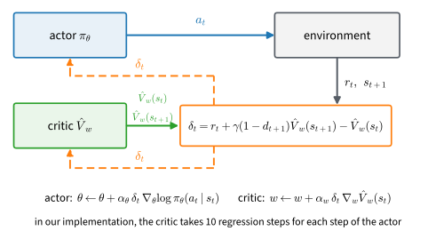

# Actor-Critic Methods
:label:`sec_actorcritic`

REINFORCE with a learned baseline weights each action by
$G_t - \hat{V}(s_t)$. The reward-to-go $G_t$ is known only after the episode
has ended, and it carries the randomness of every remaining step of the
trajectory. In this section we replace the sampled remainder of the trajectory
by the value estimate, as Q-learning did in :numref:`sec_qlearning`. The
result is a pair of learners that improve each other: an *actor*, the policy
$\pi_\theta$, and a *critic*, the value estimate $\hat{V}$. The arrangement
goes back to :citet:`Barto.Sutton.Anderson.1983`, and
:citet:`Konda.Tsitsiklis.2000` analyze its convergence. Between the one-step
estimate and the Monte Carlo estimate lies a family of multi-step estimates.
We derive generalized advantage estimation, which averages this family with
geometric weights set by one parameter $\lambda$, and compare three values of
$\lambda$ on CartPole.

```{.python .input #actor-critic-actor-critic-methods-and-multi-step-returns}
%%tab pytorch
import math
import numpy as np
import torch
from torch import nn
from torch.nn import functional as F
from d2l import torch as d2l
```

```{.python .input #actor-critic-actor-critic-methods-and-multi-step-returns}
%%tab jax
import math
import numpy as np
import jax
from jax import numpy as jnp
from flax import nnx
import optax
from d2l import jax as d2l
```

```{.python .input #actor-critic-actor-critic-methods-1}
%%tab pytorch, jax
import gymnasium as gym
```

## Bootstrapping the Reward-to-Go

We first replace the sampled remainder of the trajectory by the critic's
estimate and examine what the resulting weight estimates.

### The TD Error

The reward-to-go satisfies $G_t = r_t + \gamma\, G_{t+1}$, and the learned
baseline $\hat{V}(s_{t+1})$ is an estimate of the expected value of
$G_{t+1}$. Substituting the estimate for the sample turns the weight
$G_t - \hat{V}(s_t)$ into the *temporal-difference error*

$$\delta_t = r_t + \gamma\, (1 - d_{t+1})\, \hat{V}(s_{t+1}) - \hat{V}(s_t),$$
:eqlabel:`eq_td_error_v`

where $d_{t+1}$ is one if $s_{t+1}$ is terminal and zero otherwise. This is the
TD error of :eqref:`eq_td_error` written for state values under the current
policy: $\hat{V}(s_{t+1})$ replaces the greedy value $\max_{a'} Q(s', a')$ in
the target, and $\hat{V}(s_t)$ replaces $Q(s, a)$ as the estimate being
corrected. As there, the mask uses
`terminated` and not `truncated`: at a time limit, the state $s_{t+1}$ is not
terminal, and the target keeps $\gamma \hat{V}(s_{t+1})$ (:numref:`sec_mdp`).
The bootstrapped target $r_t + \gamma (1 - d_{t+1}) \hat{V}(s_{t+1})$ takes one
line of code:

```{.python .input #actor-critic-the-td-error}
%%tab pytorch, jax
@d2l.add_to_class(d2l.Batch)  #@save
def td_target(self, bootstrap, gamma):
    """r_t + gamma (1 - terminated) V(s'), with V given as a numpy function."""
    return self.rew + gamma * (1 - self.term) * bootstrap(self.next_obs)
```

### The TD Error as an Advantage Estimate

Suppose for a moment that the critic were exact, $\hat{V} = V^\pi$. Averaging
:eqref:`eq_td_error_v` over the reward and the next state gives

$$\mathbb{E}\big[ \delta_t \mid s_t, a_t \big] = r(s_t, a_t) + \gamma \sum_{s'} P(s' \mid s_t, a_t)\, V^{\pi}(s') - V^{\pi}(s_t) = Q^{\pi}(s_t, a_t) - V^{\pi}(s_t),$$

the advantage :eqref:`eq_advantage` of the action taken. The mask
$1 - d_{t+1}$ disappears in the first equality because the return after a
terminal state is zero, so $V^\pi$ is zero there, and the second equality is
the relation $Q^\pi(s, a) = r(s, a) + \gamma \sum_{s'} P(s' \mid s, a)\, V^\pi(s')$
of :numref:`sec_valueiter`. A single transition,
with two evaluations of the critic, thus gives an unbiased estimate of the
advantage, where the Monte Carlo estimate needed the whole remainder of the
episode. During training, however, $\hat{V}$ is not $V^\pi$, so in general
$\delta_t$ is a biased estimate of the advantage, and the policy update is no
longer an unbiased estimate of the policy gradient. The baseline argument of
:numref:`sec_baselines` does not cover the term $\hat{V}(s_{t+1})$, because the
next state depends on the action $a_t$. Bootstrapping thus accepts bias to
reduce variance: the TD error contains the randomness of one step instead of
all remaining steps, but it inherits the errors of the critic.

### The Critic as Sampled Policy Evaluation

The critic is trained by moving $\hat{V}(s_t)$ toward the target
$r_t + \gamma (1 - d_{t+1}) \hat{V}(s_{t+1})$. This is the policy evaluation
of :numref:`sec_valueiter`, with the expectations over the action and the
next state replaced by one sampled transition, just as Q-learning replaced
the expectation in the optimality backup. Actor-critic methods are thus a
form of the generalized policy iteration of :numref:`fig_rl_gpi`: the critic
estimates the values of the current policy while the actor improves the
policy with these estimates.

## The Actor-Critic Algorithm

Both learners update from the same TD error.

### The Actor and Critic Updates

Writing $\hat{V}_w$ for a critic with parameters $w$, the updates after the
transition $(s_t, a_t, r_t, s_{t+1})$ are

$$w \leftarrow w + \alpha_w\, \delta_t\, \nabla_w \hat{V}_w(s_t), \qquad \theta \leftarrow \theta + \alpha_\theta\, \delta_t\, \nabla_\theta \log \pi_\theta(a_t \mid s_t),$$
:eqlabel:`eq_actor_critic`

with step sizes $\alpha_w$ and $\alpha_\theta$. The critic takes a
semi-gradient step toward its bootstrapped target, as in
:numref:`sec_qlearning`: differentiating the squared error $\frac{1}{2}\delta_t^2$
with the target held fixed gives
$-\delta_t\, \nabla_w \hat{V}_w(s_t)$, so the critic update is one gradient
descent step of a regression toward the target. The actor takes a
policy-gradient step with $\delta_t$ as the weight. If $\delta_t > 0$, the
transition turned out better than the critic predicted, and a small step
raises the log-probability of $a_t$; if $\delta_t < 0$, it lowers it. As in
:numref:`sec_deeprl`, we omit the factor
$\gamma^t$ in the actor update. :numref:`fig_rl_actor_critic_loop` shows the
loop. Because $\delta_t$ needs only one transition, these updates can be
applied at every step while the agent acts; nothing waits for the episode to
end, so the method also applies to tasks that never end.


:label:`fig_rl_actor_critic_loop`

### Two Timescales

The two learners depend on each other. Every update of the actor changes the
policy and therefore the values that the critic estimates, and the actor
judges its actions with whatever the critic currently predicts. The
convergence analysis of :citet:`Konda.Tsitsiklis.2000` lets the critic learn on
a faster timescale than the actor, so that the critic can track the values of
the slowly changing policy. Our implementation follows this idea in a simple
form: in each round, the critic takes several regression steps and the actor
takes one.

## Multi-Step Returns and GAE

The one-step TD error and the Monte Carlo advantage are the two ends of a
family of estimates.

### n-Step Returns

Instead of bootstrapping after one step, we can include $n$ sampled rewards
and then bootstrap:

$$G^{(n)}_t = r_t + \gamma\, r_{t+1} + \cdots + \gamma^{n-1} r_{t+n-1} + \gamma^n\, \hat{V}(s_{t+n}),$$
:eqlabel:`eq_nstep_return`

with the convention that the rewards after a terminal state and the values at
and after it are zero. The advantage estimate $G^{(n)}_t - \hat{V}(s_t)$ is
the TD error for $n = 1$ and the Monte Carlo advantage when $n$ reaches the
end of an episode that terminates. For example, take $\gamma = 0.9$, rewards
$r_t = r_{t+1} = 1$, and critic values $\hat{V}(s_t) = 5$,
$\hat{V}(s_{t+1}) = 4$, and $\hat{V}(s_{t+2}) = 6$. The
one-step estimate is $\delta_t = 1 + 0.9 \cdot 4 - 5 = -0.4$, and the two-step
estimate is $G^{(2)}_t - \hat{V}(s_t) = 1 + 0.9 \cdot 1 + 0.81 \cdot 6 - 5 = 1.76$.
The two estimates have opposite signs: the second replaces the critic's value
$\hat{V}(s_{t+1})$ by one more observed reward and the critic's value one step
later, $r_{t+1} + \gamma \hat{V}(s_{t+2})$. A larger $n$ weights the
critic's error at $s_{t+n}$ by a smaller factor $\gamma^n$ but adds the
randomness of more sampled steps. :numref:`fig_rl_td_mc_spectrum` illustrates
this trade-off on a synthetic example.

![The bias-variance trade-off of multi-step targets. Left: backup diagrams of depth one, two, $n$, and up to termination; the green node marks where the target stops sampling and uses the critic, and the strip below shows the weights $(1-\lambda)\lambda^{n-1}$ of the $\lambda$-return over the $n$-step targets for $\lambda = 0.9$. Right: measurements on a synthetic chain of ten states that moves deterministically to the right, pays $1$ on the final transition, adds reward noise of standard deviation $0.15$ at every step, and uses $\gamma = 0.97$, with a critic whose error decreases toward termination as $0.5\,(1 - s/9)^2$. Over $20{,}000$ rollouts of the depth-$n$ target from the start state, the squared bias decreases with depth, the variance increases, and the mean squared error is smallest at $n = 4$. A critic that is equally wrong at every state would put the smallest error at $n = 1$ or $n = 10$, never in between; the interior optimum comes from a critic that is more accurate near termination.](../img/mdl-rl-td-mc-spectrum.svg)
:label:`fig_rl_td_mc_spectrum`

### The Lambda-Return and GAE

Instead of choosing one depth, we can average all of them with geometric
weights, the construction that defines TD($\lambda$) for value estimates
:cite:`Sutton.1988,Sutton.Barto.2018` and that generalized advantage
estimation applies to advantages :cite:`Schulman.Moritz.Levine.ea.2016`:

$$\hat{A}_t = (1 - \lambda) \sum_{n=1}^{\infty} \lambda^{n-1} \big( G^{(n)}_t - \hat{V}(s_t) \big), \qquad \lambda \in [0, 1).$$
:eqlabel:`eq_lambda_return`

The weights $(1-\lambda)\lambda^{n-1}$ sum to one, since
$\sum_{n \geq 1} \lambda^{n-1} = 1/(1-\lambda)$. Hence $\hat{A}_t$ is the
weighted average of the $n$-step returns, called the *$\lambda$-return*, minus
$\hat{V}(s_t)$. For $\lambda = 0$, all
weight is on the one-step estimate, and for $\lambda \to 1$, it moves to the
deepest one. In the strip of :numref:`fig_rl_td_mc_spectrum`, for
$\lambda = 0.9$, the first depth receives the weight $0.1$ and all depths
beyond $10$ together receive $\lambda^{10} \approx 0.35$. On an episode that
terminates at step $T$, every $n$-step return with $n \geq T - t$ equals the
reward-to-go $G_t$, so the Monte Carlo advantage receives the total weight
$\lambda^{T-t-1}$ of these depths, which tends to one as $\lambda \to 1$.
The average can be computed without forming the $n$-step returns.

**Proposition.** *The average :eqref:`eq_lambda_return` equals a discounted sum
of TD errors:*

$$\hat{A}_t = \sum_{l=0}^{\infty} (\gamma\lambda)^l\, \delta_{t+l}.$$
:eqlabel:`eq_gae_deltas`

**Proof.** Each $n$-step advantage is a sum of TD errors, because the
intermediate values cancel in pairs:
$\sum_{l=0}^{n-1} \gamma^l \delta_{t+l} = \sum_{l=0}^{n-1} \gamma^l r_{t+l} + \gamma^n \hat{V}(s_{t+n}) - \hat{V}(s_t) = G^{(n)}_t - \hat{V}(s_t)$.
Substituting this into :eqref:`eq_lambda_return` and exchanging the two sums,
the TD error $\delta_{t+l}$ appears in every $n$-step advantage with
$n \geq l+1$, each time with the factor $\gamma^l$. It therefore receives the
weight
$\gamma^l (1-\lambda) \sum_{n \geq l+1} \lambda^{n-1} = \gamma^l (1-\lambda)\, \lambda^l / (1-\lambda) = \gamma^l \lambda^l$.
$\blacksquare$

In the example above, $\delta_{t+1} = 1 + 0.9 \cdot 6 - 4 = 2.4$, and
$\delta_t + \gamma\, \delta_{t+1} = -0.4 + 0.9 \cdot 2.4 = 1.76$ is the
two-step estimate, as the first step of the proof states.

At $\lambda = 1$ the average :eqref:`eq_lambda_return` is not defined, and we
take :eqref:`eq_gae_deltas` as the definition. On an episode that terminates,
this sum has finitely many nonzero terms, and it is the limit of
:eqref:`eq_lambda_return` as $\lambda \to 1$. An episode cut by the time
limit at step $T$ provides TD errors only up to $\delta_{T-1}$, and the sum
stops there. This is the same as using $G^{(T-t)}_t$, the deepest return
that the data provide, for every depth $n > T - t$ in
:eqref:`eq_lambda_return`, and with this replacement the limit holds again.

The estimator :eqref:`eq_gae_deltas` is called *generalized advantage
estimation* (GAE). For $\lambda = 0$ it is the TD error $\delta_t$. For
$\lambda = 1$ it is $G_t - \hat{V}(s_t)$ on an episode that terminates; on an
episode cut by the time limit, its last TD error adds the estimated value
after the limit, so it equals $G_t + \gamma^{T-t} \hat{V}(s_T) - \hat{V}(s_t)$,
where $s_T$ is the state at which the episode was cut. Like the reward-to-go,
$G_t = r_t + \gamma\, G_{t+1}$, the sum :eqref:`eq_gae_deltas` satisfies
$\hat{A}_t = \delta_t + \gamma\lambda\, \hat{A}_{t+1}$, with
$\hat{A}_t = \delta_t$ at the last step of an episode. GAE is thus the
backward scan of :numref:`sec_baselines`, run on the TD errors with the
factor $\gamma\lambda$:

```{.python .input #actor-critic-gae-in-one-old-function-1}
%%tab pytorch, jax
@d2l.add_to_class(d2l.Batch)  #@save
def gae(self, value_fn, gamma, lam):
    """GAE(gamma, lam): the reward-to-go scan, run on the TD errors."""
    delta = self.td_target(value_fn, gamma) - value_fn(self.obs)
    return self.backward_scan(delta, gamma * lam)
```

We check both ends on a batch from an untrained agent, whose episodes all end
because the pole falls:

```{.python .input #actor-critic-gae-in-one-old-function-2}
%%tab pytorch, jax
gamma = 0.99
env = gym.make('CartPole-v1')
env.reset(seed=0)
if tab.selected('pytorch'):
    torch.manual_seed(0)
    fresh = d2l.ActorCritic.mlp(4, 2)
if tab.selected('jax'):
    fresh = d2l.ActorCritic.mlp(4, 2, rngs=nnx.Rngs(0))
b = d2l.rollout(env, fresh.act, 8, np.random.default_rng(0))
V = fresh.value_np(b.obs)
print('all episodes terminated:', bool(b.term[b.ep_ends - 1].all()))
print('lambda = 0 gives the TD errors:',
      np.allclose(b.gae(fresh.value_np, gamma, 0.0),
                  b.td_target(fresh.value_np, gamma) - V))
print('lambda = 1 gives G_t - V(s_t):',
      np.allclose(b.gae(fresh.value_np, gamma, 1.0),
                  b.reward_to_go(gamma) - V, atol=1e-4))
```

## Actor-Critic on CartPole

We now train with GAE advantages for three values of $\lambda$.

### The Implementation

Each round collects $8$ episodes with the current policy and computes the GAE
advantages with the current critic and the discount factor $\gamma = 0.99$
set in the check above. The actor takes one step on the surrogate loss of
:numref:`sec_deeprl` with the standardized advantages. The critic then takes
$10$ regression steps toward the targets $\hat{A}_t + \hat{V}(s_t)$, which
are the $\lambda$-returns: the one-step targets
$r_t + \gamma (1 - d_{t+1}) \hat{V}(s_{t+1})$ for $\lambda = 0$, and the
reward-to-go, continued by the value estimate after a time limit, for
$\lambda = 1$. The case $\lambda = 1$ is thus REINFORCE with a learned
baseline as in :numref:`sec_deeprl`, except that every step uses the same
treatment of time limits as the bootstrapped cases and that the critic takes
$10$ regression steps per round instead of one. As in
:citet:`Schulman.Moritz.Levine.ea.2016`, the advantages are computed with the
critic from before its update; they note that updating the critic first on
the same batch would add bias.

```{.python .input #actor-critic-a2c-by-name-1}
%%tab pytorch, jax
def train_actor_critic(seed, lam, num_updates=100, batch_episodes=8,
                       critic_steps=10):
    """Batched actor-critic with GAE(gamma, lam) advantages."""
    rng, env = np.random.default_rng(seed), gym.make('CartPole-v1')
    if tab.selected('pytorch'):
        torch.manual_seed(seed)
        ac = d2l.ActorCritic.mlp(4, 2)
    if tab.selected('jax'):
        ac = d2l.ActorCritic.mlp(4, 2, rngs=nnx.Rngs(seed))
    env.reset(seed=seed)
    for _ in range(num_updates):
        batch = d2l.rollout(env, ac.act, batch_episodes, rng)
        adv = batch.gae(ac.value_np, gamma, lam)
        targets = adv + ac.value_np(batch.obs)            # lambda-returns
        d2l.policy_step(ac, batch, d2l.normalize(adv))
        d2l.fit_value(ac, batch.obs, targets, num_steps=critic_steps)
        yield batch.episode_returns().mean()

runs = {f'lambda = {lam}': d2l.run_seeds(train_actor_critic, 3, lam=lam)
        for lam in (0.0, 0.95, 1.0)}
d2l.plot_curves(runs, xlabel='update', ylabel='mean return of the batch',
                reference=500)
```

### Results

The curves show the median over three seeds, with bands from the smallest to
the largest value. To compare the end of training, we average the return over
the last $20$ updates of each run:

```{.python .input #actor-critic-a2c-by-name-2}
%%tab pytorch, jax
for name, r in runs.items():
    print(f'{name:>13}: mean return over the last 20 updates, per seed:',
          np.round(r[:, -20:].mean(axis=1)))
```

With the one-step TD error, $\lambda = 0$, learning is the slowest of the
three. Its advantage estimates rely entirely on the critic, which is
inaccurate early in training, so the policy updates are biased while the
critic learns. In our runs, the freshly initialized critic predicts values
within about $0.7$ of zero on the first batch, and every TD error of that
batch lies between about $0.3$ and $1.7$, so the step at which the pole falls
receives a positive TD error like every other step. A critic that predicted
the value $1/(1-\gamma) = 100$ of balancing forever at every state would
instead give
$\delta_t = 1 + 0.99 \cdot 100 - 100 = 0$ on a step that keeps the pole up and
$\delta_t = 1 - 100 = -99$ on the step at which it falls. With
$\lambda = 0.95$ and $\lambda = 1$, the returns approach the maximum within
the budget. Their curves overlap within the spread of the seeds, so this
experiment does not separate them. In the printed averages over the last $20$
updates, every run with $\lambda = 0.95$ or $\lambda = 1$ is close to
$500$, while the three runs with $\lambda = 0$ end at returns that
differ widely from seed to seed. In most of the experiments of
:citet:`Schulman.Moritz.Levine.ea.2016`, intermediate values of $\lambda$
gave the best results. In this experiment, the variance of the Monte Carlo
advantage did not measurably slow learning, while the one-step estimate,
which relies entirely on the critic, did.

## Summary

Actor-critic methods replace the sampled reward-to-go with the critic's
estimate after one or more steps. The TD error estimates the advantage without
bias if the critic is exact and in general with bias otherwise; it depends on
one transition instead of the rest of the episode. The critic performs sampled
policy evaluation, and the actor improves the policy with the critic's
estimates. The $\lambda$-return averages the $n$-step returns with geometric
weights. Generalized advantage estimation computes the $\lambda$-return minus
$\hat{V}(s_t)$ as a backward scan over TD errors; it is the one-step estimate
at $\lambda = 0$ and, on episodes that terminate, the Monte Carlo advantage at
$\lambda = 1$. On CartPole, the one-step estimate learned slowest, while
$\lambda = 0.95$ and $\lambda = 1$ both approached the maximum return. Like
REINFORCE, these methods use each batch for one policy step. The
next section reuses a batch for several steps.

## Exercises

1. **The bias of bootstrapping.** The conditional identity of
   :numref:`sec_baselines` shows that subtracting any $b(s_t)$ leaves the
   expected update unchanged. Explain why the same argument does not apply
   to the term $\gamma \hat{V}(s_{t+1})$ in the TD error, and show that the
   expected TD error is the advantage when $\hat{V} = V^\pi$.
1. **Time limits.** Suppose that the policy never lets the pole fall and
   that the critic is exact for the continuing task, so
   $\hat{V}(s) = 1/(1-\gamma)$ at every state. For a state $10$ steps before
   the time limit, compute the GAE advantage at $\lambda = 1$, once with the
   time limit handled as in `td_target` and once with the time limit treated
   as termination. The true advantage of every action that keeps the pole up
   is zero. Which estimate agrees with this, and what would the actor learn
   from the other one?
1. [code] **Critic steps.** Repeat the experiment at $\lambda = 0$ with
   $1$, $5$, $10$, and $50$ critic steps per round. How does the speed of
   learning change, and how does the result relate to the two-timescale
   idea?
1. [code] **More values of $\lambda$.** Repeat the experiment for
   $\lambda \in \{0, 0.5, 0.9, 0.95, 0.99, 1\}$ with five seeds each. Which
   values can you distinguish from each other at this budget?
1. [code] **Online actor-critic.** Implement :eqref:`eq_actor_critic`
   literally, with one update of each network after every transition and no
   batches. Compare it with the batched version. What do you observe, and
   why? Which ingredient of :numref:`sec_dqn` keeps the critic's targets
   fixed for several updates, and why can the actor's update in :eqref:`eq_actor_critic`
   not use transitions from a replay buffer without a correction?

[Discussions](https://d2l.discourse.group/t/36801)

<!-- slides -->

::: {.slide}
::: {.cover}
[Dive into Deep Learning · §14.7]{.kicker}

Actor-critic methods<br>
**the TD error as an advantage · actor and critic · n-step returns · GAE · CartPole**
:::
:::

::: {.slide title="Replace the Tail by the Critic"}
$$G_t = r_t + \gamma\, G_{t+1} \quad\longrightarrow\quad
\delta_t = r_t + \gamma (1 - d_{t+1})\, \hat{V}(s_{t+1}) - \hat{V}(s_t)$$

- exact critic: $\mathbb{E}[\delta_t \mid s_t, a_t] = A^\pi(s_t, a_t)$;
- learned critic: lower variance, but biased in general.
:::

::: {.slide title="Actor and Critic"}
{width=70%}

$$w \leftarrow w + \alpha_w\, \delta_t\, \nabla_w \hat{V}_w(s_t), \qquad
\theta \leftarrow \theta + \alpha_\theta\, \delta_t\, \nabla_\theta \log \pi_\theta(a_t \mid s_t)$$
:::

::: {.slide title="From One Step to the Whole Episode"}
$$G^{(n)}_t = \sum_{k<n} \gamma^k r_{t+k} + \gamma^n \hat{V}(s_{t+n}), \qquad
\hat{A}_t = \sum_{l} (\gamma\lambda)^l\, \delta_{t+l}$$

- $\lambda = 0$: the TD error; $\lambda = 1$: the Monte Carlo advantage, on
  episodes that terminate.
- GAE is the backward scan over the TD errors.

@actor-critic-gae-in-one-old-function-1
:::

::: {.slide title="Three Values of Lambda on CartPole"}
@actor-critic-a2c-by-name-1
:::

::: {.slide title="What the Runs Show"}
@actor-critic-a2c-by-name-2

The one-step estimate is slowest; its advantages rely entirely on the
critic.
:::
