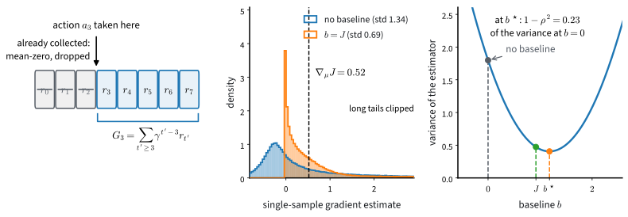

# Baselines and Variance Reduction
:label:`sec_baselines`

In the previous section we trained a policy by raising the log-probability of every sampled action in proportion to the return of its trajectory,

$$\hat{u} = \frac{1}{n} \sum_{i=1}^n R(\tau_i) \sum_{t=0}^{T-1} \nabla_\theta \log \pi_\theta(a_t^i \mid s_t^i).$$

On average this estimate is the gradient of the expected return $J(\theta)$. In a single draw it is not: with four episodes per update, a single estimate at a partly trained policy was typically off by more than three times the gradient's length, and a batch without a success gave no update at all. The weights explain much of this. On the calm lake every return is either zero or $\gamma^{T-1}$, so an action is either ignored or rewarded. A detour on a successful episode is pushed up, and the step into a hole on a failed one is never pushed down.

Williams saw the problem in the 1992 paper that introduced REINFORCE and proposed a remedy there: subtract a reference level, a *baseline*, from the return before weighting :cite:`Williams.1992`. Statisticians call this a control variate. Subtract something whose mean you know, and the estimate keeps its mean while its variance can fall. Starting from one fact, that the score of the policy's own action averages to zero, this section works out which quantities may be subtracted and how much variance each removes, measured against exact gradients. The actor-critic methods of the next chapter and the group-based updates used to post-train language models are this estimator with other baselines.

```{.python .input #baselines-setup}
%%tab jax
# Deterministic XLA kernels. On an accelerator XLA otherwise picks each
# matrix product's kernel by timing candidates, and kernels that add in
# different orders differ in the last bits; training runs at large step
# sizes can turn such differences into different outcomes. JAX reads
# XLA_FLAGS once, when it starts, so this cell runs before the imports.
import os
os.environ['XLA_FLAGS'] = (os.environ.get('XLA_FLAGS', '') +
                           ' --xla_gpu_deterministic_ops=true').strip()
```

```{.python .input #baselines-baselines-advantages-and-variance-reduction-1}
%%tab pytorch
import math
import numpy as np
import torch
from torch import nn
from torch.nn import functional as F
from d2l import torch as d2l
```

```{.python .input #baselines-baselines-advantages-and-variance-reduction-1}
%%tab jax
import math
import numpy as np
import jax
from jax import numpy as jnp
from flax import nnx
import optax
from d2l import jax as d2l
```

```{.python .input #baselines-baselines-and-variance-reduction-1}
%%tab pytorch, jax
import gymnasium as gym
```

We keep the calm lake, $\gamma = 0.95$ and the softmax table of :numref:`sec_policygradient`. On the calm lake every action visibly affects the return; on slippery ice success is mostly luck, the return says little about any one action (at the uniform start, :numref:`sec_policygradient` found, a batch must be about nine times larger there for the same precision). Each update uses four episodes, few enough for differences in variance to show, and each training comparison runs twenty seeds, a hundred at the largest step size. Episodes are cut after 200 steps. Only a policy stuck in a loop walks that long, and its value is near zero, so the cut changes no weight measurably; without it, the large step sizes used below produce episodes thousands of steps long.

```{.python .input #baselines-baselines-advantages-and-variance-reduction-2}
%%tab pytorch, jax
gamma, eta_v = 0.95, 0.1               # discount; value-table step size
num_updates, batch_episodes = 150, 4   # small batches, to expose variance
num_seeds = 20                         # twenty seeds per arm
num_seeds_large = 100                  # at the large step size, eta = 16
env = gym.make('FrozenLake-v1', is_slippery=False, max_episode_steps=200)
```

## The Zero-Mean Identity

Every method in this section changes the weight of a score and must leave the mean in place. One identity, already used in the proof of the policy gradient theorem (:numref:`sec_policygradient`), guarantees this; we state it here for every differentiable policy.

### The Zero-Mean Lemma

For the softmax table, the score of action $a$ at state $s$ has one nonzero block, at the preferences of state $s$:

$$\frac{\partial \log \pi_\theta(a \mid s)}{\partial \theta_{s,a'}} = \mathbf{1}(a' = a) - \pi_\theta(a' \mid s).$$

Averaged over the policy's own action at $s$, the indicator averages to $\pi_\theta(a' \mid s)$ and cancels the second term. The cancellation holds for every differentiable policy.

**Lemma.** For every state $s$, $\ \sum_{a \in \mathcal{A}} \pi_\theta(a \mid s)\ \nabla_\theta \log \pi_\theta(a \mid s) = 0$.

**Proof.** $\sum_a \pi_\theta(a \mid s) \nabla_\theta \log \pi_\theta(a \mid s) = \sum_a \nabla_\theta\, \pi_\theta(a \mid s) = \nabla_\theta \sum_a \pi_\theta(a \mid s) = \nabla_\theta 1 = 0.$ $\blacksquare$

In words: at any state, the score of the sampled action has mean zero. Probability mass that one action gains, the others lose.

### The Conditional Identity

The useful consequence is slightly stronger. Suppose $c$ is any quantity that is already determined by the time the agent stands at state $s_t$: a reward collected earlier in the trajectory, a constant, or a function of $s_t$ itself. Conditioned on the trajectory prefix $(s_0, a_0, r_0, \ldots, s_t)$, the value $c$ is fixed while the action $a_t$ is still random, and since the policy consults only $s_t$, the inner expectation is the one the lemma covers:

$$
\begin{aligned}
\mathbb{E}\big[ c\ \nabla_\theta \log \pi_\theta(a_t \mid s_t) \big] &= \mathbb{E}\Big[ c\ \underbrace{\mathbb{E}\big[ \nabla_\theta \log \pi_\theta(a_t \mid s_t) \mid s_0, a_0, \ldots, s_t \big]}_{=\,0 \textrm{ by the lemma}} \Big] \\
&= 0.
\end{aligned}
$$

We can therefore multiply any score in the REINFORCE estimator by such a quantity, or subtract such a quantity from its weight, without moving the average. The condition is about the prefix: a quantity that depends on $a_t$ or on anything that happens after it is not covered.

## Reward-to-Go, Baselines, and Control Variates

The identity licenses two operations on the weight at step $t$: dropping terms fixed before $a_t$, and subtracting a quantity fixed before $a_t$. Neither moves the mean. Whether either reduces the variance is a separate question.

### Reward-to-Go and Causality

In the REINFORCE estimator, the score at step $t$ is multiplied by the return $R(\tau_i)$ of the whole trajectory, including rewards collected before action $a_t^i$ was drawn. Those rewards are fixed by the prefix, so by the conditional identity their product with the score at step $t$ has mean zero. Removing them leaves

$$\nabla_\theta J(\theta) = \mathbb{E}_{\tau \sim P(\cdot;\, \theta)} \Big[ \sum_{t=0}^{T-1} \nabla_\theta \log \pi_\theta(a_t \mid s_t)\ \sum_{t'=t}^{T-1} \gamma^{t'} r_{t'} \Big].$$

This is *causality*: an action can affect the future, not the past. The inner sum equals $\gamma^t \hat{G}_t$, where

$$\hat{G}_t = \sum_{t'=t}^{T-1} \gamma^{t'-t}\, r_{t'}$$

is the *reward-to-go* from step $t$, the discounted return of the rest of the episode. The plain estimator multiplies a sum of $T$ scores by a return that is itself a sum over $T$ steps, so its variance grows quickly with the length of the episode when rewards arrive at every step; removing the earlier rewards shortens the sum that multiplies each score. Removing a term of mean zero does not by itself lower the variance, though, because the removed term may be correlated with what remains; the measurements below show both outcomes.

Implementations, ours included, also drop the factor $\gamma^t$ and weight the score at step $t$ by $\hat{G}_t$ alone:

$$\hat{u} = \frac{1}{n} \sum_{i=1}^n \sum_{t=0}^{T-1} \hat{G}_t^i\ \nabla_\theta \log \pi_\theta(a_t^i \mid s_t^i).$$
:eqlabel:`eq_rtg`

Dropping $\gamma^t$ is not licensed by the identity. It counts a late visit to a state as heavily as an early one, so for $\gamma < 1$ the mean of :eqref:`eq_rtg` tilts away from $\nabla_\theta J$. :citet:`Thomas.2014` identified this bias in actor-critic algorithms, and :citet:`Nota.Thomas.2020` showed that the update is the gradient of no objective at all. At the policy studied below the tilt is about eight degrees (a cosine of $0.991$) and the mean is about $1.4$ times longer (exercise :exref:`ex_baselines-reward-to-go-taken-apart`). We keep the convention, which the methods built on this estimator share, and measure both versions.

The reward-to-go of every step follows from one backward pass per episode, $\hat{G}_t = r_t + \gamma \hat{G}_{t+1}$, starting from zero after the last step. `backward_scan` runs this recursion for any vector and factor (later sections scan other quantities with other factors) over each episode that `Batch.episodes` of :numref:`sec_policygradient` reports, and `reward_to_go` applies it to the rewards with factor $\gamma$:

```{.python .input #baselines-reward-to-go-and-causality}
%%tab pytorch, jax
@d2l.add_to_class(d2l.Batch)  #@save
def backward_scan(self, x, factor):
    """y_t = x_t + factor * y_{t+1}, restarted at every episode boundary."""
    y = np.zeros_like(x)
    for ep in self.episodes():
        running = 0.0
        for t in reversed(range(ep.start, ep.stop)):
            running = x[t] + factor * running
            y[t] = running
    return y

@d2l.add_to_class(d2l.Batch)  #@save
def reward_to_go(self, gamma):
    """G_t: the discounted return of the rest of its episode, by one scan."""
    return self.backward_scan(self.rew, gamma)
```

### Baselines

The second operation is subtraction. Any quantity $b$ that is determined by the trajectory prefix up to $s_t$, whether a constant or a function $b(s_t)$ of the current state, can be subtracted from the reward-to-go:

$$\hat{u} = \frac{1}{n} \sum_{i=1}^n \sum_{t=0}^{T-1} \big( \hat{G}_t^i - b(s_t^i) \big)\ \nabla_\theta \log \pi_\theta(a_t^i \mid s_t^i).$$
:eqlabel:`eq_pg_baseline`

Such a $b$ is called a *baseline*. The extra term is $b(s_t)$ times the score, which has mean zero by the conditional identity, so :eqref:`eq_pg_baseline` and :eqref:`eq_rtg` have the same mean.

On the lake no reward-to-go is negative, so without a baseline no sampled action is ever pushed down. Subtracting a value near the typical reward-to-go gives positive weights to continuations that did better than typical and negative weights to those that did worse. If the mean is unchanged, how can learning change? Through the variance, which the next subsection computes. And why not subtract an estimate of $Q(s_t, a_t)$, the best predictor of the weight? It depends on $a_t$, so the identity no longer applies and the mean moves (exercise :exref:`ex_baselines-admissible`).

### Control Variates

Baseline subtraction is an instance of a general method for Monte Carlo estimation. Suppose we want $\mathbb{E}[X]$, and each sample also contains a correlated quantity $Y$ whose expectation is known. For any scalar $c$, define

$$X_c = X - c\, \big( Y - \mathbb{E}[Y] \big).$$
:eqlabel:`eq_control_variate`

Since $\mathbb{E}[Y-\mathbb{E}[Y]]=0$, the estimator $X_c$ has the same expectation as $X$ for every $c$. Its variance is

$$\textrm{Var}(X_c) = \textrm{Var}(X) - 2c\, \textrm{Cov}(X, Y) + c^2\, \textrm{Var}(Y),$$

a quadratic in $c$, minimized at

$$c^* = \frac{\textrm{Cov}(X, Y)}{\textrm{Var}(Y)}.$$

Substituting $c^*$ back in leaves the variance at $(1 - \mathrm{corr}^2)\, \textrm{Var}(X)$, where $\mathrm{corr}$ is the correlation between $X$ and $Y$. Strong correlation permits a large reduction: at $\mathrm{corr}=0.9$ the variance falls by a factor of about five, whereas at $\mathrm{corr}=0$ it is unchanged. The quantity $Y$ is called a *control variate* for $X$.

For a policy gradient, take $X = \hat{G}_t\, \nabla_\theta \log \pi_\theta(a_t \mid s_t)$ and $Y = \nabla_\theta \log \pi_\theta(a_t \mid s_t)$. By the lemma $\mathbb{E}[Y\mid s_t]=0$, and $c=b(s_t)$ recovers :eqref:`eq_pg_baseline`: a baseline is a control variate built from the score. The best coefficient is $c^*$, computed separately for each state; for a vector-valued score, inner products replace the products and give the optimal baseline $b^*$ of exercise :exref:`ex_baselines-optimal-constant-baseline`. :citet:`Greensmith.Bartlett.Baxter.2004` develop this analysis for policy gradients.

The smallest case shows the size of the effect. Take the one-step problem of :numref:`fig_rl_score_ascent`: one action $a$ drawn from the normal distribution $\mathcal{N}(a; \mu, 1)$ at $\mu = 0$, and the reward $R(a)=0.4+2e^{-(a-2)^2/2}$. The expected reward is $J = \mathbb{E}[R] = 0.92$, the score with respect to $\mu$ is $a - \mu = a$, and the exact gradient is $\mathrm{d}J/\mathrm{d}\mu = 0.52$. A single-sample estimate $R(a)\,a$ has this mean and a standard deviation of $1.34$, more than two and a half times the quantity it estimates. Subtracting the mean reward, $(R(a) - 0.92)\,a$, cuts the standard deviation to $0.69$. The best constant is $b^* = \mathbb{E}[R(a)\,a^2] / \mathbb{E}[a^2] = 1.18$, above the mean reward because actions far from zero have large scores and, here, large rewards; it leaves $1-\mathrm{corr}^2 = 0.23$ of the variance without a baseline (:numref:`fig_rl_variance_reduction`).

![Two ways to quiet the score-function estimator. (a) In a multi-step episode, rewards collected before an action have zero expected product with its score, so only the reward-to-go $\hat G_3$ remains. (b) On the one-step problem of :numref:`fig_rl_score_ascent`, subtracting the mean reward cuts the standard deviation of a single-sample estimate from $1.34$ to $0.69$; both histograms are clipped at their 1st and 95th percentiles. (c) The variance as a function of a constant baseline $b$ is a parabola, smallest at $b^* = 1.18$, where $0.23$ of the variance at $b = 0$ remains.](../img/mdl-rl-variance-reduction.svg)
:label:`fig_rl_variance_reduction`

### The Advantage and the Learned Baseline

On the lake one constant cannot fit every state: a cell next to the goal has a much higher expected reward-to-go than the start. The natural state-dependent baseline is the value of the state. By :numref:`sec_valueiter`, $V^\pi(s) = \sum_a \pi(a \mid s)\, Q^\pi(s, a)$, the policy's average over the values of its actions. The *advantage* of an action measures how much better it is than that average,

$$
A^\pi(s, a) = Q^\pi(s, a) - V^\pi(s), \qquad \mathbb{E}_{a \sim \pi(\cdot \mid s)} \big[ A^\pi(s, a) \big] = 0.
$$
:eqlabel:`eq_advantage`

The mean is zero by the relation just stated. A positive advantage marks an action that beats the policy's average at $s$. Since $\mathbb{E}[\hat{G}_t \mid s_t, a_t] = Q^{\pi_\theta}(s_t, a_t)$, the weight $\hat G_t - V^{\pi_\theta}(s_t)$ is a sample of the advantage of the action taken, so the update raises the actions that beat the state's average and lowers the rest.

We do not know $V^{\pi_\theta}$, but we can estimate it from the same batches. Keep a table $\hat{V}(s)$, and after each batch move the entry of every visited state toward the reward-to-go observed there,

$$\hat{V}(s_t) \leftarrow \hat{V}(s_t) + \eta_V \big( \hat{G}_t - \hat{V}(s_t) \big),$$
:eqlabel:`eq_value_baseline`

with a step size $\eta_V$. This is REINFORCE with a baseline :cite:`Williams.1992`. The table is fitted by regression on Monte Carlo returns, the reward-to-go values of complete episodes. Targets built from $\hat{V}$'s own predictions one step later give the actor-critic methods of :numref:`chap_deep_rl`, whose advantage estimate reduces to $\hat{G}_t - \hat{V}(s_t)$ when it does not bootstrap at all.

## Centering, Scaling, and Normalization

Practitioners often standardize the weights of each batch or compare the samples of a group with one another, and every implementation must decide what to divide a summed loss by. Each choice changes either the estimator or only its scale, and the two are easy to confuse. Telling them apart needs a fixed policy whose exact gradient we know.

We rebuild `probe` exactly as in :numref:`sec_policygradient`, with `d2l.train_reinforce_tabular` and the same sixteen updates of sixteen episodes. Its value $J(\theta)=V^{\pi_\theta}(s_0)$ is the first entry of the solution of the linear system $V = r_\pi + \gamma P_\pi V$ of :numref:`sec_valueiter`, with $P_\pi(s' \mid s) = \sum_a \pi_\theta(a \mid s)\, P(s' \mid s, a)$ and $r_\pi(s) = \sum_a \pi_\theta(a \mid s)\, r(s, a)$. `probe.probs` reads $\pi_\theta$ off the probe, and `mdp.policy_value(pi_np)` solves this system in NumPy and returns $V^{\pi_\theta}$ at every state, the exact state baseline:

```{.python .input #baselines-centering-scaling-and-normalization-1}
%%tab pytorch, jax
mdp = d2l.TabularMDP.from_gym(env, gamma)
probe = d2l.Policy.tabular(16, 4)        # the probe of sec_policygradient
list(d2l.train_reinforce_tabular(probe, env, gamma, 3, num_updates=16))
pi_np = probe.probs(16, 4)
V_pi = mdp.policy_value(pi_np)           # the exact state baseline
```

`exact_gradient` differentiates `d2l.policy_objective` of :numref:`sec_policygradient`, the same system written with the framework's arrays, at the probe's preference table. It takes the reward table `r` as an argument, so it also serves a modified reward later:

```{.python .input #baselines-estimator-hygiene}
%%tab pytorch
theta_probe, P = probe.policy.weight.detach(), torch.as_tensor(mdp.P).float()

def exact_gradient(r):
    """grad J at the probe for the rewards r[s, a], flattened."""
    return torch.func.grad(d2l.policy_objective)(
        theta_probe, P, torch.as_tensor(r).float(), gamma).numpy().ravel()

g_exact = exact_gradient(mdp.r)
print(f'J(theta) = {V_pi[0]:.3f}, |grad J| = {np.linalg.norm(g_exact):.3f}')
```

```{.python .input #baselines-estimator-hygiene}
%%tab jax
theta_probe, P = probe.policy.embedding[...], jnp.asarray(mdp.P, jnp.float32)

def exact_gradient(r):
    """grad J at the probe for the rewards r[s, a], flattened."""
    return np.asarray(jax.grad(d2l.policy_objective)(
        theta_probe, P, jnp.asarray(r, jnp.float32), gamma)).ravel()

g_exact = exact_gradient(mdp.r)
print(f'J(theta) = {V_pi[0]:.3f}, |grad J| = {np.linalg.norm(g_exact):.3f}')
```

The printed $J(\theta) = 0.313$, against a best possible $\gamma^5 \approx 0.77$, is the probe's value in :numref:`sec_policygradient`. Its exact gradient is the reference for every measurement below.

### Batch Centering versus Variance Scaling

A common variant standardizes the reward-to-go values within each batch. Collect every $\hat{G}_t^i$ in the current batch, compute their mean $\bar{R}$ and standard deviation $\sigma$, and use

$$\tilde{G}_t^i = \frac{\hat{G}_t^i - \bar{R}}{\sigma + 10^{-8}}$$
:eqlabel:`eq_pg_normalized`

in place of $\hat{G}_t^i$, where the constant $10^{-8}$ avoids dividing by zero. Subtracting $\bar{R}$ is a baseline: it changes the relative weights of the samples and can change the direction of the estimate. Because $\bar{R}$ comes from the same batch, it depends weakly on the sampled actions; the next subsection computes the resulting bias for per-trajectory weights, and exercise :exref:`ex_baselines-batch-centering` for the step-level weights used here.

Dividing by $\sigma + 10^{-8}$ multiplies the whole batch estimate by one positive number, so within a batch it acts as a step size that adapts to the spread of the rewards, not as a baseline. Across batches the factor is random and correlated with the batch, so the expected update tilts as well; exercise :exref:`ex_baselines-sigma-objective` works out the related effect of a $\sigma$ that differs across prompts. On the lake $0\leq\hat{G}_t\leq1$ implies $\sigma\leq1/2$, so at a fixed step size normalization takes steps at least twice as long as centering; below we measure about three times. `standardize` implements :eqref:`eq_pg_normalized`:

```{.python .input #baselines-centering-is-a-baseline-dividing-by-sigma-is-a-step-size-rescaling}
%%tab pytorch, jax
def standardize(x, eps=1e-8):  #@save
    """Center a NumPy batch of weights and divide by its standard deviation
    (NumPy's std, which divides by the batch size)."""
    return (x - x.mean()) / (x.std() + eps)
```

### The Leave-One-Out Baseline
:label:`subsec_leave_one_out`

The batch mean includes the sample it is subtracted from. Leave-one-out centering removes this self-dependence by giving each trajectory the mean of the *other* trajectories as its baseline,

$$b_i = \frac{1}{n-1} \sum_{j \neq i} R(\tau_j).$$

Trajectories are drawn independently, so $b_i$ is independent of trajectory $i$, and the conditional zero-mean identity applies with no correction: the estimator is unbiased at every batch size. Its weights are those of centering by $\bar{R}$, scaled,

$$R_i-b_i=\frac{n}{n-1}(R_i-\bar{R}),$$

so plain centering with per-trajectory weights multiplies the mean of the estimator by $(n-1)/n$, one half at $n = 2$. We verify both statements on a problem small enough to enumerate: two states visited in order, two actions at each, rewards from a table. `leave_one_out` computes the weights $R_i - b_i$ of one batch:

```{.python .input #baselines-leave-one-out}
%%tab pytorch, jax
def leave_one_out(R):
    """R_i - b_i, with b_i the mean of the other n - 1 returns: n/(n-1)
    times the centered returns."""
    return (R - R.mean()) * len(R) / (len(R) - 1)
```

The next cell computes the exact gradient `g` from the four possible trajectories and the exact mean of both estimators over all sixteen ordered batches of two:

```{.python .input #baselines-the-leave-one-out-baseline-2}
%%tab pytorch, jax
rng = np.random.default_rng(0)
th = rng.standard_normal((2, 2))               # a generic two-state table
pi2 = np.exp(th) / np.exp(th).sum(1, keepdims=True)
r2 = np.array([[0.3, 1.0], [0.6, 0.1]])        # r[s, a]; s0 -> s1 -> done
trajs = [(a0, a1) for a0 in range(2) for a1 in range(2)]
p = np.array([pi2[0, a0] * pi2[1, a1] for a0, a1 in trajs])
R = np.array([r2[0, a0] + r2[1, a1] for a0, a1 in trajs])
S = np.zeros((4, 2, 2))                        # the score of each trajectory
for i, (a0, a1) in enumerate(trajs):
    S[i] = -pi2
    S[i, 0, a0] += 1
    S[i, 1, a1] += 1
g = (p[:, None, None] * R[:, None, None] * S).sum(0)    # exact gradient
u_loo = u_cen = 0.0
for i in range(4):
    for j in range(4):                         # every batch of n = 2
        w, wc = leave_one_out(R[[i, j]]), R[[i, j]] - R[[i, j]].mean()
        u_loo += p[i] * p[j] * (w[0] * S[i] + w[1] * S[j]) / 2
        u_cen += p[i] * p[j] * (wc[0] * S[i] + wc[1] * S[j]) / 2
print(f'E[leave-one-out] equals the exact gradient: {np.allclose(u_loo, g)}')
print(f'E[centered] equals (n-1)/n of it:           {np.allclose(u_cen, g / 2)}')
```

Both identities hold to machine precision. :citet:`Kool.Hoof.Welling.2019` proposed the leave-one-out baseline for REINFORCE with several samples per input, and under the name RLOO it is used to post-train language models :cite:`Ahmadian.Cremer.Galle.ea.2024`: sample $n$ responses to a prompt and weight each by its reward minus the mean reward of the other $n-1$.

### The Group as the Batch
:label:`subsec_baselines_group`

On the lake every episode starts in the same cell, so one batch mean serves all of them. The verifier task of :numref:`sec_mdp` is different: four arithmetic prompts, nine shared candidate responses, and a verifier that pays one for the correct answer; the reference policy succeeds with probability $0.062$, and no policy can exceed $0.5$ because two prompts have no correct candidate. Each prompt is its own start state with its own success rate, so the baseline must be per prompt. `verifier_step` of :numref:`sec_policygradient` samples $K$ responses to each prompt and weights the score $\mathbf{e}_y - \pi(\cdot \mid x)$ of each response $y$ by a function of the $K$ rewards. The $K$ responses to one prompt, the *group*, supply the baseline.

With rewards of zero and one, centering by the group mean has a simple form. If $k$ of the $K$ responses are correct, the group mean is $k/K$, so a correct response receives the weight $1 - k/K$ and an incorrect one $-k/K$. Without the baseline an incorrect response had weight zero; now it is pushed down, and harder the more often the policy already succeeds on that prompt. Dividing by the group's standard deviation $\sqrt{\hat p(1 - \hat p)}$, with $\hat p = k/K$, turns the two weights into

$$+\sqrt{\frac{1-\hat p}{\hat p}} \quad \textrm{and} \quad -\sqrt{\frac{\hat p}{1-\hat p}}.$$

With $K = 16$ and two correct answers, each correct response gets about $+2.65$ and each incorrect one about $-0.38$: a rare success on a hard prompt receives a large push. A group in which every response scores the same, all wrong or all right, has nothing to compare and gives every response the weight zero; :numref:`sec_exploration` counted how often that happens.

The standardized weight of response $j$ in its group is

$$\hat{A}_j = \frac{r_j - \bar{R}}{\sigma + 10^{-8}},$$

where $\bar{R}$ and $\sigma$ are the mean and standard deviation of the $K$ rewards of the group. It is the per-trajectory form of :eqref:`eq_pg_normalized`, with the prompt as the start state and the group as the batch: one reward per response is standardized, not one reward-to-go per step. It is the weight of Group Relative Policy Optimization (GRPO) :cite:`Shao.Wang.Zhu.ea.2024`, and `group_step` is `verifier_step` with `standardize` as the weighting:

```{.python .input #baselines-the-leave-one-out-baseline-1}
%%tab pytorch, jax
def group_step(task, theta, K, reward, rng, lr=2.0):  #@save
    """verifier_step with the group-normalized weight (GRPO): the rewards
    of each prompt's K responses, standardized within the group."""
    return d2l.verifier_step(task, theta, K, reward, rng, standardize, lr)
```

The group mean includes the response's own reward, so by the leave-one-out calculation the expected group-centered update is $(K-1)/K$ times the gradient. We check this exactly for groups of two, without the division by $\sigma$. The cell computes the score of every response (`Sv`), the exact gradient of each prompt's success as the nine-term sum $\sum_y \pi(y \mid x)\, r(x, y)\, (\mathbf{e}_y - \pi(\cdot \mid x))$ (`gv`), and the exact mean of the centered update over all ordered pairs of responses (`u`):

```{.python .input #rl-sequences-the-group-is-the-baseline-3}
%%tab pytorch, jax
task = d2l.VerifierTask()                  # the instance of sec_mdp
K, pi, Rv = 2, task.policy(task.theta_ref), task.R
Sv = np.eye(len(task.resp))[None, :, :] - pi[:, None, :]  # eq_softmax_score
gv = np.einsum('xy,xy,xyv->xv', pi, Rv, Sv)          # the exact gradient
u = np.zeros_like(gv)
for y1, y2 in np.ndindex(len(task.resp), len(task.resp)):  # groups of K = 2
    w = (Rv[:, y1] - Rv[:, y2]) / 2                  # reward minus group mean
    u += (pi[:, y1] * pi[:, y2] * w)[:, None] * (Sv[:, y1] - Sv[:, y2]) / K
print(f'E of the group-centered update is (K-1)/K of the gradient: '
      f'{np.allclose(u, gv * (K - 1) / K)}')
print(f'rescaled by K/(K-1), leave-one-out, it is exact: '
      f'{np.allclose(u * K / (K - 1), gv)}')
```

How much does the bias matter? At $K=1$ the factor is zero: the group mean equals the response's own reward, every weight is zero, and the policy never moves, although its gradient is not zero. For $K \geq 2$ the factor only shrinks the step. The sweep fixes the budget at $6{,}400$ scored responses per prompt, so smaller groups take more steps ($3{,}200$ at $K = 2$, $200$ at $K = 32$):

```{.python .input #rl-sequences-the-group-is-the-baseline-2}
%%tab pytorch, jax
budget = 6400                    # scored responses per prompt, matched
for K in (1, 2, 4, 8, 32):
    rng, theta = np.random.default_rng(1), task.theta_ref.copy()
    for _ in range(budget // K):
        theta = group_step(task, theta, K, task.verify, rng)
    print(f'K = {K:2d}: success of a sampled response '
          f'{task.success(task.policy(theta)):.3f}')
```

At $K=1$ the policy keeps the reference score $0.062$, as predicted, and every $K\geq2$ reaches the ceiling of $0.5$ within the same budget, for each of the ten seeds we tried. The group supplies the per-prompt comparison that a learned value table would otherwise supply. Dividing by $\sigma$ per prompt has a further effect that this instance does not show: it changes which prompts the update favors (exercise :exref:`ex_baselines-sigma-objective`).

### The Loss Divisor
:label:`subsec_pg_loss_divisor`

The double sum in :eqref:`eq_rtg` runs over episodes and steps, and an implementation must divide it by something. Dividing by the number of episodes $n$ gives that equation. Dividing by the total number of steps rescales each batch by the reciprocal of its mean episode length, which changes as the policy improves. Dividing each episode by its own length reweights the episodes and can change the direction. A fixed constant changes only the scale. We compute all four on one batch of four episodes of different lengths; `agg` sums the scores of batch `b` under the policy `pi` with `d2l.tabular_score` of :numref:`sec_policygradient`, each weighted by its reward-to-go times a per-step factor `scale`:

```{.python .input #baselines-summing-over-episodes-of-different-lengths}
%%tab pytorch, jax
b = d2l.rollout(env, probe.act, 4, np.random.default_rng(6))
G, T = b.reward_to_go(gamma), np.diff(b.ep_ends, prepend=0)
print(f'episode lengths {T}, successes {int(b.rew.sum())}')

def agg(b, G, pi, scale):  # sum_t scale_t G_t score_t
    return d2l.tabular_score(b.obs, b.act, G * scale, pi).ravel()

grads = {'episodes': agg(b, G, pi_np, np.full(len(b), 1 / len(T))),
         'own length': agg(b, G, pi_np, np.repeat(1 / T, T) / len(T)),
         'total steps': agg(b, G, pi_np, np.full(len(b), 1 / len(b))),
         'a constant': agg(b, G, pi_np, np.full(len(b), 1 / 32))}
for k, u in grads.items():
    cos = u @ grads['episodes'] / (np.linalg.norm(u)
                                   * np.linalg.norm(grads['episodes']))
    print(f'{k:>12}: |grad| = {np.linalg.norm(u):.3f}, '
          f'cos to episodes = {cos:.3f}')
```

Three of the four gradients are parallel, at sizes an order of magnitude apart; the per-length version tilts away from the rest. The `policy_step` of :numref:`sec_imitation` divides by the total number of steps, the third choice, so the training loop below rescales its weights to recover the first. Language-model training faces the same choice with responses as episodes and tokens as steps: GRPO divides each response by its own length, DAPO divides by the total number of tokens :cite:`Yu.Zhang.Zhu.ea.2025`, and Dr. GRPO divides by a constant, the one choice that rescales every batch by the same factor :cite:`Liu.Chen.Li.ea.2025`.

## Five Estimators Compared

We now have five weightings for the score at step $t$. Which of them reduce the variance, and by how much? We answer first at a fixed policy, where the exact gradient is known, and then in training.

### Estimators at a Frozen Policy
:label:`subsec_five_estimators`

The five weightings are:

1. **Trajectory return** $R(\tau)$, the unbiased REINFORCE estimator displayed at the start of this section.
2. **Reward-to-go** $\hat{G}_t$ as in :eqref:`eq_rtg`, with the factor $\gamma^t$ dropped.
3. **Centered** reward-to-go $\hat{G}_t - \bar{R}$, with $\bar{R}$ the mean over the steps of the batch.
4. **Normalized** reward-to-go :eqref:`eq_pg_normalized`.
5. **Value baseline** $\hat{G}_t - V(s_t)$: at the fixed policy the exact $V^{\pi_\theta}$ from the linear solve, which we can afford here; in training the learned table $\hat{V}$ of :eqref:`eq_value_baseline`.

A sixth row, **causal**, weights the score at step $t$ by $\gamma^t \hat{G}_t$, the unbiased estimator of the causality argument; it separates dropping past rewards from dropping $\gamma^t$.

Holding the probe fixed, we draw $2{,}000$ batches of four episodes and compute every estimator on each. `estimate` sums the weighted scores of a batch with `d2l.tabular_score` and divides by the number of episodes, as in :eqref:`eq_rtg`; `discounted` multiplies each reward-to-go by $\gamma^t$, counting $t$ from the start of its episode; `weightings` maps each name to a function of the batch, its reward-to-go and a value table (`per_step` repeats each episode's return over its steps). `stats` computes the three printed columns. `|mean|/|grad J|` and `cos` give the scale and direction of the estimator's mean: the length of the mean of the draws relative to $\nabla_\theta J$, and the cosine between them. The column `noise` is the relative variance, the trace of the covariance of the draws divided by the squared length of their own mean. It is measured against each estimator's own mean because normalized weights are centered weights divided by $\sigma$, and a rescaled estimator should not be charged for its scale.

```{.python .input #baselines-estimators-at-a-frozen-policy-1}
%%tab pytorch, jax
def estimate(b, w, pi):
    """One draw of the estimator: weighted scores, averaged over episodes."""
    return d2l.tabular_score(b.obs, b.act, w, pi).ravel() / len(b.ep_ends)

def discounted(b, G, gamma):
    """gamma^t G_t: reward-to-go with the factor gamma^t of the gradient kept."""
    t = np.concatenate([np.arange(ep.stop - ep.start) for ep in b.episodes()])
    return gamma ** t * G

weightings = {                   # V: exact V^pi here, the learned table later
    'return': lambda b, G, V: b.per_step(b.episode_returns(gamma)),
    'causal': lambda b, G, V: discounted(b, G, gamma),
    'reward-to-go': lambda b, G, V: G,
    'centered': lambda b, G, V: G - G.mean(),
    'normalized': lambda b, G, V: standardize(G),
    'value baseline': lambda b, G, V: G - V[b.obs]}

def stats(u, g):
    """The scale and direction of the mean of the draws u against g, and
    the variance of the draws relative to their own mean."""
    m = u.mean(axis=0)
    size_m, size_g = np.linalg.norm(m), np.linalg.norm(g)
    return (size_m / size_g, m @ g / (size_m * size_g),
            ((u - m) ** 2).sum(axis=1).mean() / (m @ m))
```

The lake has a single reward, at the goal, so there are no past rewards to drop. To see causality at work, the cell repeats the measurement with a charge of $0.1$ for every move from a live cell. Every recorded step is such a move, so subtracting $0.1$ from every reward of a batch gives the same episodes under the new reward; `costly` is the MDP with the same kernel and the charged reward, which supplies the exact gradient and $V^\pi$:

```{.python .input #baselines-five-estimators-1}
%%tab pytorch, jax
step_cost = 0.1                  # charged for every move from a live cell
live = ~np.isin(env.unwrapped.desc.ravel(), [b'H', b'G'])
costly = d2l.TabularMDP(mdp.P, mdp.r - step_cost * live[:, None], gamma)
cases = {'lake': (0.0, g_exact, V_pi),
         'step cost': (step_cost, exact_gradient(costly.r),
                       costly.policy_value(pi_np))}
rng = np.random.default_rng(4)
batches = [d2l.rollout(env, probe.act, 4, rng) for _ in range(2000)]
for case, (c, g, V) in cases.items():
    bs = [d2l.Batch(b.obs, b.act, b.rew - c, b.next_obs, b.term, b.ep_ends)
          for b in batches]
    for k, fn in weightings.items():
        u = np.stack([estimate(b, fn(b, b.reward_to_go(gamma), V), pi_np)
                      for b in bs])
        scale, cos, noise = stats(u, g)
        print(f'{case:>9} {k:>14}: |mean|/|grad J| = {scale:.2f}, '
              f'cos = {cos:.3f}, noise = {noise:5.1f}')
```

On the lake the return and causal rows agree draw for draw: with one reward at the end of a successful episode, $\gamma^t \hat{G}_t = \gamma^{T-1}$ is the return itself at every step. Reward-to-go differs from them only by the dropped $\gamma^t$, with a mean about $1.4$ times longer and a slightly lower cosine. An unbiased estimator averaged over $2{,}000$ draws has a cosine near $0.997$, so that column shows this tilt and little else. The noise column gives the ordering that holds when the draws are repeated with other seeds: the value baseline is quietest, centered and normalized come next and agree with each other, and return and reward-to-go are noisiest. Centering removes about 40 percent of the noise of reward-to-go, and the value baseline about half. Centering also shortens the mean to about 0.8 of that of reward-to-go, near the factor $(n-1)/n = 3/4$ of per-trajectory centering. Dividing by $\sigma$ lengthens the mean about threefold and leaves the noise where centering put it, as a step size should.

With the charge per move, dropping past rewards cuts the noise of the return about threefold here. It need not. The dropped terms have mean zero but are correlated with the rest, and $\textrm{Var}(X+Y) = \textrm{Var}(X) + \textrm{Var}(Y) + 2\,\textrm{Cov}(X, Y)$ can be smaller than $\textrm{Var}(X)$: at a charge of $0.01$ per move, dropping them raises the noise by about a sixth (exercise :exref:`ex_baselines-reward-to-go-taken-apart`). The ordering of the other rows also belongs to this policy; at the uniform policy centering does not help (exercise :exref:`ex_baselines-variance-ordering`).

### Step Size and Variance in Training

Training compounds many steps, and the step size enters. The arms below use the same seeds and differ only in the weight passed to `policy_step`. They update by plain SGD with step size $\eta$, because Adam rescales each coordinate and would partly undo the differences in scale under study. Every run updates $\hat{V}$ by :eqref:`eq_value_baseline`, though only the value-baseline arm uses it. `entropy` averages the entropy $-\sum_a \pi(a \mid s) \log \pi(a \mid s)$, in nats, over the states of a batch, so each state counts as often as the agent visits it:

```{.python .input #baselines-step-size-and-variance-in-training-1}
%%tab pytorch, jax
def entropy(theta, obs):
    """Entropy of pi(.|s) in nats, averaged over the states the batch visited."""
    logp = theta - np.logaddexp.reduce(theta, axis=1, keepdims=True)
    return float(-(np.exp(logp) * logp).sum(axis=1)[obs].mean())
```

`train` is REINFORCE by plain SGD with one of the `weightings` and a step size `eta`. Its other arguments are the environment and the settings fixed at the start of the section. `policy_step` averages over the $N$ steps of a batch, while the frozen table averaged over its $n$ episodes; multiplying every weight by $N/n$ turns the first average into the second, so each arm runs the estimator the table measured. Without the factor the effective step would be $\eta\, n/N$, which grows as episodes shorten. Given the MDP as `exact`, `train` replaces the learned table by the exact $V^{\pi_\theta}$ of the policy about to be updated, solved afresh before every update as at the frozen policy; we call this arm the *exact baseline*. Each update records the batch's success rate, the length of the parameter step and the entropy along the batch.

:begin_tab:`pytorch`
`table` copies the preference table out of the policy, `d2l.plain_sgd` (:numref:`sec_utils`) replaces the policy's Adam optimizer by plain SGD, and `d2l.run_seeds` (:numref:`sec_utils`) calls `train` once per seed and stacks the results:
:end_tab:

:begin_tab:`jax`
`train` runs all seeds at once. Each seed keeps its own random generator, environment and value table, and the rollouts loop over the seeds, because the environment steps one state at a time in Python. The update is a single JAX computation: `sgd_step` is `policy_step` by plain SGD on one preference table, and `jax.vmap` maps it over a leading axis of seeds, so one compiled call updates every table. Each seed draws the same random numbers as it would alone:
:end_tab:

```{.python .input #baselines-five-estimators-2}
%%tab pytorch
def table(ac):
    """The policy's preference table, copied out to numpy."""
    return ac.policy.weight.detach().numpy().copy()
```

```{.python .input #baselines-five-estimators-2}
%%tab jax
def sgd_step(theta, obs, act, w, mask, eta):
    """policy_step by plain SGD on one preference table: a step on
    -(1/N) sum_t w_t log pi(a_t|s_t) over the N real rows of the batch."""
    def loss(theta):
        logp = jax.nn.log_softmax(theta[obs])[jnp.arange(len(act)), act]
        return -(mask * w * logp).sum() / mask.sum()
    return theta - eta * jax.grad(loss)(theta)

# Many independent runs at once: map the step over a leading axis of seeds
sgd_steps = jax.jit(jax.vmap(sgd_step, in_axes=(0, 0, 0, 0, 0, None)))
```

With those helpers in place, `train` runs the plain-SGD REINFORCE loop for
`num_updates` batches, scaling each per-step weight from
`weighting(batch, G, V)` by `len(batch) / batch_episodes`, updating the value
table `V` via :eqref:`eq_value_baseline` (or solving $V^\pi$ exactly when
`exact` is provided), and recording the mean return, parameter step norm, and
policy entropy:

```{.python .input #baselines-five-estimators-3}
%%tab pytorch
def train(seed, weighting, eta, env, gamma, num_updates, batch_episodes,
          eta_v, exact=None):
    """REINFORCE by plain SGD; the arms differ in one line, the weight. With
    an MDP as `exact`, V is the exact V^pi of the current policy."""
    S, A = env.observation_space.n, env.action_space.n
    rng, V = np.random.default_rng(seed), np.zeros(S, np.float32)
    ac = d2l.Policy.tabular(S, A, seed=seed)
    ac.opt_pi = d2l.plain_sgd(ac.policy, eta)
    env.reset(seed=seed)
    for _ in range(num_updates):
        batch = d2l.rollout(env, ac.act, batch_episodes, rng)
        G, before = batch.reward_to_go(gamma), table(ac)
        if exact is not None:              # V^pi of the policy that acted
            V = exact.policy_value(ac.probs(S, A))
        w = weighting(batch, G, V) * len(batch) / batch_episodes
        d2l.policy_step(ac, batch.obs, batch.act, w)  # sum over steps / n
        for s, g in zip(batch.obs, G):     # eq_value_baseline, every arm
            V[s] += eta_v * (g - V[s])
        yield (float(batch.episode_returns().mean()),
               float(np.linalg.norm(table(ac) - before)),
               entropy(before, batch.obs))
```

```{.python .input #baselines-five-estimators-3}
%%tab jax
def train(seeds, weighting, eta, env, gamma, num_updates, batch_episodes,
          eta_v, exact=None):
    """REINFORCE by plain SGD for all seeds at once; the arms differ in one
    line, the weight. With an MDP as `exact`, V is the exact V^pi of the
    current policy. Returns the curves, of shape (seeds, updates, 3)."""
    S, A = env.observation_space.n, env.action_space.n
    n, size = len(seeds), batch_episodes * env.spec.max_episode_steps
    rngs = [np.random.default_rng(seed) for seed in seeds]
    envs = [gym.make(env.spec) for _ in seeds]
    for e, seed in zip(envs, seeds):
        e.reset(seed=seed)
    theta = np.zeros((n, S, A), np.float32)  # Policy.tabular starts at zero
    Vs = [np.zeros(S, np.float32) for _ in seeds]
    curves = np.zeros((n, num_updates, 3))
    for k in range(num_updates):
        pi = np.exp(theta - theta.max(-1, keepdims=True))
        pi /= pi.sum(-1, keepdims=True)
        obs, act = (np.zeros((n, size), np.int32) for _ in range(2))
        w, mask = (np.zeros((n, size), np.float32) for _ in range(2))
        batches = []
        for i in range(n):                 # padded batches, one row per seed
            batch = d2l.rollout(envs[i], lambda s, rng: int(rng.choice(
                A, p=pi[i, s])), batch_episodes, rngs[i])
            G, N = batch.reward_to_go(gamma), len(batch)
            if exact is not None:          # V^pi of the policy that acted
                Vs[i] = exact.policy_value(pi[i])
            obs[i, :N], act[i, :N], mask[i, :N] = batch.obs, batch.act, 1
            w[i, :N] = weighting(batch, G, Vs[i]) * N / batch_episodes
            batches.append((batch, G))
        new = np.asarray(sgd_steps(theta, obs, act, w, mask, eta))
        for i, (batch, G) in enumerate(batches):
            for s, g in zip(batch.obs, G):  # eq_value_baseline, every arm
                Vs[i][s] += eta_v * (g - Vs[i][s])
            curves[i, k] = (batch.episode_returns().mean(),
                            np.linalg.norm(new[i] - theta[i]),
                            entropy(theta[i], batch.obs))
        theta = new
    return curves
```

The weightings have different scales, so a shared $\eta$ gives them steps of different lengths, and step length alone changes how fast a run learns. Matching the average step length does not remove this. A step's length includes its noise, and the steps of an arm with a baseline shrink once its policy succeeds, while an arm without one keeps pushing up the actions it already takes; arms matched on average therefore still take steps of different lengths while they learn. The clean test holds the expected update fixed instead. The exact $V^{\pi_\theta}$ is fixed before the batch is drawn, and so is the learned $\hat{V}$, which was fitted on earlier batches only. By the conditional identity, reward-to-go, the value baseline and the exact baseline therefore have the same expected update at every $\theta$, and at one $\eta$ they differ only in their noise. We run all six arms at $\eta = 2$ (`shared`) and these three again at $\eta = 16$ on `num_seeds_large` seeds (`large`). `setup` collects the settings every run shares, and each arm's runs are stacked into an array of shape (seeds, updates, 3):

```{.python .input #baselines-five-estimators-4}
%%tab pytorch
variants = ['return', 'reward-to-go', 'centered', 'normalized',
            'value baseline']
arms = {v: dict(weighting=weightings[v]) for v in variants}
arms['exact baseline'] = dict(weighting=weightings['value baseline'],
                              exact=mdp)
setup = dict(env=env, gamma=gamma, num_updates=num_updates,
             batch_episodes=batch_episodes, eta_v=eta_v)
shared = {v: d2l.run_seeds(train, num_seeds, eta=2.0, **kw, **setup)
          for v, kw in arms.items()}
large = {v: d2l.run_seeds(train, num_seeds_large, eta=16.0, **arms[v],
                          **setup)
         for v in ('reward-to-go', 'value baseline', 'exact baseline')}
```

```{.python .input #baselines-five-estimators-4}
%%tab jax
variants = ['return', 'reward-to-go', 'centered', 'normalized',
            'value baseline']
arms = {v: dict(weighting=weightings[v]) for v in variants}
arms['exact baseline'] = dict(weighting=weightings['value baseline'],
                              exact=mdp)
setup = dict(env=env, gamma=gamma, num_updates=num_updates,
             batch_episodes=batch_episodes, eta_v=eta_v)
shared = {v: train(range(num_seeds), eta=2.0, **kw, **setup)
          for v, kw in arms.items()}
large = {v: train(range(num_seeds_large), eta=16.0, **arms[v], **setup)
         for v in ('reward-to-go', 'value baseline', 'exact baseline')}
```

The success rate of the three arms with a common mean at $\eta = 16$, smoothed over a ten-update window, with each band spanning the interquartile range of the seeds around their median:

```{.python .input #baselines-five-estimators-5}
%%tab pytorch, jax
d2l.plot_curves({v: r[:, :, 0] for v, r in large.items()}, xlabel='update',
                ylabel='batch success rate', smooth=10, band='iqr')
```

`to90` finds the first update at which the success rate over the last ten updates reaches 90 percent; the tolerance absorbs the rounding of nine in ten. The cell prints, for both step sizes, the median over seeds with the fastest and slowest seed, the number of runs that never reach 90 percent within the 150 updates, and the mean step length over the updates before a run reaches 90 percent:

```{.python .input #baselines-five-estimators-6}
%%tab pytorch, jax
def to90(curve):
    """Last update of the first 10-update window whose mean success is 0.9."""
    hit = np.convolve(curve, np.ones(10) / 10, 'valid') >= 0.9 - 1e-9
    return hit.argmax() + 9 if hit.any() else len(curve)

for name, runs in (('eta = 2', shared), ('eta = 16', large)):
    print(name)
    for v, r in runs.items():
        reach = np.array([to90(c) for c in r[:, :, 0]])
        climb = np.mean([c[:t, 1].mean() for c, t in zip(r, reach)])
        print(f'{v:>14}: to 90%: median {np.median(reach):5.1f} '
              f'[{reach.min():3d}, {reach.max():3d}], never '
              f'{(reach == num_updates).sum():2d}, |step| {climb:.2f}')
```

At the shared step size the ordering is a step-size effect. Normalization needs the fewest updates, about 30 against 50 to 70, but before reaching 90 percent its steps are about three times as long as those of centering and more than one and a half times those of reward-to-go. Centering is about as fast as the plain return and slower than reward-to-go, the weight it centers, because it shrinks the step. The three arms with a common mean cannot be told apart at this step size: each needs about 50 updates.

At $\eta = 16$ they separate. All three learn faster than at $\eta = 2$, but the exact baseline gains most: its median falls from 50 to about 20 updates, and that of reward-to-go from 51 to about 35. The larger difference is in the failures. About one reward-to-go run in seven never reaches 90 percent, against none of the exact-baseline runs. Nearly every such run has stalled: long steps along noisy directions made the policy nearly deterministic on a path that loops until the time limit or ends in a hole, every later episode returns zero, every weight is zero, and the policy never moves again. The learned table falls between the two (a median of 26 updates, and one run in twenty never reaches 90 percent), because at this step size the policy changes faster than $\hat{V}$ can follow. The step column shows that the gain is not a longer step: before reaching 90 percent the exact baseline moves at most about a sixth farther per update than reward-to-go. Lower variance does not make a small step better, since many small steps average the noise away; it makes a longer step usable (exercise :exref:`ex_baselines-step-size-confound-quantified`).

At $\eta = 2$ the slowest seed of every arm needs two to six times the updates of the fastest, and at $\eta = 16$ the runs without the exact baseline spread wider still. Twenty seeds can therefore reorder medians that lie close together. In a separate experiment with 200 seeds per arm, drawing twenty of them at random, the medians of reward-to-go and the exact baseline at $\eta = 2$ differ by more than six updates about one time in seven, while at $\eta = 16$ the exact baseline has the lower median in about 49 draws of 50, but a single reward-to-go seed that changes course can move the median of twenty by more than fifteen updates. The arms at $\eta = 16$ therefore run 100 seeds. We report medians and ranges, and check a claim on more seeds before relying on it :cite:`Henderson.Islam.Bachman.ea.2018,Agarwal.Schwarzer.Castro.ea.2021`.

How deterministic does the policy become along the states the agent visits?

```{.python .input #baselines-five-estimators-7}
%%tab pytorch, jax
d2l.plot_curves({v: large[v][:, :, 2] for v in ('reward-to-go',
                                                 'exact baseline')},
                xlabel='update', ylabel='entropy along the batch (nats)',
                reference=np.log(4), smooth=10, band='iqr')
```

At $\eta = 16$ the median of both arms falls from the uniform policy's $\ln 4 \approx 1.39$ nats to below $0.1$ nats along the batch within the first 20 to 40 updates, that of reward-to-go usually sooner. A stalled run is as deterministic as a successful one, near zero nats on the path it repeats. An average over all sixteen states would stay above $0.4$ nats, because the four holes and the goal are never acted in and keep $\ln 4$.

We can now say which weights may be used, how much variance each removes, and how to tell a better estimator from a longer step. Every estimator here indexed a table, sixteen rows of preferences and sixteen entries of $\hat{V}$. A cart on a track is described by four real numbers and never visits the same state twice; :numref:`sec_deeprl` replaces both tables by networks.

## Summary

The score of a policy's own action has zero mean, and so does its product with anything fixed before the action. This lets us drop earlier rewards and subtract a baseline without changing the expected gradient. A baseline is a control variate; the state value $V^\pi$, which turns the weight into a sampled advantage, removed about half the noise at the policy we measured. Centering each trajectory's return by the batch or group mean multiplies the expected gradient by $(n-1)/n$, which leave-one-out removes; centering step by step shrinks it by a different factor. Dividing by the spread changes the step size, and with binary rewards the group-normalized weight of GRPO pushes failures down; a group of one cannot learn. A shared step size favors whichever weighting takes the longest steps. Compared at one step size and with the same mean, the exact value baseline and reward-to-go learn equally fast at a small step, while at a large step the baseline learns faster and does not stall.

## Exercises

1. **Admissible baselines.** The conditional zero-mean identity allows any
   quantity that is already determined when the agent stands at $s_t$ to be
   subtracted from $\hat{G}_t$. For each candidate below, decide whether
   subtracting it in :eqref:`eq_pg_baseline` leaves the expected gradient
   unchanged, and justify the answer with that condition:
    1. the time index $t$;
    1. the sum $r_0 + \cdots + r_{t-1}$ of the rewards collected before
       step $t$;
    1. the number $T - t$ of steps that remain in the episode;
    1. a function of the next state $s_{t+1}$;
    1. an action-value estimate $\hat{Q}(s_t, a_t)$.

   For the last candidate with $\hat{Q} = Q^{\pi_\theta}$, compute the
   expected contribution of step $t$ after the subtraction. What does the
   result say about baselines that depend on the action?
   :exlabel:`ex_baselines-admissible`
1. **Optimal constant baseline.** Fix a state $s$, write
   $\boldsymbol{\psi} = \nabla_\theta \log \pi_\theta(a \mid s)$ for the
   score of the sampled action, and consider the single-step estimator
   $(\hat{G} - b)\, \boldsymbol{\psi}$ with a constant $b$. Its mean does not
   depend on $b$, so we measure its noise by the trace of its covariance,

   $$\mathbb{E}\big[\|(\hat{G} - b)\, \boldsymbol{\psi}\|^2\big] - \big\|\mathbb{E}[\hat{G}\, \boldsymbol{\psi}]\big\|^2.$$

    1. Minimize the trace over $b$ and show that the minimizer is

       $$b^* = \frac{\mathbb{E}\big[\|\boldsymbol{\psi}\|^2\, \hat{G}\big]}{\mathbb{E}\big[\|\boldsymbol{\psi}\|^2\big]}.$$

       Show that any other $b$ adds exactly
       $\mathbb{E}\big[\|\boldsymbol{\psi}\|^2\big]\, (b - b^*)^2$ to the trace, and
       that $b^*$ is the coefficient $c^*$ of :eqref:`eq_control_variate`
       for $X = \hat{G}\, \boldsymbol{\psi}$ and $Y = \boldsymbol{\psi}$,
       with inner products in place of products.
    1. In the one-step problem of :numref:`fig_rl_variance_reduction`, the
       action is $a \sim \mathcal{N}(\mu, 1)$ at $\mu = 0$, so the
       score with respect to $\mu$ is $a$. Compute $b^*$ for
       $R(a) = 0.4 + 2e^{-(a-2)^2/2}$ and confirm the value $b^* = 1.18$. The product of the standard normal density with
       $e^{-(a-2)^2/2}$ is proportional to another normal density. Why does
       $b^*$ exceed $\mathbb{E}[R] = 0.92$?
   :exlabel:`ex_baselines-optimal-constant-baseline`
1. [code] **Bias of batch centering.** ● :numref:`subsec_leave_one_out`
   obtains the factor $(n-1)/n$ by which per-trajectory batch centering
   shrinks the expected gradient from the leave-one-out identity
   $R_i - b_i = \frac{n}{n-1}(R_i - \bar{R})$. That argument applies only to
   per-trajectory weights.
    1. Derive the factor directly, without the leave-one-out baseline. Write
       the centered estimate as
       $\frac{1}{n}\sum_{i=1}^n \big(R(\tau_i) - \bar{R}\big)\, \mathbf{S}_i$,
       where $\mathbf{S}_i$ is the summed score of trajectory $i$ and $\bar{R}$
       the mean return of the batch, expand $\mathbb{E}[\bar{R}\, \mathbf{S}_i]$ into its
       $n$ terms, and use the independence of the trajectories. Which of the
       terms have a nonzero expectation?
    1. The centered arm of `train` instead subtracts the mean of all
       reward-to-go values in the batch, step by step. Extend the
       enumeration to this weighting. Each trajectory of the two-state
       problem has $\hat{G}_0 = r_0 + r_1$ and $\hat{G}_1 = r_1$, since the
       enumeration uses no discount, and row $s$ of `S[i]` is the score of
       the step taken at state $s$. Compute the expected estimate for
       $n \in \{2, 4, 8\}$ and compare it with `g` through the ratio of the
       norms and the cosine.
    1. Explain the comparison. For each of the two steps, which
       reward-to-go values inside the batch mean have a nonzero expected
       product with the score of that step?
   :exlabel:`ex_baselines-batch-centering`
1. **The $\sigma$-normalized objective.** ● GRPO divides the centered
   rewards of each group by their standard deviation $\sigma$, a choice
   that :citet:`Liu.Chen.Li.ea.2025` analyze. Consider a
   prompt $x$ with binary reward, $r = 1$ for a correct response and $r = 0$
   otherwise, on which the current policy succeeds with probability $p_x$.
   Take the group so large that $\bar{R}$ and $\sigma$ equal their
   population values $p_x$ and $\sqrt{p_x (1 - p_x)}$.
    1. Compute $\sigma$ for $p_x = 0.5$ and for $p_x = 0.9$. By what factor
       does the division amplify the update of the second prompt relative to
       the first?
    1. Let $y$ denote the sampled response. Show that

       $$\mathbb{E}\big[(r - p_x)\, \nabla_\theta \log \pi_\theta(y \mid x)\big] = \nabla_\theta\, p_x.$$

       Conclude that the $\sigma$-normalized update ascends
       $\sum_x h(p_x)$ for a function $h$ with $h'(p) = 1/\sqrt{p(1-p)}$,
       and find $h$.
    1. Compare $h$ with the objective $\sum_x p_x$ of the unnormalized
       update. Which prompts gain weight relative to it? Is that the
       weighting a practitioner wants when most prompts of a training set
       are either nearly always or nearly never solved?
    1. With a finite group of $K$ responses, a prompt contributes no
       gradient when all $K$ rewards agree. Compute the probability of this
       event for $p_x = 0.9$ and $K = 8$, and explain how it limits the
       amplification of prompts with small $\sigma$.
   :exlabel:`ex_baselines-sigma-objective`
1. [code] **Variance ordering across policies.** ● The frozen-policy
   comparison of :numref:`subsec_five_estimators` probes one policy,
   `probe` after sixteen updates, at which $J(\theta) = 0.313$. Repeat it
   at the policies reached after $k \in \{0, 8, 32, 64\}$ probe updates:
   change the number of iterations of the loop that trains `probe`, and
   recompute `theta_probe`, `pi_np`, `g_exact` and `V_pi` before drawing the
   $2{,}000$ batches.
    1. Tabulate the noise of the five estimators against $k$. Does the
       ordering found at sixteen updates hold at every policy? At which
       policy does centering stop helping, and why?
    1. How do the two estimators without a baseline behave as $J(\theta)$
       approaches its maximum $\gamma^5 \approx 0.77$, and why?
    1. At $k = 0$, count how many of the batches contain no success, and
       explain what such a batch contributes to each of the five estimators.
   :exlabel:`ex_baselines-variance-ordering`
1. [code] **The step-size confound.** ● At the shared step size the
   normalized arm of `train` reached 90% success in the fewest updates, but
   it also took the longest steps. On a batch with $\sigma > 0$, the
   normalized weights :eqref:`eq_pg_normalized` produce the SGD update of
   the centered weights at the step size $\eta / (\sigma + 10^{-8})$.
    1. Log $\sigma$ per batch in the normalized arm and plot the median over
       seeds of $1/(\sigma + 10^{-8})$ against the update index, skipping
       batches without a success. How does this multiplier of the step size
       change as the policy improves? What does that imply for an attempt to
       equalize the two arms by running the normalized arm at $\eta$ divided
       by the run average of $1/(\sigma + 10^{-8})$?
    1. Repeat the comparison of reward-to-go, the value baseline and the
       exact baseline at $\eta \in \{4, 8, 32\}$, and plot for each arm,
       against $\eta$, the median number of updates to 90% and the fraction
       of runs that never get there. Which step size is best for each arm?
       Explain why the best step size grows as the noise of the estimator
       falls.
    1. Matching step lengths instead gives a noisier arm a smaller $\eta$.
       Choose for each of the five arms of `shared` a step size at which its
       mean step length over the first 40 updates is about $0.6$, and log
       the mean step length separately before and after each run reaches
       90%. Which arms take longer steps while they learn, and why does a
       comparison at matched average step lengths still mix variance with
       step size?
   :exlabel:`ex_baselines-step-size-confound-quantified`
1. [code] **Optimal state baseline.** ●● Exercise
   :exref:`ex_baselines-optimal-constant-baseline` derived the
   variance-optimal constant baseline at one state. Applied state by state,
   it gives the optimal baseline function of
   :citet:`Greensmith.Bartlett.Baxter.2004`, which minimizes the variance of
   a single step's term. This problem works it out for the tabular softmax
   policy and asks when it is also optimal for the episodic estimate
   `estimate`.
    1. Show from the softmax score that

       $$\|\nabla_\theta \log \pi_\theta(a \mid s)\|^2 = 1 - 2\pi_\theta(a \mid s) + \sum_{a'} \pi_\theta(a' \mid s)^2.$$

       Use $\mathbb{E}[\hat{G}_t \mid s_t = s, a_t = a] = Q^{\pi_\theta}(s, a)$ to
       write the optimal baseline $b^*(s)$ in terms of
       $\pi_\theta(\cdot \mid s)$ and $Q^{\pi_\theta}(s, \cdot)$.
    1. The estimate of one episode sums the weighted scores of all its
       steps. Show that in the tabular parameterization the scores of two
       steps at different states are orthogonal, so that the squared norm of
       the estimate splits into one term per step plus cross terms between
       visits to the same state. Under which condition on the episodes does
       $b^*(s)$ minimize the trace of the covariance of `estimate` exactly?
       Does FrozenLake meet it?
    1. Compute $b^*(s)$ at `probe`, with $Q^{\pi_\theta}$ given by
       `mdp.backup(V_pi)`, and add the weighting `G - b_star[b.obs]` to
       `weightings` in :numref:`subsec_five_estimators` as
       `lambda b, G, V: G - b_star[b.obs]`. Compare its noise with that of
       the exact baseline, at `probe` and at
       the policy after 64 probe updates.
    1. At which states does $b^*(s)$ differ most from $V^{\pi_\theta}(s)$?
       Explain with the weights
       $\|\nabla_\theta \log \pi_\theta(a \mid s)\|^2$ why a nearly
       deterministic state pulls $b^*(s)$ toward the action values of its
       rarely chosen actions, and relate the gap between the two baselines
       to the excess variance found in
       problem :exref:`ex_baselines-optimal-constant-baseline`a.
   :exlabel:`ex_baselines-optimal-state-baseline`
1. [code] **Reward-to-go, taken apart.** ● The reward-to-go weight of
   :eqref:`eq_rtg` makes two changes to the trajectory return: it drops the
   rewards collected before each action, which the conditional identity
   allows, and it drops the factor $\gamma^t$, which it does not.
    1. Let $\rho(s) = \mathbb{E}\big[\sum_t \mathbf{1}(s_t = s)\big]$ be the
       expected number of visits to $s$ in one episode. As in problem
       :exref:`ex_policy-gradient-discount-that-implementations-drop`a, the
       mean of :eqref:`eq_rtg` is
       $\sum_s \rho(s) \sum_a \nabla_\theta \pi_\theta(a \mid s)\,
       Q^{\pi_\theta}(s, a)$, while the policy gradient weights the states by
       $\sum_t \gamma^t \Pr(s_t = s)$ instead. For which $\gamma$ do the two
       agree?
    1. At `probe`, compute $\rho$ by solving
       $\rho = \mathbf{e}_{s_0} + P_\pi^\top \rho$ over the eleven cells that
       are neither holes nor the goal, take $Q^{\pi_\theta}$ from
       `mdp.backup(V_pi)`, and evaluate the mean of :eqref:`eq_rtg` exactly.
       Compare its cosine with `g_exact` and its length relative to
       `g_exact` with the reward-to-go row of the frozen-policy table.
    1. Dropping the earlier rewards removes a term $Y$ of mean zero from an
       estimate $X + Y$. Show that $\textrm{Var}(X) < \textrm{Var}(X + Y)$
       exactly when $\textrm{Var}(Y) + 2\,\textrm{Cov}(X, Y) > 0$. Repeat the
       comparison of the return and causal rows with a charge of $0.01$ per
       move instead of $0.1$, and at the policy reached after 64 probe
       updates. Does causality always reduce the noise? Explain each case by
       the sign of the covariance between the past rewards and the
       reward-to-go.
   :exlabel:`ex_baselines-reward-to-go-taken-apart`

[Discussions](https://d2l.discourse.group/t/36799)

<!-- slides -->

::: {.slide}
::: {.cover}
[Dive into Deep Learning · §14.8]{.kicker}

Baselines and Variance Reduction<br>**zero-mean score identity · reward-to-go · control-variate baselines · advantage & learned V · RLOO & GRPO group normalization**
:::
:::

::: {.slide title="Why Raw Return Weighting Is Too Noisy"}
[Motivation & Mental Model]{.kicker}

::: {.cols .vc}
::: {.col}
$$\hat{u} = \frac{1}{n}\sum_{i=1}^n R(\tau_i) \sum_{t=0}^{T_i-1} \nabla_\theta \log \pi_\theta(a_t^i \mid s_t^i)$$

- **All-or-nothing weights:** Nonnegative returns $R(\tau) \in \{0, \gamma^{T-1}\}$ push wasteful loops inside winning episodes *up*, while fatal steps into holes get weight $0$ and are never pushed *down*.
- **Control-variate solution:** Subtracting $b(s_t)$ pushes above-average actions up and below-average actions down without altering $\mathbb{E}[\hat{u}]$.
:::

::: {.col .fig}
@fig:ch14-rl-all-or-nothing
:::
:::
:::

::: {.slide title="The Zero-Mean Score Lemma and Prefix Identity"}
[Why Subtracting a Baseline Is Unbiased]{.kicker}

::: {.cols .vc}
::: {.col}
$$\mathbb{E}_{a \sim \pi_\theta(\cdot \mid s)}\big[\nabla_\theta \log \pi_\theta(a \mid s)\big] = \nabla_\theta \sum_{a \in \mathcal{A}} \pi_\theta(a \mid s) = \mathbf{0}$$

- **Conditional prefix identity:** For any quantity $c(s_{0:t}, a_{0:t-1})$ determined before $a_t$ is sampled, $\mathbb{E}[c\,\nabla_\theta \log \pi_\theta(a_t \mid s_t)] = \mathbf{0}$.
- **Admissibility rule:** Any prefix quantity may be subtracted without bias; anything depending on $a_t$ or $s_{t+1}$ biases the expectation.
:::

::: {.col .fig}
@fig:ch14-rl-prefix-admissibility
:::
:::
:::

::: {.slide title="Causality and Reward-to-Go"}
[Dropping Past Rewards via Backward Scan]{.kicker}

Dropping the prefix $\sum_{t'<t} \gamma^{t'} r_{t'}$ of $R(\tau)$ (zero expected product with step-$t$'s score) leaves the **reward-to-go**:

$$\hat{G}_t = \sum_{t'=t}^{T-1} \gamma^{t'-t}\,r_{t'} = r_t + \gamma\,\hat{G}_{t+1}$$

@baselines-reward-to-go-and-causality

- **Practical convention vs. exact $\gamma^t\hat{G}_t$:** Most implementations weight step $t$ by $\hat{G}_t$ rather than $\gamma^t\hat{G}_t$ (counting late visits as heavily as early visits, tilting the mean by $\approx 8^\circ$ at our frozen probe).
:::

::: {.slide title="Baselines as Statistical Control Variates"}
[Minimizing Estimator Variance]{.kicker}

In Monte Carlo estimation of $\mathbb{E}[X]$, subtracting a zero-mean correlated variable $c\,(Y - \mathbb{E}[Y])$ leaves the mean unchanged while reducing variance to a parabola in $c$:

$$\textrm{Var}\big(X - c(Y - \mathbb{E}[Y])\big) = \textrm{Var}(X) - 2c\,\textrm{Cov}(X, Y) + c^2\,\textrm{Var}(Y)$$

- **Optimal coefficient $c^* = \textrm{Cov}(X, Y)/\textrm{Var}(Y)$:** Cuts the variance to $(1 - \textrm{corr}^2)\,\textrm{Var}(X)$ (a $5\times$ reduction when $\textrm{corr} = 0.9$).
- **Policy-gradient specialization:** Setting $X = \hat{G}_t\nabla_\theta \log \pi_\theta(a_t \mid s_t)$ and $Y = \nabla_\theta \log \pi_\theta(a_t \mid s_t)$ (where $\mathbb{E}[Y \mid s_t] = \mathbf{0}$) yields the state-dependent baseline estimator:
  $$\hat{u} = \frac{1}{n}\sum_{i=1}^n \sum_{t=0}^{T_i-1} \big(\hat{G}_t^i - b(s_t^i)\big)\,\nabla_\theta \log \pi_\theta(a_t^i \mid s_t^i)$$
:::

::: {.slide title="Visualizing Variance Reduction on a 1-Step Task"}
[Causality and the Variance Parabola]{.kicker}

On the 1-step Gaussian problem $a \sim \mathcal{N}(\mu, 1)$ at $\mu = 0$ with reward $R(a) = 0.4 + 2e^{-(a-2)^2/2}$ ($\mathbb{E}[R] = 0.92$, exact gradient $0.52$), subtracting a constant baseline $b$ shrinks the estimator spread dramatically:

{.nostretch width=77%}

- **Over $4\times$ variance reduction:** Raw $R(a)\,a$ has standard deviation $1.34$; subtracting the mean reward $b = 0.92$ halves the spread to $0.69$, and the score-weighted optimum $b^* = \mathbb{E}[R(a)a^2]/\mathbb{E}[a^2] = 1.18$ leaves only $23\%$ of the original variance.
:::

::: {.slide title="State Values and the Advantage Function"}
[Learning a State-Dependent Baseline]{.kicker}

::: {.cols .vc}
::: {.col}
$$A^\pi(s, a) = Q^\pi(s, a) - V^\pi(s), \qquad \mathbb{E}_{a \sim \pi}\big[A^\pi(s, a)\big] = 0$$

- **Sampled advantage $\hat{G}_t - V^{\pi_\theta}(s_t)$:** Subtracting $V^{\pi_\theta}(s_t)$ centers every state around zero—pushing actions with $Q^\pi(s_t, a_t) > V^\pi(s_t)$ up and worse actions down.
- **Online value-table baseline:** Maintain $\hat{V}(s)$ updated after each batch via $\hat{V}(s_t) \leftarrow \hat{V}(s_t) + \eta_V(\hat{G}_t - \hat{V}(s_t))$.
:::

::: {.col .fig}
@fig:ch14-rl-advantage-centering
:::
:::
:::

::: {.slide title="Batch Centering vs. Standard-Deviation Scaling"}
[Separating Baseline Subtraction from Step-Size Rescaling]{.kicker}

Practitioners frequently standardize all reward-to-go weights within each batch via $\tilde{G}_t^i = (\hat{G}_t^i - \bar{R})/(\sigma + 10^{-8})$:

@baselines-centering-is-a-baseline-dividing-by-sigma-is-a-step-size-rescaling

- **Subtracting $\bar{R}$ is a baseline:** Shifts relative weights so below-average trajectories receive negative weights (with a small $(n-1)/n$ self-inclusion shrink factor).
- **Dividing by $\sigma$ is an adaptive step-size multiplier:** Multiplies the entire batch gradient by $1/\sigma$; on FrozenLake where $\hat{G}_t \in [0, 1]$, $\sigma \leq 0.5$, so dividing by $\sigma$ enlarges SGD steps by $\approx 3\times$.
:::

::: {.slide title="Leave-One-Out (RLOO) Eliminates Centering Bias"}
[Exact Unbiased Batch Centering]{.kicker}

Because the batch mean $\bar{R} = \frac{1}{n}\sum_{j=1}^n R_j$ includes trajectory $i$'s own return $R_i$, plain centering shrinks the expected gradient by $(n-1)/n$; **Leave-One-Out (RLOO)** (Kool et al., 2019; Ahmadian et al., 2024) uses the mean of the *other* $n-1$ trajectories:

$$b_i = \frac{1}{n - 1}\sum_{j \neq i} R(\tau_j), \qquad R_i - b_i = \frac{n}{n - 1}\big(R_i - \bar{R}\big)$$

@!baselines-the-leave-one-out-baseline-2

- **Exact unbiasedness for any $n \geq 2$:** Since independent trajectories $j \neq i$ do not depend on $\tau_i$'s actions, $\mathbb{E}[b_i \nabla_\theta \log P(\tau_i; \theta)] = \mathbf{0}$ holds exactly.
:::

::: {.slide title="Group Relative Policy Optimization (GRPO)"}
[Critic-Free Baselines for Language Models]{.kicker}

In LLM post-training, each prompt $x$ has its own difficulty $p_x$, so **GRPO** (Shao et al., 2024) samples a group of $K$ responses to prompt $x$ and uses the group's own mean and spread as the baseline:

$$\hat{A}_j = \frac{r(x, y_j) - \bar{R}_x}{\sigma_x + 10^{-8}}, \qquad \text{binary rewards } (k \text{ of } K \text{ right}): \quad +\sqrt{\frac{1-\hat{p}}{\hat{p}}} \;\;\text{vs.}\;\; -\sqrt{\frac{\hat{p}}{1-\hat{p}}}$$

@!rl-sequences-the-group-is-the-baseline-2

- **Why $K = 1$ never learns and $K \geq 2$ hits the ceiling:** At $K = 1$, $r_1 - \bar{R}_x = 0$ identically; for any $K \geq 2$, group centering pushes wrong answers down ($-k/K$) and right answers up ($1 - k/K$), reaching the $0.500$ ceiling without a value network.
:::

::: {.slide title="How the Loss Divisor Affects Direction and Scale"}
[Episodes vs. Total Steps vs. Per-Episode Length]{.kicker}

When summing weighted scores across episodes of varying lengths $T_i$ ($N = \sum_{i=1}^n T_i$ total steps), four common divisors behave differently:

@!baselines-summing-over-episodes-of-different-lengths

- **Three parallel, one tilted:** Dividing by episodes $n$, total steps $N$ (DAPO), or a fixed constant (Dr. GRPO) produces parallel gradients (`cos = 1.000`) differing only in scale, whereas dividing each episode by its own length $T_i$ (GRPO) reweights short vs. long episodes and tilts the direction (`cos = 0.937`).
:::

::: {.slide title="Benchmarking Six Estimators at a Frozen Policy" layout="tall-output"}
[Scale, Direction, and Relative Variance]{.kicker}

Evaluating $2{,}000$ 4-episode batches at our frozen probe ($J = 0.313$, where exact $\nabla_\theta J$ and $V^{\pi_\theta}$ are known via linear solve) compares bias and relative noise $\textrm{tr}(\textrm{Cov})/\|\textrm{mean}\|^2$:

@!baselines-five-estimators-1
:::

::: {.slide title="Interpreting the Frozen-Policy Variance Table"}
[What Drops Noise and When Causality Helps]{.kicker}

::: {.cols .vc}
::: {.col}
- **State value baseline is quietest:** Subtracting $V^{\pi_\theta}(s_t)$ more than halves relative noise (from about $12$ to under $6$) while preserving mean scale ($1.38$) and direction (`cos = 0.990`).
- **Centering vs. normalization:** Batch centering cuts noise by $\approx 40\%$ with $(n-1)/n$ shrink; dividing by $\sigma$ leaves relative noise unchanged ($7.5$) while tripling step length ($3.28$).
- **Dropping past rewards:** With a $-0.1$ per-step charge, causality cuts noise more than **$3\times$** ($19.5 \to 5.8$).
:::

::: {.col .fig .big}
@fig:ch14-rl-variance-mechanisms
:::
:::
:::

::: {.slide title="Disentangling Step Size from Variance in Training" layout="tall-output"}
[Shared Small Step Size vs. Large Step Size]{.kicker}

Comparing all six estimators under plain SGD at $\eta = 2$ (20 seeds) vs. the three equal-mean estimators at $\eta = 16$ (100 seeds) exposes the step-size confound:

@!baselines-five-estimators-6

- **At $\eta = 2$, normalization wins purely by taking $3\times$ larger steps:** Normalization reaches $90\%$ success in a median of $32.0$ updates because its step norm is $0.93$ vs. $0.32$ for centered and $0.53$ for reward-to-go.
:::

::: {.slide title="Lower Variance Unlocks Larger, Stable Step Sizes"}
[Why the Value Baseline Wins at eta = 16]{.kicker}

Holding the expected update vector identical across `reward-to-go`, `value baseline` (learned $\hat{V}$), and `exact baseline` ($V^{\pi_\theta}$) at $\eta = 16$ shows what variance reduction actually buys:

::: {.cols .vc}
::: {.col}
- **Faster convergence without stalling:** At $\eta = 16$, `exact baseline` reaches $90\%$ success in a median of **about $20$ updates with $0/100$ stalled runs**.
- **Catastrophic stalling without a baseline:** `reward-to-go` fails to reach $90\%$ in **about one run in seven** because a noisy large step locks the policy onto a zero-return loop where all future weights are $0$.
:::

::: {.col .fig}
@!baselines-five-estimators-5
:::
:::
:::

::: {.slide title="Policy Entropy Collapse Under Large Step Sizes"}
[Diagnosing Stalled Runs via On-Batch Entropy]{.kicker}

Tracking the Shannon entropy $\mathcal{H}(\pi_\theta(\cdot \mid s)) = -\sum_a \pi_\theta(a \mid s)\log\pi_\theta(a \mid s)$ averaged along visited states shows how quickly large steps make the policy deterministic:

::: {.cols .vc}
::: {.col}
- **From uniform ($\ln 4 \approx 1.39$ nats) to deterministic ($< 0.1$ nats):** Within 20 to 40 updates at $\eta = 16$, both arms collapse onto a nearly deterministic trajectory.
- **Why stalled runs never recover:** A stalled `reward-to-go` run is just as deterministic ($\approx 0$ nats) as a winning run—repeating a loop into a hole with zero entropy and zero gradient.
:::

::: {.col .fig}
@!baselines-five-estimators-7
:::
:::
:::

::: {.slide title="Concept Check: Baselines and Variance Reduction"}
[Check Your Understanding]{.kicker}

Test your understanding of admissible baselines, RLOO, and step-size confounds:

1. **Admissible baselines:** Which of the following may be subtracted from $\hat{G}_t$ at step $t$ without biasing the expected gradient: (a) the step index $t$, (b) the remaining episode length $T - t$, or (c) an action-value estimate $\hat{Q}(s_t, a_t)$?
2. **Centering vs. RLOO:** In a batch of $n = 4$ episodes where one reaches the goal ($R_1 = 0.77$) and three hit holes ($R_2 = R_3 = R_4 = 0$), what weights do batch centering ($R_i - \bar{R}$) and RLOO ($R_i - b_i$) assign to the winning and losing episodes?
3. **Evaluating normalization:** At $\eta = 2$, why is it a mistake to conclude that `normalized` is a lower-variance gradient estimator than `value baseline` just because it reaches $90\%$ success in fewer updates?

::: {.d2l-note .fragment .fade-up}
**Answers:**

1. Only **(a) the step index $t$** is admissible because it is determined before $a_t$ is sampled; both $T - t$ and $\hat{Q}(s_t, a_t)$ depend on the sampled action $a_t$ and bias the expectation.
2. With $\bar{R} = 0.77/4 = 0.1925$, batch centering assigns $+0.5775$ to the win and $-0.1925$ to each loss; RLOO scales these by $\frac{n}{n-1} = \frac{4}{3}$, assigning $0.77 - 0 = +0.77$ to the win and $0 - 0.77/3 = -0.2567$ to each loss.
3. Dividing by $\sigma \leq 0.5$ multiplies the effective SGD learning rate by $\approx 3\times$; at the frozen probe, `normalized` actually has higher relative noise ($7.5$) than `value baseline` ($5.7$).
:::
:::

::: {.slide title="Summary: Policy-Gradient Variance Reduction"}
[Key Takeaways]{.kicker}

| Estimator / Technique | Weighting Formula $w_t^i$ | Expectation & Variance Properties |
|:--|:--|:--|
| **Trajectory Return** | $R(\tau_i) = \sum_{t'=0}^{T_i-1} \gamma^{t'} r_{t'}^i$ | Unbiased ($\nabla_\theta J$); highest variance over full trajectory |
| **Causal Reward-to-Go** | $\gamma^t \hat{G}_t^i$ with $\hat{G}_t^i = \sum_{t' \geq t} \gamma^{t'-t} r_{t'}^i$ | Unbiased ($\nabla_\theta J$); drops past rewards $r_{<t}$ via zero-mean lemma |
| **State Value Baseline** | $\hat{G}_t^i - V(s_t^i)$ (sampled advantage $A_t^i$) | Preserves expectation; cuts relative variance by $\approx 50\%$ on Lake |
| **Leave-One-Out (RLOO)** | $R(\tau_i) - \frac{1}{n-1}\sum_{j \neq i} R(\tau_j) = \frac{n}{n-1}(R_i - \bar{R})$ | Unbiased batch/group centering without the $(n-1)/n$ shrink factor |
| **GRPO Group Weight** | $(r(x, y_j) - \bar{R}_x)/(\sigma_x + \varepsilon)$ over $K \geq 2$ draws | Critic-free per-prompt baseline + adaptive $\sigma_x^{-1}$ step scaling |
:::

