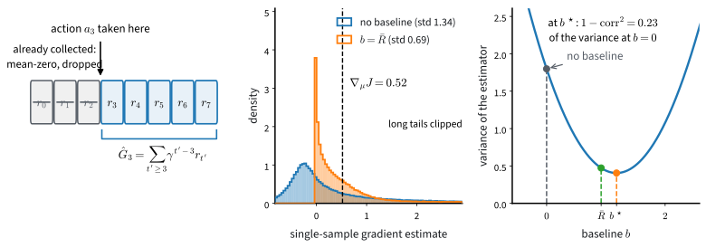

# Variance Reduction for Policy Gradients
:label:`sec_baselines`

The REINFORCE estimator is unbiased but can have high variance. On FrozenLake, unsuccessful trajectories have zero return and contribute no gradient signal, while successful trajectories can produce large updates. This section derives several variance-reduction methods from the zero-mean score identity: reward-to-go, constant baselines, control variates, and state-dependent baselines. It also distinguishes centering, which changes the estimator, from scaling, which changes its effective step size. We compare five estimators against the exact gradient used in :numref:`sec_policygradient`.

```{.python .input #baselines-baselines-advantages-and-variance-reduction-1}
%%tab pytorch
%matplotlib inline
from d2l import torch as d2l
import gymnasium as gym
import numpy as np
import torch
```

```{.python .input #baselines-baselines-advantages-and-variance-reduction-1}
%%tab jax
%matplotlib inline
from d2l import jax as d2l
from flax import nnx
import gymnasium as gym
import jax
from jax import numpy as jnp
import numpy as np
import optax
```

We retain the deterministic FrozenLake environment, complete-episode horizon, discount $\gamma=0.95$, and tabular softmax policy from :numref:`sec_policygradient`. Each update uses four episodes so that differences in estimator variance remain visible. We run twenty seeds to characterize the substantial variation between training runs.

```{.python .input #baselines-baselines-advantages-and-variance-reduction-2}
%%tab pytorch, jax
gamma, alpha, alpha_v = 0.95, 16.0, 0.1  # discount; SGD step; value step
num_updates, batch_episodes = 150, 4   # small batches, to expose variance
num_seeds = 20                         # with 5, the medians below are noise
env = gym.wrappers.TimeLimit(
    gym.make('FrozenLake-v1', is_slippery=False).env, max_episode_steps=10_000)
```

## A Zero-Mean Identity

The following identity underlies each variance-reduction method in this section.

### The Zero-Mean Lemma

**Lemma.** For every state $s$, $\ \sum_{a \in \mathcal{A}} \pi_\theta(a \mid s)\ \nabla_\theta \log \pi_\theta(a \mid s) = 0$.

**Proof.** $\sum_a \pi_\theta(a \mid s) \nabla_\theta \log \pi_\theta(a \mid s) = \sum_a \nabla_\theta\, \pi_\theta(a \mid s) = \nabla_\theta \sum_a \pi_\theta(a \mid s) = \nabla_\theta 1 = 0.$ $\blacksquare$

In words: at any state, the score of the sampled action has zero mean. For our softmax policy the lemma can also be read directly off the verified score formula :eqref:`eq_softmax_score`, which sums to zero over actions by inspection; the proof above is the same cancellation stated for every differentiable policy at once.

### The Conditional Version

The useful consequence is slightly stronger. Suppose $c$ is any quantity that is already determined by the time the agent stands at state $s_t$: a reward collected earlier in the trajectory, a constant, or a function of $s_t$ itself. Conditioned on the trajectory prefix $(s_0, a_0, r_0, \ldots, s_t)$, the value $c$ is fixed while the action $a_t$ is still random, and since the policy consults only $s_t$, the inner expectation is the one the lemma covers:

$$E\big[ c\ \nabla_\theta \log \pi_\theta(a_t \mid s_t) \big] = E\Big[ c\ \underbrace{E\big[ \nabla_\theta \log \pi_\theta(a_t \mid s_t) \mid s_0, a_0, \ldots, s_t \big]}_{=\,0 \textrm{ by the lemma}} \Big] = 0.$$

We can therefore multiply any score in the REINFORCE estimator by such a quantity, or subtract such a quantity from its weight, without moving the average. Every tool in this section is an instance of this observation.

## Variance Reduction from the Zero-Mean Identity

The identity supports four modifications: removing past-reward terms, subtracting a constant, choosing a variance-minimizing constant, and subtracting a state-dependent function. Each preserves the expected gradient under its stated dependence conditions.

### Reward-to-Go and Causality

In the REINFORCE estimator, the score at time $t$ is multiplied by the
return $R(\tau_i)$ of the whole trajectory, including rewards collected
before action $a_t^i$. Those earlier rewards cannot depend on that action.
Their product with the time-$t$ score therefore has zero expectation but
can have nonzero variance. Removing these zero-mean terms from
$\nabla_\theta J(\theta)$ leaves

$$\nabla_\theta J(\theta) = E_{\tau \sim P(\cdot;\, \theta)} \Big[ \sum_{t=0}^{T-1} \nabla_\theta \log \pi_\theta(a_t \mid s_t)\ \sum_{t'=t}^{T-1} \gamma^{t'} r_{t'} \Big].$$

The inner sum equals $\gamma^t \hat{G}_t$ where

$$\hat{G}_t = \sum_{t'=t}^{T-1} \gamma^{t'-t}\, r_{t'}$$

is called the reward-to-go from step $t$. It is the discounted return of the trajectory suffix beginning at $s_t$. Implementations commonly omit the leading factor $\gamma^t$ and weight the score by $\hat{G}_t$ alone. This replaces discounted state occupancy with undiscounted occupancy and can change the gradient direction, not only its magnitude. The resulting update is therefore a per-step surrogate rather than an unbiased estimator of the discounted objective's gradient. We distinguish this surrogate from both the exact discounted estimator and the finite-batch centered estimators introduced below. The surrogate is

$$\hat{u} = \frac{1}{n} \sum_{i=1}^n \sum_{t=0}^{T-1} \hat{G}_t^i\ \nabla_\theta \log \pi_\theta(a_t^i \mid s_t^i).$$
:eqlabel:`eq_rtg`

This removal follows from causality: the action chosen at time $t$ can influence only rewards from time $t$ onward, so earlier rewards have zero expected product with its score.

In code, reward-to-go requires one backward scan over the batch, restarted at each episode boundary. We implement the general scan for later reuse:

```{.python .input #baselines-reward-to-go-and-causality}
%%tab pytorch, jax
@d2l.add_to_class(d2l.Batch)  #@save
def backward_scan(self, x, factor):
    """y_t = x_t + factor * y_{t+1}, restarted at every episode boundary."""
    y = np.zeros_like(x)
    for ep in self.episodes():
        running = 0.0
        for t in reversed(range(ep.start, ep.stop)):
            running = x[t] + factor * running
            y[t] = running
    return y

@d2l.add_to_class(d2l.Batch)  #@save
def reward_to_go(self, gamma):
    """G_t: the discounted return of the rest of its episode, by one scan."""
    return self.backward_scan(self.rew, gamma)
```

The same backward scan will be used for generalized advantage estimation in :numref:`sec_ppo`. There it is applied to the temporal-difference errors of :numref:`sec_actorcritic` with decay $\gamma\lambda$. At $\lambda=1$, the resulting sum telescopes to the reward-to-go.

### Baselines

The second use of the identity is subtraction. Any quantity $b$ that does not depend on the action $a_t$, whether a constant or a function $b(s_t)$ of the current state, can be subtracted from the reward-to-go without biasing the estimator:

$$\hat{u} = \frac{1}{n} \sum_{i=1}^n \sum_{t=0}^{T-1} \big( \hat{G}_t^i - b(s_t^i) \big)\ \nabla_\theta \log \pi_\theta(a_t^i \mid s_t^i).$$
:eqlabel:`eq_pg_baseline`

Such a $b$ is called a baseline. The extra term is $b(s_t)$ times the score, and we showed above that this has zero mean, so :eqref:`eq_pg_baseline` and :eqref:`eq_rtg` estimate the same gradient.

On FrozenLake, every reward-to-go is nonnegative. Without a baseline, sampled actions therefore receive only positive weights, with larger increases on more successful trajectories. Subtracting a value near the typical return gives positive weights to better-than-typical continuations and negative weights to worse-than-typical ones. A baseline may be a constant, an empirical mean return, or an estimate of the value function. The mean return is simple but not generally variance minimizing; the optimal constant is derived below and generalized to a function of the state in exercise :exref:`ex_baselines-optimal-state-baseline`.

### Control Variates

Baseline subtraction is an instance of the control-variate method for Monte Carlo estimation.

Suppose the objective is to estimate $E[X]$, and each sample also contains a correlated quantity $Y$ whose expectation is known. For any scalar $c$, define

$$X_c = X - c\, \big( Y - E[Y] \big).$$
:eqlabel:`eq_control_variate`

Since $E[Y-E[Y]]=0$, the estimator $X_c$ has the same expectation as $X$ for every $c$. Its variance is

$$\mathrm{Var}(X_c) = \mathrm{Var}(X) - 2c\, \mathrm{Cov}(X, Y) + c^2\, \mathrm{Var}(Y),$$

Minimizing this quadratic gives

$$c^* = \frac{\mathrm{Cov}(X, Y)}{\mathrm{Var}(Y)},$$

and substituting $c^*$ back in leaves the variance at $(1 - \mathrm{corr}^2)\, \mathrm{Var}(X)$, where $\mathrm{corr}$ is the correlation between $X$ and $Y$. Strong correlation therefore permits substantial variance reduction: at $\mathrm{corr}=0.9$, the variance falls by a factor of about five, whereas at $\mathrm{corr}=0$ it is unchanged. The quantity $Y$ is called a control variate for $X$.

For a policy gradient, take

$$X = \hat{G}_t\, \nabla_\theta \log \pi_\theta(a_t \mid s_t),$$

and

$$Y = \nabla_\theta \log \pi_\theta(a_t \mid s_t).$$

Here $E[Y\mid s_t]=0$ by the zero-mean lemma, and $X$ is a scalar multiple of $Y$. Setting $c=b(s_t)$ recovers :eqref:`eq_pg_baseline`. Thus a baseline is a control variate constructed from the policy score.

This interpretation explains both unbiasedness and the choice of baseline. Any coefficient preserves the mean of a control-variate estimator, while the variance-minimizing coefficient is the covariance-to-variance ratio $c^*$, computed separately for each state. For a vector-valued score, scalar products replace ordinary products and give the score-weighted optimal baseline derived in exercise :exref:`ex_baselines-optimal-constant-baseline`. The average return is often effective, but it is not generally optimal. :citet:`Greensmith.Bartlett.Baxter.2004` develop this analysis for policy gradients and interpret a value-function critic as a control variate.

![Variance reduction for the one-step problem of :numref:`fig_rl_score_ascent`. The reward is $R(a)=0.4+2e^{-(a-2)^2/2}$ under $\mathcal{N}(0,1)$, with $E[R]=0.92$ and $\nabla_\mu J=0.52$. (a) Rewards preceding an action have zero expected product with its score, leaving only reward-to-go. (b) The standard deviation of a single-sample gradient estimate decreases from $1.34$ without a baseline to $0.69$ after subtracting the mean reward. The distributions are clipped at the 1st and 95th percentiles. (c) Estimator variance as a function of a constant baseline $b$. The optimum $b^\star=c^*=1.18$ leaves $1-\mathrm{corr}^2=0.23$ of the original variance.](../img/mdl-rl-variance-reduction.svg)
:label:`fig_rl_variance_reduction`

### The Advantage and the Learned Baseline

A natural state-dependent baseline is the value function $V^\pi(s)$. Since $A^\pi(s,a)=Q^\pi(s,a)-V^\pi(s)$ has mean zero under the policy, subtracting $V^{\pi_\theta}(s_t)$ from the reward-to-go makes $\hat G_t-V^{\pi_\theta}(s_t)$ a sample estimate of the advantage. It is positive when the sampled continuation performs better than the policy's average continuation from $s_t$, and negative when it performs worse.

We do not know $V^{\pi_\theta}$, but we can estimate it from the same batch of trajectories. Keep a table $\hat{V}(s)$, and after each batch move the estimate at every visited state toward the reward-to-go observed there,

$$\hat{V}(s_t) \leftarrow \hat{V}(s_t) + \alpha_V \big( \hat{G}_t - \hat{V}(s_t) \big),$$
:eqlabel:`eq_value_baseline`

with a step size $\alpha_V$, its subscript keeping it clear of the policy step $\alpha$. This algorithm is REINFORCE with a baseline :cite:`Williams.1992`. Note that $\hat{V}$ is trained here by regression on Monte Carlo returns, meaning reward-to-go values computed from complete sampled trajectories; in :numref:`sec_actorcritic`, bootstrapped targets will also depend on its predictions, producing an actor--critic method.

## Centering, Scaling, and Normalization

Several implementation choices affect either the estimator or its scale. To distinguish them, we reuse the policy frozen after sixteen updates in :numref:`sec_policygradient`, together with the exact gradient from the differentiable linear solve. The same solve also provides the exact value function $V^{\pi_\theta}$ used below.

```{.python .input #baselines-estimator-hygiene}
%%tab pytorch
mdp = d2l.TabularMDP.from_gym(env, gamma)
P, r = torch.as_tensor(mdp.P).float(), torch.as_tensor(mdp.r).float()
torch.manual_seed(3)
probe = d2l.ActorCritic.tabular(16, 4)
rng = np.random.default_rng(3)
env.reset(seed=3)
for _ in range(16):
    b = d2l.rollout(env, probe.act, 16, rng)
    d2l.policy_step(probe, b, np.repeat(b.episode_returns(gamma),
                                        np.diff(b.ep_ends, prepend=0)))
theta = probe.policy.weight.detach().requires_grad_(True)
pi = torch.softmax(theta, -1)
V = torch.linalg.solve(torch.eye(16) - gamma * torch.einsum('sa,sat->st',
                                                            pi, P),
                       (pi * r).sum(-1))
g_exact = torch.autograd.grad(V[0], theta)[0].numpy().ravel()
V_pi = V.detach().numpy()
print(f'J(theta) = {V_pi[0]:.3f}, |grad J| = {np.linalg.norm(g_exact):.3f}')
```

```{.python .input #baselines-estimator-hygiene}
%%tab jax
mdp = d2l.TabularMDP.from_gym(env, gamma)
P, r = jnp.asarray(mdp.P), jnp.asarray(mdp.r)
probe = d2l.ActorCritic.tabular(16, 4, rngs=nnx.Rngs(3))
rng = np.random.default_rng(3)
env.reset(seed=3)
for _ in range(16):
    b = d2l.rollout(env, probe.act, 16, rng)
    d2l.policy_step(probe, b, np.repeat(b.episode_returns(gamma),
                                        np.diff(b.ep_ends, prepend=0)))

def V_fn(theta):
    pi = jax.nn.softmax(theta, -1)
    return jnp.linalg.solve(jnp.eye(16) - gamma * jnp.einsum('sa,sat->st',
                                                             pi, P),
                            (pi * r).sum(-1))

theta = probe.policy.embedding[...]
g_exact = np.asarray(jax.grad(lambda th: V_fn(th)[0])(theta)).ravel()
V_pi = np.asarray(V_fn(theta))
print(f'J(theta) = {V_pi[0]:.3f}, |grad J| = {np.linalg.norm(g_exact):.3f}')
```

The printed $J(\theta) = 0.313$ matches the fixed intermediate policy from the previous section. The exact $\nabla_\theta J$ provides the reference for the measurements below.

### Batch Centering versus Variance Scaling

A practical variant standardizes the reward-to-go values within each batch. Collect every $\hat{G}_t^i$ in the current batch, compute their mean $\mu$ and standard deviation $\sigma$, and use

$$\tilde{G}_t^i = \frac{\hat{G}_t^i - \mu}{\sigma + 10^{-8}}$$
:eqlabel:`eq_pg_normalized`

in place of $\hat{G}_t^i$, where the constant $10^{-8}$ avoids dividing by zero. Subtracting $\mu$ acts as a baseline, with one caveat: $\mu$ is computed from the same batch, so it depends weakly on the sampled actions, and the exact zero-bias argument above holds only up to a correction that vanishes as the batch grows. Dividing by $\sigma + 10^{-8}$ is different in kind: it rescales the update so that its size no longer depends on the scale of the rewards, which reduces sensitivity to changes in reward scale, although it changes the effective step size.

Centering and scaling have different effects. Subtracting $\mu$ changes the relative weights of the samples and can change the direction of the estimate. Dividing by $\sigma+10^{-8}$ multiplies the complete batch estimate by one positive scalar, leaving its direction unchanged. It is therefore a per-batch step-size adjustment rather than a baseline. On FrozenLake, $0\leq\hat{G}_t\leq1$ implies $\sigma\leq1/2$, so normalization increases the step norm by at least a factor of two at a fixed learning rate; the measured factor below is about five. Any performance difference must consequently be interpreted together with the optimizer and effective step size, as in :numref:`sec_sgd` and :numref:`sec_batch_size`.

Two utilities support the remaining experiments: `normalize` implements :eqref:`eq_pg_normalized`, and `run_seeds` executes a seeded training generator and stacks its curves. The experiments compute multi-seed results explicitly before plotting.

```{.python .input #baselines-centering-is-a-baseline-dividing-by-sigma-is-a-step-size-rescaling}
%%tab pytorch, jax
def normalize(x, eps=1e-8):  #@save
    """Center a batch of weights and rescale them to unit spread."""
    return (x - x.mean()) / (x.std() + eps)

def run_seeds(train, num_seeds, **kwargs):  #@save
    """Run train(seed, **kwargs), a generator of curve points, per seed."""
    return np.array([list(train(seed, **kwargs)) for seed in range(num_seeds)])
```

### The Leave-One-Out Baseline
:label:`subsec_leave_one_out`

Leave-one-out centering removes the self-dependence of the batch mean $\mu$. For each trajectory, define a baseline from the *other* trajectories in the batch,

$$b_i = \frac{1}{n-1} \sum_{j \neq i} R(\tau_j),$$

so that $b_i$ is independent of trajectory $i$ conditional on the other
trajectories. The conditional zero-mean identity therefore applies with no
correction term: the estimator is unbiased at every batch size. Moreover,

$$R_i-b_i=\frac{n}{n-1}(R_i-\mu),$$

so leave-one-out centering differs from ordinary batch centering only by
the constant $n/(n-1)$. Plain centering with per-trajectory weights thus
shrinks the mean estimator by $(n-1)/n$. We verify both statements on a
small decision problem that can be enumerated exactly: two states visited
in order, two actions at each state, table-based rewards, and analytic
scores from :eqref:`eq_softmax_score`.

```{.python .input #baselines-leave-one-out}
%%tab pytorch, jax
def leave_one_out(R):
    """b_i = the mean of the other n - 1 returns: n/(n-1) times centering."""
    return (R - R.mean()) * len(R) / (len(R) - 1)

rng = np.random.default_rng(0)
th = rng.standard_normal((2, 2))               # a generic two-state table
pi2 = np.exp(th) / np.exp(th).sum(1, keepdims=True)
r2 = np.array([[0.3, 1.0], [0.6, 0.1]])        # r[s, a]; s0 -> s1 -> done
trajs = [(a0, a1) for a0 in range(2) for a1 in range(2)]
p = np.array([pi2[0, a0] * pi2[1, a1] for a0, a1 in trajs])
R = np.array([r2[0, a0] + r2[1, a1] for a0, a1 in trajs])
S = np.zeros((4, 2, 2))                        # the score of each trajectory
for i, (a0, a1) in enumerate(trajs):
    S[i] = -pi2
    S[i, 0, a0] += 1
    S[i, 1, a1] += 1
g = (p[:, None, None] * R[:, None, None] * S).sum(0)    # exact gradient
u_loo = u_cen = 0.0
for i in range(4):
    for j in range(4):                         # every batch of n = 2
        w, wc = leave_one_out(R[[i, j]]), R[[i, j]] - R[[i, j]].mean()
        u_loo += p[i] * p[j] * (w[0] * S[i] + w[1] * S[j]) / 2
        u_cen += p[i] * p[j] * (wc[0] * S[i] + wc[1] * S[j]) / 2
print(f'E[leave-one-out] equals the exact gradient: {np.allclose(u_loo, g)}')
print(f'E[centered] equals (n-1)/n of it:           {np.allclose(u_cen, g / 2)}')
```

Both identities hold to machine precision. The same estimator is used for language-model post-training under the name RLOO: sample $n$ responses to a prompt and weight each response by its reward minus the mean reward of the other $n-1$ responses :cite:`Ahmadian.Cremer.Galle.ea.2024`.

### Summing over Episodes of Different Lengths
:label:`subsec_pg_loss_divisor`

The normalization of a summed loss determines the resulting estimator. The double sum in :eqref:`eq_rtg` ranges over episodes and steps. Dividing by the number of episodes $n$ gives the estimator in that equation. Dividing by the total number of steps rescales each batch by the reciprocal of its realized mean episode length, which varies across batches and may correlate with performance. Dividing each episode's contribution by its own length can also change the gradient direction because episodes receive different relative weights. Division by a fixed constant changes only the overall scale.

We compare these four choices on a FrozenLake batch whose episode lengths differ:

```{.python .input #baselines-summing-over-episodes-of-different-lengths}
%%tab pytorch, jax
pi_np = np.exp(probe.log_prob_np(np.repeat(np.arange(16), 4),
                                 np.tile(np.arange(4), 16))).reshape(16, 4)
b = d2l.rollout(env, probe.act, 4, np.random.default_rng(6))
G, T = b.reward_to_go(gamma), np.diff(b.ep_ends, prepend=0)
print(f'episode lengths {T}, successes {int(b.rew.sum())}')

def agg(scale):   # sum_t scale_t * G_t * score_t, via eq_softmax_score
    u = np.zeros((16, 4))
    np.add.at(u, b.obs,
              (G * scale)[:, None] * (np.eye(4)[b.act] - pi_np[b.obs]))
    return u.ravel()

grads = {'episodes': agg(np.full(len(b), 1 / len(T))),
         'own length': agg(np.repeat(1 / T, T) / len(T)),
         'total steps': agg(np.full(len(b), 1 / len(b))),
         'a constant': agg(np.full(len(b), 1 / 32))}
for k, u in grads.items():
    cos = u @ grads['episodes'] / (np.linalg.norm(u)
                                   * np.linalg.norm(grads['episodes']))
    print(f'{k:>12}: |grad| = {np.linalg.norm(u):.3f}, '
          f'cos to episodes = {cos:.3f}')
```

Three of the four gradients are exactly parallel, at sizes an order of magnitude apart; the per-own-length variant tilts away from the rest. In order, these are the per-trajectory estimator, the per-response length normalization, the token-level loss, and the fixed-constant normalization of the LLM post-training literature. The choice of divisor differs among language-model objectives: GRPO normalizes each response by its own length, whereas the "Dr. GRPO" modification :cite:`Liu.Chen.Li.ea.2025` uses a constant because only batchwise rescaling preserves the estimator direction. The four-episode example above shows the resulting gradients.

### Normalized Returns and GRPO

Group Relative Policy Optimization (GRPO) :cite:`Shao.Wang.Zhu.ea.2024` samples a *group* of $K$ responses to the same prompt, assigns each response a reward $r_j$, and weights the score function with

$$A_j = \frac{r_j - \mu}{\sigma + 10^{-8}},$$

where $\mu$ and $\sigma$ are the mean and standard deviation within the group. This is :eqref:`eq_pg_normalized`, with a prompt corresponding to a start state and its responses to a batch of trajectories. The group mean provides a prompt-specific baseline without requiring a separate value network, and the group standard deviation normalizes reward scales across prompts. Division by $\sigma$ also changes the effective step size separately for each prompt; it is therefore not merely baseline subtraction. The remaining components of GRPO are discussed in :numref:`sec_ppo` and :numref:`sec_rl_sequences`.

## Empirical Comparison of Gradient Estimators

We next compare the estimators at a fixed policy and during training.

### Five Gradient Estimators
:label:`subsec_five_estimators`

The methods introduced above differ in the quantity multiplying the score at step $t$:

1. **Trajectory return** $R(\tau)$: unbiased :eqref:`eq_reinforce`, and the noisiest.
2. **Reward-to-go** $\hat{G}_t$: removes terms with zero expectation; it is exactly unbiased when the $\gamma^t$ factor is retained. Our implementation omits that factor and therefore uses the per-step surrogate described above.
3. **Constant baseline** $\hat{G}_t - b$: unbiased for every $b$; the best constant is the control-variate optimum $c^*$.
4. **State baseline** $\hat{G}_t - b(s_t)$: unbiased; the natural target for $b$ is $V^{\pi_\theta}$.
5. **Leave-one-out**: exactly unbiased, batch coupling included.
6. **A learned critic** $\hat{V}(s)$: baseline subtraction remains unbiased when the critic only replaces $b(s_t)$; using critic predictions inside bootstrapped targets introduces the approximation studied in :numref:`sec_actorcritic`.
7. **Generalized advantage estimation**: a coefficient $\lambda$ interpolating between reward-to-go and a bootstrapped critic (:numref:`sec_actorcritic`, :numref:`sec_ppo`).

Before training, we hold $\theta$ fixed, draw 200 batches of the training batch size, and compute five per-episode estimators through the score identity, one for each entry of `weightings`: the trajectory return, reward-to-go, reward-to-go centered by its batch mean $\mu$, the normalized weights :eqref:`eq_pg_normalized`, and reward-to-go minus the exact state baseline. Comparison with the exact gradient measures both the estimator mean and its sampling variance. For the state baseline we can afford here what training cannot: the exact $V^{\pi_\theta}$ from the linear solve.

```{.python .input #baselines-five-estimators-1}
%%tab pytorch, jax
def estimate(b, w):
    """One draw of the estimator: weighted scores, averaged over episodes."""
    u = np.zeros((16, 4))
    np.add.at(u, b.obs, w[:, None] * (np.eye(4)[b.act] - pi_np[b.obs]))
    return u.ravel() / len(b.ep_ends)

weightings = {
    'return': lambda b, G: np.repeat(b.episode_returns(gamma),
                                     np.diff(b.ep_ends, prepend=0)),
    'reward-to-go': lambda b, G: G,
    'centered': lambda b, G: G - G.mean(),
    'normalized': lambda b, G: normalize(G),
    'exact baseline': lambda b, G: G - V_pi[b.obs]}
rng, draws = np.random.default_rng(4), {k: [] for k in weightings}
for _ in range(200):
    b = d2l.rollout(env, probe.act, 4, rng)
    G = b.reward_to_go(gamma)
    for k, fn in weightings.items():
        draws[k].append(estimate(b, fn(b, G)))
for k, u in draws.items():
    u = np.stack(u)
    m = u.mean(axis=0)
    cos = m @ g_exact / (np.linalg.norm(m) * np.linalg.norm(g_exact))
    rel = ((u - m) ** 2).sum(axis=1).mean() / (m ** 2).sum()
    print(f'{k:>14}: cos(mean, exact) = {cos:.2f}, '
          f'relative variance = {rel:6.1f}')
```

The cosine column checks whether the sample means align with the exact gradient. Cosine similarity cannot detect magnitude errors or errors parallel to the true gradient, but all five estimators agree within the resolution of these 200 draws. The variance measurements show that centering reduces relative variance by about one third and the exact state baseline nearly halves it. Dividing by $\sigma$ adds little variance reduction beyond centering, consistent with its interpretation as a step-size adjustment. Reward-to-go provides only a small improvement here because FrozenLake has a single terminal reward and therefore few past rewards to remove.

We compare the five variants. They share the same data generator and differ only in the weights passed to `policy_step`. We use plain SGD because Adam would partially normalize parameter-wise scale differences and make the effects studied here harder to interpret. Every run maintains the same value table, although only the learned-baseline variant uses it. At each update we record success rate, parameter-step norm, and policy entropy.

```{.python .input #baselines-five-estimators-2}
%%tab pytorch, jax
def table(ac):
    """The policy's preference table, copied out to numpy."""
    if tab.selected('pytorch'):
        return ac.policy.weight.detach().numpy().copy()
    if tab.selected('jax'):
        return np.asarray(ac.policy.embedding[...])

def entropy(ac):
    """Mean policy entropy over the sixteen states, in nats."""
    logp = ac.log_prob_np(np.repeat(np.arange(16), 4),
                          np.tile(np.arange(4), 16))
    return float(-(np.exp(logp) * logp).sum() / 16)
```

```{.python .input #baselines-five-estimators-3}
%%tab pytorch, jax
def train(seed, variant):
    """Five REINFORCE variants; they differ in one line, the weight."""
    rng, V = np.random.default_rng(seed), np.zeros(16, np.float32)
    if tab.selected('pytorch'):
        torch.manual_seed(seed)
        ac = d2l.ActorCritic.tabular(16, 4)
        ac.opt_pi = torch.optim.SGD(ac.policy.parameters(), lr=alpha)
    if tab.selected('jax'):
        ac = d2l.ActorCritic.tabular(16, 4, rngs=nnx.Rngs(seed))
        ac.opt_pi = nnx.Optimizer(ac.policy, optax.sgd(alpha), wrt=nnx.Param)
    env.reset(seed=seed)
    for _ in range(num_updates):
        batch = d2l.rollout(env, ac.act, batch_episodes, rng)
        G = batch.reward_to_go(gamma)
        w = {'return': np.repeat(batch.episode_returns(gamma),
                                 np.diff(batch.ep_ends, prepend=0)),
             'reward-to-go': G,
             'centered': G - G.mean(),
             'normalized': normalize(G),
             'learned baseline': G - V[batch.obs]}[variant]
        before = table(ac)
        d2l.policy_step(ac, batch, w)
        for s, g in zip(batch.obs, G):     # eq_value_baseline, every arm
            V[s] += alpha_v * (g - V[s])
        yield (float(batch.episode_returns().mean()),
               float(np.linalg.norm(table(ac) - before)), entropy(ac))
```

We run five variants with twenty seeds each; `runs[v]` has shape (seeds, updates, 3):

```{.python .input #baselines-five-estimators-4}
%%tab pytorch, jax
variants = ['return', 'reward-to-go', 'centered', 'normalized',
            'learned baseline']
runs = {v: run_seeds(train, num_seeds, variant=v) for v in variants}
```

The success-rate column, smoothed over a ten-update window, with each band spanning the seed minimum to maximum around the seed median:

```{.python .input #baselines-five-estimators-5}
%%tab pytorch, jax
d2l.plot_curves({v: r[:, :, 0] for v, r in runs.items()}, xlabel='update',
                ylabel='batch success rate', smooth=10)
```

We report performance and parameter-step norms together because both affect the observed ordering:

```{.python .input #baselines-five-estimators-6}
%%tab pytorch, jax
def to90(curve):
    """First update whose trailing 10-update mean success reaches 0.9."""
    hit = np.convolve(curve, np.ones(10) / 10, 'valid') >= 0.9
    return hit.argmax() if hit.any() else len(curve)

for v, r in runs.items():
    reach = np.array([to90(c) for c in r[:, :, 0]])
    print(f'{v:>16}: updates to 90%: median {np.median(reach):5.1f}, '
          f'fastest {reach.min():3d}, slowest {reach.max():3d}')
    print(f'{"":>16}  mean |step| over the first 40 updates: '
          f'{r[:, :40, 1].mean():.2f}')
```

The plain trajectory-return estimator is the slowest in this experiment, with median runs requiring roughly 50--70 updates to maintain 90% batch success. Reward-to-go reduces the median by about one third. The learned baseline performs similarly to reward-to-go, with differences smaller than the variation across seeds. Sparse rewards explain part of this result: the value estimate remains near zero until the policy has reached the goal several times, so the learned-baseline update initially resembles reward-to-go. Centering reduces the frozen-policy variance but has little effect on the median training time.

Normalization reaches 90% success in roughly half as many updates as the plain estimator, but it also produces much larger parameter steps. At the shared learning rate, its steps are about five times larger than those of the centered estimator and about twice as large as those of reward-to-go. Reward-to-go likewise increases the average weight scale relative to the full trajectory return on this environment. Consequently, the training ordering reflects both estimator variance and effective step size. The table reports both quantities, and exercise :exref:`ex_baselines-step-size-confound-quantified` repeats the comparison after matching their scales.

The runs also record policy entropy. Each method starts at the uniform policy's entropy of $\ln 4 \approx 1.39$ nats and decreases toward roughly $0.8$ as the policy becomes more concentrated. Methods with faster initial improvement reduce entropy earlier. The constrained updates in :numref:`sec_ppo` provide explicit control over this change.

```{.python .input #baselines-five-estimators-7}
%%tab pytorch, jax
d2l.plot_curves({v: runs[v][:, :, 2] for v in ('return', 'normalized')},
                xlabel='update', ylabel='policy entropy (nats)',
                reference=np.log(4))
```

### Reading the Comparison across Seeds

The variation across seeds limits the precision with which the methods can be compared.

> **Variation across seeds.** The uncertainty bands are wide. Within one variant, the slowest seed can require more than twice as many updates as the fastest seed to reach 90% success. Comparing selected individual runs could therefore reverse the apparent ordering of the methods. We report medians and ranges over twenty seeds and keep the hyperparameters matched across variants, following the evaluation recommendations in :cite:`Henderson.Islam.Bachman.ea.2018,Agarwal.Schwarzer.Castro.ea.2021,Engstrom.Ilyas.Santurkar.ea.2020`.

The leave-one-out calculation is framework independent. Measurements that use framework objects agree across the two implementations to the reported precision rather than necessarily to every digit. The environment also matters: FrozenLake's terminal-only reward reduces the effect of reward-to-go, and denser rewards or longer horizons could change both the numerical results and parts of the ordering. For this reason, the comparison reports gradient variance and parameter-step norms together.

## Summary

The score function has zero conditional mean. This identity permits the removal of rewards that precede an action and the subtraction of action-independent baselines without changing the expected gradient. Constant control variates and state-dependent value baselines reduce variance, while reward-to-go removes terms that cannot be influenced by the current action. Batch centering introduces a finite-sample shrinkage that leave-one-out centering removes. Dividing by the batch standard deviation instead changes the effective step size and should be evaluated separately from variance reduction. The empirical comparison confirms these distinctions and reports parameter-step norms alongside training performance.

The implementations add `Batch.backward_scan`, `Batch.reward_to_go`, `normalize`, and `run_seeds` to the shared library.

**Experimental scope.** The variance comparison probes one intermediate policy with 200 batches of four episodes. Other policies change the numerical variances; whether they also change the ordering is not tested here. Training results use twenty seeds, and their spreads are often wider than the gaps between methods. FrozenLake's sparse terminal reward limits the benefit of reward-to-go, while plain SGD makes differences in effective step size visible.

## Exercises

1. **Admissible baselines.** The conditional zero-mean identity allows any
   quantity that is already determined when the agent stands at $s_t$ to be
   subtracted from $\hat{G}_t$. For each candidate below, decide whether
   subtracting it in :eqref:`eq_pg_baseline` leaves the expected gradient
   unchanged, and justify the answer with that condition:
    1. the time index $t$;
    1. the sum $r_0 + \cdots + r_{t-1}$ of the rewards collected before
       step $t$;
    1. the number $T - t$ of steps that remain in the episode;
    1. a function of the next state $s_{t+1}$;
    1. an action-value estimate $\hat{Q}(s_t, a_t)$.

   For the last candidate with $\hat{Q} = Q^{\pi_\theta}$, compute the
   expected contribution of step $t$ after the subtraction. What does the
   result say about baselines that depend on the action?
1. **Baselines on stale data.** The zero-mean lemma averages the score under
   the same policy that is being differentiated. Suppose instead that the
   action at state $s$ was drawn from an older policy
   $\pi_{\theta_{\textrm{old}}}$, as happens when a batch is reused for a
   second update, while the score is still
   $\nabla_\theta \log \pi_\theta(a \mid s)$.
    1. Use :eqref:`eq_softmax_score` to compute, for a constant $b$,

       $$E_{a \sim \pi_{\theta_{\textrm{old}}}(\cdot \mid s)}\big[b\, \nabla_\theta \log \pi_\theta(a \mid s)\big].$$

       Which values of $b$ introduce no bias, and how does the bias depend
       on the difference between the two policies?
    1. Show that multiplying each term by the ratio
       $\pi_\theta(a \mid s) / \pi_{\theta_{\textrm{old}}}(a \mid s)$
       restores the zero mean for every $b$. The same ratio drives the
       clipped objective of :numref:`sec_ppo`.
1. [code] **Reward-to-go with dense rewards.** The frozen-policy comparison
   of :numref:`subsec_five_estimators` found that reward-to-go barely
   improves on the trajectory return, since FrozenLake pays a single terminal
   reward. Add a constant $c$ to the reward of every step: set
   `b.rew = b.rew + c` right after the call of `d2l.rollout` that draws each
   of the 200 batches, leave the loop that trains `probe` unchanged, and add
   $c$ to `r` at every nonterminal state before recomputing `g_exact` and
   `V_pi`.
   The holes and the goal (the letters `H` and `G` in `env.unwrapped.desc`)
   are absorbing in `mdp.P`, so their rewards must stay zero. Rerun the
   comparison for $c \in \{0, -0.01, -0.05, -0.2\}$. For which $c$ does
   reward-to-go clearly beat the trajectory return? Which terms of the
   trajectory-return estimator does it remove there?
1. **Optimal constant baseline.** Fix a state $s$, write
   $\boldsymbol{\psi} = \nabla_\theta \log \pi_\theta(a \mid s)$ for the
   score of the sampled action, and consider the single-step estimator
   $(\hat{G} - b)\, \boldsymbol{\psi}$ with a constant $b$. Its mean does not
   depend on $b$, so we measure its noise by the trace of its covariance,

   $$E\big[\|(\hat{G} - b)\, \boldsymbol{\psi}\|^2\big] - \big\|E[\hat{G}\, \boldsymbol{\psi}]\big\|^2.$$

    1. Minimize the trace over $b$ and show that the minimizer is

       $$b^* = \frac{E\big[\|\boldsymbol{\psi}\|^2\, \hat{G}\big]}{E\big[\|\boldsymbol{\psi}\|^2\big]}.$$

       Show that any other $b$ adds exactly
       $E\big[\|\boldsymbol{\psi}\|^2\big]\, (b - b^*)^2$ to the trace, and
       that $b^*$ is the coefficient $c^*$ of :eqref:`eq_control_variate`
       for $X = \hat{G}\, \boldsymbol{\psi}$ and $Y = \boldsymbol{\psi}$,
       with inner products in place of products.
    1. In the one-step problem of :numref:`fig_rl_variance_reduction`, the
       action is $a \sim \mathcal{N}(\mu, 1)$ at $\mu = 0$, so the score
       with respect to $\mu$ is $a$. Compute $b^*$ for
       $R(a) = 0.4 + 2e^{-(a-2)^2/2}$ and confirm the caption's value
       $b^\star = 1.18$. The product of the standard normal density with
       $e^{-(a-2)^2/2}$ is proportional to another normal density. Why does
       $b^*$ exceed $E[R] = 0.92$?
   :exlabel:`ex_baselines-optimal-constant-baseline`
1. [code] **The training loss divisor.** :numref:`subsec_pg_loss_divisor`
   compares four divisors for the summed loss.
    1. Read `policy_step`. Which of the four divisors do the training runs
       of `train` use?
    1. At the policy `probe`, draw 2000 batches of four episodes. For each
       batch, compute the per-episode estimate `estimate(b, G)` with the
       reward-to-go weights `G = b.reward_to_go(gamma)`, the factor by which
       the divisor of `policy_step` rescales it, and the number of successes
       in the batch. How much does the factor vary between batches, and how
       does it correlate with the number of successes?
    1. Average `estimate(b, G)` and the rescaled estimate over the 2000
       batches and compute the cosine between the two means. What does the
       result say about comparing the training runs of `train` with the
       frozen-policy measurements of :numref:`subsec_five_estimators`?
1. [code] **Baseline step size and timing.** ● The learned-baseline arm of
   `train` updates its table $\hat{V}$ by :eqref:`eq_value_baseline` after
   `policy_step`, so the baseline used on each batch was fitted on earlier
   batches only.
    1. Sweep $\alpha_V$ (`alpha_v`) over $\{0.01, 0.1, 0.5, 1\}$ and report
       the median and the range over twenty seeds of the number of updates
       to 90% success. How sensitive is the arm to $\alpha_V$?
    1. Move the value update above the line that computes the weights `w`,
       so that the baseline of each batch has already seen that batch, and
       repeat the sweep. At
       $\alpha_V = 1$, what is the weight $\hat{G}_t - \hat{V}(s_t)$ of the
       last visit to each state in the batch?
    1. Explain both sweeps with the conditional zero-mean identity. Which of
       its conditions does the second ordering violate, and why does the
       damage grow with $\alpha_V$?
1. [code] **Bias of batch centering.** ● :numref:`subsec_leave_one_out`
   obtains the factor $(n-1)/n$ by which per-trajectory batch centering
   shrinks the expected gradient from the leave-one-out identity
   $R_i - b_i = \frac{n}{n-1}(R_i - \mu)$. That argument applies only to
   per-trajectory weights.
    1. Derive the factor directly, without the leave-one-out baseline. Write
       the centered estimate as
       $\frac{1}{n}\sum_{i=1}^n \big(R(\tau_i) - \mu\big)\, \mathbf{S}_i$,
       where $\mathbf{S}_i$ is the summed score of trajectory $i$ and $\mu$
       the mean return of the batch, expand $E[\mu\, \mathbf{S}_i]$ into its
       $n$ terms, and use the independence of the trajectories. Which of the
       terms have a nonzero expectation?
    1. The centered arm of `train` instead subtracts the mean of all
       reward-to-go values in the batch, step by step. Extend the
       enumeration to this weighting. Each trajectory of the two-state
       problem has $\hat{G}_0 = r_0 + r_1$ and $\hat{G}_1 = r_1$, since the
       enumeration uses no discount, and row $s$ of `S[i]` is the score of
       the step taken at state $s$. Compute the expected estimate for
       $n \in \{2, 4, 8\}$ and compare it with `g` through the ratio of the
       norms and the cosine.
    1. Explain the comparison. For each of the two steps, which
       reward-to-go values inside the batch mean have a nonzero expected
       product with the score of that step?
1. **The $\sigma$-normalized objective.** ● GRPO divides the centered
   rewards of each group by their standard deviation $\sigma$, a choice
   that :citet:`Liu.Chen.Li.ea.2025` analyze. Consider a
   prompt $x$ with binary reward, $r = 1$ for a correct response and $r = 0$
   otherwise, on which the current policy succeeds with probability $p_x$.
   Take the group so large that $\mu$ and $\sigma$ equal their population
   values $p_x$ and $\sqrt{p_x (1 - p_x)}$.
    1. Compute $\sigma$ for $p_x = 0.5$ and for $p_x = 0.9$. By what factor
       does the division amplify the update of the second prompt relative to
       the first?
    1. Let $y$ denote the sampled response. Show that

       $$E\big[(r - p_x)\, \nabla_\theta \log \pi_\theta(y \mid x)\big] = \nabla_\theta\, p_x.$$

       Conclude that the $\sigma$-normalized update ascends
       $\sum_x h(p_x)$ for a function $h$ with $h'(p) = 1/\sqrt{p(1-p)}$,
       and find $h$.
    1. Compare $h$ with the objective $\sum_x p_x$ of the unnormalized
       update. Which prompts gain weight relative to it? Is that the
       weighting a practitioner wants when most prompts of a training set
       are either nearly always or nearly never solved?
    1. With a finite group of $K$ responses, a prompt contributes no
       gradient when all $K$ rewards agree. Compute the probability of this
       event for $p_x = 0.9$ and $K = 8$, and explain how it limits the
       amplification of prompts with small $\sigma$.
1. [code] **Variance ordering across policies.** ● The frozen-policy
   comparison of :numref:`subsec_five_estimators` probes one policy,
   `probe` after sixteen updates, at which $J(\theta) = 0.313$. Repeat it
   at the policies reached after $k \in \{0, 8, 32, 64\}$ probe updates:
   change the number of iterations of the loop that trains `probe`, and
   recompute `g_exact`, `V_pi` and `pi_np` before drawing the 200 batches.
    1. Tabulate the relative variance of the five estimators against $k$.
       Does the ordering found at sixteen updates hold at every policy?
    1. How do the two estimators without a baseline behave as $J(\theta)$
       approaches its maximum $\gamma^5 \approx 0.77$, and why?
    1. At $k = 0$, count how many of the 200 batches contain no success, and
       explain what such a batch contributes to each of the five estimators.
1. [code] **The step-size confound.** ● The normalized arm of `train`
   reached 90% success in the fewest updates, but it also took the largest
   steps. On a batch with $\sigma > 0$, the normalized weights
   :eqref:`eq_pg_normalized` produce the SGD update of the centered weights
   at the learning rate $\alpha / (\sigma + 10^{-8})$.
    1. Log $\sigma$ per batch in the normalized arm and plot the median over
       seeds of $1/(\sigma + 10^{-8})$ against the update index, skipping
       batches without a success. How does this multiplier of the learning
       rate change as the policy improves? What does that imply for an
       attempt to equalize the two arms by running the normalized arm at
       the learning rate $\alpha$ divided by the run average of
       $1/(\sigma + 10^{-8})$?
    1. Rerun the centered arm with $\alpha \in \{16, 32, 64, 128\}$ and find
       the value whose mean step norm over the first 40 updates matches that
       of the normalized arm. At matched step norms, which of the two arms
       reaches 90% success sooner?
   :exlabel:`ex_baselines-step-size-confound-quantified`
1. [code] **Optimal state baseline.** ●● Exercise
   :exref:`ex_baselines-optimal-constant-baseline` derived the
   variance-optimal constant baseline at one state. Applied state by state,
   it gives the optimal baseline function of
   :citet:`Greensmith.Bartlett.Baxter.2004`, which minimizes the variance of
   a single step's term. This problem works it out for the tabular softmax
   policy and asks when it is also optimal for the episodic estimate
   `estimate`.
    1. Show from :eqref:`eq_softmax_score` that

       $$\|\nabla_\theta \log \pi_\theta(a \mid s)\|^2 = 1 - 2\pi_\theta(a \mid s) + \sum_{a'} \pi_\theta(a' \mid s)^2.$$

       Use $E[\hat{G}_t \mid s_t = s, a_t = a] = Q^{\pi_\theta}(s, a)$ to
       write the optimal baseline $b^*(s)$ in terms of
       $\pi_\theta(\cdot \mid s)$ and $Q^{\pi_\theta}(s, \cdot)$.
    1. The estimate of one episode sums the weighted scores of all its
       steps. Show that in the tabular parameterization the scores of two
       steps at different states are orthogonal, so that the squared norm of
       the estimate splits into one term per step plus cross terms between
       visits to the same state. Under which condition on the episodes does
       $b^*(s)$ minimize the trace of the covariance of `estimate` exactly?
       Does FrozenLake meet it?
    1. Compute $b^*(s)$ at `probe`, with $Q^{\pi_\theta}$ given by
       `mdp.backup(V_pi)`, and add the weighting `G - b_star[b.obs]` to
       `weightings` in :numref:`subsec_five_estimators`. Compare its
       relative variance with that of the exact baseline, at `probe` and at
       the policy after 64 probe updates.
    1. At which states does $b^*(s)$ differ most from $V^{\pi_\theta}(s)$?
       Explain with the weights
       $\|\nabla_\theta \log \pi_\theta(a \mid s)\|^2$ why a nearly
       deterministic state pulls $b^*(s)$ toward the action values of its
       rarely chosen actions, and relate the gap between the two baselines
       to the excess variance found in
       problem :exref:`ex_baselines-optimal-constant-baseline`a.
   :exlabel:`ex_baselines-optimal-state-baseline`
1. [extended] **Length bias at small scale.** ●● Dividing the loss of each
   episode by its own length changes the direction of the gradient
   (:numref:`subsec_pg_loss_divisor`), and GRPO divides the loss of each
   response by its own length. :citet:`Liu.Chen.Li.ea.2025` argue that this
   favors short correct responses and long incorrect ones. This project
   derives the effect in a toy model and looks for it on FrozenLake.
    1. Take a single prompt with three responses and a softmax over one logit
       per response: one correct response with reward $1$ and length $L_c$,
       and two incorrect responses with reward $0$ and lengths $L_s < L_l$.
       Weight the score of each response by $(r - p)/L$, where $p$ is the
       probability of the correct response and $L$ the length of the
       response. When the two
       incorrect responses are equally likely, compute the expected change of
       the logit difference $z_l - z_s$ after one ascent step of size
       $\alpha$, and compare it with the change under a constant divisor.
    1. On FrozenLake, sample batches of eight episodes and weight every step
       of episode $i$ by its centered return
       $A_i = R(\tau_i) - \frac{1}{8}\sum_{j=1}^8 R(\tau_j)$, divided either
       by the episode's own length $T_i$ or by the constant $10$, where
       $R(\tau_i)$ is the discounted return `b.episode_returns(gamma)`. Since
       `policy_step` averages over all steps of the batch, pass the weight
       $A_i N / (8 T_i)$, or $A_i N / 80$, at every step of episode $i$,
       where $N$ is `len(b)`, the number of steps in the batch. Train twenty
       seeds with each divisor for 200 updates of plain SGD at
       $\alpha = 16$, as in `train`, and record per update the batch success
       rate and the mean length of the failed episodes.
    1. The two divisors learn at different speeds, so compare them at
       matched success rates: group the updates of all seeds into bins of
       success rate of width $0.2$ and plot the mean length of failed
       episodes per bin for both divisors. Does FrozenLake show the predicted
       bias? What does the same mechanism do to the incorrect responses of a
       language model during GRPO training?

[Discussions](https://d2l.discourse.group/)

<!-- slides -->

::: {.slide}
::: {.cover}
[Dive into Deep Learning · §14.6]{.kicker}

Baselines, advantages and variance reduction<br>
**one zero-mean identity · reward-to-go, baselines, control variates · centering is a baseline, dividing by $\sigma$ is a step size · measured against the exact gradient**
:::
:::

::: {.slide title="One Zero-Mean Identity"}
$$\sum_a \pi_\theta(a \mid s)\, \nabla_\theta \log \pi_\theta(a \mid s)
= \nabla_\theta \sum_a \pi_\theta(a \mid s) = \nabla_\theta 1 = 0$$

. . .

Condition on the prefix: anything already determined at $s_t$
has a mean-zero product with the score,

$$E\big[ c\ \nabla_\theta \log \pi_\theta(a_t \mid s_t) \big] = 0.$$

Multiply a score by such a $c$, or subtract it from the weight,
and the expectation is unchanged. Reward-to-go, state baselines, and
leave-one-out baselines are applications of this identity.
:::

::: {.slide title="Reward-to-Go: One Scan"}
Past rewards have zero expected product with the score at $t$, so they can be removed:

$$\hat u = \frac1n \sum_i \sum_t \hat G^i_t\,
  \nabla_\theta \log \pi_\theta(a^i_t \mid s^i_t),
\qquad
\hat G_t = \sum_{t'\ge t} \gamma^{t'-t} r_{t'}.$$

@baselines-reward-to-go-and-causality

. . .

GAE will be this same scan, run on TD errors with factor
$\gamma\lambda$.
:::

::: {.slide title="A Baseline Is a Control Variate"}
To estimate $E[X]$: subtract anything whose mean you know,

$$X_c = X - c\,(Y - E[Y]), \qquad
c^* = \frac{\mathrm{Cov}(X,Y)}{\mathrm{Var}(Y)}
\ \Rightarrow\ \mathrm{Var} = (1-\mathrm{corr}^2)\,\mathrm{Var}(X).$$

At $\mathrm{corr} = 0.9$ the variance falls by a factor of about five.

. . .

Here: $X = \hat G_t \nabla_\theta \log \pi_\theta(a_t \mid s_t)$,
$\ Y = \nabla_\theta \log \pi_\theta(a_t \mid s_t)$, $\ E[Y] = 0$
by the lemma. Choosing $b(s_t)$ **is** choosing $c$; the optimum
is $c^*$, state by state.
:::

::: {.slide title="Effect of a Baseline"}
{width=98%}

. . .

Drop the past; subtract $b = E[R]$ and the std halves
($1.34 \to 0.69$); the parabola's optimum $b^\star$ leaves
$1 - \mathrm{corr}^2 = 0.23$ of the variance.
:::

::: {.slide title="The Advantage, and a Learned Baseline"}
A natural $b(s)$ is the value function, which makes the weight a
sampled advantage (:numref:`sec_valueiter` defined it).

$$\hat V(s_t) \leftarrow \hat V(s_t) + \alpha_V\,(\hat G_t - \hat V(s_t)),
\qquad \textrm{weight} = \hat G_t - \hat V(s_t) \approx A^{\pi_\theta}.$$

This section uses Monte Carlo regression; the next chapter introduces
bootstrapped actor--critic targets.
:::

::: {.slide title="Dependence Conditions Determine Baseline Bias"}
Leave-one-out: $b_i = \frac{1}{n-1}\sum_{j \neq i} R(\tau_j)$,
independent of trajectory $i$: *exactly* unbiased. It is
$\frac{n}{n-1} \times$ centering, and it is RLOO.

. . .

What do you divide the summed loss by?

@!baselines-summing-over-episodes-of-different-lengths

Three pure rescalings, one changed *direction*: the
Dr. GRPO / token-loss debate on a four-episode batch.
:::

::: {.slide title="Normalized Returns Became GRPO"}
$$A_j = \frac{r_j - \mu}{\sigma + 10^{-8}}$$

- prompt $\leftrightarrow$ start state; group of $K$ responses
  $\leftrightarrow$ batch of trajectories
- group mean = a per-prompt baseline without a value network
- dividing by $\sigma$: a per-prompt **step-size rescaling**,
  not a baseline (Dr. GRPO's objection)
:::

::: {.slide title="Five Estimators at a Frozen Theta"}
The policy is held fixed, and its exact gradient provides the reference
against which every estimator is measured.

@!baselines-five-estimators-1

. . .

The matching cosines confirm that baselines preserve the expected gradient.
Centering reduces variance by one third, and the exact state baseline nearly
halves it. Dividing by $\sigma$ gives no further reduction, while reward-to-go
helps little because a terminal-only reward leaves no earlier rewards to omit.
:::

::: {.slide title="Estimator Comparison"}
All variants use the same $\alpha$, plain SGD, matched batches, and
twenty seeds; only the score weights differ.

@!baselines-five-estimators-6

. . .

- Normalization learns fastest here, but its updates are about $5\times$
  those of centering and $2\times$ those of reward-to-go.
- Subtracting $\mu$ gives a baseline. Dividing by $\sigma + 10^{-8}$
  changes the per-batch **step size** rather than the baseline.
- At fixed $\alpha$, performance depends on both variance and update scale.
:::

::: {.slide title="How To Read RL Curves"}
- every band is wide: slowest seed $> 2\times$ the fastest,
  same variant, only the seed changed
- individual seeds can reverse an apparent ordering
- twenty seeds support the broad ordering rather than precise digits;
  report ranges and ratios
- several seeds, matched hyper-parameters, medians, spread
  :cite:`Henderson.Islam.Bachman.ea.2018,Agarwal.Schwarzer.Castro.ea.2021,Engstrom.Ilyas.Santurkar.ea.2020`
:::

::: {.slide title="Recap"}
- One lemma: the score has zero conditional mean; anything
  determined at $s_t$ can weight or offset it, bias-free.
- Reward-to-go, baselines, the optimal $c^*$, the learned
  $\hat V$: four uses of the identity.
- A baseline is a control variate; the factor $(1-\mathrm{corr}^2)$
  quantifies its variance reduction.
- Centering is a baseline; $\div\,\sigma$ is a step size;
  leave-one-out is exact; the loss divisor is a fourth estimator
  choice. GRPO is this section at scale.
- Entropy decreases from $\ln 4$ to about $0.8$ nats without an
  explicit constraint; :numref:`sec_ppo` controls policy change.
:::
